# Atölye kataloğu

40 stil · 6 aile · 10 atölye özgün stili. Bütün örnekler aynı sahneyi çizer (bkz. [sahne/SAHNE.md](sahne/SAHNE.md)). Bu dosya `node atolye/araclar/katalog.mjs` ile üretilir; elle düzenlemeyin.

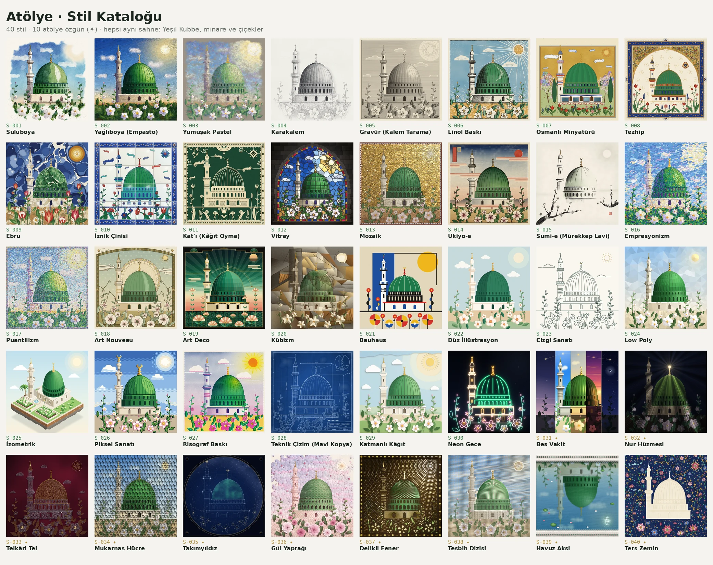

| Kod | Stil | Aile |
| --- | --- | --- |
| [S-001](#s-001) | Suluboya | Boya ve Kuru Teknikler |
| [S-002](#s-002) | Yağlıboya (Empasto) | Boya ve Kuru Teknikler |
| [S-003](#s-003) | Yumuşak Pastel | Boya ve Kuru Teknikler |
| [S-004](#s-004) | Karakalem | Boya ve Kuru Teknikler |
| [S-005](#s-005) | Gravür (Kalem Tarama) | Boya ve Kuru Teknikler |
| [S-006](#s-006) | Linol Baskı | Boya ve Kuru Teknikler |
| [S-007](#s-007) | Osmanlı Minyatürü | Türk-İslam Sanatları |
| [S-008](#s-008) | Tezhip | Türk-İslam Sanatları |
| [S-009](#s-009) | Ebru | Türk-İslam Sanatları |
| [S-010](#s-010) | İznik Çinisi | Türk-İslam Sanatları |
| [S-011](#s-011) | Kat'ı (Kâğıt Oyma) | Türk-İslam Sanatları |
| [S-012](#s-012) | Vitray | Türk-İslam Sanatları |
| [S-013](#s-013) | Mozaik | Türk-İslam Sanatları |
| [S-014](#s-014) | Ukiyo-e | Uzak Doğu |
| [S-015](#s-015) | Sumi-e (Mürekkep Lavi) | Uzak Doğu |
| [S-016](#s-016) | Empresyonizm | Sanat Akımları |
| [S-017](#s-017) | Puantilizm | Sanat Akımları |
| [S-018](#s-018) | Art Nouveau | Sanat Akımları |
| [S-019](#s-019) | Art Deco | Sanat Akımları |
| [S-020](#s-020) | Kübizm | Sanat Akımları |
| [S-021](#s-021) | Bauhaus | Sanat Akımları |
| [S-022](#s-022) | Düz İllüstrasyon | Grafik ve Dijital |
| [S-023](#s-023) | Çizgi Sanatı | Grafik ve Dijital |
| [S-024](#s-024) | Low Poly | Grafik ve Dijital |
| [S-025](#s-025) | İzometrik | Grafik ve Dijital |
| [S-026](#s-026) | Piksel Sanatı | Grafik ve Dijital |
| [S-027](#s-027) | Risograf Baskı | Grafik ve Dijital |
| [S-028](#s-028) | Teknik Çizim (Mavi Kopya) | Grafik ve Dijital |
| [S-029](#s-029) | Katmanlı Kâğıt | Grafik ve Dijital |
| [S-030](#s-030) | Neon Gece | Grafik ve Dijital |
| [S-031](#s-031) | Beş Vakit ✦ | Atölye Özgün |
| [S-032](#s-032) | Nur Hüzmesi ✦ | Atölye Özgün |
| [S-033](#s-033) | Telkâri Tel ✦ | Atölye Özgün |
| [S-034](#s-034) | Mukarnas Hücre ✦ | Atölye Özgün |
| [S-035](#s-035) | Takımyıldız ✦ | Atölye Özgün |
| [S-036](#s-036) | Gül Yaprağı ✦ | Atölye Özgün |
| [S-037](#s-037) | Delikli Fener ✦ | Atölye Özgün |
| [S-038](#s-038) | Tesbih Dizisi ✦ | Atölye Özgün |
| [S-039](#s-039) | Havuz Aksi ✦ | Atölye Özgün |
| [S-040](#s-040) | Ters Zemin ✦ | Atölye Özgün |

✦ atölyenin sıfırdan ürettiği stil

## Boya ve Kuru Teknikler

### S-001

**Suluboya** · *Watercolor*

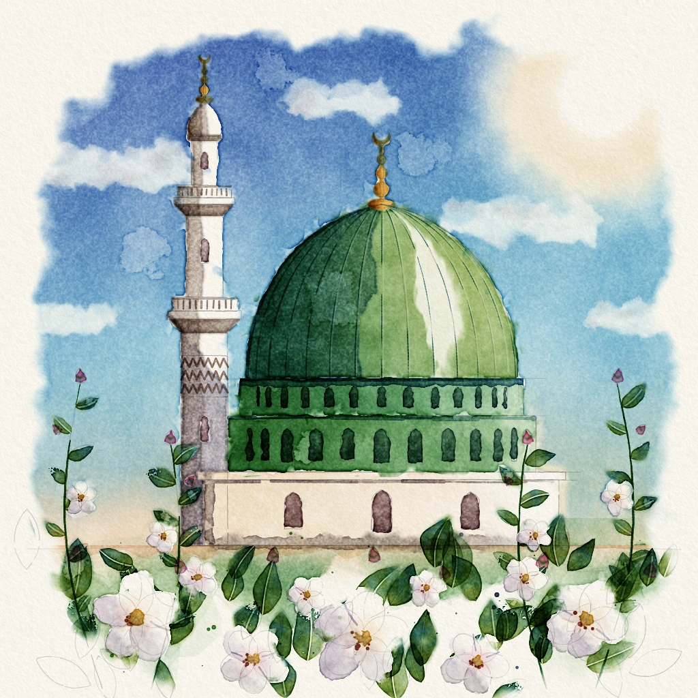

Suluboya, suyla inceltilmiş saydam pigmentlerin kâğıda katman katman sürülmesiyle yapılır; renkler üst üste bindikçe koyulaşır, beyaz boya yerine kâğıdın kendisi ışık olarak bırakılır. Islak kâğıtta renkler yumuşakça birbirine akar, kuruyan yıkamalar ise kenarlarında koyu, keskin bir iz bırakır. Manzara, mimari eskiz, seyahat defteri ve botanik resimde çok kullanılır.

- **Köken:** Kökleri Doğu Asya mürekkep resmine ve Orta Çağ el yazması süslemesine uzanır; Avrupa'da Albrecht Dürer'in doğa çalışmalarıyla belirginleşir. 18. ve 19. yüzyıl İngiliz okulu (Thomas Girtin, J. M. W. Turner, John Sell Cotman) tekniği bağımsız bir sanat dalına dönüştürdü; John Singer Sargent ve Winslow Homer gevşek, ışıklı suluboyanın ustaları oldu.
- **Ayırt edici:** Üst üste binen saydam yıkamalar: kubbenin gölgeli yanında ikinci kat sır koyulaşıp keskin, koyu bir kenarla kurumuş; Gökte, kubbede ve yaprak kütlesinde ıslak üstüne ıslak açılmalar; karnabahar gibi saçaklı, koyu kenarlı lekeler; Kaybolan ve bulunan kenarlar: boya kalem çizgisinin kimi yerde dışına taşıyor, kimi yerde geride kalıp beyaz bir pay bırakıyor; yapının ışıklı sağ ucu kâğıda eriyor; Yapraklar tek fırça darbesi ya da ortasında beyaz damar kalan iki yarım darbe; kimi ucunda ıslakta dağılmış, kimi kuru fırçayla kırılmış; Kâğıdın beyazı ışık olarak bırakılmış: güneş, kubbedeki parlak şerit, minarenin ışıklı yanı ve yalnız gölge yanına soluk bir darbe vurulmuş beyaz çiçekler; Pigment çökelmesi (granülasyon), soğuk preslenmiş kâğıt dokusu, yer yer görünen kurşun kalem altlığı ve kenarlara doğru bitmemiş bırakılmış düzensiz sınır
- **Palet:** `#5C7CB7` `#9FB571` `#35694C` `#A99E9C` `#C2862F` `#AD657A` `#F7F4EC`
- **Kodla çizim:** Her yıkama piksel başına bir kapsama alanıdır: bölge haritasından alınan maske bulanıklaştırılıp gürültüyle değişen bir eşik ve yumuşaklıkla kesilir (boya kalem çizgisinin dışına taşar ya da geride kalır; kenar yer yer sert, yer yer kâğıda erir) ya da Tyler Hobbs usulü yinelemeli bozulmuş çokgenler düşük saydamlıkta onlarca kat doldurulur. Alanın bulanık kopyasından farkıyla kuruyan kenardaki pigment birikimi, kâğıt yüksekliği ve ince gürültüden granülasyon, Hobbs damlalarıyla karnabahar açılmaları hesaplanır. Yapraklar baskısı değişen fırça darbesi çokgenleridir (tek ya da arada beyaz damar kalan iki yarım), ucu ya da bir yanı bulanık kopyayla karıştırılarak eritilir, kimi kâğıt dokusuyla eşiklenip kuru fırça gibi kırılır; taç yapraklar bozulmuş serbest biçimlerdir ve yalnız ışıktan uzak yanlarına soluk gölge darbesi vurulur. Pencereler tek darbelik bozuk kemer lekeleridir. Yoğunluk yedi pigmentin (yaprak yeşili, viridyen, ultramarin, seruleum, ham siena, kinakridon gül, gamboj) soğurma vektörüyle çarpılarak biriktirilir ve renk = kâğıt × exp(−Σ yoğunluk) ile çarpımsal karışır. Kaburgaların ışıklı yanı nemli fırçayla boya kaldırır gibi açılır; kurşun kalem ayrı bir tuvalde titrek, kesik çizgilerle çizilir; kâğıt dokusu en sonda kabartma ışığıyla eklenir.
- **Kaynak:** [`S-001-suluboya/ornek.html`](stiller/S-001-suluboya/ornek.html)

### S-002

**Yağlıboya (Empasto)** · *Oil Painting (Impasto)*

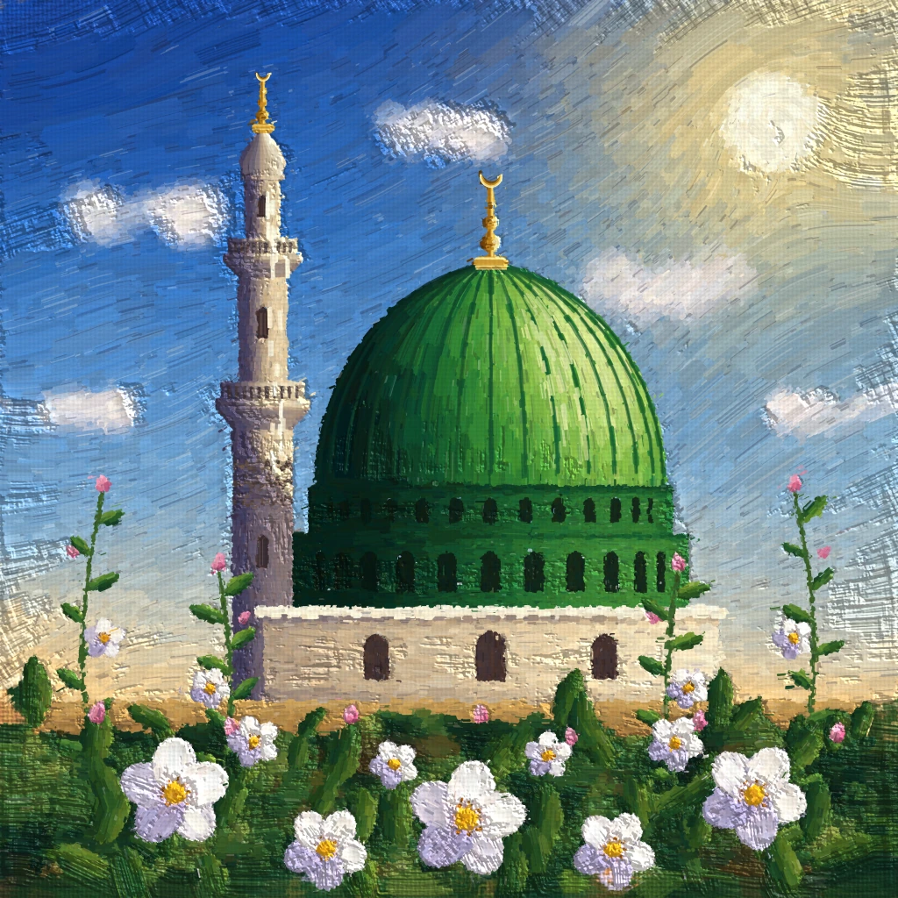

Empasto, yağlıboyanın tüpten çıktığı kıvamda ya da daha kalın sürülerek fırça ve spatula izlerinin yüzeyde kabartı olarak kaldığı tekniktir. Darbeler biçimi izler, boya sırtları ışığı yakalar; renk doygun, ışık-gölge (chiaroscuro) güçlüdür. Boyanın ince sürüldüğü yerlerde tuval bezinin dokusu ve alttaki astar seçilir.

- **Köken:** Yağlıboya 15. yüzyılda Flaman ressamlarınca (Jan van Eyck) olgunlaştırıldı; kalın boya sürme Tiziano'nun geç dönemi ve Rembrandt'ın ışıklı empastolarıyla öne çıktı. 19. yüzyılda Van Gogh hareketli, kalın darbeleri bir anlatım aracına dönüştürdü; 20. yüzyılda Frank Auerbach ve Leon Kossoff boyanın maddesini resmin konusu hâline getirdi.
- **Ayırt edici:** Biçimi izleyen darbeler: kubbede kaburgalar boyunca, kasnakta yatay, minarede silindir boyunca dikey, gökte geniş ve eğik süpürmeler; Her darbede kıl izleri: rengi hafifçe değişen paralel çizgiler ve fırçada tam karışmamış ikinci renk; Sağ üstten ışık alan kabartmalı boya sırtları, darbe sonlarında yığılan boya; Kubbenin koyu yeşil gölgesinden sarı-yeşil ışığına uzanan güçlü ışık-gölge; Çiçeklerde, minarenin ışıklı yanında ve güneşte çapraz atılmış kalın beyaz empasto vuruşları; Kenarlara doğru ince sürülmüş boyanın arasından görünen sıcak astar ve tuval bezi dokusu
- **Palet:** `#154394` `#518CCB` `#C0D683` `#2B6B30` `#07251F` `#E8D6B1` `#F5EFD4` `#3F622B`
- **Kodla çizim:** Işık modeliyle (kubbe için dönel yüzey normali, kasnak ve minare için silindir) doygun renkli bir hedef tablo kurulur. Hertzmann usulü beş katta (fırça yarıçapı 18 → 1,4) boyanır: her katta tuval ile hedef arasındaki fark pencere ortalamasıyla ölçülür; fark büyük yerden başlayan darbe bölgeye özgü bir yön alanında (kaburga meridyeni, yatay, eğik süpürme, yaprak ekseni) ilerler ve renk sapınca durur. Darbe 3–26 kıllık bir demettir; aynı Path2D'ler ayrı bir yükseklik tuvaline toplamalı çizilir. Minare gövdesi silindir ışığına göre renklenen uzun dikey kıl demetleriyle, kaburgalar, şerefeler, zikzak bant ve alemler küçük fırçayla ayrıca işlenir. Yükseklik yumuşatılıp yüksek geçiren süzgeçten geçirilir, ince boyalı yerlere düz dokuma bez dokusu eklenir ve normal haritasıyla sağ üstten yayınık ve parlak ışık verilir.
- **Kaynak:** [`S-002-yagliboya/ornek.html`](stiller/S-002-yagliboya/ornek.html)

### S-003

**Yumuşak Pastel** · *Soft Pastel*

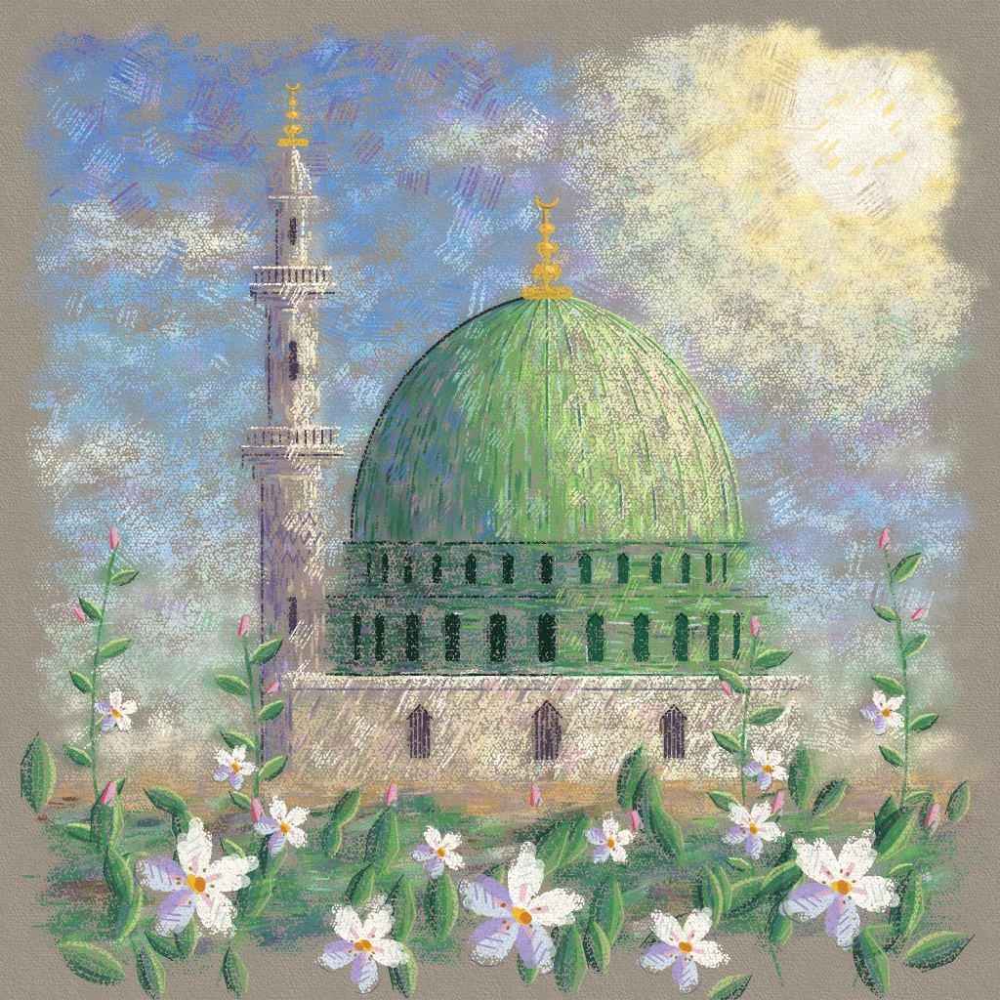

Yumuşak pastel, az bağlayıcıyla sıkıştırılmış saf pigment çubuklarıdır; pürüzlü kâğıda sürtülünce pigment yalnız dişin tepelerine tutunur ve vuruşlar tozlu, kırık görünür. Çubuğun yan yüzüyle geniş alanlar, ucuyla tarama çizgileri yapılır; parmakla dağıtılan yerler yumuşak geçişler verir, üstüne gelen keskin vuruşlar onlarla karşıtlık kurar. Tonlu kâğıdın rengi vuruşların arasından görünerek resmin bir parçası olur.

- **Köken:** 18. yüzyılda Rosalba Carriera ve Maurice Quentin de La Tour'un portreleriyle saygınlık kazandı; Jean-Siméon Chardin de ustalarındandır. 19. yüzyılda Edgar Degas katmanlı, taramalı pastelleriyle tekniği yeniden tanımladı; Mary Cassatt ve Odilon Redon onu izledi.
- **Ayırt edici:** Sıcak gri, petek dokulu tonlu kâğıt her yerde işin parçası: renk yalnız dişin tepelerinde kalıyor, vuruşların arasından ve boş bırakılmış kenarlardan kâğıt görünüyor; Çubuğun yan yüzüyle geniş, düz uçlu vuruşlar (gök, kasnak, zemin) ve uçla atılmış paralel tarama öbekleri (gökte, kubbede ve kaidede çapraz); Gökte ve güneş halesinde parmakla dağıtılmış yumuşak, puslu geçişler; hemen yanlarında dağıtılmamış keskin vuruşlar; Yapraklar boyunca uzanan, araları açık paralel çizgiler; taç yapraklar göbekten dışa basınçlı beyaz vuruşlar, gölge yanında lavanta tarama; Pastel kalemle atılmış birkaç keskin çizgi: kubbenin gölgeli silueti, pencereler, yaprak ve taç yaprak kenarları; Tozlu, açık değerli, tebeşirimsi renkler; yağlıboyanın parlaklığı ve kabartması yok
- **Palet:** `#9D9487` `#88ADCF` `#D0DCA0` `#4C7671` `#F2EAD9` `#AD9FC8` `#E1B13C` `#498956`
- **Kodla çizim:** Kâğıt dişi, titreşimli altıgen petek ile çok ölçekli gürültüden kurulan 2048 piksellik bir yükseklik haritasıdır. Her katta vuruşlar ayrı bir tuvale basınç (saydamlık) olarak çizilir; pigment yalnız 'diş yüksekliği > 1 − basınç' olan piksellere yumuşak bir eşikle bırakılır, basınç düşük tutulduğu için kâğıt vuruşların içinden ve arasından görünür. Renkler ışık modelli, açık değerli bir hedeften okunur, tebeşir beyazıyla biraz açılır ve kırk kadar çubuktan oluşan sınırlı bir kutuya yuvarlanır (bazen ikinci en yakın çubuk: kırık renk). Sırayla yan yüzle seyrek alt kat, gökte gürültü maskeli parmakla dağıtma (bulanıklaştırma), orta vuruşlar, güneş halesi, uçla tarama öbekleri, pastel kalem ayrıntıları, zeminde yatay yan vuruşlar, paralel çizgilerle yapraklar ve basınçlı vuruşlarla çiçekler, en üstte yapılarda çapraz tarama öbekleri gelir; en sonda kâğıt dişinin kabartma ışığı eklenir (vuruş kabartması yoktur).
- **Kaynak:** [`S-003-pastel/ornek.html`](stiller/S-003-pastel/ornek.html)

### S-004

**Karakalem** · *Graphite Pencil Drawing*

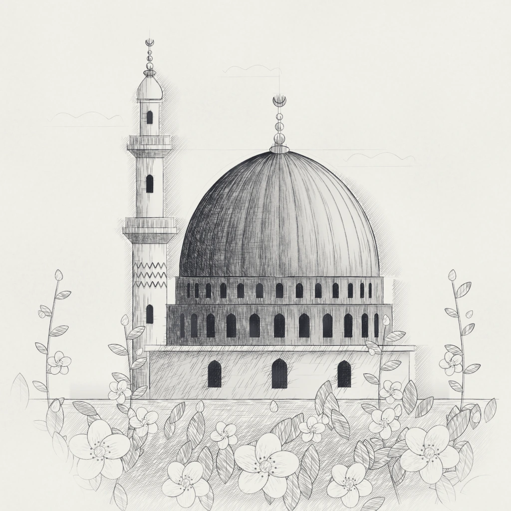

Karakalem, grafit kurşun kalemle yalnız gri tonlarla yapılan çizimdir. Ton, kalemin baskısıyla ve biçimin üzerinde dolaşan paralel ya da çapraz taramayla kurulur; yer yer parmakla ya da kâğıt kalemle (estompe) yayılarak yumuşatılır. Kurgu çizgileri, tekrar eden konturlar ve kenarlara doğru yarım bırakılan alanlar çizime canlılık verir. Eskiz defterlerinde, mimari ve akademik çizimde, resim hazırlıklarında kullanılır.

- **Köken:** Grafit, 16. yüzyılda İngiltere'de Borrowdale'de bulunan saf yataklarla çizime girdi; 1795'te Nicolas-Jacques Conté'nin grafiti kille karıştırıp pişirerek yaptığı kalem, bugünkü sertlik derecelerini (H–B) mümkün kıldı. Jean-Auguste-Dominique Ingres'in kurşun kalem portreleri ve Adolph Menzel'in eskizleri tekniğin ustalık örnekleridir; akademik resim eğitiminde bugün de temel derstir.
- **Ayırt edici:** Kubbede kaburgalar boyunca uzanan tarama; gölge yanında enlem yaylarını izleyen çapraz tarama; İki üç kez, hafifçe kayarak ve baskısı değişerek çizilmiş konturlar; gölge yanında daha kalın çizgi; Kubbe ve minare eksenlerini, kat hizalarını ve kubbenin oranını gösteren açık kurgu çizgileri; Parmakla yayılmış yumuşak gri lekeler; ışıklı kenarlara yaslanıp dışa doğru düzgünce sönen derli toplu hale taraması; Grafitin kâğıt dişinde kırılan tanesi; koyu pencerelerde ve gölgelerde hafif metalik parlaklık; Kenarlara doğru gölgesi silinip yalnız çizgisi kalan, yarım bırakılmış çiçek ve yapraklar
- **Palet:** `#F1EFE9` `#E4E2DD` `#D1D0CC` `#8F8F8F` `#5D5E62` `#49494D` `#2A2B31`
- **Kodla çizim:** Canvas 2048 px iç çözünürlükte; çizim önce ayrı bir grafit yoğunluğu katmanına yapılır. Bölge haritası ve kubbe profilinden bir ton haritası çıkarılır (kubbede hafif dışbükey dilimlerle Lambert ışığı, kasnak ve minarede silindir gölgesi). Her öğenin kılavuz çizgileri (kubbede meridyenler ve ∩ biçimli enlem yayları, kasnakta dikey, kaidede eğik, yapraklarda damar yönünde) 14–64 px'lik, uçları degradeyle incelen kalem vuruşlarına bölünür; vuruşun çizilip çizilmeyeceği ve koyuluğu tona göre, eşikleri farklı üç dört katmanla belirlenir. Gökte ve öndeki zeminde tarama, her kılavuz çizgisinde tonun eşiği aştığı kesimi tek (uzunsa birkaç ardışık) vuruşla çizer; baskı tona göre degradeyle azaldığından siluete yaslanan, dışa doğru sönen derli toplu bir hale oluşur. Konturlar düşük frekanslı titreşimle kaydırılan iki üç geçişte, parça parça değişen baskıyla çizilir. Öndeki öğe arkadakinin izini 'destination-out' ile siler, ton haritasından bulanıklaştırılmış lekeler yayma gölgesini verir, gürültülü elips bir maske çizimi kenarlarda söndürür. Son adımda piksel piksel iki ölçekli kâğıt dişiyle birleşir: grafit önce dişin tepelerine tutunur, baskı arttıkça çukurlar dolar; en koyu yerlere soğuk bir parlaklık eklenir.
- **Kaynak:** [`S-004-karakalem/ornek.html`](stiller/S-004-karakalem/ornek.html)

### S-005

**Gravür (Kalem Tarama)** · *Engraving (Pen & Ink Hatching)*

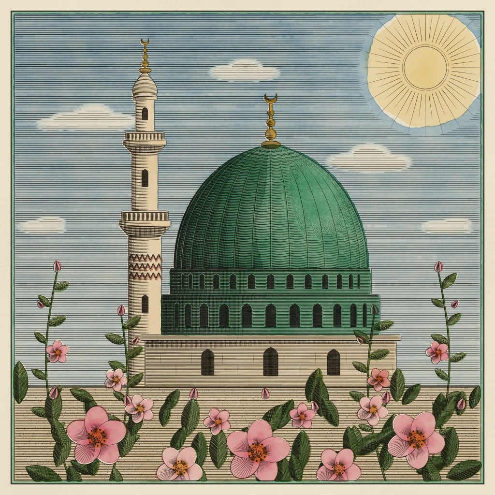

Gravür (kalem tarama), bakır ya da çelik levhaya kalemle (burin) kazınan çizgilerin mürekkeplenip basılmasıyla oluşan resim dilidir. Gri ton yoktur: ton, biçimi izleyen paralel çizgilerin kalınlığı ve aralığıyla, koyu yerlerde çapraz taramayla, geçişlerde noktalamayla kurulur. Çizgiler kontrollü ve keskindir, uçları iğne gibi incelerek biter. Eski kitap resimlerinde, haritalarda, banknot ve pullarda, senet ve sertifikalarda kullanılır.

- **Köken:** 15. yüzyılda kuyumcu atölyelerinden doğan bakır gravür, Martin Schongauer ve Albrecht Dürer ile olgunlaştı; 17. yüzyılda Claude Mellan tonu tek bir şişip incelen çizgiyle kurmayı ustalığa vardırdı. 19. yüzyılda çelik gravür kitap resminin, 20. yüzyılda Czesław Słania gibi ustaların elinde pul ve banknot gravürünün dili oldu.
- **Ayırt edici:** Kalınlığı tona göre şişip incelen, uçları iğne gibi biten paralel çizgiler; Kubbede dilimler arasında kabaran ∩ biçimli enlem çizgileri; gölge yanında meridyenlerle çapraz tarama; Gökte güneşe yaklaştıkça incelip kaybolan yatay çizgiler, ince ışınlı güneş ve çizgilerin seyrelmesiyle beliren bulutlar; Kasnakta, kaidede ve minarede silindiri izleyen yatay çizgiler; pencerelerde sık çapraz tarama; Kubbenin parıltısında çizgilerin kısa vuruşlara, sonra küçülen noktalara dönüşmesi; zeminde ve çiçek ortalarında noktalama; Krem kâğıt üzerinde ince çift çizgili çerçeve
- **Palet:** `#F1E7CF` `#E7DDC6` `#C3BAA7` `#5E584E` `#17130F`
- **Kodla çizim:** Canvas 2048 px. Her öğe için biçimi izleyen kılavuz çizgi aileleri kurulur: gökte yatay, kubbede kaburga dilimleri arasında hafifçe kabaran ∩ biçimli enlem yayları ve meridyenler, kasnak, kaide ve minarede yatay silindir çizgileri, yapraklarda damar yönünde eğik çizgiler, taç yapraklarda merkezden yayılan çizgiler. Ton kubbe profilinden Lambert ışığıyla, silindirlerde yüzey açısına göre, gökte güneşe uzaklık ve bulut maskesiyle hesaplanır. Her çizgi 1,4 px aralıklarla örneklenir; genişliği tona göre 0,5 px'den aralığın yaklaşık %85'ine kadar şişer, eşiğin altında kesilir, uçları iğne gibi incelir. Şeritler tek bir Path2D'de dolgu olarak çizilir; rasterleştiricinin kalınlık basamakları kontur gibi görünmesin diye her çizgi piksel altı kaydırılır. Çapraz tarama ikinci ve üçüncü ailelerle yalnız koyu yerlerde yapılır. Kubbenin parıltısına yaklaşan enlem çizgileri önce incelir, sonra kesik kısa vuruşlara bölünür, en sonunda aynı yolun üzerinde dizilen, küçülüp seyrelerek kaybolan noktalara döner; zemin ve çiçek ortaları serbest noktalamayla kurulur; öndeki öğe arkadakini kâğıt rengiyle örter. Sonda piksel piksel kâğıt dokusu, levha izi ve mürekkebin hafif dağılması eklenir.
- **Kaynak:** [`S-005-gravur/ornek.html`](stiller/S-005-gravur/ornek.html)

### S-006

**Linol Baskı** · *Linocut Print*

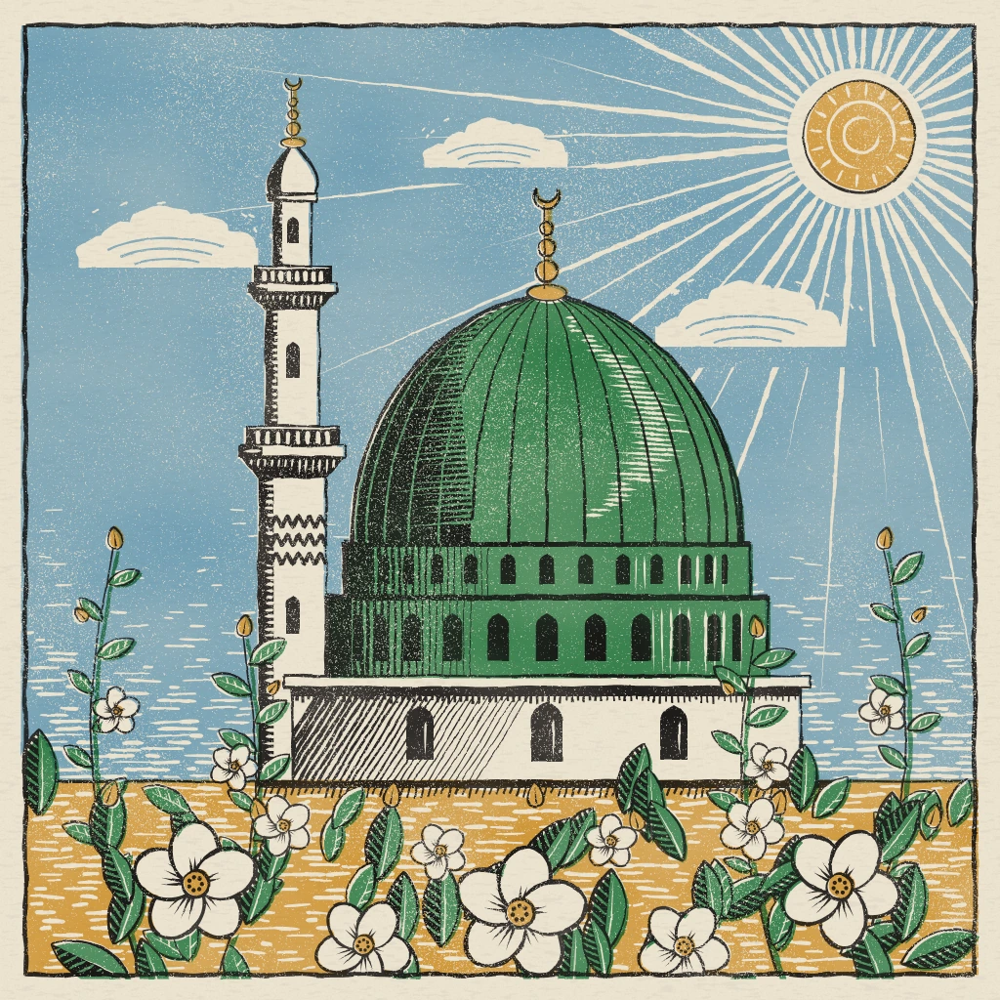

Linol baskı, linolyum levhaya V ve U oyma kalemleriyle oyulan resmin mürekkeplenip kâğıda bastırılmasıyla yapılan bir yüksek baskı tekniğidir. Oyulan yerler kâğıt rengi kalır, kalan yüzey düz ve opak bir renk basar. Renkli baskıda her renk ayrı kalıpla ya da aynı kalıbın her renkten sonra biraz daha oyulduğu eksiltme yöntemiyle basılır. Kalın, sadeleşmiş biçimler, oyma izlerinin ritmi, benekli mürekkep ve renkler arasındaki hafif kayma tekniğin imzasıdır; afiş, kitap kapağı ve sanat baskılarında kullanılır.

- **Köken:** Linolyum 1860'larda döşeme malzemesi olarak icat edildi; 20. yüzyıl başında Alman dışavurumcuları ve Rus avangardı onu baskı kalıbı olarak benimsedi. 1920–30'larda Londra'da Claude Flight ve Grosvenor okulu renkli linolü yaygınlaştırdı, Meksika'da Taller de Gráfica Popular onu afiş ve toplumsal baskının aracı yaptı; Pablo Picasso 1950'lerin sonunda tek kalıpla eksiltme yöntemini ünlü kıldı.
- **Ayırt edici:** Mavi, okra ve yeşil düz renk kalıplarının üzerine basılmış kalın siyah ana kalıp; Güneşten yayılan oyulmuş ışınlar ve ufka doğru sıklaşan yatay U oyukları; Kubbenin gölge yanındaki siyah kütleye enlem boyunca açılmış, incelerek biten kavisli V oyukları; sınırda ışığa doğru sivrilen, oyulmadan kalmış siyah dişler; ışıklı yanda yeşilden oyulmuş parıltı izleri; Yapraklarda oyulmuş damarlar; çiçek, tomurcuk ve minarede kalın siyah konturlar; Lekeli, benekli mürekkep ve yer yer görünen kâğıt; renk katmanları ile siyah arasında hafif kayma; El oyması titrek kenarlar, düzensiz bulutlar ve baskı alanını çevreleyen kalıp kenarı
- **Palet:** `#F0E7D4` `#70A8CC` `#DAA03A` `#2E844E` `#353D33` `#1E1C1B`
- **Kodla çizim:** Her renk (mavi, okra, yeşil, siyah) 2048 px'lik ayrı bir kalıp tuvalidir. Biçimler Path2D ile doldurulur; oyma izleri V ya da U profilli, titreyen şeritler olarak 'destination-out' ile kalıptan oyulur: gökte güneşten çıkan ışınlar ve ufka doğru sıklaşan oyuklar, kubbenin gölge kütlesinde enlem yayları (sınırda oyulmadan bırakılan dişlerle), gölgede yeşil, ışıkta siyah kaburgalar, ışıklı yanda parıltı izleri, yapraklarda damarlar. Öndeki biçim arkadakileri bütün kalıplarda boşaltır. Baskı adımında her kalıp 2–3 px kaydırılarak ve gürültüyle titretilmiş koordinatlardan okunur (el oyması kenar); kaplama geniş lekelenme ve yatay merdane iziyle değişir; kâğıt gözeneklerinde mürekkebin tutmadığı benekler, merdanenin az mürekkep bıraktığı geniş bölgelerde ve kalıp kenarına doğru yoğunlaşır, oralarda kümelenen küçük boşluklar da açılır. Renkler sırayla yarı saydam (çarpma ve örtme karışımı) basılır; siyah en son ve en örtücü katmandır. Kâğıt lif ve gözenek gürültüsüyle dokulanır.
- **Kaynak:** [`S-006-linol/ornek.html`](stiller/S-006-linol/ornek.html)

## Türk-İslam Sanatları

### S-007

**Osmanlı Minyatürü** · *Ottoman Miniature*

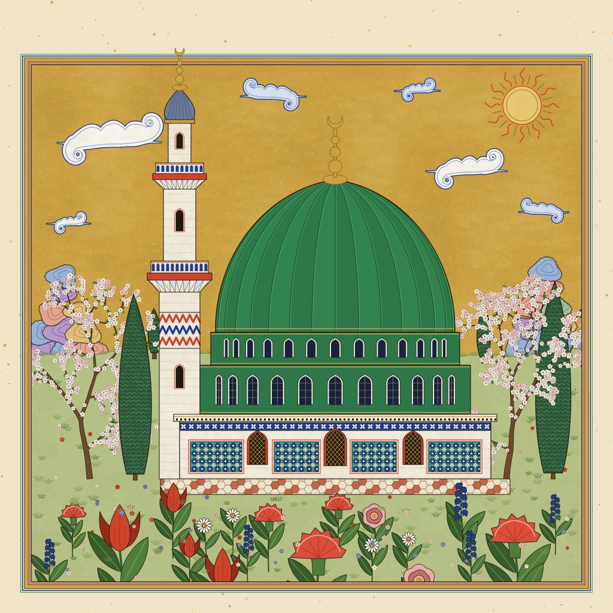

Osmanlı minyatürü, el yazması kitapları ve murakkaları süsleyen küçük ölçekli resim sanatıdır. Örtücü maden boyaları ve altınla, gölge ve doğrusal perspektif kullanılmadan, ince mürekkep konturlarla çalışılır; zemin yukarıdan görülür gibi yükseltilmiş düz bir düzlemdir. Mimari, bahçe ve gök süslemeci bir düzenle, cetvellerle çevrili bir çerçeve içinde verilir.

- **Köken:** Saray nakkaşhanesinde 15.–18. yüzyıllarda gelişti; Matrakçı Nasuh'un menzil (şehir) resimleri, Nakkaş Osman'ın Hünername ve Surname-i Hümayun minyatürleri, 18. yüzyılda Levni bu geleneğin önde gelen örnekleridir. Altın gök ve çin bulutu İran-Timurlu mirasıdır; servi ve çiçek açmış ağaçlar bahar ve cennet bahçesini simgeler.
- **Ayırt edici:** Zerreli ezme altın gök ve lacivert konturlu, uçları helezonla kıvrılan çin bulutları; Gölgesiz, düz malakit yeşili kubbe; ince koyu mürekkep konturlar ve dilim çizgileri; Yükseltilmiş düz yeşil zemin düzlemi; ufukta sırtın ardından yükselen pastel renkli, loblu süngerimsi kaya yığınları, servi ve çiçek açmış meyve ağaçları; Kaide ve minarede yıldızlı çini panolar, lacivert friz, zikzak bant ve altın şebekeli pencereler; Önde lale, karanfil, gül, sümbül ve papatyadan düz boyalı bahçe; çimene serpiştirilmiş küçük çiçekler; Altın ve renkli cetvellerle çevrili resim, zerefşanlı kenar suyu; minarenin alemi çerçeveyi taşar
- **Palet:** `#CFA445` `#1E3C8E` `#D4432B` `#2F8650` `#F5EFE0` `#B9C689` `#29563A` `#21170E`
- **Kodla çizim:** Canvas 2D, 2048 iç çözünürlük. Bütün biçimler SAHNE geometrisinden (kubbe profili, kaburgalar, kasnak pencereleri, minare parçaları, alemler) düz dolgu ve ince mürekkep konturla çizilir; gölge ve degrade yoktur. Çin bulutları hafif S çizen, uçlarında eğriliği artan (klotoid) bir omurga boyunca iki kenarı loblu şerit poligonlarıyla; süngerimsi kayalar tepeye daralan bir zarf içinde sıra sıra dizilen loblu kapalı eğrilerle (öndeki sıra arkadakini örter); çiçekli ağaçlar tohumlu özyinelemeli dallanmayla, servi yaprakları sıra sıra küçük kavislerle, çini panolar sekiz köşeli yıldız-haç örgüsüyle üretilir. Altın gök ve boya yüzeyi için piksel düzeyinde değer gürültüsü, kenar suyunda tohumlu zerefşan pulları kullanılır. Ön bahçedeki çiçeklerin taçları çerçeveye kesilmeyecek bir kuşağa toplanır, sapları çerçeveye iner. Minarenin üst kısmı cetvellerden sonra yeniden çizilerek çerçeveyi taşar.
- **Kaynak:** [`S-007-minyatur/ornek.html`](stiller/S-007-minyatur/ornek.html)

### S-008

**Tezhip** · *Ottoman Illumination*

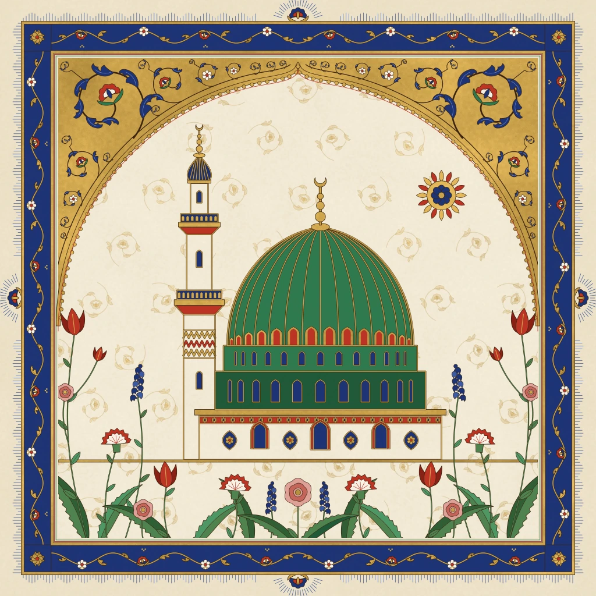

Tezhip, el yazması kitapların sayfalarını altın ve boyalarla süsleme sanatıdır. Ezme altın, lacivert ve aharlı kâğıt zemin üzerinde rumî ve hatayî motifleri helezon dallar halinde, katı bir simetriyle düzenlenir; her biçim ince koyu bir tahrirle çevrilir. Serlevha ve zahriye sayfalarında cetveller, köşebentler, tığlar ve tepeliklerle zengin çerçeveler kurulur.

- **Köken:** Selçuklu ve Timurlu mirası üzerine 15.–16. yüzyıl Osmanlı saray nakkaşhanesinde olgunlaştı; Baba Nakkaş, Şahkulu ve natüralist çiçek üslubunu getiren Kara Memi başlıca ustalardır. Lale, karanfil, sümbül ve gülden oluşan yarı natüralist çiçekler Kara Memi ekolünün imzasıdır.
- **Ayırt edici:** Lacivert zemin üzerinde altın rumî ve hatayî su yoluyla bezeli bordür; köşe kareleri ve altın cetveller; Kenar suyunda ince lacivert tığlar ve her kenarın ortasında dışa taşan hatayî tepelikler; Altın zeminli köşebentlerde iç içe geçen iki helezon sistemi: ince koyu saplı hatayî, penç, gonca ve yaprak dalları ile onların üstünden ince bir aralık bırakarak geçen lacivert rumî kolları; boşluklarda küçük kıvrımlar ve üçlü noktalar; Dilimli sivri kemerli (mihrabiye) çerçevenin içinde aharlı krem zemin ve soluk altın halkâr; Düz yeşil kubbe, altın kaburgalar ve tabanda altın-kırmızı dilim frizi; altın konturlu, tahrirli minare ve kaide; Kara Memi üslubunda iki tonlu tırtıklı saz yaprakları, mızrak biçimli lale yaprakları; lale, karanfil, gül ve sümbül
- **Palet:** `#CFA64E` `#1C3478` `#F6EEDA` `#2E7B50` `#BE3424` `#3A2412` `#E3A49B` `#4F8550`
- **Kodla çizim:** Canvas 2D, 2048 iç çözünürlük. Ezme altın, sağ üstten hafif parıltılı ve zerreli bir gürültü dokusu olarak bir kez üretilip sayfaya sabit desen dolgusu olarak kullanılır. Rumî, hatayî ve penç motifleri Bezier yollarıyla tanımlanıp döndürülerek yerleştirilir; helezonlar spiral nokta dizileriyle kurulur. Köşebentte iki ayrı açgözlü daire istifi yapılır; her daireye bir helezon oturur ve helezonlar önceki sapların en yakın noktasından iki ucu teğetli Bezier saplarla beslenerek ağaç biçimli bir su yolu oluşturur. Alt katta hatayî sistemi, üst katta lacivert şeritli rumî sistemi çizilir; üst kat ayrı bir katmanda alttakini destination-out ile silerek iç içe geçme aralığı bırakır. Kalan boşluklar kapsama haritasının uzaklık dönüşümüyle bulunur ve büyükten küçüğe küçük kıvrımlar, penç ve üçlü noktalarla doldurulur; öbür köşebent aynalanarak simetri sağlanır. Bordür dört kenarda döndürülmüş sinüs su yolu, kemer iki yay ve kavşara eğrisinden oluşur. Sahne kemere sığması için 0,8 ölçekle aynı yerleşimde çizilir: düz dolgu, altın kontur, koyu tahrir; saz yaprakları omurga ve tırtıklı şerit poligonuyla üretilir.
- **Kaynak:** [`S-008-tezhip/ornek.html`](stiller/S-008-tezhip/ornek.html)

### S-009

**Ebru** · *Turkish Paper Marbling*

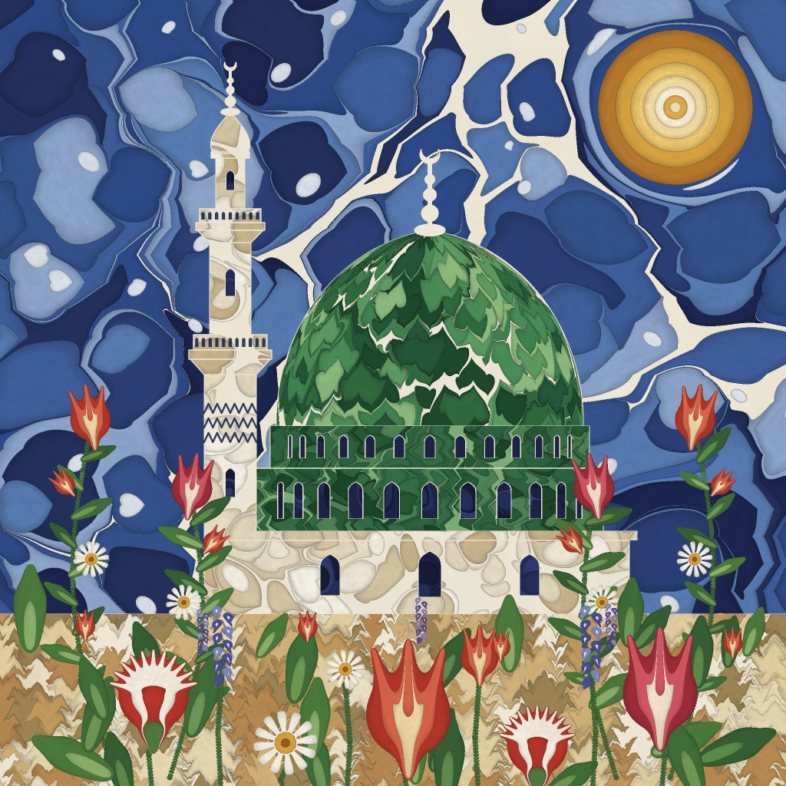

Ebru, kitreyle koyulaştırılmış su yüzeyine öd katılmış toprak boyaların serpilip biz ve tarakla biçimlendirildiği, sonra desenin kâğıda alındığı kâğıt süsleme sanatıdır. Serpilen damlalar birbirini iterek taşlar oluşturur (battal); biz bir ileri bir geri çekilince gelgit, tarakla taranınca taraklı desenler ortaya çıkar. Damla ve iğne hareketleriyle lale, karanfil, sümbül gibi çiçekler yapılır; akkâse tekniğinde bir şablon, siluetin içini başka bir ebruya ayırır.

- **Köken:** 15. yüzyıldan beri Türk kitap sanatlarında cilt kapağı, yan kâğıdı ve hat kenarı süslemesinde kullanılır. Çiçekli ebruyu 18. yüzyılda Hatip Mehmed Efendi başlattı; 20. yüzyılda Necmeddin Okyay çiçekli ebruyu geliştirip akkâse ve yazılı ebru gibi teknikleri canlandırdı, Mustafa Düzgünman geleneği sürdürdü.
- **Ayırt edici:** Lacivert ve çivit taşlardan battal gök; taşların arasında ince açık damarlar ve gelgitle dalgalanan kenarlar; Aynı noktaya iç içe serpilmiş okra ve sarı damlalardan halkalı güneş; sarı toprak boyalı alemler; Yeşil battalın kubbe meridyenleri boyunca taranmasıyla sivri dilimli, tepeye toplanan kubbe deseni; 16 dilimi ayıran ince akkâse kâğıt çizgileri; Akkâse şablonuyla ayrılmış, beyaz mermer desenli kaide ve minare; şablonun bıraktığı ince kâğıt çizgisi ve koyu pencereler; Taraklı (tek yönde taranmış) toprak renkli zemin; İğneyle çekilmiş iç içe renkli laleler, tırtıklı karanfiller, papatyalar, sümbüller, damla yapraklar ve boncuk dizisi gibi saplar
- **Palet:** `#22305E` `#567BB4` `#D9A441` `#3E8350` `#E2D6BC` `#C29A5E` `#B3352A` `#F2EBDA`
- **Kodla çizim:** Aubrey Jaffer'in ebru dönüşümleri uygulanır: damla p' = c + (p−c)·√(1 + r²/|p−c|²), tarak dişi p' = p + α·λ/(d+λ)·M (gelgitte komşu dişler ters yönde, eşit aralıklı dişlerde her noktaya en yakın iki diş), iğne adımı p' = p + v·e^(−|p−s|²/σ²). Her bölge (gök, zemin, kubbe, kasnak, bina, pencere, alem) için ayrı bir işlem dizisi kaydedilir. Damla çokgenlerini ileri taşımak yerine her piksel bu dönüşümlerin tersinden geçirilir (damlada tam ters formül, iğnede sabit nokta yinelemesi) ve hangi damlaya düştüğü bulunur; böylece en sert taramada bile sınırlar keskin ve hatasız kalır. Uyarlamalı örnekleme, damla kenarına doğru koyulaşan boya, akışla gerilen doku ve damla kimliği değişen piksellerde ince damar eklenir. Kubbe deseni boylam-yükseklik uzayında hesaplanıp meridyen eşlemesiyle kubbeye sarılır; 16 dilim, ayrı şablon parçaları gibi aralarında ince kâğıt çizgisi bırakılarak ayrılır; bölgeler SAHNE bölge haritasıyla akkâse şablonu gibi ayrılır. Alemler sarı toprak zeminli bir battalla boyanır. Çiçekler kendi kutularında damla ve iğne çekişleriyle üretilir; arka sıradaki goncalar kendi saplarıyla ön çiçeklerin arkasında kalır.
- **Kaynak:** [`S-009-ebru/ornek.html`](stiller/S-009-ebru/ornek.html)

### S-010

**İznik Çinisi** · *Iznik Tile*

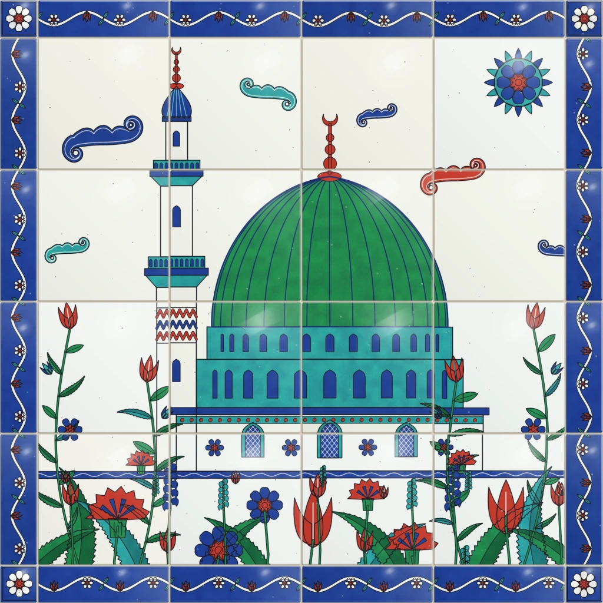

İznik çinisi, kuvars ağırlıklı bir gövde üzerine beyaz astar sürülüp sır altı tekniğiyle boyanan ve parlak, şeffaf sırla pişirilen Osmanlı seramiğidir. Siyah ya da koyu kontur içinde kobalt mavisi, firuze, zümrüt yeşili ve kabarık mercan kırmızısı kullanılır; saz yaprakları, lale, karanfil, sümbül ve rozetler başlıca motiflerdir. Kare çiniler bordürlerle birlikte duvar panoları halinde dizilir.

- **Köken:** İznik atölyeleri 15. yüzyılın sonundan 17. yüzyıla kadar saray için üretim yaptı; Süleymaniye, Rüstem Paşa ve Sultanahmet camilerinde görülen, 1550'lerden sonraki kabarık kırmızılı dönem zirvedir. Desenler saray nakkaşhanesinde, Kara Memi'nin saz ve natüralist çiçek üslubuyla hazırlanırdı.
- **Ayırt edici:** Bordür çinileriyle çevrili 4 × 4 kare çini pano; aralarda girintili, açık renk derzler; Hafif mavimsi beyaz astar üzerinde kobalt, firuze ve zümrüt yeşili; ince siyah kontur; Kabarık mercan kırmızısı laleler, karanfiller, rozetler ve alemler; Kobalt konturlu ve kaburgalı zümrüt yeşili kubbe; firuze kasnakta kobalt pencereler; Uzun, kıvrık, tırtıklı, iki tonlu saz yaprakları ve sümbüller; gökte kobalt, firuze ve kırmızı çin bulutları ile rozet güneş; Her çinide sır parlaması ve pencere yansıması, sır birikmesiyle dalgalanan renk, iğne delikleri, çiniden çiniye ton ve baskı kayması
- **Palet:** `#F5F7F3` `#1F3F99` `#2AA3A5` `#C8382A` `#1F8B4E` `#1A1A22` `#D6D0C1`
- **Kodla çizim:** Tasarım üç ayrı 2048 px katmana çizilir: sır altı renkler (kobalt, firuze, yeşil), kabarık kırmızı ve siyah kontur. Renk katmanı piksel düzeyinde düşük frekanslı gürültüyle koyulaştırılıp açılarak sır birikmesi verilir ve hafifçe bulanıklaştırılarak akıtılır; kırmızı katman alt-sola kayık bir gölgeyle kabarık gösterilir; beyaz çizgiler (astar) renk katmanından silinerek açılır. Ardından tasarım çini çini kesilip derz zeminine yerleştirilir: her çiniye küçük baskı kayması, pişirim ton farkı, sağ üstten parlama, yumuşak pencere yansıması, sır kenarı ışığı ve tohumlu iğne delikleri eklenir. Lale, karanfil, sümbül, rozet, saz ve çin bulutu motifleri Bezier yolları ve omurga-şerit poligonlarıyla üretilir.
- **Kaynak:** [`S-010-iznik-cinisi/ornek.html`](stiller/S-010-iznik-cinisi/ornek.html)

### S-011

**Kat'ı (Kâğıt Oyma)** · *Kat'ı Paper Cutting*

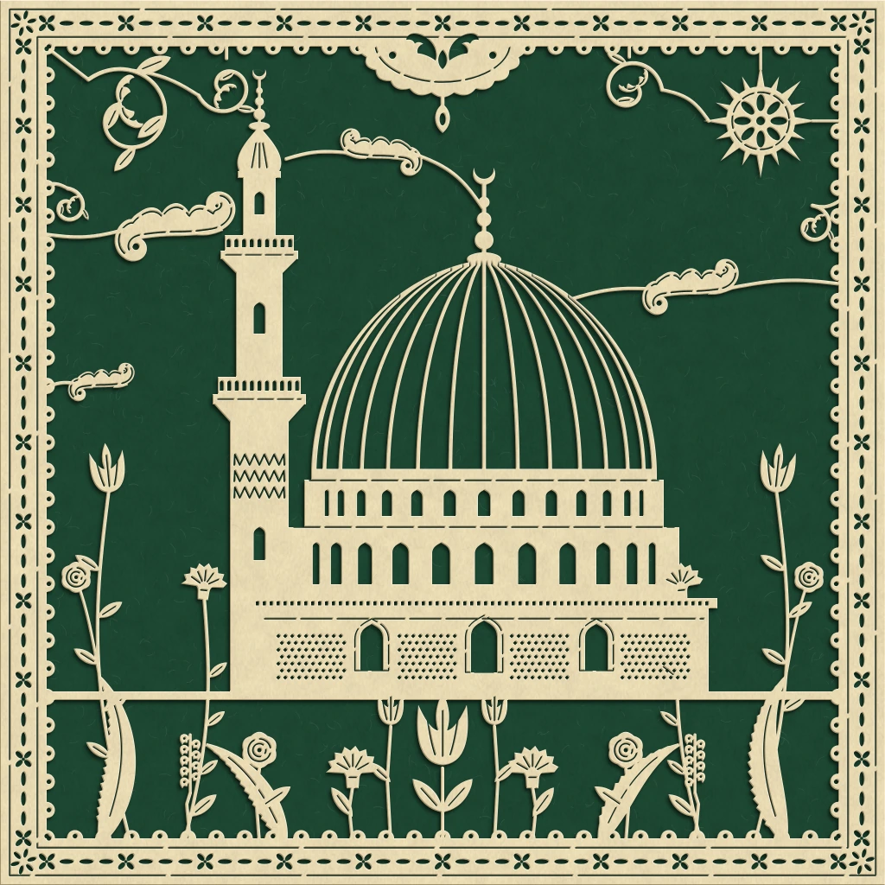

Kat'ı, kâğıdın ince bir bıçakla oyularak motiflerin çıkarıldığı ve oyulan kâğıdın zıt renkli bir zemin kâğıdına yapıştırıldığı süsleme sanatıdır. Müsbet (pozitif) ya da menfi (negatif) olarak çalışılır; rumî, hatayî, bulut ve çiçek motifleri dantel inceliğinde köprülerle birbirine bağlanır. Murakka sayfalarında, cilt kapaklarında ve kitap kenarlarında kullanılır.

- **Köken:** 15. yüzyılda Timurlu Herat'ta yaygınlaştı ve Osmanlı kitap sanatlarına geçti. 17. yüzyılda Bursalı Fahrî (Fahrî-i Bursevî) kat'ı çiçek ve kompozisyonlarıyla tanınan en ünlü Osmanlı ustasıdır; sanat bugün murakka ve cilt sanatıyla birlikte yaşatılmaktadır.
- **Ayırt edici:** Tek parça krem kâğıt ve koyu yeşil zemin: yalnız iki renk; kâğıdın zemine düşen sola-aşağı gölgesi ve keskin bıçak kenarları; Kubbede kaburgalar kâğıt kalacak biçimde oyulmuş sivri dilimler; yeşil zemin dilimlerden görünür; Oyulmuş pencereler, korniş dişleri, baklava kafesli panolar, zikzak yarıklar ve korkuluk kemerleri; Gökte köprülerle çerçeveye bağlanan çin bulutları, ışın taçlı güneş, üstte salbekli yarım şemse ve helezon danteli; Dilimli iç kenar ve mercek dizili, rozetli çerçeve bandı; köprü bırakılarak kesilmiş cetvel yarıkları; Önde ve yanlarda orta damarları oyulmuş lale, karanfil, gül, sümbül ve saz yaprakları
- **Palet:** `#E8D9B2` `#1D4632` `#173828` `#B4AC8A`
- **Kodla çizim:** Kâğıt, 2048 px bir maske tuvalinde kesip-ekleme işlemleriyle kurulur: dolu sayfadan iç alan oyulur (destination-out), bina silueti, bulutlar, güneş, dantel ve çiçekler eklenir, ardından kubbe dilimleri, pencereler, damarlar ve kesik (köprülü) yarıklar oyulur. Saplar ve köprüler çoğunlukla 3,6 px ve üzeri genişliktedir; yalnız yaprak diplerinde, birkaç kıvrım ucunda ve kubbe tepesinde kaburgaların birleştiği yerde 2–3 px'e iner. Kapalı yarıklar setLineDash ile aralıklı kesildiği için ada oluşmaz. Maske üzerinde bağlı bileşen sayımı (BFS) yapıldı: 2048 px çözünürlükte kâğıt tek parçadır, geriye yalnız kenar yumuşatmasından kalan tek piksellik kırıntılar kalır (denetim kodu sayfada kapalı durur). Görüntü; lifli zemin dokusu, maskeden üretilen bulanık ve kayık gölge, dokulu kâğıt ve maskenin kaydırılmış farkından elde edilen ince kenar ışığı ile kenar gölgesinin bileşimidir.
- **Kaynak:** [`S-011-kati/ornek.html`](stiller/S-011-kati/ornek.html)

### S-012

**Vitray** · *Stained Glass*

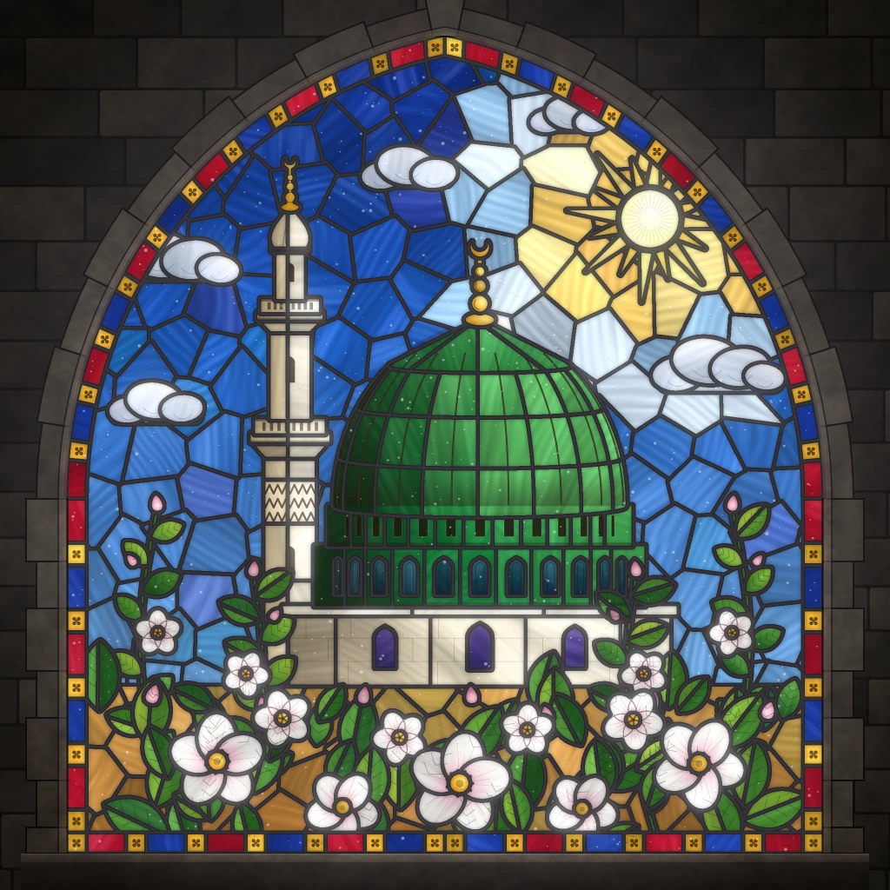

Vitray, renkli cam parçalarının H kesitli kurşun çubuklarla birleştirilip bir pencereye takılmasıyla yapılan ışık resmidir. Resim, arkadan gelen ışıkla parlar; biçimleri kalın ve eşit kalınlıktaki koyu kurşun çizgileri çevreler, yüz ve süs gibi ince ayrıntılar cama grizay boyayla yazılır. Cami, kilise ve saray pencerelerinde, kubbe kasnaklarında ve tavan fenerlerinde kullanılır.

- **Köken:** Renkli camı alçı ya da kurşun kafes içine yerleştirme geleneği Bizans ve erken İslam yapılarına uzanır; Orta Çağ Avrupa katedrallerinde (Chartres, Sainte-Chapelle) kurşunlu vitray doruğuna ulaştı. Osmanlı mimarisinde alçı kafesli renkli cam pencereler (revzen, şemse) Süleymaniye ve Sultanahmet camilerinde ünlüdür; 19. yüzyılda Tiffany ve Arts and Crafts ustaları opal camla akımı yeniledi.
- **Ayırt edici:** Her renk alanını ayıran, her yerde aynı kalınlıkta koyu kurşun çizgileri; Göğün düzensiz cam parçalarına bölünmesi; güneş çevresinde sarı ve amber camlar, ışın biçimli parçalar; Arkadan gelen ışıkla parlayan doygun renkler ve parlak camların kurşun üstüne taşan hafif ışıltısı; Camın kendi dokusu: çekme izleri, dalgalı katedral camı, kabarcıklar ve kenarlara doğru koyulaşan yoğunluk; Grizay boyayla yazılmış ayrıntılar: kubbedeki ara kaburgalar, kasnak nişleri, minare zikzağı, yaprak damarları; Kırmızı, mavi ve altın sarısı küçük camlardan bordür; koyu taş duvardaki sivri kemerli pencere çerçevesi
- **Palet:** `#1A389C` `#1E58B6` `#3B8445` `#B0142C` `#E8AC2E` `#CE9C4E` `#F6F4F0` `#18171B`
- **Kodla çizim:** Canvas 2048 px iç çözünürlükte çizilir; sahne sivri kemere sığsın diye %84 ölçeklenir. Her cam parçası (Voronoi ile bölünmüş gök, kaburgalara ve enlemlere göre kesilmiş kubbe, kasnak şeritleri, minare ve kaide parçaları, ikiye bölünmüş yapraklar, taç yapraklar; kemer boyunca simetrik dizilen, tepede ve alt ortada altın kilit camıyla biten bordür camları) gizli bir kimlik haritasına kendi rengiyle, kurşunun yarısı kadar şişirilerek çizilir. Kimliğin değiştiği kenarlardan Öklid uzaklık dönüşümü (Felzenszwalb) ile tek kalınlıkta, ortası hafif parlak kurşun üretilir. Cam piksel piksel renklendirilir: parça rengi ve degrade, yönlü değer gürültüsüyle çekme izleri, geniş gürültüyle yoğunluk farkı, sinüs ve gürültüyle katedral dalgası. Üstüne grizay boya, yalnız bazı camlara serpilen kabarcıklar, bulanık kurşunla kenar koyulaşması ve parlak camlardan 'screen' ışıltı eklenir; dışta taş duvar, kemer taşları, kilit taşı ve denizlik vektörle çizilip gürültü dokusuyla çarpılır.
- **Kaynak:** [`S-012-vitray/ornek.html`](stiller/S-012-vitray/ornek.html)

### S-013

**Mozaik** · *Mosaic (Tesserae)*

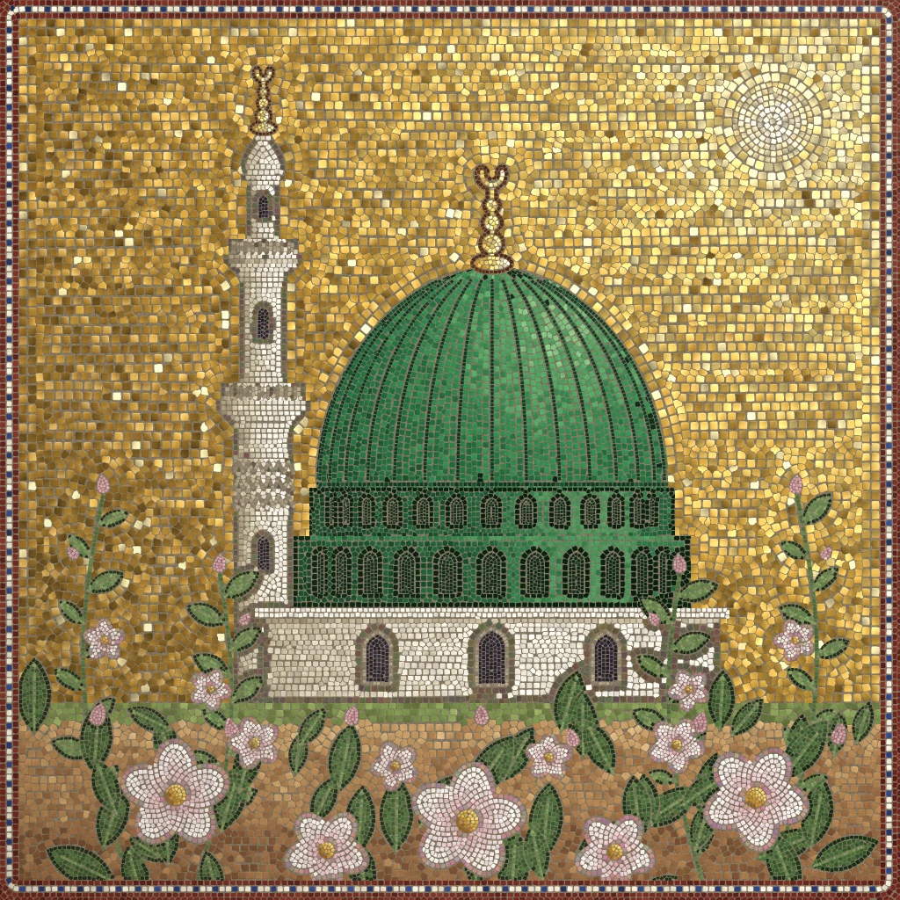

Mozaik, küçük taş, mermer ve renkli cam (smalti) parçalarının harç yatağına tek tek gömülmesiyle yapılan kalıcı duvar ve döşeme resmidir. Taşların diziliş yönü (andamento) resmin bir parçasıdır: biçimlerin çevresinde konturu izleyen kıvrık sıralar, arka planda düz sıralar görülür. Altın varaklı cam taşlar ışığı her açıda farklı yakalayarak zemini titreştirir; cami, kilise ve saray duvarlarında, kubbe ve mihraplarda kullanılır.

- **Köken:** Helenistik ve Roma döşeme mozaiklerinden (opus tessellatum, opus vermiculatum) doğdu; Bizans'ta altın smalti zeminli duvar mozaiklerine dönüştü (Ravenna, Ayasofya). Emevî döneminde Kubbetü's-Sahra (691) ve Şam Emevî Camii'nin (715) altın zeminli ağaç, köşk ve nehir manzaraları İslam sanatının en erken başyapıtları arasındadır; Kurtuba Camii mihrabı da aynı geleneği sürdürür.
- **Ayırt edici:** Her biri hafif düzensiz ve eğik oturmuş küçük kare taşlar, aralarında görünür açık renkli derz; Kubbe dilimlerinde, pencere kemerlerinde, çiçek taç yapraklarında konturu izleyen kıvrık sıralar (opus vermiculatum); alemlerin hilal ve kürelerinde ince ayrıntı için çok daha küçük taşlar; Gökte düz yatay sıralar (opus tessellatum) ve figürlerin çevresini iki sıra dolanan altın taşlar; Parlaklığı taştan taşa değişen, yer yer ışığı yakalayıp parlayan altın smalti zemin; eş merkezli sıralarla dizilmiş güneş; Figürleri çevreleyen koyu kontur sırası; kubbe kaburgaları, minare zikzağı ve saplar tek sıra taşla çizilmiş; Sınırlı taş ve cam paleti: yeşil cam, beyaz ve krem mermer, toprak sarısı, pembe; üç sıralı bordür
- **Palet:** `#D3A646` `#F0D077` `#20703E` `#0D3820` `#EFE8D9` `#E8C2C8` `#B0804E` `#807460`
- **Kodla çizim:** Sahne, her öğe ve alt bölge (kubbe dilimleri, pencereler, taç yaprakları, alem parçaları) ayrı kimlik rengiyle bir etiket haritasına çizilir. Etiket kenarlarından Öklid uzaklık dönüşümü (Felzenszwalb) alınır; her bölgede taş boyunun yarım katlarındaki eş uzaklık çizgileri gradyana dik yürünerek taşlar sıra sıra dizilir (andamento). Alemler küçük taşlarla (kubbede 3,7, minarede 2,5 birim; zeminde 11) ve tek sıra koyu kontur halkasıyla dizilir, hilal biraz kalın kesilir. Gök, zemin ve kaidede ilk bir iki sıradan sonra hafif dalgalı yatay sıralar, kaburga, zikzak, sap ve damarlarda çizgi boyunca tek sıra taş kullanılır; kalan boşluklar yerel ağırlık merkezine konan ara taşlarla doldurulur. Renk, başvuru çiziminin parlaklığına göre malzeme rampasından titreşimli seçilir; altın taşlara rastgele ışık yakalama verilir. Son çizim 2048 px'de piksel piksel yapılır: her piksel kendi bölgesindeki en yakın döndürülmüş kareye (köşesi hafif kırık, kenarı gürültüyle dalgalı) atanır, kareler dışı derz olur, taş kenarlarında ışığa göre pah gölgesi verilir.
- **Kaynak:** [`S-013-mozaik/ornek.html`](stiller/S-013-mozaik/ornek.html)

## Uzak Doğu

### S-014

**Ukiyo-e** · *Ukiyo-e Woodblock Print*

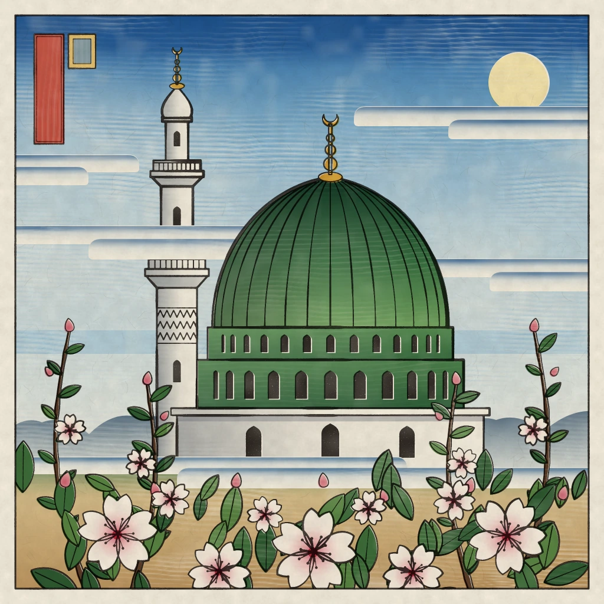

Ukiyo-e, her rengin ayrı bir kiraz tahtası kalıba oyulup elle, sırayla washi kâğıdına basıldığı Japon ağaç baskı resmidir. Biçimleri ana kalıbın (sumi) kalın siyah çizgileri belirler; renk alanları düzdür, gökte ve kenarlarda kalıbın ıslak silinmesiyle elde edilen bokashi geçişleri görülür. Manzaralarda yatay sis kuşakları (kasumi) derinlik verir; tahtanın damarı ve hafif kayık baskı her nüshada sezilir.

- **Köken:** 17. yüzyıl Edo'sunda kitap resimleriyle başladı, 18. yüzyılda çok renkli baskı (nishiki-e) Suzuki Harunobu ile yerleşti. 1820'lerden sonra Avrupa'dan gelen Prusya mavisi gökleri değiştirdi; Katsushika Hokusai'nin 'Fuji'nin Otuz Altı Görünümü' ve Utagawa Hiroshige'nin 'Tōkaidō'nun Elli Üç Durağı' ile 'Edo'nun Yüz Ünlü Manzarası' manzara baskısının doruğudur. 19. yüzyıl sonunda Japonizm akımıyla Van Gogh ve Monet'yi derinden etkiledi.
- **Ayırt edici:** Kubbe, kasnak, minare ve çiçekleri çevreleyen kalın siyah ana kalıp çizgileri: kalınlığı yer yer değişir, kenarları oymanın izini taşıyan hafif tırtıklıdır; pencereler düz siyah; Üstte düz koyu Prusya mavisi şeritten (ichimonji bokashi) aşağı doğru açılan gök, ufukta şeftali bokashi; kubbede yukarıdan aşağı yeşil bokashi; Basamak basamak üst üste binen, alt ve üst kenarı düz, uçları üslupça yuvarlatılmış kasumi sis kuşakları; her katın üst kenarı koyu pembe, aşağısı silik; minareyi ortasından örter; Gök, güneş, zemin ve kubbede açıkça görülen kiraz tahtası damarı (dalgalı ince halkalar, düğüm çevresinde kıvrılan çizgiler) ve baren basıncının eşitsizliğinden kalan lekeler; Düz kırmızı güneş teker, çizgisiz mavi-gri uzak tepeler, sakura biçimli çentikli beyaz çiçekler ve kiraz dalları; renklerin çizgiden hafifçe kaydığı kayık baskı; Lifli sıcak bej washi kâğıdı, siyah çerçeve çizgisi ve yazısız kırmızı ve sarı kartuşlar
- **Palet:** `#1D2F4E` `#B63F29` `#476742` `#CA8A71` `#E4D6B9` `#221D1A` `#B08A5E` `#C99633`
- **Kodla çizim:** Canvas 2048 px'de baskı sırası taklit edilir: önce lifli washi kâğıdı, sonra her renk kalıbı ayrı ekran dışı tuvale çizilip 'multiply' ile ve birkaç piksel kaydırılarak (kayık baskı) basılır. Kiraz tahtasının damarı iki dokudan gelir: bükülmüş değer gürültüsüyle dalgalandırılmış, düğüm çevresinde kıvrılan sinüs halkalarının açık tepeleri boyayı siler ('destination-out', baren basıncının geniş lekeleriyle birlikte), koyu tepeleri katmanın bir kopyasını yalnız oralarda bir kez daha basar; her kalıp farklı açıyla damarlanır. Ana kalıp çizgileri önce vektörle, bir de 1,5 kat kalın olarak çizilir; kalın kopya ikili bir leke maskesinde kalır, sonra katman 1,25 px bulanıklaştırılıp gürültüyle değişen bir eşikten geçirilir: kalınlık yer yer değişir, kenarlar hafif tırtıklanır, mürekkep yoğunluğu eşitsizleşir. Nesneler gruplar hâlinde ressam sırasıyla işlenir; önde duranın silueti kâğıt rengine döndürülür, böylece öndeki biçim arkadaki çizgileri örter. Gök (ichimonji), kubbe ve kasumi bokashi'leri doğrusal degradelerle; kasumi kuşakları basamaklı katlar hâlinde, alttaki kat üsttekinin silik ucunu örterek; sakura taç yaprakları çentikli Bézier biçimleriyle, kiraz dalları incelen şeritlerle çizilir; en sonda kâğıt dokusu çarpılır, kenar boşluğu ve kartuşlar eklenir.
- **Kaynak:** [`S-014-ukiyo-e/ornek.html`](stiller/S-014-ukiyo-e/ornek.html)

### S-015

**Sumi-e (Mürekkep Lavi)** · *Sumi-e Ink Wash*

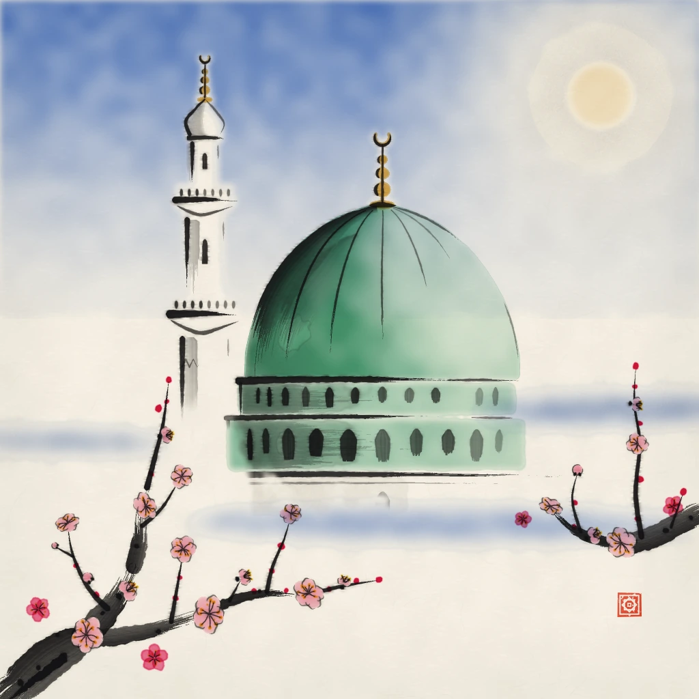

Sumi-e (Çincede shuimo hua), çubuk mürekkebin suyla farklı yoğunluklarda açılıp yumuşak fırçayla emici pirinç kâğıdına uygulandığı resim geleneğidir. Her vuruş tek seferde ve düzeltilmeden yapılır: fırça bastırılıp kaldırılarak yaprak biçimlenir, kuruyan fırça 'kasure' denen beyaz çizgili izler bırakır, ıslak mürekkep kâğıdın liflerine yayılır. Boşluk (ma) resmin parçasıdır; sis, uzaklık ve ışık boş bırakılan kâğıtla anlatılır. Renk çok az kullanılır, resim çoğunlukla kırmızı bir mühürle tamamlanır.

- **Köken:** Tang ve Song Çin'inde gelişti; geleneği Wang Wei'ye bağlanır, Mu Qi ve Liang Kai gibi Chan (Zen) ressamlarıyla olgunlaştı. 13–14. yüzyıllarda Zen keşişleriyle Japonya'ya geçti ve Muromachi döneminde Sesshū Tōyō ile doruğa ulaştı. Bambu, erik çiçeği, orkide ve krizantem, yani 'dört soylu bitki', fırça eğitiminin temelidir.
- **Ayırt edici:** Kubbenin gölge yanı tek bir yan fırça vuruşudur: fırçanın ucunda koyu, topuğunda soluk mürekkep; aşağıda kuruyup kıl kıl açılır; Tepeden inip kuruyarak sönen birkaç hızlı kaburga çizgisi; ışık yanında kubbenin sağ kenarı neredeyse kaybolur; Kasnak, yoğunluğu soldan sağa azalan fırça noktalarından bir bant; gölge yanında ıslak noktalar lavın içine akar; Kuru fırçanın 'kasure' izi erik gövdesinde, korniş ve kasnak çizgilerinde; ıslak vuruşların kenarında mürekkep liflere yayılır; Bol boşluk (ma): kaide ve minarenin alt yanı sise karışır, güneş boş bırakılmış soluk bir dairedir; sol alt köşeden giren erik dalında kümeler hâlinde çiçek, tomurcuk ve yosun noktaları; Çok az renk: kubbe ve kasnakta soluk yeşil, alem kürelerinde okra; sağ altta yazısız, geometrik desenli küçük kırmızı mühür
- **Palet:** `#F3EDE0` `#C9CBB6` `#A09F90` `#5F6154` `#141415` `#D2AA69` `#BE4439`
- **Kodla çizim:** Canvas 2048 px; mürekkep bir yoğunluk alanında birikir ve kâğıt rengine Beer-Lambert benzeri üstel bir azalmayla uygulanır. Fırça vuruşu, omurga boyunca 0,5 px adımlarla enine taranır: fırça 5–76 kıldan oluşur, her kılın kendi mürekkep yükü ve kuruma hızı vardır (kenardaki kıllar önce kurur); kuruyan kıl kâğıdın ince tanesinin yalnız tepelerine değer, böylece kasure çizgileri ve tanecikli kuru fırça kendiliğinden oluşur. Kıllar arasında enine ton farkı yan fırçanın ucu koyu, topuğu soluk yüklemesini verir; bastırılan baş yuvarlanır, uç sivrilir. Vuruşun ıslak payı ayrı bir alana yazılır ve sonda iki kutu bulanıklığından uzamış lif gürültüsüyle seçilen bir saçak olarak kâğıda yayılır. Lavlar bulanık maskelerden hesaplanır: eşikleri gürültüyle tırtıklanır, kuruyan kenarda mürekkep birikir, içte tanelenir; birkaç geri akma (çiçeklenme) lekesi eklenir. Kaide ve minarenin alt yanı gürültülü bir sis maskesiyle söner. Erik çiçekleri iki kısa kavisli taç yaprağı çizgisi ve noktalı erciklerle, kendi düzleminde basıklaştırılarak çizilir; arkalarındaki dal silinir. Yeşil ve okra ayrı renk katmanlarıdır; mühür oyulmuş geometrik çizgiler ve damga dokusuyla çizilir.
- **Kaynak:** [`S-015-sumi-e/ornek.html`](stiller/S-015-sumi-e/ornek.html)

## Sanat Akımları

### S-016

**Empresyonizm** · *Impressionism*

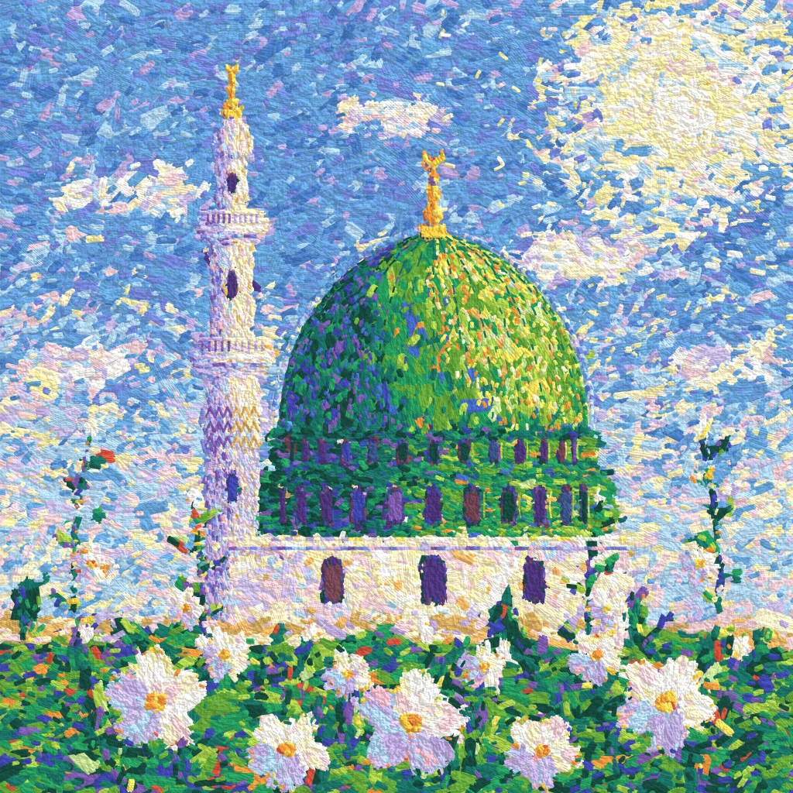

Empresyonizm, konunun ayrıntısından çok ışığın ve havanın o anki etkisini yakalamaya çalışır. Renkler palette karıştırılmadan kısa fırça lekeleriyle yan yana konur ve gözde karışır; gölgeler siyah değil mavi-mor, ışıklar sıcak sarı-turuncudur. Fırça izi canlı ve görünür, kenarlar yumuşak ve kayıptır; çoğunlukla açık havada, çabuk çalışılır.

- **Köken:** 1860'ların sonunda Paris'te doğdu; adını Claude Monet'nin 1874 sergisindeki 'İzlenim, Gün Doğumu' tablosundan aldı. Camille Pissarro, Alfred Sisley, Pierre-Auguste Renoir ve Berthe Morisot akımın öncülerindendir; Monet'nin saman yığınları ve Rouen Katedrali dizileri aynı konunun farklı ışıklardaki izlenimlerini işler.
- **Ayırt edici:** Yan yana konmuş kısa, kırık, karıştırılmamış saf renk lekeleri; renkler gözde karışıyor; Kubbenin ışığında sarı-yeşil ve açık zümrüt, gölgesinde viridyen, ultramarin ve mor kıvılcımlar; yer yer sıcak turuncu-sarı ışık lekeleri; Renkli gölgeler: taş yapıların gölgesi leylak-mavi ve serin gri, ışıklı yanı krem ve açık sarı; Güneşin çevresinde titreşen sıcak ışık ve havadaki parıltı; Yönü ve boyu değişen canlı fırça izleri: gökte daha iri, çiçek tarlasında küçük ve sık; dallarda saplar boyunca koyu yeşil, kesik lekeler; Yumuşak, kayıp kenarlar
- **Palet:** `#6AA8DE` `#289E60` `#AACE4C` `#1C7668` `#F0963E` `#805CB0` `#BEAADE` `#FCEEC6`
- **Kodla çizim:** Işık modeli her piksel için bir bölge ve 0–1 arası bir aydınlık değeri verir. Her leke, bölgesinin ışık, orta ya da gölge kümesinden (değerleri birbirine yakın, tonları farklı saf renkler) ağırlıklı rastgele seçilir. Lekeler 2048 piksellik tuvalde birkaç kıllık kısa fırça vuruşlarıdır; yönü bölgeye göre (kubbede meridyen, kasnakta yatay, gökte eğik, yapraklarda eksen) belirlenip gürültüyle saptırılır, rengi biraz kaydırılmış bir noktadan okunduğu için kenarlar kaybolur. Seyreltik bir ön boyanın üstüne üç boyda leke katı gelir (gökte ince katlar seyrek tutulur), ardından tamamlayıcı kıvılcımlar, yapı ayrıntıları, saplar boyunca ve yan dallardaki yapraklarda koyu lekeler, güneş ve çiçekler; hafif boya kabartısı ve bez dokusu son ışıkta eklenir.
- **Kaynak:** [`S-016-empresyonizm/ornek.html`](stiller/S-016-empresyonizm/ornek.html)

### S-017

**Puantilizm** · *Pointillism*

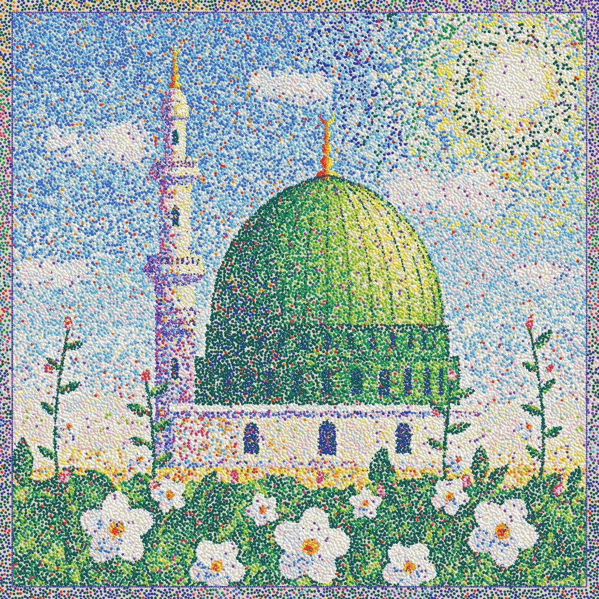

Puantilizm (noktacılık), resmi küçük, ayrı ve karıştırılmamış renk noktalarıyla kurar; renkler tuvalde değil izleyicinin gözünde karışır. Sınırlı bir saf renk paleti kullanılır, tamamlayıcı renkler yan yana konarak titreşim yaratılır. Renk kuramına dayanan bu yöntem düzenli, sakin ve ışıklı bir yüzey verir.

- **Köken:** Georges Seurat 1880'lerde Michel Eugène Chevreul ve Ogden Rood'un renk kuramlarından yola çıkarak geliştirdi; 'La Grande Jatte Adası'nda Bir Pazar Öğleden Sonrası' (1884–1886) akımın simgesidir. Paul Signac, Henri-Edmond Cross ve Théo van Rysselberghe yöntemi Yeni Empresyonizm adıyla sürdürdü; Seurat bazı tablolarına noktalarla boyanmış çerçeveler ekledi.
- **Ayırt edici:** Resmin tamamı küçük, ayrı ve hemen hemen eş boyda saf renk noktalarından oluşuyor; alemler gibi ince ayrıntılarda noktalar küçülüyor; Yeşil kubbe yeşil, sarı ve mavi noktalarla kurulmuş; ışıkta ve gölgede turuncu ve mor tamamlayıcı noktalar; Kontur boyunca ışınım halesi: kubbe ve minarenin kenarında gök daha açık, yapının kenarı daha koyu; Beyaz çiçeklerde ışık yanı krem-sarı, gölge yanı mavi-leylak noktalar; taç yapraklar serin bir nokta sırasıyla ayrılıyor; Noktaların arasından görünen astarlı bez; Komşu rengin tamamlayıcısıyla noktalanmış, elle atılmış ince koyu bir nokta sırasıyla resimden ayrılan boyalı çerçeve
- **Palet:** `#FAE240` `#F49628` `#E03A2C` `#7E4AB0` `#303CAC` `#68B6E2` `#22965C` `#96C63A`
- **Kodla çizim:** Işık modelli, renkli gölgeli bir hedef tabloya (taç yapraklarda ışık geçişi ve serin kenar çizgisi dahil) bulanık kopyasından farkı eklenerek kontur halesi (ışınım) verilir; güneş çevresindeki yumuşak geçiş bunun dışında tutulur. Bridson Poisson diski üç ölçekte nokta üretir: seyrek bir alt kat, ana kat ve kontur ile küçük öğelerde daha ince noktalar. Her noktanın hedef rengi, on iki saf renk ve üç açık tondan oluşan paletin en iyi üçlü karışımına ayrıştırılır (doğrusal ışıkta optik karışım; değeri hedeften uzak boyalar ve tek renge yığılma cezalandırılır) ve ağırlıklara göre tek bir renk seçilir; yüzde beş olasılıkla tamamlayıcı renk konur. Alemlerin çevresi silinip gök ve altın çok küçük noktalarla yeniden kurulur (hilal okunsun diye). Çerçeve noktaları iç kenarın ortalama renginin tamamlayıcısından ayrıştırılır; iç sınır aralığı ve hizası oynak noktalarla elle atılmış gibi çizilir. Noktalar hafif bir kabartma ve bez dokusuyla ışıklandırılır.
- **Kaynak:** [`S-017-puantilizm/ornek.html`](stiller/S-017-puantilizm/ornek.html)

### S-018

**Art Nouveau** · *Art Nouveau*

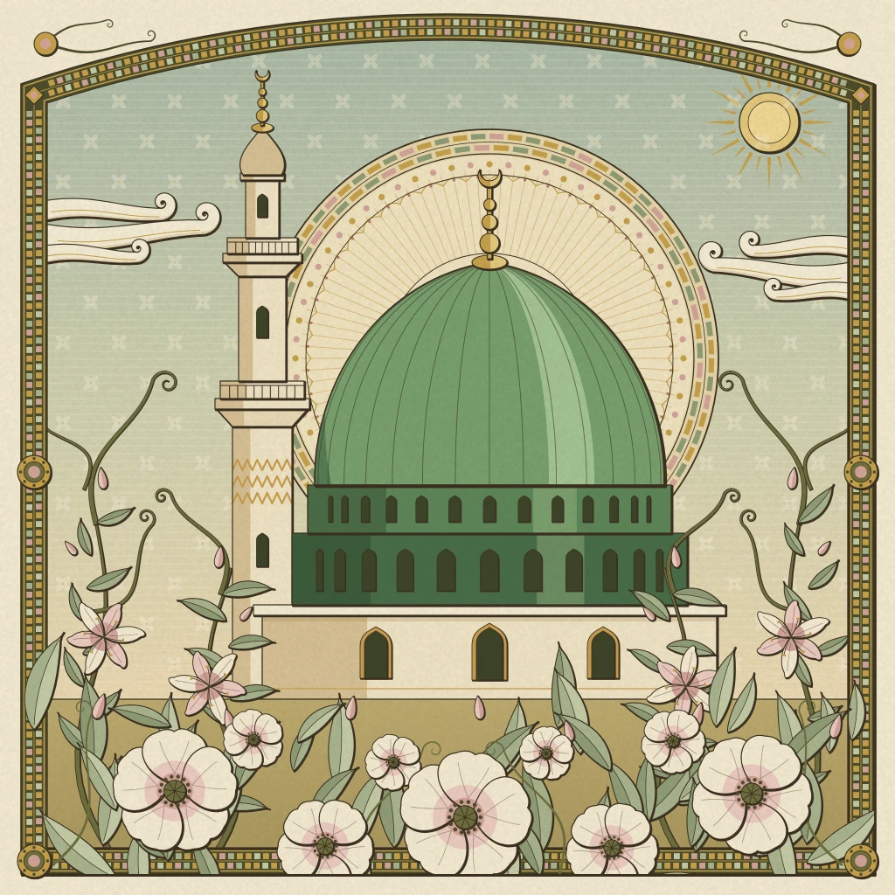

Art Nouveau, doğadaki bitki biçimlerinden türetilmiş akışkan, organik çizgileri (kamçı kıvrımı) ve süslemeyi resmin taşıyıcısı yapan bir akımdır. Afişlerde düz renk alanları ince ama kalınlığı değişen konturlarla çevrilir; konu çoğu zaman büyük bir dairesel hale ve mozaik benzeri bantlarla örülü süslü bir çerçeve içinde durur. Renkler solgun ve zariftir: adaçayı yeşili, zeytin, aşı boyası, toz gülü, krem ve altın; zambak, süsen, gelincik gibi uzun saplı çiçekler kıvrılarak yüzeyi doldurur.

- **Köken:** 1890'larda Avrupa'da Arts and Crafts hareketi ve Japon baskılarının etkisiyle doğdu; Fransa'da Art Nouveau, Almanya'da Jugendstil, Avusturya'da Sezession, İtalya'da Stile Liberty adını aldı. Alfons Mucha'nın Paris afişleri (Gismonda, Mevsimler, Zodyak), Hector Guimard'ın metro girişleri, Victor Horta'nın Brüksel yapıları ve Gustav Klimt'in altınlı panoları akımın simgeleridir. İstanbul'da Raimondo D'Aronco'nun Karaköy ve Yıldız'daki yapıları Osmanlı'daki örneklerdendir.
- **Ayırt edici:** Kubbenin ardında Mucha usulü büyük hale: mozaik taşlı iki sıra bant, inci dizisi, dantel kemercikleri ve ince ışın çizgileri; Basık kemerli süslü çerçeve: iki sıra renkli kare taştan bant, altın çizgiler, köşe gülleri, madalyonlar ve kıvrık köşe süsleri; Uçları sarmal kıvrılan kamçı filizleri ve S biçimli zambak sapları; çerçevenin içinden akıp ucu dalga gibi kıvrılan, kat kat şerit bulutlar; Kalınlığı değişen koyu kahve konturlarla çevrilmiş düz renk alanları; kubbede ve yapılarda afiş usulü iki tonlu gölge; Önde çerçeveyi taşan iri gelincikler, uzun kıvrık bıçak yapraklar; yanlarda altı yapraklı zambaklar; Solgun zarif palet ve gök zemininde soluk dört yapraklı çiçeklerden şablon deseni
- **Palet:** `#A9B48F` `#6E6F3E` `#C99E4F` `#D3A49B` `#F3EAD3` `#C6A14B` `#79A06F` `#3B3122`
- **Kodla çizim:** Canvas 2048 px'de vektör olarak çizilir. Kalın-ince kontur, biçimin dışına kırpılmış ve sağ alta kaydırılmış kalın bir çizgiyle ince ana çizginin üst üste konmasıyla elde edilir. Kamçı kıvrımları, sinüslü bir S eğrisine teğeti kırılmadan eklenen logaritmik sarmalın, ortası şişen ve uca doğru incelen şeritlere çevrilmesidir; bulutlar da çerçeve kenarından başlayan, alt kenarı düz gölgeli üç kat böyle şerittir. Çerçeve büyük yarıçaplı bir yaydan kurulan basık kemerdir; bantta yay ve kenarlar boyunca döndürülmüş renkli kareler mozaik dokusu verir. Hale eş merkezli halka dilimleri, inci daireleri ve kemerciklerle; kubbe, kaburga eğrilerinden kurulan parlak şerit ve elips dışı gölgeyle iki tonlu boyanır. Zambak ve gelincikler Bézier taç yapraklarla, yapraklar kıvrık eksen boyunca iki tonlu bıçak biçimleriyle çizilir; sonunda taş baskı kâğıdı dokusu çarpılır.
- **Kaynak:** [`S-018-art-nouveau/ornek.html`](stiller/S-018-art-nouveau/ornek.html)

### S-019

**Art Deco** · *Art Deco*

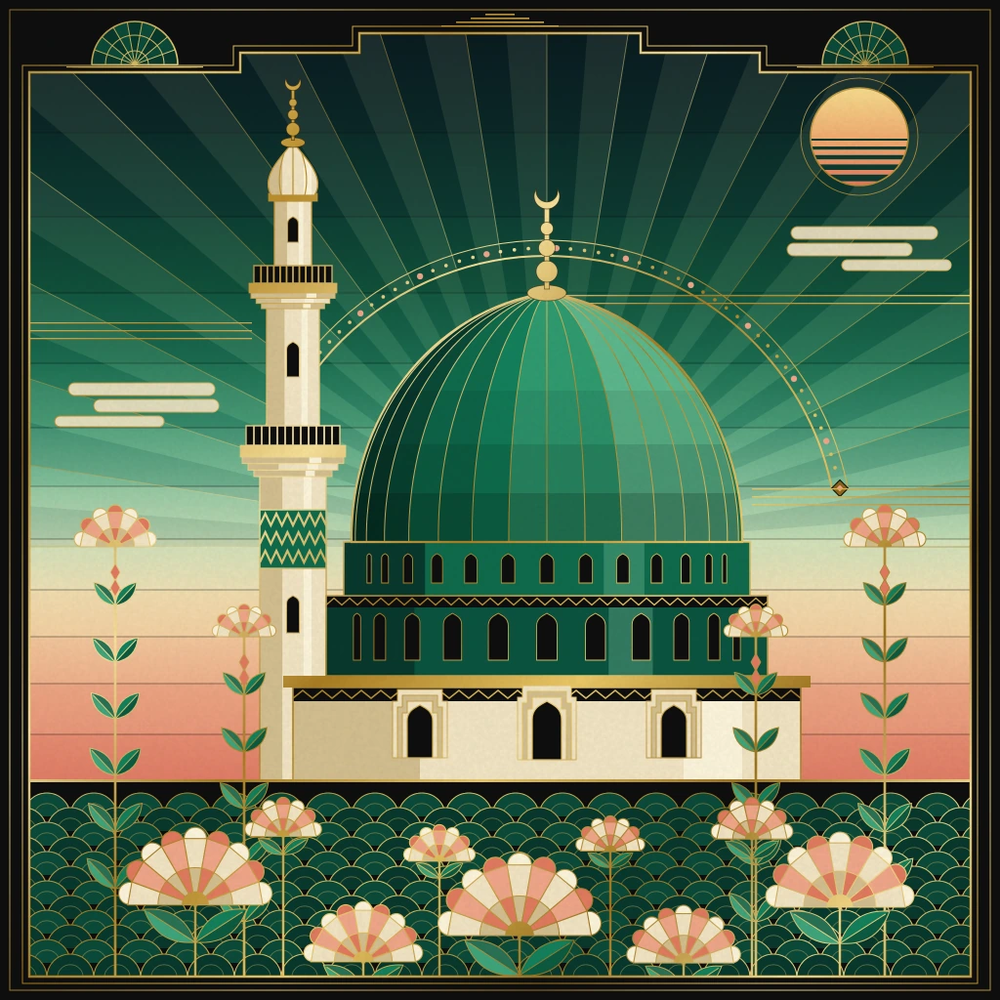

Art Deco, makine çağının hızını ve lüksünü geometriye dönüştüren bir tasarım akımıdır: güneş patlaması ışınları, basamaklı zigurat biçimleri, şevronlar, yelpaze ve pul motifleri, akış çizgili (streamline) sadeleştirilmiş biçimler. Renkler güçlü ve zıttır; siyah ve koyu zümrüt zemin üstünde metalik altın çizgiler, krem ve mercan vurgular. Seyahat ve demiryolu afişlerinde, gökdelen cephelerinde, sinema salonlarında, mücevher ve iç mimaride kullanılır.

- **Köken:** Adını 1925 Paris Uluslararası Modern Süsleme ve Endüstri Sanatları Sergisi'nden alır; kübizm, Viyana Atölyeleri, Mısır ve Maya süslemesi ile makine estetiğinden beslendi. Cassandre'ın demiryolu ve vapur afişleri, Chrysler ve Empire State binaları, Tamara de Lempicka'nın resimleri ve Erté'nin tasarımları akımın simgeleridir. Türkiye'de 1930'ların Ankara ve İstanbul apartmanlarında, Ankara Palas çevresindeki yapılarda yaygın izleri vardır.
- **Ayırt edici:** Kubbenin ardından açılan, altın çizgili ve dönüşümlü tonlu güneş patlaması ışınları; boncuk dizili çift yay; Basamaklı (zigurat) tepe çerçevesi, kademeli minare konsolları ve basamaklı pencere çerçeveleri; Seyahat afişi gibi şeritli gök: koyu zümrütten yeşime, kreme ve mercana; çizgilerle kesilmiş güneş diski; Her yerde metalik altın çizgi: kubbe kaburgaları, konturlar, korkuluk çubukları, şevron frizler; Geometrik yelpaze çiçekler ve şevron yaprak çiftleri; zeminde altın kenarlı pul (yelpaze) deseni; Akış çizgili kapsül bulutlar ve ince paralel hız çizgileri
- **Palet:** `#0D0E0D` `#08382C` `#0F6A4C` `#64A584` `#E9CB72` `#B98C2C` `#F0E3C4` `#E07A5F`
- **Kodla çizim:** Canvas 2048 px'de vektör olarak çizilir. Tuval boyunca açık ve koyu duraklar arasında dolaşan tek bir çapraz degrade, bütün altın çizgi ve dolgulara metalik parıltı verir. Gök on iki dikey degrade şeritten kurulur; güneş patlaması, kubbe tabanı merkezli dönüşümlü saydam kamalar ve altın ışın çizgileridir. Kubbe kaburga dilimleri, ışık yönüne göre altı basamaklı zümrüt tonundan biriyle boyanır (akış gölgesi). Minare konsolları basamaklara, pencere çerçeveleri ziguratlara, kaide ve kasnak frizleri şevron çizgilerine çevrilir. Çiçekler yay dilimlerinden ve kenar pullarından oluşan yelpazeler, zemin yarım daire pullardan bir desendir; çerçeve basamaklı bir çokgen, köşelerde yarım güneş yelpazeleri vardır. Sonunda hafif baskı dokusu çarpılır.
- **Kaynak:** [`S-019-art-deco/ornek.html`](stiller/S-019-art-deco/ornek.html)

### S-020

**Kübizm** · *Cubism*

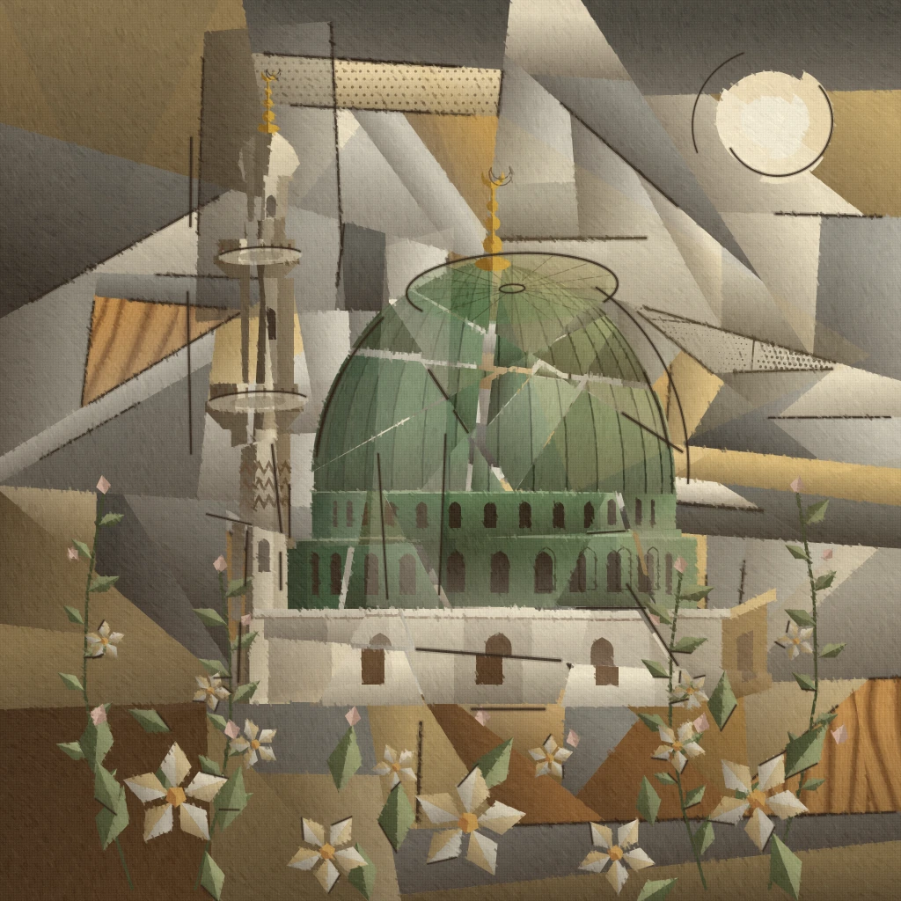

Kübizm, nesneyi tek bir bakış noktasından değil, parçalanıp yeniden kurulmuş düzlemler hâlinde gösterir. Biçimler köşeli yüzeylere ayrılır, düzlemler birbirine geçer ve kenarlar komşu yüzeye akar (passage); palet okr, gri ve kahverengilerle sınırlıdır. Sentetik evrede gazete kâğıdı ve ahşap damarı gibi kolaj dokuları da resme girer. Natürmort, portre ve kent görünümlerinde kullanılmış, modern resmin ve tasarımın temel dillerinden biri olmuştur.

- **Köken:** 1907–1914 yılları arasında Paris'te Pablo Picasso ile Georges Braque tarafından geliştirildi; Cézanne'ın doğayı silindir, küre ve koni üzerinden ele alışından beslendi. Analitik kübizm (1909–1912) neredeyse tek renkli, ince düzlemlere ayrılmış yüzeyleriyle; sentetik kübizm (1912–1914) kolaj, papier collé ve daha yalın, düz renkli düzlemleriyle bilinir. Juan Gris, Fernand Léger ve Albert Gleizes akımın öteki önemli adlarıdır.
- **Ayırt edici:** Kubbe, kasnak, kaide ve minare kesim çizgileriyle parçalara ayrılmış; parçalar birbirine göre kaymış ve hafifçe dönmüş; Aynı anda iki bakış: kubbe önden ve tepeden (ışınsal dilimli elips), şerefeler yandan ve üstten (halkalar), kaidenin sağa kaçan yan yüzü; Her düzlem bir kenarından koyulaşıp öbür yana açılan geçişle gölgelenmiş; kenarlar komşu düzleme akıyor (passage) ve yarı saydam düzlemler üst üste biniyor; Okr, gri, kahverengi ve kirli yeşille sınırlı analitik palet; açık minare koyu bir düzlem sütununun, koyu yeşil kubbe açık ve orta tonlu düzlemlerin önünde okunur; Sentetik kübizmden kolaj dokuları: ahşap damarı (faux bois), yazısız gazete rasteri ve nokta deseni; Yer yer koyu, fırçayla çekilmiş düzlem çizgileri ve her yüzeyde kısa, eğik fırça vuruşları
- **Palet:** `#BE9452` `#D9BA7C` `#684C32` `#34281E` `#C9C3B2` `#969286` `#4F7247` `#CCA03E`
- **Kodla çizim:** Canvas (2048 iç çözünürlük). Arka plan, birkaç yapı çizgisinden sonra hücreleri tek tek bölen BSP kesimleriyle yaklaşık 118 dışbükey düzleme ayrılır; her düzlem okr/gri/kahve tonlarından birini alır (minarenin arkası koyu, kubbenin gölgeli yanı açık tutulur) ve bir kenarından içeri doğrusal geçişle gölgelenir; üç hücre prosedürel ahşap damarı, yazısız gazete yarım tonu ve nokta deseniyle doldurulur. Minare, kaide, kasnak ve kubbe önce ekran dışı bir katmana düz kübist tonlarla (prizma yüzleri, 16 dilim, kaburgalar) çizilir; sonra kesim doğrularının oluşturduğu her hücre kaydırılıp döndürülerek taşınır, kendi ton/ışık geçişini ve yalnız nesnenin içinde kalan koyu kenar çizgilerini alır; parçaların arasındaki aralıklara nesnenin koyulaşmış, kaymamış hâli dolar. Kubbenin tepeden görünüşü, şerefe halkaları ve kaidenin yan yüzü ikinci bakış olarak eklenir. Çiçeklerin taç yaprakları altı köşeli çokgenlerdir ve ekseninden aydınlık/gölgeli iki düzleme bölünür. Ardından yarı saydam düzlemler, piksel renginden örneklenen 38 bin kısa fırça vuruşu, koyu düzlem çizgileri ve hafif bir kontrast artışıyla birlikte tuval dokusu gelir. Geometri SAHNE'den (kubbe profili, kaburgalar, kasnak pencereleri, minare parçaları, bitki yerleri) alınır.
- **Kaynak:** [`S-020-kubizm/ornek.html`](stiller/S-020-kubizm/ornek.html)

### S-021

**Bauhaus** · *Bauhaus*

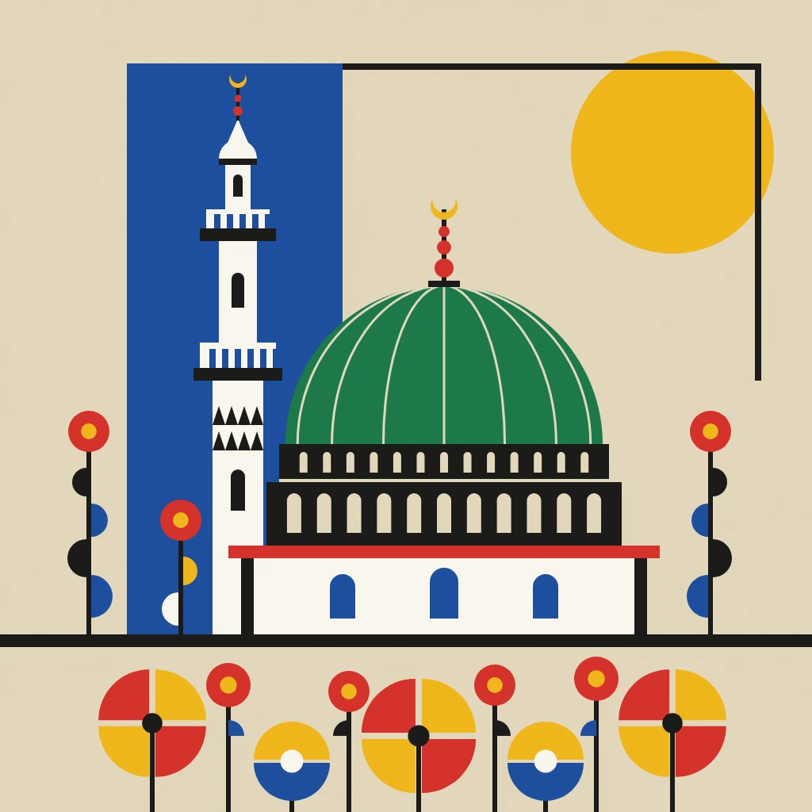

Bauhaus üslubu biçimi işlevine ve en yalın geometrik öğelerine indirger: daire, kare, üçgen, yarım ve çeyrek daire. Kırmızı, sarı ve mavi; siyah, beyaz ve krem zeminle birlikte düz, gölgesiz alanlar hâlinde kullanılır; kompozisyon ızgaraya oturan asimetrik bir dengeyle kurulur. Afiş, tipografi, mimari ve ürün tasarımında modernizmin ortak dili olmuştur.

- **Köken:** 1919'da Walter Gropius'un Weimar'da kurduğu Bauhaus okulundan doğdu; Dessau (1925) ve Berlin (1932) dönemleriyle 1933'e kadar sürdü. Wassily Kandinsky'nin renk ve biçim kuramı, Johannes Itten'in renk dersleri, Josef Albers, László Moholy-Nagy, Herbert Bayer ve Joost Schmidt'in afiş ve tipografi çalışmaları üslubu biçimlendirdi; De Stijl ve Rus konstrüktivizmiyle akrabadır.
- **Ayırt edici:** Yalnız kırmızı, sarı, mavi, siyah, beyaz ve krem; tek istisna Yeşil Kubbe'yi temsil eden yeşil yarım daire; Kubbe meridyen yaylarıyla bölünmüş bir yarım daire, minare üst üste dikdörtgenler, topuz yarım daire ile üçgen, hilaller daire kesimi; Kalın siyah çubuklar: yer çizgisi, pencereli kasnak bloğu, şerefeler ve beyaz kaideyi iki uçtan çerçeveleyen dikmeler; kırmızı korniş bandı; 16 px ızgaraya oturan asimetrik denge: solda mavi dikey alan, sağ üstte büyük sarı güneş dairesi ve ince siyah çerçeve çizgisi; Çiçekler daire ve çeyrek dairelerden: dört çeyrek daireli fırıldak çiçekler, iki renkli yarım daireler, yarım daire yapraklı dallar ve ince saplarda çeyrek daire yapraklar; Düz, gölgesiz renk alanları üzerinde çok hafif baskı greni
- **Palet:** `#E5D9BE` `#FBF8F1` `#1B1A19` `#D7322B` `#F2B81C` `#1F4FA0` `#1D7A4A`
- **Kodla çizim:** JavaScript ile üretilen satır içi SVG: yalnız rect, circle ve yay komutlu path öğeleri (yarım daire, çeyrek daire, yarım daire tepeli kemer, üçgen). Ölçüler 16 px ızgaraya oturtulur; kubbe meridyenleri çeyrek elips yaylarıyla, hilaller SAHNE.hilalYolu ile çizilir; çiçek ve dal yerleri SAHNE.bitki'den alınıp ızgaraya yuvarlanır. Baskı greni, feTurbulence gürültüsünün %8 saydamlıkla çarpma (multiply) karışımıdır.
- **Kaynak:** [`S-021-bauhaus/ornek.html`](stiller/S-021-bauhaus/ornek.html)

## Grafik ve Dijital

### S-022

**Düz İllüstrasyon** · *Flat Illustration*

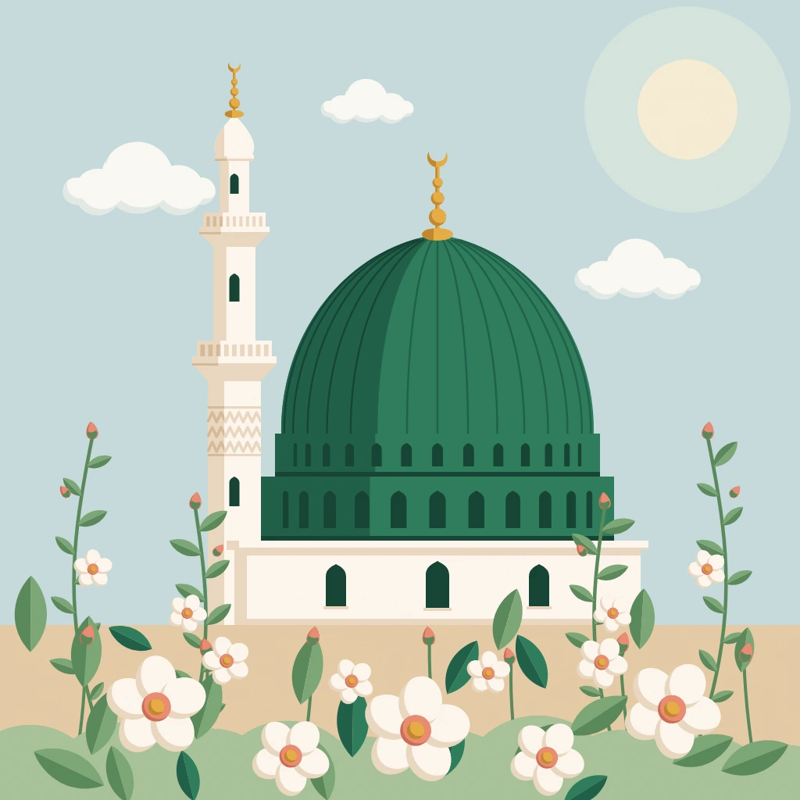

Düz illüstrasyon biçimleri geometrik olarak sadeleştirir ve kontursuz, düz renk alanlarıyla anlatır; derinlik yalnızca her biçimin gölgede kalan yanındaki tek bir koyu tonla verilir. Beş-sekiz renklik uyumlu bir palet, keskin kenarlar ve isteğe bağlı çok hafif bir gren çağdaş editoryal görünümü kurar. Dergi ve gazete illüstrasyonlarında, kurumsal anlatımlarda, uygulama ve web arayüzlerinde yaygındır.

- **Köken:** Kökleri 20. yüzyıl ortasının modernist afiş ve çocuk kitabı illüstrasyonuna (Charley Harper, Mary Blair, Paul Rand) uzanır; 2010'larda dijital arayüzlerdeki düz tasarım (flat design) akımıyla birlikte vektör araçlarında olgunlaştı. Bugün editoryal illüstrasyonda Malika Favre ve Tom Haugomat gibi sanatçıların sade, sınırlı paletli işleri bu dilin örnekleridir.
- **Ayırt edici:** Hiçbir biçimde kontur yok; her öğe keskin kenarlı düz renk alanı; Tek tonluk gölge: ışık sağ üstten, kubbe, kasnak ve minarede gölge sınırı aynı boylamda; şerefe çıkmaları ve korniş altı gölge tonunda; Kaburgalar ve zikzak bant bir ton koyu ince şeritler; pencereler en koyu yeşil; Taç yapraklarında, bulutlarda ve alem kürelerinde kaydırmalı gölge: her biçimin sol alt kenarında ince koyu hilal; Yapraklar orta damar boyunca açık ve gölge iki yarıya bölünmüş; adaçayı yeşili ve kubbe yeşili iki yaprak tonu; Soluk mavi gök, büyük açık renkli güneş dairesi ve halesi; önde yuvarlak hatlı düz bir çalı kütlesinin üstünde mercan göbekli beyaz çiçekler; çok hafif gren
- **Palet:** `#C7DCDD` `#FFF8EE` `#EBD9C2` `#2E7E5C` `#21614A` `#E8AE46` `#7DA877` `#EC8D73`
- **Kodla çizim:** JavaScript ile üretilen satır içi SVG; biçimler kontursuz dolgulu yollardır, yalnız kaburgalar, zikzak bant ve saplar düz renkli ince şerit (stroke) olarak çizilir. Her biçim açık ve gölge tonda iki katmandır: kubbe ve kasnakta gölge bölgesi u = −0,38 meridyeninin solu (SAHNE.kubbeProfili'nden kurulan yol); minarede her parça kendi yarıçapına göre kırpılmış ikinci bir gölge geçişiyle yeniden çizilir; taç yaprakları, bulutlar ve alem kürelerinde biçim gölge renginde, üstüne sağ üste kaydırılmış açık kopyası clipPath ile kırpılarak konur. Öndeki yaprak yelpazesi seyreltilir (birbirine 56 px'ten yakın yapraklar atlanır), tarhın altına üst üste binen dairelerden tek ton gölgeli bir çalı kütlesi konur. Gren, feTurbulence gürültüsünün %7 çarpma karışımıdır. Geometri SAHNE.minareParcalari, kasnakPencereleri, kaide, hilalYolu ve bitki'den gelir.
- **Kaynak:** [`S-022-duz-illustrasyon/ornek.html`](stiller/S-022-duz-illustrasyon/ornek.html)

### S-023

**Çizgi Sanatı** · *Line Art*

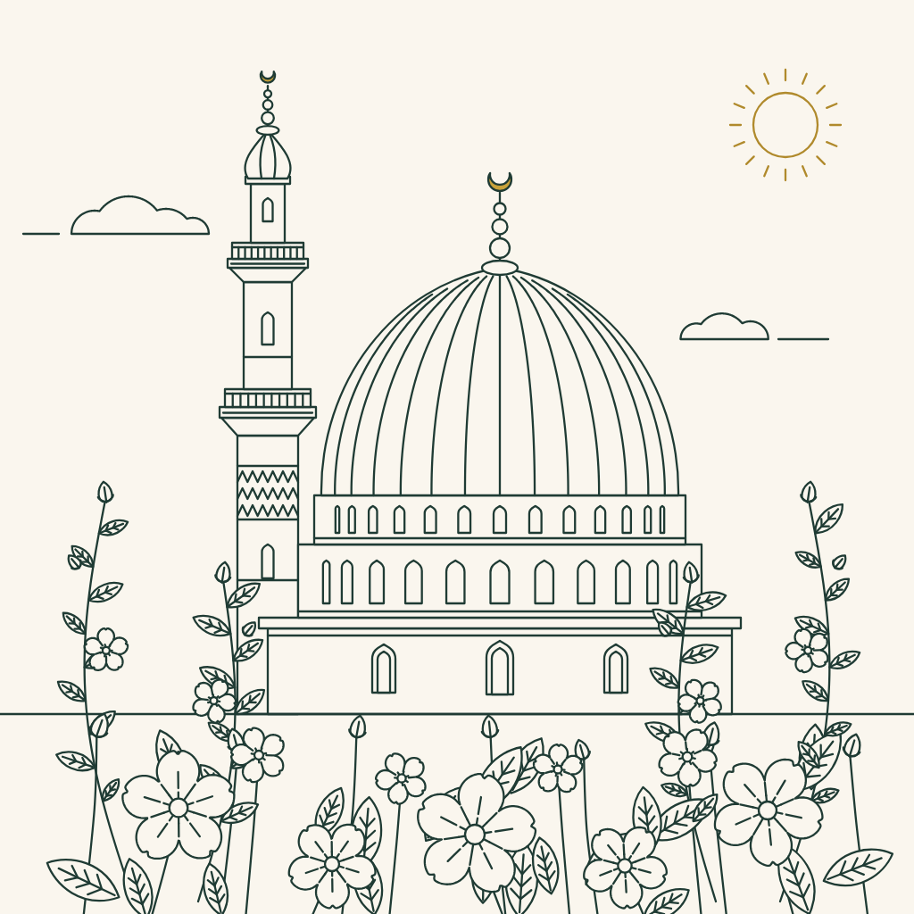

Çizgi sanatı (line art) konuyu yalnızca çizgiyle anlatır: ton, gölge ve dolgu yerine eşit kalınlıkta (monoline), tek renkli konturlar ve iç ayrıntı çizgileri kullanılır. Yuvarlak uçlu, temiz vektör çizgiler ve geniş beyaz alan sakin, zarif bir etki verir. Logo ve ikon tasarımında, ambalajda, davetiyelerde, boyama kitaplarında ve minimal duvar baskılarında yaygındır.

- **Köken:** Kökü gravür, kalem çizimi ve teknik illüstrasyon geleneğine; modern biçimiyle Matisse ve Picasso'nun tek çizgi desenlerine ve 20. yüzyıl ortasının reklam çizimlerine dayanır. Bugünkü monoline biçim vektör araçları ve ikon tasarımıyla (eşit kalınlık, yuvarlak uç ve birleşim) yaygınlaştı.
- **Ayırt edici:** Bütün çizgiler aynı kalınlıkta (2,3 px) ve tek renk (koyu yeşil mürekkep); uçlar ve birleşimler yuvarlak; Dolgu yok; tek vurgu altın: iki hilalin dolgusu ve güneşin çizgisi; Ayrıntılar yalnız çizgiyle: kubbe kaburgaları, kemerli pencereler, şerefe korkuluk babaları, zikzak bant, topuz dilimleri, yaprak damarları, çiçek ercikleri; Kaburgalar tepede komşusuna fazla yaklaştığı yerde bitiyor; çizgiler üst üste yığılmıyor; Örtüşmeler gizli çizgi yöntemiyle temiz: arkadaki çizgi öndeki biçimin içinde görünmüyor; Geniş boş gök, ışınlı güneş ve iki sade bulut çizgisi; seyreltilmiş yapraklarla sakin ön plan
- **Palet:** `#FAF6EE` `#1F3B34` `#C9A23A` `#B08A2C`
- **Kodla çizim:** JavaScript ile üretilen satır içi SVG; bütün yollar stroke-width 2,3, stroke-linecap ve stroke-linejoin round. Gizli çizgiler ressam sırasıyla çözülür: arkadan öne çizilen her kapalı biçim kâğıt rengiyle doldurulur (görünürde dolgu yoktur). Kaburgalar SAHNE.kaburgalar'dan alınıp komşu kaburgaya 6 px'ten fazla yaklaştıkları yükseklikte kesilir; çiçekler taç uçlarında çentikli kutupsal bir eğriyle tek dış çizgi olarak (taç ayrımları, damarlar ve ucu halkalı ercikler, boyu SAHNE.rng ile değişen hafif kıvrık ikinci derece Bézier çizgileri), yapraklar orta ve uca doğru kıvrılan yan damarlarıyla, bulutlar dairelerin üst zarfı olarak hesaplanır. Öndeki yapraklardan yalnız çiçeklerin arkasından çıkanlar seçilerek boşluk korunur.
- **Kaynak:** [`S-023-cizgi-sanati/ornek.html`](stiller/S-023-cizgi-sanati/ornek.html)

### S-024

**Low Poly** · *Low Poly*

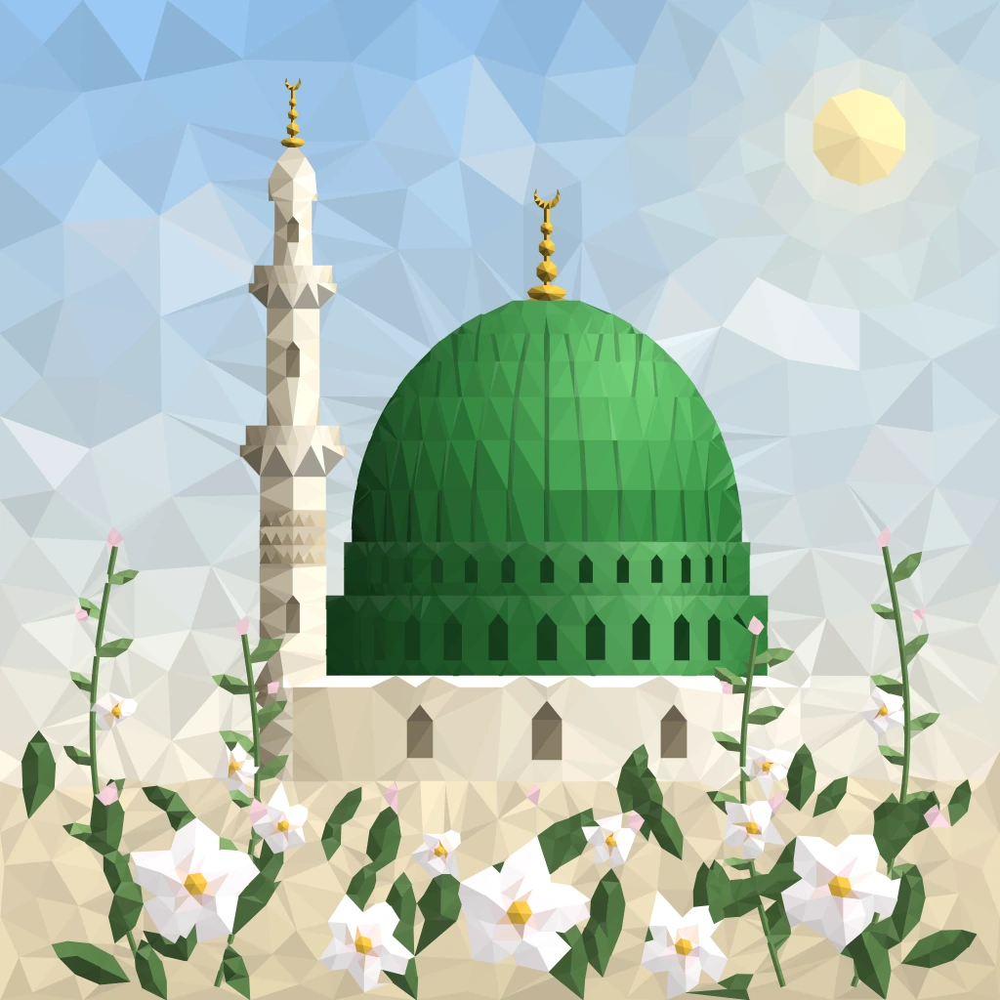

Low poly, sahneyi az sayıda düz gölgelenmiş üçgenden oluşan bir ağ olarak gösterir; her üçgen tek renktir ve hacim, ışığa göre farklı ton alan yüzlerle (faset) okunur. Üçgen kenarları çizgiyle değil, komşu yüzler arasındaki renk basamaklarıyla görünür. Oyun grafiğinde, hareketli grafik tasarımında, duvar kâğıtlarında ve poster illüstrasyonunda yaygındır.

- **Köken:** Adını 1990'ların gerçek zamanlı 3B grafiğindeki düşük poligon sayılı modellerden alır; 2010'larda bağımsız oyunlar ve dijital illüstrasyonda bilinçli bir estetiğe dönüştü. Fotoğraf ve resimleri Delaunay üçgenlemesiyle üçgen ağına çeviren üretken tasarım araçları bu görünümü yaygınlaştırdı.
- **Ayırt edici:** Bütün yüzey yaklaşık 3 800 düz renkli üçgenden oluşan tek bir ağ; çizgi yok, kenarlar renk basamaklarıyla görünüyor; Gökte büyük üçgenler; kubbede, pencerelerde, minarede ve çiçeklerde küçülen üçgenler; Kubbe kaburgalar boyunca hizalanmış hücrelerden; her kaburga tabandan üst üçte bire dek uzanan ince, bir ton koyu üçgen şeridi; Kemerli pencereler beşgen, şerefe korkulukları zikzak üçgen dizisi, minaredeki zikzak bant diş sıraları hâlinde; Sağ üstten gelen ışıkla mücevher kesimi gölgelendirme; güneş, yüzleri dışa eğik on köşeli bir disk ve onu saran düzgün çokgen hale halkaları; Alemler, hilaller, küçük pencereler ve ince saplar elle üçgenlenmiş; yapraklar orta damarda, saplar ortadan kırılan iki tonlu yüzeyler
- **Palet:** `#90BCE4` `#E3E5DE` `#6BC972` `#479A51` `#17371C` `#E5DECD` `#F8C847` `#527643`
- **Kodla çizim:** Canvas (2048 iç çözünürlük). SAHNE geometrisiyle her nesne (kubbe dilimleri, pencereler, minare parçaları, yapraklar, çiçekler…) ayrı bir renk kimliğiyle kimlik haritasına çizilir. Noktalar: kubbede kaburga × enlem kafesi (alt seviyelerde kaburganın iki yanına konan noktalar ince bir kaburga şeridi kurar), pencerelerde kemer beşgeni köşeleri, yapı kenarlarında sık noktalar, yaprak ve çiçek kenarlarında (ışın boyunca yürüyerek bulunan) noktalar, güneşte on köşeli disk ve aynı açılara dizilmiş hale halkaları; gök ve zemin değişken yarıçaplı Poisson diskiyle doldurulur. Komşuluk bilgili, yürüyerek yer bulan Bowyer–Watson Delaunay yaklaşık 1 900 noktadan 3 800 üçgen üretir. Her üçgenin rengi SAHNE.renkHaritasi'nın üçgen içindeki ortalamasıdır (yalnız çoğunluk nesnesinin örnekleri); üstüne nesne türüne göre çözümsel yüzey normaliyle sağ üstten Lambert ışığı ve küçük rastgele yüz farkı eklenir. Kaburga şeridindeki ince üçgenler bir ton koyulaştırılır, güneş diski sıcak açık sarıya boyanır. Alemler, zikzak bant, minare ve kaide pencereleri (kemer beşgeni üç üçgen) ve saplar (yalnız görünen parçaları, iki tonlu şerit) ağın üstüne elle üçgenlenir.
- **Kaynak:** [`S-024-low-poly/ornek.html`](stiller/S-024-low-poly/ornek.html)

### S-025

**İzometrik** · *Isometric Illustration*

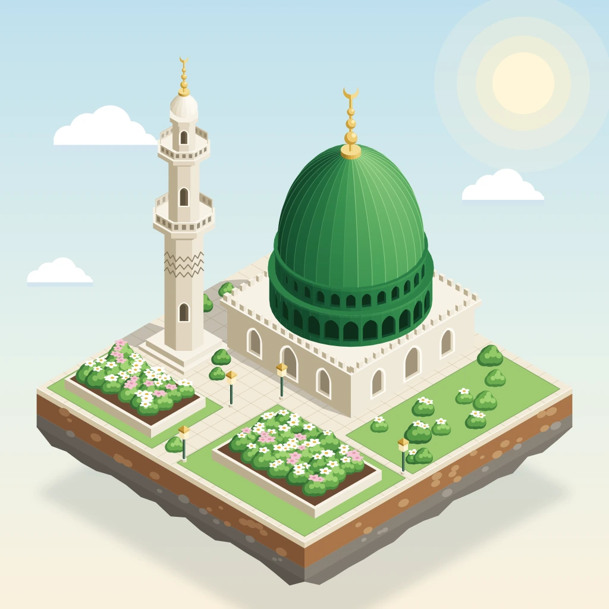

İzometrik illüstrasyon, nesneleri birbirine 120° açılı üç eksen üzerinde, uzaklaştıkça küçülmeden çizen teknik bir izdüşümdür; paralel çizgiler hep paralel kalır. Bugün bilgi grafiklerinde, oyun ve uygulama arayüzlerinde, kurumsal sunumlarda sık görülen 'masa üstü diorama' görünümünü verir. Yüzeyler düz renklerle, ışığa göre üç tonla boyanır; temiz vektör kenarlar ve küçük, sevimli ayrıntılar (fener, çalı, tarh) sahneyi oyuncak bir maket gibi okutur.

- **Köken:** Kökü mühendislik ve mimarlık çizimindeki aksonometrik izdüşümlere (19. yüzyılda William Farish'in izometrik perspektifi) uzanır. 1980'lerin bilgisayar oyunları (Marble Madness, Populous, sonra SimCity 2000) bu bakışı ekranlara taşıdı; 2010'larda düz tasarım akımıyla birlikte vektör izometrik illüstrasyon web ve marka dünyasının gözde dili oldu.
- **Ayırt edici:** Perspektifsiz gerçek izometrik bakış: bütün yatay kenarlar 30° eğik, düşeyler dik ve paralel; Kalınlığı görünen, havada duran kare zemin karosu: taş döşeme şeridi, çakıllı toprak ve kırık kaya katmanı; Üç tonlu yüzey gölgelemesi: üst yüzler en açık, sağ (güneşe bakan) yüzler açık, sol yüzler koyu; Kubbe izometrik elipslerden kurulmuş dönel yüzey; 32 dilim düz tonlarla ve ince kaburga çizgileriyle; Sekizgen prizma minare, korkuluklu iki şerefe ve soğan topuz; zemine sola düşen düz yarı saydam gölgeler; Karonun üstünde yükseltilmiş çiçek tarhları, yuvarlak çalılar, küçük yol fenerleri; minarenin dibindeki avluda yıldız kakmalı taş madalyon üstünde sekizgen şadırvan ve saksıda bir hurma ağacı
- **Palet:** `#1F693C` `#46A057` `#F4EEDF` `#C3B597` `#D9AC40` `#9FCB72` `#A9764A` `#BFE0EE`
- **Kodla çizim:** Tek canvas (2× iç çözünürlük). Kendi izdüşüm fonksiyonu P(x,y,z) = (512 + (x−y)·cos30°, OY + (x+y)·sin30° − z) ile bütün öğeler dünya koordinatında kuruldu. Kutular, n kenarlı prizmalar ve kesik koniler yüzey normali ile ışık vektörünün (sağ üst) iç çarpımına göre rampadan düz ton alır; arkaya bakan yüzler çizilmez. Kubbe SAHNE.kubbeProfili()'nden alınan profille dönel yüzey olarak 32 dilime bölündü, her dilimin yalnız izleyiciye bakan kısmı görünürlük sınırında kesilip hafif dikey geçişle dolduruldu; kasnak pencereleri silindir yüzeyine sarılmış sivri kemerler, kaide pencereleri yüz düzlemine eğilmiş kemerlerdir. Gölgeler ışık yönünde zemine izdüşürülen noktaların dışbükey zarfıyla ekran dışı tuvalde birleştirilip karo üstüne kırpıldı. Avludaki şadırvan sekizgen prizma ve kesik konilerden kuruldu; su, havuz ağzına kırpılmış daha alçak bir sekizgen olarak çizildiği için arka iç duvar görünür. Hurmanın gövdesi iki tonlu boğumlarla, tacı ekran düzleminde sarkan, kenarı tırtıllı ve üst yarısı açık tonlu on iki yaprakla çizildi. Tarh, çalı, çiçek, fener ve avlu öğeleri derinliğe (x+y) göre sıralanıp ressam algoritmasıyla çizildi.
- **Kaynak:** [`S-025-izometrik/ornek.html`](stiller/S-025-izometrik/ornek.html)

### S-026

**Piksel Sanatı** · *Pixel Art*

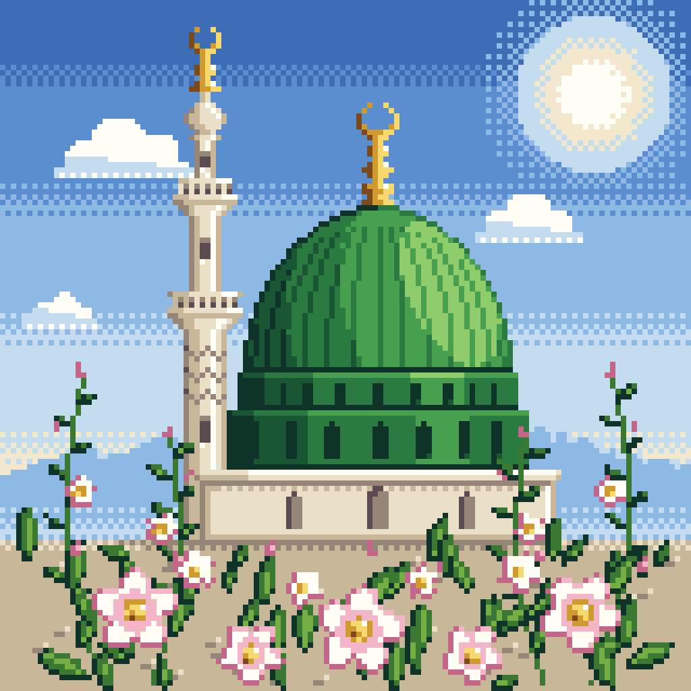

Piksel sanatı, görüntünün çok düşük çözünürlükte, pikseller tek tek bilinçli olarak yerleştirilerek kurulduğu dijital bir resim dilidir. Sınırlı palet, kenar yumuşatmasının olmayışı, düz renk kümeleri ve gökte ya da geçişlerde damalı titreklik (dithering) başlıca araçlarıdır. Bağımsız oyunların arka planlarında, simgelerde ve retro esintili illüstrasyonlarda kullanılır; büyütüldüğünde her piksel net bir kare olarak görünür.

- **Köken:** 1970'lerin ve 80'lerin oyun makineleri ile ev bilgisayarlarının (Atari, Commodore 64, NES, Amiga) donanım sınırlarından doğdu; az renk ve düşük çözünürlük sanatçıları her pikseli düşünerek koymaya zorladı. Mark Ferrari'nin palet döngülü manzaraları, LucasArts macera oyunları ve 16 bit dönemi bu dilin klasikleridir; 2000'lerden sonra Fez, Celeste, Eastward gibi bağımsız oyunlarla bilinçli bir estetik olarak yeniden doğdu.
- **Ayırt edici:** 128 × 128 ızgara, 8× en yakın komşu büyütme: her piksel keskin bir kare, hiçbir yerde kenar yumuşatması yok; 22 renklik sınırlı palet; gölgeler maviye-mora, ışıklar sarıya kaydırılmış tonlar; Gök degradesi düz bantlar ve aralarında damalı (ordered) titreklik geçişleriyle; güneşin halesi de damalı halkalar; Kubbede bantlı ışık kümeleri ve bir ton koyu piksel çizgilerle kaburgalar; gölge tarafında en koyu, ışık tarafında açık seçici dış çizgi; Elle yerleştirilmiş ayrıntılar: uçları içe kıvrık, altı kalın kâse biçimli hilaller, küre boğumlu alemler, minaredeki V zikzak bant ve korkuluk dikmeleri; Pembe kenarlı beyaz çiçekler (küçükleri elle çizilmiş beş yapraklı sprite'lar), sarı göbekler ve koyu kenarlı iki tonlu yapraklar; ufukta uzak tepe katmanı
- **Palet:** `#3B6CB4` `#8DB9E4` `#2A7A42` `#8DCB6B` `#F6D86E` `#E9DEC6` `#C4668A` `#FFFDF4`
- **Kodla çizim:** Çizim 128 × 128'lik bir dizin tamponunda (her hücre 22 renklik paletten bir numara) yapıldı; tarayıcının çizim fonksiyonları kullanılmadı. Kendi rutinleri: piksel merkezine göre tarama çizgisiyle çokgen doldurma, Bresenham çizgisi, harf haritalı elle çizilmiş sprite'lar (hilaller, alemler, soğan topuz, pencereler, küçük çiçekler) ve %25/%50/%75 damalı desenler. Kubbe SAHNE.kubbeProfili()'nden piksel piksel maskelenip yüzey normaline göre dört düz banda ayrıldı, kaburgalar meridyen boyunca bir ton koyu piksellerle işlendi; dış çizgi rengi kenarın yönüne göre seçildi. Yaprak, tomurcuk ve büyük çiçekler SAHNE.bitki konumlarından 128 uzayına rasterleştirilip iki tonla ve seçici kenarla boyandı. Sonunda tampon ImageData'ya çevrilip imageSmoothingEnabled=false ile 8× büyütüldü.
- **Kaynak:** [`S-026-piksel-sanati/ornek.html`](stiller/S-026-piksel-sanati/ornek.html)

### S-027

**Risograf Baskı** · *Risograph Print*

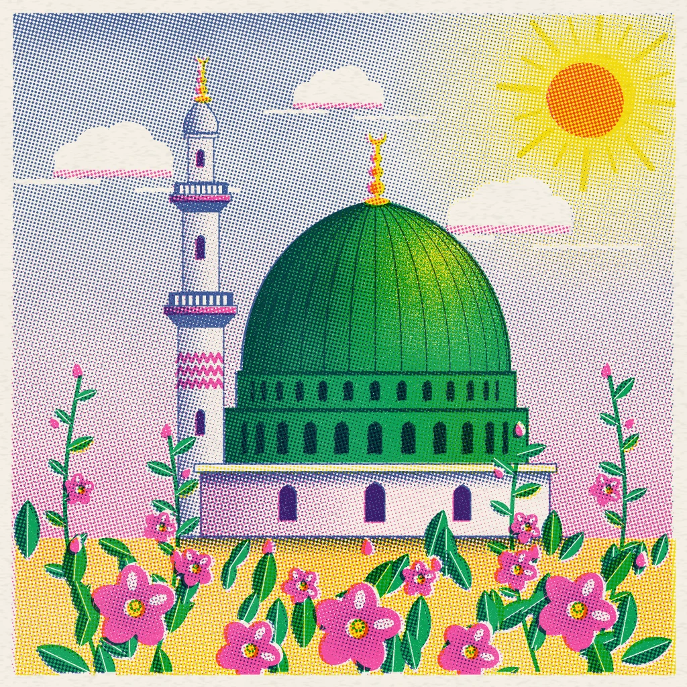

Risograf, ana kalıbı ısıyla delinen ince bir zarın içinden mürekkebi kâğıda iten, fotokopi makinesine benzeyen bir şablon baskı makinesidir. Her renk ayrı bir tamburla ve ayrı geçişte basılır; yarı saydam soya bazlı mürekkepler üst üste binince karışarak yeni renkler verir. Tonlar yarım ton noktaları ya da stokastik taneyle oluşur; kayma, düzensiz mürekkep ve tambur izleri baskının doğal parçasıdır. Fanzin, afiş, sanatçı kitabı ve küçük yayıncılıkta sevilen, canlı ve floresan renkli bir estetiktir.

- **Köken:** Japon Riso Kagaku şirketi 1980'lerde Risograph makinesini okul ve ofisler için ucuz, hızlı bir çoğaltma aracı olarak geliştirdi; şirketin 1977 tarihli Print Gocco el baskı aleti de aynı şablon ilkesine dayanır. 2000'lerden itibaren bağımsız baskı atölyeleri, tasarımcılar ve fanzin kültürü onu kendine özgü renkleri olan bir sanat ortamına dönüştürdü.
- **Ayırt edici:** Yeşil, sarı, floresan pembe ve orta mavi; üst üste binince koyu yeşil, mor ve turuncu tonlar; Gökte, minarede ve kubbe gölgesinde döndürülmüş yarım ton ızgaraları; yeşilde stokastik tane; Katmanlar arasında gözle görülen kayma: alemlerde sarı ile pembe ayrışır, kenarlarda ince kâğıt boşlukları açılır; Düzensiz mürekkep yoğunluğu, ince benekler ve yatay merdane bantları; Kaplamasız kırık beyaz kâğıt ve çevrede basılmamış kenar payı; Sade, kalın grafik biçimler: pembe çiçekler, kâğıt beyazı bulutlar, kalın ışınlı güneş
- **Palet:** `#F5F0E5` `#00A95C` `#FFE800` `#FF48B0` `#3255A4` `#053338` `#3C216E`
- **Kodla çizim:** Her mürekkep (sarı, pembe, yeşil, mavi) için 2048 px'lik ayrı bir yoğunluk katmanı çizilir (alfa = mürekkep miktarı): gökte mavi ve pembe degradeler, güneşte sarı ve pembe, kubbede yeşil zemin, enlem boyunca mavi gölge ve sarı parıltı, çiçeklerde pembe, binada mavi çizgiler. Öndeki biçim arkadakini bütün katmanlarda boşaltır (knockout). Baskı adımında her katman kendi kaymasıyla okunur ve taranır: sarı, pembe ve mavi farklı açılarda (7°, 75°, 15°) 5,4 px hücreli yarım ton noktalarıyla, yeşil stokastik taneyle. Yoğunluk geniş lekelenme gürültüsü ve renge göre farklı yerde duran yatay merdane bantlarıyla (her renkte bir de mürekkebi azalmış dar şerit) oynatılır; bantlar hem nokta boyunu hem mürekkep miktarını etkiler; ince benekler mürekkebi keser. Renkler kırık beyaz kâğıtla çarpılarak (multiply) üst üste biner, çevrede basılmamış kenar payı kalır.
- **Kaynak:** [`S-027-risograf/ornek.html`](stiller/S-027-risograf/ornek.html)

### S-028

**Teknik Çizim (Mavi Kopya)** · *Blueprint*

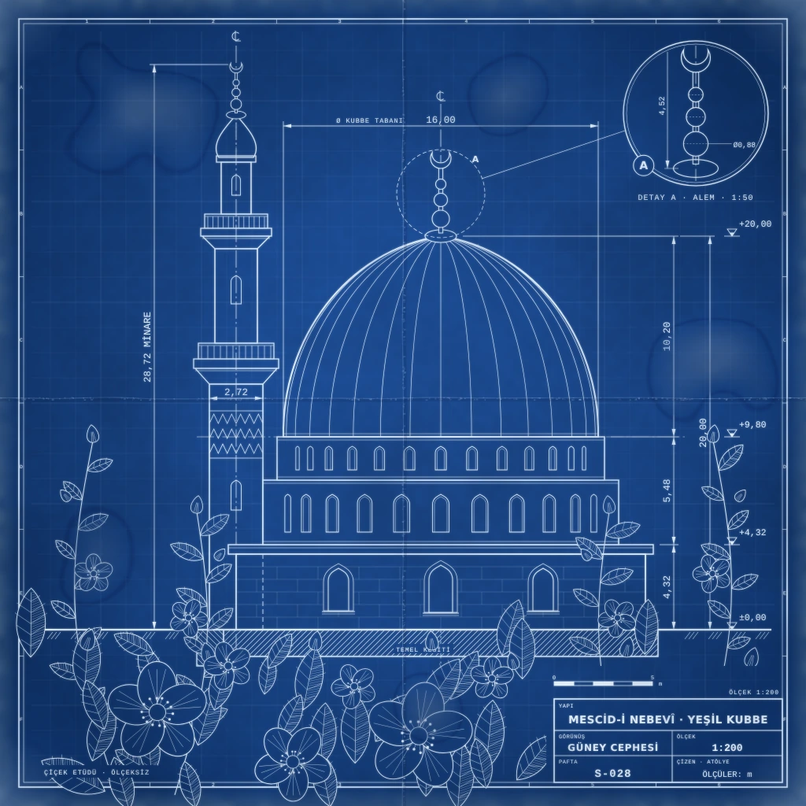

Mavi kopya, mimari ve mühendislik çizimlerinin ışığa duyarlı kâğıda çoğaltılmasıyla ortaya çıkan, koyu mavi zemin üzerinde beyaz çizgili baskıdır. Ortografik görünüşler, oklu ölçü çizgileri, kesik-noktalı eksenler, kesitlerde tarama ve sağ alttaki antet bu dilin vazgeçilmezleridir. Kullanılmış paftalarda katlama izleri, kenar aşınması ve kimyasal lekeler de görünür; bugün teknik ve 'mühendislik' estetiğini çağrıştırmak için grafik tasarımda sıkça kullanılır.

- **Köken:** Siyanotipi 1842'de Sir John Herschel buldu; demir tuzlarıyla kaplı kâğıt ışıkta Prusya mavisine döner, çizgilerin gölgede kalan yerleri beyaz kalır. 1870'lerden 1940'lara kadar tersane, demiryolu ve mimarlık bürolarında çizimleri çoğaltmanın standart yolu oldu; sonra yerini amonyakla banyo edilen diazo kopyalara ve bilgisayar çıktılarına bıraktı, ama 'blueprint' sözcüğü plan anlamında dilde kaldı.
- **Ayırt edici:** Prusya mavisi, lekeli ve dokulu kâğıt üzerinde hafif dağılmış beyaz/açık camgöbeği çizgiler; Ortografik güney cephesi: kubbe kaburgaları, kasnak pencereleri, kaide taş dizileri, kaidenin arkasında kalan minare kenarı kesik (gizli) çizgiyle; Oklu ölçü çizgileri ve sayılar (16,00 · 28,72 · zincir ölçüler), kot işaretleri, kesik-noktalı eksenler ve kubbenin yapım daireleri; Soluk yapı ızgarası, bölge harfli pafta çerçevesi ve temel kesitinde 45° tarama; Sağ üstte büyütülmüş alem detayı (DETAY A · 1:50), sağ altta antet ve çizgisel ölçek; Katlama izleri, aşınmış kenarlar, kuruma halkalı su lekeleri; ön planda damarlı ve taramalı ince botanik çiçek etütleri
- **Palet:** `#0F3063` `#1B488C` `#3A66A7` `#335587` `#537099` `#819EC5` `#EAF6FF`
- **Kodla çizim:** Kâğıt 1024 × 1024 ImageData olarak piksel piksel hesaplandı: merkezden kenara Prusya mavisi geçişi, üç ölçekli değer gürültüsüyle beneklenme, gürültüyle bozulmuş dairesel maskelerle açık içli, koyu kuruma halkalı su lekeleri ve aşınmış kenarlar. Bütün çizim 2× çözünürlükte ayrı, saydam bir 'çizgi katmanına' beyazla yapıldı; SAHNE.yollar() ve SAHNE.minareParcalari() geometrisi Path2D ile çizildi, öndeki öğe çizilmeden önce kendi biçimi destination-out ile silinerek arkadaki çizgiler örtüldü. Ölçü okları, kot işaretleri, eksen simgesi, tarama, pafta çerçevesi, antet ve ölçek çubuğu kendi yardımcılarımızla; yazılar DejaVu Sans ve Liberation Mono. Botanik etütler SAHNE.bitki konumlarından kontur, orta ve yan damar, gölge yarısında ince tarama ve ercik çizgileriyle kuruldu. Katman gürültü maskesiyle hafifçe düzensizleştirilip önce bulanık (dağılma), sonra keskin olarak kâğıda basıldı; en son katlama sırtları ve köşe aşınması eklendi.
- **Kaynak:** [`S-028-teknik-cizim/ornek.html`](stiller/S-028-teknik-cizim/ornek.html)

### S-029

**Katmanlı Kâğıt** · *Layered Papercut*

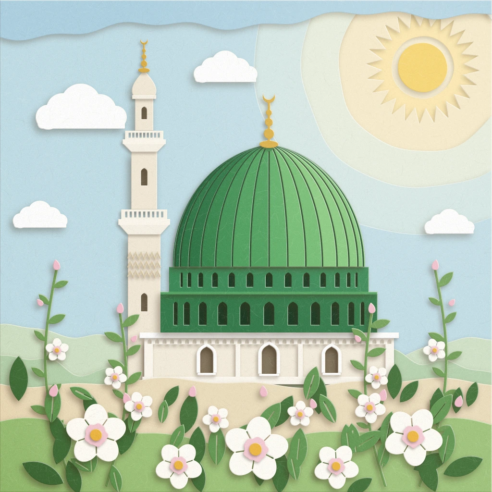

Katmanlı kâğıt kesimi, düz renkli kâğıtların biçimlere kesilip aralarında küçük boşluklarla üst üste yapıştırılmasıyla yapılan kabartma bir resim tekniğidir. Her katmanın kenarı ışıkta ince parlar, altındaki katmana yumuşak bir gölge düşürür; böylece düz renkler gerçek bir derinlik kazanır. Kitap kapaklarında, vitrinlerde ve 'paper art' esintili dijital illüstrasyonlarda sevilen, sıcak ve el yapımı hissi veren bir dildir.

- **Köken:** Kâğıt kesme sanatının kökü Çin'in jianzhi geleneğine, Osmanlı'daki kat'ı (kâğıt oyma) sanatına ve Avrupa'nın silüet kesimlerine uzanır. Katmanlarla derinlik veren bugünkü 'shadow box' ve 'layered papercut' çalışmaları 2010'larda Hari & Deepti, Owen Gildersleeve gibi sanatçılarla yaygınlaştı; aynı görünüm dijital illüstrasyonda yumuşak gölgeli kâğıt katmanlarıyla taklit edilir.
- **Ayırt edici:** Otuz dört ayrı kâğıt katmanı: gök halkaları, güneş, bulutlar, iki sıra uzak tepe, minare ve kabarık şerefeleri, kaide gövdesi, pilastrlar ve kör kemer frizi, pencere çerçeveleri, kasnak, kubbe, alem, zemin, çayır, yapraklar ve çiçekler; Her katmanın sol alta düşen yumuşak gölgesi; pencere deliklerinin ve frizdeki küçük kemer oyuklarının içinde arkadaki kâğıda düşen gölge; Ayrı ayrı kesilmiş, sağa doğru açılan yeşil tonlarda 16 kubbe dilimi ve aralarındaki koyu boşluklar (kaburgalar); Güneşin çevresinde dalgalı halkalar ve ışınlı yıldız kesimi; üstte kabarık altın güneş diski; Her kâğıtta lifli doku, sağ üste bakan kesim kenarında ince ışık, karşı kenarda kâğıt kalınlığı gölgesi; Derinliğe göre palet: arkada soluk gök ve kum tonları, önde daha doygun yeşiller ve beyaz çiçekler
- **Palet:** `#BEDCE6` `#F5D77C` `#F1E8D6` `#2B7243` `#55A861` `#D8A93F` `#EBDCBC` `#FFFDF7`
- **Kodla çizim:** Her kâğıt katmanı 2048 × 2048'lik ekran dışı bir tuvale kendi biçimleriyle (SAHNE.yollar(), minare parçaları, kubbe profili, SAHNE.bitki) boyanır, delikler destination-out ile kesilir. Sonra bir kez üretilen lif dokusu (ince benek + 9000 kıvrık iplik) her katmana farklı kaydırmayla source-atop olarak işlenir; katmanın kendi alfa kanalı sol alta kaydırılıp çıkarılarak sağ üst kenarda ince ışık, ters yönde kâğıt kalınlığı gölgesi elde edilir. Katman ana tuvale shadowBlur ve shadowOffset ile (ışık sağ üstten, gölge sol alta) basılır; böylece her katman ancak altındakilere gölge düşürür. Kubbe 16 dilime ayrı ayrı kesilip boylamına göre yeşil tonlandırıldı. Beyaz kaide düz kalmasın diye gövdenin üstüne ayrı katmanlar olarak pilastrlar, taban silmesi, SAHNE.kemerYolu() ile oyulmuş kör kemer frizi ve evenodd dolguyla kesilmiş sivri kemer pencere çerçeveleri eklendi; minarenin çıkmaları ve bileziği de gövdeden ayrı, kabarık kâğıttır. En sonda soft-light karışımlı radyal ışıkla fotoğraf aydınlatması verildi.
- **Kaynak:** [`S-029-katmanli-kagit/ornek.html`](stiller/S-029-katmanli-kagit/ornek.html)

### S-030

**Neon Gece** · *Neon Sign*

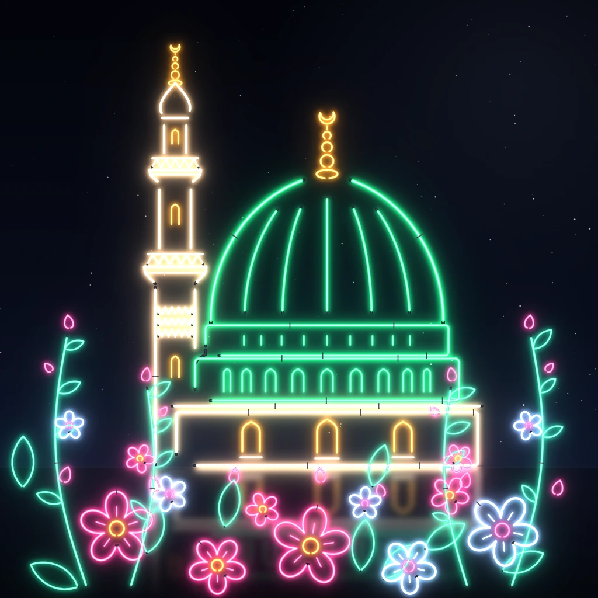

Neon tabela, içinde soy gaz bulunan ince cam tüplerin ısıtılıp elle bükülmesi ve elektrotlarla yakılmasıyla yapılan ışıklı yazı ve resimlerdir. Tüpler her yerde aynı kalınlıktadır, uçları yuvarlaktır; ayrı tüplerin birleştiği ya da arkadan dolaştığı yerlerde küçük boşluklar ve siyaha boyanmış sönük kısımlar görülür. Işık tüpün ortasında neredeyse beyaz, kenarında doygun renkli, çevresinde ise geniş yumuşak bir hale olarak algılanır; bu yüzden neon hem vitrinlerde hem de gece temalı dijital illüstrasyonlarda güçlü bir atmosfer kurar.

- **Köken:** Georges Claude neon lambasını 1910'da Paris'te tanıttı; 1923'te Los Angeles'a gelen ilk neon reklamlarla birlikte tabela dili 1930–60 arası Amerikan şehirlerinin, Las Vegas'ın ve Tokyo'nun gece yüzü oldu. Cam bükme ustalığı bir zanaat olarak sürerken, 1980'lerden sonra neon görünümü synthwave ve gece temalı grafik tasarımda dijital olarak da yeniden üretilir.
- **Ayırt edici:** Sabit kalınlıkta, uçları yuvarlak cam tüpler; her tüpte beyaz-sıcak çekirdek, renkli gövde ve dört katlı yumuşak hale; Yeşil tüplerle kubbe dış çizgisi, beş kaburga, iki kat kasnak; alt katta kemerli pencereler, üst katta küçük kemerli nişler; tepede alemin oturduğu boşluk; Sıcak beyaz minare ve kaide, altın alemler, hilaller ve pencereler; şerefe korkulukları ve gövde bandı zikzak tüplerle; Ölçülü, ağırbaşlı palet: yumuşak gül pembesi ve inci beyazı beş loblu çiçekler, altın göbekler, yeşim yeşili saplar ve yapraklar; Gerçek neon yapımı ayrıntıları: bükülme yerlerinde boşluklar, uçlarda sönük koyu elektrot kısımları, karartılmış bağlantı tüpü ve küçük tüp tutucular; Soluk yıldızlı gece göğü; parlak koyu zeminde bulanık yansıma ve ışık havuzu
- **Palet:** `#070B18` `#34F08A` `#FFF2DC` `#FFC247` `#F7A9BE` `#FFEFEA` `#6FD8A4`
- **Kodla çizim:** Motif, SAHNE geometrisinden (kubbe profili ve kaburgalar, kasnak pencereleri, kaide, minare parçaları, alem, SAHNE.bitki) üretilen çoklu çizgilerden oluşan bir 'tüp listesi' olarak kuruldu; her tüpün rengi, kalınlığı, elektrot ucu ve tutucu aralığı var. Çiçekler beş loblu kutupsal eğriyle tek tüp, hilal dış ve iç yayın birleşimiyle, kasnak nişleri ve pencereleri SAHNE.kemerYolu() örneklenerek alt ucu açık tek tüp olarak çizildi. Hale renkleri yarı saydam tutuldu ki pembe ve sıcak beyaz tüpler yeşil kubbeyi bastırmasın. Tüpler 2× çözünürlükte ayrı tuvallere ışık, gövde ve çekirdek olarak çizildi; ışık tuvali 'lighter' karışımla dört farklı bulanıklıkta (70, 30, 12, 4 px) üst üste toplandı, üstüne doygun renkli gövde ve hafif bulanık beyaz çekirdek basıldı. Tüplerin uçları yay uzunluğuna göre kesilip koyu camla, tutucular tüp yönüne dik küçük kıskaçlarla eklendi. Yapı tüpleri ters çevrilip bulanıklaştırılarak zemine sönümlenen yansıma olarak işlendi; gök degrade ve tohumlu yıldızlarla kuruldu.
- **Kaynak:** [`S-030-neon-gece/ornek.html`](stiller/S-030-neon-gece/ornek.html)

## Atölye Özgün

### S-031

**Beş Vakit** · *Five Prayer Times* · ✦ atölye özgün

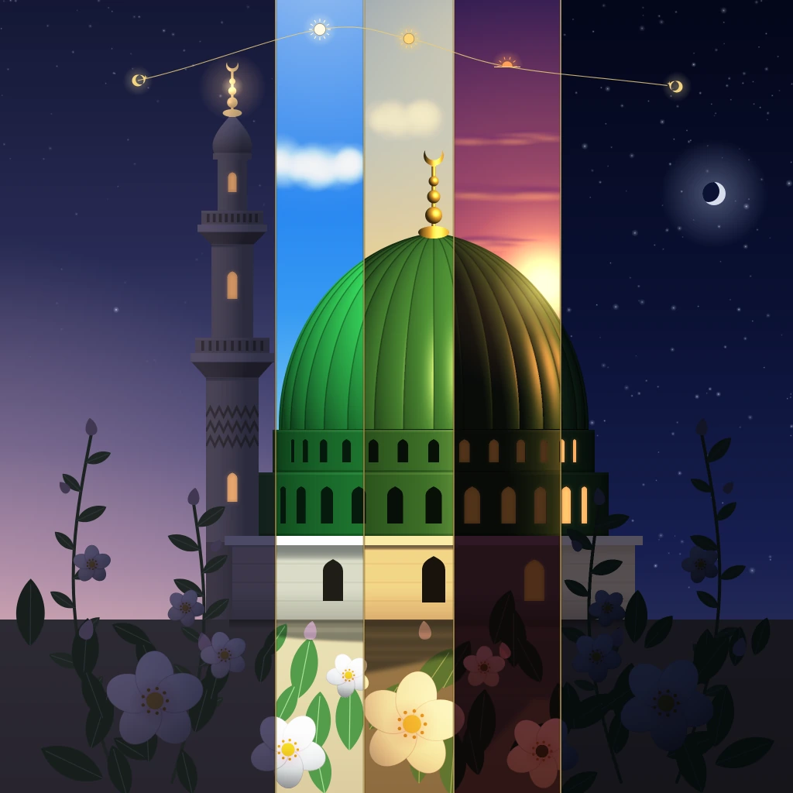

Tuval soldan sağa beş dikey banda bölünür ve her bant aynı, kesintisiz sahneyi başka bir vaktin ışığında gösterir: İmsak'ta şafak öncesi serin mor-mavi gök, son yıldızlar ve sabah yıldızı; Öğle'de tepeden beyaz ışık, kısa gölgeler ve doygun renk; İkindi'de altın sarısı sıcak ışık ve uzayan gölgeler; Akşam'da turuncu-eflatun gök, ufka alçalmış güneş ve kızıl kenar ışıklı yarı siluet yapı; Yatsı'da koyu çivit gece, ay ve yıldızlar. Geometri bant sınırlarında hiç kaymaz; değişen yalnız ışığın yönü ve rengi, gök, gölgeler ve palettir; gece ve alacakaranlık bantlarında yapının ışıkları (pencereler, alem) yanar. Bantlar aşağı yukarı eşit genişliktedir (burada 236, 192, 192, 192 ve 212 piksel; gece kanatları biraz geniş), böylece beş vakit eşit bir ritimle okunur ve sınırlar konunun içinden geçer: minare Öğle'ye, alem İkindi'ye, kubbenin sağ omzu Akşam'a düşer. Bantlar ince altın kıl çizgilerle ayrılır; üstte ortak bir yay (güneşin yolu) üzerinde her bandın ortasında o vaktin güneş ya da hilal işareti durur.

- **Köken:** Fikir, namaz vakitlerinin günü beş ışığa bölmesinden doğdu. Aynı yapının gün boyunca değişen ışıkta defalarca resmedildiği seri resim geleneği (Monet'nin Rouen Katedrali dizisi gibi) tek bir tuvalde, yan yana dikey şeritler hâlinde toplanır; Medine'de günün ritmini ezan vakitleri belirlediği için ışık saat yerine vakitlerle okunur ve üstteki güneş yolu bir vakit cetveli gibi çalışır.
- **Ayırt edici:** Soldan sağa İmsak, Öğle, İkindi, Akşam ve Yatsı ışığında, aşağı yukarı eşit genişlikte beş dikey bant; Minare, kubbe, kasnak, kaide ve çiçekler bant sınırlarında kaymadan sürer; yalnız ışık, gök ve renk değişir; Bantları ayıran ince altın kıl çizgiler ve üstte ortak güneş yolu yayında hilal, güneş ve ufuktaki yarım güneş işaretleri; İmsak'ta mor-pembe şafak, son yıldızlar ve sabah yıldızı; Yatsı'da çivit gece, hilal ay ve yıldızlar; Öğle'de mavi gök ve parlak beyaz minare, İkindi'de altın sarısı gök ve sıcak ışıkta parlayan kubbe ile alem; Akşam'da kubbenin sağ omzunda ufka alçalmış güneş, kızıl kenar ışıklı yarı siluet kubbe ve yanmaya başlayan pencereler
- **Palet:** `#272C66` `#5C9EF0` `#2CAF4A` `#F2C27E` `#C5467A` `#FE8D67` `#0B133C` `#C9A043`
- **Kodla çizim:** Canvas, 2048 iç çözünürlük; bant sınırları x = 236, 428, 620 ve 812. Sahne önce ışıksız düz renklerle (albedo) ve SAHNE bölge haritasıyla ayrı tuvallere çizilir; her piksel için bulunduğu bandın vakit ayarlarıyla (güneş yönü, rengi ve gücü, gök ve yer ortam ışığı, gece projektörü, pozlama, ton ve doygunluk) Lambert ve Blinn-Phong ışığı hesaplanır. Normaller geometriden çıkarılır: kubbe profili ve 16 dilimli kaburgalar, silindir kasnak ve minare, düz kaide, küre alemler, hafif kubbemsi çiçekler. Gölgeler: bina siluetinin vakte göre eğik izdüşümüyle yer gölgesi, korniş ve şerefe altı gölgeleri, minarede ışığa doğru yürüyerek bulunan kubbe gölgesi. Gökler bant bant degrade, yıldız, şafak ve gün batımı bulutları, sabah yıldızı, alçak güneş ve hilal ayla çizilir; pencere ve alem ışımaları bulanık 'lighter' katmanla, altın kıl çizgiler ve Catmull-Rom eğrisiyle güneş yolu en üstte çizilir.
- **Kaynak:** [`S-031-bes-vakit/ornek.html`](stiller/S-031-bes-vakit/ornek.html)

### S-032

**Nur Hüzmesi** · *Beam of Light* · ✦ atölye özgün

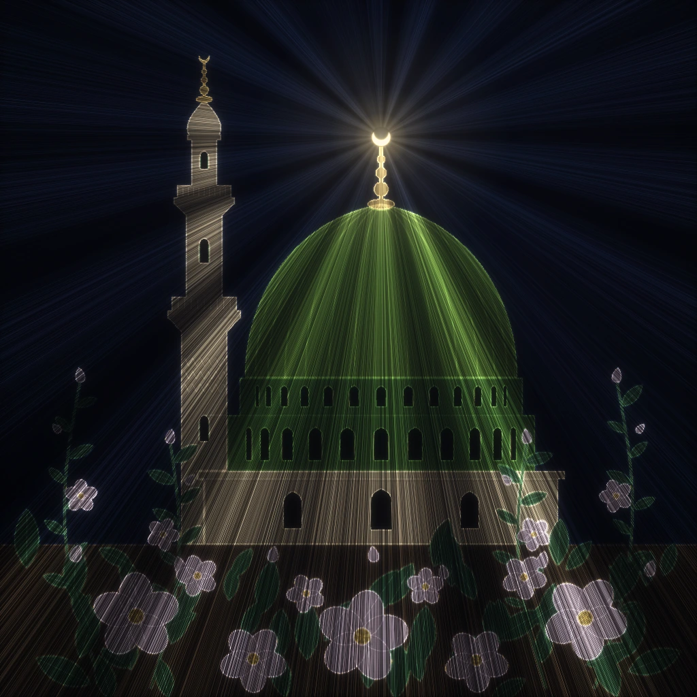

Zemin derin koyudur ve hiçbir dış çizgi ya da renk dolgusu kullanılmaz; sahnenin en anlamlı noktasına konan tek bir ışık kaynağından (burada kubbe alemindeki hilal) her yöne binlerce ince, düz ışın çıkar. Her ışın geçtiği biçime göre parlaklık ve renk değiştirir: kubbe üstünde yeşil-altın, minare ve kaidede krem, çiçeklerde pembe-beyaz, yapraklarda yeşil, gökte soluk mavi, yerde sönük sıcak kum rengi; pencere gibi boşluklarda söner. Işınlar kaynağa yakın yoğun ve parlaktır, kaynağın kendisi parlayan bir biçim (hilal) ve yumuşak hâle olarak görünür; ışın bir biçime girip çıkarken ya da kaburga, korkuluk, taç yaprağı kenarı gibi bir ayrıntıyı keserken kısa bir parlama yapar. Biçimler yalnızca bu ışın değişimiyle okunur; kural her konuya, anlamlı bir noktaya kaynak konarak uygulanabilir.

- **Köken:** İlham, karanlık bir mekâna aralıktan sızan ışık hüzmelerinden, tozlu havada görünen ışık sütunlarından ve 'nur' kavramının kendisinden geldi: görmek, ışığın bir şeye çarpmasıdır. Fikrin özü resmi boyayla değil ışıkla yazmak ve her şeyi aydınlatan kaynağı sahnenin en anlamlı noktasına, kubbe alemindeki hilale koymaktır.
- **Ayırt edici:** Kubbe alemindeki parlayan hilalden her yöne yayılan binlerce ince ışın ve kaynakta yumuşak hâle; Dış çizgi ve dolgu yok: biçimler yalnızca ışınların renk ve parlaklık değişiminden okunuyor; Kubbede yeşil-altın, minare ve kaidede krem, çiçeklerde pembe-beyaz, yapraklarda yeşil, gökte soluk mavi, yerde sönük sıcak ışınlar; Kasnak ve kaide pencereleri ışığın söndüğü koyu kemerli boşluklar olarak kalıyor; Kaynaktan uzaklaştıkça seyrelen, tek tek seçilen ışın demetleri; Siluetlerde, kaburgalarda ve taç yaprağı kenarlarında ışınların kısa parlamalarıyla beliren çizgiler
- **Palet:** `#05070F` `#1C2033` `#83A951` `#9F9076` `#E8CF9C` `#CBBDC4` `#FFF8E6`
- **Kodla çizim:** Canvas, 2048 iç çözünürlük ve kendi Float32 ışık birikim tamponu. Bölge haritası SAHNE.ciz({bolge:true}) ile 2048 çözünürlükte çizilip bölge dizisine çevrilir (kenar yumuşatma hataları komşu çoğunluğuyla düzeltilir, güneş diski göğe katılır), renkHaritasi() ton haritası olur; ayrıca kaburga, zikzak, korkuluk, silme, taç yaprağı ve damar çizgilerinden bir ayrıntı haritası ve bölge sınırı haritası çıkarılır. Hilalden 5600 ışın, hilalin kenarından başlayarak 0,34 piksel adımla dışa doğru yürütülür; her adımda bölgeye göre renk ve güç, uzaklık sönümü, ton, sınır ve ayrıntı parlaması hesaplanıp tampona çift doğrusal serpmeyle toplanır (toplamalı karışım). Işın güçleri rastgele ve açıya bağlı demetlerle değişir, kaynağa yakın ışınlar altın-beyaza çalar. Tampon 1 − e^(−kx) ile ton eşlenir; üstüne bulanık 'lighter' hâle, kaynakta radyal parıltı ve keskin kenarlı parlak hilal eklenir.
- **Kaynak:** [`S-032-nur-huzmesi/ornek.html`](stiller/S-032-nur-huzmesi/ornek.html)

### S-033

**Telkâri Tel** · *Filigree Wire* · ✦ atölye özgün

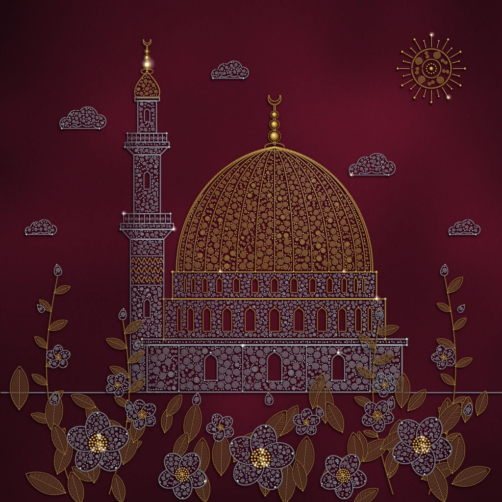

Her şey koyu, hafif havlı kadifenin (lacivert ya da bordo) üstüne serilmiş ince gümüş ve altın telden yapılmış gibi çizilir. Dış hatlar ve bölme çizgileri burgulu çift teldir (halat deseni); alanlar sıkıca yerleştirilmiş minik tel spiraller, S ve C kıvrımlarıyla, ince uzun alanlar (yapraklar) damardan kenara uzanan eğik yassı tellerle (balık sırtı) doldurulur; birleşim yerlerine ve küçük boşluklara granül boncuklar konur. Her tel metal gibi gölgelenir (koyu kenar, orta ton, ışığa bakan yanda parlak çizgi) ve kadifeye küçük gölgeler düşürür; önde duran parça arkadakinin tellerini örter. Malzeme biçime göre seçilir: burada kubbe altın spirallerle, minare, kasnak ve kaide gümüşle dolu, çiçekler gümüş taç yapraklı ve altın granül göbekli, yapraklar eskitilmiş altın, bulutlar gümüş çerçeveli.

- **Köken:** İlham, Mardin ve Midyat telkârisi ile Osmanlı kuyumculuğundaki filigran işçiliğinden geldi: ince gümüş tel bükülüp burularak çerçeve yapılır, içi yassı tel kıvrımlarıyla doldurulur, lehimlenip granülle süslenir. Fikrin özü bir mimari manzarayı bir mücevher plaketi gibi düşünmek: her çizgi bir tel, her alan sabırla doldurulmuş bir hücredir.
- **Ayırt edici:** Burgulu çift telden (halat desenli) dış hatlar, kubbe kaburgaları ve pencere kemerleri; Hücreleri dolduran sık tel spiraller, S ve C kıvrımları ve aralardaki granül boncuklar; Altın spirallerle dolu kubbe; gümüş telden minare, kasnak, kaide ve dalgalı çerçeveli bulutlar; Eskitilmiş altından, balık sırtı yassı tellerle dolu yapraklar; Gümüş, üst üste binen taç yaprakları ve altın granül kümesi göbekli çiçekler; Koyu bordo, havlı kadife zemin ve tellerin kadifeye düşen küçük gölgeleri; altın telkâri güneş
- **Palet:** `#4A0F1E` `#2E0912` `#C08E36` `#F4D888` `#A4ACB6` `#EAF0F5` `#A47832`
- **Kodla çizim:** Canvas, 2048 iç çözünürlük. Kadife zemin piksel piksel değer gürültüsüyle üretilir (geniş parıltı, dikey hav lifleri, kenar kararması). Teller metal türü ve kalınlığa göre toplanmış Path2D vuruşlarıyla üç katmanda çizilir: koyu kenar, ışığa kaydırılmış orta ton ve ince parlak çizgi; burgulu tel, yol boyunca eşit aralıklı eğik kısa halkalardan oluşur, SAHNE yolları SVG getPointAtLength ile örneklenir. Örtme: minarenin kaide ve kasnak ardına düşen hatları bölge haritasıyla, bitkilerde sap, yaprak, tomurcuk ve taç yaprağı hatları çizim sırasına göre üstteki biçimlerle (isPointInPath) kesilir. Dolgu için görünür tel hatlarından bir sınır maskesi çıkarılır; uzaklık dönüşümü (chamfer) ve ızgarayla hızlandırılmış dart atışıyla daireler sıkı yerleştirilir, her daire Arşimet spirali, iki ters spiralden S kıvrımı ya da açık C kıvrımı olur, en küçükleri granül boncuk; yapraklarda damar boyunca eğik teller kenara kadar yürütülür. Boncuklar önceden çizilmiş küre görüntüleridir. Yapı ve bitki katmanları ayrı ayrı, bulanık ve kaydırılmış gölgeleriyle kadifeye bindirilir; metale hafif hacim degradesi ve birkaç ışıltı eklenir.
- **Kaynak:** [`S-033-telkari-tel/ornek.html`](stiller/S-033-telkari-tel/ornek.html)

### S-034

**Mukarnas Hücre** · *Muqarnas Cells* · ✦ atölye özgün

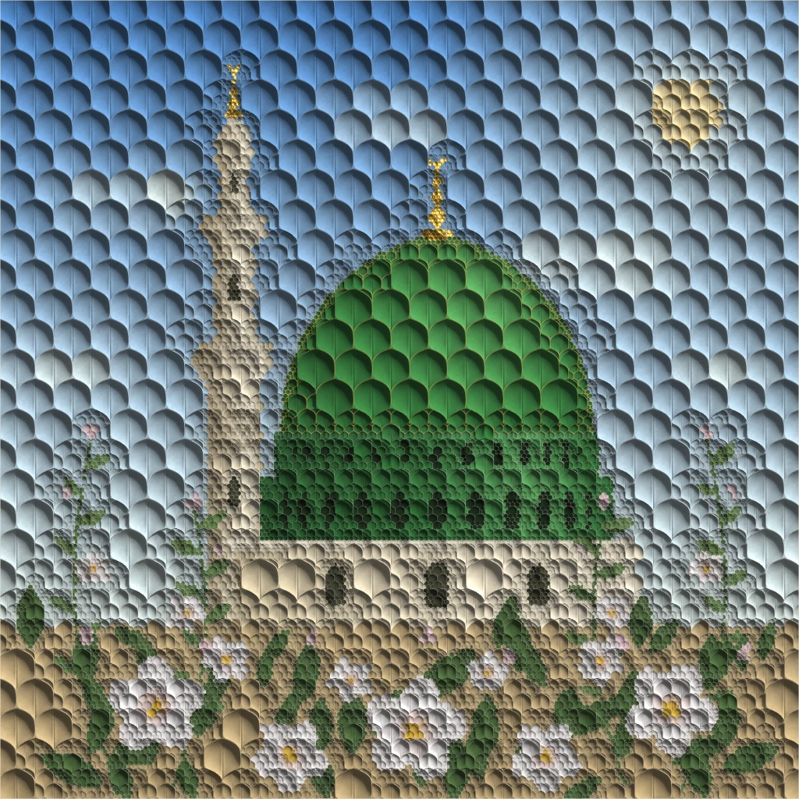

Resim yüzeyinin tamamı, yarım hücre kaydırılmış kademeler (sıralar) hâlinde dizilen küçük sivri kemerli niş hücrelerine bölünür. Her hücre bir mukarnas nişidir: üstte sivri kemer başlık, dikey yan duvarlar ve düz bir taban; tabanın altında, alttaki iki nişin kemerleri arasına sarkan, ortadan sırtlı üçgen bir pandantif yüzü bulunur, böylece hücreler boşluksuz kenetlenir ve her kademe yatay bir çizgiyle okunur. Niş içbükeydir: sağ üstten gelen ışıkla kemer sırtının sağ üstü parlar, başlığın altındaki kovuk ve sağ iç duvar gölgede kalır, sol iç duvar ve taban aydınlanır. Hücrenin rengi sahnenin o noktasından alınır ve alçı kremine biraz karıştırılır. Ayrıntı gereken yerlerde (siluet kenarları, alem, hilal, çiçekler, saplar) hücre kendi içinde daha küçük hücrelere bölünür; pencere gibi kemerli açıklıklar kendi biçiminde tek ve derin bir niş olur. Kubbe gibi değerli yüzeylerde hücre kenarları ince altın yaldızla çizilir; bütün yüzey oyulmuş, boyanmış alçı kabartma gibi görünür.

- **Köken:** İlham, Selçuklu ve Osmanlı mimarisindeki mukarnaslardan (taç kapılarda, kubbe geçişlerinde ve mihrap kavsaralarında kademe kademe dizilen küçük niş hücreleri) ve boyalı alçı mukarnas tavanlarından geldi. Fikrin özü, mukarnasın üç boyutlu hücre dilini bir resmin piksel ızgarası gibi kullanmak: her hücre hem bir mimari niş hem de resmin bir renk noktasıdır.
- **Ayırt edici:** Bütün yüzeyi kaplayan, yarım hücre kaydırılmış kademeler hâlinde kenetlenmiş sivri kemerli niş hücreleri; Her nişte gölgeli başlık kovuğu, aydınlık sol iç duvar ve ışık alan sağ üst kemer sırtı; Nişlerin arasında, alttaki kemerlerin arasına sarkan sırtlı üçgen pandantif yüzleri ve kademe çizgileri; Gökte büyük, siluet kenarlarında, alemde, çiçeklerde ve saplarda iç içe küçülen hücreler; Kendi kemer biçiminde derin nişler olarak okunan kasnak, kaide ve minare pencereleri; Yukarıda koyu, ufukta açık mavi boyalı gök, altın yaldız kenarlı yeşil kubbe ve krem alçı minare ile kaide
- **Palet:** `#4680C4` `#A4BCD0` `#4E8F51` `#E9DFC8` `#D6AC52` `#2A3527` `#AF9B77`
- **Kodla çizim:** Canvas, 2048 iç çözünürlük, tamamen piksel işleme. Hücre ızgarası analitiktir: dört seviye (42, 21, 10,5 ve 5,25 piksel genişlik), sıra yüksekliği genişliğin 1,14 katı, kemer yüksekliği 0,58 katı; her sıra yarım hücre kaydırılır, hücre üstü tepesi sivriltilmiş eşkenar kemer eğrisinden, altı alttaki iki hücrenin kemerlerinden hesaplanır. Bir hücrenin bölünüp bölünmeyeceği içine düşen SAHNE bölgelerinin çeşitliliği, pencere, alem ya da çiçek ortası bulunması ve ton varyansıyla belirlenir. Pencereler kendi kemer biçimlerinden çizilen bir maskeyle ayrı, derin niş hücreleri olur. Her piksel için hücre zinciri bulunur; niş kısmında yatay ve dikey konumdan (kemer tepesinde yumuşatılmış) düzgün bir kase derinliği, taban altında öne çıkan sırtlı pandantif yüzü hesaplanır, iç içe hücrelerde derinlikler toplanır. Derinlik alanından normaller çıkarılır; sağ üstten Lambert ışığı, yükseklik alanında ışığa doğru yürüyerek atılan gölge, derinliğe bağlı ortam kapanması ve alçı tanesi eklenir. Hücre rengi, parçanın baskın bölgesindeki (ince öğeler ağırlıklı sayılır) başvuru renklerinin ortalamasıdır (alçı kremiyle karıştırılmış, gök yukarıda koyu, ufukta açık maviye çekilmiş); altın hücrelere metal parlaklık, kubbe, alem, güneş ve çiçek ortası hücrelerinin kenarına altın yaldız çizgisi verilir.
- **Kaynak:** [`S-034-mukarnas-hucre/ornek.html`](stiller/S-034-mukarnas-hucre/ornek.html)

### S-035

**Takımyıldız** · *Constellation Chart* · ✦ atölye özgün

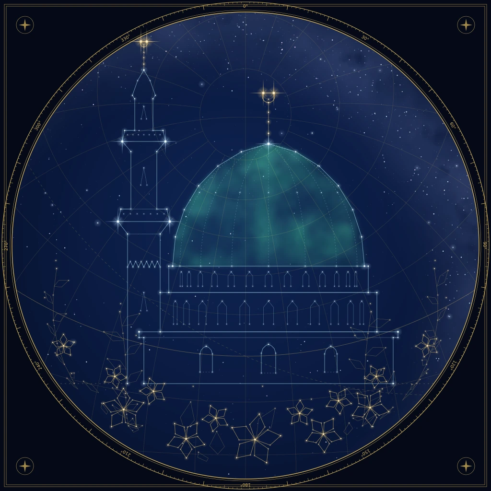

Sahne lacivert bir gök haritasının üstüne takımyıldız olarak çizilir: biçimlerin yapısal köşelerine (kubbe dış çizgisi, kasnak ve kaide köşeleri, pencere kemerleri, minare çıkıntıları, alem) yıldızlar konur ve ince soluk çizgilerle bağlanır. Yıldızın büyüklüğü önemini gösterir: hilal uçları, kubbe tepesi, minare tepesi ve şerefe uçları en parlaklarıdır ve dört kollu kırınım ışınları taşır. Arkada soluk, eğri gök koordinat ızgarası, Samanyolu tozu ve yalnızca 0°, 30°, 60° gibi küçük derece işaretleri taşıyan dairesel harita çerçevesi bulunur; kubbe hafif yeşil bir bulutsuyla dolar, çiçekler küçük takımyıldızlardır. Mürekkepler altın ve soluk camgöbeğidir.

- **Köken:** İlham, eski gök atlasları, usturlap levhaları ve gece yolculuğunda yön bulmak için yıldızlara bakma geleneğinden geldi. Fikrin özü mimariyi göğe yazmaktır: takımyıldızlar dağınık yıldızları hayalî çizgilerle birleştirip biçim kurduğu gibi, kubbe ve minare de birkaç parlak nokta ve aralarındaki çizgilerle tanınır hâle gelir.
- **Ayırt edici:** Kubbe, minare, kasnak ve kaidenin köşelerinde ince camgöbeği çizgilerle bağlanmış yıldızlar; Hilal uçlarında, kubbe tepesinde ve şerefe uçlarında dört kollu kırınım ışınlı parlak yıldızlar; Soluk altın, eğri gök koordinat ızgarası ve kesikli tutulum çizgisi; Derece çentikli, çift halkalı dairesel harita çerçevesi ve küçük derece işaretleri; Kubbeyi dolduran hafif yeşil bulutsu ve sağ üstten geçen Samanyolu tozu; Beş yapraklı küçük altın takımyıldızlar olarak çiçekler
- **Palet:** `#0B1C44` `#081535` `#040918` `#B0E8F4` `#D8B45A` `#2E8A7A` `#F4FBFF`
- **Kodla çizim:** Canvas, 2048 iç çözünürlük. Eğik stereografik izdüşümle gerçek bir gök ızgarası (dik açıklık çemberleri, sağ açıklık meridyenleri, tutulum) çizilir; Samanyolu, her pikselin ters izdüşümle galaktik enlemi bulunup değer gürültüsüyle yoğunluk ve toz şeritleri verilerek üretilir, arka plan yıldızları bu yoğunluğa göre dağıtılır. Kubbe bulutsusu kubbedeMi maskesi içinde fbm gürültüsünden yapılıp bulanıklaştırılarak 'lighter' ile eklenir. Takımyıldızlar SAHNE geometrisinden (kubbeNoktalari, kaburgalar, kasnak ve kasnakPencereleri, kaide, minare parçaları, alemParcalari, bitki) çıkarılan köşe ve çizgi listeleridir; yıldızlar önem derecesine göre büyüklük, radyal degrade hâle ve büyüklerde dört kollu ışınla çizilir. Öndeki büyük çiçekler harita çemberine sığacak biçimde biraz içeri alınmış; çemberin dışına taşan sap, yaprak, tomurcuk ve çiçek noktaları kenara doğru üstel olarak sıkıştırılır (kenarda balıkgözü izdüşümü gibi), böylece hiçbir takımyıldız kesilmez. Izgara ve yıldızlar harita çemberine kırpılır, yalnız çembere yakın en parlak yıldızların ışınları çerçevenin üstünden geçer; çerçeve, derece çentikleri ve DejaVu Sans ile küçük derece etiketleri en üstte çizilir.
- **Kaynak:** [`S-035-takimyildiz/ornek.html`](stiller/S-035-takimyildiz/ornek.html)

### S-036

**Gül Yaprağı** · *Rose Petal* · ✦ atölye özgün

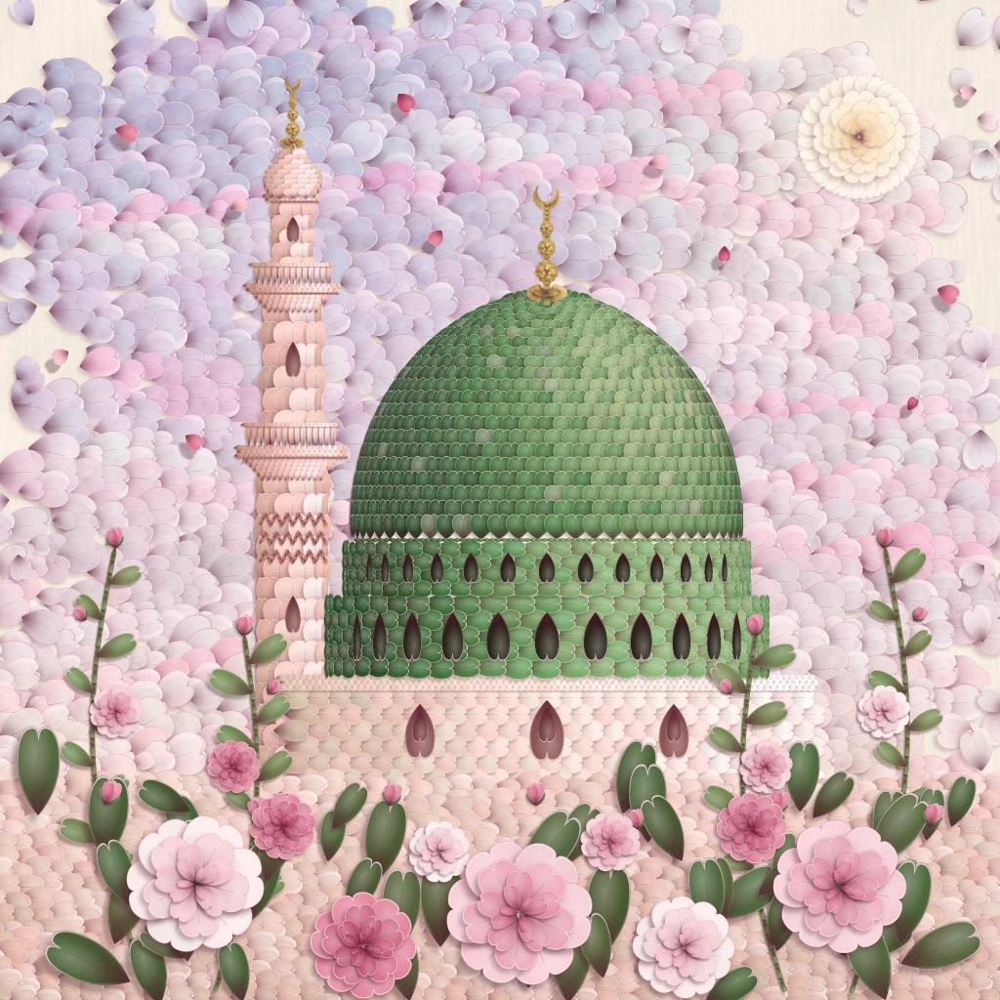

Kural: her iz tek bir gül yaprağıdır; dibi dar, ucu geniş ve hafif çentikli bir damla biçimi; dibi koyu, içi yumuşak geçişli, ortasında silik bir damar, kenarında uca doğru güçlenen ince açık bir parıltı vardır, bazılarının bir kenarı geriye kıvrılmıştır. Yapraklar balık pulu gibi üst üste bindirilir: her yaprağın yuvarlak ucu görünür, dibi bir öncekinin altında kalır. Yönleri biçimin akışından gelir: kubbede kaburgalar boyunca yukarı, kasnak ve kaidede yatay, minarede sütun sütun dikey, gökte dalgalı akıntılar halinde. Renkler sahneden alınır ama parlaklık korunarak güle doğru kaydırılır (yeşil kubbe gül tenli bir yeşile, mavi gök leylak-pembeye döner); çiçekler halka halka dizilmiş yapraklardan güllere, yapraklar yeşil gül yapraklarına dönüşür. Yapraklar krem bir kâğıda serilmiştir; kâğıdın kenarı düzensiz kalır ve gökte birkaç serbest yaprak gölgesini düşürerek süzülür.

- **Köken:** Fikir, Osmanlı'dan bu yana süren gül sevgisinden ve gül yaprağı reçeli, gül suyu, kurutulmuş yaprakla doldurulan keseler gibi gündelik gül kültüründen doğdu; Osmanlı geleneğinde gül Hz. Peygamber'i de simgelediği için Yeşil Kubbe'yi gül yapraklarıyla örmek konuya ayrıca yakışır. Bir sepet gül yaprağını kâğıda tek tek dizerek resim yapmak, mozaik ve pul (sedef, balık pulu, kiremit) düzenleriyle birleştirildi: tessera yerine yaprak, ızgara yerine biçimin akışı. Yaprakların yön alanı yapının geometrisinden çıkarıldığı için aynı kural her konuya uygulanabilir.
- **Ayırt edici:** Kubbe, kaburgalar boyunca yukarı bakan, tepeye doğru daralan yeşil gül yaprağı pullarından oluşur; dilim sınırları koyu yaprak sütunlarıyla seçilir; Gök, dalgalı akıntılar halinde iri ufak karışık, bir kısmının kenarı geriye kıvrık, yarı saydam leylak-pembe yapraklarla dolar; arada gül tenli akıntı şeritleri seçilir; Minare sütun sütun yukarı bakan yapraklarla, kasnak ve kaide yatay yaprak sıralarıyla örülür; pencereler ucu aşağı bakan koyu yapraklardır; Öndeki çiçekler halka halka yapraklardan kurulmuş güllere, yapraklar yeşil gül yapraklarına dönüşür; Güneş krem-altın yapraklı iri bir gül; gökte gölgesi uzağa düşen birkaç serbest yaprak süzülür; Kâğıt kenarında yapraklar düzensiz biter: yer yer kenara taşar, yer yer kâğıt koyları açılır, kenarda dağınık yapraklar kalır
- **Palet:** `#F6EDE2` `#B2BADE` `#F9E5DC` `#348440` `#164622` `#E488A0` `#B03A5C` `#C2A350`
- **Kodla çizim:** Canvas 2B, 2048 iç çözünürlük. Tek bir birim yaprak yolu (Path2D) ile üç gölgelendirme kalıbı hazırlanır (dipte koyu gül gölgesi, iç ışık, lif çizgileri, damar, uca doğru güçlenen kenar parıltısı; ikisinde sola ya da sağa kıvrık kenar şeridi ve altında bulanık gölge) ve bir bulanık gölge kalıbı; her yaprak setTransform ile konumlanıp düz renkle doldurulur, üstüne kalıp çizilir. Yön alanı geometriden hesaplanır: kubbe profilinin yay uzunluğuyla enlem sıraları ve boylam sütunları (sütun sayısı tepeye doğru azalır), yön meridyen türevinden, ışık küre normalinden; kasnak ve minare silindir izdüşümüyle daraltılır; gök sıraları üç sinüslü akış çizgileri üzerindedir, boy, en, açı ve saydamlık rastgele oynatılır. Kâğıt kenar payı düşük frekanslı gürültüyle 0–90 px arasında değişir. Renkler kendi gök işlevinden ve sahne tonlarından alınıp parlaklığı korunarak gül kromasına kaydırılır; bölge haritası göğü yapıdan ayırır. Pul görünümü için her grup uç yönünden dibe doğru sıralanarak çizilir. Yaklaşık 5 bin yaprak, sonda yumuşak ışık kipinde ince kâğıt dokusu.
- **Kaynak:** [`S-036-gul-yapragi/ornek.html`](stiller/S-036-gul-yapragi/ornek.html)

### S-037

**Delikli Fener** · *Pierced Lantern* · ✦ atölye özgün

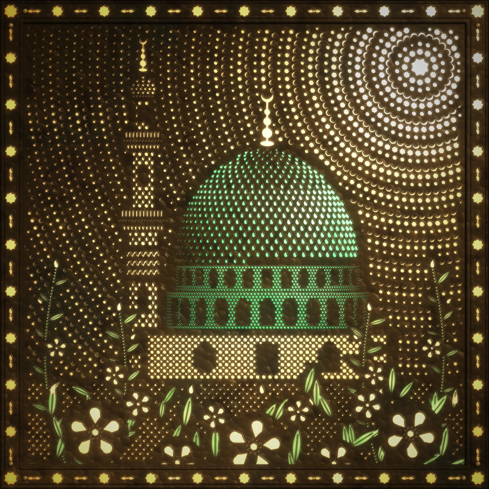

Kural: resim, arkasında sıcak bir ışık yanan delikli bir metal levhadır ve sahne yalnızca deliklerle anlatılır. Delikler sekiz köşeli yıldız, damla, hilal ve daire gibi süs biçimleridir; düzenli ya da ışınsal bir ızgaraya dizilir ve her deliğin büyüklüğü sahnenin o noktadaki aydınlığıyla büyür (karanlık yerde delik yoktur, aydınlık yerde delikler birbirine değer). Bölgeler arasında deliksiz düz metal şeritler bırakılır, böylece biçimlerin sınırı ve pencereler karanlık çizgi ve kemer olarak okunur; ızgaranın yönü biçimi izler (kubbede kaburga boyunca, gökte güneşin çevresinde halka halka, kasnakta silindir sıraları). Yapraklar ortasında damar gibi metal köprü kalan yarıklar, saplar zımba noktası dizileridir. Kubbenin ardında yeşil, yaprakların ardında sarımsı yeşil cam, başka her yerde altın sarısı ışık vardır; levha dövme izli, patinalı, hafif parlak koyu pirinçtir ve iri delikli bir süs bordürüyle çevrilir.

- **Köken:** İlham, Osmanlı cami ve saray fenerleri, kandil kafesleri ile Mağrip'in delikli pirinç lambalarından geldi: bu fenerlerde desen, karanlık odaya düşen ışık noktalarıyla görünür. Fikrin özü, matbaadaki yarım ton (raster) noktasını fener zanaatinin süs delikleriyle değiştirmek: aydınlık değeri nokta büyüklüğüne değil, kesilmiş bir yıldızın ya da hilalin büyüklüğüne çevrilir. Böylece her konu, bir fener paneli gibi ışıkla okunan bir delik dokusuna dönüşür.
- **Ayırt edici:** Koyu, dövme izli, yer yer yeşilimsi patinalı pirinç levha; deliklerden sızan sıcak ışık ve çevresine yayılan parlama; Gök, güneşin çevresinde halka halka dizilmiş yıldız, daire ve güneşe bakan hilal deliklerinden oluşur; delikler güneşe yaklaştıkça büyür; Kubbe, kaburgalar boyunca yukarı bakan damla deliklerden oluşur ve ardındaki yeşil camla yeşil yanar; kasnağın sık delik ızgarasında pencereler deliksiz koyu kemerler olarak seçilir; Kaide ve minare iri, sık deliklerle parlar; kaide pencereleri karanlık kemerler, korkuluklar dikey yarıklardır; alemler doğrudan levhaya kesilmiş biçimlerdir; Yapraklar ortasında metal damar köprüsü kalan, sarımsı yeşil camlı yarıklar; saplar küçük zımba deliklerinden noktalı çizgiler; Çiçekler düz metal halkayla çevrili beş damlalı madalyonlar; çevrede iri yıldız ve damla delikli bordür ve perçinler
- **Palet:** `#1A1108` `#5A3E1C` `#A87A36` `#FFECAC` `#AAFFAA` `#1A964A` `#D6F08C` `#FFFCE8`
- **Kodla çizim:** Canvas 2B, 2048 iç çözünürlük. Levha piksel piksel üretilir: titreşimli bir ızgaradaki dövme çukurları paraboloid kâselerin en küçüğü olarak bir yükseklik alanı verir; çerçeve pervazı ve olukları bu alana eklenir; normallerden yaygın ve Blinn parlaklık ışığı, gürültüyle patina ve kir hesaplanır. Sahnenin aydınlığı bölge haritası ve kendi ışık modelimden (küre normali, silindir, güneş uzaklığı, bulutlar) okunur; delik çapı alan aydınlıkla orantılı olacak biçimde karekökle hesaplanır; her delik 10 noktalı bir ayak izi sınamasıyla bölge sınırından uzak tutulur (düz metal şeritler). Gökte güneş merkezli ışınsal ızgara, kubbede yay uzunluğuna göre enlem sıraları ve meridyen yönlü damlalar, kasnak ve minarede silindir izdüşümü kullanılır (kasnakta ince adım; izdüşüm yalnız aralığı daraltır, delikler yuvarlak kalır); hilal SAHNE.hilalYolu'ndan döndürülerek kesilir; yaprak yarığının ortasındaki damar köprüsü maskeden destination-out ile silinir, saplar 6,4 px aralıklı küçük deliklerdir; sahne delikleri çerçevenin iç kenarında kırpılır. Yaklaşık 4.300 delik bir maske tuvaline çizilir; arka ışık (sıcak altın, kubbe ardında gürültülü yeşil, yaprak ardında sarımsı yeşil cam) maskeyle ve levha kalınlığını taklit eden kaydırılmış maskeyle kesilir, koyu delik duvarı, dört farklı bulanıklıkla eklemeli parlama, kesik ağzında ince parıltı, perçinler ve kenar karartması eklenir.
- **Kaynak:** [`S-037-delikli-fener/ornek.html`](stiller/S-037-delikli-fener/ornek.html)

### S-038

**Tesbih Dizisi** · *Bead Strings* · ✦ atölye özgün

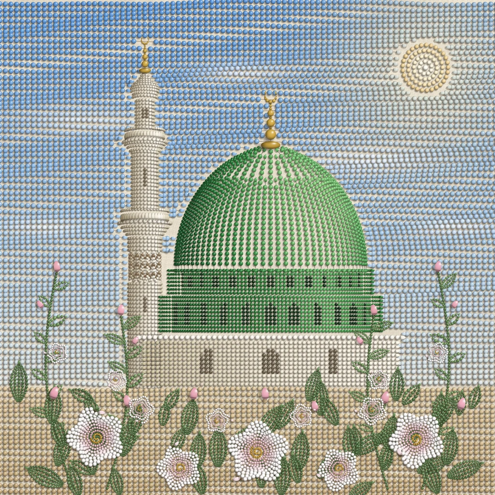

Kural: her iz, görünür bir ipe dizilmiş bir tanedir ve ipler biçimi izler: kubbede meridyenler (kaburgalar) boyunca, kasnak ve kaidede yatay sıralar, minarede gövdeyi saran halkalar, gökte hafif dalgalı yataylar, çiçeklerde merkezin çevresinde dönen sarmallar, yapraklarda uca doğru birleşen damar ipleri. Her tane, ışığı sağ üstten alan küçük bir küredir: sağ üstte parlak nokta, sol altta gölge ve zemine düşen minik temas gölgesi; rengi sahnenin o noktasından alınır, boyu ip boyunca değişebilir. İpin bittiği her yerde (yapının kenarı, kubbede seyrelen meridyenler, yaprak ucu, çiçek sarmalının sonu) uzun bir imame tanesi durur; kapalı halkalarda (minare, güneş) imame yoktur. Zemin açık keten bezidir ve taneler arasında görünür.

- **Köken:** Fikir, tesbihin kendisinden doğdu: elde çekilen, ipe dizili tanelerin ritmi ve dizinin sonunu bildiren imame. Boncuk işi, oya ve çeyiz işlemelerindeki tane dizme geleneğiyle birleşince, bir resmi noktalarla değil iplere dizili tanelerle örme kuralı ortaya çıktı. Noktacılıktan farkı, tanelerin hacimli olması ve hepsinin biçimin akışına yerleştirilmiş görünür iplere bağlı durmasıdır; ipin yönü resmin çizgisini, tanenin rengi tonunu taşır.
- **Ayırt edici:** Kubbe, tepeye doğru seyrelen yeşil meridyen ipleriyle örülü; biten iplerin ucunda imame taneleri, kubbe eteğinde imame saçağı; Gök, ucunda imame bulunan hafif dalgalı yatay mavi tane dizileri; ufka doğru açılır ama mavi kalır, ipler yapıya değdiği yerde imameyle biter; Minare, göz hizasının üstünde hafifçe kıvrılan halka halka taş rengi taneler; korkuluklar dik duran uzun taneler, zikzak bandı zikzağı izleyen iplerdir; Güneş iç içe tesbih halkalarından; alemler dikey ipe dizili altın küreler, hilal kalın yerinde iki üç ipe dizilmiş minik altın tanelerden dolgun bir hilaldir; alemlerin çevresi boş keten kalır; Çiçekler beş loblu sarmal ipler (altın göbek, pembe iç, beyaz dış; küçüklerde daha iri tane ve belirgin lob), yapraklar uca doğru birleşen yeşil ipler, tomurcuklar sap ucundaki pembe imameler; Her tane parlak noktalı, gölgeli ve temas gölgeli küçük bir küre; aralarından ince ip ve keten dokusu görünür
- **Palet:** `#ECE4D4` `#6098D8` `#BEDAEA` `#2E803C` `#164822` `#EEE6D3` `#ECC454` `#ECB0C0`
- **Kodla çizim:** Canvas 2B, 2048 iç çözünürlük. Keten zemin piksel piksel dama örgüsü, gürültülü iplik boğumları ve geniş lekelerle üretilir. Bir kez çizilen küre gölgelendirme kalıbı (parlak nokta, sol alt gölge, yansıyan ışık) ve yumuşak temas gölgesi kalıbı her taneye uygulanır; tane önce sahnenin renginde doldurulur, sonra kalıp çizilir. İpler geometriden kurulur: kubbe profili Bezier'inden meridyenler (ipin seviyesi ikinin kuvvetleriyle seçilir, komşu ipe 3B uzaklık tane boyunun altına düşünce ip biter), silindir izdüşümüyle kasnak sıraları ve göz hizasına göre eğilen minare halkaları, bölge haritasıyla göğün yapıdan ayrılan parçaları, Arşimet sarmalının beş loblu zarfla biçimlendirilmesiyle çiçekler; hilal, gövde kalınlığına göre bir, iki ya da üç eş merkezli ipe dizilen minik tanelerle doldurulur ve çevresindeki gök taneleri silinir. Taneler her ip boyunca yay uzunluğuna göre aralıklanır; her grupta önce bütün gölgeler, sonra ipler, sonra taneler çizilir; uçlarda dipte boğumlu, uca doğru incelen imameler eklenir. Yaklaşık 15.400 tane.
- **Kaynak:** [`S-038-tesbih-dizisi/ornek.html`](stiller/S-038-tesbih-dizisi/ornek.html)

### S-039

**Havuz Aksi** · *Pool Reflection* · ✦ atölye özgün

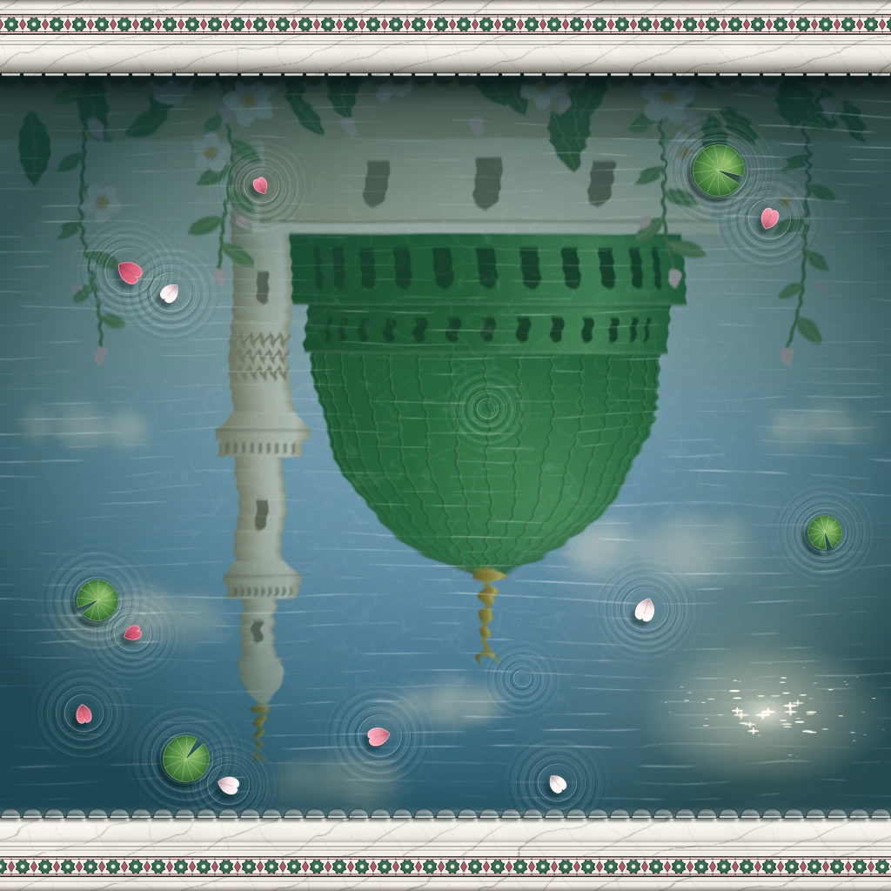

Kural: konu hiçbir zaman doğrudan çizilmez; yalnızca havuz kenarından eğik bakılan suyun yüzündeki aksi gösterilir. Aks yalnız dikeyde ters döner (kubbe sağda, minare solda kalır) ve yumuşak, boyalı bir görüntüdür; dalga yüzünün eğimi onu dikeyde kaydırıp sıvazlar, böylece kenarlar yatay şeritlere kırılır. Perspektif korunur: dalgalar uzak kıyıda incelir, yüzen şeylerin çevresindeki dalgacık halkaları elips olur. Uzakta su ayna gibidir; yakına geldikçe aks zayıflar, su koyulaşır ve havuzun çini dibi ile ışık ağı silikçe seçilir; güneşin aksi dalga eğimine göre dağılan pırıltılara bölünür. Su yüzünde eğik bakışla kısalmış gül yaprakları ve nilüfer yaprakları yüzer; resmi üstte ve altta ince kakma bantlı, dilimli ağızlı oyma mermer havuz kenarı çerçeveler.

- **Köken:** İlham, Osmanlı ve Endülüs avlularının durgun havuzları ile şadırvanlardır: Elhamra'nın Mersin Avlusu'ndaki havuzda yapının aksi, Türk bahçelerindeki havuzlarda gökle kubbe aynı yüzeyde buluşur. Fikrin özü, bakışı yapıdan suya çevirmek: konu suyun aynasında, yaprakların ve dalgacıkların arasından, bir anlığına titreyen bir görüntü olarak okunur. Kural her konuya uygulanabilir: neyi çizerseniz çizin, yalnızca onun sudaki aksi ve suyun yüzü görünür.
- **Ayırt edici:** Kubbe, kasnak, kaide ve minare yalnızca ters dönmüş, yumuşak bir aks olarak görünür; kubbe sağda, minare solda kalır, uzak kıyıdaki çiçekli dallar aksın üstünden sarkar; Dalga eğimi aksi dikeyde kaydırıp sıvazlar: kubbe, kasnak ve minare kenarları ince yatay şeritlere kırılır; dalgalar uzakta incelir; Yakında aks zayıflar, su koyu deniz mavisine döner; havuzun çini dibi ve ışık ağı suyun içinden silikçe görünür; Yüzen gül ve beyaz yapraklar ile çentikli nilüfer yaprakları eğik bakışla kısalmış; çevrelerinde elips biçimli halka halka dalgacıklar; Güneşin aksi, dalga eğimine göre dağılan pırıltılara bölünür ve çevresine ışık taşar; Üstte ve altta damarlı, oyma basamaklı, dilimli ağızlı mermer havuz kenarı; içinde yeşil sekiz köşeli yıldız ve gül renkli baklavalardan ince kakma bant
- **Palet:** `#497D93` `#90ADB0` `#265840` `#337276` `#F1EEE7` `#2F6B52` `#B4566A` `#D65C76`
- **Kodla çizim:** Canvas 2B, 2048 iç çözünürlük. Yansıyacak sahne ekran dışında kendi çizimimizle boyanır: doygun gök, parlak güneş çekirdeği ve ışıltısı, gölgeli bulut öbekleri; minare, kasnak ve kaide SAHNE yollarından silindir gölgeli yatay geçişlerle, kubbe sağ üstten ışık alan ışınsal geçiş, yumuşak kaburgalar ve parlak alınla, bitkiler kendi renkleriyle doldurulur; sonra 4,6 px bulanıklık ve yumuşak ışık kipinde yatay fırça dokusuyla boyalı bir yumuşaklık verilir. Su piksel piksel hesaplanır: perspektif ölçeği p(Y) (uzak 0,5, yakın 1) ve 0,6 dikey kısalmayla yer düzlemi koordinatları (U, V = ln p / (p' · 0,6)) bulunur; bu düzlemde yedi yönlü sinüs dalgası (kaba ızgaradan okunan sakin/dalgalı yamalar ve evre bükümüyle) ve yüzen her şeyin çevresinde ışınsal halka dalgaları toplanıp eğim çözümsel olarak hesaplanır. Ters koordinat (Y = 960 − y) eğimle dikeyde çok, yatayda az kaydırılır ve yedi dikey örnekle sıvazlanarak çift doğrusal okunur; dalga yüzü eğime göre açılıp koyulaşır, renk deniz yeşiline çekilir. Fresnel benzeri bir oranla yakında aks zayıflayıp kırılmayla titreyen çini ızgaralı havuz dibine karışır. Güneş pırıltısı, eğimin güneşi o noktaya yansıttığı yerlerde Gauss eşleşmesiyle doğar; parlak maske üç bulanıklıkla eklemeli olarak taşar. Üstüne havuz dibindeki ışık ağı (gürültü farkı), yüzeye yatırılmış (döndür, sonra dikeyde kısalt) gölgeli gül yaprakları ve damarlı nilüfer yaprakları çizilir. Mermer piksel piksel damar gürültüsüyle üretilir; profil, pervaz çizgileri, oluk, yuvarlatılmış ağız, dilimli kenar ve yıldız-baklava kakma bandı vektörle eklenir.
- **Kaynak:** [`S-039-havuz-aksi/ornek.html`](stiller/S-039-havuz-aksi/ornek.html)

### S-040

**Ters Zemin** · *Negative Ground* · ✦ atölye özgün

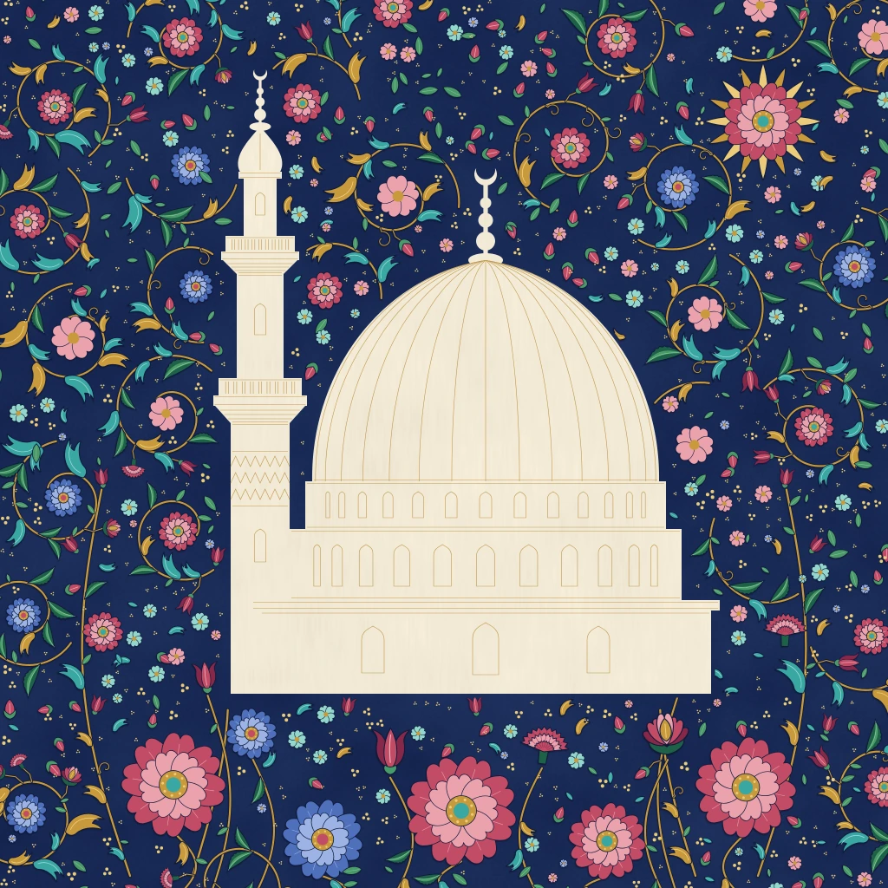

Kural: asıl konu hiçbir zaman figür olarak çizilmez, yalnızca boşluk olarak kalır. Kubbe, kasnak, kaide, minare ve alemler boş fildişi kâğıt siluetlerdir; geri kalan her yeri lacivert zemin üzerinde klasik Osmanlı tezhip dağarcığıyla kurulmuş yoğun ama ölçülü bir süs bahçesi doldurur: ince altın helezon dallar, ortalarında önden dilimli hatayiler ve yandan görülen palmet hatayiler, dallar boyunca çatallı rumiler, uzun dişli saz yaprakları, lale, karanfil, gonca ve penç; gökte çin bulutu şeritleri. Renkler koyu yeşil, gül, altın, lacivert ve firuzedir; her motifin koyu ince bir kontur (tahrir) çizgisi ve içinde açık bir ışık çizgisi vardır. Süsler boşluğa değmez, aralarında ince bir zemin şeridi kalır, böylece siluetin kenarı keskin okunur. Boşlukların içinde yalnızca çok ince soluk altın kıl çizgiler bulunur (kaburgalar, pencere kemerleri, şerefe ve korkuluk çizgileri); öndeki çiçekler süs alanına karışır.

- **Köken:** İlham, tezhip ve kalem işinin zemin anlayışından, ciltlerdeki şemse oymalarından, ebru ve kâğıt oymacılığındaki (katı) boşluk okumasından ve Rubin vazosu gibi figür-zemin oyunlarından geldi. Fikrin özü, kutsal yapıyı süslemeden çok onun çevresini süslemek: kubbe ve minare bahçenin içinde bırakılmış sessiz, aydınlık bir boşluk olarak kalır. Kural her konuya uygulanabilir: konu yalnızca, onu dolduran süsün yokluğuyla görünür.
- **Ayırt edici:** Kubbe, kasnak, kaide, minare ve hilalli alemler yalnızca boş fildişi siluet olarak görünür; siluetin çevresinde ince bir lacivert zemin şeridi; Lacivert zemini dolduran ince altın helezon dallar; ortalarında önden dilimli hatayiler ya da yandan görülen, tohum benekli altın tepelikli palmet hatayiler; Dallar boyunca altın ve firuze çatallı rumiler, sarmal uçlarında rumi kanatları, uzun dişli yeşil saz yaprakları, kısa saplı lale, karanfil ve goncalar; Gökte ince altın ve firuze çin bulutu şeritleri; güneş altın ışınlı çok katlı bir hatayi-şemse; Öndeki çiçekler büyük dilimli hatayiler, palmet hatayiler, laleler ve karanfiller; kaidenin altında küçük rumi ve goncalarla süslü yatay bir kıvrık dal; Boşlukların içinde yalnızca soluk altın kıl çizgiler: kaburgalar, pencere kemerleri, şerefe, korkuluk ve zikzak çizgileri
- **Palet:** `#1A2B57` `#F3EAD6` `#C99A3C` `#C24C66` `#EBA2AE` `#1F6248` `#3AA7A3` `#4E70BC`
- **Kodla çizim:** Canvas 2B, 2048 iç çözünürlük. Bütün yapı parçalarının SAHNE.yollar() yollarından bir boşluk maskesi çizilir ve iki geçişli pah (chamfer) algoritmasıyla her pikselin boşluğa uzaklığı hesaplanır. Süsler ayrı bir tuvalde üretilir: sabit çapalar (güneş şemsesi, SAHNE.bitki çiçekleri ve sapları), gökte çin bulutu şeritleri (iki ucu sarmal kıvrımlı, ortası halkalı dalgalı merkez çizgisi), kaidenin altında yatay kıvrık dal, boşluktan uzak noktalara Poisson diskiyle yerleştirilen sarmal dallar (ortalarında önden ya da yandan hatayi, dış uçlarında rumi kanadı, engelde kesilen helezon), dallar boyunca dönüşümlü saz, rumi, küçük yaprak, kısa saplı lale/karanfil/gonca ve sarmal filizler, en sonda seyrek dolgu. Motifler yerel koordinatta Path2D ile çizilir: hatayi yaprakları uca yakın iki çentikli, sivri uçlu 'dilimli' bir profilden, palmet hatayi çanak, yedi ve dört yapraklı iki yelpaze ve benekli tepelikten, saz yaprağı uca yatık dişlerden kurulur; her biri koyu kontur ve içte küçültülmüş açık tahrir çizgisi alır. Çakışmalar 4 piksellik bir doluluk ızgarası ve uzaklık alanıyla önlenir. Süs katmanından boşluklar kalın bir kontur ile silinir (zemin şeridi), çok hafif gölgeyle guaj dokulu lacivert zeminin üstüne konur; boşluklar dokulu fildişi kâğıtla doldurulur ve içine 0,6 piksellik soluk altın kıl çizgiler çekilir.
- **Kaynak:** [`S-040-ters-zemin/ornek.html`](stiller/S-040-ters-zemin/ornek.html)
