# Atölye kataloğu

240 stil · 6 aile · 90 atölye render üslubu. Bütün örnekler aynı sahneyi çizer (bkz. [sahne/SAHNE.md](sahne/SAHNE.md)). Bu dosya `node atolye/araclar/katalog.mjs` ile üretilir; elle düzenlemeyin.

| Kod | Stil | Aile |
| --- | --- | --- |
| [S-001](#s-001) | Suluboya | Boya ve Kuru Teknikler |
| [S-002](#s-002) | Yağlıboya (Empasto) | Boya ve Kuru Teknikler |
| [S-003](#s-003) | Yumuşak Pastel | Boya ve Kuru Teknikler |
| [S-004](#s-004) | Renkli Karakalem | Boya ve Kuru Teknikler |
| [S-005](#s-005) | Elle Renklendirilmiş Gravür | Boya ve Kuru Teknikler |
| [S-006](#s-006) | Linol Baskı | Boya ve Kuru Teknikler |
| [S-007](#s-007) | Osmanlı Minyatürü | Türk-İslam Sanatları |
| [S-008](#s-008) | Tezhip | Türk-İslam Sanatları |
| [S-009](#s-009) | Ebru | Türk-İslam Sanatları |
| [S-010](#s-010) | İznik Çinisi | Türk-İslam Sanatları |
| [S-011](#s-011) | Kat'ı (Kâğıt Oyma) | Türk-İslam Sanatları |
| [S-012](#s-012) | Vitray | Türk-İslam Sanatları |
| [S-013](#s-013) | Mozaik | Türk-İslam Sanatları |
| [S-014](#s-014) | Ukiyo-e | Uzak Doğu |
| [S-015](#s-015) | Renkli Sumi-e | Uzak Doğu |
| [S-016](#s-016) | Empresyonizm | Sanat Akımları |
| [S-017](#s-017) | Puantilizm | Sanat Akımları |
| [S-018](#s-018) | Art Nouveau | Sanat Akımları |
| [S-019](#s-019) | Art Deco | Sanat Akımları |
| [S-020](#s-020) | Kübizm | Sanat Akımları |
| [S-021](#s-021) | Bauhaus | Sanat Akımları |
| [S-022](#s-022) | Düz İllüstrasyon | Grafik ve Dijital |
| [S-023](#s-023) | Renkli Çizgi Sanatı | Grafik ve Dijital |
| [S-024](#s-024) | Low Poly | Grafik ve Dijital |
| [S-025](#s-025) | İzometrik | Grafik ve Dijital |
| [S-026](#s-026) | Piksel Sanatı | Grafik ve Dijital |
| [S-027](#s-027) | Risograf Baskı | Grafik ve Dijital |
| [S-028](#s-028) | Teknik Çizim (Mavi Kopya) | Grafik ve Dijital |
| [S-029](#s-029) | Katmanlı Kâğıt | Grafik ve Dijital |
| [S-030](#s-030) | Neon Gece | Grafik ve Dijital |
| [S-031](#s-031) | Yumuşak Hacim ✦ | Atölye Render Üslupları |
| [S-032](#s-032) | Renkli Kontur Cel ✦ | Atölye Render Üslupları |
| [S-033](#s-033) | Taneli Gradyan ✦ | Atölye Render Üslupları |
| [S-034](#s-034) | Kayık Dolgu ✦ | Atölye Render Üslupları |
| [S-035](#s-035) | Buzlu Cam ✦ | Atölye Render Üslupları |
| [S-036](#s-036) | Kil Hamuru ✦ | Atölye Render Üslupları |
| [S-037](#s-037) | Hologram Folyo ✦ | Atölye Render Üslupları |
| [S-038](#s-038) | Sinematik Sis ✦ | Atölye Render Üslupları |
| [S-039](#s-039) | Masal Kitabı ✦ | Atölye Render Üslupları |
| [S-040](#s-040) | Voksel ✦ | Atölye Render Üslupları |
| [S-041](#s-041) | Guaj | Boya ve Kuru Teknikler |
| [S-042](#s-042) | Akrilik | Boya ve Kuru Teknikler |
| [S-043](#s-043) | Yumurta Temperası | Boya ve Kuru Teknikler |
| [S-044](#s-044) | Fresk | Boya ve Kuru Teknikler |
| [S-045](#s-045) | Enkostik | Boya ve Kuru Teknikler |
| [S-046](#s-046) | Spatula Resmi | Boya ve Kuru Teknikler |
| [S-047](#s-047) | Klasik Sırlama (Sfumato) | Boya ve Kuru Teknikler |
| [S-048](#s-048) | Sgrafito | Boya ve Kuru Teknikler |
| [S-049](#s-049) | Kuru Fırça | Boya ve Kuru Teknikler |
| [S-050](#s-050) | Sünger Boyama | Boya ve Kuru Teknikler |
| [S-051](#s-051) | Airbrush (Püskürtme Boya) | Boya ve Kuru Teknikler |
| [S-052](#s-052) | Duvar Resmi | Boya ve Kuru Teknikler |
| [S-053](#s-053) | Akrilik Dökme | Boya ve Kuru Teknikler |
| [S-054](#s-054) | Alkol Mürekkebi | Boya ve Kuru Teknikler |
| [S-055](#s-055) | Tek Fırça Dekoratif Boyama | Boya ve Kuru Teknikler |
| [S-056](#s-056) | Kuru Boya | Boya ve Kuru Teknikler |
| [S-057](#s-057) | Suluboya Kalemi | Boya ve Kuru Teknikler |
| [S-058](#s-058) | Yağlı Pastel | Boya ve Kuru Teknikler |
| [S-059](#s-059) | Üç Kalem (Trois Crayons) | Boya ve Kuru Teknikler |
| [S-060](#s-060) | Kara Tahta Tebeşiri | Boya ve Kuru Teknikler |
| [S-061](#s-061) | Kalem ve Lavi | Boya ve Kuru Teknikler |
| [S-062](#s-062) | Keçeli Kalem (Marker) | Boya ve Kuru Teknikler |
| [S-063](#s-063) | Tükenmez Kalem | Boya ve Kuru Teknikler |
| [S-064](#s-064) | Fırça Kalemi | Boya ve Kuru Teknikler |
| [S-065](#s-065) | Renkli Kâğıda Jel Kalem | Boya ve Kuru Teknikler |
| [S-066](#s-066) | Mum Boya Rezist | Boya ve Kuru Teknikler |
| [S-067](#s-067) | Batik | Boya ve Kuru Teknikler |
| [S-068](#s-068) | İpek Boyama | Boya ve Kuru Teknikler |
| [S-069](#s-069) | Renkli Kazıma | Boya ve Kuru Teknikler |
| [S-070](#s-070) | Pirografi | Boya ve Kuru Teknikler |
| [S-071](#s-071) | Monotipi | Boya ve Kuru Teknikler |
| [S-072](#s-072) | Taşbaskı (Kromolitografi) | Boya ve Kuru Teknikler |
| [S-073](#s-073) | Renkli Akuatint | Boya ve Kuru Teknikler |
| [S-074](#s-074) | Kolagraf | Boya ve Kuru Teknikler |
| [S-075](#s-075) | Pochoir (Şablon Boyama) | Boya ve Kuru Teknikler |
| [S-076](#s-076) | Camaltı Resmi | Boya ve Kuru Teknikler |
| [S-077](#s-077) | Lake Resim | Boya ve Kuru Teknikler |
| [S-078](#s-078) | Kloazone Emaye | Boya ve Kuru Teknikler |
| [S-079](#s-079) | Yırtık Kâğıt Kolaj | Boya ve Kuru Teknikler |
| [S-080](#s-080) | Karışık Teknik | Boya ve Kuru Teknikler |
| [S-081](#s-081) | Islak Üstüne Islak Suluboya | Boya ve Kuru Teknikler |
| [S-082](#s-082) | Negatif Boyama | Boya ve Kuru Teknikler |
| [S-083](#s-083) | Botanik Suluboya | Boya ve Kuru Teknikler |
| [S-084](#s-084) | Varaklı Suluboya | Boya ve Kuru Teknikler |
| [S-085](#s-085) | Renkli Mürekkep | Boya ve Kuru Teknikler |
| [S-086](#s-086) | Alla Prima | Boya ve Kuru Teknikler |
| [S-087](#s-087) | Yaş Üstüne Yaş Yağlıboya | Boya ve Kuru Teknikler |
| [S-088](#s-088) | Kabartma Macun | Boya ve Kuru Teknikler |
| [S-089](#s-089) | Naif Resim | Boya ve Kuru Teknikler |
| [S-090](#s-090) | Nokta Boyama | Boya ve Kuru Teknikler |
| [S-091](#s-091) | Pastel Kalem | Boya ve Kuru Teknikler |
| [S-092](#s-092) | Pastel Resim | Boya ve Kuru Teknikler |
| [S-093](#s-093) | Toz Pastel | Boya ve Kuru Teknikler |
| [S-094](#s-094) | Mum Boya | Boya ve Kuru Teknikler |
| [S-095](#s-095) | Suda Çözünür Mum Pastel | Boya ve Kuru Teknikler |
| [S-096](#s-096) | Akrilik Marker | Boya ve Kuru Teknikler |
| [S-097](#s-097) | Renkli Noktalama | Boya ve Kuru Teknikler |
| [S-098](#s-098) | Guaj ve Kuru Boya | Boya ve Kuru Teknikler |
| [S-099](#s-099) | Suluboya Fırça Kalemi | Boya ve Kuru Teknikler |
| [S-100](#s-100) | Islak Kâğıda Mürekkep | Boya ve Kuru Teknikler |
| [S-101](#s-101) | Serigrafi | Boya ve Kuru Teknikler |
| [S-102](#s-102) | Yazma (Tahta Kalıp Baskı) | Boya ve Kuru Teknikler |
| [S-103](#s-103) | Damga Baskı | Boya ve Kuru Teknikler |
| [S-104](#s-104) | Jelatin Baskı | Boya ve Kuru Teknikler |
| [S-105](#s-105) | Yapboz Baskı | Boya ve Kuru Teknikler |
| [S-106](#s-106) | Kesik Kâğıt (Gouache Kesme) | Boya ve Kuru Teknikler |
| [S-107](#s-107) | Pelür Kâğıt Kolaj | Boya ve Kuru Teknikler |
| [S-108](#s-108) | Kâğıt Mozaik | Boya ve Kuru Teknikler |
| [S-109](#s-109) | Quilling (Kâğıt Kıvırma) | Boya ve Kuru Teknikler |
| [S-110](#s-110) | Kumaş Kolaj (Aplike) | Boya ve Kuru Teknikler |
| [S-111](#s-111) | Kuru Çiçek Kolajı | Boya ve Kuru Teknikler |
| [S-112](#s-112) | Renkli Kum Resmi | Boya ve Kuru Teknikler |
| [S-113](#s-113) | Kalemişi | Boya ve Kuru Teknikler |
| [S-114](#s-114) | Edirnekâri | Boya ve Kuru Teknikler |
| [S-115](#s-115) | Porselen Boyama | Boya ve Kuru Teknikler |
| [S-116](#s-116) | Boyalı Ahşap Rölyef | Boya ve Kuru Teknikler |
| [S-117](#s-117) | El Boyaması Duvar Kâğıdı | Boya ve Kuru Teknikler |
| [S-118](#s-118) | Cam Boyama | Boya ve Kuru Teknikler |
| [S-119](#s-119) | Boyalı Emaye | Boya ve Kuru Teknikler |
| [S-120](#s-120) | Ovma (Scumbling) | Boya ve Kuru Teknikler |
| [S-121](#s-121) | Yarı Düz Vektör | Grafik ve Dijital |
| [S-122](#s-122) | Gradyan Vektör | Grafik ve Dijital |
| [S-123](#s-123) | Gradyan Ağ | Grafik ve Dijital |
| [S-124](#s-124) | Pastel Minimal | Grafik ve Dijital |
| [S-125](#s-125) | Uzun Gölge | Grafik ve Dijital |
| [S-126](#s-126) | Geometrik Vektör | Grafik ve Dijital |
| [S-127](#s-127) | Saydam Katmanlar | Grafik ve Dijital |
| [S-128](#s-128) | Gradyan Çizgi | Grafik ve Dijital |
| [S-129](#s-129) | Duotone (Zümrüt ve Altın) | Grafik ve Dijital |
| [S-130](#s-130) | Çiçek Çerçeveli Vektör | Grafik ve Dijital |
| [S-131](#s-131) | Lazer Kesim Dantel | Grafik ve Dijital |
| [S-132](#s-132) | Origami | Grafik ve Dijital |
| [S-133](#s-133) | Kâğıt Heykel | Grafik ve Dijital |
| [S-134](#s-134) | Işıklı Kâğıt Kutu | Grafik ve Dijital |
| [S-135](#s-135) | Atmosferik Katmanlar | Grafik ve Dijital |
| [S-136](#s-136) | Kabartma Kâğıt | Grafik ve Dijital |
| [S-137](#s-137) | Katmanlı Ahşap | Grafik ve Dijital |
| [S-138](#s-138) | Mimari Görselleştirme | Grafik ve Dijital |
| [S-139](#s-139) | Mermer ve Altın Heykel | Grafik ve Dijital |
| [S-140](#s-140) | Mermer Rölyef | Grafik ve Dijital |
| [S-141](#s-141) | Porselen Heykelcik | Grafik ve Dijital |
| [S-142](#s-142) | Kristal Heykel | Grafik ve Dijital |
| [S-143](#s-143) | Dijital Nakış | Grafik ve Dijital |
| [S-144](#s-144) | Yarı Gerçekçi Dijital Resim | Grafik ve Dijital |
| [S-145](#s-145) | Animasyon Arka Planı | Grafik ve Dijital |
| [S-146](#s-146) | Dijital Suluboya | Grafik ve Dijital |
| [S-147](#s-147) | Yumuşak Dijital Resim | Grafik ve Dijital |
| [S-148](#s-148) | Fotogerçekçi Dijital Resim | Grafik ve Dijital |
| [S-149](#s-149) | Geometrik Desen Zemin | Grafik ve Dijital |
| [S-150](#s-150) | Altın Varaklı Kart | Grafik ve Dijital |
| [S-151](#s-151) | Banknot Gravürü | Grafik ve Dijital |
| [S-152](#s-152) | Vintage Seyahat Afişi | Grafik ve Dijital |
| [S-153](#s-153) | İnce Konturlu Düz Renk | Grafik ve Dijital |
| [S-154](#s-154) | Mermer Doku Vektör | Grafik ve Dijital |
| [S-155](#s-155) | Suluboya Dokulu Vektör | Grafik ve Dijital |
| [S-156](#s-156) | Dijital Kolaj | Grafik ve Dijital |
| [S-157](#s-157) | Yumuşak Kabartma | Grafik ve Dijital |
| [S-158](#s-158) | Desen Dolgulu Vektör | Grafik ve Dijital |
| [S-159](#s-159) | Kemha Dokuma | Grafik ve Dijital |
| [S-160](#s-160) | İpek Eşarp Tasarımı | Grafik ve Dijital |
| [S-161](#s-161) | Kamış Kalem ve Lavi ✦ | Atölye Render Üslupları |
| [S-162](#s-162) | Sepya Kalem ve Tinte ✦ | Atölye Render Üslupları |
| [S-163](#s-163) | Altın Mürekkep ve Suluboya ✦ | Atölye Render Üslupları |
| [S-164](#s-164) | Gümüş Uç ve Tebeşir ✦ | Atölye Render Üslupları |
| [S-165](#s-165) | Renkli Tarama ✦ | Atölye Render Üslupları |
| [S-166](#s-166) | Işıklı Sır Suluboya ✦ | Atölye Render Üslupları |
| [S-167](#s-167) | Pastel Tonlu Suluboya ✦ | Atölye Render Üslupları |
| [S-168](#s-168) | Tonlu Kâğıtta Suluboya ve Beyaz ✦ | Atölye Render Üslupları |
| [S-169](#s-169) | Kuru Fırça Natüralist ✦ | Atölye Render Üslupları |
| [S-170](#s-170) | Mimari Lavi ✦ | Atölye Render Üslupları |
| [S-171](#s-171) | Akademik Yağlıboya ✦ | Atölye Render Üslupları |
| [S-172](#s-172) | İnce Yağlıboya (Ahşap Pano) ✦ | Atölye Render Üslupları |
| [S-173](#s-173) | Açık Hava Yağlıboya ✦ | Atölye Render Üslupları |
| [S-174](#s-174) | Renk İplikleri ✦ | Atölye Render Üslupları |
| [S-175](#s-175) | İnce Fırça Akrilik ✦ | Atölye Render Üslupları |
| [S-176](#s-176) | Elle Boyanmış Kâğıt Kolaj ✦ | Atölye Render Üslupları |
| [S-177](#s-177) | Washi Kolaj (Chigiri-e) ✦ | Atölye Render Üslupları |
| [S-178](#s-178) | Boyalı Katmanlı Kâğıt ✦ | Atölye Render Üslupları |
| [S-179](#s-179) | Şablon Suluboya ✦ | Atölye Render Üslupları |
| [S-180](#s-180) | Elle Boyanmış Düz Guaj ✦ | Atölye Render Üslupları |
| [S-181](#s-181) | Altın Çağ Kitap Resmi ✦ | Atölye Render Üslupları |
| [S-182](#s-182) | Guaj Doğa Levhası ✦ | Atölye Render Üslupları |
| [S-183](#s-183) | Noktalama Gravür ve El Boyama ✦ | Atölye Render Üslupları |
| [S-184](#s-184) | El Boyamalı Ağaç Oyma Baskı ✦ | Atölye Render Üslupları |
| [S-185](#s-185) | Fırça Kontur ve Guaj ✦ | Atölye Render Üslupları |
| [S-186](#s-186) | Gongbi ✦ | Atölye Render Üslupları |
| [S-187](#s-187) | Nihonga ✦ | Atölye Render Üslupları |
| [S-188](#s-188) | Shin-hanga Ağaç Baskı ✦ | Atölye Render Üslupları |
| [S-189](#s-189) | Rinpa Altın Zemin ✦ | Atölye Render Üslupları |
| [S-190](#s-190) | Mavi-Yeşil Manzara ✦ | Atölye Render Üslupları |
| [S-191](#s-191) | Renkli Kalem Gerçekçi ✦ | Atölye Render Üslupları |
| [S-192](#s-192) | Kraft Kâğıtta Renkli Kalem ✦ | Atölye Render Üslupları |
| [S-193](#s-193) | Suluboya ve Renkli Kalem ✦ | Atölye Render Üslupları |
| [S-194](#s-194) | Mavi Kâğıtta Pastel ✦ | Atölye Render Üslupları |
| [S-195](#s-195) | Suluboya Üstüne Pastel ✦ | Atölye Render Üslupları |
| [S-196](#s-196) | Fildişi Minyatür Noktalama ✦ | Atölye Render Üslupları |
| [S-197](#s-197) | Altın Serpmeli Kenar Süslemeli Resim ✦ | Atölye Render Üslupları |
| [S-198](#s-198) | Murakka Albüm Sayfası ✦ | Atölye Render Üslupları |
| [S-199](#s-199) | Kalemkâr ✦ | Atölye Render Üslupları |
| [S-200](#s-200) | Grisaille ve Renk Sırı ✦ | Atölye Render Üslupları |
| [S-201](#s-201) | Veduta Yağlıboya ✦ | Atölye Render Üslupları |
| [S-202](#s-202) | Beyaz Astarda Mücevher Renkler ✦ | Atölye Render Üslupları |
| [S-203](#s-203) | Ham Keten Üzerine İnce Yağlıboya ✦ | Atölye Render Üslupları |
| [S-204](#s-204) | Yapıcı Fırça Vuruşu ✦ | Atölye Render Üslupları |
| [S-205](#s-205) | Akdeniz Öğle Işığı ✦ | Atölye Render Üslupları |
| [S-206](#s-206) | Hollanda Şehir Manzarası ✦ | Atölye Render Üslupları |
| [S-207](#s-207) | Leke Ressamı (Macchia) ✦ | Atölye Render Üslupları |
| [S-208](#s-208) | Bantla Maskelenmiş Akrilik ✦ | Atölye Render Üslupları |
| [S-209](#s-209) | Elle Boyanmış Animasyon Fonu ✦ | Atölye Render Üslupları |
| [S-210](#s-210) | Kuzey Gün Işığı Yağlıboya ✦ | Atölye Render Üslupları |
| [S-211](#s-211) | Napoli Guajı ✦ | Atölye Render Üslupları |
| [S-212](#s-212) | Yumurta Temperası Tarama ✦ | Atölye Render Üslupları |
| [S-213](#s-213) | Sünger ve Şablon Guaj ✦ | Atölye Render Üslupları |
| [S-214](#s-214) | Seladon Astarda Guaj ✦ | Atölye Render Üslupları |
| [S-215](#s-215) | Kurşun Kalem Altlıklı Guaj ✦ | Atölye Render Üslupları |
| [S-216](#s-216) | Sınırlı Palet Suluboya ✦ | Atölye Render Üslupları |
| [S-217](#s-217) | Beyaz Mürekkep Konturlu Suluboya ✦ | Atölye Render Üslupları |
| [S-218](#s-218) | Beyaz Aralıklı Leke Suluboya ✦ | Atölye Render Üslupları |
| [S-219](#s-219) | Topoğrafik Renkli Çizim ✦ | Atölye Render Üslupları |
| [S-220](#s-220) | Yassı Fırça Suluboya ✦ | Atölye Render Üslupları |
| [S-221](#s-221) | Nim Kalem ✦ | Atölye Render Üslupları |
| [S-222](#s-222) | Delâil Ravza Tasviri ✦ | Atölye Render Üslupları |
| [S-223](#s-223) | Konak Duvarı Manzarası ✦ | Atölye Render Üslupları |
| [S-224](#s-224) | Osmanlı Natüralist Çiçek Resmi ✦ | Atölye Render Üslupları |
| [S-225](#s-225) | Safevi Minyatürü ✦ | Atölye Render Üslupları |
| [S-226](#s-226) | Kemiksiz Fırça (Mogu) ✦ | Atölye Render Üslupları |
| [S-227](#s-227) | Cetvelli Çizgi Resmi ✦ | Atölye Render Üslupları |
| [S-228](#s-228) | Pahari Minyatürü ✦ | Atölye Render Üslupları |
| [S-229](#s-229) | Kumpanya Resmi ✦ | Atölye Render Üslupları |
| [S-230](#s-230) | Pith Kâğıdına Kanton Guajı ✦ | Atölye Render Üslupları |
| [S-231](#s-231) | Velur Kâğıtta Pastel ✦ | Atölye Render Üslupları |
| [S-232](#s-232) | Filmde Renkli Kalem ✦ | Atölye Render Üslupları |
| [S-233](#s-233) | Pastel Tarama ✦ | Atölye Render Üslupları |
| [S-234](#s-234) | Süngerle Pastel ✦ | Atölye Render Üslupları |
| [S-235](#s-235) | Eritilmiş Yağlı Pastel ✦ | Atölye Render Üslupları |
| [S-236](#s-236) | İskandinav Çizgi ve Suluboya ✦ | Atölye Render Üslupları |
| [S-237](#s-237) | Geç Osmanlı Suluboya Manzarası ✦ | Atölye Render Üslupları |
| [S-238](#s-238) | Mürekkep ve Ekolin ✦ | Atölye Render Üslupları |
| [S-239](#s-239) | Majolika Boyama ✦ | Atölye Render Üslupları |
| [S-240](#s-240) | Yeşil Altboya (Verdaccio) ✦ | Atölye Render Üslupları |

✦ atölyenin tanımladığı render üslubu

## Boya ve Kuru Teknikler

### S-001

**Suluboya** · *Watercolor*

Suluboya, suyla inceltilmiş saydam pigmentlerin kâğıda katman katman sürülmesiyle yapılır; renkler üst üste bindikçe koyulaşır, beyaz boya yerine kâğıdın kendisi ışık olarak bırakılır. Islak kâğıtta renkler yumuşakça birbirine akar, kuruyan yıkamalar ise kenarlarında koyu, keskin bir iz bırakır. Manzara, mimari eskiz, seyahat defteri ve botanik resimde çok kullanılır.

- **Köken:** Kökleri Doğu Asya mürekkep resmine ve Orta Çağ el yazması süslemesine uzanır; Avrupa'da Albrecht Dürer'in doğa çalışmalarıyla belirginleşir. 18. ve 19. yüzyıl İngiliz okulu (Thomas Girtin, J. M. W. Turner, John Sell Cotman) tekniği bağımsız bir sanat dalına dönüştürdü; John Singer Sargent ve Winslow Homer gevşek, ışıklı suluboyanın ustaları oldu.
- **Ayırt edici:** Üst üste binen saydam yıkamalar: kubbenin gölgeli yanında ikinci kat sır koyulaşıp keskin, koyu bir kenarla kurumuş; Gökte, kubbede ve yaprak kütlesinde ıslak üstüne ıslak açılmalar; karnabahar gibi saçaklı, koyu kenarlı lekeler; Kaybolan ve bulunan kenarlar: boya kalem çizgisinin kimi yerde dışına taşıyor, kimi yerde geride kalıp beyaz bir pay bırakıyor; yapının ışıklı sağ ucu kâğıda eriyor; Yapraklar tek fırça darbesi ya da ortasında beyaz damar kalan iki yarım darbe; kimi ucunda ıslakta dağılmış, kimi kuru fırçayla kırılmış; Kâğıdın beyazı ışık olarak bırakılmış: güneş, kubbedeki parlak şerit, minarenin ışıklı yanı ve yalnız gölge yanına soluk bir darbe vurulmuş beyaz çiçekler; Pigment çökelmesi (granülasyon), soğuk preslenmiş kâğıt dokusu, yer yer görünen kurşun kalem altlığı ve kenarlara doğru bitmemiş bırakılmış düzensiz sınır
- **Palet:** `#5C7CB7` `#9FB571` `#35694C` `#A99E9C` `#C2862F` `#AD657A` `#F7F4EC`
- **Kodla çizim:** Her yıkama piksel başına bir kapsama alanıdır: bölge haritasından alınan maske bulanıklaştırılıp gürültüyle değişen bir eşik ve yumuşaklıkla kesilir (boya kalem çizgisinin dışına taşar ya da geride kalır; kenar yer yer sert, yer yer kâğıda erir) ya da Tyler Hobbs usulü yinelemeli bozulmuş çokgenler düşük saydamlıkta onlarca kat doldurulur. Alanın bulanık kopyasından farkıyla kuruyan kenardaki pigment birikimi, kâğıt yüksekliği ve ince gürültüden granülasyon, Hobbs damlalarıyla karnabahar açılmaları hesaplanır. Yapraklar baskısı değişen fırça darbesi çokgenleridir (tek ya da arada beyaz damar kalan iki yarım), ucu ya da bir yanı bulanık kopyayla karıştırılarak eritilir, kimi kâğıt dokusuyla eşiklenip kuru fırça gibi kırılır; taç yapraklar bozulmuş serbest biçimlerdir ve yalnız ışıktan uzak yanlarına soluk gölge darbesi vurulur. Pencereler tek darbelik bozuk kemer lekeleridir. Yoğunluk yedi pigmentin (yaprak yeşili, viridyen, ultramarin, seruleum, ham siena, kinakridon gül, gamboj) soğurma vektörüyle çarpılarak biriktirilir ve renk = kâğıt × exp(−Σ yoğunluk) ile çarpımsal karışır. Kaburgaların ışıklı yanı nemli fırçayla boya kaldırır gibi açılır; kurşun kalem ayrı bir tuvalde titrek, kesik çizgilerle çizilir; kâğıt dokusu en sonda kabartma ışığıyla eklenir.
- **Kaynak:** [`S-001-suluboya/ornek.html`](stiller/S-001-suluboya/ornek.html)

### S-002

**Yağlıboya (Empasto)** · *Oil Painting (Impasto)*

Empasto, yağlıboyanın tüpten çıktığı kıvamda ya da daha kalın sürülerek fırça ve spatula izlerinin yüzeyde kabartı olarak kaldığı tekniktir. Darbeler biçimi izler, boya sırtları ışığı yakalar; renk doygun, ışık-gölge (chiaroscuro) güçlüdür. Boyanın ince sürüldüğü yerlerde tuval bezinin dokusu ve alttaki astar seçilir.

- **Köken:** Yağlıboya 15. yüzyılda Flaman ressamlarınca (Jan van Eyck) olgunlaştırıldı; kalın boya sürme Tiziano'nun geç dönemi ve Rembrandt'ın ışıklı empastolarıyla öne çıktı. 19. yüzyılda Van Gogh hareketli, kalın darbeleri bir anlatım aracına dönüştürdü; 20. yüzyılda Frank Auerbach ve Leon Kossoff boyanın maddesini resmin konusu hâline getirdi.
- **Ayırt edici:** Biçimi izleyen darbeler: kubbede kaburgalar boyunca, kasnakta yatay, minarede silindir boyunca dikey, gökte geniş ve eğik süpürmeler; Her darbede kıl izleri: rengi hafifçe değişen paralel çizgiler ve fırçada tam karışmamış ikinci renk; Sağ üstten ışık alan kabartmalı boya sırtları, darbe sonlarında yığılan boya; Kubbenin koyu yeşil gölgesinden sarı-yeşil ışığına uzanan güçlü ışık-gölge; Çiçeklerde, minarenin ışıklı yanında ve güneşte çapraz atılmış kalın beyaz empasto vuruşları; Kenarlara doğru ince sürülmüş boyanın arasından görünen sıcak astar ve tuval bezi dokusu
- **Palet:** `#154394` `#518CCB` `#C0D683` `#2B6B30` `#07251F` `#E8D6B1` `#F5EFD4` `#3F622B`
- **Kodla çizim:** Işık modeliyle (kubbe için dönel yüzey normali, kasnak ve minare için silindir) doygun renkli bir hedef tablo kurulur. Hertzmann usulü beş katta (fırça yarıçapı 18 → 1,4) boyanır: her katta tuval ile hedef arasındaki fark pencere ortalamasıyla ölçülür; fark büyük yerden başlayan darbe bölgeye özgü bir yön alanında (kaburga meridyeni, yatay, eğik süpürme, yaprak ekseni) ilerler ve renk sapınca durur. Darbe 3–26 kıllık bir demettir; aynı Path2D'ler ayrı bir yükseklik tuvaline toplamalı çizilir. Minare gövdesi silindir ışığına göre renklenen uzun dikey kıl demetleriyle, kaburgalar, şerefeler, zikzak bant ve alemler küçük fırçayla ayrıca işlenir. Yükseklik yumuşatılıp yüksek geçiren süzgeçten geçirilir, ince boyalı yerlere düz dokuma bez dokusu eklenir ve normal haritasıyla sağ üstten yayınık ve parlak ışık verilir.
- **Kaynak:** [`S-002-yagliboya/ornek.html`](stiller/S-002-yagliboya/ornek.html)

### S-003

**Yumuşak Pastel** · *Soft Pastel*

Yumuşak pastel, az bağlayıcıyla sıkıştırılmış saf pigment çubuklarıdır; pürüzlü kâğıda sürtülünce pigment yalnız dişin tepelerine tutunur ve vuruşlar tozlu, kırık görünür. Çubuğun yan yüzüyle geniş alanlar, ucuyla tarama çizgileri yapılır; parmakla dağıtılan yerler yumuşak geçişler verir, üstüne gelen keskin vuruşlar onlarla karşıtlık kurar. Tonlu kâğıdın rengi vuruşların arasından görünerek resmin bir parçası olur.

- **Köken:** 18. yüzyılda Rosalba Carriera ve Maurice Quentin de La Tour'un portreleriyle saygınlık kazandı; Jean-Siméon Chardin de ustalarındandır. 19. yüzyılda Edgar Degas katmanlı, taramalı pastelleriyle tekniği yeniden tanımladı; Mary Cassatt ve Odilon Redon onu izledi.
- **Ayırt edici:** Sıcak gri, petek dokulu tonlu kâğıt her yerde işin parçası: renk yalnız dişin tepelerinde kalıyor, vuruşların arasından ve boş bırakılmış kenarlardan kâğıt görünüyor; Çubuğun yan yüzüyle geniş, düz uçlu vuruşlar (gök, kasnak, zemin) ve uçla atılmış paralel tarama öbekleri (gökte, kubbede ve kaidede çapraz); Gökte ve güneş halesinde parmakla dağıtılmış yumuşak, puslu geçişler; hemen yanlarında dağıtılmamış keskin vuruşlar; Yapraklar boyunca uzanan, araları açık paralel çizgiler; taç yapraklar göbekten dışa basınçlı beyaz vuruşlar, gölge yanında lavanta tarama; Pastel kalemle atılmış birkaç keskin çizgi: kubbenin gölgeli silueti, pencereler, yaprak ve taç yaprak kenarları; Tozlu, açık değerli, tebeşirimsi renkler; yağlıboyanın parlaklığı ve kabartması yok
- **Palet:** `#9D9487` `#88ADCF` `#D0DCA0` `#4C7671` `#F2EAD9` `#AD9FC8` `#E1B13C` `#498956`
- **Kodla çizim:** Kâğıt dişi, titreşimli altıgen petek ile çok ölçekli gürültüden kurulan 2048 piksellik bir yükseklik haritasıdır. Her katta vuruşlar ayrı bir tuvale basınç (saydamlık) olarak çizilir; pigment yalnız 'diş yüksekliği > 1 − basınç' olan piksellere yumuşak bir eşikle bırakılır, basınç düşük tutulduğu için kâğıt vuruşların içinden ve arasından görünür. Renkler ışık modelli, açık değerli bir hedeften okunur, tebeşir beyazıyla biraz açılır ve kırk kadar çubuktan oluşan sınırlı bir kutuya yuvarlanır (bazen ikinci en yakın çubuk: kırık renk). Sırayla yan yüzle seyrek alt kat, gökte gürültü maskeli parmakla dağıtma (bulanıklaştırma), orta vuruşlar, güneş halesi, uçla tarama öbekleri, pastel kalem ayrıntıları, zeminde yatay yan vuruşlar, paralel çizgilerle yapraklar ve basınçlı vuruşlarla çiçekler, en üstte yapılarda çapraz tarama öbekleri gelir; en sonda kâğıt dişinin kabartma ışığı eklenir (vuruş kabartması yoktur).
- **Kaynak:** [`S-003-pastel/ornek.html`](stiller/S-003-pastel/ornek.html)

### S-004

**Renkli Karakalem** · *Tinted Graphite Drawing*

Renkli karakalem, kurşun kalemle kurulan bir çizimin renkli grafit ya da renkli kalemle hafifçe sırlanmasıdır. Işık ve gölge, konturlar ve dokular yine grafitten gelir; renk kırık, tozlu tonlarda grafit taramanın aralarına ve orta tonlara sürülür, en koyu yerlerde grafite bırakır. Kâğıdın büyük kısmı boş kalır, kurgu çizgileri silinmez ve çizim kenarlara doğru yarım kalıp söner. Mimari eskizlerde, botanik çizimde ve resimli kitap hazırlıklarında sık kullanılır.

- **Köken:** Kurşun kalem çizimini renkle canlandırma geleneği eskidir: 18. yüzyılda Antoine Watteau gibi ressamlar siyah, kırmızı ve beyaz tebeşirle (trois crayons) çalıştı; 19. yüzyıl gezgin ve mimar eskizlerinde grafit çizim hafif renkle desteklendi. Mumlu renkli kalemler 20. yüzyılın başında yaygınlaştı; bugün grafite renk özü katılmış renkli grafit kalemleri bu iki dünyayı tek uçta birleştirir. Ressamlar renkli kalemi önce hafif baskıyla sırlayıp katları üst üste bindirerek koyulaştırır.
- **Ayırt edici:** Değerleri grafit taşıyor: kubbenin gölge yanı, kasnak, pencereler, kaburgalar ve konturlar nötr gri-siyah grafit; en koyu yerlerde grafitin gümüşi parlaklığı; Biçimi izleyen grafit tarama ve çapraz tarama, birkaç kez yinelenmiş eskiz konturları, silinmemiş açık kurgu çizgileri (eksenler, kubbe tabanı, ölçü işaretleri); Renk grafitin içinde bir sır: kubbe ve kasnakta adaçayı-zümrüt yeşili tarama aralarında ve orta tonlarda görünür, koyu yerlerde grafite bırakır; Gök büyük ölçüde boş kâğıt: yalnız minarenin ve kubbenin arkasında, grafit vuruşlarına karışan ve düzensiz kenarla sönen tozlu mavi bir tarama yaması; bulutlar ve güneş açık, kesik konturlar; Aşı boyası-altın alemler, minarenin zikzak bandında kiremit kırmızısı bir çizgi; beyaz taş minare ve kaide neredeyse renksiz, gri tarama; Tozlu gül pembesi taç yaprakları, sarı göbekler, yaprak aralarında yeşil-gri tarama; çizim kenarlara doğru yarım kalıp kâğıda söner
- **Palet:** `#EFEDE7` `#312F33` `#738EB2` `#7E9F7B` `#38654D` `#A07439` `#B26370` `#325D37`
- **Kodla çizim:** Canvas 2048 px iç çözünürlükte, iki ayrı katman: grafit yoğunluk katmanı ve beyaz zeminli, 'multiply' ile boyanan renkli grafit katmanı. Grafit çizim bölge haritası ve kubbe profilinden çıkarılan ton haritasına göre biçimi izleyen tarama, çapraz tarama, tekrar eden konturlar, kurgu çizgileri ve yayma gölgelerle kurulur. Renk katmanı aynı tarama fonksiyonuyla, ayrı bir tohumlu rastgele diziyle (grafit vuruşları değişmesin diye) çizilir; renk her vuruşta konuma ve tona göre kırık tonlu bir rampadan seçilir (kubbede adaçayı → zümrüt, altında aşı boyası, taç yaprağında tozlu gül). Gökte renk ve grafit yalnız siluetlerin arkasında, gürültüyle bozulmuş bir elips yamada toplanır; güneşin çevresinde çok açık dairesel vuruşlar vardır. Öndeki öğe arkadakinin hem grafitini hem rengini siler. Son adımda piksel piksel birleştirme: kâğıt rengi renk katmanıyla çarpılır, boya iki ölçekli kâğıt dişinin önce tepelerine tutunur; grafit tam gücüyle en üste biner, açık ve orta baskıda altındaki rengin koyusuna çalar (renkli grafit), bastırılmış koyu çizgilerde nötr kalır; en koyu yerlerde grafitin soğuk parlaklığı eklenir.
- **Kaynak:** [`S-004-karakalem/ornek.html`](stiller/S-004-karakalem/ornek.html)

### S-005

**Elle Renklendirilmiş Gravür** · *Hand-Colored Engraving*

Elle renklendirilmiş gravür, bakır ya da çelik levhadan siyah mürekkeple basılan resmin sonradan fırçayla, saydam suluboyayla boyanmasıdır. Ton ve biçim yine şişip incelen paralel çizgilerden, çapraz taramadan ve noktalamadan gelir; renk bunların altında görünen düz yıkamalar olarak durur. Her renk tek seferde sürüldüğü için yıkamalar düzdür, kenarlarında boya birikir, yer yer çizginin dışına taşar ya da çizgiye varmadan durur. 18. ve 19. yüzyıl gezi kitaplarında, botanik levhalarda, haritalarda ve manzara baskılarında yaygındır.

- **Köken:** Baskı resmi elle boyama 15. yüzyıl tahta baskılarına kadar gider; 18. ve 19. yüzyılda bakır ve çelik gravürlü gezi albümleri, botanik ve doğa tarihi levhaları (örneğin John James Audubon'un Amerika Kuşları albümü), haritalar atölyelerde çalışan renklendiricilerce boyandı. Renklendiriciler örnek bir levhaya bakarak sınırlı bir paletle çalışırdı: Prusya mavisi, bakır yeşili (verdigris), gamboj sarısı, sarı aşı boyası, gül kökü kırmızısı, özsu yeşili. Kromolitografinin yaygınlaşmasıyla 19. yüzyılın sonunda yerini basılı renge bıraktı.
- **Ayırt edici:** Değişmeden duran gravür çizgisi: kalınlığı tona göre şişip incelen paralel çizgiler, kubbede enlem yayları ve meridyenlerle çapraz tarama, noktalama; Çizgilerin altında düz, saydam yıkamalar: bakır yeşili kubbe ve kasnak, gamboj sarısı güneş, altın alemler, gül kırmızısı çiçekler, özsu yeşili yapraklar; Kenarında boya biriken, çizgiye tam oturmayan yıkamalar: her biçimde elin başka yöne kayması (taç yapraklarının bir yanında boyanmamış krem şerit, öteki yanında çizgiden taşan pembe), güneşin çevresinde yer yer boşluk kalan, yer yer maviyle üst üste binip yeşile dönen sınır; Yukarıda koyu, ufka doğru açılan mavi gök yıkaması; bulutlar boyanmadan kâğıdın kremi olarak bırakılmış; Boyanın elle sürülmüş düzensizliği: her çiçekte biraz başka bir sulandırma, taç yaprağının dibinde, göbeğe doğru koyulaşan gül rengi, kubbenin gölge yanına kenarı belirgin ikinci bir yeşil kat, gökte yatay fırça izleri, pigment tanesi; Krem kâğıtta ince çift çizgili çerçeve ve iki çizgi arasında açık bakır yeşili bir şerit
- **Palet:** `#EAE0C9` `#91A9B0` `#679D78` `#E4CC94` `#A88338` `#D48385` `#6A8149` `#26201A`
- **Kodla çizim:** Canvas 2048 px. Gravür çizimi: her öğe için biçimi izleyen kılavuz çizgi aileleri, tona göre 0,5 px'den aralığın yaklaşık %85'ine kadar şişen, uçları incelen şerit çizgiler, koyu yerlerde çapraz tarama, parıltıya doğru kısa vuruşlara ve noktalara dönen enlem çizgileri; öndeki öğe arkadakini kâğıt rengiyle örter. Renklendirme ayrı bir 1024 px'lik çarpımlı katmanda yapılır: her yıkama SAHNE yollarından çizilen bir maskedir (kubbe, kasnak, alemler, taş yapı, zikzak bant, saplar ve yapraklar, taç yaprakları, göbekler, gök, güneş, zemin, çerçeve şeridi). Maske çizgiye tam oturmayan elin taklidi olarak bütün olarak 1–3 px kaydırılır; yaprak, çiçek ve göbeklerde her biçim ayrıca kendi tohumlu kaymasıyla çizilir. Güneş lekesi ve gökteki oyuğu birkaç sinüsle bozulmuş elle çizilmiş çemberlerdir. Maske bulanıklaştırılıp gürültülü bir eşikle kesilir (tırtıllı kenar); eşiğe yakın yerde yoğunluk artar (kenarda biriken boya); iri ve küçük biçimlerde ince ölçekli gürültü, pigment tanesi ve gökte yatay uzatılmış gürültü yoğunluğu oynatır; çiçeklerde her çiçeğe ayrı bir güç ve göbeğe doğru artan yoğunluk verilir. Son adımda piksel piksel krem kâğıt, kâğıt dokusu ve levha izi suluboya katmanıyla çarpılır, mürekkep en üste biner.
- **Kaynak:** [`S-005-gravur/ornek.html`](stiller/S-005-gravur/ornek.html)

### S-006

**Linol Baskı** · *Linocut Print*

Linol baskı, linolyum levhaya V ve U oyma kalemleriyle oyulan resmin mürekkeplenip kâğıda bastırılmasıyla yapılan bir yüksek baskı tekniğidir. Oyulan yerler kâğıt rengi kalır, kalan yüzey düz ve opak bir renk basar. Renkli baskıda her renk ayrı kalıpla ya da aynı kalıbın her renkten sonra biraz daha oyulduğu eksiltme yöntemiyle basılır. Kalın, sadeleşmiş biçimler, oyma izlerinin ritmi, benekli mürekkep ve renkler arasındaki hafif kayma tekniğin imzasıdır; afiş, kitap kapağı ve sanat baskılarında kullanılır.

- **Köken:** Linolyum 1860'larda döşeme malzemesi olarak icat edildi; 20. yüzyıl başında Alman dışavurumcuları ve Rus avangardı onu baskı kalıbı olarak benimsedi. 1920–30'larda Londra'da Claude Flight ve Grosvenor okulu renkli linolü yaygınlaştırdı, Meksika'da Taller de Gráfica Popular onu afiş ve toplumsal baskının aracı yaptı; Pablo Picasso 1950'lerin sonunda tek kalıpla eksiltme yöntemini ünlü kıldı.
- **Ayırt edici:** Mavi, okra ve yeşil düz renk kalıplarının üzerine basılmış kalın siyah ana kalıp; Güneşten yayılan oyulmuş ışınlar ve ufka doğru sıklaşan yatay U oyukları; Kubbenin gölge yanındaki siyah kütleye enlem boyunca açılmış, incelerek biten kavisli V oyukları; sınırda ışığa doğru sivrilen, oyulmadan kalmış siyah dişler; ışıklı yanda yeşilden oyulmuş parıltı izleri; Yapraklarda oyulmuş damarlar; çiçek, tomurcuk ve minarede kalın siyah konturlar; Lekeli, benekli mürekkep ve yer yer görünen kâğıt; renk katmanları ile siyah arasında hafif kayma; El oyması titrek kenarlar, düzensiz bulutlar ve baskı alanını çevreleyen kalıp kenarı
- **Palet:** `#F0E7D4` `#70A8CC` `#DAA03A` `#2E844E` `#353D33` `#1E1C1B`
- **Kodla çizim:** Her renk (mavi, okra, yeşil, siyah) 2048 px'lik ayrı bir kalıp tuvalidir. Biçimler Path2D ile doldurulur; oyma izleri V ya da U profilli, titreyen şeritler olarak 'destination-out' ile kalıptan oyulur: gökte güneşten çıkan ışınlar ve ufka doğru sıklaşan oyuklar, kubbenin gölge kütlesinde enlem yayları (sınırda oyulmadan bırakılan dişlerle), gölgede yeşil, ışıkta siyah kaburgalar, ışıklı yanda parıltı izleri, yapraklarda damarlar. Öndeki biçim arkadakileri bütün kalıplarda boşaltır. Baskı adımında her kalıp 2–3 px kaydırılarak ve gürültüyle titretilmiş koordinatlardan okunur (el oyması kenar); kaplama geniş lekelenme ve yatay merdane iziyle değişir; kâğıt gözeneklerinde mürekkebin tutmadığı benekler, merdanenin az mürekkep bıraktığı geniş bölgelerde ve kalıp kenarına doğru yoğunlaşır, oralarda kümelenen küçük boşluklar da açılır. Renkler sırayla yarı saydam (çarpma ve örtme karışımı) basılır; siyah en son ve en örtücü katmandır. Kâğıt lif ve gözenek gürültüsüyle dokulanır.
- **Kaynak:** [`S-006-linol/ornek.html`](stiller/S-006-linol/ornek.html)

### S-041

**Guaj** · *Gouache*

Guaj, suluboyanın tebeşir ya da beyaz pigmentle koyulaştırılmış, örtücü hâlidir: kuruyunca mat, kadife gibi, hafif tozlu bir yüzey verir. Saydam olmadığı için açık renk koyu rengin üstüne doğrudan sürülebilir; ışık ve gölge degradeyle değil, yan yana konmuş birkaç düz tonla kurulur. Düz görünen alanların içinde bile fırça yönünde çizgilenme, eşit olmayan örtme ve darbe sınırları kalır; kenarlar elle çekildiği için hafifçe titrer, fırçanın kuruduğu yerde kırılır. Afiş, kitap resmi, animasyon arka planı ve tasarım çizimlerinde yaygındır.

- **Köken:** Örtücü sulu boyalar Orta Çağ el yazmalarından ve 16. yüzyıl portre minyatürlerinden beri kullanılır; 'gouache' adı 18. yüzyıl Fransa'sında yerleşti. 20. yüzyılın ortasında afiş ve kitap resminin başlıca malzemesi oldu: Mary Blair, Alice ve Martin Provensen, Charley Harper gibi ressamlar sınırlı paletli, düz tonlu, fırça izi görünen bir resimleme dili kurdu; Matisse ise guajla boyadığı kâğıtları keserek kolajlar yaptı.
- **Ayırt edici:** Düz renk alanlarının içinde fırça yönünde çizgilenme ve eşit olmayan örtme: gökte ve yerde yatay, kubbede kaburga boyunca, minarede dikey darbeler; Gökte koyu maviden açık kreme beş düz bant; geçişler degrade değil, yatay darbelerin birbirine geçmesiyle; Kubbe üç düz yeşil tonla boyanmış, ton sınırları darbe darbe iç içe geçiyor; ışık alan tarafta kaburga boyunca ayrı ayrı sürülmüş açık sarı-yeşil vurgu darbeleri; Açık rengin koyunun üstüne örtücü sürülmesi: beyaz taç yapraklar merkezden dışa açılan yüklü fırça darbeleriyle gri-leylak gölge biçiminin üstüne konmuş, darbe aralarından gölge görünüyor; Elle çekilmiş, hafifçe titreyen kenarlar; bulutlarda, güneş halkalarında ve büyük alanların sınırında kuru fırça kırıkları, darbe kenarlarında ince boya sırtları; Mat, parlamasız, tebeşirimsi yüzey ve boyanın bittiği yerde fırça uçlarıyla kırılan kenardan görünen krem rengi kâğıt
- **Palet:** `#3B6F95` `#8AB5BD` `#184731` `#44894D` `#93C077` `#ABA5AE` `#D8B47E` `#EAE0CA`
- **Kodla çizim:** 2048 px'lik bir kayan noktalı renk tamponuna katman katman örtücü boya sürülür. Her katmanın biçimi Path2D ile ekran dışı tuvale çizilip kapsama maskesine çevrilir; maske bulanıklaştırılır, düşük frekanslı bir yer değiştirme alanıyla örneklenir (elle çekilmiş titrek kenar) ve gürültü ile darbe haritasına göre eşiklenir. Ayrı bir 'darbe haritası' tuvaline bölgeye göre yön alan kıl demetli fırça darbeleri gri tonlarla çizilir (gökte ve yerde yatay, kubbede kaburga boyunca, minarede dikey, çiçeklerde merkezden dışa); bu harita her katmanın değerini yüzde on kadar oynatır, ton sınırlarını darbe darbe kaydırır ve ince kıl yapısından türetilen boşluk alanıyla kenarlarda kuru fırça kırıkları açar. Kubbe vurguları, bulut kıvrımları, yapraklar ve taç yaprakları kıl demetli renkli darbelerle ara tuvale boyanır (her taç yaprak merkezden dışa 3–5 darbe, göbek tıpış lekeleri). Her katman bir boya kalınlığı haritası da günceller: kenarda küçük sırt, kıl izlerinde oluk; son geçişte bu harita sağ üstten çok hafif kabartı ışığı verir, koyu tonlara tebeşirimsi açık benekler ve kâğıt dişi eklenir, resim kenarlarda darbe uçlarıyla kırılan düzensiz bir dikdörtgenle krem kâğıda oturtulur.
- **Kaynak:** [`S-041-guaj/ornek.html`](stiller/S-041-guaj/ornek.html)

### S-042

**Akrilik** · *Acrylic*

Akrilik, pigmentin akrilik polimer emülsiyonuyla bağlandığı, suyla incelen ama kuruyunca suya dayanıklı hâle gelen çabuk kuruyan bir boyadır. Çabuk kuruduğu için renkler yaş yaşa karışmaz; ressam tonları keskin kenarlı katlar hâlinde üst üste koyar, düz alanlarda fırça izi ve darbe kenarlarında ince boya sırtları kalır. Renkler doygun ve parlaktır, yüzey yağlıboyadan daha ince ve düzdür, hafif saten bir parlaklığı vardır. Çağdaş resimde, duvar resminde ve tuval üzerine canlı renkli manzaralarda yaygındır.

- **Köken:** Akrilik boya 1930'larda geliştirildi, 1950'lerde Magna ve ardından Liquitex adıyla sanatçı boyası olarak piyasaya çıktı. Meksikalı duvar ressamları (Siqueiros) ve Amerikan renk alanı ressamları (Helen Frankenthaler, Morris Louis) ilk kullanıcıları arasındaydı; David Hockney'in 1960'lardaki parlak, düz renkli Kaliforniya tabloları ve Bridget Riley'nin keskin kenarlı resimleri akriliğin çabuk kuruyan, karışmayan katlarını bir anlatım diline dönüştürdü.
- **Ayırt edici:** Kobalt mavisinden turkuaza, fıstık yeşilinden sarı-yeşile doygun, parlak renkler; Kubbede ve gökte ışık-gölgenin degradesiz, keskin sınırlı düz ton katlarıyla kurulması; sınırlarda darbeler birbirine geçer; Düz uçlu fırçanın keskin kenarlı darbeleri: gökte uzun yatay vuruşlar, güneş çevresinde yönleri karışık gevşek kısa darbeler, yerde sarı ışık ve mor-pembe gölge vuruşlarıyla kırık renk; Çiçekler, yapraklar ve bulutlar tek tek filbert darbeleriyle boyanmış: köşeli darbe uçları, kıl izleri, yer yer kuru fırça kılları; Kubbe, bulut ve minare çevresinde yer yer açık kalan ince boşluklardan görünen turuncu-kırmızı astar; Darbe kenarlarında ışık yakalayan ince boya sırtları, hafif saten parlama ve ince boyalı yerlerde belirginleşen tuval bezi dokusu
- **Palet:** `#1A3E99` `#2E86CE` `#0B5A40` `#2EAD56` `#9ED64A` `#A9A3CC` `#E2582E` `#F07BB2`
- **Kodla çizim:** 2048 px'lik bir renk tamponu turuncu-kırmızı astarla başlar. Ayrı bir 'darbe haritası' tuvaline düz uçlu fırça darbeleri çizilir; R kanalı darbenin ton oynamasını, G kanalı boya kalınlığını (gövde, kenar sırtı, kıl olukları), B kanalı kuru uçları taşır. Darbeler bölgeye göre yön alır: gökte uzun yatay, güneş çevresinde rastgele konumlu ve yönlü kısa darbeler, güneş diskinde birkaç geniş kıvrık darbe, kubbede kaburga boyunca, minarede dikey, kasnakta yatay. Biçimler Path2D'den çıkarılan keskin kapsama maskeleriyle katman katman örtücü boyanır; ışık kubbe için dönel yüzey normali, kasnak ve minare için silindir modeliyle hesaplanıp beş-altı düz tona basamaklanır ve basamak sınırları darbe haritasıyla kaydırılarak darbe biçimli, keskin kenarlar elde edilir; güneş halkalarının sınırı da darbe haritası ve gürültüyle kırılır. Bulutlar, saplar, yapraklar, tomurcuklar ve taç yaprakları değişken genişlikli fırça gövdeleriyle (kıl çizgileri, rastgele kuru uç) hem renk tuvaline hem darbe haritasına çizilir: taç yaprak başına merkezden dışa 2–3 darbe, gölge kenarında ince leylak, dipte pembe darbe; bulutlarda kıvrımı izleyen yay darbeleri. Arkadaki boya öndeki biçimlerin bulanık maskesine ve gürültüye göre yer yer biçimin çevresinde boşluk bırakır, astar oradan görünür. Son geçişte darbe kalınlığı ve çözgü-atkı modelli tuval bezi yükseklik haritasına toplanır; ince ve geniş ölçekli normallerle sağ üstten yayınık ışık ve saten parlama verilir.
- **Kaynak:** [`S-042-akrilik/ornek.html`](stiller/S-042-akrilik/ornek.html)

### S-043

**Yumurta Temperası** · *Egg Tempera*

Yumurta temperası, pigmentin yumurta sarısıyla bağlanıp alçı (gesso) astarlı ahşap panoya sürüldüğü bir tekniktir. Boya çok çabuk kuruduğu için renkler karıştırılamaz; biçim, birbirine paralel ya da çapraz binlerce küçük tarama darbesiyle, koyudan açığa adım adım kurulur. Ten ve taş gibi açık yüzeylerin gölgesinde alttaki yeşil toprak (terre verte) boyası görünür. Gök çoğunlukla kırmızı bolus üstüne yapıştırılıp perdahlanmış varak altındır; altına zımbalarla nokta ve rozet desenleri basılır, ışınlar oyulur. Yüzey mat ve ışıklıdır, yıllar içinde alçı astarda ince bir çatlak ağı (craquelure) oluşur.

- **Köken:** Bizans ikonalarından gelen teknik 13. ve 14. yüzyıl İtalya'sında olgunlaştı: Siena'da Duccio ve Simone Martini, Floransa'da Giotto ve sonra Fra Angelico altın zeminli sunak panolarını bu yöntemle boyadı. Cennino Cennini'nin 1400 dolaylarında yazdığı 'Il Libro dell'Arte' alçı astar, bolus, varak, zımba ve tarama aşamalarını ayrıntısıyla anlatır. Yağlıboya 15. yüzyılda yaygınlaşınca tempera geriledi; 20. yüzyılda Andrew Wyeth gibi ressamlar onu yeniden canlandırdı.
- **Ayırt edici:** Gök yerine elle döşenmiş, perdahlı varak altın zemin: sıra yükseklikleri ve yaprak genişlikleri hafifçe değişir, birleşimler sıradan sıraya kayar; bazı birleşimlerde kesik kesik ince kırmızı bolus çizgisi, köşelerde altının inceldiği sıcak, yumuşak bir ton; Altına zımbalanmış rozet ve nokta dizili bordür; tanecikli disk, oyma halkalar ve ışınlarla işlenmiş güneş; Kubbede kaburga boyunca atılmış ince, sık malakit yeşili taramalar; ışık alan yanda hafif açılı ikinci kat ve açık vurgu taramaları, kaburgalarda kırık kırık mordan altın çizgiler; Minare ve kaidede yeşilimsi alt katın üstüne kurşun beyazı taramalar; gölgede taramalar seyrelip yeşil toprak alt boya görünür; Fra Angelico usulü koyu yeşil çayır: ot taramaları, küçük beyaz, zinober ve lacivert çiçekler; büyük çiçeklerde merkezden dışa beyaz taramalar, yapraklarda orta damardan dışa eğik taramalar; Altın yaldızlı çerçeve, zinober fileto ve bütün yüzeyi saran ince çatlak ağı
- **Palet:** `#D4A442` `#AA4A2E` `#2E8452` `#0E3424` `#EEE2C4` `#6C7C58` `#B82E20` `#1E2E1E`
- **Kodla çizim:** Önce piksel düzeyinde varak altın zemin ve çerçeve üretilir: yapraklar düzensiz sıralar hâlinde döşenir (her sıranın yüksekliği, eğimi ve yaprak genişlikleri tohumlu rastgele sayılarla değişir), her yaprak biraz farklı parlaklıktadır, birleşim yerleri ince koyu çizgi, düşük frekanslı gürültü perdah parıltısıdır. Zımbalar (rozet, nokta, tanecikli güneş diski) ve oyma çizgiler ayrı bir yükseklik tuvaline çukur olarak çizilir; bu haritanın normallerinden sağ üstten ışıklandırılarak altına basılmış izler elde edilir. Aşınma iki biçimde ve yumuşak geçişlidir: seçilmiş birleşimler boyunca gürültüyle kesilen ince bolus çizgisi; panonun kenar ve köşelerinde düşük frekanslı, düşük örtücülükte sıcak bolus tonu. Resim bölgeleri Path2D ile kırpılır; önce ışık modelinden piksel piksel hesaplanan, gölgede yeşil toprağa kayan yumuşak bir alt kat konur, sonra bölgeye özgü yön alanında kısa, ince tarama darbeleri (1024 ölçeğinde yaklaşık 1 px kalınlık, 1,6 px aralık, düzensiz dağılımlı) iki-üç katta, birbirine dik değil hafif açılı olarak sürülür; darbe rengi kubbe için dönel yüzey, minare ve kasnak için silindir ışık modelinden okunan bir rampadan gelir, gölgede darbeler seyrelir. Kaburgalara kırık kırık altın çizgiler, yapraklara orta damardan dışa eğik taramalar, çiçeklere merkezden dışa beyaz darbeler çekilir. Son geçişte gürültüyle bükülmüş dikdörtgenimsi Voronoi hücrelerinin kenarlarından çatlak ağı ve hafif sıcak, yaşlanmış vernik tonu eklenir.
- **Kaynak:** [`S-043-yumurta-temperasi/ornek.html`](stiller/S-043-yumurta-temperasi/ornek.html)

### S-044

**Fresk** · *Fresco*

Fresk (buon fresco), suyla ezilmiş toprak pigmentlerinin henüz yaş olan ince kireç sıvaya (intonaco) sürüldüğü duvar resmi tekniğidir; kireç kuruyup karbonatlaşırken pigmenti duvarın içine bağlar. Renkler bu yüzden mat, tebeşirimsi ve yumuşaktır, kireç beyazıyla açılır; yaş sıvaya sürülen fırça darbeleri kenarlarını yumuşakça dağıtır ve yüzeyde parlaklık değil kadife gibi bir matlık kalır. Bu örnek yeni bitmiş, bütün ve temiz bir fresk gibidir: kireçle açılmış açık gök, yeşil toprak kubbe ve okra alemler, kırmızı toprak bordürle çevrelenir. Kilise ve saray duvarlarında, tavanlarda kullanılır.

- **Köken:** Minos Girit'i ve Pompei duvar resimleri yaş ve kuru sıva tekniklerini çok erken kullandı. Tekniğin klasik biçimi 13.–14. yüzyıl İtalya'sında kuruldu: Giotto'nun Padova'daki Scrovegni Şapeli ve Assisi freskleri, ardından Masaccio, Piero della Francesca ve Michelangelo'nun Sistina tavanı. Cennino Cennini sinopia, giornata ve kuru eklenen (a secco) maviyi anlatır; 20. yüzyılda Diego Rivera ve Meksika duvar ressamları tekniği yeniden canlandırdı.
- **Ayırt edici:** Kireç beyazıyla açılmış, tebeşirimsi ve ışıklı mat renkler: açık azurit mavisi gök, yeşil toprak kubbe, okra alemler, kireç beyazı taş; Yaş sıvaya sürülmüş, kenarı yumuşakça dağılan geniş fırça darbeleri: gökte yatay ve hafif kavisli, kubbede kaburga boyunca, taşta yatay ve dikey; Koyu tonlarda pigmentin arasından sezilen ince kireç tanecikleri; kadife gibi mat, tozlu yüzey; Çok hafif kumlu kireç sıva dokusu ve sağ üstten ışık alan yumuşak mala dalgası; çatlak ya da dökülme yok, yüzey bütün; Sağ üstte güneşe doğru açılıp ışıyan gök ve kireç beyazı yumuşak bulutlar; parlak gün ışığı; Kırmızı toprak şerit üstünde baklava ve dairelerle boyanmış süs bordürü; biçimlerde ince, fırçayla çekilmiş kırmızı-kahve kontur
- **Palet:** `#6F91BC` `#CBD5D7` `#92B694` `#578366` `#EBE3D1` `#DEC07F` `#AB5945` `#8CA379`
- **Kodla çizim:** 2048 px'lik renk tamponu kireç beyazıyla başlar. Biçimler Path2D'den kapsama maskesine çevrilip bulanıklık ve gürültülü eşikle yumuşak, sıvaya emmiş kenarlarla katman katman boyanır; ayrı bir yumuşak fırça haritası (gökte geniş yatay, kubbede kaburga boyunca darbeler) tonu oynatır. Göğün üstüne güneşe doğru açılan taban renginden türetilmiş açık ve koyu, yarı saydam, hafif kavisli 1500 geniş darbe, kubbeye kaburga boyunca, kaideye yatay, minareye dikey yumuşak darbeler bulanıklaştırılarak eklenir; biçimlere kesik kesik kırmızı-kahve kontur, çayıra ot darbeleri konur. Bitkiler bordürün içinde kalsın diye (512, 790) çevresinde %86'ya küçültülerek çizilir. Bordür ayrı tuvalde kırmızı toprak şerit, okra fileto, baklava ve dairelerle çizilir. Son geçişte renkler hafifçe kireç beyazına doğru açılır, koyu tonlara eşikli ince gürültüyle tebeşirimsi kireç tanecikleri karışır, sıva dokusu ve mala dalgasından kurulan çok hafif yükseklik haritasıyla sağ üstten mat ışık verilir.
- **Kaynak:** [`S-044-fresk/ornek.html`](stiller/S-044-fresk/ornek.html)

### S-045

**Enkostik** · *Encaustic*

Enkostik, pigmentin eritilmiş balmumu ve damar reçinesiyle karıştırılıp sıcakken ahşap panoya sürüldüğü, her katın ısıyla bir öncekine kaynaştırıldığı bir tekniktir. Mum yarı saydam olduğu için alttaki katlar üsttekilerin arasından ışır; resim derin, sıcak ve hafif sütlü görünür. Isıyla eritilen alanlar pürüzsüz ve yumuşak kenarlı olur, fırçayla hızlı sürülen yerlerde mum yığılıp dokulanır; kazıyıcıyla alt katlar açılır, oyulan çizgiler koyu boyayla doldurulur, eriyen mum kenarlarda göllenip ince sırtlar bırakır. Yüzey cilalanınca saten bir parlaklık kazanır.

- **Köken:** Teknik Antik Yunan ve Roma'da gemi ve duvar boyamasında kullanıldı; en ünlü örnekleri MS 1.–3. yüzyıl Mısır'ının Fayum mumya portreleridir. Erken Bizans ikonalarından sonra unutuldu; 20. yüzyılda Diego Rivera duvarlarda, Jasper Johns 'Bayrak' (1954–55) dizisinde kullandı, ardından taşınabilir ısıtıcıların yaygınlaşmasıyla çağdaş ressamlar arasında katman, doku ve ışıltı arayışının malzemesi oldu.
- **Ayırt edici:** Sıcak okra alt katın turkuaz gökten ve zümrüt kubbeden ışıması; açık, koyu ve sıcak yarı saydam mum sırlarının üst üste binmesiyle katmanlı derinlik; Gök baştan sona kısa, geniş fırça darbeleriyle sürülmüş kabarık mum dokusu; güneş çevresinde ve gökte birkaç geniş alanda ısıyla eritilip cam gibi düzleşmiş yüzey; Gökün iki alt yanında kazıyıcıyla çapraz sıyrılıp sıcak alt katı gösteren şeritler; Üst kenardan ve güneşin altından süzülen, uçlarında boncuk biriktirmiş açık renk mum akıntıları; kubbe ve güneş kenarında göllenmiş mum sırtı; Kubbe kaburgaları, kasnak, kaide ve minare çevresinde, güneşin etrafında oyulup koyu boyayla doldurulmuş çizgiler; Kubbede kaburga boyunca, taşta ve çiçeklerde fırça izli yarı saydam mum; yumuşak, hafif bulanık kenarlar ve kabartılarda sağ üstten saten parlama
- **Palet:** `#38677D` `#6CADA8` `#E8C87D` `#FFF6BC` `#7EB96A` `#30503D` `#FAE8BE` `#9A5A31`
- **Kodla çizim:** 2048 px'lik renk tamponunun yanında bir mum kalınlığı (yükseklik) tamponu tutulur. Katlar sırayla eklenir: sıcak okra taban, renk blokları, saydam turkuaz gök (güneş çevresinde sarı-turuncu ışıltı), sütlü, sıcak ve serin perdeler, ardından gökü baştan sona örten 3600 kadar kısa, geniş fırça darbesi: her darbe bir renk tuvaline yarı saydam sır (gök rampasından açık, koyu ya da sıcak), bir yükseklik tuvaline de kabarık iz olarak çizilir. Güneş, yumuşak beyaz bulutlar, yapı ve kubbe gelir; kubbeye kaburga yönünde, taşa ve kasnağa dikey ya da yatay daha ince mum darbeleri eklenir. Her kat Path2D'den çıkarılan maskenin bulanıklaştırılıp gürültüyle eşiklenmesiyle yumuşak kenarlı, kısmen saydam karışır. Kazıyıcı, alt kat anındaki kopyaya dönen çapraz anizotrop gürültü şeritleriyle yapılır. Çiçeklerde düşük kabartılı taç yaprakların üstüne merkezden dışa yarı saydam beyaz darbeler konur. Isıyla kaynaşmış alanlarda yükseklik büyük yarıçaplı bulanıklıkla düzleştirilir, sınırına tek bir yumuşak sırt eklenir; kubbe ve güneş kenarında göllenmiş mum bulanık maskeden sırt olarak çıkar. Renk tamponu hafifçe bulanıklaştırılır, oyulmuş çizgiler koyu dolguyla ve çukur olarak, akıntılar ve sıçramalar açık mum rengi ve parlak kabartı olarak eklenir. Son geçişte yükseklik normallerinden sağ üstten yayınık ışık ve yumuşak, saten bir Blinn-Phong parlaması verilir; kalın mumda renk biraz ısınır.
- **Kaynak:** [`S-045-enkostik/ornek.html`](stiller/S-045-enkostik/ornek.html)

### S-046

**Spatula Resmi** · *Palette Knife Painting*

Spatula resminde boya fırça yerine esnek, mala biçimli çelik bir spatulayla tuvale yayılır, bastırılır ve sıyrılır. Her vuruş üstü pürüzsüz, kenarı keskin, kalın bir boya levhası bırakır; spatulanın kalktığı uçta ve taşan yanında ince boya sırtları oluşur. Spatulada tam karışmamış renkler levhanın içinde damar damar akar, levhalar yan yana gelince yüzey köşeli yüzlere (faset) bölünür. Kıl izi yoktur; renk cesur, doku heykelsidir. Manzara, natürmort ve çağdaş soyut resimde sevilir.

- **Köken:** Spatula ressamın paletinde boya karıştırma aleti olarak doğdu; Rembrandt ve geç dönem Tiziano onu yer yer tuvalde de kullandı. 19. yüzyılda Gustave Courbet manzaralarında kayalık ve toprağı spatulayla kurarak tekniği bağımsızlaştırdı; Paul Cézanne'ın erken dönemi ve Nicolas de Staël'in kalın, düz renk levhalarından oluşan resimleri spatula resminin doruklarıdır.
- **Ayırt edici:** Gökte, yapıda ve yerde düz, köşeli, keskin kenarlı boya levhaları; levhaların üstü pürüzsüz ve kıl izi yok; Tek levhada spatulada yarım karışmış iki renk: gökte mavi ile krem-lavanta, kubbede yeşil ile sarı-yeşil damarlar sürme yönünde akıyor; Levhaların taşan yanında ve spatulanın kalktığı uçta sağ üstten ışık alan ince boya sırtları ve parlak çizgiler; Güneşin çevresinde dairesel dizilmiş kalın limon ve krem levhaları; bulutlar birkaç geniş beyaz basış; Kubbede kaburga boyunca dikey, kasnakta yatay, minarede uzun dikey levhalarla kurulmuş köşeli yüzler; Taç yaprakları iki basışlı beyaz levhalar (gölge tonu geniş, ışık tonu dar ve kayık), göbekler üç küçük turuncu-sarı spatula dokunuşu; yapraklar tek basışlık sivri, kenarı sırtlı yeşil levhalar
- **Palet:** `#192F92` `#4A92D6` `#FFE88A` `#4EA143` `#C8E25A` `#0C4A4E` `#F6D2B0` `#D07F31`
- **Kodla çizim:** Doygun renkli bir hedef tablo (kubbe için dönel yüzey normali, kasnak ve minare için silindir ışığı) ve 2048 piksellik bir renk + yükseklik yüzeyi kurulur. Her spatula vuruşu bir levha fonksiyonudur: yönlendirilmiş dörtgen (uçları eğik ya da sivri, hafif yay ve daralmalı), çift sivri yaprak ya da taç yaprağı biçiminde bir mesafe alanı. Levhanın içinde gürültü eşiğiyle keskin geçişli iki renk damarı sürme yönüne paralel akar; ıslak boyaya basma etkisi için alttaki renk kısmen sürüklenir. Yükseklik düz bir üst, eğik bir yüz, taşan yanda sırt ve kalkış ucunda gürültüyle kırılmış bir dudak olarak yazılır; bazı ince levhalar yalnız alttaki tepelere boya bırakır. Gök, yapı ve yer üç katta (kaba → ince) bölgeye özgü yön alanlarında, levha bölge sınırına kadar uzatılarak boyanır; kubbe silüeti gök rengiyle kesilir, kaburgalar, pencereler, korniş, şerefe ve alemler ince levhalarla ayrıca basılır. En sonda yükseklikten normal hesaplanıp sağ üstten yayınık ve parlak ışık verilir.
- **Kaynak:** [`S-046-spatula/ornek.html`](stiller/S-046-spatula/ornek.html)

### S-047

**Klasik Sırlama (Sfumato)** · *Old Master Glazing*

Eski ustaların yağlıboya yönteminde resim sıcak, açık bir astar üstüne değer çalışmasıyla kurulur; renk sonra ince, saydam sırlar hâlinde kat kat sürülür. Alttaki açık katman sırların içinden parlar ve renge cam gibi bir derinlik verir: kubbenin yeşili tek düze değil, bakır yeşilinden sarı-yeşile kayan ışıklı katmanlardır. Geçişler pürüzsüzdür, gölgede kenarlar sfumato ile duman gibi erir, ama bu örnekte bütün resim açık değerlerde tutulur: Claude Lorrain ve Canaletto'nun aydınlık gün ışığı, açık sıcak bir zemin ve ince, taze, sıcak bir vernik.

- **Köken:** Sırlama tekniği 15. yüzyılda Jan van Eyck ve Flaman ustalarıyla olgunlaştı; Leonardo da Vinci gölgelerde sınırları dumanımsı eriten sfumatoyu tanımladı. Tiziano ve Venedik okulu renkli sırları zenginleştirdi. Bu örneğin aydınlık manzarası Claude Lorrain'in güneşe doğru altın pusa açılan göklerine, Canaletto'nun berrak gün ışıklı Venedik görünümlerine ve Felemenk Altın Çağı ressamlarının (Jacob van Ruisdael, Aelbert Cuyp) kabarık kümülüs bulutlarına dayanır.
- **Ayırt edici:** Kubbede saydam, ışıl ışıl yeşil sırlar: bakır yeşilinden sarı-yeşile kayan katmanlar, alttaki açık astar içlerinden parlıyor; Yumuşak sfumato modelaj ve pürüzsüz geçişler; fırça izi ancak yakından, biçimi izleyen ince ve yumuşak vuruşlar olarak seçiliyor; Claude Lorrain ve Canaletto usulü aydınlık gök: üstte berrak mavi, güneş çevresinde altın pus, sağdan aydınlanan kabarık kümülüs bulutlar; Ufukta hava perspektifiyle mavimsi-yeşil, açık tepeler ve ağaç kümeleri; öne doğru açık, sıcak yeşil çayır; Bütün resim yüksek değerde: koyu çevre ya da kararan köşe yok; sıcak, ışıklı taş kaide ve krem minare; Işıkta krem renkli, kalınca sürülmüş beyaz çiçekler; taç yapraklarda ince damarlar ve hafif pembe kızarma
- **Palet:** `#4F7FBC` `#C4D3D6` `#FAF0D0` `#8DBD63` `#508948` `#FDEBB0` `#808E3E` `#F3E9C9`
- **Kodla çizim:** Görüntü 1024 pikselde piksel başına bir ışık modeliyle hesaplanır; bölge haritası 2048'de okunur, kenar piksellerinde dört alt örnek alınır ve harita yarım piksel kadar oynatılarak elle çizilmiş kenar verilir. Kubbe dönel yüzey normali, kasnak ve minare silindir ışığı alır; bütün değerler yüksek bir tabandan başlatılır (koyu çevre ya da ışık havuzu yok, aydınlatma neredeyse eşit). Yeşil, sırlama formülüyle bulunur: renk = açık astar × değer × sır^kalınlık; sır rengi gürültüyle bakır yeşili ile sarı-yeşil arasında gezinir, gölgeli yana gökten serin yansıma eklenir. Bulutlar yarım küre yüksekliği veren kabarcıklardan kurulur; yüzey normali bu yükseklikten çıkar, güneşe doğru yürüyen bir gölge örneklemesiyle gölgelenir. Çiçek ve yapraklar ayrı bir tuvalde gradyan ve hafif tuval gölgeleriyle boyanır. Ardından on binlerce düşük karışımlı fırça vuruşu bölgesine göre yön ve boyut alır (gökte yatay ya da bulut çevresini izleyen, kubbede kaburga boyunca); vuruşlar rengi başından alıp sürükler, çok hafif kabartı bırakır. Gölgelilik haritasına göre bulanık kopya karıştırılarak sfumato verilir. En sonda ince, eşit, sıcak bir vernik tonu, ışıklarda seçilen hafif bez dokusu ve yumuşak ton eğrisi uygulanır.
- **Kaynak:** [`S-047-klasik-sirlama/ornek.html`](stiller/S-047-klasik-sirlama/ornek.html)

### S-048

**Sgrafito** · *Sgraffito*

Sgrafito (İtalyanca 'kazınmış'), renkli bir alt katın üstüne zıt renkte bir boya ya da sıva katı sürülüp bu katın sivri uçlu ya da geniş ağızlı aletlerle kazınması tekniğidir. Bu örnekte üst kat açık krem bir kireç sıvadır: kazınan yerden gökte mavi, kubbede yeşil, alemlerde altın, çiçeklerde gül rengi çıkar, kazınmadan kalan sıva bulutları, ışıkları ve beyaz taşı verir. İnce iğne çizgileri taramayla ton kurar, geniş açılmış alanlar rengi doyurur; alet izleri ve oyuk kenarları yakından seçilir. Cephe süslemesinde, seramikte ve resimde kullanılır.

- **Köken:** Teknik Roma döneminden bilinir; Rönesans İtalya'sında saray cephelerinde (Floransa'da Palazzo Spinelli) yaygınlaştı ve Orta Avrupa'da, özellikle Bohemya ve İsviçre'de (Engadin evleri) cephe sanatının simgesi oldu. Seramikte Bizans ve Anadolu Selçuklu sgrafito kâseleri, 20. yüzyılda da Picasso'nun seramikleri tekniğin ünlü örnekleridir; çocukların renkli mum üstüne siyah boya kazıdığı 'kazıma resim' de aynı ilkeye dayanır.
- **Ayırt edici:** Açık krem, mat kireç sıva üst kat bütün resmi kaplıyor; bulutlar, ışıklar, beyaz taş ve kubbe kaburgaları kazınmadan bırakılmış sıvadır; Parlak renkli alt katlar kazınarak açılmış: gökte mavi, kubbe ve kasnakta yeşil, alemlerde altın, güneşte sarı-turuncu, çiçeklerde gül, çayırda yeşil, taşın gölgesinde sıcak toprak rengi; Kazıma çizgisinin kalınlığıyla kurulmuş ton: gökte yukarıda kalın, ufka ve güneşe doğru incelen dalgalı yatay çizgiler; kubbede meridyen taraması, gölgeli yanda enlem yaylarıyla çapraz tarama; Tamamen açılmış alanlar: kasnak ve kaide pencereleri, altın alemler, güneş diski, çiçek göbekleri; çevrelerinde ince bir sıva payı ve kazınmış kemer çizgisi; Yapraklarda gölge yarısı sık, ışıklı yarı seyrek taranmış; orta ve yan damarlar kazınmadan kalan krem çizgiler; Bulutların dış kenarında tek, ince ve kırık kazıma konturu; oyukların ışığa bakan duvarında hafif gölge ve alet izi
- **Palet:** `#F1EBDC` `#2066CA` `#198753` `#91B05A` `#FBCB45` `#F8668F` `#D58259` `#8ED241`
- **Kodla çizim:** Önce 1024 piksellik parlak renkli alt kat hazırlanır: bölge haritası gürültüyle kaydırılarak gevşek, taşkın lekeler hâlinde boyanır (gök mavi rampası, güneşte sarı-turuncu, bulutların altında açık mavi-mor, kubbede ışık modeline göre yeşil, kasnak pencerelerinde koyu yeşil, kaide ve minarede toprak-okra, çiçek gül, çayır yeşil) ve bulanıklaştırılır. Kazıma ayrı bir 2048 piksellik maskede canvas çizgileriyle yapılır; üst kat açık olduğu için ton ters işler: çizgi kalınlığı gölgede ve koyu gökte artar, ışıkta ve bulutta azalıp kaybolur. İğne taraması her çizgide kalınlığı, eğimi ve kopuklukları değişen paralel çizgilerdir; bulutlar düzensiz kabarcıklardan kurulan bir yoğunluk alanında taramanın silinmesiyle açık kalır, dış sınırlarına ince kırık bir kontur çizilir; güneş diski, pencereler, alemler ve çiçek göbekleri tamamen açılır; kaburgalar ve yaprak damarları destination-out ile kazınmamış bırakılır. Her bölge kendi maskesiyle aktarılır, yeşil kanal alet izi derinliği olarak saklanır. Birleştirmede maske iki ölçekli gürültüyle pürüzlendirilir, kazınan yerde alt kat rengi alet izi dokusuyla çarpılır, sağ üst komşuya göre oyuk gölgesi ve karşı kenar parlaması hesaplanır; kazınmayan yer ince kumlu, açık krem kireç sıva olarak kalır.
- **Kaynak:** [`S-048-sgrafito/ornek.html`](stiller/S-048-sgrafito/ornek.html)

### S-049

**Kuru Fırça** · *Dry Brush*

Kuru fırça tekniğinde fırçadaki boya ve su iyice azaltılır; fırça kâğıt ya da tuval üstünde hızla sürüklenince boya yalnız yüzey dokusunun tepelerine tutunur, çukurlar boş kalır. Darbeler tek tek kıl izlerinden oluşan çizgili, kırık bir doku bırakır; boya tükendikçe darbe kesilir, ucu tüy gibi dağılır. Saydam renkler üst üste bindirilerek taş, ağaç kabuğu, çimen ve gök gibi dokulu yüzeyler hızlı ve enerjik biçimde anlatılır. Suluboya, akrilik ve guaşla yapılır.

- **Köken:** Tekniğin en bilinen ustası Andrew Wyeth'tir; çimen, kuru ot ve eskimiş ahşabı kuru fırçalı suluboya ve tempera ile incelikle işledi. Winslow Homer ve John Singer Sargent suluboyalarında parıltı ve doku için kuru fırça darbelerine başvurdu; Albrecht Dürer'in doğa çalışmalarında da benzer kırık darbeler görülür. Bugün akrilik manzara ve illüstrasyonda yaygın bir doku tekniğidir.
- **Ayırt edici:** Gökte fırça genişliğinde, uzun ve yatay süpürmeler: her darbenin başı dolu ve köşeli, sonu kuruyup tüy gibi dağılıyor; Darbelerin içinde paralel kıl çizgileri; boya azaldıkça kıllar ayrışıyor, beyaz kâğıt darbe yönünde uzamış benekler hâlinde görünüyor; Saydam katlar üst üste biniyor: açık serulean bantların üstünde daha kısa, koyu kobalt ve ultramarin darbeler; bulutlar boş bırakılmış kâğıt, altlarında kuru mor-gri dokunuş; Kubbede tabandan tepeye meridyen boyunca çekilmiş sarı-yeşil, yeşil ve viridyen darbeler; kasnakta yatay bantlar, kemerli pencerelerin altı kuru fırçayla saçaklanıyor; Güneş boş kâğıt bir disk; kenarından dışa çekilmiş kısa limon ve şeftali darbeleriyle çevrili; Önde okra zemin üstüne aşağıdan yukarı fırlatılmış, ucu incelen çimen darbeleri; çiçekler kâğıt beyazı, yalnız gölge yanında mor-gri ve gül renginde kuru dokunuş
- **Palet:** `#FAF7F0` `#345EC6` `#76B6E8` `#4C9A3E` `#B2D652` `#145021` `#E2B05C` `#9686B0`
- **Kodla çizim:** Kâğıt dişi, çok ölçekli değer gürültüsünden kurulup histogramla eşitlenmiş 2048 piksellik bir yükseklik haritasıdır. Her darbe bir yol boyunca dağılmış kıllardan oluşur: her kılın kendi boya yükü, başlangıç ve bitiş noktası ve kalınlığı vardır. Darbe ilerledikçe kuruluk artar; kıl yalnız darbe yönünde uzun, enine birkaç kıl genişliğinde bir atlama gürültüsünün eşiği aştığı yerlerde boya bırakır, bu yüzden beyaz boşluklar darbe boyunca uzar. Sona doğru kıllar açılır, ayrı ayrı kesilir ve uç tüy gibi dağılır; kenar kıllar daha az boya taşır, sivri darbelerde kısalır. Basınç gri bir tuvale 'lighten' karışımıyla, renk ayrı bir tuvale çizilir; katman aktarılırken basınç kâğıt dişiyle hafifçe eşiklenir ve renk çarpımsal (saydam) karışır. Bölgeler pürüzlü kenarlı maskelerle, pencereler temiz kenarlı maskeyle sınırlanır. Gök satır satır uzun süpürmelerle (bulutlar ve güneş diski boş bırakılarak), kubbe meridyen boyunca, kasnak ve kaide yatay, minare dikey, yer ve çimen aşağıdan yukarı, yapraklar dipten uca ve uçtan dibe çekilen iki sivri darbe ve gölge yanında koyu bir darbeyle boyanır; en sonda kâğıt kabartısının hafif ışığı eklenir.
- **Kaynak:** [`S-049-kuru-firca/ornek.html`](stiller/S-049-kuru-firca/ornek.html)

### S-050

**Sünger Boyama** · *Sponge Painting*

Sünger boyamada renk fırça yerine doğal deniz süngeriyle yüzeye tamponlanır. Süngerin gözenekleri her basışta delikli, benekli, düzensiz bir iz bırakır; birkaç renk üst üste tamponlandıkça renkler birbirinin aralarından görünür ve biçim yumuşak, bulut gibi kenarlarla kurulur. Keskin kenar gereken yerlerde şablon (stencil) ya da maskeleme bandı kullanılır. Dekoratif duvar boyasında (faux finish), çocuk resminde ve el yapımı süslemede çok kullanılır.

- **Köken:** Süngerle boya tamponlama, Antik Roma ve Rönesans duvar resimlerinde mermer ve taş taklidi için kullanılan yalancı mermer (marmorino, faux marbre) geleneğine uzanır. 19. yüzyılda süngerle süslenmiş İngiliz ve Amerikan halk seramiği (spongeware) yaygınlaştı; 20. yüzyılın sonunda iç mimaride 'sponge painting' duvar dokusu moda oldu. Sanat eğitiminde şablonla birlikte en temel baskı ve doku tekniklerinden biridir.
- **Ayırt edici:** Her basış gözenekli, delikli, benekli bir sünger izi; renk katları birbirinin boşluklarından görünüyor; Gökte üst üste tamponlanmış açık mavi, kobalt ve lavanta; güneşe doğru sarı ve şeftali; bulutlar yumuşak kenarlı beyaz kümeler; Kubbe, kasnak, kaide ve minare şablonla maskelenmiş: dış kenarlar ve pencereler keskin, içleri süngerle benekli; Kubbede koyu yeşil üstüne orta yeşil ve sağ üstte sarı-yeşil ışık tamponları; kaburgalar dar şablon yarıklarından basılmış koyu çizgiler; Önde yumuşak kenarlı, katmanlı yeşil yapraklık kütlesi; yapraklar ve beyaz taç yaprakları şablonla keskin kesilmiş, taç yaprağının şablon kenarında ince lavanta gölge, içleri benekli; Krem astar ve fildişi taşın mat, kumlu dekoratif duvar boyası (faux finish) hissi
- **Palet:** `#EFE4CF` `#80BED6` `#4E94CE` `#A498D2` `#2C7048` `#96C654` `#F0A82E` `#EEA0BA`
- **Kodla çizim:** Önce on farklı sünger damgası üretilir: düzensiz, gürültüyle bozulmuş bir bulut kenarı içinde bükülmüş çok ölçekli gürültü eşiklenerek gözenekli doku çıkarılır, üstüne rastgele dairesel delikler açılır. Her renk katı ayrı bir tuvalde yüzlerce damga basışıyla (rastgele döndürme, ölçek ve opaklık) tamponlanır; mimari, yaprak ve taç yaprak katları sonra şablon tuvaliyle 'destination-in' karışımında keskin kenarla kesilir, gök ve yapraklık katları ise şablonsuz ya da yapıyı dışarıda bırakan bir maskeyle yumuşak kenarlı kalır. Krem astar, gök (açık mavi → kobalt → sıcak hale → beyaz bulut), güneş, yer, yapraklık, minare, kaide, kasnak, kubbe (koyu → orta → ışık, kaburgalar ince şablon yarıklarından), alemler ve bitkiler sırayla basılır (taç yaprakları beyaz tamponlarla uçlarına kadar örtülür, şablon kenarından içeri doğru ince bir şeride lavanta gölge basılır); renk yoğunluğu ışık modeline (kubbe yüzey normali, silindir ışığı) göre basış olasılığıyla ayarlanır.
- **Kaynak:** [`S-050-sunger-boyama/ornek.html`](stiller/S-050-sunger-boyama/ornek.html)

### S-051

**Airbrush (Püskürtme Boya)** · *Airbrush*

Airbrush, boyanın basınçlı havayla ince bir sis hâlinde püskürtüldüğü bir tekniktir; ressam yapışkan maske filmi (frisket), kesilmiş şablonlar ve elde tutulan eğri cetvellerle alanları korur. Böylece bir kenar bıçak gibi keskin kalırken boya kenardan içeri doğru fırça izi olmadan yumuşakça söner. Fotoğraf kadar pürüzsüz geçişler, metal ve camda krom gibi parlak yansımalar, beyaz silgi ucuyla açılmış yıldız parıltıları ve degradenin seyrek ucundaki ince boya zerrecikleri tekniğin imzasıdır. Albüm kapakları, film afişleri, reklam ve otomobil illüstrasyonunda yaygın kullanılmıştır.

- **Köken:** Püskürtme tabancası 1879'da Abner Peeler'in, 1893'te Charles Burdick'in patentleriyle gelişti; önce fotoğraf rötuşunda kullanıldı. 1970–80'lerde Hajime Sorayama'nın krom figürleri, Peter Lloyd ve Charles White III'ün albüm kapakları, Roger Dean'in parlayan gökleri ve Japon 'city pop' kapak illüstrasyonları airbrush estetiğini zirveye taşıdı; dijital boyamadan önce ticari illüstrasyonun parlak, pürüzsüz yüzü bu teknikti.
- **Ayırt edici:** Çivit maviden açık camgöbeğine, ufukta şeftaliye inen parlayan gök degradesi; güneşin çevresinde seyrek uçta zerreleşen geniş ışıltı; Şablonla püskürtülmüş bulutlar: alt kenar bıçak gibi keskin ve şeftali renkli, beyaz kabarık tepeler yukarı doğru yumuşakça sönüyor; Krom gibi parlak yeşil kubbe: dilim dilim kırılan pencere yansıması ve kubbenin alt üçte birinde boydan boya kavis çizen keskin ufuk yansıması (üstü açık gök, altı koyu toprak); Krom altın alemler: açık sarı üst yarı, ortada koyu kahve ufuk bandı, turuncu alt yansıma ve beyaz parlak noktalar; Güneşte, hilal uçlarında, kubbe parlamasında ve çiy damlalarında dört uzun, dört kısa ışınlı yıldız parıltıları; Orta damar maskesiyle bir yarısı koyu, öbür yarısı açık püskürtülmüş yapraklar; merkezden sarıya ya da pembeye boyanmış frangipani çiçekleri ve çiy damlaları
- **Palet:** `#0E1650` `#2F6CC8` `#FFB98C` `#168046` `#A0F096` `#FFD95A` `#C81460` `#9D93C4`
- **Kodla çizim:** Her boya geçişi ekran dışı bir tuvale yumuşak radyal ve doğrusal degradeler olarak püskürtülür, sonra 'destination-in' ile bir maske yolu (frisket: kubbe, taç yaprak, yaprak yarısı, bulut şablonu, tepe sırtı) uygulanarak kenar keskinleştirilir; ardından alfa kanalına piksel başına karma gürültüyle tanecik ve kısmi örtülü (seyrek) bölgelerde tek piksellik boya zerrecikleri eklenip ana tuvale basılır. Kubbe, SAHNE.kubbeProfili'nden türetilen dönel yüzey normaliyle piksel piksel gölgelenir: kaburgalar arasındaki her dilim hafif dışbükey sayılır, sağ üstten Blinn-Phong ışığı, yansıyan ışının yüksekliğine göre gök/toprak krom yansıması ve keskin ufuk çizgisi, dikdörtgen bir 'pencere' yansıması ve solda soğuk kenar ışığı hesaplanır. Ufuk çizgisi, dilim şişkinliği çok az alınmış ayrı bir normalden hesaplanır; böylece kubbe boyunca tek bir kavis olarak akar. Minare, kasnak ve babalar silindir normalinden kurulan çok duraklı yatay degradelerle; kaide sıcak parlama ve çivit gölge püskürtmeleri, cetvelle çekilmiş taş sıraları, kenar payeleri ve şablonla kesilmiş pencere söveleri ile denizlik gölgeleriyle; alemler sabit ufuk bandlı krom altın degradesiyle; yaprak yarıları damar boyunca keskin geçişli degradeyle boyanır. Yıldız parıltıları 'lighter' karışımla incelen ışın üçgenleri ve ışıltılı çekirdekten oluşur; en sonda bütün yüzeye hafif püskürtme taneciği eklenir.
- **Kaynak:** [`S-051-airbrush/ornek.html`](stiller/S-051-airbrush/ornek.html)

### S-052

**Duvar Resmi** · *Mural*

Duvar resmi, bir yapının iç ya da dış duvarına doğrudan boyanan büyük ölçekli resimdir. Dış cephe duvar resimleri sokaktan, metrelerce uzaktan okunmak üzere tasarlanır: biçimler sadeleştirilir, renkler doygun ve az sayıda düz tona indirilir, kalın konturlar biçimleri ayırır. Bu örnekte resim bütün yüzeyi kenardan kenara kaplar; duvar görünmez, dokusu yalnız boyanın altında çok hafif bir kabartı olarak sezilir ve yüzeyde rulo ile fırçanın izi kalır.

- **Köken:** Duvar resminin kökü mağara resimlerine ve fresk geleneğine uzanır. Modern kent duvar resmi 1920–30'larda Diego Rivera, José Clemente Orozco ve David Alfaro Siqueiros'un Meksika muralizmiyle, ABD'de WPA kamu sanatı programıyla yaygınlaştı; 1970'lerden sonra mahalle ve topluluk duvar resimleri hareketiyle dünyaya yayıldı. Bugün akrilik dış cephe boyaları, rulo, fırça ve ızgarayla büyütülmüş eskizlerle yapılır.
- **Ayırt edici:** Kenardan kenara bütün yüzeyi kaplayan boya: duvar, kaldırım ya da boyanmamış alan görünmüyor; Elle çekilmiş dalgalı bantlardan kurulan parlak mavi gök; bant geçişlerinde birbirine giren kısa kuru fırça dilleri; İri, sade biçimler ve kalın lacivert kontur; kubbe dilimleri, kasnak ve minare ikişer üçer düz tonla gölgelenmiş; Turuncu halkalı sarı güneş ve konturu olmayan ince ışın kamaları; yuvarlak uçlu şeritlerden beyaz bulutlar; Önde iri, kalın konturlu beyaz ve mercan çiçekler, iki tonlu yeşil yapraklar; Kenarları hafif pürüzlü düz boya, geniş ve yumuşak rulo izi; altta duvar dokusu ancak yakından, çok hafif bir kabartı olarak sezilir
- **Palet:** `#3A7CCC` `#7ABDE5` `#F8EDB7` `#FBECA4` `#32A652` `#197B3B` `#DE584E` `#222B47`
- **Kodla çizim:** Duvar resmi önce ekran dışı bir tuvale, sahnenin tam (kanonik) boyutunda ve bütün tuvali kaplayacak biçimde düz renkli vektör biçimlerle çizilir: dalgalı gök bantları ve geçişlerinde sivri fırça dilleri, ışın kamalı güneş, şerit bulutlar, uzak tepeler ve kum rengi zemin bantları, posterize 16 dilimli kubbe (dilim tonu sağ üstten gelen ışığa göre beş kademeye yuvarlanır), üç tonlu kasnaklar, iki tonlu minare ve kaide, kalın konturlu yapraklar ve çiçekler (SAHNE yolları). Sonra 1024² piksel tek tek işlenir: boya rengi düşük frekanslı gürültüyle kaydırılan noktadan örneklenerek kenarlar elle çekilmiş gibi pürüzlendirilir; geniş, yumuşak rulo izi ve boya filminin ince dokusu eklenir. Koşu bağlı tuğla ızgarasından kurulan yükseklik haritası yalnız çok zayıf bir kabartma ışığı olarak (yüzde birkaç) uygulanır; boya her yeri tam örter, duvar görünmez.
- **Kaynak:** [`S-052-duvar-resmi/ornek.html`](stiller/S-052-duvar-resmi/ornek.html)

### S-053

**Akrilik Dökme** · *Acrylic Pour*

Akrilik dökme (fluid art), akışkanlaştırıcıyla inceltilmiş akrilik boyaların fırçasız, tuvale dökülerek ve tuval eğilerek yayıldığı bir tekniktir. Silikon katılmadan yapılan temiz dökmede (flip cup, swipe, ring pour) renkler birbirine karışmadan ince ve kalın şeritler hâlinde akar, kıvrılıp girdaplar çizer; aralarındaki sınırlar keskin ve pürüzsüz kalır. Kalın boya kuruyunca yüzeyde hafif sırtlar oluşur ve iş çoğu zaman reçineyle kaplanarak cam gibi parlatılır. Dekoratif tablolar, ahşap ve seramik süslemesinde yaygındır.

- **Köken:** Akışkan boyayla resim, 1930'larda David Alfaro Siqueiros'un deneysel atölyesindeki dökme tekniklerinde, sonra Jackson Pollock ve Helen Frankenthaler'in boya dökme yöntemlerinde sanat tarihine girdi. Bugünkü akrilik dökme 2010'larda flip cup, swipe, ring pour ve puddle pour gibi adlandırılmış tekniklerle ve akışkanlaştırıcıların kullanımıyla yaygın bir dekoratif sanat hâline geldi; temiz (silikonsuz) dökmeler şerit ve girdap akışını öne çıkarır, bitmiş iş epoksi reçineyle kaplanır.
- **Ayırt edici:** Gökte gök mavisi, seruleum, turkuaz, aqua, açık mavi ve beyazdan dökülmüş uzun, pürüzsüz şeritler; tuval eğilirken çizilmiş geniş girdaplar (solda, ortada üstte ve sağda); Şeritlerin arasında saç teli inceliğinde beyaz, açık altın ve kobalt damarlar; renk sınırları keskin ve yumuşatılmış, karışma ya da bulanıklık yok; Kubbede meridyenler boyunca dökülmüş zümrüt, yeşil, fıstık, çağla ve nane şeritleri; kaburga yanlarında koyu yeşil ile ince altın ya da beyaz çizgi; kasnakta yatay yeşil akıntılar; Güneş, ortası limon sarısı ve krem, çevresi beyaz halkalardan ve ince altın çizgilerden oluşan bir halka dökmesi (puddle pour); Çiçekler halka dökmesi gibi: ortada altın şeritli göbek, limon ve krem halka, beyaz taç yaprak, kenarda açık ve gül pembesi ince şerit; yapraklar malakit gibi çizgili, zemin kum, şeftali, krem ve açık terrakota şeritli; Kalın boyanın şerit sırtlarında ince parlamalar, yüzeyde geniş, yumuşak parlaklık dalgaları ve sol üstte reçine kaplamanın ince pencere yansıması
- **Palet:** `#48A4E1` `#B6E3F7` `#42C4D7` `#F4F6F2` `#288E52` `#8DCA84` `#E0B040` `#E685A9`
- **Kodla çizim:** Bütün görüntü 2048 iç çözünürlükte piksel piksel hesaplanır ve sonunda 2×2 ortalamayla 1024'e indirilir. SAHNE bölge haritası 2048'de çizilir; kenar yumuşatma pikselleri en yakın tam renkli komşunun bölgesine verilir, harita çok hafif, yumuşak bir gürültüyle kaydırılarak okunur. Her bölgenin bir akış koordinatı s vardır: gökte birkaç Gauss ağırlıklı girdap dönüşümü ve iki katlı alan bükmesiyle (domain warp) kıvrılan yükseklik, güneşte gürültülü uzaklık, kubbede SAHNE.kubbeProfili'nden çıkarılan boylamla dilim içi konum, minarede dikey, kaide ve kasnakta yatay akış, zeminde girdaplı yatay akış, çiçekte merkeze uzaklık ile taç yaprak elipsinin kenar koordinatının birleşimi. s, tohumlu olarak üretilen 'dökülen katman' tablolarında (renk, genişlik, kalınlık) aranır; s'nin gradyanından piksel cinsinden kenar uzaklığı bulunup şerit sınırları yumuşatılır ve sınırlarda ince kalınlık sırtı eklenir. Korkuluk boşlukları, şerefe gölgeleri, zikzak, korniş ve saplar ayrı bir ayrıntı tuvalinden aynı kaydırmayla okunur. Kalınlık haritasından normal çıkarılır, düşük frekanslı yüzey dalgalanması eklenir ve sağ üstten keskin Blinn-Phong parlaklığıyla reçine gibi ışıtılır; sol üste bulanık pencere yansıması eklenir. Hücre, kabarcık ya da dantel üretilmez.
- **Kaynak:** [`S-053-akrilik-dokme/ornek.html`](stiller/S-053-akrilik-dokme/ornek.html)

### S-054

**Alkol Mürekkebi** · *Alcohol Ink*

Alkol mürekkebi, alkolde çözünmüş boyarmaddeli, çok akışkan ve saydam bir mürekkeptir; emici olmayan sentetik (Yupo) kâğıt, seramik ya da metal üzerinde kullanılır. Damlatılan mürekkep hızla organik biçimlerde yayılır ve alkol buharlaşırken pigment kenarda toplanıp keskin, koyu bir kuru kenar çizgisi bırakır; içi açık kalır, iç içe gelgit halkaları oluşur. Kurumuş boyaya yeni bir damla ya da saf alkol değince eski boya yeniden ıslanıp kenara itilir, rengi kaldırılmış açık alanlar ve yeni kenar çizgileri belirir. Doygun mücevher renkleri, yumuşak renk geçişleri, kâğıdın beyazı ve metalik altın vurgular tekniğin tipik görüntüsüdür.

- **Köken:** Alkol bazlı mürekkepler 20. yüzyılda keçeli kalem ve endüstriyel boyama için geliştirildi; 2000'lerde Ranger (Tim Holtz) gibi markaların ürünleri ve 1990'larda Japonya'da üretilen Yupo sentetik kâğıdıyla bağımsız bir resim tekniğine dönüştü. Damlatma, üfleme (hava ya da pipetle), alkolle kaldırma ve metalik karışımlarla yapılan soyut ve çiçekli işler bugün dekoratif sanatta çok yaygındır.
- **Ayırt edici:** Gökte turkuaz, kobalt, mor ve macenta çiçeklenmeler: dalgalı, keskin, koyu kuru kenarlar; benekli, tüylü iç doku ve iç içe soluk gelgit halkaları; Çiçeklenmeler arasında ve yapının çevresinde bırakılmış beyaz kâğıt boşluğu; bulutlar saf alkolle boyası kaldırılmış, kenarı koyulaşmış beyaz biçimler; Dilim dilim damlatılmış kubbe: komşu damlaların koyu kuru kenarları kaburgalarda buluşur, renk soldaki derin petrol yeşilinden sağ üstteki fıstık yeşiline döner; ışık alan dilimlerde kaburgalarda kırılan tek bir açık fıstık yeşili çiçeklenme ve alkol kalemiyle açılmış ince kaburga çizgileri; Saydam üst üste binmeler: taç yapraklar ve yapraklar birbirinin üstünden görünür, her yeni damla öncekinin üstünde koyu bir kenar çizgisi bırakır; Turuncu-sarı güneş ve içine damlatılmış soluk sarı; kasnakta çivit pencere damlaları, leylak-şeftali minare, solunda leylak gölge çiçeklenmesi taşıyan kum-şeftali kaide; Metalik altın: pul pul parlayan alemler, zikzak bant, korniş ve kasnak çizgileri, bazı kenarlarda kırık altın çizgiler ve serpinti damlacıkları
- **Palet:** `#08A6B8` `#1B6FD6` `#7A2CC9` `#FFB000` `#0FA35A` `#E8247E` `#F2A541` `#CBA943`
- **Kodla çizim:** Kâğıt, kayan noktalı bir RGB tampon olarak tutulur ve her çiçeklenme bu tampona tek tek uygulanır. Bir çiçeklenme için maske (elips, daire, SAHNE yolları; gökte yapı silueti çıkarılarak) ekran dışı tuvale çizilir, CSS blur ile bulanıklaştırılır ve çok oktavlı gürültüyle değişen bir eşikle kesilir: bulanıklık kenarın ne kadar serbest dalgalanacağını belirler. Alan değerinin gradyanından her pikselin kenara piksel cinsinden uzaklığı bulunur; buna göre keskin koyu kuru kenar, içe doğru sönen koyu bant, gürültüyle oynayan iç gelgit halkaları, iki ölçekli benekli yoğunluk ve gürültü ya da yöne göre iki renk arasında yumuşak renk geçişi hesaplanır. Yeni mürekkep önce alttaki boyayı kâğıt rengine doğru kaldırır (yeniden ıslatma), sonra saydam çarpma karışımıyla eklenir; kaldırılan pigment kenara itilerek kenar çizgisini koyulaştırır. Kubbe önce tek, yönlü bir çiçeklenmeyle boyanır; sonra SAHNE.kubbeProfili'nden kurulan 16 dilim çokgeni ayrı damlalar olarak yeniden ıslatılıp boyanır (kuru kenarlar kaburgada buluşur), ışık alan dilimlere aynı büyük elipsten dilime kırpılmış açık damlalar eklenir. Yalnız alkol damlaları (bulutlar, kaburgalar) renksiz kaldırma olarak uygulanır. Bazı kenarlarda gürültüyle kırılan altın çizgi örtmesi, ayrıca alemler, zikzak, korniş, çiçek göbekleri ve serpinti için tuvalde çizilmiş bir altın maskesi toplanır; çıktıda altın, gürültüyle bronzdan açık sarıya değişen pullu bir metal rengiyle ve rastgele parlak noktalarla basılır.
- **Kaynak:** [`S-054-alkol-murekkebi/ornek.html`](stiller/S-054-alkol-murekkebi/ornek.html)

### S-055

**Tek Fırça Dekoratif Boyama** · *One-Stroke Decorative Painting*

Tek fırça (one-stroke) dekoratif boyamada yassı fırçanın bir köşesine koyu, öbür köşesine açık renk yüklenir; fırça çekildiğinde darbenin bir kenarı koyu, öbür kenarı açık kalır, ortada iki renk kendiliğinden karışır. Böylece bir yaprak, bir taç yaprak ya da bir gül yaprağı gölgesi ve ışığıyla birlikte tek darbede çıkar. Kıvrımlı yaprak, kabuk (yelpaze) taç yaprak, C ve S darbeleri, virgül ve damla darbeleri, kıvrık filizler ve nokta işiyle gür çiçek demetleri kurulur. Ahşap pano, tepsi, sandık ve boyalı teneke eşya süslemesinde kullanılır.

- **Köken:** Kökü Avrupa ve Amerikan halk boyamasına (tole painting, Pennsylvania Hollandalı süslemesi, Norveç rosemaling'i), Rus Jostovo tepsilerine ve boyalı teneke geleneğine uzanır. Çift yüklü yassı fırça tekniğini 1990'larda Donna Dewberry 'One Stroke' adıyla sistemleştirip televizyon programları ve kitaplarla yaygınlaştırdı; bugün hobi boyamasının ve dekoratif ahşap süslemenin en bilinen yöntemlerindendir.
- **Ayırt edici:** Kubbenin her dilimi tabandan tepeye tek uzun darbe: solda koyu, sağda açık yeşil, ortada kendiliğinden geçiş ve darbe boyunca kıl izleri; Tek darbe yapraklar: keskiyle başlayıp bastırılan, ucunda yeniden keskiye kalkan, bir kenarı koyu yeşil öbür kenarı sarı-krem, bir kısmı kıvrımlı kenarlı; keskiyle çekilmiş açık damar; Kabuk darbeli arka taç yapraklar, kubbe ve U darbeli gonca, kıvrımlı etek yaprakları ile kurulan, koyu bordo-macenta kalpten beyaz kıvrımlı kenara geçen güller; beş kabuk darbeli mor, mavi, pembe kır çiçekleri ve nokta işi göbekler; Merkezde dönen fırçayla tek darbede boyanmış güneş diski ve virgül ışınları; C darbelerinden kabarık bulutlar; Altın-oker S darbesi ve tüy gibi virgüllerden köşe kıvrımı; koyu yeşil bordürde krem virgül çiftleri, altın liner ve köşe çiçekleri; kıvrık filizler ve üçlü nokta dolgular; Çift yüklü dikey ve yatay darbelerle sade, dekoratif minare ve kasnak; tek uzun darbeyle boyanmış kaide, yan yüklü (float) yumuşak gölgeler ve çift yüklü söveli pencereler; çapraz fırça izli gök taban boyası ve kenarda vernikli çıplak çam ahşap
- **Palet:** `#1C4A2A` `#C8D86A` `#2A8A45` `#A0174A` `#FFE9EF` `#26473A` `#B8862B` `#9CC8E8`
- **Kodla çizim:** Temel araç bir 'çift yüklü yassı fırça' fonksiyonudur: fırçanın iki köşesinin izlediği A ve B yolları verilir, ardışık noktalar arasındaki her dörtgen A'dan B'ye doğru iki renkli (ortası karışık) doğrusal degradeyle doldurulur; opak darbelerde dörtgenler dikiş kalmasın diye ~0,7 px üst üste biner, üstüne darbe boyunca rengi hafifçe koyu ya da açık kıl izi çizgileri eklenir. Bu fonksiyondan omurga + genişlik profiliyle yaprak (keskiden başlayıp keskiye biten, istenirse dalgalı kenarlı), merkezde dönen kabuk/yelpaze taç yaprağı, uçları incelen C darbesi, kübik S darbesi, yuvarlak başlı virgül ve incelen spiral filiz türetilir. Kubbe dilimleri SAHNE.kubbeProfili'nden alınan iki komşu meridyen A ve B yolu yapılarak tek darbeyle boyanır; minare, kaide ve kasnak parçaları SAHNE ölçüleriyle dikey ve yatay darbeler (kaide tek uzun darbe; gölgeler bir köşesi boyalı, öbürü saydam 'yan yüklü' degrade float'larla, pencere söveleri kemer yolu boyunca iki darbeyle), güller kabuk + C darbeleri, çiçek ve yapraklar SAHNE.bitki konumlarıyla çizilir. Gök, degradenin üstüne yarı saydam çapraz geniş darbelerle; bordür çift kat dolgu (evenodd), virgül çiftleri ve altın çizgiyle kurulur. En sonda 2× çözünürlükte piksel piksel gürültüyle bükülmüş yıllık halkalardan ahşap damarı hesaplanır: kenarda çıplak ahşap, panoda ince boyanın altından hafifçe görünür; pah çizgileri ve hafif vernik parlaması eklenir.
- **Kaynak:** [`S-055-tek-firca/ornek.html`](stiller/S-055-tek-firca/ornek.html)

### S-056

**Kuru Boya** · *Colored Pencil*

Kuru boya (renkli kalem), mumlu ya da yağlı bağlayıcıyla sıkıştırılmış pigment uçlarıyla çizilir; renk karıştırılmaz, ince taramalar üst üste bindirilerek gözde karıştırılır. Hafif bastırılan yerlerde pigment yalnız kâğıt dişinin tepelerinde kalır ve vuruşların arasından beyaz kâğıt benekleri görünür; açık renk bir kalemle sertçe üstünden geçilen (cilalanan) yerlerde diş dolar, yüzey mumlu ve pürüzsüz olur. Kitap resminde, botanik ve mimari çizimde, illüstrasyonda yaygındır.

- **Köken:** Mumlu renkli kalemler 20. yüzyılın başında (Caran d'Ache 1924'te, Faber-Castell ve Derwent aynı yıllarda) yaygınlaştı. Uzun süre eskiz aracı sayıldı; 20. yüzyılın ikinci yarısında katmanlama ve cilalama teknikleriyle bağımsız bir resim tekniğine dönüştü. Bugün botanik illüstrasyonda ve çağdaş gerçekçi çizimde (ör. Colored Pencil Society of America çevresi) ustaca kullanılır.
- **Ayırt edici:** Resmin tamamı doygun, katman katman renkli kalemle örtülü: gök sol üstte ultramarin ve menekşeden ortada leylak-mavisine, güneş çevresinde şeftali ve limon sarısına geçiyor; yalnız kenarda ince, düzensiz bir kâğıt payı kalıyor; Kısa, paralel, uçları incelen tarama öbekleri her yerde seçiliyor: gökte iki yönde çapraz, güneş çevresinde dairesel, kubbede kaburga boyunca meridyen vuruşları; Renkler karıştırılmadan üst üste taranmış: kubbede sarı-yeşil, zümrüt ve çivit; zeminde okra, turuncu ve menekşe gölge; gri grafit hiç yok; Güneş kursu, kümülüs bulutları, kubbenin ışıklı omzu, alemler ve taç yaprağı uçları krem ve beyazla sertçe cilalanmış: diş dolmuş, mumlu, pürüzsüz ışıklar; Hafif bastırılan yerlerde (gök, zemin) vuruş aralarından beyaz kâğıt dişi benek benek görünüyor; kubbe kaburgaları ve yaprak damarları kâğıda bastırılmış ince açık çizgiler; Bütün biçimler kalın, net, renkli kalem konturlarıyla çizili: kubbe ve kasnakta koyu yeşil, minare ve kaidede sepya, yaprakta koyu yeşil, çiçeklerde mor-kırmızı
- **Palet:** `#FBF9F3` `#3B5BC0` `#9C8CD0` `#F9BC92` `#46A04E` `#185E44` `#D8387A` `#E8A24E`
- **Kodla çizim:** 2048 piksellik iç çözünürlükte ince taneli bir kâğıt dişi (çok ölçekli gürültü) yükseklik haritası kurulur. Her renk kalemi ayrı bir katman tuvaline çizilir: öbek taraması (kısa, paralel, uçları saydamlaşıp incelen çokgen vuruşlar), kubbede profil eğrisinden üretilen meridyen vuruşları, güneş çevresinde dairesel tarama, yapraklarda önce boyuna taban taraması sonra damardan dışa açılı vuruşlar, çiçeklerde göbekten dışa vuruşlar. Katman önde kalan öğelerin maskeleriyle silinir ve basınç haritası olarak kâğıda bırakılır: pigment çarpma (subtractive) karışımıyla, diş yüksekliği ile basınca bağlı yumuşak bir eşikle tutunur; bütün kalemler ortak bir katsayıyla sert bastırıldığı için örtü yoğundur. Gök, kenarda ince düzensiz bir pay bırakan maskeyle sekiz katmanda (şeftali, limon, gök mavisi, ultramarin, menekşe, gül, krem cila, bulut gölgesi) tamamen örtülür; bulutlar düz tabanlı loblu biçimlerdir. Bir cila haritasında (kubbe omzu, alemler, pencereler, gökte gürültüyle seçilmiş lekeler) katmanın bulanık kopyası kullanılarak diş doldurulur; güneş, bulut ve taç uçlarında açık renk yüksek örtücülükle bastırılır. Kaburga ve damarlar için 'çukur çizgi' haritası pigmenti engeller. En sonda konturlar 1,8 kat kalınlıkta titreşimli el çizgisi parçalarıyla çizilir; tonlar sahnenin ışık modelinden (kubbe normali, silindir ışığı) türetilen maskelerle dağıtılır.
- **Kaynak:** [`S-056-kuru-boya/ornek.html`](stiller/S-056-kuru-boya/ornek.html)

### S-057

**Suluboya Kalemi** · *Watercolor Pencil*

Suluboya kalemi (akvarel kalem), suda çözünen bağlayıcılı renkli kalemdir: önce kuru olarak renkli kalem gibi çizilir, sonra ıslak fırçayla üzerinden geçilen yerlerde pigment çözülüp suluboyaya dönüşür. Fırçanın değdiği yerde renk koyulaşır ve yayılır ama tarama yönü çoğu zaman seçilebilir kalır; kuruyan lekenin kenarında pigment birikir, kâğıdın çukurlarına tanecikler çöker. Değmeyen yerler kalem çizgisi olarak kalır; çizim ile resim aynı yaprakta buluşur. Seyahat eskizinde, botanik ve doğa defterlerinde, çocuk kitabı resminde sık kullanılır.

- **Köken:** Suda çözünen renkli kalemler 1930'larda (Caran d'Ache Prismalo 1931, ardından Derwent ve Faber-Castell Albrecht Dürer serileri) ortaya çıktı. Taşınabilir olduğu için açık havada eskiz ve seyahat defteri ressamlarının, botanik illüstratörlerin aracı oldu; 'kuru başla, ıslak bitir' yaklaşımı kalem çizgisiyle suluboya lekesini birleştirir.
- **Ayırt edici:** Resmin aşağı yukarı yarısı ıslak fırçayla çözülmüş: sol üst gök, kubbe ve kasnağın sol yanı, kaidenin solu, zemin ve öndeki çiçeklerin çoğu suluboya lekesi; güneşli sağ gök, kubbenin ışıklı yarısı, sağdaki çiçekler ve minare kuru, net kalem taraması; Islak ile kuru arasındaki sınır düz bir çizgi değil, loblu ve düzensiz bir hat: kubbeyi eğri bir çizgiyle bölüyor, ıslak tarafta tarama izleri yer yer hâlâ seçiliyor; Islak gökte ve zeminde çiçeklenmeler (geri kaçma lekeleri): içi açık, kenarı karnabahar gibi koyu; pigment akışla dalgalanıp yer yer koyulaşıyor; Islak alanların ve biçimlerin kenarında kuruma çizgisi gibi koyulaşan pigment birikimi, alt kenarlarda göllenme; soğuk pres kâğıdın çukurlarına çöken tanecikler; Kuru tarafta pürüzlü kâğıdın dişine tutunan çapraz tarama ve beyaz kâğıt benekleri; güneş çevresinde dairesel sarı vuruşlar, kubbede kaburga boyunca meridyen çizgileri; Renkli kalem konturları (koyu yeşil, sepya, mor) kuru yerlerde keskin, ıslak yerlerde dağılmış; çiçeklerde pembe ve menekşe suyla birbirine akmış
- **Palet:** `#FBFAF5` `#5EA6DA` `#3D58B6` `#F3D23C` `#4F9C38` `#165A46` `#D6A456` `#EE8FAE`
- **Kodla çizim:** Kuru Boya (S-056) ile aynı katman ve vuruş altyapısı kullanılır; kâğıt dişi iri tümsekli (soğuk pres) ve ayrıca bir tanecik haritası vardır. Islak fırça alanı 1024'lük bir haritada, yukarıdan aşağı dolanan ve iri ölçekli gürültüyle loblanan bir sınır eğrisiyle (resmin yaklaşık yarısı) ve kuru tarafta küçük bir ıslak adacıkla tanımlanır; sınır birkaç piksellik sert geçişlidir. Her katman kâğıda bırakılırken kuru kısımda pigment diş tepelerine eşikle tutunur (kuru vuruşlar biraz daha bastırılır). Islak kısımda yayılan pigment, katmanın dörtte bir çözünürlükte bulanıklaştırılıp yumuşakça büyütülmüş geniş kopyası ile az bulanık kopyasının karışımıdır; bu koyulaştırılır, iri bir akış gürültüsü ve fırça kılı izleriyle modüle edilir, rastgele yerleştirilen çiçeklenmelerde (açısal gürültülü sınır: içi açık, kenarı koyu halka) açılır, ıslak alan kenarında, alt kenarlarda (göllenme) ve bölge haritasından bulunan biçim kenarlarında koyulaşır, kâğıt çukurlarına ve tane haritasına fazla çöker. Minare ve alemler kuru bırakılır; konturlar az yayılan ayrı bir ıslak ayarla çizilir.
- **Kaynak:** [`S-057-suluboya-kalemi/ornek.html`](stiller/S-057-suluboya-kalemi/ornek.html)

### S-058

**Yağlı Pastel** · *Oil Pastel*

Yağlı pastel, pigmentin mum ve mineral yağla bağlandığı yumuşak, tereyağı kıvamında çubuklardır; tozumaz, kalın ve örtücü katlar verir. Renkler kâğıt üzerinde üst üste sürülerek, hafifçe sürtülerek (scumble) ya da parmakla ezilerek karıştırılır; kalın katlar sivri bir uçla kazınınca (sgraffito) alttaki renk çizgi olarak açığa çıkar. Pürüzlü kâğıtta mum dişin tepelerine tutunur, çukurlarda zemin rengi kalır. Canlı, doygun ve dışavurumcu bir görüntü verir; resim eğitiminde ve çağdaş resimde yaygındır.

- **Köken:** Profesyonel yağlı pastel 1949'da Sennelier tarafından Pablo Picasso'nun isteğiyle üretildi; öncesinde Japonya'da Sakura'nın 1925'te çıkardığı Cray-Pas okul pastelleri vardı. Picasso, sonra Henry Moore ve birçok 20. yüzyıl ressamı tekniği kullandı; kazıma ve katmanlama oyunları onu yağlıboyaya yakın, ama çizim kadar dolaysız bir araç yaptı.
- **Ayırt edici:** Her yerde tıknaz, kalın, boyuna çizgili mum vuruşları; uçlarında çubuğun bıraktığı kırık bitişler; Doygun, parlak renkler: kobalt ve gök mavisi, zümrüt ve sarı-yeşil kubbe, limon sarısı güneş, okra zemin, beyaz-leylak çiçekler; Kazıma (sgraffito): kubbe kaburgaları, güneş halkaları, yaprak damarları ve taç yaprağı çizgileri kalın kattan kazınmış, alttaki altın sarısı ve pembe kat görünüyor; Gökte ve kubbede parmakla ezilmiş yumuşak geçiş şeritleri; hemen yanlarında ezilmemiş keskin vuruşlar; Sıcak taba rengi pürüzlü karton: kenarlarda vuruşlar seyrelip ufalanarak bitiyor ve çıplak karton düzensiz bir pay olarak görünüyor; mum dişin tepelerine tutunuyor, yüzey kabartmalı ve hafif parlak; Üstten hafifçe sürtülen açık renklerin (beyaz, açık mavi, sarı-yeşil) alttakini kırık kırık göstermesi
- **Palet:** `#2846BE` `#5CB8E6` `#138C4E` `#B8E454` `#FFE060` `#EEB43C` `#9C9AE8` `#96623C`
- **Kodla çizim:** 2048 piksellik pürüzlü karton dişi bir yükseklik haritasıdır; kartonun rengi sıcak taba, renk ve mum kalınlığı ayrı dizilerde tutulur. Kenarda gürültüyle düzensizleştirilmiş bir pay maskesi vuruşların basıncını azaltır; vuruşlar orada ufalanarak biter ve çıplak karton görünür. Vuruşlar dokuz 'kıl' şeridinden oluşan, uçları incelen tıknaz şeritlerdir; renkler ışık modelinden türetilen tonla renk rampalarından (iki durak arasında rastgele karışım) seçilir. Katmanlar örtücü olarak bırakılır: pigment diş yüksekliği ve önceden birikmiş mum kalınlığına bağlı eşikle tutunur, mum kalınlığı artar. Sıra: parlak alt kat (kopyası saklanır), ana kat, düşük basınçlı sürtme katı, parmakla ezme (ince bir şerit içinde görüntünün kayan kopyalarıyla bulaştırma, orada mum düzleşir), net ayrıntılar (pencereler, korkuluk, korniş, zikzak), kazıma (kazınan çizgilerde üst kat alt katın kopyasıyla değiştirilir, mum oluk açar ve kenarlarda sırt yapar). En sonda mum kalınlığı ve kâğıt dişinden normal hesaplanıp yaygın ışık ve yumuşak bir parlama (speküler) eklenir.
- **Kaynak:** [`S-058-yagli-pastel/ornek.html`](stiller/S-058-yagli-pastel/ornek.html)

### S-059

**Üç Kalem (Trois Crayons)** · *Trois Crayons*

Üç kalem (aux trois crayons), orta tonlu bir kâğıt üzerinde kırmızı tebeşir (sanguine), siyah tebeşir ve beyaz tebeşirin birlikte kullanıldığı çizim tekniğidir. Biçim çoğunlukla kırmızı tebeşirle, sol alttan sağ üste giden paralel taramalarla ve hafifçe ezilmiş gölgelerle kurulur; siyah en koyu yerleri ve vurguları, beyaz ise ışıkları verir, kâğıdın tonu ara değer olarak çalışır. 18. yüzyılda buna seyrek renkli pastel dokunuşları eklenerek (rehaussé de pastel) zarif, canlı etütler yapıldı.

- **Köken:** Üç renkli tebeşir çizimi 16. yüzyılda (Federico Barocci, Rubens) başladı; 18. yüzyıl Fransa'sında Antoine Watteau'nun figür etütleriyle doruğa ulaştı, François Boucher ve Jean-Baptiste Greuze sürdürdü. Venedikli Rosalba Carriera pastelle birleştirerek tekniğe renk kattı; mavi-gri ve bej tonlu kâğıtlar dönemin tercihiydi.
- **Ayırt edici:** Sıcak bej (chamois), vergeli eski kâğıt her yerde ara ton olarak görünüyor; tebeşirde ince yatay verge çizgileri, kenarlarda hafif sararma; Kırmızı tebeşirle (sanguine) sol alttan sağ üste paralel tarama ve ezilmiş gölgeler: minare, kaide, kubbe ve kasnağın gölge tarafları; Siyah tebeşir yalnız en koyu yerlerde: pencereler, gölgeli konturlar, korniş altı, korkuluk babaları; Beyaz tebeşir ışıklarda: kubbenin sağ omzu, minarenin ve kaidenin aydınlık yüzü, korniş üstü, bulutlar; güneş beyaz tebeşirle taranmış, iki kez dolanan konturlu ve kısa ışınlı bir kurs; Renkli pastel dokunuşları: kubbe ve kasnakta yeşil (gölgede koyu, ışıkta açık yeşil), alemlerde altın-okra, çiçek ve tomurcuklarda gül rengi; kâğıt ve kırmızı tebeşir yeşilin altından seçiliyor; Etüt havası: ön çizim izleri ve kaymış ikinci konturlar (pişmanlık), arka planda yapının iki yanında gevşek kırmızı tarama
- **Palet:** `#D4BF9E` `#BC3F26` `#231E1C` `#F6F3EA` `#3F8C5C` `#22573C` `#DC9A26` `#E3768C`
- **Kodla çizim:** Kâğıt, ince yatay vergeler (sinüs), seyrek dikey zincir çizgileri, lif gürültüsü ve kenarda sararma lekesiyle 2048 pikselde kurulur. Tebeşir katmanları ayrı tuvallere çizilip kâğıda bırakılır: pigment diş yüksekliği ile basınca bağlı eşikle tutunur, yarı örtücü (çarpma ile örtme arası) karışır. Kırmızı ve yeşil modelleme sabit açılı (Watteau yönü) paralel tarama öbekleriyle ve bulanıklaştırılarak bırakılan geniş, saydam 'estompe' vuruşlarıyla yapılır; tarama, biçimin dışına kesik çizgili bir genişletilmiş maskeyle düzensizce taşar. Tonlar sahnenin ışık modelinden türetilir (gölgede kırmızı ve koyu yeşil, ışıkta beyaz ve açık yeşil). Siyah ve kırmızı konturlar titreşimli el çizgisi parçalarıdır; kayık ikinci çizgiler pişmanlık izi verir. Çiçeklerde göbekten dışa vuruşlar, yapraklarda yeşil estompe üstüne damardan dışa tarama vardır.
- **Kaynak:** [`S-059-uc-kalem/ornek.html`](stiller/S-059-uc-kalem/ornek.html)

### S-060

**Kara Tahta Tebeşiri** · *Chalkboard Chalk*

Kara tahta tebeşiri, arduaz ya da boyalı tahta üzerinde kalsiyum karbonat veya alçı tebeşirlerle yapılan çizimdir. Tebeşir tahtanın ince dokusunun tepelerinde kalır; tebeşirin yan yüzüyle sürülen geniş alanlar parmakla dağıtılarak yumuşatılır ve bitmiş bir tebeşir duvar resminde tahta neredeyse tamamen örtülür, yalnız tanelerin arasından seçilir. Üstüne uçla net çizgiler ve tozlu vuruşlar atılır. Kafe ve dükkân duvarlarında, vitrin ve okul panolarında, sokak tebeşir resminde kullanılır.

- **Köken:** Okul kara tahtası 19. yüzyılın başında (James Pillans ve George Baron'a atfedilir) yaygınlaştı; renkli tebeşirle anlatım çizimi öğretmenlerin ve dükkânların gündelik sanatı oldu. 20. yüzyılda kafe ve bistro tahtaları, bugün de 'chalk art' ustalarının tahtayı baştan sona renkli tebeşirle örttükleri duvar boyu panoları bu geleneği sürdürür; yeşil ve açık renkli tahtalar koyu arduazın yerini büyük ölçüde almıştır.
- **Ayırt edici:** Gök baştan sona tebeşirle örtülü: yukarıda gök mavisi, ufka doğru açık mavi ve krem; yan yüzle sürülüp parmakla dağıtılmış, üstünde tozlu, kırık kenarlı beyaz ve mavi yan vuruşlar; Açık yeşil-gri tahta yalnız tebeşir tanelerinin arasından ince benekler hâlinde ve pencere içlerinde seçiliyor; vuruş kenarları tozlu; Güneşin çevresinde dağıtılmış geniş açık sarı hale, beyaz göbek ve uçla çekilmiş kısa sarı ışınlar; kalın, dağıtılmış beyaz bulutlar ve kabarık üst çizgileri; Yeşil tebeşirle dağıtılmış kubbe: kaburga yönünde açık yeşil ve beyaz vuruşlar, gölge yanında mavi-yeşil; kaburgalar parmakla silinerek açılmış ince çizgiler; Beyaz ve krem tebeşirle örtülü minare ve kaide, gölge yanında açık lila; üstlerinde çapraz beyaz tarama ve uçla çekilmiş konturlar, pembe zikzak bant; Parlak kum sarısı zemin, yeşil yapraklar ve beyaz çiçekler: göbekte açık sarı ve turuncu, gölge yanında lila, pembe-lila konturlu taç yapraklar; çerçeve yok, resim kenara kadar
- **Palet:** `#94C8E6` `#BADBEA` `#E1E6E5` `#EAD9A7` `#5BB06D` `#3D8E66` `#F3DC84` `#5B776B`
- **Kodla çizim:** Açık yeşil-gri tahta 2048 pikselde, tebeşir tanesi ölçeğinde (1024'te 1–2 piksel) bir diş yükseklik haritasıyla kurulur. Tebeşir katmanları ayrı tuvallere çizilir ve örtücü olarak bırakılır: pigment diş yüksekliği ile basınca bağlı eşikle tepelere tutunur, basınç yükseldikçe vadiler de dolar. Geniş alanlar paralel ince şeritlerden oluşan 'yan yüz' vuruşlarıyla doldurulur; gök ve zemin iki kattır: önce sık vuruşlar bulanıklaştırılarak (parmakla dağıtma) tahtayı neredeyse tamamen örten bir örtü, üstüne dişe kırık tutunan ezilmemiş vuruşlar; gökte ayrıca uzun, yumuşak parmak sürtmeleri. Gök rengi yükseklik ve güneşe uzaklıkla seçilir. Taş yapılar, kubbe ve kasnak aynı yolla, ışık haritasına (kubbe normali, silindir ışığı) göre seçilen renklerle örtülür; kubbe kaburgaları renk dizisi tahta rengine geri çekilerek 'silinir'. Net çizgiler, bulut kıvrımları, yaprak vuruşları ve konturlar titreşimli el çizgisi parçalarıdır. Bulanıklaştırmanın tuval kenarında bıraktığı ince şerit içerideki komşu piksellerle doldurulur; çerçeve, bordür ya da silinmiş eski çizim izi yoktur.
- **Kaynak:** [`S-060-kara-tahta/ornek.html`](stiller/S-060-kara-tahta/ornek.html)

### S-061

**Kalem ve Lavi** · *Pen and Wash*

Kalem ve lavi (pen and wash), çizimin dolma kalem, daldırma uç ya da ince uçlu kalemle mürekkeple yapıldığı, rengin ise gevşek, saydam suluboya lavileriyle eklendiği karma tekniktir. Görüntüyü taşıyan mürekkep çizgisidir: kalınlığı değişen konturlar, köşelerde taşan hatlar, tarama ve karalama gölgeler; renk ikincildir, çizgiyle tam örtüşmez ve kâğıdın beyazını bol bırakır. Kentsel eskiz (urban sketching), seyahat defterleri, mimari ön çizimler ve kitap resimlemede yaygındır.

- **Köken:** Kökü Rembrandt ve Claude Lorrain'in bistr ve sepya lavili kalem desenlerine, 18. yüzyıl İngiliz topografik ve hiciv çizimlerine (Paul Sandby, Thomas Rowlandson) uzanır; 20. yüzyıl başında Arthur Rackham'ın renkli lavili mürekkep resimleriyle kitap resimlemede olgunlaştı. Bugün Urban Sketchers topluluğu (2007, Gabriel Campanario) ve yerinde çizen çağdaş eskizcilerle sokakta çizimin ortak dili oldu.
- **Ayırt edici:** Koyu kahve-siyah mürekkep çizgisi baskın: kalınlığı uç açısına ve basınca göre değişiyor; gölge yanındaki konturlar kalın, ışıklı yanınki ince, kubbenin sağ konturunda küçük bir boşlukla kaybolan kenar; Köşelerde kalem kalkıyor, yatay hatlar yapının ötesine taşıyor; yer yer ikinci, arayan çizgiler ve kubbe tabanı, korniş, minare ekseni boyunca ince inşa çizgileri; Gölgeler mürekkeple kurulmuş: kubbenin sol yanında kaburgaya koşut kontur taraması ve çapraz tarama, minare ile kasnakta dikey tarama, korniş altında sık şerit; pencereler zikzak karalamayla koyulaşmış; Laviler çizgiye oturmuyor: kubbe yeşili sağa-yukarı kaymış, solda konturla arasında beyaz pay bırakıp sağda dışarı taşıyor; ışıklı şerit boyanmamış kâğıt; Gök açık tonlu, kenarları düzensiz tek bir leke: yapının çevresinde beyaz pay, ultramarine ile seruleum ıslakta geçiyor, bulutlar mendille kaldırılmış yumuşak kenarlı açıklıklar; güneş kâğıt beyazı bir disk, çevresinde kaymış sarı-turuncu lavi ve tek hamlede çekilmiş, kapanmayan mürekkep halkası; Kuruyan lavi kenarlarında koyu pigment çizgisi, kâğıt dokusunda granülasyon, birkaç boya sıçrantısı; beyaz çiçekler boyanmadan bırakılmış, yalnız merkeze yakın gölge yanında gül pembesi
- **Palet:** `#211913` `#FBF8F1` `#BDD0E2` `#B7D480` `#316A55` `#EAD5BC` `#CCC3CE` `#E3A5BA`
- **Kodla çizim:** İki katman. Lavi katmanı 1024 çözünürlükte piksel başına optik yoğunluk olarak birikir: her leke Hobbs usulü yinelemeli bozulmuş çokgenlerin düşük saydamlıkla on kez üst üste doldurulmasıyla bir kapsama alanı olur; boş bırakılacak yerler (ışık şeridi, çiçekler, güneş diski, gürültüyle eşiklenmiş genişletilmiş yapı silueti) bu alandan silinir; bulutlar bulanık kenarlı, eksik güçte silinerek mendille kaldırılmış gibi yumuşak kalır. Alanın bulanık kopyasından farkı kuruyan kenarda pigment birikimini, kâğıt yükseklik dokusu granülasyonu, düşük frekanslı gürültü yoğunluk dalgalanmasını verir; renk iki pigment arasında konuma göre karışır ve renk = kâğıt × exp(−Σ yoğunluk × soğurma) ile çarpımsal biriktirilir. Lekeler geometriden kaydırılarak konur, çizgiye tam uymaz. Mürekkep katmanı 2048 çözünürlükte: her darbe el titremesiyle bozulmuş bir yolun değişken kalınlıklı şerit olarak doldurulmasıdır (kalınlık = uç açısına göre yön çarpanı × başta basınç, sonda incelme × gürültü); mimari hatlar keskin köşelerden bölünüp uçlarından taşırılır, bazılarına ikinci arayan çizgi eklenir. Gölge taraması ışık modeline (kubbe için dönel yüzey normali, kasnak ve minare için silindir) göre eşiklenen kısa darbelerle, kubbede meridyenler boyunca kontur taramasıyla yapılır; pencereler kırpılmış zikzak karalamadır. Örtüşmeler ressam sırasıyla çözülür: önde duran biçimin silueti mürekkep katmanından silinip sonra kendi çizgileri çizilir. En sonda kâğıt dokusu kabartma ışığıyla eklenir.
- **Kaynak:** [`S-061-kalem-ve-lavi/ornek.html`](stiller/S-061-kalem-ve-lavi/ornek.html)

### S-062

**Keçeli Kalem (Marker)** · *Marker Rendering*

Keçeli kalemle sunum çizimi (marker rendering), alkol bazlı, saydam mürekkepli kalemlerle yapılan hızlı ve parlak bir tekniktir. Kesik (chisel) uçla çekilen paralel darbeler kâğıtta çizgili bir doku bırakır; üst üste binen darbeler koyulaşır, renkler soğuk ve sıcak gri altlıkların üstüne katmanlanır. Konturlar ince uçlu siyah kalemle, parlak noktalar beyaz jel kalem ya da guaşla eklenir. Endüstriyel ürün ve otomobil tasarımı, mimari ve iç mimari sunum eskizlerinde yaygındır.

- **Köken:** Keçeli kalem 1950'lerde Sidney Rosenthal'ın Magic Marker'ıyla yaygınlaştı; karışabilen alkol bazlı kalemler (Chartpak AD, 1987'den sonra Japon Copic) tasarım stüdyolarında hızlı sunum çiziminin standart aracı oldu. Teknik, otomobil ve ürün tasarımı okullarında (Pasadena'daki Art Center College of Design gibi) ve mimarlık bürolarının sunum perspektiflerinde kuşaktan kuşağa aktarılan bir el ustalığı olarak gelişti.
- **Ayırt edici:** Gök, kesik uçlu açık mavi kalemlerle çekilmiş eğik, paralel darbelerden bir zemin bloğu: darbe uçları savrulmuş ve düzensiz, yapının hemen arkasında ve sol üstte ikinci, üçüncü kat koyulaşıyor; Kubbede kaburgalar boyunca kıvrık darbeler: üç yeşil üst üste biniyor, binen yerlerde koyu bantlar kaburga ritmini veriyor; sol kenarda soğuk gri altlık, ışık şeridi boyanmamış kâğıt; Beyaz taş yapı soğuk gri kalemlerle (açık, orta, koyu üç ton) kurulmuş: minarenin gölge yanı, kaidenin solu ve korniş altı katman katman koyulaşıyor, kaidenin sağında birkaç sıcak gri darbe; yapının sola düşen gölgesi yerde sert kenarlı, koyu soğuk gri; Hızlı darbelerin sonunda mürekkep azalıp açılıyor; darbe kenarlarında hafif koyulaşma ve kâğıda yayılan yumuşak hare; İnce uçlu siyah kalemle düzgün kontur ve koyu kalemle doldurulmuş pencereler; Beyaz jel kalem vurguları: kubbenin ışıklı kenarı, kaburgalarda kısa çizgiler, alem kürelerinde, pencerelerde, yaprak ve çiçeklerde parlak çizgi ve noktalar
- **Palet:** `#A4D1EB` `#68ACDB` `#98CA6D` `#559C24` `#0E380B` `#A9B0B6` `#EE8FB0` `#1A1A1C`
- **Kodla çizim:** Renk katmanı beyaz başlar ve her keçeli kalem darbesi çarpımsal karışımla basılır, böylece binen darbeler gerçek mürekkep gibi koyulaşır. Bir darbe, el titremesiyle hafifçe bozulmuş bir orta çizgi boyunca sabit genişlikte (kesik uç) tek bir çokgen olarak doldurulur; tek dolgu olduğu için kendi üstüne binmez. Hızlı darbelerde doğrusal geçişli dolgu sonda mürekkebi azaltır, kenarlara ince ve soluk iki çizgi (mürekkep birikimi), başlangıca hafif bir leke ve darbe yönünde birkaç ince çizgilenme eklenir. Her bölge (gök, minare, kaide, kasnak, kubbe, alemler, her yaprak, taç yaprağı) önce renk katmanında beyaza döndürülür (önde duran biçim için kâğıt bırakılır), darbeleri ayrı bir katmana çizilip bölge maskesiyle 1–2 px taşarak kırpılır ve basılır; işlem bölgenin sınır kutusuyla sınırlıdır. Gök darbeleri bloğun gürültülü sınırına ve yapıya uzaklığa göre seçilen, uçları rastgele kısaltılmış hafif yaylardır; kubbe darbeleri SAHNE.kubbeProfili ile meridyenler boyunca kıvrılır, ton ışık modeline göre katman sayısıyla kurulur. En sonda renk katmanının bulanık kopyası hafifçe çarpılarak kâğıtta yayılma verilir; üstüne örtme sırasıyla (önde duranın silueti silinerek) ince uçlu siyah kontur, en üste beyaz jel kalem vurguları çizilir.
- **Kaynak:** [`S-062-keceli-kalem/ornek.html`](stiller/S-062-keceli-kalem/ornek.html)

### S-063

**Tükenmez Kalem** · *Ballpoint Pen*

Tükenmez kalem çizimi, yağlı mürekkepli bilyeli uçla yapılan, tonun yalnızca çizgi yoğunluğuyla kurulduğu bir tekniktir. Hafif bastırınca açık ve kâğıt dişinde kesik kesik, sert bastırınca koyu bir çizgi çıkar; gölgeler gidip gelen tarama, çapraz tarama ve karalamayla katman katman koyulaştırılır, kalemin biriktiği yerde küçük mürekkep damlaları kalır. Renkli kalemler üst üste binerek karışır. Okul defteri kenarlarından eskiz defterlerine ve ince ayrıntılı çağdaş resimlere kadar geniş bir kullanımı vardır.

- **Köken:** Bilyeli kalem 1938'de László Bíró tarafından patentlendi, 1950'lerde Marcel Bich'in BIC kalemleriyle ucuz ve her yerde bulunur oldu; dört renkli kalemler okul ve büro defterlerinin rengini belirledi. Alighiero Boetti'nin mavi tükenmezle doldurulmuş büyük yüzeyleri, Jan Fabre'nin tükenmez kalem çizimleri, Il Lee ve Juan Francisco Casas gibi sanatçılar tekniği müze ölçeğine taşıdı.
- **Ayırt edici:** Çizgili defter kâğıdı: soluk mavi satır çizgileri ve kırmızı kenar boşluğu çizgisi çizimin altından görünüyor; Gök yama yama, gidip gelen mavi tarama: her yama kendi açısında, dönüşlerde küçük kancalarla; sol üstte çapraz tarama ve mor katman, güneşe doğru seyrelip kâğıda kalıyor; küme bulutlar kâğıt beyazı; Renkler üst üste karışıyor: kubbede yeşil kontur taraması üstüne yeşil, mavi ve siyah çapraz tarama; altın alemler turuncu tükenmezle iki yönlü taranmış, gölge yanında hafif kırmızı; Basınç farkı görünür: hafif çizgiler soluk ve kâğıt dişinde kesik, sert çizgiler koyu; konturlar bir iki kez geçilmiş; Kalemin biriktiği yerlerde küçük mürekkep damlaları; Çiçekler kırmızı konturlu, tabanlarında kırmızı ve mor tarama; yapraklar iki yönlü yeşil taramalı, gölge yarısında mavi; güneş turuncu taramayla dolu, kırmızı-turuncu konturlu, ışınsız bir disk; kaidenin ışıklı yanında hafif bastırılmış seyrek mor yamalar
- **Palet:** `#384799` `#B92D40` `#296D42` `#1C1C26` `#9678B2` `#E68930` `#FCFCF9` `#C5D0E0`
- **Kodla çizim:** Kâğıt düz bir zemin üstüne satır ve kenar çizgileriyle çizilir; mürekkep ayrı bir katmanda çarpımsal birikir. Her kalem darbesi 1,4 px aralıkla örneklenir, her küçük parçanın basıncı uçlarda azalan ve gürültüyle dalgalanan bir değerdir; basınç düşükken kâğıt dişi gürültüsü eşiği aşan parçalar atlanır (kesik çizgi). Parçalar renk ve basınç kovalarına toplanıp tek yol olarak çizilir: aynı katmanda kendi üstüne binmez, katmanlar arasında (bir tarama yönü bitince) çarpımsal olarak koyulaşır; kalınlık ve saydamlık basınçla artar, rastgele darbe uçlarına mürekkep damlası konur. Tarama, aralığı ve uçları oynayan, hafif yaylı paralel çizgilerin komşularıyla küçük dönüş kancalarıyla tek darbede birleşmesidir; gök ve kaide, her biri kendi açısında düzensiz eliptik hücrelere bölünerek yama yama taranır. Ton, ışık modelinden (kubbe için dönel yüzey normali, silindirler) ya da güneşe uzaklıktan gelir ve eşiklerle katman sayısına çevrilir; kubbede meridyenler boyunca kesik, birbirine kaymış kısa darbeler kontur taraması yapar. Örtüşmeler önde duran biçimin silueti mürekkep katmanından silinerek çözülür; en sonda hafif lif dokusu eklenir.
- **Kaynak:** [`S-063-tukenmez-kalem/ornek.html`](stiller/S-063-tukenmez-kalem/ornek.html)

### S-064

**Fırça Kalemi** · *Brush Pen*

Fırça kalem (brush pen), ucu esnek kıllardan ya da keçeden yapılmış, mürekkep hazneli bir kalemdir: basınca göre incecik bir çizgiden geniş bir şeride geçer. Hızlı çekilen darbelerin sonunda mürekkep azalır, kıllar ayrılarak kuru ve kırık bir iz bırakır. Renkli fırça kalemlerin saydam darbeleri üst üste bindikçe koyulaşır ve darbe yönü görünür kalır. Çizgi roman ve illüstrasyon eskizlerinde, hızlı renkli çalışmalarda ve kentsel eskizde yaygındır.

- **Köken:** Doğu Asya fırça geleneğinden gelen hazneli fırça kalemler, 20. yüzyılın ikinci yarısında Japon üreticilerin (Pentel, Kuretake, Tombow) kalemleriyle dünyaya yayıldı. Batı'da çizgi roman mürekkeplemesinin (Milton Caniff, Will Eisner) kalın-ince, dinamik fırça çizgisini taşınabilir kıldı; Tombow türü renkli fırça kalemler de suluboyaya yakın, hızlı ve çizgili bir renklendirme biçimi getirdi.
- **Ayırt edici:** Siyah çizgi basınçla şişip inceliyor: kubbenin sol konturu kalın ve tepeye doğru inceliyor, sağa inen hat incecik başlayıp kalınlaşıyor; yaprak ve taç yapraklarında bir yan kalın, bir yan ince; Hızlı darbelerin sonunda kılların ayrıldığı kuru, kırık uçlar: uzun konturlar (kubbenin dış hattı, kasnak ve korniş hatları, minare gövdesi) birkaç darbeye bölünmüş, her darbe kuru bir kesintiyle bitiyor; tepeye doğru biten kaburgalar, saplar ve yer çizgisi de kuru açılıyor; Pencereler bastırılmış fırçanın dolu, kenarı pürüzlü lekeleri; minarenin, kasnağın ve kubbenin gölge yanında hızlı, eğik, uçları kuru kısa çizgiler; Renkli fırça kalemin saydam darbeleri: kubbede kaburgalar boyunca yukarı savrulan üç yeşil, binen yerlerde koyulaşma ve ince beyaz aralıklar; ışık şeridi kâğıt, üstünden tek bir kuru açık yeşil darbe geçiyor; Gök, binanın çevresinde kümelenen eğik, boyları ve açıları farklı, uçları kuru açılan mavi darbeler; yapının hemen arkasında kısa koyu darbeler, güneşin çevresi kâğıt; güneş iki dairesel sarı darbe ve tek hamlede çekilmiş, neredeyse kapanan siyah halka; Gölgeler lavanta, taş sıcak kum rengi; çiçeklerde merkezden dışa çekilmiş şeftali ve mercan rengi darbeler, sarı orta
- **Palet:** `#18161C` `#97C7DF` `#66AD2D` `#1F6217` `#CEC0DF` `#F8D2B0` `#FA845F` `#FAD763`
- **Kodla çizim:** Her fırça darbesi bir basınç profiliyle çizilir: iniş (ince uçtan hızla kalınlaşma), ortada şişme, kalkışta incelme; kenarlar düşük frekanslı gürültüyle hafifçe pürüzlenir. Darbenin son bölümünde gövde biter ve fırça kıllara ayrılır: genişlik boyunca dizilen 6–24 kıl, kendi gürültüsü darbe sonuna doğru yükselen bir eşiği aştığı yerlerde ince şeritler olarak sürer, kenardaki kıllar önce kopar. Gövde ve kıllar tek bir yola eklenip tek seferde doldurulur, böylece saydam renkte üst üste binme olmaz. Renk katmanı beyaz başlar; renkli darbeler çarpımsal ve yarı saydam basılır; gök darbeleri altı küme halinde, açı, boy ve eğrilikleri rastgele seçilerek ve güneşin çevresi boş bırakılarak çekilir; diğer darbeler bölge bölge (önce beyaza dönen, maskeyle 2–5 px taşarak kırpılan) uygulanır: kubbede meridyenler boyunca yukarı savrulan darbeler, kasnakta dikey darbeler, yapraklarda tek basışlı yaprak darbesi, taç yapraklarında merkezden dışa darbeler. Siyah çizgi ayrı katmanda ressam sırasıyla (önde duranın silueti silinerek) çizilir; mimari hatlar köşelerden bölünür, uzun hatlar ayrıca 120–220 birimlik darbelere ayrılır (her darbe kuru kuyrukla biter, böylece konturda kuru kesintiler oluşur), her parça rastgele yönde çekilir; pencereler pürüzlü kemer lekeleri olarak doldurulur. En sonda bristol kâğıdın çok ince dokusu eklenir.
- **Kaynak:** [`S-064-firca-kalemi/ornek.html`](stiller/S-064-firca-kalemi/ornek.html)

### S-065

**Renkli Kâğıda Jel Kalem** · *Gel Pen on Colored Paper*

Renkli kâğıda jel kalem çizimi, pigmentli, örtücü jel mürekkebin renkli zeminde de parlak ve net bir çizgi bırakmasına dayanır. Beyaz ve pastel kalemler kâğıdın renginin üstünde ışığı, koyu jel renkleri gölgeyi ve konturu verir; ton, çizgi ve noktaların sıklığıyla kurulur, metalik altın ve gümüş çizgi boyunca parıldar. Tekrarlanan desen dolguları, defter ve kart süslemesi, dekoratif illüstrasyon ve boyama çalışmalarında yaygındır.

- **Köken:** Jel mürekkepli kalem 1984'te Japon Sakura şirketince geliştirildi; 1980'lerin sonundan itibaren Gelly Roll gibi opak beyaz, pastel ve metalik jel kalemler renkli ve kraft kâğıda çizimi yaygın bir illüstrasyon ve hobi tekniğine dönüştürdü. Renkli kâğıt üstünde açık renkle ışık kurma Rönesans'tan beri bilinir (mavi ya da boyalı kâğıt üstüne beyaz tebeşirle ışıklandırma); 2000'lerde Rick Roberts ile Maria Thomas'ın Zentangle yöntemi tekrarlanan desen dolgularını bu kalemlerle popülerleştirdi.
- **Ayırt edici:** Zemin açık gök mavisi renkli kâğıt; gök kâğıdın kendi rengi, ufka doğru sıklaşan beyaz nokta sıraları ve beyaz noktalamayla doldurulmuş, kabarık hatlı bulutlar; Örtücü pastel ve metalik kalemler (beyaz, pastel pembe, turkuaz, fıstık yeşili, açık sarı, altın, gümüş) ile kontrast için koyu yeşil ve koyu turkuaz; çizgiler keskin, parlama yok; Ton sıklıkla kurulmuş: kubbede meridyen taraması gölgede koyu yeşil ve sık, ışıkta fıstık yeşili ve seyrek; üstünde dilim dilim noktalama, balık pulu, zikzak ve noktalı halka dolguları; Kaidede beyaz yatay tarama üstüne gümüş baklava kafes ve gözlerinde dört noktalı pembe ve turkuaz çiçekler, kornişte altın diş sırası; minarede beyaz tarama, gümüş örgü, altın-pembe zikzak bant ve koyu turkuaz hat; Altın güneş: sarı-turuncu noktalanmış disk, iç içe altın halkalar, altın ve şeftali ışınlar, üçgen diş halkası ve dışa doğru seyrelen sarı nokta halkaları; Zeminde sık, hafif dalgalı açık sarı ve şeftali çizgiler; yapraklarda koyu yeşil konturlu balıksırtı dolgu, çiçeklerde örtücü beyaz yelpaze çizgiler, dipte pastel pembe, altın noktalı ortalar
- **Palet:** `#D2E5F1` `#F7FAFC` `#F0A1C5` `#2EB9C1` `#A6DE47` `#207745` `#C8A24D` `#F9DE83`
- **Kodla çizim:** Açık gök mavisi kâğıt, piksel başına düşük frekanslı lekelenme, ince gürültü ve seyrek açık ve koyu liflerle üretilir. Jel kalem işaretleri 2048 iç çözünürlükte ayrı bir katmanda örtücü (source-over) çizilir; çizgiler ve noktalar renk ve kalınlık kovalarına toplanıp toplu basılır. Metalik altın ve gümüş çizgiler her küçük parçada beş tonluk bir diziden gürültüyle seçilen renkle çizilir (çizgi boyunca parıltı). Süs dolguları işaret üreten desen işlevleridir (noktalama, paralel tarama, balık pulu, noktalı halka, zikzak, nokta sıraları); her işaret o noktadaki ışığa bağlı bir olasılıkla tutulur. Açık kâğıtta ton iki yönlü kurulur: gölge koyu renkte sık tarama (kubbede ışığa göre seçilen renk ve olasılıkla kısa meridyen parçaları), ışık örtücü beyaz ve pastel işaretler. Işık kubbede dönel yüzey normalinden, kasnak ve minarede silindirden gelir; kubbe dilimleri SAHNE.kaburgalar ile kurulup her dilime sırayla farklı desen verilir. Taç yaprak ve yapraklar kendi biçimlerine kırpılmış yelpaze ve balıksırtı çizgilerle doldurulur. Örtüşmeler önde duran biçimin silueti katmandan silinerek çözülür; bulanıklaştırma ya da parlama kullanılmaz.
- **Kaynak:** [`S-065-jel-kalem/ornek.html`](stiller/S-065-jel-kalem/ornek.html)

### S-066

**Mum Boya Rezist** · *Wax Resist*

Mum boya rezist, kâğıda önce beyaz ve renkli mum boyalarla çizgi, desen ve dolgu yapılıp ardından bütün yüzeyin bol sulu, canlı suluboya yıkamalarıyla boyanmasıdır. Mumdaki yağ suyu ittiği için boya çizgilere tutunmaz: çizgiler kâğıt dokusunun tepelerinde tanecikli, kırık ama keskin kalır, boya çizgilerin kenarında birikip koyu bir pay bırakır, mumun üstünde de küçük damlalar hâlinde boncuklanır. Beyaz mum boyayla görünmez çizilen desen boyanınca ortaya çıktığı için okul ve atölye resminde, çocuk kitabı resimlemesinde ve deneysel suluboya çalışmalarında sevilir.

- **Köken:** Mumla boya ya da boyayı itme (rezist) ilkesi batik ve Ukrayna pisanka yumurtaları gibi geleneklerde yüzyıllardır kullanılır. Kâğıt üstünde mum boya ve suluboya rezisti 20. yüzyılda yaygınlaştı: Henry Moore İkinci Dünya Savaşı'ndaki sığınak çizimlerinde mum boya, suluboya ve mürekkebi birlikte kullandı; teknik sonra sanat eğitiminin ve resimli çocuk kitaplarının temel yöntemlerinden biri oldu.
- **Ayırt edici:** Mavi gökte beyaz mum boyayla çizilmiş bulutlar, sarmallar ve yıldızcıklar; boya taramanın aralarına dolmuş, çizgiler beyaz kalmış; Güneşte sarı mum dolgu, turuncu ve beyaz halkalar, dalgalı ışınlar; çevresine sürülen gamboj-turuncu hale; Mum çizgileri kâğıt dokusunun tepelerinde tanecikli ve kırık: kubbe kaburgaları, pencere kemerleri, yaprak damarları; beyaz kaidede ve minarenin ışıklı yanında hafif basınçlı çapraz mum taraması, toprakta sarı-krem mum karalamaları; Boya mum çizgilerinin kenarında birikip koyu bir pay bırakıyor, mumun üstünde küçük boya damlaları boncuklanmış; Islak üstüne ıslak yıkamalar: ultramarinden turkuaza geçen gök, sarı-yeşilden koyu ftalo yeşiline dönen kubbe, okra-turuncu toprakta yer yer sap yeşili; Pembe-macenta taç yapraklar beyaz mum konturlu, ortaları sarı mum dolgulu ve turuncu noktalı; kenarda maskeleme bandının bıraktığı temiz kâğıt payı
- **Palet:** `#232E95` `#528CB1` `#F2CE31` `#3C7F19` `#0A4751` `#F4CF8E` `#EAA433` `#E6769E`
- **Kodla çizim:** 2048 iç çözünürlükte piksel piksel kurulur. Mum boya çizgileri SAHNE yollarından örneklenen noktalara elle titreme verilerek 2–3 izli, boyunca basıncı ve kalınlığı gürültüyle değişen, uçları incelen vuruşlar olarak iki tuvale çizilir: biri rengi, öteki basıncı tutar (açıklaştır karışımıyla, üst üste binen vuruşlar koyulaşmaz). Öğeler arkadan öne çizilir ve her öğe önce kendi alanındaki arka çizgileri siler. Beyaz kaide ve minarenin ışıklı yanı, kapalı yolun içine kırpılmış seyrek ve hafif basınçlı mum taramasıyla (karalama) örtülür; toprağa da hafif basınçlı yatay mum karalamaları atılır. Mum kapsaması basınç ile kâğıt yüksekliğinin (soğuk pres dokusu, çok oktavlı gürültü) toplamının eşiklenmesiyle bulunur; böylece mum yalnız kâğıt tepelerinde tutunur. Suluboya, bölge haritasından alınan ve gürültülü eşikle gevşetilen maskelerle on iki pigmentin (ultramarin, turkuaz, mor, sap yeşili, ftalo, gamboj, turuncu, siena, okra, macenta, gül, çivit) optik yoğunluğu olarak biriktirilir; kuruyan kenarda pigment birikimi, kâğıt çukurlarında çökelme ve ıslak dalgalanma eklenir. Birleştirmede boya mumun üstünde %94 azaltılır, mumun bulanık kopyasıyla farkından kenar birikimi hesaplanır, mumun üstüne rastgele boya damlaları (koyu kenarlı küçük halkalar) serpilir; renk = kâğıt × exp(−yoğunluk), mum rengi kapsamaya göre üste karıştırılır ve kâğıt kabartısı sağ üstten ışıkla verilir.
- **Kaynak:** [`S-066-mum-boya-rezist/ornek.html`](stiller/S-066-mum-boya-rezist/ornek.html)

### S-067

**Batik** · *Batik*

Batik, sıcak mumun bez üstüne tjanting (ince ağızlı bakır kalem) ya da cap (bakır kalıp) ile sürülüp bezin boyaya batırılmasıdır; mumlanan yer boyayı almaz. Mumlama ve boyama açıktan koyuya doğru birkaç kez tekrarlanır, sonunda mum kaynatılarak sökülür. Bezin ilk rengi ince çizgi ve noktalarda kalır, her boya kademesi bir öncekinin yanına ya da üstüne biner, boya mum kenarından ipliklere hafifçe yayılır. Açık zeminli kıyı (pesisir) batiklerinde bezin fildişi rengi geniş alanlarda korunur, renkler açık ve canlı tutulur. Giyim kumaşı, sarong, şal ve duvar örtüsünde kullanılır.

- **Köken:** Mumla boya itme Mısır, Hindistan, Çin ve Batı Afrika'da çok eskiden bilinir; sanat olarak en çok Endonezya'nın Cava adasında gelişti. Yogyakarta ve Surakarta saray batikleri koyu soga ve çividi severken Cirebon, Pekalongan ve Lasem gibi kıyı kentlerinin pesisir batikleri açık zemin, canlı ve açık renkler ve çiçekli motiflerle tanınır. Parang, kawung, mega mendung (Cirebon'un katmanlı bulutları) ve tumpal üçgen bordür gibi motifler kuşaktan kuşağa geçti; Cava batiki 2009'da UNESCO Somut Olmayan Kültürel Miras listesine girdi.
- **Ayırt edici:** Geniş alanlarda korunan fildişi pamuklu bez: güneşin çevresi, bulut içleri, taş yapı ve beyaz taç yapraklar bezin kendi rengiyle kalır; Krem tjanting çizgileri ve isen-isen dolgular: kubbe kaburgalarının iki yanında cecek noktaları, dilim ortalarında sawut çizgileri, yaprak damarları, taç yapraklarda ışınsal çizgiler, toprakta pirinç taneleri, gökte üçlü ve yedili cecek kümeleri; Açıktan koyuya boya kademeleri: fildişinden yumuşak sarıya ve üç açık gök mavisine inen, sınırlarında ince ve çift krem mum çizgisi kalan gök; kubbede üç, kasnakta ve yapraklarda iki yumuşak yeşil; Çivit yalnız aksan olarak: biçimlerin dış kenarında son boya banyosunun bıraktığı ince kontur kanalı ve küçük pencereler; Mega mendung bulutları: dıştan içe açık maviden fildişine inen bantlar, aralarında krem mum çizgileri; Renk sınırlarında mumun altına sızan yumuşak boya haleleri, iplik yönünde hafifçe tırtıklanan kenarlar, görünen düz pamuk örgüsü; yumuşak sarı zeminli, gök mavisi tumpal üçgenli açık bordür
- **Palet:** `#EFE7D2` `#EEE0B2` `#A2C5D2` `#C5E1A0` `#79B57A` `#E9A7A2` `#DCC5A1` `#5877B4`
- **Kodla çizim:** Desen önce düz boya renkleriyle 2048 çözünürlükte bir tuvale çizilir. Gök, güneşe uzaklığa ve gürültüye bağlı bir alanın eşiklerle beş kademeye (fildişi, yumuşak sarı, üç açık gök mavisi) bölünmesiyle piksel piksel kurulur; kademe sınırlarında çift krem mum çizgisi bırakılır. Üstüne SAHNE yollarından dolgular, ışık modeline göre üç yumuşak yeşile ayrılan kubbe dilimleri, krem tjanting çizgileri, elle kaydırılmış cecek noktaları, sawut çizgileri, pirinç taneleri, tumpal bordür ve kawung köşeler gelir; biçimlerin içine krem mum şeridi (kırpılmış kalın çizgi), dış kenarına ince çivit kanalı çekilir. Mega mendung bantları daire birleşimi maskesinin tam öklid uzaklık dönüşümüyle (Felzenszwalb) bulunur. Sonra her piksel bezin fildişine göre optik yoğunluğa çevrilir: örnekleme satıra ve sütuna bağlı gürültüyle kaydırılır (boya iplik boyunca sızar), iki yarıçaplı bulanık yoğunluk yalnız açık tarafa doğru yumuşakça eklenir (boya halesi). Son olarak geniş ölçekli hafif gürültüyle boya alımı dalgalanır ve düz örgü (6 px iplik, üstte kalan iplik satranç düzeniyle, iplik başına ton farkı) ışıkla verilir.
- **Kaynak:** [`S-067-batik/ornek.html`](stiller/S-067-batik/ornek.html)

### S-068

**İpek Boyama** · *Silk Painting (Serti)*

Serti tekniğinde gergin ipeğe önce gutta (kauçuk ya da su bazlı, renksiz veya metalik) çizgiler sürülür; çizgiler boyanın yayılmasını durduran kapalı alanlar oluşturur. Sonra her alanın içine sıvı ipek boyası damlatılır: boya liflerde hızla yayılır, ıslak üstüne ıslak birbirine karışır ve gutta sınırında birikir. Islak boyaya serpilen tuz taneleri boyayı çekip yıldız patlaması gibi açık, lifli lekeler bırakır. Renkler ipeğin parlaklığıyla ışıl ışıl görünür; çizgiler renksiz guttada boyanmamış ipek, altın guttada parlak metal çizgi olarak kalır. Şal, eşarp, kravat ve duvar panolarında kullanılır.

- **Köken:** İpek boyamanın kökleri Çin ve Japonya'ya, Japon yuzen boyamasında pirinç macunuyla yapılan rezist çizgilere uzanır. Serti (Fransızca 'kapatılmış') adını alan gutta tekniği 20. yüzyılın başında Fransa'da gelişti; 1920'lerde Art Deco şallarıyla moda oldu ve ikinci yarıda Avrupa ile Kuzey Amerika'da el sanatı olarak yaygınlaştı. Tuz, alkol ve su lekeleri gibi doku teknikleri bu dönemde serti ile birlikte ustaların ortak dağarcığına girdi.
- **Ayırt edici:** Yüzeyi kapalı alanlara bölen gutta çizgileri: yapıda, güneşte ve bordürde ışıkla parlayan, kalınlığı elle sıkılmış gibi değişen altın gutta; gökte, bulutlarda, toprakta ve bitkilerde boyanmamış ipek kalan renksiz gutta; Her alanın içinde ıslak üstüne ıslak kıvrılarak akan ve kaynaşan boyalar: menekşe-mavi-turkuaz gök şeritleri, güneşe doğru pembe ve şeftaliye dönen sıcaklık, limon yeşilinden lacivert-camgöbeğine inen kubbe dilimleri; Islak cephenin durduğu yerde ince koyu kuruma çizgileri ve içi açılmış halkalar (auréole); gutta sınırında biriken koyu boya payı; Gökte, toprakta ve bordürde tuz kristallerinin bıraktığı saçaklı, lifli açık lekeler; ortalarında boyanın toplandığı koyu bir nokta, dış uçlarında ince koyu sınır; Merkezden uca açılan taç yaprak geçişleri (fuşya, mor, mercan), altın noktalı çiçek ortaları; Şal kenarı gibi mor bordür: altın sarmaşık ve beş yapraklı çiçekler, turkuaz iç şerit, köşelerde sekiz yapraklı güller; çapraz parlaklık şeridi ve lif yönünde ince ışıltı veren ipek yüzeyi
- **Palet:** `#4C3691` `#46C1C1` `#F3DB61` `#A3D15A` `#21587F` `#D2288C` `#EDB23F` `#6C1F6F`
- **Kodla çizim:** 2048 iç çözünürlükte üç tuval kullanılır: altın gutta, renksiz gutta ve öğe etiketi. Öğeler arkadan öne çizilir; her öğe önce kendi alanındaki arka gutta çizgilerini siler, etiketini boyar, sonra kendi gutta konturunu çizer (gökte dalgalı bölme şeritleri, bulut dilimleri, kubbe kaburgaları, kasnak bölmeleri, yaprak orta damarları, bordür sarmaşığı). Gutta maskesinin ayırdığı bağlı bölgeler taşkın doldurmayla bulunur; her bölgenin etiketi çoğunluk oyuyla, boya tarifi etikete ve bölgeye özgü rastgele değerlere göre seçilir (gök rampası + bölge başına bir uçtan akan vurgu rengi, güneşe yaklaştıkça pembe-şeftali-altın, kubbe ışık modeline göre limon-zümrüt-camgöbeği-lacivert, taç yapraklarda çiçek merkezine uzaklıkla açılan ton). Boyalar ipeğe göre optik yoğunluk uzayında karıştırılır; boya tarifindeki ıslak dalgalanma alan bükülmüş (domain warp) gürültüden gelir, böylece renkler kıvrılarak akar. Gutta maskesinin bulanık kopyasıyla sınırda birikim, bükülmüş gürültünün iki eş düzey çizgisinde ince koyu kuruma izleri ve içleri açılan halkalar (alan büyüklüğüne göre ölçeklenir), açısal fbm ile saçaklı sınırı ve ışınsal lifleri belirlenen tuz kristalleriyle (aynı bölgeyle sınırlı) açılma, koyu merkez ve koyu kenar eklenir. Gutta çizgisinin kalınlığı, maskenin bulanık kopyası gürültüyle değişen bir eşikle yeniden kesilerek elle sıkılmış gibi oynatılır. Altın gutta, maskenin bulanık yükseklik alanının eğiminden yayınık ve parlak ışıkla metal gibi, renksiz gutta hafif kabarık boyasız ipek olarak çizilir; en sonda düşük frekanslı germe dalgasından ve iki çapraz parlaklık şeridinden ipek parlaklığı, lif yönünde uzatılmış gürültüden ince ışıltı ve çok ince örgü eklenir.
- **Kaynak:** [`S-068-ipek-boyama/ornek.html`](stiller/S-068-ipek-boyama/ornek.html)

### S-069

**Renkli Kazıma** · *Color Scratchboard*

Kazıma (scratchboard), beyaz kil kaplı bir levhanın sivri bir uçla kazınmasıdır. Renkli biçiminde kil yüzey önce saydam ya da yarı saydam renkli mürekkeplerle boyanır, ardından kazınan her çizgi alttaki beyaz kili açığa çıkarır. Ton çizgilerin sıklığı ve kalınlığıyla kurulur: ışıklı yerde beyaz çizgiler sıklaşıp birleşir, gölgede incelir ve mürekkebin rengi baskın kalır; kazınmayan ince çizgiler biçimin konturu olur. Kitap ve dergi resimlemesinde, doğa çiziminde, ambalaj ve etiket grafiğinde görülür.

- **Köken:** Tekniğin öncüsü 19. yüzyılda İngiltere ve Fransa'da gravür baskının ucuz bir karşılığı olarak geliştirilen kil kaplı kazıma kartonlarıdır. 20. yüzyılın başında gazete ve kitap resimlemesinde yaygınlaştı; Lynd Ward ve Thomas Nason gibi sanatçılar ağaç baskı etkisini kazımayla aradı. Günümüzde Ampersand Claybord gibi beyaz kil levhalar mürekkeple boyanıp kazınarak renkli kullanılır; Scott McKowen tiyatro afişleriyle, Mark Summers kitap kapaklarıyla tanınır.
- **Ayırt edici:** Açık ve orta tonlu mürekkep yüzeyi üstünde elle kazınmış beyaz çizgiler: gökte güneşin çevresinde altın sarısı, uzaklaştıkça gök mavisi mürekkep; Gökte rüzgâr gibi kıvrılıp güneşin çevresinde halka halka dönen akış çizgileri: aydınlık yerde sık ve kalın (neredeyse beyaz), sol üstte seyrek ve ince, uçları incelen; Kubbede yeşil mürekkep üstüne meridyen çizgileri ve ışıklı yanda paralellerle çapraz tarama; gölgede koyu yeşil, ışıkta çağla yeşili ve beyaza yakın; Kaidede açık şeftali-krem mürekkep, her taş bloğu ayrı yönlü taramalı, kazınmamış derzler; minarede silindiri izleyen çizgiler, gölgede lila, gül pembesi mürekkep üstünde beyaz kazınmış zikzak bant; Kazınmayan ince mürekkep çizgileri biçimi ayırıyor: kubbe kaburgaları, taç yaprak konturları; pencere içleri küçük koyu mavi vurgu, ince kazınmış çerçeveli; Beyaza yakın, ışınsal çizgilerle kazınmış taç yapraklar (dipte gül pembesi, lila ya da şeftali mürekkep), altın benekli ortalar, balıksırtı yapraklar; kum rengi zeminde kazınmış ot vuruşları; güneş diski tamamen kazınmış, çevresinde incelen ışınlar
- **Palet:** `#61A9E1` `#F6E4AE` `#F5F3EC` `#3DA560` `#B2DE71` `#E8C58F` `#F09CBA` `#DFB676`
- **Kodla çizim:** Görüntü 2048 iç çözünürlükte piksel piksel hesaplanır. Her öğe kendi biçimini izleyen bir çizgi ailesinin koordinatını taşır: kubbede boylam (asin((x−560)/r(y))) ile meridyenler ve ışıklı yanda paraleller, kasnak ve minarede silindir boylamı, kaidede taş bloğu başına karma ile seçilen tarama yönü, taç yapraklarda çiçek merkezine göre açı, yapraklarda yaprak eksenine göre balıksırtı, bulutlarda bulut maskesinin tam öklid uzaklık dönüşümünden bulunan iç derinlik. Pikselin en yakın çizgi merkezine piksel cinsinden uzaklığı, ışık modelinden (kubbe normali, silindir ışığı, güneşe uzaklık) gelen kapsamaya bağlı yarı genişlikle yumuşak eşiklenir; ince gürültü kenarı pürüzlendirir. Gök ayrı bir tuvale akış çizgileri olarak kazınır: rüzgâr benzeri gürültülü bir yön alanı güneşin çevresinde halkasal yönle karıştırılır, Jobard–Lefer usulü eşit aralıklı akış çizgileri izlenir; aralık ve kalınlık güneşe uzaklık ve ufuktan gelen ışıkla değişir, çizgi uçlara doğru incelir. Güneş, ışınlar, pencere çerçeveleri, kaburga vurguları, korkuluklar, zikzak ve ot vuruşları ayrı bir tuvale incelen çizgiler olarak kazınır; kaburgalar, derzler, konturlar ve bölge sınırları kazınmamış mürekkep çizgisi olarak bırakılır ve mürekkep orada biraz koyulaştırılır. Son renk, bölgenin mürekkep rampasından (gök: altın sarısı → krem → gök mavisi; kubbe: yeşiller; taş: lila → gül → şeftali → krem; zemin: kum) örneklenen mürekkep ile beyaz kilin kazıma kapsamasına göre karışımıdır; mürekkepte hafif dalgalanma, kilde ince doku vardır.
- **Kaynak:** [`S-069-renkli-kazima/ornek.html`](stiller/S-069-renkli-kazima/ornek.html)

### S-070

**Pirografi** · *Pyrography*

Pirografi (ahşap yakma), elektrikli bir kalemin kızgın metal ucuyla ahşabın yüzeyini yakarak çizim yapmaktır. İnce yazma ucu keskin kahverengi çizgiler, geniş gölgeleme ucu açık bal renginden tarçına inen yumuşak tonlar verir; noktalama ve kısa çekme vuruşları doku kurar. Ahşabın damarı yanığı ve boyayı farklı aldığı için resmin içinden görünür. Çoğu zaman sonradan saydam ahşap boyası, suluboya ya da renkli kalemle renklendirilir. Ihlamur, huş ve akçaağaç gibi açık renkli, sık lifli tahtalardan yapılmış panolar, kutular ve kesme tahtalarında yaygındır.

- **Köken:** Ateşte kızdırılmış demirle ahşap ve su kabağı süsleme Çin, Peru ve Afrika'da çok eskiye uzanır; Avrupa'da 17. yüzyıldan beri bilinir. 19. yüzyılın sonunda platin uçlu, benzin buharıyla ısıtılan aletlerle Viktorya döneminde 'poker work' adıyla moda oldu; 20. yüzyılda elektrikli kalemle hobi ve halk sanatı olarak yaygınlaştı. Açık renkli ıhlamur (basswood) panel, yanığı temiz ve keskin aldığı için bugün en çok tercih edilen yüzeydir; Julie Bender ve Jordan Thrower gibi sanatçılar fotoğraf gerçekliğinde ve renklendirilmiş pirografi işleriyle tanınır.
- **Ayırt edici:** Tuvalin tamamını kaplayan dikdörtgen, açık renkli ıhlamur panel: yatay akan, geniş dalgalarla hafifçe kıvrılan yumuşak damarlar ve ince lif dokusu; damar boyanın ve gökün altından seçiliyor; Yazma ucuyla yakılmış titrek kahverengi kontur çizgileri, çevrelerinde hafif is halesi; kaburgalar, taş derzleri, yaprak damarları, taç yapraklardaki ince çizgiler; Gölgeleme ucuyla açık bal renginden tarçına inen yumuşak tonlar: minarenin ve kaidenin gölge yüzü, kubbenin sol kenarı, kasnak altları, kahverengi pencere içleri; Güneşte noktalı ışınlar, gökte seyrek ve hafif noktalama, toprakta kısa çekme vuruşlarıyla otlar; Temiz ve canlı renklendirme: açık mavi gök, sarı güneş halesi, taze yeşil kubbe ve kasnak, altın alemler, beyaz kalemle boyanmış bulutlar ve dibi pembe beyaz çiçekler, gül rengi çiçekler, yeşil yapraklar; Kenara yakın yakılmış çift çerçeve çizgisi ve aralarında boncuk noktalar; öndeki çiçek ve yapraklar çerçevenin önünden geçiyor
- **Palet:** `#F2E5CD` `#B9D2D7` `#D5B886` `#81C26A` `#4F6429` `#EDC66E` `#D3817A` `#5E3A1C`
- **Kodla çizim:** Sahne kanonik yerleşimde, tam boyutta çizilir; bölge haritası 2048 çözünürlükte alınır. Yakma çizgileri SAHNE yollarından örneklenip hafifçe oynatılan, baskısı ve kalınlığı gürültüyle değişen kısa parçalar olarak bir tuvale çizilir (öndeki öğe arkadakinin çizgisini siler); güneş ışınları ve çiçek ortaları nokta, gök ise güneşten uzaklaştıkça hafifçe sıklaşan seyrek noktalama olarak ayrı tuvale yakılır. Kenara yakın çift çerçeve çizgisi ve boncuk noktalar ayrı bir maskeye çizilir, bitki bölgelerinde silinir. Her piksel için ahşap rengi hesaplanır: gürültü ve sinüsle dalgalandırılmış yatay koordinattan boyuna damar bantları (erken odun açık, geç odun ince ve yumuşak bant, banttan banda değişen koyuluk), geniş ton dalgası ve yatay gerilmiş lif gürültüsü. Gölgeleme yanığı bölgeye göre ışık modelinden (kubbe normali, silindir ışığı) gelir, çekme vuruşu yönünde gerilmiş gürültüyle dokulanır, geç odunda biraz azalır; çizgiler çekirdek + bulanık is halesi olarak eklenir. Renk = ahşap × renkli kalem/boya tonu (liflere takılan çizgili kapsama) × exp(−yanık × [0.78, 1.12, 1.62]); renkli kalem yarı örtücü olduğu için sonuç ayrıca pigment rengine doğru bir pay karıştırılır (gökte açık mavi, bulut, taş ve beyaz çiçeklerde beyaz kalem).
- **Kaynak:** [`S-070-pirografi/ornek.html`](stiller/S-070-pirografi/ornek.html)

### S-071

**Monotipi** · *Monotype*

Monotipi, cam, metal ya da pleksi bir levhanın üzerine mürekkep ya da yağlı boyayla resim yapılıp üstüne nemli kâğıt konarak preste ya da elle bir kez basılmasıyla elde edilen özgün baskıdır. Resim levhada boyanarak (eklemeli) ya da levhaya merdaneyle açılan mürekkebin bez, pamuk, parmak ve fırça sapıyla alınmasıyla (eksiltmeli) kurulur; aynı görüntüden ikinci bir eş çıkmaz. Pres mürekkebi ezip yumuşatır, kenarları hayalet gibi bulanıklaştırır; ince açılmış mürekkepte kâğıdın beyazı ve tanesi seçilir, silinen yerlerde çok hafif bir levha tonu kalır. Ressamların baskı ile resim arasında kalan, lekeci ve ışıklı işleri için kullanılır.

- **Köken:** Tekniği 17. yüzyılda Cenovalı Giovanni Benedetto Castiglione ilk kez kullandı. 19. yüzyıl sonunda Edgar Degas yüzlerce monotipiyle ve üzerlerine pastelle çalışarak onu yeniden canlandırdı; Paul Gauguin aktarma monotipileri, Maurice Prendergast açık renkli, benekli ve güneşli monotipileriyle tanındı. 20. yüzyılda Milton Avery'nin sade, aydınlık renk alanlı monotipileri ve Mary Frank gibi sanatçılar tekniği sık kullandı.
- **Ayırt edici:** Göğe yatay geçişlerle ince açılmış parlak seruleum; geçiş sınırlarında hafif merdane sırtları, sol üstte kuru fırçayla çekilmiş açık mavi çapraz vuruşlar; Bezle silinerek açılmış güneş, dairesel sarı ve pembe vuruşlu hale, ışık yolları ve bulutlar; kubbenin ışık yanında mürekkebi alınmış mat, sarımsı yeşil ışık; Preste ezilmiş, gürültüyle kaymış yumuşak fırça lekeleri: meridyen boyunca boyanmış taze yeşil kubbe, yatay vuruşlu kasnak, sivri vuruşlu yapraklar; fırça sapıyla çizilmiş açık kaburga, korkuluk ve yaprak damarı çizgileri; Silinerek beyazlatılmış, hayalet gibi yumuşak kenarlı beyaz çiçekler; üstlerine sonradan konmuş pembe ve sarı dokunuşlar; İnce mürekkepte her yerden seçilen beyaz kâğıt ve kâğıt tanesi, açık kum rengi zeminde gevşek eğik vuruşlar, çok hafif levha tonu; Dar beyaz kâğıt payı ve kâğıda hafifçe gömülmüş yumuşak levha izi
- **Palet:** `#F7F2E7` `#A2C9D3` `#82B9D1` `#F1DEA0` `#54A278` `#88AE55` `#E3D5AD` `#C5A0AB`
- **Kodla çizim:** 2048 px iç çözünürlükte yedi pigment (açık levha tonu, parlak seruleum, ultramarin, viridyan, sarı, gül, siena) ayrı yoğunluk tuvallerine 'lighter' karışımıyla kıl kıl fırça darbeleri olarak düşük yoğunlukta boyanır: kubbede meridyen boyunca, kasnakta yatay, yapraklarda yaprak biçimine kırpılmış sivri darbeler. Göğün mavisi piksel döngüsünde merdane geçişleri olarak hesaplanır (yukarıdan ufka azalan ince yoğunluk, sınırda hafif mürekkep sırtı, yatay merdane benekleri); zeminin sienası ve sarısı ince, lekeli bir merdane tabakası, birkaç eğik kuru fırça vuruşu ve bez tamponlarıyla kurulur. Üç silme katmanı vardır: merdane mürekkebini alan bez silmeleri (güneş halesi, ışık yolları, bulutlar; bez dokusuyla çarpılır), her katmanı alan son silmeler (kubbenin ışık yanındaki mat silmeler, taç yaprakları) ve kazıma çizgileri; çiçek göbekleri ve pembe gölgeler silmeden sonra eklenir. Katmanlar bulanıklaştırılıp gürültüyle kaydırılmış koordinatlardan okunur (preste ezilen kenar), ince mürekkepte kâğıt tanesi beyaz bırakılır; renkler Beer–Lambert çarpımıyla kâğıda basılır, dar kâğıt payındaki levha kenarı yükseklik haritasından hafif kabartma ışığıyla gömülür.
- **Kaynak:** [`S-071-monotipi/ornek.html`](stiller/S-071-monotipi/ornek.html)

### S-072

**Taşbaskı (Kromolitografi)** · *Chromolithograph*

Kromolitografi, yağlı taş kalemi ya da mürekkeple çizilen resmin kireç taşına aktarılıp su ile yağın birbirini itmesi ilkesiyle basıldığı taşbaskının çok renkli biçimidir; her renk için ayrı bir taş hazırlanır ve kâğıt sırayla, bazen on beş yirmi taştan geçirilir. Grenli taşa sürülen kalem tonları düzensiz ince noktalar, elle noktalanmış (stipple) alanlar yumuşak geçişler verir; renkler üst üste binerek yeni tonlar kurar, taşlar arasındaki küçük kayıklıklar kenarlarda renk saçakları bırakır. Yeni basılmış bir levhada kâğıt temiz ve açık, renkler parlaktır. Kitap levhaları, seyahat albümleri, etiket, takvim ve süslü bordürlü duvar resimlerinde yaygındı.

- **Köken:** Taşbaskıyı 1796'da Alois Senefelder buldu; Godefroy Engelmann 1837'de renkli taşbaskının patentini aldı. Owen Jones'un 'The Grammar of Ornament' (1856) levhaları, Louis Haghe'nin David Roberts için hazırladığı Doğu albümleri, Louis Prang'in Boston'da bastığı 'kromo'lar ve yüzyıl sonunun afiş ve etiketleri tekniğin en bilinen örnekleridir; 20. yüzyılda yerini ofset baskıya bıraktı.
- **Ayırt edici:** Dokuz ayrı taş (sarı, iki açık mavi, pembe, gri, okra, yeşil, orta mavi, kırmızı) ve açık sepya ana kalıp çizgisi; parlak, taze renkler üst üste binerek ton kurar; Kubbe, zemin ve yapraklarda taş kalemi greninin düzensiz, kümeli noktaları; zeminde kalemle çekilmiş çimen öbekleri ve toprak izleri; Gökte, bulut altlarında, zeminde ve çiçek pembesinde elle noktalanmış, ızgaraya oturmayan, boyları değişen ince nokta geçişleri; güneşe doğru açılan aydınlık gök; Taşlar arasında hafif kayıklık: konturların dışına taşan ya da kâğıdı açıkta bırakan renk saçakları; Açık sarı zeminli, dört yapraklı pembe güller, açık mavi baklavalar ve köşe rozetleriyle basılı bordür; altta boş, kıvrık uçlu açık kartuş; Temiz, açık krem kâğıt; yalnız ince lif dokusu
- **Palet:** `#FBF7EE` `#86B7D6` `#E7E6D0` `#F7E6B5` `#56A76B` `#EBD392` `#F5DC96` `#E48276`
- **Kodla çizim:** Sahne 0,875 ölçekle bordürün içine yerleştirilir. Her taş 2048 px'lik gri tonlu bir tuvaldir: öğeler arkadan öne Path2D ile bütün taşlara birden doldurulur (öndeki biçim arkadaki tonu örter), tonlar doğrusal ve ışınsal geçişlerle, kaburga gölgeleri ve kalem gölgeleri toplamalı olarak eklenir; açık sepya ana kalıp her öğeden sonra kontur, kaburga ve damar çizgisi alır. Bordür ve kartuş da aynı taşlara açık tonlarla basılır. Baskıda her taş kendi kaymasıyla okunur; 'kara' taşlarda ton, Worley tabanlı ve histogramla eşitlenmiş bir gren alanıyla eşiklenir (taş kalemi), 'nokta' taşında eğik ve yavaşça bükülen bir ızgaranın hücrelerinde serbestçe kaydırılmış, boyları değişen, yer yer atlanmış noktaların yarıçapı tonla büyür (elle noktalama). Parlak mürekkepler sırayla çarpımla temiz, açık krem kâğıda basılır; kâğıtta yalnız ince lif gürültüsü ve çok hafif geniş ton dalgası vardır.
- **Kaynak:** [`S-072-tasbaski/ornek.html`](stiller/S-072-tasbaski/ornek.html)

### S-073

**Renkli Akuatint** · *Color Aquatint*

Akuatint, bakır levhaya serpilip ısıtılarak yapıştırılan reçine (kolofan) tozunun asitten koruduğu taneler arasında aşınan ince bir ağın mürekkep tutmasıyla ton elde eden bir çukur baskı tekniğidir; çizgi değil, suluboya lekesine benzeyen grenli ton verir. Açık kalacak yerler sırayla örtü cilasıyla kapatılıp levha yeniden asite daldırıldıkça basamaklı ton alanları oluşur; çoğu zaman birkaç ince asitle yedirilmiş çizgiyle birleştirilir. Renkli baskıda birkaç renk aynı levhaya küçük bez tamponlarla bölge bölge sürülür (à la poupée), renkler sınırlarda yumuşakça karışır; levha izi ve geniş kenar boşluğu baskının parçasıdır.

- **Köken:** Tekniği 1760'larda Fransız Jean-Baptiste Le Prince geliştirdi; Paul Sandby İngiltere'de yaygınlaştırıp adını verdi. Francisco Goya 'Caprichos' dizisinde, Thomas ve William Daniell 'Oriental Scenery' albümünde, Robert Havell Audubon'un 'Birds of America' levhalarında akuatint kullandı; Philibert-Louis Debucourt renkli akuatintin, Mary Cassatt 1891'deki renkli baskılarıyla tamponla renklendirmenin bilinen ustalarıdır.
- **Ayırt edici:** Tarama yerine her yerde ince reçine greni: açık tonlarda seyrek ağ ve sık beyaz taneler, koyu tonlarda küçülen beyaz benekler; Örtü cilasının fırçalı kenarlarıyla ayrılmış basamaklı ton alanları (gökte, kubbede, zeminde); Tek levhaya tamponla sürülmüş renkler: tepede koyulaşan Prusya mavisi gök, güneş çevresinde altın sarısından güle dönen hale, viridyan kubbe, gölge yanı mor-gri, ışık yanı okra taş, gül çiçekler; sınırlarda yumuşak karışma; Yalnızca birkaç ince asitle yedirilmiş çizgi: kubbe ve kaburgalar, pencereler, minare, yaprak ve taç konturları; Silmeden kalan ince levha tonu, kenarında mürekkep biriken eğimli levha izi; Tırtıllı kenarlı el yapımı kâğıt, gri paspartu üstünde yumuşak gölge
- **Palet:** `#14366B` `#396692` `#125728` `#629E75` `#DEC592` `#795536` `#C99C8D` `#F2EDE1`
- **Kodla çizim:** Sahne levha alanına (0,84 ölçek) çizilir. Üç ekran dışı tuval tutulur: aşındırma derinliği (gri ton, geçişlerle), tampon rengi (bölge renkleri, 4,5 px bulanıklaştırılarak à la poupée karışması) ve ince çizgiler (öndeki biçim arkadaki çizgiyi siler). Piksel döngüsünde ton, düşük frekanslı gürültüyle kaydırılmış eşiklerle 6 kademeye ayrılır (örtü cilası basamakları); her kademede iki Worley alanından kurulan reçine tanelerinin yarıçapı küçülür ve aradaki ağın mürekkep yoğunluğu artar. Çizgiler tırtıklı yoğunlukla eklenir, levha tonu dalgalı silme gürültüsüyle uygulanır; renk Beer–Lambert çarpımıyla kâğıda basılır. Levha izi yükseklik haritasından kabartma ışığı alır, kâğıt kenarı çok ölçekli gürültüyle tırtıllanıp paspartuya gölge düşürür.
- **Kaynak:** [`S-073-renkli-akuatint/ornek.html`](stiller/S-073-renkli-akuatint/ornek.html)

### S-074

**Kolagraf** · *Collagraph*

Kolagraf, karton ya da sunta bir taban üzerine kumaş, oluklu karton, zımpara, karborundum tozu, yaprak, ip ve tutkal çizgileri gibi dokulu malzemelerin yapıştırılıp verniklenmesiyle kurulan levhadan yapılan baskıdır. Levha mürekkeplenip silinir ve preste nemli kâğıda basılır: pürüzlü yüzeyler mürekkebi daha çok tutar, düz ve vernikli yüzeyler ve kabarık tutkal çizgileri kâğıdın beyazını bırakır. Bu örnekte levha açık gök mavisi, taze yeşiller ve ılık kum rengiyle ince mürekkeplenip bolca silinmiştir; kâğıt malzemelerin girintisine bastırıldığı için her malzemenin dokusu beyaz kâğıtta kabartma olarak ayrı ayrı okunur.

- **Köken:** Terim 1950'lerde ABD'de Glen Alps tarafından yaygınlaştırıldı; Rolf Nesch 1930'larda metal parçalarla kurduğu levhalarla öncü sayılır. Edmond Casarella karton kabartma baskılarıyla, Clare Romano ve John Ross ise teknik kitapları ve kolagraflarıyla tekniği atölyelerde yerleştirdi; ucuz ve toksik olmayan malzemesi sayesinde bugün okul ve baskı atölyelerinin en yaygın tekniklerinden biridir.
- **Ayırt edici:** Gökte çuval bezi örgüsü: ipliklerin arasındaki gözeneklerde açık gök mavisi mürekkep, ufka ve güneşe doğru beyaza açılan tampon; Kubbede dilim dilim kesilip yapıştırılmış oluklu karton: taze yeşil olukları lifli basar, sol yanda ince karborundum tanesiyle hafif koyulaşır; Kasnakta ince taneli zımpara, kaidede yatay fırça izli açık macun, bulutlarda ve minarede kabarık buruşuk ipek kâğıdı, zeminde ılık açık kum; Gerçek yapraklardan basılmış açık yeşil yapraklar ve kabarık damarları; ip saplar, kesik karton beyaz taç yaprakları, kumlu sarı göbekler; Güneşin çevresinde, zikzak bantta ve korkulukta beyaz kalan kabarık tutkal çizgileri; Kâğıdın beyazında kabartma ışığı ve gölgesiyle okunan parça kenarları, ince levha izi ve dar beyaz kenar boşluğu
- **Palet:** `#87AEC8` `#38954E` `#7BBD8A` `#8BB46C` `#DEC6A0` `#E4C56C` `#563725` `#F8F5EE`
- **Kodla çizim:** Levha 2048 px'te kurulur. Dokuz malzeme (kumaş, kum, ipek kâğıdı, karton, oyuk, oluklu karton, zımpara, yaprak, macun) üç tuvalin R, G, B kanallarında maske olarak tutulur; her yeni parça 'multiply' ile önceki maskelerden kendi biçimini siler. Ayrı tuvallerde açık tonlu tampon rengi (gök mavisi, taze yeşiller, ılık kum, beyaza yakın taç yaprakları), mürekkep miktarı ile levha yüksekliği (R ve G kanalı) ve tutkal/ip çizgileri durur; yaprak damarları yükseklik ve mürekkep kanalına çizilir. Piksel döngüsünde her malzeme kendi dokusunu hesaplar: düzensiz iplikli örgü, Worley taneli kum ve karborundum, meridyen açısından hesaplanan, evresi ve sıklığı dilimden dilime değişen lifli oluklar, buruşuk ipek, ağsı yaprak dokusu, yatay fırça izi. Okuma, gürültüyle titretilmiş koordinatlardan yapılır (elle kesilmiş kenar). Mürekkep, rengin geçirgenliğinin mürekkep miktarı kadar kuvveti olarak kâğıda uygulanır; kenarlardaki birikim ve levha tonu bilerek hafif tutulur, böylece kâğıdın beyazı her yerde nefes alır. Son olarak kâğıt yüksekliği (dar kenar boşluğu basılmamış, yüksek parçalar daha çok bastırılmış) sağ üstten gelen kabartma ışığıyla gölgelenir.
- **Kaynak:** [`S-074-kolagraf/ornek.html`](stiller/S-074-kolagraf/ornek.html)

### S-075

**Pochoir (Şablon Boyama)** · *Pochoir*

Pochoir, önce ışıkla basım ya da çinko klişeyle ince bir ana çizgi basılan, ardından her renk için ayrı kesilmiş şablonların (çinko, bakır, selüloit) kâğıda konup boyanın yuvarlak ponpon fırçalarla tamponlanarak sürüldüğü elle renklendirme tekniğidir. Bir levha için onlarca şablon kullanılabilir; kenarlar bıçakla kesildiği için keskin, şablon içi ise tampon ve benek dokulu olur, suluboya şablon kenarında birikir. Ustalar fırçayı bir yana daha çok bastırarak dereceli geçişler (dégradé) yapar, guajla örtücü ve parlak, suluboyayla saydam renkler, altın ve gümüş boyayla metal vurgular elde eder; şablonlar arasındaki ince boşluklar ve kaymalar el işinin izidir.

- **Köken:** Teknik eski Japon katagami şablonlarına ve Avrupa'nın şablonla renklendirilmiş halk resimlerine dayanır; altın çağını 1900–1930 Paris'inde Jean Saudé'nin atölyesinde yaşadı. 'Gazette du Bon Ton' ve 'Journal des Dames et des Modes' moda levhaları, George Barbier ve Georges Lepape'nin resimleri, E. A. Séguy'nin böcek ve çiçek albümleri, Sonia Delaunay ve Henri Matisse'in 'Jazz' kitabı pochoirle basıldı.
- **Ayırt edici:** Bıçakla kesilmiş keskin şablon kenarları ve ince, koyu gri-mor ana çizgi; Şablon içinde ponpon tampon izleri; kubbe ışığında, gölge yanında, bulut altlarında, güneş kenarında ve zeminde ponpon kıllarının bıraktığı ince, sık benekli dereceli geçişler; Kubbenin on altı dilimi iki ayrı şablonla açık ve koyu yeşil; yapraklar orta damardan iki renge ayrılmış; Suluboyanın şablon kenarında biriken koyu halkası, guajın mat ve örtücü yüzeyi; Şablonlar arasında ince kâğıt boşlukları (güneş halkası, minare ve kubbe çevresi) ve hafif kaymalar; Taze, ışıklı renkler: seruleum gök, şeftali ufuk, zümrüt kubbe, pembe çiçekler, tane tane parlayan altın alemler
- **Palet:** `#75A6CA` `#EAC9A6` `#319566` `#8DC87B` `#0D3C2D` `#E06E87` `#EDB03D` `#F9F4E8`
- **Kodla çizim:** 1024 px'te çalışılır. Önce ana çizgi ayrı bir tuvale çizilir (öndeki biçim arkadaki çizgiyi siler). Otuz bir şablonun her biri bir tuvalin R, G ya da B kanalına maske olarak kesilir; öndeki nesne silueti 'multiply' ile önceki bütün şablonlardan biraz geniş çıkarılır, böylece kâğıt boşlukları kalır. Her şablonun rengi, türü (suluboya, guaj, altın), kayması ve tampon yoğunluğunu veren bir dereceli geçiş fonksiyonu vardır. Piksel döngüsünde önce ana çizgi basılır; şablonlar kayık koordinatlardan okunur, maskenin bulanık kopyasıyla farkından kenarda biriken boya hesaplanır. Dolu tamponlamada yoğunluk, Worley halkaları ve kıl gürültüsünden kurulup histogramla eşitlenmiş ponpon dokusuyla dalgalanır; dereceli şablonlarda ton, iki ölçekli Worley ve kıl gürültüsünden kurulmuş ince benek alanıyla eşiklenir. Suluboya çarpımla, guaj örtücü karışımla, altın parıltı gürültüsüyle uygulanır.
- **Kaynak:** [`S-075-pochoir/ornek.html`](stiller/S-075-pochoir/ornek.html)

### S-076

**Camaltı Resmi** · *Reverse Glass Painting*

Camaltı resmi, camın arka yüzüne boyanıp önden, camın içinden bakılan bir halk resmidir. Ressam işe en öndeki ayrıntıdan başlar: önce koyu konturları, sonra süsleri, en son geniş renk alanlarını sürer; bu yüzden renkler pürüzsüz, düz ve camın arkasında parlak görünür. Saydam boyanın ya da boş bırakılan yerlerin arkasına buruşturulmuş kalay veya yaldız kâğıdı konur; ışık bu folyodan kırılarak yansır. Bu örnekte sahne açık gök mavisi bir göğün ve ılık açık bir zeminin önünde durur; camın kenarında boyalı ince bir bordür ve ince, açık renkli bir çıta resmi neredeyse kenardan kenara çevreler.

- **Köken:** Arkadan boyanmış cam tekniği Orta Çağ İtalya'sında (verre églomisé) doğdu, 18.–19. yüzyılda Orta Avrupa ve Balkan köylerinde halk sanatına dönüştü; Romanya, Bosna ve Makedonya camaltı ikonaları bilinir. Osmanlı'da 19. yüzyıl sonu ile 20. yüzyıl başında İstanbul'da yaygınlaştı: Kâbe ve Mescid-i Nebevî tasvirleri, vazoda gül ve lale demetleri, gemi ve köşk manzaraları kalay folyolu ve çok renkli olarak yapıldı. Ressamların çoğu adsız kaldı; geleneği günümüzde Türkiye'deki camaltı atölyeleri sürdürüyor.
- **Ayırt edici:** Her biçimi çevreleyen, fırçayla çekilmiş, kalınlığı hafifçe değişen koyu kontur çizgileri ve onların ardında düz, pürüzsüz, parlak renk alanları; Açık gök mavisinden ufukta kremaya dönen gök, düz tabanlı iki tonlu bulutlar ve ılık açık kum rengi zemin; Kubbede saydam yeşilin, güneşte, alemlerde ve çiçek göbeklerinde saydam sarının arkasında parıldayan buruşuk kalay ve yaldız folyo: köşeli yüzeyler ve sert ışık noktaları; Saf halk süslemesi: kırmızı-beyaz nokta dizileri, kubbe eteğinde kırmızı kemercikler, kaidede dört yapraklı çiçek motifleri, kırmızı-turuncu alev ışınlı güneş; Önde kırmızı güller, beyaz ve pembe beş yapraklı çiçekler, iki tonlu yeşil yapraklar ve lale goncaları; Cam yüzeyinde çapraz, yumuşak, ince parlak yansıma çizgileri; kenarda yaldız şeritli krem bordür ve ince açık renkli yaldızlı çıta
- **Palet:** `#7FB5E4` `#2C984B` `#87D26B` `#C22E25` `#FFD460` `#E5CE97` `#3960B9` `#FDF8EE`
- **Kodla çizim:** Canvas 2048 px iç çözünürlükte, sahne camın kenarındaki ince bordür içine sığsın diye %96 ölçekle çizilir. Her biçim ressamın sırasıyla üç ekran dışı katmana işlenir: boya katmanına dolgu, folyo maskesine (folyolu biçimler eklenir, opak biçimler siler) ve kontur katmanına (biçimin altındaki eski çizgiler silinip kendi konturu çekilir). Gök açık maviden kremaya, zemin ılık açık kum rengine giden düz boya alanlarıdır. Kontur katmanı bulanıklaştırılıp düşük frekanslı gürültüyle değişen bir eşikten geçirilir; çizgiler fırça gibi incelip kalınlaşır. Folyo, rastgele yönlü yüzlerce kısa 'kırışık' doğru parçasıyla modellenir: her kırışık iki yanının normalini ters yöne eğer, normaller birikir, yüzey düz yüzeylere bölünür; metal, sağ üstteki pencereden ve gökten gelen çevre yansımasıyla piksel piksel ışıklandırılır ve üstteki saydam boyanın rengiyle çarpılır (taban parlaklığı yüksek tutulur, folyo hep aydınlık parıldar). Boya alanlarına yönlü fırça gürültüsü eklenir. En üste 'screen' kipiyle yumuşak çapraz cam yansımaları ve cam kenarı parıltısı; en dışta gürültüyle üretilmiş açık ahşap damarlı, yaldız boncuklu ince bir çıta dört gönyeli kenar olarak çizilir.
- **Kaynak:** [`S-076-camalti/ornek.html`](stiller/S-076-camalti/ornek.html)

### S-077

**Lake Resim** · *Lacquer Painting*

Lake resim, ağaç reçinesinden elde edilen lakenin bir pano üzerine kat kat sürülüp her kattan sonra kurutulması ve zımparalanmasıyla yapılır. Renkler, altın ve gümüş varaklar, ezilmiş yumurta kabuğu ve sedef katların arasına gömülür; son katlar zımpara ve cilayla inceltildiğinde alttaki renkler ve varak, biçimleri izleyen yumuşak geçişlerle yüzeye çıkar. Bu örnekte zemin, ince kehribar lake altından parlayan altın varaktır; sonuç aydınlık, sıcak, ayna gibi parlak ve mücevher etkili bir yüzeydir. Pano resimlerinde, paravanlarda, kutularda ve iç mekân süslemesinde kullanılır.

- **Köken:** Lake sanatı Çin'de Neolitik çağa uzanır, Japonya'da urushi (maki-e altın tozu, raden sedef kakma) olarak incelikli bir saray sanatına dönüştü. Vietnam'da sơn mài ('zımparalanmış boya') adıyla bilinen resim tekniği 1930'larda Hanoi'deki Çinhindi Güzel Sanatlar Okulu'nda geleneksel lake zanaatından geliştirildi; Nguyễn Gia Trí, Trần Văn Cẩn ve Nguyễn Sáng gibi ustalar siyah, kırmızı, altın, gümüş ve yumurta kabuğuyla büyük pano resimleri yaptı. Osmanlı'da 'lake' ya da 'Edirnekâri' adıyla bilinen yakın gelenek de cilt kapakları ve çekmeceleri süsledi.
- **Ayırt edici:** Bütün gökte ince kehribar lake altından parlayan altın varak: hafifçe seçilen varak kareleri, güneşe ve ufka doğru cilayla açılan açık şampanya altını; Yeşil lake kubbede her dilimin kendi ışığını alması; ışıklı omuzda yeşim yeşili ve altın-yeşil cila parıltısı, kırmızı lake kontur ve altın kaburgalar; Ortası cilayla altına açılmış kırmızı lake güneş, gümüş varak halkalar; çevresinde serpme gümüş ve açık altın pullar; Gümüş varak, altın maki-e çizgili bulutlar; kehribar-altın lake zemin ve ince kırmızı lake ufuk çizgisi; Minarede, kaidede ve büyük çiçeklerde ince altın lake aralı beyaz yumurta kabuğu kakması; küçük çiçeklerde pembe, yeşil ve mavi parıldayan sedef taç yapraklar; Kırmızı lake şerefe çıkmaları, korniş, zikzak ve gonca vurguları; sol üstte cilalı yüzeye düşen yumuşak pencere yansıması
- **Palet:** `#DAAC5D` `#F7EB96` `#2D844C` `#D7D786` `#C44327` `#E8DDC6` `#EAEDF0` `#D09852`
- **Kodla çizim:** Canvas 2048 px iç çözünürlükte. Her parça bir malzemeyle beş ekran dışı katmandan birine çizilir: üst lake rengi, alt lake (ikinci renk ve miktarı), varak (ton ve miktar), yumurta kabuğu (ton) ve sedef (parça başına faz kayması); opak parçalar alttaki malzemeleri siler. Gök ve zemin, kehribar lake tabanın üstüne miktarı gradyanla değişen altın varak olarak kurulur: lake üstte biraz kalın, güneşe ve ufka doğru cilayla incelir. Piksel geçişinde boyanan miktar doğrudan karışım oranı olur, yalnızca geçiş bölgelerinde ince bir 'zımpara tanesi' gürültüsü eklenir. Kubbe piksel piksel gölgelenir: her dilimin şişkinliği normali döndürür, ışık miktarı açık yeşil lake tonunu, yeşim yeşili alt katı ve altın varağın açılma oranını belirler. Varak, şaşırtmalı kareler ve ince bindirme çizgileriyle hafifçe dokulanır. Yumurta kabuğu, gürültüyle bükülmüş koordinatlarda Voronoi parçalarına bölünür; parçaların arası dar ve sıcak altın lakeyle doludur. Sedef, büyüme halkaları ve gürültüden türeyen kosinüs paletli ince film girişim renkleri alır. Altın zeminde seçilsinler diye alemler ve kubbe ince kırmızı lakeyle çevrelenir. En üstte 'screen' kipiyle hafif bulanık pencere yansıması ve çapraz cila ışığı çizilir.
- **Kaynak:** [`S-077-lake/ornek.html`](stiller/S-077-lake/ornek.html)

### S-078

**Kloazone Emaye** · *Cloisonné Enamel*

Kloazone, bir metal levhanın üstüne yan yatırılarak yapıştırılan ince altın, gümüş ya da bakır tellerle (kloazon) desenin çizildiği, tellerin ayırdığı hücrelerin toz cam macunuyla doldurulup fırınlanarak eritildiği emaye tekniğidir. Birkaç kez doldurulup pişirilen yüzey sonunda zımparalanıp cilalanır: tel sırtları altın çizgiler olarak parlar, aradaki emaye opak, pürüzsüz ve mücevher gibi parlaktır. Işık geçirmez; renk metalin üstündeki camdan gelir. Vazolarda, kutularda, takılarda, nişan ve plaketlerde kullanılır.

- **Köken:** Teknik Tunç Çağı Kıbrıs'ında ve Miken'de doğdu, Bizans'ta altın kloazone ikonalar ve mücevherlerle doruğa ulaştı. Çin'e 13.–14. yüzyılda geldi; Ming dönemi Jingtai hükümdarlığında (1450'ler) turkuaz zeminli, telden bulut kıvrımlı 'jingtailan' kaplar ünlendi. Japonya'da shippō, Rusya'da Fabergé atölyeleri tekniği sürdürdü; Osmanlı kuyumculuğunda da mineli altın işler saray hazinesinin parçasıdır.
- **Ayırt edici:** Her biçimi, her kubbe dilimini, her taç yaprağını ve yaprak yarısını çevreleyen tek kalınlıkta ince altın teller; Turkuaz gökte ve kobalt zeminde emayeyi tutan seyrek, alçak dalgalı dolgu telleri ve aralıklı tepelerde kıvrılan küçük sarmallar; Opak, camsı emaye renkleri: turkuaz, kobalt, zümrüt, mercan, beyaz, sarı; kubbe dilimlerinde ve taç yapraklarda hücre içi renk geçişleri; Tellerin dibinde menisküs parıltıları, sol üstte tellerin kenarında kırılan pencere yansıması: parlak, hafif dalgalı yüzey; Emayede küçük gözenekler ve kabarcık çukurları; Kobalt şeritte mercan ve sarı baklavalı emaye bordür; boncuklu ve oymalı, yaldızlı metal çerçeve, köşeleri yuvarlak plaket
- **Palet:** `#1E9EA6` `#1D3A94` `#1E8A4C` `#E2583F` `#F2EFE7` `#F1C33F` `#D4A64A` `#EE8A9A`
- **Kodla çizim:** Canvas 2048 px iç çözünürlükte; sahne bordürün içine %88 ölçekle girer. Her emaye hücresi gizli bir kimlik haritasına benzersiz renkle, renk katmanına kendi emaye rengi ya da geçişiyle çizilir; dolgu telleri (sarmaşık ve sarmallar, kubbe ve yaprak telleri) ayrı bir katmana çizilir ve üstüne gelen hücreler onları siler. Kimliğin değiştiği her piksel ve her süs teli tohum olur; Felzenszwalb Öklid uzaklık dönüşümü ve hafif yumuşatma ile tek kalınlıkta, kenar yumuşatmalı teller elde edilir. Bu uzaklıktan bir yükseklik alanı kurulur: yuvarlak tel sırtı, telin dibinde yükselen menisküs, geniş dalga ve rastgele gözenek çukurları. Normaller yükseklik alanından alınır; emaye yaygın ışık, dar ve geniş tepeli parlama ve normallerle bükülen eliptik pencere yansımasıyla, altın teller ve yaldızlı metal ayrı bir metal modeliyle ışıklandırılır. Çerçeve, yuvarlak köşeli dikdörtgenin işaretli uzaklığından hesaplanan kesit profiliyle (boncuk, oluk, oymalı düz bant, pah) piksel piksel gölgelenir; dışta plaketin düşürdüğü gölgeyle kadife zemin vardır.
- **Kaynak:** [`S-078-kloazone-emaye/ornek.html`](stiller/S-078-kloazone-emaye/ornek.html)

### S-079

**Yırtık Kâğıt Kolaj** · *Torn Paper Collage*

Yırtık kâğıt kolajında biçimler makasla kesilmez, elle yırtılır: kâğıt yırtılınca yüzeyin altındaki beyaz öz ince, lifli bir kenar olarak görünür ve her parçanın çevresine düzensiz bir ışık çizgisi çeker. Sanatçı önceden süngerle, fırçayla ya da tarakla boyadığı kâğıtları, el yapımı lifli kâğıtları, dergi sayfalarını, kraft ve saydam ipek kâğıtları üst üste yapıştırır; renkler ve dokular kâğıttan gelir. Parçalar düz durur, aralarında yalnız çok ince bir gölge vardır. Çocuk kitabı resimlerinde, afişlerde ve atölye çalışmalarında sevilen sıcak, el yapımı bir tekniktir.

- **Köken:** Kâğıt kolajı 1912'de Picasso ve Braque'ın papier collé denemeleriyle sanata girdi; Dada sanatçısı Jean Arp yırtık kâğıtları rastlantıyla yerleştiren kolajlar yaptı, Matisse geç döneminde boyalı kâğıt kesmelerine yöneldi. Yırtık ve elle boyanmış kâğıt kolajını en tanınır biçimine Eric Carle getirdi: sünger, fırça ve tarakla dokulandırdığı ipek kâğıtlardan resimli kitaplar yaptı. Romare Bearden ve Ezra Jack Keats de kolajı resimlemede kullandı.
- **Ayırt edici:** Her parçanın çevresinde genişliği değişen beyaz, lifli yırtık kenar ve dışa taşan ince kâğıt tüyleri; Gökyüzünün yatay yırtılmış koyudan açığa mavi kâğıt şeritleriyle, kubbenin sekiz yeşil kâğıt diliminden kurulması; dilimler arasındaki beyaz yırtık kenarların kaburga gibi okunması; Kâğıt dokusu çeşitliliği: suluboya lekeli, fırça izli, süngerli ve lifli el yapımı kâğıtlar; uzun lifli dut kâğıdı, buruşturulup düzeltilmiş kâğıt, dergiden kesilmiş yarım ton noktalı baskı, benekli kraft; saydam ipek kâğıttan gölge ve hale parçaları; Elle boyanmış zikzak şerit, süngerle pembe vurulmuş taç yaprak dipleri, turuncu noktalı çiçek göbekleri; Parçalar arasında yalnız çok hafif gölge, elle yerleştirmenin küçük kaymaları ve tutkal kırışıkları; Kraft ve toprak renkli iki yırtık zemin şeridi üzerinde farklı dokulu yeşil yaprak kâğıtları ve beyaz çiçekler
- **Palet:** `#2C5BA6` `#6FA3D8` `#2C7E40` `#62BA5E` `#F3ECDC` `#FFD447` `#D3AE74` `#E58AA4`
- **Kodla çizim:** Canvas 2048 px iç çözünürlükte. Her biçimin dış çizgisi gizli bir SVG yolunda getPointAtLength ile 1–2 birim aralıkla örneklenir; elle yerleştirme için çok hafif döndürülüp kaydırılır. Örnek noktalar dış normal boyunca yay uzunluğuna bağlı çok oktavlı gürültüyle itilerek yırtık dış kenar, ikinci bir gürültüyle genişliği 0–5 birim arasında değişen bir payla içeri çekilerek renkli yüzün kenarı elde edilir. Dış kenar kâğıt özü rengiyle ve sola-aşağı düşen hafif gölgeyle doldurulur, kenardan dışa ince eğri lif çizgileri çekilir; renkli yüz üstüne çizilir. Döşenebilir gri dokular (yatay fırça izi, sünger lekeleri, lifli el yapımı kâğıt, taraklı çizgi, kurumuş kenarlı suluboya lekesi, 45° yarım ton baskı noktaları, kısa lifli ve benekli kraft, uzun kıvrık lifli dut kâğıdı, periyodik Voronoi yüzeyli buruşuk kâğıt) her parçaya rastgele açı ve kaymayla 'overlay' kipinde basılır, büyük parçalara açık-koyu ton lekeleri ve bulanık açık-koyu çizgi çiftlerinden tutkal kırışıkları eklenir. Saydam ipek kâğıtlar 'multiply' kipiyle çizilir; en sonda bütün yüzeye ince kâğıt dişi dokusu ve çok hafif kenar koyulaşması eklenir.
- **Kaynak:** [`S-079-yirtik-kagit-kolaj/ornek.html`](stiller/S-079-yirtik-kagit-kolaj/ornek.html)

### S-080

**Karışık Teknik** · *Mixed Media*

Karışık teknik, tek bir resimde birden çok malzemenin üst üste kullanılmasıdır: hafif dokulu gesso zemine açık desenli kâğıtlar yapıştırılır, üstünden saydam akrilik lavi geçer, şablonla desen basılır, altın varak konur; en sonda opak boya ve mürekkep çizgisi eklenir. Katmanlar birbirinin içinden görünür; kâğıdın çizgisi ve deseni lavinin altından sezilir. Sanat defterlerinde (art journal), illüstrasyonda ve çağdaş resimde sevilen, zengin ama bilinçle düzenlenmiş, temiz bir yüzey üretir.

- **Köken:** Malzemeleri karıştırma fikri Kübistlerin 1912'deki kolajlarına ve Dada'nın buluntu nesne resimlerine dayanır; Kurt Schwitters'in Merz kolajları, Robert Rauschenberg'in 'combine' resimleri ve Joseph Cornell'in kutuları yolu açtı. Gesso, akrilik ve kolajla katmanlı çalışma 1990'lardan sonra sanat defteri ve scrapbook kültürüyle yaygınlaştı; bugün illüstratörler ve resim atölyeleri tekniği şablonlar, damgalar ve varakla sürdürüyor.
- **Ayırt edici:** Yazısız, açık desenli kâğıt kolajı: kareli, çizgili defter, çiçek desenli, noktalı ve şeritli kâğıt parçaları; yırtık kenarlar ve hafif gölgeler; Yumuşak, saydam akrilik lavi: açık turkuaz gök, sol üstte açık mavi, güneş çevresinde şeftali, zeminde açık okr; Temiz kenarlı şablon desenleri: beyaz nokta ızgarası, altın sekiz köşeli yıldız örgüsü, zeminde beyaz yarım daire dizisi; Noktalı pembe kâğıt üstünde pürüzsüz, yumuşak parıltılı altın varak güneş ve mercan halka; Kubbede, kasnakta, kaidede ve minarede fırça izli opak akrilik; yumuşakça sürülmüş dolgun beyaz bulutlar; Biçimleri saran düzgün, ince lacivert mürekkep çizgileri ve bütün yüzeyde hafif gesso fırça kabartması
- **Palet:** `#A8CACB` `#C2DBD1` `#E7BB53` `#F2DDC7` `#278143` `#61B86B` `#F2A9A2` `#E5C9A3`
- **Kodla çizim:** Canvas 2048 px iç çözünürlükte, katman sırasıyla çizilir. Gesso için gri bir tuvale binlerce hafif yarı saydam fırça darbesi çekilir, gradyanından sağ üstten ışıklı kabartma haritası çıkarılır ve en sonda bütün resme düşük oranla 'overlay' kipiyle basılır. Kolaj kâğıtları döndürülmüş, bir kenarı yırtık, gölgeli dikdörtgenlere çizilen açık desenlerdir. Lavi, biçim maskesinin bulanık kopyasıyla farkından hafif kenar koyulaşması, geniş ölçekli fbm gürültüsünden yumuşak yoğunluk farkı alan ve 'multiply' kipiyle binen bir katmandır. Şablonlar düzgün kenarlı, yoğunluğu hafifçe değişen boyadır. Varak, yalnız geniş ve yumuşak bir parıltıyla gölgelenen düzgün kenarlı bir disktir. Opak boya, kıl izlerinden oluşan fırça darbeleriyle ayrı tuvallerde boyanıp hafif pürüzlü maskelerle kırpılır. Bulutlar, loblar içinde teğet ve kıvrık kısa darbelerle sürülen beyazla altta gri-mavi darbelerden oluşur; alfa, gesso yüksekliği ve yumuşak gürültüden kurulan bir haritayla geniş bir eşikten geçirilir, gövde dolgun kalır. Mürekkep, gizli bir SVG yolundan örneklenen noktaların çok az titretilip uzun aralıklarla hafifçe kalınlaşan opak çizgiyle çizilmesidir; çiçek konturları ayrı bir katmanda her taç yaprak öncekilerin çizgisini silerek çizildiği için yalnız görünen kenarlar kalır, yaprak çizgileri çiçeklerin altında, minare çizgileri kaidenin arkasında kalır.
- **Kaynak:** [`S-080-karisik-teknik/ornek.html`](stiller/S-080-karisik-teknik/ornek.html)

### S-081

**Islak Üstüne Islak Suluboya** · *Wet-on-Wet Watercolor*

Islak üstüne ıslak (wet-on-wet, wet-in-wet) suluboyada kâğıt önce temiz suyla bütünüyle ıslatılır, boya bu nemli yüzeye düşürülür. Pigment kâğıdın liflerine yayılarak yumuşak, tüylü kenarlarla açılır; yan yana konan renkler kendi kendine karışıp birbirine erir, sert çizgi neredeyse hiç kalmaz. Görüntü rüya gibi, ışıklı ve buğuludur; yalnız birkaç son ayrıntı kâğıt kuruduktan sonra ince fırçayla keskin olarak eklenir. Gökyüzü, sis, çiçek ve atmosfer çalışmalarında ve gevşek manzara suluboyasında çok kullanılır.

- **Köken:** Yöntem 18. ve 19. yüzyıl İngiliz suluboya okulunda, özellikle J. M. W. Turner'ın ıslak kâğıda boya akıttığı gök ve deniz etütlerinde olgunlaştı. 20. yüzyılda Emil Nolde'nin Japon kâğıdına ıslak yaptığı çiçek ve bulut suluboyaları, Charles Reid ve Jean Haines gibi çağdaş ustaların gevşek, ışıklı çalışmaları tekniği tanınır kıldı; bugün de suluboya eğitiminde ilk öğretilen temel yöntemlerdendir.
- **Ayırt edici:** Neredeyse hiçbir yerde kesin kenar yok: kubbe, kasnak, minare ve yaprakların sınırı ıslak kâğıtta yumuşak, buğulu saçaklarla eriyor; Kubbenin yeşili ıslak göğe taşıp sağda ve tepede yumuşak bir yeşil hale açıyor; kubbe içinde turkuaz ve limon sarısı damlalar ıslakta açılıp eriyor; Gökte seruleum, turkuaz, soluk mor ve gül birbirine akıyor; güneşin çevresinde sıcak, şeftali-altın bir ışıma; bulutlar ve güneş kenarsız, ıslakta bırakılmış beyaz açıklıklar; Ön planda yeşil, mavi ve yer yer gül pembesi ıslak bir kütle; beyaz çiçekler kâğıt beyazı kalmış, göbeklerinden dışa pembe ve sarı yayılıyor; Kâğıt kuruduktan sonra eklenmiş az sayıda keskin ayrıntı: altın okru hilaller, birkaç pencere, korkuluk çizgileri, çiçek göbeklerindeki siena noktalar ve birkaç yaprak darbesi; Bol kâğıt beyazı, açık ve aydınlık değerler; kâğıdın dokusunda hafif pigment çökelmesi
- **Palet:** `#EBDDB8` `#67ABCE` `#75BF80` `#1D7674` `#91B75D` `#E6BDAB` `#AA93B2` `#DCAB46`
- **Kodla çizim:** Boya piksel başına optik yoğunluk olarak biriktirilir ve renk = kâğıt × exp(−Σ yoğunluk × pigment soğurması) ile çarpımsal karışır (seruleum, ultramarin, gamboj, kinakridon gül, ada yeşili, viridyen, turkuaz, siena, mor, limon). Islak kâğıt etkisi için her alanın kapsaması (bölge haritası, SVG yolları ya da bozulmuş Hobbs çokgenleri) geniş yarıçapla bulanıklaştırılır, sonra büyük ölçekli fbm ile dalgalanan ve 7 px ölçekli hafif bir gürültüyle saçaklanan bir kaydırma alanından örneklenip yumuşak bir eşikle kesilir; böylece kenarlar her yerde yumuşak ve buğulu kalır. Gökte güneşin çevresine sıcak gamboj-gül, yukarıdan aşağı açılan seruleum-turkuaz ve ıslakta açılan renk damlaları sürülür; kubbenin yeşili 20 px yarıçaplı ayrı bir hale yıkamasıyla göğe taşar; temiz su açılmaları (ortası açık, saçağı hafif koyu) çarpanla uygulanır. Son aşamada kuru kâğıda keskin kenarlı birkaç yıkama (alemler, seçilmiş pencereler, korkuluk, çiçek göbeği noktaları, birkaç yaprak) kenar pigment birikimiyle eklenir; kâğıt dokusu kabartma ışığıyla en sonda verilir.
- **Kaynak:** [`S-081-islak-ustune-islak/ornek.html`](stiller/S-081-islak-ustune-islak/ornek.html)

### S-082

**Negatif Boyama** · *Negative Painting*

Negatif boyama, suluboyada bir biçimi kendisini boyayarak değil, etrafındaki boşluğu boyayarak ortaya çıkarma yöntemidir. Ressam önce açık, çok renkli bir alt kat sürer; kuruyunca yaprak ve çiçek biçimlerini çizip onların etrafını bir ton koyu sırla boyar, sonra yeni biçimler çizip yine çevrelerini sırlar. Her turda açılan biçimler bir önceki katın rengini korur; önde ilk açılanlar en açık, arkadakiler giderek koyulaşan zeminin içinden çıkar ve keskin kenarlı, katman katman bir derinlik oluşur. Çiçek, yaprak ve orman sahnelerinde, desenli soyut suluboyada sık kullanılır.

- **Köken:** Kâğıdın beyazını ışık olarak 'saklama' geleneği İngiliz suluboya okulundan gelir; biçimleri art arda sırlarla negatif olarak açma yöntemini 20. yüzyıl sonunda Linda Kemp ('Watercolor Painting on the Wild Side') ve Jean Haines, Ann Blockley gibi çağdaş ressamlar kitaplarıyla sistemleştirdi. Bugün suluboya atölyelerinde katmanlı yaprak ve çiçek çalışmalarının temel alıştırmasıdır.
- **Ayırt edici:** Ön planda ve iki yandaki çalılarda katman katman açılmış yaprak ve çiçek silüetleri: en öndekiler soluk sarı-yeşil, arkadakiler yeşil, turkuaz ve en dipte mavi zeminden çıkıyor; Açılan her biçimin kenarı keskin, sırın kurumuş kenarında ince pigment çizgisi; sırların dış ucu ise suyla yumuşatılmış; Beyaz çiçekler, saplar ve tomurcuklar çevrelerindeki yeşil sırlarla kâğıt beyazı olarak açılmış; çiçeklerde yalnız göbek çevresine soluk sarı-yeşil, gölge yanına leylak ve taç yaprakların birleştiği yerlere ince gölge çizgisi; Kubbenin açık kaburgaları da negatif boyanmış: yeşil sır ince şeritlerin ve parlak şeridin etrafından dolaşıyor, gölge yanında ikinci bir sır kaburgaları daha ince bırakıyor; Gökte düzensiz loblu bulutlar sırların arasından açılıyor: üst kenarları keskin, alt kenarlarında sırın ucu suyla yumuşatılmış; çekirdek kâğıt beyazı, alt yanı leylak gölge sırı, çevresi seruleum; güneş açılmış soluk sarı bir disk; Beyaz minare ve kaide kâğıt; yalnız gölgeleri keskin kenarlı leylak-gri sırlarla verilmiş
- **Palet:** `#89C1DA` `#EFE0A0` `#BBDBAF` `#5BAF5A` `#4FA07F` `#418F87` `#BA707E` `#E7B03F`
- **Kodla çizim:** Optik yoğunluk modeli: her sır piksel başına soğurma vektörüyle birikir, renk = kâğıt × exp(−Σ yoğunluk). Ön plan bölgesi sahnedeki yaprak ve sapların bulanık kapsaması, dalgalı bir ön şerit, yapının dibinde yer çizgisi boyunca uzanan bir bant ve iki yandaki gürültülü elips çalılardan kurulur; bulanık kopyası 'derinlik' alanını verir. Açılan biçimler dört kattır: çiçekler ve sahnenin yaprak-sap-tomurcukları, sonra derinliğe göre rastgele yerleştirilmiş badem yapraklar, beş yapraklı çiçek ve saplı dallardan üç ayrı silüet katmanı; kenarları fbm kaydırmasıyla hafifçe titretilir. Alt kat (gamboj, gül, açık yeşil) bölgeyi doldurur; ardından dört sır (sarı-yeşil, yeşil, turkuaz, ultramarin-seruleum) sırasıyla 1 − (o ana kadar açılan biçimlerin birleşimi) maskesiyle sürülür, derinlik eşiğiyle dışa doğru suyla yumuşatılır; keskin kenarlarda kuruyan kenar pigment birikimi hesaplanır. Bulutlar her biri farklı tohumla, Hobbs usulü bozulmuş damla çokgenlerinden loblu kümeler olarak çizilip eşiklenir ve gürültüyle bozulur; alt kenarlarda bulanık kopya kapsamaya karıştırılarak sırın ucu yumuşatılır. Leylak, seruleum ve ultramarin sırlar sırayla bulutların, güneşin, yapıların ve bitkilerin etrafından dolaşır. Kubbede açık kaburga şeritleri ve parlak şerit çizgisel maskelerle hariç tutulan üç sırla açılır; çiçeklerde taç yaprak elipslerinin birbirine binen kenarları kırpılarak ince gölge çizgisi olarak yıkanır.
- **Kaynak:** [`S-082-negatif-boyama/ornek.html`](stiller/S-082-negatif-boyama/ornek.html)

### S-083

**Botanik Suluboya** · *Botanical Watercolor*

Botanik suluboya, bitkileri bilimsel doğrulukla tanıtmak için yapılan resim geleneğidir. Parlak beyaz, sıcak preslenmiş kâğıda önce ince ve sürekli bir kurşun kalem çizimi yapılır; renk, kenarları keskin tutulan çok sayıda ince, denetimli sırla katman katman kurulur, en sonda kuru fırçayla damar, tüy ve doku gibi ayrıntılar işlenir. Taç yaprak geçişleri, yaprak damarları, dişli kenarlar ve ercikler tek tek incelenir; arka plan çoğunlukla boş, temiz beyaz kâğıttır. Bilimsel levhalarda, flora kitaplarında ve botanik sanat sergilerinde kullanılır.

- **Köken:** Geleneğin kökleri Dürer'in doğa etütlerine ve 16. yüzyıl bitki kitaplarına uzanır; 18. ve 19. yüzyılda Georg Dionysius Ehret, Pierre-Joseph Redouté ve Ferdinand Bauer bilimsel botanik resmi doruğuna taşıdı. Kew Botanik Bahçesi'nde Walter Hood Fitch ve 20. yüzyılda Margaret Mee gibi ressamlarla süren bu disiplin, bugün botanik sanatçılar derneklerinin sergileri ve bilimsel yayınlarla yaşamaktadır.
- **Ayırt edici:** Elma çiçeği gibi incelenmiş beyaz çiçekler: ters yumurta biçimli, uçları yuvarlak taç yapraklar; tabanda soluk serin gölge, uçlarda hafif pembe, ince damarlar, üstteki yaprağın alttakine düşürdüğü ince gölge; Çiçek göbeklerinde yeşil-sarı disk ve halka hâlinde ince sapçıklı, okru başçıklı ercikler; Dişli kenarlı yapraklar: ışıklı yarısı açık sarı-yeşil, gölge yarısı koyu; orta ve yan damarlar açık bırakılmış, damarlar arasında kuru fırça izleri; Kubbenin 16 dilimi tek tek modellenmiş: her dilim ışığa bakan yanında açık, ince koyu kaburgaların sağında kâğıttan bir ışık payı, gölgede kuru fırça dokusu; Yapıların her yerinde görünen ince kurşun kalem altlığı: dış hatlar, eksenler, yapının iki yanına taşan yer ve kat hizası çizgileri, yarı silinmiş elips kılavuzları, kaide taş sıraları ve derzleri; Arka planda düzgün dereceli tek bir soluk gök yıkaması, kenarlarda temiz beyaz kâğıt; beyaz kaidede soldan sağa açılan serin sır ve korniş gölgesi, dibinde sola düşen keskin kenarlı leylak-gri gölge ve soluk toprak yıkaması
- **Palet:** `#AFD6E9` `#ACCC72` `#539644` `#1A473A` `#E2C2CF` `#DDB467` `#F6EBD8` `#FAFAF7`
- **Kodla çizim:** Optik yoğunluk modeli (renk = kâğıt × exp(−Σ yoğunluk)), düşük granülasyon, hafif akış dalgalanması ve ince kuruma kenarlarıyla; kâğıt ince, az kabartmalı sıcak preslenmiş doku. Gök tek bir yuvarlatılmış kare maskeyle kenarlara doğru eriyen dereceli bir yıkamadır, bulutlar kaldırma (lift) işlemidir. Kubbede her pikselin iki kaburga arasındaki konumu boylamdan hesaplanır; dilim kemerinin ışığa göre eğimi küre ışığına eklenerek her dilim ayrı gölgelenir; kaburgalar ince koyu çizgi ve sağında kaldırılmış açık çizgi, gölgeli dilimlerde kâğıt yüksekliğiyle eşiklenmiş kısa fırça izleri. Kaide sıcak taş sırrı, soldan sağa açılan serin ikinci sır, korniş altında aşağı doğru açılan gölge ve dipte sıcak yansıma ışığıyla modellenir; zeminde soluk toprak yıkaması ve yapının sola düşen gölgesi (bulanık kenarlı paralelkenar) bitkilerin dolu maskesiyle kesilerek eklenir. Bitkiler önden arkaya işlenir ve dolu maskesiyle örtüşme yönetilir (öndeki bitince arkadaki onun kenarında durur). Taç yaprakları ters yumurta biçimli eğrilerdir; gölge, damar (piksel uzaklığıyla kenar yumuşatılmış yelpaze çizgiler), pembe uç ve üstteki yaprağın gölgesi ayrı ayrı yıkanır; ercikler ince eğri çizgi ve elips başçıklardır. Yapraklar dişli kenarlı çokgenlerdir; orta ve eğik yan damarlar piksel uzaklığıyla hesaplanıp ikinci sırdan hariç tutulur, damarların gölge yanına ince koyu çizgi ve kâğıtla eşiklenmiş kuru fırça darbeleri eklenir. Kurşun kalem ayrı tuvalde çizilir (dış hatlar, eksenler, taşan yardımcı çizgiler, elips kılavuzları, taş sıraları); görünmeyen taç yaprak çizgileri kırpılarak silinir ve grafit yoğunluğu olarak boyaya katılır.
- **Kaynak:** [`S-083-botanik-suluboya/ornek.html`](stiller/S-083-botanik-suluboya/ornek.html)

### S-084

**Varaklı Suluboya** · *Watercolor with Gold Leaf*

Varaklı suluboyada gevşek ve ışıklı suluboya darbeleri, kâğıda yapıştırıcı (mixtion) sürülüp üzerine basılan ince altın varakla birleşir. Boya geniş, tek hamlelik darbelerle ve bol kâğıt beyazı bırakılarak sürülür; ayrıntılar az, renkler tazedir. Varak ise küçük alanlarda kullanılır: perdahlanınca ışığa göre parlayıp kararan, yer yer pırıldayan temiz metalik yüzeyi elle yapılmış bir zarafet katar. Davetiye ve kutlama kartlarında, dekoratif duvar resimlerinde ve çağdaş çiçek suluboyasında çok sevilir.

- **Köken:** Altın varak Orta Çağ el yazması tezhibinde, Bizans ikonalarında ve Osmanlı tezhip sanatında boyayla birlikte kullanıldı; Gustav Klimt altın varağı resimle birleştiren en ünlü modern ressam oldu. Suluboyayı varakla birleştiren gevşek, dekoratif üslup 2010'larda kaligrafi, davetiye tasarımı ve çiçek suluboyası yapan çağdaş sanatçılarla yaygınlaştı; imitasyon ve gerçek altın varak, yaldız kalemleri ve mixtion yapıştırıcılarıyla uygulanır.
- **Ayırt edici:** Güneş büyük, temiz kenarlı bir altın varak disk: perdahlanmış yüzeyde çapraz bir parlama bandı, ince dövme dokusundan gelen ışıltı ve dört kollu küçük parıltılar; çevresinde gevşek, sıcak sarı bir hale; Kubbe kaburgaları ve kubbe tabanı ince altın varak çizgileri: ışıklı sağ yanda parlak limon altını, gölge yanda daha koyu bal rengi altın; Hilaller, alemler ve çiçek göbekleri altın varak; hilallerde ve alemin büyük küresinde küçük parıltılar; Gök geniş, gevşek darbelerle boyanmış: ıslak bir ilk kat, üstünde başta basılıp sonda incelen, ucu kuru fırçayla kıl kıl kırılan eğik darbeler; birkaçı nemliyken çekildiği için yumuşak kenarlı; bulutlar ve yapıların çevresi kâğıt beyazı; Yapraklar tek darbelik, ortada bastırılıp uçta kaldırılan fırça izleri (ada çayı yeşili, zeytin, turkuaz); iki yanda dalların arkasında soluk, eğik çalı darbeleri; Bol beyaz kâğıt, açık ve zarif renkler; beyaz çiçeklerde yalnız gölge yanına soluk leylak bir darbe
- **Palet:** `#79C0D6` `#3EB5AB` `#A2CA8A` `#78B36E` `#DEAF3D` `#E6BB4A` `#F8E7AB` `#FBF9F4`
- **Kodla çizim:** Suluboya katmanı optik yoğunluk modeliyle (renk = kâğıt × exp(−Σ yoğunluk)) boyanır. Gevşek darbeler, omurga noktalarından iki yanı ayrı gürültüyle dalgalanan değişken genişlikli çokgenlerdir (başta basılan, ortada genişleyen, sonda incelen); ikinci bir tuvale her darbe parçasının darbe boyunca konumu ve kuruluğu, üçüncü bir tuvale fırça yönü çift açı (cos 2θ, sin 2θ) olarak yazılır, böylece darbenin sonunda ve kenarında boya, fırça yönünde gerilmiş gürültü ve kâğıt yüksekliğiyle eşiklenerek kıl kıl kırılır. Gök ıslak bir ilk yıkama, keskin kenarlı eğik ikinci darbeler ve bulanıklaştırılmış (nemliyken çekilmiş) birkaç darbedir; bulutlar, güneş halkası ve yapıların çevresindeki gürültülü pay boş bırakılır. Varak, boya bittikten sonra görüntünün üstüne bindirilir: alemler, kaburga çizgileri, güneş diski ve çiçek göbekleri bir maskeye çizilir, kenar hafif gürültüyle eşiklenir (güneşte ve göbeklerde temiz). Yüzey ışığı düşük frekanslı fbm ile çok ince bir dövme gürültüsünün eğiminden gelen parıltı, biçime göre ışık (küre, silindir ya da disk), 58 px'lik varak yapraklarının çok küçük ton farkı ve güneşte çapraz perdah bandı toplanıp sıcak bal renginden beyaza yakın parlak altına uzanan bir rampaya eşlenir; en sonda en parlak noktalara dört kollu küçük ışık yıldızları eklenir.
- **Kaynak:** [`S-084-varakli-suluboya/ornek.html`](stiller/S-084-varakli-suluboya/ornek.html)

### S-085

**Renkli Mürekkep** · *Liquid Ink Painting*

Renkli mürekkep resmi, pigment yerine boyar madde içeren sıvı suluboya mürekkepleriyle (konsantre suluboya, Ecoline gibi) yapılır. Mürekkep kâğıdı lekeleyerek içine işler; granülasyon yapmaz, son derece doygun ve ışıklı, pürüzsüz yıkamalar verir. Islakken renkler birbirine akıp karışır, kuruyunca her yıkamanın kenarı ince, keskin ve biraz koyu bir çizgi bırakır; üst üste binen havuzlar cam gibi saydam katmanlar oluşturur. Aynı mürekkeplerle ince fırça ya da uçla renkli hatlar da çekilir. Resimli kitaplarda, illüstrasyonda, el yazısı ve tasarım çalışmalarında kullanılır.

- **Köken:** Anilin boyar maddelerin 19. yüzyıl sonunda bulunmasıyla parlak sıvı renkler yaygınlaştı; 20. yüzyılda Hollanda'da Talens'in Ecoline'ı (1930'lar) ve ABD'de Dr. Ph. Martin's konsantre suluboyaları (1934'ten) illüstratörlerin ve reklam ressamlarının vazgeçilmezi oldu. Ünlü resimli kitap ve dergi illüstratörleri canlı renk lekelerini bu mürekkeplerle elde etti; bugün de el çizimi illüstrasyonda ve kaligrafide yaygındır.
- **Ayırt edici:** Son derece doygun, ışıldayan renkler: turkuaz, kobalt, mor, macenta, limon sarısı, turuncu ve zümrüt; yine de görüntü açık ve aydınlık; Granülasyonsuz, pürüzsüz ve cam gibi saydam yıkamalar; her yıkamanın kurumuş kenarında ince, keskin, biraz koyu bir çizgi; Kubbe ve kasnakta üst üste binmiş keskin kenarlı mürekkep havuzları: limon yeşili alt kat, ıslakta turkuaza geçen zümrüt, gölge yanında kobalt ve ıslağa düşmüş mor damlalar; ışıklı şerit düzensiz kenarlı kâğıt beyazı; Gökte güneşin çevresinde limondan turuncuya ve güle akan ıslak geçiş; üst gökte ve ufukta keskin kenarlı kobalt-mor ve turkuaz-limon havuzları; bulutlar etraflarından boyanmış düzensiz loblu beyaz kümeler; Renkli mürekkeple çekilmiş, kalınlığı değişen ve yer yer kalem kaldırılarak kopan hatlar: zümrüt kaburgalar ve saplar, kobalt korkuluklar, macenta zikzak, mor yapı konturu; yapraklarda lekeye tam oturmayan kopuk kontur ve damar; Beyaz çiçeklerde her taç yaprak ayrı, çok açık bir mürekkep sırrı: dipte macenta, mor ya da turuncu, uca doğru açılıyor; kenarında kuruma çizgisi, binen yaprakların kesişimi saydamlıktan koyulaşmış; dış yaylarda kopuk renkli kalem hattı
- **Palet:** `#53A2E4` `#95DAF1` `#F7EC51` `#C5E46E` `#2EA875` `#1A51B2` `#957CC6` `#F4D6E4`
- **Kodla çizim:** Optik yoğunluk modeli boyar madde gibi çok doygun soğurma vektörleriyle kullanılır (turkuaz, kobalt, mor, macenta, limon, turuncu, zümrüt, yaprak yeşili, gül); granülasyon kapalı, kuruyan kenar birikimi güçlü ve dar yarıçaplıdır, böylece her yıkama pürüzsüz ve keskin kenarlı olur. Islakta geçişler iki mürekkebin fbm alanıyla yumuşak eşiklenmiş karışımıdır. Gök bir ilk ıslak kat (güneş çevresinde gürültüyle bükülmüş limon-turuncu-gül-turkuaz rampası) ve gürültülü sınırlarla kesilmiş üç keskin kenarlı havuzdur; bulutlar Hobbs usulü bozulmuş damla çokgenlerinden eşiklenmiş, altı dalgalı bir eğriyle kesilmiş beyaz alanlardır; yapının çevresindeki kâğıt payı gürültüyle değişen eşikle keskin ve düzensizdir. Kubbe ve kasnak, ışık modeline gürültü eklenerek sınırı belirlenen üst üste havuzlarla boyanır; ışıklı şerit gürültülü bir maskeyle boş bırakılır. Renkli hatlar, noktalar boyunca basınç gürültüsüyle genişliği değişen tek bir çokgen olarak doldurulup mürekkep yıkaması olarak eklenir; yapı konturları rastgele boylarda parçalara bölünerek kalem kaldırılmış gibi kesilir. Yapraklarda iki mürekkepli ilk sırrın üstüne gölge yarısında keskin kenarlı ikinci havuz, damar ve kaydırılmış kopuk kontur; çiçeklerde her taç yaprak, kenarı gürültüyle titreyen elips çokgen olarak ayrı yıkanır (dipte yoğun, uca doğru açılan), dış yaylara kaydırılmış kopuk kalem hattı eklenir; kâğıt dokusu en sonda hafif kabartmayla verilir.
- **Kaynak:** [`S-085-renkli-murekkep/ornek.html`](stiller/S-085-renkli-murekkep/ornek.html)

### S-086

**Alla Prima** · *Alla Prima Oil Sketch*

Alla prima (İtalyanca 'ilk denemede'), resmin katman katman kurutulmadan, tek seansta ve yaş boya üstüne yaş boyayla bitirilmesidir. Ressam tonlanmış bir astar üstüne inceltilmiş boyayla birkaç çizgi atar, ardından iri fırçayla biçimleri birkaç değer düzlemine indirgeyerek renkleri doğrudan yerine koyar; renkler paletten tuvale taşınır, tuvalde fazla karıştırılmaz. Darbeler görünür kalır, kenarlar yer yer kaybolur, astar aralardan sızar. Açık havada (plein air) yapılan manzara, portre ve natürmort eskizlerinin temel yöntemidir.

- **Köken:** Kökü 17. yüzyılda Frans Hals ve Velázquez'in doğrudan boyamasına uzanır; 19. yüzyılda Barbizon ressamları ve Empresyonistlerle, ardından John Singer Sargent, Joaquín Sorolla ve Anders Zorn'un elinde açık hava resminin ana yöntemi oldu. Tüp boyanın ve taşınabilir şövalenin yaygınlaşması tekniği kolaylaştırdı. Bugün çağdaş plein air ressamları tek oturuşta biten küçük boy eskizlerle sürdürüyor; Richard Schmid'in 'Alla Prima' kitabı yöntemin bilinen el kitabıdır.
- **Ayırt edici:** Gökte geniş, köşeli başlayan düz fırça darbeleri çapraz yönde süpürülmüş; uçları kuruyup kırılıyor, aralarından turuncu-sienna astar görünüyor; Kubbe beş değer düzlemine indirgenmiş: sağ üstte limon yeşili ışık lekeleri, solda serin mavi-yeşil gölge, darbeler meridyen boyunca; kaburgalar ince fırçayla kesik kesik çekilmiş; Kütlelerin çevresinde yer yer boş bırakılmış astar şeridi: minare ve kubbe silueti sıcak bir hatla göğe karışmadan ayrılıyor; Beyaz kaide ve minarede sıcak krem ışık ile lavanta-mor gölge yan yana, karıştırılmadan; pencereler tek darbelik koyu lekeler; Bulutlar birkaç kalın beyaz oval darbe, altları mor-gri; güneş kıvrık, kalın darbelerle sıcak sarı bir halkadan krem ortaya boyanmış, kenarı yer yer göğe karışıyor; Önde çimen sivri darbelerle, yapraklar tek darbede bastırılıp kaldırılmış; beyaz çiçeklerin her taç yaprağı uçtan merkeze tek kalın darbe
- **Palet:** `#E4A87C` `#4996E4` `#A3C6EB` `#FFF9EA` `#C4BCD4` `#ADD162` `#26774A` `#E6BE45`
- **Kodla çizim:** Resim 2048 piksellik kayan noktalı bir renk tamponunda ve ayrı bir boya kalınlığı (yükseklik) tamponunda piksel piksel boyanır. Önce atkı-çözgü biçimli bir bez dokusu yükseklik haritası kurulur; sıcak sienna astar geniş saydam sürtmelerle, ön çizim ince sienna çizgilerle atılır. Her fırça darbesi yerel boy-en koordinatlarında hesaplanan bir şerittir: düz fırça profili, gürültüyle pürüzlenen kenar, enine sık ve boyuna seyrek gürültüden kıl çizgileri, sonuna doğru kıl gürültüsü ve bez dokusuyla eşiklenen kuru kırılma; fırçada yarı karışmış ikinci bir renk darbenin bir yanına kayar. Renkler, ışığı sağ üstten alan basit bir sahne modelinin beş-altı basamağa nicelenmiş (sadeleştirilmiş) değerlerinden alınır. Katlar büyükten küçüğe çekilir: gök (çapraz geniş darbeler, taze renk dokunuşları, oval bulut darbeleri, gürültülü kenarlı bir maskede teğet ve kıvrık darbelerle güneş), yer ve çayır, minare-kaide-kasnak-kubbe (bölge maskeleriyle sınırlı, yönleri biçime göre: kubbede meridyen, kasnakta yatay), ince fırça kaburgalar, tek darbelik pencereler, altın alemler; yapının çevresinde gürültüyle seçilen yerlerde astar boş bırakılır. En sonda yapraklar tek darbe, taç yaprakları uçtan merkeze kalın darbelerle eklenir. Kalınlık haritası sağ üstten ışıklandırılır; ince boyada bez dokusu görünür.
- **Kaynak:** [`S-086-alla-prima/ornek.html`](stiller/S-086-alla-prima/ornek.html)

### S-087

**Yaş Üstüne Yaş Yağlıboya** · *Wet-on-Wet Oil Landscape*

Yaş üstüne yaş yağlıboya manzara tekniğinde tuval önce ince, yağlı bir beyaz astarla ıslatılır; renkler bu ıslak katmanın üstünde kolayca karışır ve tek oturuşta yumuşak geçişler elde edilir. Gök iri fırçanın çapraz (X) darbeleriyle boyanıp temiz, kuru bir fırçayla yumuşatılır; bulutlar dairesel hareketle tamponlanır, dağlar spatulayla çekilir ve eteklerine sis verilir. Ağaç ve çalılar yelpaze fırçasının ucuyla koyudan açığa doğru tıklatılarak yapılır; en sonda spatulayla keskin ışık çizgileri eklenir. Televizyon resim derslerinin ve amatör manzara resminin en sevilen yöntemlerindendir.

- **Köken:** Yöntem, Alman asıllı ressam William Alexander'ın 1970'lerdeki televizyon derslerinde yaygınlaştı; öğrencisi Bob Ross 1983–1994 arasında yayımlanan 'The Joy of Painting' programıyla tekniği bütün dünyaya tanıttı. Kökü 19. yüzyıl Avrupa manzara resminin hızlı, tek oturuşluk çalışmalarına uzanır. Bugün resim kurslarında 'Bob Ross tekniği' adıyla da öğretilir.
- **Ayırt edici:** Gök, köşelerdeki koyu maviden ufka doğru beyaza yumuşacık geçiyor; içinde iri fırçanın çapraz (X) darbeleri silik bir doku bırakıyor, güneş parlak bir ışımanın ortasında; Kabarık tepeli, düz ve göğe karışan tabanlı küçük bulutlar: sağ üst yüzleri parlak beyaz, altları lavanta-gri; Ufukta lavanta rengi dağlar: güneşe bakan yamaçlarda spatulayla çekilmiş kopuk şeftali-beyaz ışık şeritleri, eteklerinde beyaz sis bandı; Yelpaze fırçasıyla tıklatılmış yuvarlak çalı kümeleri: koyu yeşil taban, üstünde orta yeşil, sağ üstte sarı-yeşil ışık tıklamaları ve küçük beyaz-pembe çiçek benekleri; Mimaride keskin spatula ışıkları: kornişte parlak beyaz çizgi, minarenin ve kaidenin sağ kenarları, kasnak katlarının üst kenarı, kubbenin sağ silueti; Yapıda görünür, iki tonu yaşken karışan yağlıboya darbeleri: kubbede meridyen boyunca, kasnak ve kaidede yatay, minarede dikey; kaburga olukları ve ışık tarafındaki açık bantlar birbirine geçiyor
- **Palet:** `#4585C9` `#FEFDF6` `#A1A6D0` `#FFEEE4` `#96C854` `#22583A` `#309048` `#E2B648`
- **Kodla çizim:** Renk ve kalınlık 2048 piksellik kayan noktalı tamponlarda tutulur. Gök piksel başına dikey geçiş olarak kurulur (köşelerde koyu mavi, güneş çevresinde sıcak ışıma); üstüne yerel tonun hafif koyusu ve açığıyla yumuşak kenarlı yüzlerce iri çapraz darbe düşük örtücülükle çekilir ve tampon hafifçe bulanıklaştırılarak ıslak karışım verilir. Bulutlar 'lighten' karışımlı ışınsal tamponlardan kurulan bir yoğunluk haritasıdır; kenarlar küçük ölçekli gürültüyle tüylendirilir, ışık yoğunluğun bulanık eğiminden, tabanın göğe karışması ayrı bir düz taban maskesinden gelir. Dağlar tepe noktalarından türetilen kırık sırt eğrileridir: ışığa bakan yamaçta sırttan aşağı uzanan gürültü şeritleri keskin eşikle açılır (spatula vurgusu), etekler sise geçer. Yapı yumuşak silindir ve küre aydınlatmasıyla piksel piksel boyanır, üstünden önce yumuşak kenarlı saydam darbeler, sonra biçime göre yönlenmiş (kubbede meridyen, kasnak ve kaidede yatay, minarede dikey), iki rengi yaşken karışan, kıl izli ve boya sırtı kalınlık haritasına işlenen görünür darbeler geçer; kaburga olukları ve ışık bantları ayrı bir geçişte eklenir. Spatula ışıkları keskin kenarlı, boyunca gürültüyle kopan şeritlerdir. Çalı ve çimenler yelpaze fırçası tıklamalarıdır: her tıklama dar bir yelpazede beş-altı kısa sivri kıl izi; yaprak yerlerinde koyu, orta ve açık üç kat. Son geçişte kalınlık haritasından kabartı ışığı, kalın boyada parlama ve ince boyada bez dokusu eklenir.
- **Kaynak:** [`S-087-yas-ustune-yas-yagliboya/ornek.html`](stiller/S-087-yas-ustune-yas-yagliboya/ornek.html)

### S-088

**Kabartma Macun** · *Texture Paste Relief*

Kabartma macun (doku ya da modelleme macunu) tekniğinde akrilik esaslı, kalın kıvamlı macun spatula, tarak ve şekillendirme bıçaklarıyla bir panoya sürülür ve biçimlendirilir. Geniş alanlar spatula sıvamalarıyla, bulut ve çiçekler kabartılarak, ayrıntılar oyularak ya da taranarak yapılır. Macun kuruyunca akrilik boyayla renklendirilir; çıkıntılara açık bir tonla kuru fırça yapılarak doku belirginleştirilir. Işık yandan geldiğinde gölgeler kabartmayı canlandırır; dekoratif pano ve karışık teknik çalışmalarında yaygındır.

- **Köken:** Kökü sıva ve alçı kabartmaya (stuko) ve 20. yüzyılda ressamların boyaya kum, alçı ya da mermer tozu katarak yüzey kurmasına uzanır; Antoni Tàpies'in madde resimleri bilinen örneklerdir. 1950'lerden sonra akrilik polimer esaslı modelleme macunlarının üretilmesiyle kolay şekillenen, sağlam kuruyan kalın kabartmalar mümkün oldu. Bugün özellikle spatula ile 'heykel resmi' ve üç boyutlu çiçek kabartmaları adıyla dekoratif sanatta çok sevilir.
- **Ayırt edici:** Gök üst üste binen geniş spatula sıvamalarıyla kaplı: her sıvamanın bir kenarında ve ucunda yığılmış macun sırtı, sırtlarda açık mavi-beyaz kuru fırça; Güneş kabarık bir disk: içinde iç içe halkalar, çevresinde bıçakla çekilmiş sivri ışınlar ve güneşi saran yay biçimli sıvamalar; Bulutlar lob lob yükselen kabarık tamponlar; içlerinde sarmal bıçak izleri, sol altlarına yumuşak gölge düşüyor; Kubbe yüzeyden yükselen bir yarım küre kabartması, üstünde kaburga sırtları; minare gövdesine taş sıraları ve derzler oyulmuş, zikzak bandının kabarık şeritleri açık kiremit; pencereler oyuk, korniş ve şerefeler çıkıntılı, gölgeleri sola düşüyor; Yer, tarakla dalga dalga taranmış macun: ufukta ince kum şeridi, önde açık çayır yeşili; çizgilerin sırtları kuru fırçayla açılmış; Yapraklar orta damarı oyulmuş, bıçak izli kabartmalar: ışık alan yanları açık, kabarık yerlerine açık sarı-yeşil kuru fırça; beyaz taç yaprakları bıçakla çekilmiş, uçları kalkık; çiçek ortası sarı boncuklu
- **Palet:** `#65B3F3` `#FCFBF8` `#FFD446` `#42A050` `#268650` `#F8F0E2` `#B4DC78` `#9680A2`
- **Kodla çizim:** Pano 2048 piksellik bir yükseklik haritası ve ayrı bir boya tamponu olarak kurulur. Gök alanı karışık sırayla çekilen spatula sıvamalarıyla örtülür: her sıvama yerel koordinatlarda hafif eğimli düz bir yüz ile bir kenarında ve ucunda yığılan sırt profili taşır ve alttakini örterek yerine geçer; güneş çevresinde sıvamalar teğet yönünde döner. Yer dalgalı sinüs tarama (tarak) çizgileridir; ufukta kum, önde çayır yeşiline boyanır. Güneş halkalı bir kubbecik ve sivri ışın kamaları, bulutlar loblardan yarım küre birleşimi olarak yükseltilir. Yapı 2048 çözünürlüklü bölge haritasından pahlı (bulanık) maskelerle kurulur: minare ve kasnak silindir (minare gövdesinde oyuk taş sıraları, kaydırmalı derzler ve dikey spatula izi), kubbe derinliği kubbe yarıçapıyla orantılı yarım küre artı kaburga sırtları, korniş ve şerefeler ek çıkıntı, pencereler oyuk; yüzeylere hafif spatula sürtme izleri eklenir. Bitkiler en üste eklenir: saplar yuvarlak sırt, yapraklar orta damarı oyuk, boyunca bıçak sürtme izli kabartma, taç yaprakları uca doğru kalınlaşan, uçta dudaklı, ışınsal izli bıçak çekişi, çiçek ortası boncuklar. Boya bölge ve parça kimliğine göre verilir; çıkıntılara (yükseklik eksi bulanık yükseklik) açık tonla kuru fırça uygulanır; yapraklarda ışık alan yan bir ton açılır, kabarık yerler ve bıçak izlerinin sırtları gürültü eşiğiyle açık sarı-yeşile boyanır, zikzak sırtları açık kiremit alır. Işık sağ üstten yaklaşık 35° yükseklikte gelir: normal haritasından Lambert gölgelemesi, yükseklik haritasında ışığa doğru yürüyerek yumuşak düşen gölge, oyuklarda ortam kapanması ve saten Blinn-Phong parlaması; altın alemler daha parlaktır.
- **Kaynak:** [`S-088-kabartma-macun/ornek.html`](stiller/S-088-kabartma-macun/ornek.html)

### S-089

**Naif Resim** · *Naive Painting*

Naif resim, akademik eğitim almamış ya da akademik kuralları bilerek bir yana bırakan ressamların doğrudan ve içten bir bakışla yaptığı resimdir. Perspektif ve oranlar sezgiyle kurulur; biçimler cepheden, düz ve biraz katı durur, uzaktaki şeyler de öndekiler kadar net ve ayrıntılıdır. Yapraklar, çiçekler, taşlar ve pencereler sabırla tek tek boyanır, sıra sıra dizilir; renkler parlak ve temizdir. Boya tuvale örtücü ama yer yer düzensiz sürülür, fırça izleri ve tuval dokusu seçilir; çizgiler pergel ve cetvel düzgünlüğünde değil, elin titrekliğini taşır.

- **Köken:** Henri Rousseau'nun (1844–1910) cangıl ve kent resimleriyle tanındı; Séraphine Louis, Hırvat Hlebine okulundan Ivan Generalić ve Grandma Moses türün bilinen adlarıdır. Türkiye'de 18. ve 19. yüzyıl Anadolu cami ve konaklarındaki kent ve manzara tasvirli duvar resimleri naif bakışın yerli kökü sayılır; Cihat Burak gibi ressamlar da bu içten, ayrıntıcı dili sürdürmüştür.
- **Ayırt edici:** Elle çekilmiş, kalınlığı yer yer değişen koyu fırça konturları; minare, kaide ve kubbe hatları cetvel düzgünlüğünde değil, hafifçe eğri büğrü; Her alan yassı fırçayla örtücü boyanmış: gökte yatay, kubbede kaburga yönünde, minarede dikey, taç yapraklarında ışınsal fırça izleri; biraz düzensiz kapama ve tuval örgüsü seçiliyor; Kubbe dilim dilim düz tonlarla modellenmiş (sol yan koyu, sağ üst açık); kasnak pencereleri silindirde daralmadan, eşit aralıkla ve eşit büyüklükte dizilmiş; Uzakta tarla tarla yamalanmış, her tarlası sürülmüş izli yuvarlak tepeler; kaidenin taşları, avlunun döşeme taşları, yuvarlak ağaçların yaprak lekeleri ve hurma ağaçlarının boğumları tek tek boyanmış; Önde iki tonlu, damarları ince fırçayla çizilmiş sık yaprak halısı; çayırda sıra sıra küçük papatyalar ve kırmızı gelincikler; Damarlı taç yapraklı beyaz çiçekler ve noktalı sarı göbekler; sivri ışınlı yuvarlak güneş, düz tabanlı ve konturlu tampon bulutlar
- **Palet:** `#2C7ED4` `#C4E4F2` `#2C9A4E` `#7ED070` `#124C2A` `#FDF8EC` `#644662` `#F8BA2E`
- **Kodla çizim:** Çizim 2048 piksellik ekran dışı bir tuvalde yapılır. Her biçim (SAHNE yolları ve elle kurulan yollar) gizli bir SVG yolunda getPointAtLength ile örneklenir ve yavaş değişen bir gürültü kaydırma alanıyla eğilir; komşu biçimler aynı eğriyi paylaştığı için aralarında boşluk açılmaz, ama hiçbir çizgi cetvel düzgünlüğünde kalmaz. Her alan önce düz bir zeminle örtülür, sonra alana kırpılmış yassı fırça darbeleriyle boyanır: darbe yönü bölgeye göre seçilir (gökte yatay, kubbede meridyen boyunca, minarede dikey, çiçekte ışınsal) ve her darbe uçları düzensiz, renkleri hafifçe ayrışan 3–9 kıl izinden oluşur. Konturlar aynı örnek noktalarından, kalınlığı gürültüyle değişen kısa çizgi parçalarıyla çekilir. Uzaktaki tepeler, eğik iki eksenli bir ızgaranın paralelkenar tarlalarına bölünür; her tarla ayrı renkle boyanıp sürülmüş izlerle çizilir. Kubbe dilimleri ışık yönüne göre düz tonlarla; taşlar, döşemeler, ağaç yaprakları, yapraklar ve çiçekler tek tek boyanır. Son geçişte parlaklık farkından hafif bir boya kabartısı ve düz örgülü tuval dokusu eklenir.
- **Kaynak:** [`S-089-naif-resim/ornek.html`](stiller/S-089-naif-resim/ornek.html)

### S-090

**Nokta Boyama** · *Dot Painting*

Nokta boyama tekniğinde akrilik boya, ucu yuvarlak nokta çubukları, fırça sapları ya da bilyeli kalemlerle tek tek damla olarak konur. Damlalar kuruyunca kabarık, parlak birer inci gibi durur; boyutları ve renkleri sıra sıra değiştirilerek biçimler çizilir, iç içe halkalar ve kenarı izleyen sıralarla süsleyici bir ritim kurulur. Göz karışımı amaçlanmaz: her damla ayrı ve okunur kalır. Mandala taşları, süs eşyaları ve dekoratif panolarda yaygındır.

- **Köken:** Nokta nokta süsleme pek çok halk sanatında görülür; Avustralya Yerli sanatındaki nokta resmi de 1970'lerde Papunya Tula ressamlarıyla tuvale taşınmıştır. Bu örnek o topluluğa ait geleneği taklit etmez; akrilik boya ve nokta çubuklarıyla 2010'lardan bu yana yaygınlaşan dekoratif 'mandala nokta boyama' akımını izler. Puantilizmden (S-017) farkı, noktaların göz karışımı için küçük ve sık değil, iri, kabarık ve sıralı süs öğeleri olarak kullanılmasıdır.
- **Ayırt edici:** Güneş iri turuncu bir damla ve çevresindeki sarı-turuncu halkalar; gök baştan sona güneşi merkez alan iç içe nokta halkalarıyla dolu: halkalar uzaklaştıkça açık turkuaz-maviden gök mavisine yavaşça koyulaşıyor, her dördüncüsü beyaz, aralarda tek tük turkuaz ve lavanta halka; Kubbede her kaburga ve kaburga arası boyunca dizilmiş damla sıraları; damlalar tepeye doğru küçülüyor, ışık tarafı açık, sol yanı koyu yeşil; kubbe altın damla sırasıyla çerçeveli; Bulutlar lavanta-mavi damlalarla çerçevelenmiş, içleri düzenli beyaz damlalarla dolu, tabana yakın sıralar hafif lavanta; Kaide ve kasnak pencereleri kiremit, altın ve açık yeşil damla çerçevelerle çevrili; kornişte altın ve beyaz damlalar sırayla, minarede zikzak kiremit ve lacivert damlalarla; Taç yapraklarının kenarında pembe, içte beyaz damla sıraları; çiçek ortasında altın açılı sarmal düzende sarı-turuncu damlalar; Her damla kabarık ve parlak: sağ üstte ışık lekesi, kenarında hafif koyuluk, sol altta küçük gölge; aralarından açık renkli mat zemin görünüyor
- **Palet:** `#D6ECFA` `#60ACE8` `#FAB646` `#5CBB72` `#ECBA40` `#F7F1E6` `#F096B4` `#9670A0`
- **Kodla çizim:** Önce her bölge SAHNE yollarıyla açık, mat düz renklere boyanır. Sonra damlalar katman katman eklenir: her damla düz renkli bir daire, üstüne önceden çizilmiş iki sprite (kenarı koyulaştıran kabarıklık ve sağ üstte parlak ışık lekesi) ve altında sol alta kaymış yumuşak bir gölge sprite'ıdır; bir katmandaki bütün gölgeler damlalardan önce çizilir. Damla yerleri biçimi izleyen eğriler boyunca eşit aralıkla hesaplanır: gökte güneşi merkez alan ve bölge haritasıyla kırpılan iç içe halkalar (yakında sıcak renkler; uzakta mesafeyle açık turkuaz-maviden gök mavisine geçen, her dördüncüsü beyaz, düşük zıtlıklı serin dizi; damla boyu dışa doğru hafifçe küçülür), bulutlarda lob dairelerinin birleşik dış çizgisi ve içte kaydırmalı ızgara, minarede dikey sütunlar ve şerefelerde yatay sıralar, kaide ve kasnakta yatay sıralar ile sivri kemer çizgisini izleyen çerçeveler, kubbede 31 meridyen (kaburgalar ve araları; damla boyu tepeye ve kenarlara doğru küçülür), yapraklarda iki yanda içe çekilmiş kenar eğrileri ve orta damar, taç yapraklarında içe doğru küçülen elipsler, çiçek ortasında altın açılı (phyllotaxis) sarmal. Son olarak bütün yüzeye hafif bir tane gürültüsü eklenir.
- **Kaynak:** [`S-090-nokta-boyama/ornek.html`](stiller/S-090-nokta-boyama/ornek.html)

### S-091

**Pastel Kalem** · *Pastel Pencil*

Pastel kalem, yumuşak pastelin ahşap kılıf içine alınmış ince ve biraz sert hâlidir; tebeşirsi, tozlu, mat bir çizgi bırakır ve renkli kalemden farklı olarak parmakla ya da kâğıt kalemle (estompla) yedirilebilir. Sanatçı önce geniş alanlara hafifçe sürdüğü renkleri yedirerek yumuşak bir taban kurar, üstüne ince taramalar, keskin konturlar ve ayrıntılar ekler, en sonda beyaz pastel kalemle ışık verir. Portre, hayvan ve botanik çiziminde, ayrıntılı manzara çalışmalarında sevilir.

- **Köken:** Pastel kalemler 20. yüzyılda Conté, Faber-Castell, Stabilo, Derwent ve Caran d'Ache gibi üreticilerle yaygınlaştı; 18. yüzyıl pastel portrecilerinin (Rosalba Carriera, Maurice-Quentin de La Tour, Jean-Étienne Liotard) yüz ve dantel ayrıntıları için kullandığı sert pastel çubuklarının devamıdır. Bugün özellikle gerçekçi portre ve hayvan çizimlerinde tek başına ya da yumuşak pastelin üstünde ayrıntı katmanı olarak kullanılır.
- **Ayırt edici:** Açık krem kâğıtta gökün her yerinde tebeşirsi ince taramalar; tarama yönü öbekten öbeğe döner, koyu mavi yerlerde ikinci, dik bir kat; çizgilerin çevresinde ince pastel tozu, kâğıt dişinde kırılan yumuşak kenarlar; Gökün alt yarısı ve geniş öbekleri, kubbenin gölgeli dilimleri, yaprakların bir kısmı ve çayır kâğıt kalemle yedirilmiş: taramalar yumuşak bir renk geçişine karışıyor, üstüne yeniden seyrek ve keskin vuruşlar atılmış; Kubbede kaburga boyunca eğrilen meridyen taraması; gölgede soğuk mavi-yeşil çapraz tarama, sağ omuzda beyaz ve açık yeşil pastelle bastırılmış ışık çizgileri; Güneş yedirilmiş açık limon sarısı bir kurs, çevresinde dairesel, kısa sarı-şeftali vuruşlar; bulut tepeleri beyaz pastel, altları leylak-gri tarama; Beyaz taş leylak-gri gölge ve okra ışık taramasıyla; minare korkulukları, zikzak bant, kemerli pencereler ve kaburgalar ince, renkli pastel kalem konturlarıyla keskin çizilmiş; Beyaz çiçekler kâğıdın beyazı: göbeğe doğru leylak-mavi tarama ve pembe yedirme, yalnız görünen taç kenarlarında ince mor çizgi; her yaprak kendi yeşilinde, ışık alan yarısı açık, gölge yarısı koyu yeşil damardan dışa taranmış
- **Palet:** `#FBF8F0` `#78A9DC` `#B9A7DC` `#F7DF8A` `#55A65E` `#2E8B5F` `#EED0A0` `#9A84AE`
- **Kodla çizim:** 2048 piksellik iç çözünürlükte, çok ölçekli gürültüden ince keçe dokulu bir kâğıt dişi yükseklik haritası kurulur. Her renk katmanı ayrı bir tuvale çizilir, öğenin elle bırakılmış gibi pürüzlü kenarlı maskesiyle kırpılır ve kâğıda bırakılır: pigment dişin tepelerine yumuşak bir eşikle tutunur, yarı örtücü karışır (açık renk koyuyu biraz örter); her katmanın 2–3 piksel bulanık kopyası düşük yoğunlukla bırakılarak çizgilerin çevresine pastel tozu eklenir. Önce bölge haritası ve sahnenin ışık modelinden (kubbe normali, silindir ışığı) üretilen yumuşak taban tonları düşük diş etkisiyle sürülür; sonra uçları incelen öbek taramaları atılır: gökte yönü düşük frekanslı gürültüyle öbekten öbeğe dönen ve koyu yerlerde dik ikinci katla çaprazlanan, kubbede kubbe profilinden türetilen meridyenler boyunca, yapraklarda damardan dışa (her yaprağın ışık alan yarısı yaprağın açısından hesaplanır), çiçeklerde göbekten dışa. Yedirme adımı kâğıttaki rengi seçili yerlerde (gürültü öbekleri, gökün alt yarısı, kubbenin gölgesi, yapraklar) bulanıklaştırıp karıştırır; üstüne seyrek keskin taramalar ve beyaz pastel ışıklar eklenir. Konturlar titreşimli, örtüşen el çizgisi parçalarıdır; taç yapraklarında yalnız üstteki yaprağın örtmediği kenarlar çizilir. Sonda kâğıt dişine sağ üstten hafif kabartma ışığı verilir.
- **Kaynak:** [`S-091-pastel-kalem/ornek.html`](stiller/S-091-pastel-kalem/ornek.html)

### S-092

**Pastel Resim** · *Pastel Painting on Sanded Paper*

Pastel resim, yumuşak pastel çubuklarla kâğıdın bütün yüzeyi örtülerek yapılan, boyalı resim kadar dolgun bir tekniktir. Zımparalı (kumlu) pastel kâğıdı çok katman tutar: sanatçı önce geniş renk alanlarını parmakla ya da süngerle yedirir, üstüne çubuğun yanıyla kısa, geniş, kırık renkli vuruşlar katar, en sonda çubuğun ucuyla keskin, açık renk vurgular atar. Pigment saf ve bağlayıcısı az olduğundan renkler ışıltılı, yüzey kadife gibi mattır. Manzara, natürmort ve portre resminde kullanılır.

- **Köken:** 18. yüzyılda Rosalba Carriera ve Maurice-Quentin de La Tour pastel portreyi saygın bir sanata dönüştürdü; 19. yüzyılda Edgar Degas katman katman işlediği pastellerle tekniği yağlıboyanın eşiti yaptı, Mary Cassatt ve Odilon Redon parlak renkli pasteller üretti. 20. yüzyılın sonlarında zımparalı ve kumlu yüzeyli pastel kâğıtlarının yaygınlaşması, çok katmanlı ve bütünüyle örtülü çağdaş pastel manzara resmini doğurdu.
- **Ayırt edici:** Kâğıt hiçbir yerde boşluk olarak görünmüyor: bütün yüzey baştan sona pastelle örtülü, ince kum dişi yüzeye kadifemsi, mat bir doku veriyor; Gök parmakla yedirilmiş pürüzsüz bir geçiş: güneşin beyaz kursu ve parlak halesinden krem, limon ve şeftaliye, açık turkuaza ve gök mavisine; üstünde çubuğun yanıyla geniş vuruşlar, krem-beyaz bulutların altında leylak-gri gölge, tepelerinde keskin beyaz son vuruşlar; Kırık renk: mavi gökte turkuaz, leylak ve pembe; kubbede zümrüt, sarı-yeşil ve gölgede petrol mavisi; beyaz taşta sıcak krem ışık ile mavi-leylak gölge vuruşları yan yana; Kubbede kaburga boyunca geniş meridyen vuruşları ve kısmen yedirilmiş gövde; çubuğun keskin ucuyla çizilmiş koyu ve açık kaburga çizgileri, sağ omuzda parmakla yedirilmiş sarı-yeşil, limon parıltı ve kaburgalar arasında ince krem ışık vuruşları; Ufukta sıcak kum, okra ve şeftali yan vuruşlarından bir şerit, yapının dibinde leylak gölge; derin pencerelerin içi yukarıdan aşağı açılan koyu renkte, sol iç yüzleri ışık alıyor; Beyaz çiçeklerde göbekten dışa krem, leylak ve pembe vuruşlar, taç kenarlarında parlak beyaz çizgi; çayır geride sarı-yeşil, önde çimen yeşili, yedirilmiş zemin üstünde seyrek keskin ot vuruşları
- **Palet:** `#FFF3D2` `#FFE99A` `#BFE6E2` `#7DBDE8` `#1F9468` `#86C95C` `#BDB6DE` `#F4B9C2`
- **Kodla çizim:** 2048 piksellik iç çözünürlükte çok ince, düzgün bir kum dişi yükseklik haritası kurulur. Önce bölge haritasından ve ışık modelinden türetilen ton haritası tam yoğunlukla, diş etkisi çok az olarak bırakılır ve bütün yüzey bulanıklaştırılıp yedirilir; böylece kâğıt hiç görünmez. Sonra çubuğun yanı vuruşları üretilir: rastgele sırayla dağıtılmış, uçları hafif incelen, kavisli geniş şeritler; renkleri yerel taban tonu ile bir kırık renk paletinin karışımıdır. Her vuruş katmanı 1,4 piksel bulanıklaştırılıp kum dişine yüksek örtücülükle ve keskin bir eşikle bırakılır, böylece vuruş kenarları kumlu kırılır. Gök, taş, kubbe ve zemin gürültü öbekleri ve yükseklikle değişen oranlarla yeniden yedirilir; ikinci, daha küçük vuruş katmanları ve bulutlarda kavisli vuruşlar eklenir. Pencereler yukarıdan aşağı açılan koyu bir geçiş, kısa dikey kırık renk vuruşları ve ışık alan sol iç yüzle boyanır; ufuk şeridinde kum renkli yatay vuruşlar ve yapının dibinde leylak gölge vuruşları kullanılır. En sonda örtücü son vuruşlar atılır: kubbe kaburgaları ve parıltıları, kasnak ve korniş ışıkları, bulut tepeleri, yalnız görünen taç kenarları, yaprak damarları, alem parıltıları. Sonuçta dişe hafif kabartma ışığı ve çok ince bir tane verilir.
- **Kaynak:** [`S-092-pastel-resim/ornek.html`](stiller/S-092-pastel-resim/ornek.html)

### S-093

**Toz Pastel** · *Pan Pastel*

Toz pastel (pan pastel), sıkıştırılmış kek hâlinde kaplarda satılan, çok ince öğütülmüş ve bağlayıcısı az pasteldir; çubuk gibi kullanılmaz, yumuşak süngerler ve sünger uçlu aplikatörlerle alınıp kâğıda sürülür. Renkler boya gibi karışır, geniş alanlar kuru suluboyayı andıran havadar, pürüzsüz geçişlerle kaplanır ve süngerin dokusu bantların içinde ince izler bırakır. Şablon ve maskeleme bandıyla keskin kenarlar elde edilir, silgiyle pigment kaldırılarak bulutlar ve ışıklar açılır, ayrıntılar pastel kalemle verilir. Manzara, illüstrasyon ve karışık teknik çalışmalarda kullanılır.

- **Köken:** Pastel tozunu pamukla, güderiyle ya da parmakla sürmek 18. yüzyıl pastel ustalarından beri bilinen bir yedirme yoludur. Toz pastel bu yolu ayrı bir malzemeye dönüştürdü: PanPastel adıyla 2007'de ABD'de piyasaya çıktı ve onunla birlikte geliştirilen sünger aplikatörler, şablon ve silgi teknikleri çağdaş pastel manzara ve illüstrasyonunda hızla yayıldı.
- **Ayırt edici:** Gökte geniş, kenarları yumuşak yatay sünger bantları; içlerinde süngerin bıraktığı ince paralel izler, bant sonlarında pigmentin azalıp solması; Güneş çevresinde dairesel sünger hareketiyle sürülmüş krem-sarı hale ve şablonla kaldırılmış keskin, beyaz güneş kursu; Bulutlar silgiyle kaldırılmış: tepeleri keskin, altları sürtülerek yumuşamış, içlerinde silgi izi ve hafifçe kalan mavi; altlarında küçük süngerle sürülmüş leylak gölge; Kubbe, minare, kaide, yaprak ve çiçeklerde şablon kenarı: içte yumuşak geçiş, dışta bıçak gibi keskin kenar; kubbenin sağ omzunda, minarenin ışık tarafında ve kaidenin güneşli yüzünde silgiyle açılmış parıltı çizgileri; Beyaz taş yatay sünger bantlarıyla modellenmiş: sağda güneşli krem-şeftali, sola doğru artan serin mavi-leylak gölge, korniş altında keskin üst kenarlı gölge bandı, dipte kumdan yansıyan sıcak ışık; Az ve ince pastel kalem ayrıntısı (kaburgalar, kasnak kenarları, pencere kemerleri, korkuluklar, zikzak bant, taç kenarları); kâğıdın kenarında maskeleme bandından kalmış düz, ince beyaz pay
- **Palet:** `#FCFBF7` `#B3D7F1` `#8DC0EA` `#A6DCDF` `#FBE59C` `#58B068` `#36966A` `#C7C1E1`
- **Kodla çizim:** 2048 piksellik iç çözünürlükte ince, kadifemsi bir kâğıt dişi kurulur. Sünger sürme yordamı bir yol boyunca geniş bir bant üretir: bant 0,85 piksel aralıklı çok sayıda ince paralel çizgiden oluşur; her çizginin yoğunluğu bant kenarına doğru yumuşakça düşer ve tek boyutlu gürültüyle değişir (sünger izi), çizgi boyunca başta yoğun, sonda azalan bir geçişle çizilir (pigmentin tükenmesi). Katmanlar az örtücü, diş etkisi düşük toz olarak kâğıda bırakılır. Gök üç geçişte rastgele sıralı, hafif açılı yatay bantlarla, güneş çevresi dairesel yaylarla kurulur; yapılar ve bitkiler kesin öğe maskeleriyle (şablon) kırpılır: kubbede meridyen bantları, kasnakta aplikatörle sürülmüş ton haritası ve dikey bantlar, kaidede sıcak taban bantlarının üstüne soldan sağa azalan serin gölge bantları, korniş gölgesi ve dipte sıcak yansıma. Kaldırma kipi kâğıttaki rengi kâğıt rengine geri çeker: bulutlar (üstü keskin, altı yumuşak loplar, yönlü gürültüden silgi izi), şablon dairesi güneş ve kubbe, minare ve kaidedeki bulanık parıltı çizgileri böyle açılır. Ayrıntılar tozlu, dişe tutunan ince pastel kalem çizgileridir. En sonda 18 piksellik kenar payı kâğıt rengine döndürülür ve bant kenarına çok hafif bir toz birikimi eklenir.
- **Kaynak:** [`S-093-toz-pastel/ornek.html`](stiller/S-093-toz-pastel/ornek.html)

### S-094

**Mum Boya** · *Wax Crayon*

Mum boya (crayon), parafin ya da balmumu bağlayıcıyla dökülmüş kalın bir pigment çubuğudur. Hafif bastırıldığında mum yalnız kâğıt dişinin tepelerine tutunur ve vuruşun içinde beyaz benekler kalır; renkler yarı saydam olduğundan üst üste bindirilince karışır, sarının üstüne mavi yeşil verir. Sert bastırıldığında ya da açık renkle üstünden geçildiğinde (cilalama) diş dolar, yüzey dolgun, pürüzsüz ve hafif parlak olur. Küt uç biraz sert, kendine özgü çizgiler verir; illüstrasyonda, resimli kitaplarda ve canlı renkli eskizlerde kullanılır.

- **Köken:** Bugünkü mum boya 19. yüzyıl sonunda Avrupa'da gelişti; 1903'te Binney & Smith firmasının Crayola markası onu ucuz ve her yerde bulunan bir malzeme yaptı. Picasso ve Joan Miró bazı çizimlerinde mum boyayı başka tekniklerle birlikte kullandı; çağdaş resimli kitap sanatçıları ve illüstratörler mum boyanın beneklerini ve cilalı yüzeyini bilinçli bir ifade aracı olarak seçer.
- **Ayırt edici:** Bütün alanlar ileri-geri zikzak vuruşlarla doldurulmuş: gökte çapraz, güneş çevresinde dairesel, kubbe dilimlerinde kaburga boyunca, zeminde yatay, çayırda dik; Mum yalnız kâğıt dişinin tepelerine tutunmuş: vuruşların içinde ve aralarında beyaz kâğıt benekleri ve boşlukları; Renkler üst üste binerek karışıyor: kubbede limon ve sarı-yeşil üstüne yeşil, gölgede mavi-yeşil; kasnakta sağda sarı-yeşil, solda zümrüt üstüne mavi ve leylak; gök mavisi üstüne turkuaz ve leylak; Cilalanmış, sert bastırılmış alanlar: güneş kursunun limon ve beyaz ortası, kubbenin sağ omzu ve beyaz parıltılar, kasnak katlarının üst kenarındaki limon ışık çizgisi, koyu pencereler, alemler, tomurcuklar ve çiçek göbekleri; Küt uçlu, hafif titrek mum boya konturları: kubbede koyu yeşil kaburgalar, taşta kahverengi, çiçeklerde gül-magenta, zikzak bantta kırmızı, güneşin kenarında kırık turuncu-kırmızı yaylar; Beyaz çiçekler kâğıt beyazı ve beyaz mum cilası; göbeğe doğru pembe-leylak vuruşlar, sarı göbekte turuncu noktalar
- **Palet:** `#8FCDF3` `#56AEE8` `#FFE04A` `#3DB459` `#B6E04E` `#F2C04E` `#A99BEB` `#D9508E`
- **Kodla çizim:** 2048 piksellik iç çözünürlükte orta dişli bir resim kâğıdı yükseklik haritası (üç ölçekli gürültü) kurulur. Karalama yordamı bir merkez, yön, boy ve adımla küt uçlu, kalın bir zikzak çoklu çizgi çizer: vuruş yönünde ileri-geri giderken dik doğrultuda ilerler; alan karalama bu öbekleri rastgele sırayla bir bölgeye dağıtır. Güneş iki yönde zikzakla doldurulur, kenarına doğru turuncu bir katla gölgelenir. Kasnağın tonu silindir ışığından gelen alfa ile yarı saydam katların üst üste binmesinden çıkar. Kubbe dilimleri komşu kaburgalar arasında, kubbe profilinden türetilen meridyenler boyunca yukarı-aşağı geçişlerle doldurulur; ton farkı, katmanın ışık modelinden üretilmiş yumuşak ton maskeleriyle zayıflatılmasından gelir. Her katman 0,9 piksel bulanıklaştırılıp kâğıda bırakılır: mum dişin tepelerine çok keskin bir eşikle tutunur (beyaz benekler) ve renk yarı saydam karışır. Cilalı katmanlarda diş etkisi düşük, örtücülük yüksektir. Konturlar titreşimli, küt uçlu el çizgisi parçalarıdır; taç yapraklarında yalnız görünen kenarlar çizilir. Sonda dişe hafif kabartma ışığı verilir.
- **Kaynak:** [`S-094-mum-boya/ornek.html`](stiller/S-094-mum-boya/ornek.html)

### S-095

**Suda Çözünür Mum Pastel** · *Water-Soluble Wax Pastel*

Suda çözünür mum pastel (ör. Caran d'Ache Neocolor II) kuru kullanıldığında yumuşak, örtücü, mumlu bir pastel gibi davranır; üstünden ıslak fırçayla geçilince pigment çözülür ve suluboya gibi saydam, parlak bir lavi olur. Eritilen yerlerde vuruşların izi lavinin içinde koyu çizgiler olarak kalır, ıslak alanın kenarında kuruyan boya ince bir sınır bırakır; kuruyan lavinin üstüne yeniden atılan kuru vuruşlar canlı bir kontrast yaratır. İllüstrasyonda, eskiz defterlerinde ve karışık teknik çalışmalarda sevilir.

- **Köken:** Caran d'Ache 1952'de suya dayanıklı Neocolor I'i, 1972'de suda çözünür Neocolor II'yi piyasaya sürdü; firmanın anlatımına göre Picasso Neocolor'ı ilk kullanan sanatçılar arasındaydı. Bugün başka üreticilerin suda çözünür mum pastelleri de vardır; teknik özellikle eskiz defteri, seyahat çizimi ve illüstrasyonda yaygındır.
- **Ayırt edici:** Kalın, örtücü, mumlu vuruşlar: sol üst köşede ve sağ kenarda ufka yakın kuru kalmış dalgalı mavi, turkuaz ve leylak çizgiler; ıslak fırçaya doğru yavaş yavaş eriyip laviye karışıyorlar; Gökün büyük kısmı eritilmiş: yatay fırça izli, pürüzsüz ve parlak turkuaz-mavi lavi; içinde vuruşların izleri hâlâ seçiliyor; Bulutlar ve güneş kursu kâğıdın beyazı olarak bırakılmış; güneşin çevresinde kuru, kalın sarı-turuncu yaylar ve dışa doğru eritilmiş sarı hale; Kubbede meridyen vuruşları zümrüt, sarı-yeşil ve petrol mavisi bir laviye erimiş, ıslak alanın kenarında ince koyu kuruma çizgisi; kuruduktan sonra sağ omza kalın sarı-yeşil vuruşlar, kaburgalara koyu yeşil çizgiler atılmış; Beyaz taşın gölgesi eritilmiş leylak-pembe lavi, ışığa doğru vuruşlar kuru kalıyor ve ışıklı yüzde kuru limon-şeftali vuruşlar; pencereler kalın lacivert-menekşe mum vuruşlarıyla dolgun; Beyaz çiçeklerin göbeğe yakın kısmı eritilmiş pembe-leylak lavi; kenarlarda kalın magenta mum çizgisi, sarı göbek ve turuncu noktalar kuru; yapraklar açık sarı-yeşil lavi tabanlı, dip yarıları eritilmiş
- **Palet:** `#2EC3C8` `#5DB2EE` `#3F86E0` `#9E8CE6` `#2FB85A` `#B4E24A` `#FFD23A` `#E2448C`
- **Kodla çizim:** 2048 piksellik iç çözünürlükte orta-iri dişli bir suluboya kâğıdı yükseklik haritası kurulur. Her bölgede kalın, küt uçlu mum vuruşları (gökte yatay dalgalı çizgiler, kubbede meridyenler, kasnakta dikey, yapraklarda boyuna) bir katman tuvaline çizilir ve bir ıslak alan maskesi üretilir: yapılarda ve yapraklarda pürüzlü kenarlı, gökte ve taşın gölgesinde kurudan ıslağa yumuşak geçişli. Eritme yordamı: maskenin dışındaki vuruşlar mumlu, örtücü ve dişe tutunan biçimde bırakılır; maskenin içinde vuruş katmanı büyük ölçüde bulanıklaştırılır, yönlü gürültüden üretilen bir fırça izi maskesiyle zayıflatılır ve saydam lavi olarak bırakılır (çarpma karışımı, pigment kâğıt çukurlarında çok az birikir); ıslak maskenin iç kenarından üretilen ince bir bantta aynı lavi yeniden bırakılarak kuruma kenarı koyulaştırılır; vuruşların az bulanık kopyası düşük yoğunlukla eklenerek lavinin içinde vuruş izleri kalır. Bulutlar ve güneş kursu boyasız bırakılır. Kuruyan lavilerin üstüne kubbe ışıkları, kaburgalar, konturlar, pencereler, alemler ve çiçek ayrıntıları kalın, mumlu vuruşlarla çizilir. Sonda dişe hafif kabartma ışığı verilir.
- **Kaynak:** [`S-095-suda-cozunur-mum-pastel/ornek.html`](stiller/S-095-suda-cozunur-mum-pastel/ornek.html)

### S-096

**Akrilik Marker** · *Paint Marker*

Akrilik marker (Posca türü boya kalemi), ucundan su bazlı, örtücü akrilik boya akan kalemlerle yapılan resimdir. Keçeli kalemin tersine boya saydam değil örtücüdür: açık renk koyunun üstüne sürülebilir, beyaz nokta ve çizgiler yeşilin ya da mavinin üstünde parlak kalır. Alanlar yan yana çekilmiş darbelerle doldurulur; darbe sınırları, boya birikimi ve yuvarlak uçlar görünür kalır. Sokak sanatı, illüstrasyon, kişiselleştirilmiş eşya ve pop havalı çizimlerde çok kullanılır.

- **Köken:** Pigmentli boya kalemleri 1980'lerde Japonya'da yaygınlaştı; Mitsubishi Pencil'in 1983'te çıkardığı Posca, su bazlı akrilik boyalı ve kokusuz olmasıyla okul afişlerinden graffiti ve çizgi roman çizerlerine uzanan bir kitlenin aracı oldu. 2000'lerden bu yana doodle sanatı, ayakkabı ve kaykay boyama, kafe camı yazıları ve pop çizimlerle (ör. Jon Burgerman, Mr Doodle'ın düz, renkli alanlı işleri) tanınan dili budur: düz örtücü renk, kalın kontur, beyaz vurgu noktaları.
- **Ayırt edici:** Bütün alanlar örtücü boya kalemi darbeleriyle dolu: yan yana çekilmiş, farklı uzunlukta, yuvarlak uçlu geniş darbeler; uçlar alanın içinde görünüyor, darbelerin üst üste bindiği yerde boya yoğunlaşıyor, darbe boyunca keçe ucun bıraktığı ince açık-koyu izler seçiliyor; Gök geniş uçlu kalemle yatay darbelerle boyanmış: üstte koyu mavi, ufka doğru açık mavi darbeler koyuların üstüne biniyor, geçiş darbe darbe; güneş daire boyunca darbelerle sarı disk, turuncu yarım gölge, turuncu ışın darbeleri ve beyaz nokta halkası; Açık renkler koyunun üstünde: yeşilin üstüne limon yeşili kaburgalar ve beyaz ışık darbeleri, maviye beyaz bulutlar, mercan bant üstüne beyaz zikzak, yaprak yeşiline beyaz parlama çizgileri, kumda beyaz nokta ve çizgiler; Kubbe tepeden kasnağa meridyen boyunca çekilmiş darbelerle dört düz tonda kurulmuş: solda koyu yeşil, ortada yeşil, sağda açık yeşil ve aşağı doğru sivrilen soluk ışık dilimi; İnce uçlu kalemle elle çekilmiş net lacivert kontur: hafif titrek, basınca göre biraz kalınlaşıp incelen, kapalı biçimlerde başladığı yeri biraz geçen çizgi; bulutlarda mavi kontur; Küçük nokta ve çizgi süsleri: kasnak altında limon yeşili nokta dizisi, gökte beyaz nokta üçlüleri, kumda beyaz ve turuncu noktalar, çiçek göbeğinde turuncu nokta halkası
- **Palet:** `#1A1E40` `#43BCEE` `#7AD4F5` `#FFE033` `#16A253` `#A6EC73` `#FF6F86` `#FFD47C`
- **Kodla çizim:** 2048 iç çözünürlüklü canvas. Temel birim tek bir kalem darbesidir: yuvarlak uçlu, biraz saydam (üst üste binince yoğunlaşan) gövde, başlangıçta kalemin bastığı yerde daha yoğun boya, darbe boyunca keçe ucun bıraktığı 2–7 ince açık ve koyu iz ve iki kenarda ince boya sırtı; izler açık renklerde silikleşir. Her alan bir Path2D ile kırpılıp önce rengin biraz açık bir ilk katı sürülür, sonra belirli yönde sıra sıra darbeler çekilir; her sıra rastgele uzunlukta 1–3 darbeden oluşur, uçları üst üste biner ve düşük frekanslı gürültüyle hafifçe kıvrılır. Gökte darbe rengi yüksekliğe ve gürültüye göre dört maviden seçilir, aşağıdaki açık sıralar üstteki koyuların üstüne biner. Güneş halkaları daire boyunca, kubbe sahne profilinden üretilen meridyenler boyunca boyanır; ton alanları iki meridyen ve paralel arasında kurulan net kenarlı bölgelerdir. Açık renk ayrıntılar (kaburga, ışık darbesi, zikzak, noktalar) koyu katmanların üstüne örtücü çizilir. Kontur, SVG yolu getPointAtLength ile örneklenip yay uzunluğu boyunca gürültüyle titretilen, parça parça basınca göre kalınlığı değişen çizgidir; kapalı biçimlerde başlangıcı biraz geçer. En sonda çok hafif mat boya ve kâğıt tanesi eklenir.
- **Kaynak:** [`S-096-akrilik-marker/ornek.html`](stiller/S-096-akrilik-marker/ornek.html)

### S-097

**Renkli Noktalama** · *Colored Stippling*

Noktalama (stippling), çizgi ya da leke kullanmadan, kâğıda kalemin ucuyla tek tek nokta konarak yapılan çizimdir. Koyu yerlerde noktalar sıklaşır, ışıklı yerlerde seyrekleşir ya da hiç konmaz; biçimlerin kenarı çizgiyle değil, noktaların sıklaştığı ince bantlarla belirir. Renkli biçiminde birkaç renkli ince uçlu kalem kullanılır: yeşil ve mavi noktalar yan yana gölgeli yeşili, sarı ve turuncu noktalar altını verir. Bilimsel resimlemede, botanik ve mimari çizimde, sabır isteyen ince illüstrasyonlarda kullanılır.

- **Köken:** Noktalama 16. yüzyılda bakır gravürde (Giulio Campagnola) tonu noktalarla kurma yöntemi olarak başladı, 18. yüzyılda 'stipple engraving' ile yaygınlaştı (Francesco Bartolozzi). 19.–20. yüzyılda bilimsel ve tıbbi resimlemenin temel tekniği oldu; teknik kalem (Rapidograph) ve ince uçlu keçeli kalemlerin (fineliner) yaygınlaşmasıyla renkli noktalama çağdaş illüstratörlerin elinde ayrı bir dile dönüştü. Puantilizmin (Seurat) boya lekeleriyle optik karışım fikri ortaktır, ama burada araç küçük, keskin mürekkep noktasıdır.
- **Ayırt edici:** Görüntünün tamamı küçük, keskin, yuvarlak kalem noktalarından oluşuyor; hiç çizgi ya da boya lekesi yok, noktalar eşit aralıklı dağılmış; Ton noktanın sıklığıyla: kubbenin sol gölge yanı ve kasnak pencereleri çok sık, sağ üstteki ışık yeri seyrek; gök yukarıdan ufka doğru seyrekleşiyor, güneşin çevresinde neredeyse boş; Renkler optik karışımla: gölgeli yeşil yeşil ve lacivert noktalardan, altın alemler sarı, turuncu ve kahve noktalardan, taşın gölgesi mor noktalardan, güneş halesi sarı noktalardan; Kenarlar nokta sıklaşmasıyla çizilmiş: kubbe ve yapı konturları, kaburgalar ve çiçeklerin taç yaprak kenarları sık nokta dizileri; bulutlar noktasız kalan kâğıt; Kâğıdın beyazı her yerde görünüyor; beyaz çiçekler, bulutlar ve ışıklı taş yüzeyler neredeyse boş bırakılmış, çiçek göbeğine doğru pembe noktalar sıklaşıyor; Küçük ayrıntılar (alemler, hilaller, kasnak pencereleri) daha ince uçlu kalemin daha küçük ve sık noktalarıyla; kasnak pencerelerinin çevresinde noktasız ince bir pervaz bırakılmış
- **Palet:** `#1597D3` `#2D4DB4` `#7A57C2` `#16964A` `#F4BE00` `#F2801C` `#E5468A` `#8A5634`
- **Kodla çizim:** Sekiz kalem rengi için 1024 boyutlu ayrı 'mürekkep kapsama' haritaları (gri tonlu ekran dışı canvas) kurulur. Her sahne bölgesi Path2D ile ressam sırasıyla bu haritalara yazılır: bölgedeki her kalem için kapsama değeri ya da gölgelendirme gradyanı (kubbe için ışık yönüne göre dairesel, kasnak ve minare için silindir gibi doğrusal), diğer kalemler sıfır. Kenar bantları, kaburgalar ve taç yaprak kenarları 'lighter' birleşimiyle kapsamaya eklenir; bulutlar ve güneş çevresi bulanık 'destination-out' ile silinir. Kapsama, örtüşmeyi telafi eden −ln(1−k) dönüşümüyle hücre başına nokta olasılığına çevrilir ve her kalem için yılankavi Floyd–Steinberg hata yaymayla (eşiğe küçük rastgele sapma) ızgara hücrelerine dağıtılır; konan her nokta hücre içinde biraz kaydırılmış, yarıçapı hafif değişen bir dairedir. Noktalar 2048 iç çözünürlükte 'multiply' ile çizilir (üst üste düşen mürekkep koyulaşır). Alemler ve kasnak pencereleri ayrı haritalarda, daha sık ızgara ve küçük noktalı ikinci bir geçişle çizilir; pencerelerin çevresi ana haritada ince bir şerit hâlinde boşaltılır. En sonda çok hafif kâğıt tanesi.
- **Kaynak:** [`S-097-renkli-noktalama/ornek.html`](stiller/S-097-renkli-noktalama/ornek.html)

### S-098

**Guaj ve Kuru Boya** · *Gouache and Colored Pencil*

Guaj ve kuru boya, örtücü ve mat guajla sürülen düz renk biçimlerinin, kuruduktan sonra renkli kalemle işlendiği karma tekniktir. Guaj alanı ve hacmi verir; kalem gölgeyi tarama ile, ayrıntıyı ince çizgilerle, yüzeyi küçük doku işaretleriyle ekler ve boyanın pürüzünde taneli kalır. Çizgiler boya biçimlerine tam oturmaz, bu da resme el yapımı bir sıcaklık katar. Çağdaş çocuk kitaplarında, dergi resimlemesinde ve kartpostal illüstrasyonunda çok sevilen bir dildir.

- **Köken:** Guaj 18. yüzyıldan beri afiş, tasarım ve kitap resminin hızlı, örtücü boyasıdır; renkli kalemle birleşimi 20. yüzyıl ortası çocuk kitabı resimlemesinde (Alice ve Martin Provensen, Mary Blair'in guaj işleri) başladı. 2000'lerden bu yana Carson Ellis, Isabelle Arsenault, Julie Morstad gibi resimcilerin düz guaj biçim, kalem dokusu ve sınırlı ama sıcak paletle kurduğu çağdaş resimli kitap üslubu bu tekniğin bugünkü yüzüdür.
- **Ayırt edici:** Bütün biçimler düz, örtücü, mat guaj: hafif dalgalı fırça kenarı, içinde geniş, yumuşak fırça izi ve tebeşirimsi ton oynaması; gök, kubbe ve yapraklar ayrı ayrı boyanmış alanlar, toprakta ufukta dalgalı kenarlı koyu bir şerit ve üstüne ayrı sürülmüş açık kum ve sıcak toprak lekeleri; Gölgeler kuru boya taramasıyla: kubbenin sol yanında kaburga yönünde koyu yeşil kısa darbeler, minare ve kaidenin gölge yanında lila tarama, kasnakta dikey yeşil tarama, bulutların altında lila şerit; Kalem çizgileri taneli ve guaja tam oturmuyor: kahve, koyu yeşil ve gül pembesi konturlar biçimlerden biraz kaymış, kâğıt ve boya pürüzünde kesik kesik; Açık renk koyunun üstünde: kubbede meridyen boyunca uzanıp iki ucunda incelen açık yeşil guaj ışık şeridi ve içinde daha açık ikinci şerit, kaburgalarda sarı-yeşil kalem, beyaz kalem parıltıları; Kalemle küçük doku işaretleri: gökün üst kısmında yatay, seyrek mavi kalem dokusu, bulutların dış kenarında mavi kalem yayları, toprakta turuncu ve kahve tikler, çakıl halkaları, ufuk boyunca yeşil çimen tutamları, güneşin turuncu ve hardal ışınları; Beyaz guaj çiçekler, dipten dışa gül pembesi kalem darbeleri ve hardal göbekte kahve noktalar; parlak, sıcak gündüz paleti
- **Palet:** `#76C6E3` `#F8C93E` `#FFF9EF` `#46AE62` `#F1C890` `#4F9F57` `#D5607A` `#7A4A30`
- **Kodla çizim:** İki ayrı katman ve 2048 iç çözünürlük. Guaj: her biçim ekran dışı katmanda doldurulur; büyük biçimlerin kenarı canvas'a bağlanan SVG feTurbulence + feDisplacementMap süzgeciyle, küçük biçimlerinki (yaprak, taç yaprak, pencere) örneklenen yolun gürültüyle titretilmesiyle dalgalanır; sonra 'source-atop' ile biçimin yönüne döndürülmüş fırça izi deseni basılır (geniş darbeler 512'lik döşemeye çizilir, döşeme 3 × 3 yan yana konup bir kez bulanıklaştırılır, ortası alınır) ve katman yalnız biçimin kutusu kadar ana resme aktarılır. Kuru boya: tarama (kırpılmış alanda, gölge maskesine göre olasılıkla konan kısa paralel darbeler), kontur (SVG yolu getPointAtLength ile örneklenip titretilen ve biraz kaydırılan çizgi) ve doku işaretleri kalem katmanına çizilir; her nesneden sonra katman, yönsüz ince kâğıt tanesinden üretilmiş alfa maskesiyle 'destination-in' uygulanarak taneli hâle getirilir ve ana resme basılır (ressam sırası korunur: öndeki yaprak arkadakinin çizgisini örter). Kubbede kısa darbeler sahne profilinden üretilen meridyenler boyunca, dönel yüzeyin gölge yanına göre konur. En sonda çok hafif mat yüzey tanesi.
- **Kaynak:** [`S-098-guaj-ve-kuru-boya/ornek.html`](stiller/S-098-guaj-ve-kuru-boya/ornek.html)

### S-099

**Suluboya Fırça Kalemi** · *Watercolor Brush Pens*

Suluboya fırça kalemi, ucu esnek fırça gibi olan su bazlı mürekkepli kalemlerle yapılan, ardından su hazneli fırçayla (water brush) yer yer eritilen resimdir. Kâğıda bastırılan uç kalınlaşan, kaldırılınca incelen, içinde lif damarları görünen parlak darbeler bırakır; su değen yerde mürekkep çözülür, yumuşak bir lavi gibi yayılır ve yan yana renkler birbirine geçer. Ayrıntılar fırçanın sivri ucuyla keskin çizilir; kontur için siyah mürekkep gerekmez. El yazısı süslemelerinde, günlük çizimlerde, çiçek ve kart resimlerinde çok kullanılır.

- **Köken:** Fırça uçlu keçeli kalemler 1970'lerde Japonya'da (Pentel, Tombow) Doğu Asya fırça yazısının taşınabilir aracı olarak çıktı; Tombow'un 1980'lerdeki çift uçlu ABT kalemi ve su bazlı, karışabilir mürekkebi, kalemin su fırçasıyla suluboya gibi kullanılmasını yaygınlaştırdı. 2010'larda modern el yazısı (brush lettering) ve sosyal medyadaki çiçek, manzara ve günlük çizimleriyle (Karin, Ecoline, Zig Clean Color kalemleri) kendine özgü bir resim diline dönüştü.
- **Ayırt edici:** Görünür, tek tek fırça kalemi darbeleri: bastırınca kalınlaşan, sonunda incelip yuvarlanan şeritler; içlerinde kâğıt beyazı sızan ince lif damarları, üst üste binen yerlerde renk koyulaşıyor; Su fırçasıyla eritilmiş yerler: gökte üstteki keskin mavi, turkuaz ve lila darbeler aşağı doğru çözülüp yumuşak, çizgili sulu geçişe dönüyor, gökün ortasında açık turkuaz ve lila darbeler yine seçiliyor; kubbede darbeler tabanda keskin, ortada birbirine akıyor; Renkler birbirine geçiyor: kubbede zümrüt, yeşil, çimen ve limon yeşili; kasnakta soldan sağa zümrütten çimen yeşiline; toprakta kum sarısı, şeftali ve turuncu; Ayrıntılar fırça ucunun keskin ince darbeleriyle: kaburgalar, kemerli pencereler (lacivert ve mor), pembe zikzak bant, korkuluk dikmeleri, pencerelerin pembe kemer çizgisi; hiç siyah kontur yok; Beyaz kâğıt boyanmadan bırakılmış: net kenarlı bulutlar, minare ve kaidenin ışıklı yanları, çiçeklerin taç yaprakları; çiçek göbeğinden dışa açık gül pembesi darbe su ile kenara çekilmiş; Güneş iç içe sarı, turuncu ve şeftali yay darbeleri, ortası suyla açılmış
- **Palet:** `#18B4D8` `#3B6FE0` `#B9A6EE` `#0E9C6A` `#7ACB3A` `#F0629E` `#FFD23A` `#FF9A2E`
- **Kodla çizim:** Darbe: merkez çizgisi (Catmull-Rom eğrisi, sahne profilinden meridyen ya da yaprak ekseni) sık örneklenir, uzunluk boyunca basınç profiliyle (bas–sürdür–kaldır, iki ucu sivri yaprak, düz ya da kemer) ve gürültüyle değişen genişlikte bir şerit çokgeni kurulur, uçlarına yay eklenir; 'multiply' ile doldurulur, kenarına hafif koyu birikim çizgisi, içine 'destination-out' ile kâğıt beyazını gösteren ince lif damarları çekilir. Bölge: darbeler keskin bir katmana çizilir; su fırçası etkisi için bu katmanın bulanık (blur 10–40 px) ve biraz açılmış kopyası alınır, keskin kalacak yer bir maske (gradyan ve yumuşak lekeler) ile seçilir; keskin katman maskeyle 'destination-in', bulanık kopya maskeyle 'destination-out' kesilip üst üste konur, gerekirse bölge yoluyla yumuşak kırpılır ve ana resme 'multiply' basılır. Boyanmayacak beyazlar (bulut, taş, taç yaprak, alem altı) önceki boyanın üstüne bulanık kenarlı kâğıt rengiyle kaldırılır. En sonda koyu yerlerde biraz daha belirgin kâğıt tanesi.
- **Kaynak:** [`S-099-suluboya-firca-kalemi/ornek.html`](stiller/S-099-suluboya-firca-kalemi/ornek.html)

### S-100

**Islak Kâğıda Mürekkep** · *Ink on Wet Paper*

Islak kâğıda mürekkep, suluboya lavisi henüz kurumadan kâğıda kalem ya da ince fırçayla mürekkep çizgisi çekme tekniğidir. Mürekkep ıslak kâğıdın liflerine sızar: çizgi genişler, kenarı ince saçaklarla tüylenir, kalemin durduğu yerde yumuşak bir bulut gibi yayılır; kâğıdın kuruduğu yerde ise aynı kalem keskin, temiz bir çizgi bırakır. Böylece tek resimde hem dağılmış hem keskin çizgi bir arada bulunur. Az ve akışkan çizgi, beyaz bırakılmış kâğıt ve açık laviler ona ferah, şiirsel bir hava verir; botanik eskizlerde, seyahat defterlerinde ve şiir kitabı resimlerinde kullanılır.

- **Köken:** Mürekkebin ıslak yüzeyde dağılması Doğu Asya'nın 'ıslak' mürekkep resminde (Çin ve Japon xieyi/haboku üslupları) bilinçli bir anlatım aracıydı; Batı'da 19. yüzyıl suluboyacıları ve 20. yüzyıl başı resimcileri (Arthur Rackham'ın kahverengi mürekkep lavileri, Raoul Dufy'nin renkli lavi üstüne akışkan çizgileri) çizgiyle lekeyi serbestçe ayırdı. Bugün renkli mürekkepler (indigo, yeşil, gül) ve suluboyayla çalışan çağdaş eskizciler 'wet-in-wet ink' adıyla tekniği yaygınlaştırdı.
- **Ayırt edici:** Aynı mürekkep çizgisi kâğıdın ıslaklığına göre değişiyor: kubbe konturu, alemler, pencereler, korniş ve minare keskin ve kendinden emin; kubbenin gölgeli sol yanındaki kaburgalar, sol alttaki yaprak kümesi ve sağ öndeki çiçekle yaprakları ıslak lavide yayılmış; Islak yerlerde çizginin çevresinde düzensiz kenarlı mürekkep yayılması ve kâğıt liflerine sızan ince kılcal saçaklar; siyah değil renkli mürekkep: çivit mavisi yapı, yeşil kubbe ve bitkiler, gül pembesi çiçekler, turuncu güneş; Gökte seruleumdan ufka doğru açılan, lavanta ve mavi lekelerin birbirine aktığı ıslak-ıslağa lavi; güneş çevresinde sıcak sarıya dönüyor, toprakta aşı boyası, gül ve açık yeşil karışıyor; Bulutlar, taç yapraklar ve kubbedeki ışık şeridi boyanmamış beyaz kâğıt; bulutların üst kenarı keskin, altı ıslakta yumuşamış ve lavanta gölgeli; Kuru kâğıda sürülmüş yapı lavileri keskin kenarlı, kenarında hafif pigment birikimi var; lavi çizgiye tam oturmaz, biraz kayar; Az ve akışkan çizgi: tarama yok, gölgeler lavanta ve koyu yeşil lavilerle; çizgiler basınca göre incelip kalınlaşıyor, kubbe kaburgalarında yer yer kesiliyor; boyalı yerlerde soğuk preslenmiş kâğıdın ince tanesi
- **Palet:** `#8CC6EC` `#C7C0EE` `#6DBE7C` `#F2DBA4` `#25327F` `#1E7448` `#BE3F6C` `#DD8424`
- **Kodla çizim:** Önce düşük çözünürlüklü bir ıslaklık haritası kurulur: kâğıdın çoğu kuru, yalnız seçilmiş yerler (kubbenin gölgeli sol yanı, sol alttaki ve sağ öndeki yaprak-çiçek kümeleri, iki yandaki birkaç yaprak) ıslak; harita 2048'lik yumuşak bir alfa maskesine büyütülür. Laviler: gürültüyle dalgalanan kenarlı biçimler tuvalden geniş bir ekran dışı katmanda doldurulur (kenara taşan lavi bulanınca tuval kenarında açık şerit kalmaz) ve ana resme 'multiply' basılır; kuru kâğıttaki yapı lavileri bulanıklaştırılmaz, keskin kenarlı kalır ve kenarına hafif pigment birikimi çizilir, ıslak-ıslağa gök ve leke lavileri bulanıklaştırılır. Beyazlar (bulut, taç yaprak, ışık şeridi) kâğıt rengiyle kaldırılır; bulutlarda keskin ve yumuşak iki kopya dikey bir geçişle birleştirilir. Mürekkep: ana yapı çizgileri (kubbe konturu, alemler, pencereler, korniş, minare) ayrı bir 'kuru' katmana keskin çizilir. Öteki çizgiler kısa parçalar hâlinde, basınç gürültüsü ve uçlarda incelmeyle çekirdek ve 3 kat geniş kopya olarak çizilir; ıslak yerde parçalardan liflere sızan kısa rastgele yürüyüşlü saçaklar eklenir. Geniş kopya ıslaklık maskesiyle kesilip bulanıklaştırılır, sonra piksel piksel bulut gürültüsü ve lif dokusuyla eşiklenir: yayılma bulanık bir parıltı değil, kenarı belirgin, düzensiz bir mürekkep lekesi olur. Öndeki biçimin silueti arkadaki çizgileri 'destination-out' ile siler. En sonda boyalı yerde belirginleşen kâğıt tanesi.
- **Kaynak:** [`S-100-islak-kagida-murekkep/ornek.html`](stiller/S-100-islak-kagida-murekkep/ornek.html)

### S-101

**Serigrafi** · *Screen Print*

Serigrafi (ipek baskı), gerilmiş ince bir eleğin üstüne şablon ya da ışığa duyarlı emülsiyonla resim aktarılıp mürekkebin açık kalan gözeneklerden rakleyle kâğıda bastırıldığı baskı tekniğidir. Her renk için ayrı elek hazırlanır; renkler açıktan koyuya, birbirinin üstüne basılır. Sonuç düz, örtücü, hafif kabarık mürekkep filmleri, bıçak gibi keskin kenarlar ve sınırlı ama parlak bir paletle kurulan grafik bir görüntüdür; afiş, konser posteri ve sınırlı sayılı sanat baskılarında kullanılır.

- **Köken:** Kökleri Çin ve Japonya'daki şablon baskılara uzanır; ipek elekle baskı 20. yüzyıl başında İngiltere ve ABD'de afiş ve tabela için yaygınlaştı. 1930'larda ABD'de WPA atölyelerinin milli park ve kamu afişleri tekniği sanat baskısına taşıdı; Anthony Velonis bu dönemin öncüsüdür. 1960'larda Andy Warhol, Roy Lichtenstein, Robert Rauschenberg ve Corita Kent serigrafiyi pop sanatın dili yaptı; bugün el baskısı konser afişleri ve bağımsız atölyeler geleneği sürdürüyor.
- **Ayırt edici:** Sekiz ayrı elekten düz, örtücü mürekkep katmanları; yarım ton noktası ve geçişli boyama yok; Gökte iki mürekkebin aynı elekte harmanlandığı (split fountain) maviden şeftaliye geçiş ve rakle yönünde yatay şeritler; üstünde ayrı bir elekten açık sarı, kama biçimli afiş ışınları; Kubbe üç tona posterleştirilmiş: açık yeşil ışık bölgesi kaburgaları zümrüt aralık olarak bırakıyor, gölge yanı saydam koyu üst baskı ve bu üst baskı kasnakta kubbenin gölge sınırına denk gelen payandaya kadar iniyor; kasnakta sağdaki pencerelerin söveleri açık yeşil; Kâğıdın kendisi renk olarak kullanılmış: beyaz bulutlar, minare, kaide ve çiçekler basılmamış kâğıt; mavi-gri tek tonla gölgelenmiş; Renkler arasında küçük kayıklıklar, ince bindirmeler, kenarda elek ağının bıraktığı dişli sınır ve hafif mürekkep birikintisi; Baskı alanının çevresinde kâğıt payı; her eleğin bantla sınırlanan kenarı birkaç piksel farklı bitiyor
- **Palet:** `#3EA4DE` `#FDE2C8` `#FFE496` `#F0AC3A` `#F2705C` `#96D670` `#169660` `#184E60`
- **Kodla çizim:** Sahne önce düz bir tasarım olarak ressam sırasıyla çizilir (güneşten yayılan ışın kamaları dahil); her öğe sekiz mürekkepten birine atanır ve her mürekkep için tasarım yeniden çizilip hedef renk beyaz, ötekiler siyah boyanarak renk ayrımı (elek maskesi) çıkarılır; koyu anahtar renk alttakileri kesmez, üstlerine basılır. Kubbenin ışık ve gölge tonları profil normali ve boylamdan hesaplanan Lambert aydınlığının 3×3 örneklemeyle eşiklenmesiyle bulunur; kaburgalar ışık maskesinden çıkarılır. Her elek kendi kaymasıyla çizilir, açık renkler bulanık maskeyle biraz genişletilerek tuzaklanır (trap). Piksel döngüsünde maske kenarı piksel ölçeğinde gürültüyle eşiklenerek elek ağının dişi verilir; mürekkep yoğunluğu rakle şeritleri, çekiş boyunca basınç değişimi, düşük frekanslı film dalgalanması ve kâğıt lifiyle oynar, kenarda hafif birikinti kalır. Örtücü mürekkep alttaki rengi yüzde on altı sezdirerek, gölge üst baskısı çarpımla uygulanır; gök eleği üç renkli, yatay şeritli bir harman rengiyle basılır.
- **Kaynak:** [`S-101-serigrafi/ornek.html`](stiller/S-101-serigrafi/ornek.html)

### S-102

**Yazma (Tahta Kalıp Baskı)** · *Woodblock Textile Print (Yazma)*

Yazma, ağartılmış pamuklu bezin üstüne armut ya da ıhlamur ağacından oyulmuş kalıpların boyaya batırılıp elle bastırılmasıyla desenlendirilen geleneksel Türk el baskısıdır. Desen önce dolgu kalıplarıyla (kök boya kırmızısı, cehri sarısı, çivit mavisi, yeşil), en son koyu kahve 'tahrir' kalıbıyla basılır; zemin küçük kare kalıpların yan yana tekrarıyla dolar, kenara ayrı kalıplarla süslü bir bordür ve oya kenarı basılır. Aynı kalıp yüzlerce kez kullanıldığı için motifler birebir tekrar eder, ama her basışta boya yoğunluğu, yeri ve kalıp birleşimleri biraz değişir; boya bezin içine işler ve dokuma görünür kalır. Başörtüsü, yemeni, bohça, sofra örtüsü ve perdelerde kullanılır.

- **Köken:** Anadolu'da kalıpla bez basma Selçuklu ve Osmanlı dönemlerinden beri bilinir; Tokat, Kastamonu ve İstanbul yazma basmacılığının merkezleri oldu. Tokat yazmasında kalıplar armut ağacından oyulur, boyalar kök boya, cehri, çivit, nar kabuğu ve demir pasından elde edilirdi; yazmacılar 'basmacı' ve 'kalıpçı' olarak ayrı ustalıklar oluşturdu. Gelenek bugün Tokat'taki atölyelerde ve Hindistan'ın Rajasthan bölgesindeki benzer kalıp baskıları (dabu, bagru) ile sürüyor.
- **Ayırt edici:** Krem pamuklu bez ve görünür ince dokuma; boya bezin içine işlemiş, kenarları hafifçe yumuşamış; Gök, oyulmuş küçük çiçekli kare çivit kalıbının yan yana basılmasıyla dolmuş; kalıp kaydığı yerlerde kısa, kesik krem birleşim aralıkları kalmış; Önce dolgu (yeşil, kırmızı, sarı, çivit), en son koyu kahve tahrir kalıbı; dolgu ile kontur arasında hafif kayıklıklar; Aynı kalıbın tekrarı: beş çintemani bulutu, korniş altındaki kırmızı baklava şeridi, bordürde gül ve yaprak çifti motifleri; Kubbenin berrak yeşil kalıbında oyulmuş ışık çizgileri altındaki soluk cehri basışını gösteriyor; kalıbın tam tutmadığı ince açıklar; Köşe rozetli, kırmızı çizgili ve iç kenarı kırmızı oya kemercikli, kalıpla basılmış bordür
- **Palet:** `#F6F0E0` `#C1D1D6` `#ECD6A6` `#2F955A` `#C04738` `#E3A93A` `#4A70B0` `#3E2A20`
- **Kodla çizim:** Her boya (seyreltik çivit ve cehri zemin, cehri, yeşil, çivit, pembe, kök boya, tahrir) ayrı bir tuval katmanıdır; her kalıp basışı bu katmana 'lighter' ile, rastgele birkaç piksellik kayma ve basışa özgü yoğunlukla eklenir, böylece üst üste gelen basışlar koyulaşır. Tekrarlanan kalıplar (gök ve yer kare kalıpları, bulut, baklava, bordür gülleri, oya) 2× çözünürlükte küçük damga tuvallerine bir kez çizilip defalarca basılır; oyma çizgiler destination-out ile kalıptan çıkarılır. Bitkiler önden arkaya basılır ve her biçim bir örtme tuvaline eklenir; arkadaki kalıplar orada oyuk kalır. Gök ve yer kalıpları birbirine 1,5 px bindirilerek basılır ve bu katmanlarda üst üste binme koyulaşmaz (lighten); birleşimler yalnız kalıbın kaydığı yerlerde kesik krem aralık olarak görünür. Bu iki kalıp nesnelerin çevresinde, biçimleri izleyen bulanıklaştırılmış bir rezerv maskesiyle krem pay bırakır. Son aşamada krem bez tonu satır ve sütun düzensizlikli sinüs dokumasıyla kurulur; her katman hafif bulanıklaştırılıp basınç dalgalanması, kalıbın tutmadığı küçük açıklar, tahta lifi ve dokuma kabartısıyla oynatılarak çarpımla bezin üstüne uygulanır.
- **Kaynak:** [`S-102-yazma/ornek.html`](stiller/S-102-yazma/ornek.html)

### S-103

**Damga Baskı** · *Stamp Printing*

Damga baskı, yumuşak silgi, kauçuk ya da linol bloklardan bıçakla oyulan küçük damgaların mürekkep yastığına bastırılıp kâğıda elle basılmasıyla yapılan doğrudan baskı tekniğidir. Resim tek tek damga izlerinden kurulur: aynı yaprak, tuğla, taç yaprağı ya da kare damga defalarca, dönerek ve kayarak tekrar eder. Her izde mürekkep biraz farklı tutar; kenarda hafif birikinti, içte kâğıt dişinden gelen benekli bir dolgu ve basıncın bir yana kayması görülür, saydam mürekkep bindiği yerde koyulaşır. Kart, ambalaj kâğıdı, defter, çocuk kitabı resimlemesi ve günlük süslemede sevilen oyunbaz ama zarif bir tekniktir.

- **Köken:** Mühür ve tahta damga kökleri Mezopotamya silindir mühürlerine ve Çin mühür sanatına uzanır; desenli damgayla kumaş ve kâğıt süsleme her kültürde vardır. Kauçuk damga 1860'larda vulkanize kauçukla ortaya çıktı; 1960–70'lerde Fluxus sanatçıları ve posta sanatı (mail art) hareketi damgayı sanat aracı yaptı. Günümüzde silgi oyma damgalar (keshigomu hanko), el yapımı kırtasiye ve resimli kitap atölyeleri tekniği yaygınlaştırdı.
- **Ayırt edici:** Sahnenin her parçası ayrı damga izlerinden kurulu: gökte güneşin çevresindeki halkalar boyunca uç uca basılmış uzun yuvarlak damgalar, kubbede on altı dilim damgası, kasnak ve kaidede tuğla ve taş blok damgaları, yerde tuğla dizili uzun yuvarlak damgalar; Her izde benekli, tam tutmamış mürekkep; kenarda hafif birikinti ve basıncın bir yana azalması; Gök halkaları güneşten uzaklaştıkça sarıdan şeftaliye ve maviye dönüyor; saydam mürekkep, damga uçlarının ve taç yapraklarının bindiği yerde koyulaşıyor; Beyaz çiçekler iki aşamalı damgayla basılmış: önce hafif kayık gül kurusu kontur damgası, sonra soluk inci-gri taç yaprağı dolgusu; Damgaya oyulmuş beyaz çizgiler: yaprak damarları, taç yaprağı çizgileri, bulut kıvrımları, korkuluk aralıkları; Aynı damganın tekrarı (tek bulut damgası iki boyda beş kez, aynı kemer damgası pencerelerde, aynı yaprak damgası dönerek); damgalar arasında ve nesnelerin çevresinde beyaz kâğıt aralıkları
- **Palet:** `#8CCCF0` `#FFE08C` `#FFCCB0` `#1CA064` `#4EC06C` `#225C80` `#E87A96` `#F46860`
- **Kodla çizim:** Her mürekkep ayrı bir tuval katmanıdır. Sahne önden arkaya basılır: çiçekler, tomurcuklar, yapraklar, saplar, kaide, kasnak, kubbe, minare, güneş, bulutlar, en son gök ve yer. Her damga izi kendi sınır kutusunda geçici tuvale, rastgele yönlü bir doğrusal saydamlık geçişiyle (basınç kayması) çizilir; oyulmuş çizgiler destination-out ile çıkarılır, öndeki biçimlerin biriktiği örtü tuvali de çıkarılır, sonra iz katmana 'lighter' ile ve ize özgü yoğunlukla eklenir; böylece binen izler koyulaşır. Çiçeklerde önce beş taç yaprağının birleşik dış çizgisi (dolu biçimden küçültülmüş biçim oyularak) kontur damgası olarak, sonra her taç yaprağı soluk dolgu damgası olarak basılır. Gök damgaları güneşi merkez alan, 19 px aralıklı halkalar boyunca teğet yönde ve rastgele aralıklarla uç uca dizilir; mürekkep güneşe uzaklığa göre seçilir. Gök ve yer damgaları için örtü bulanıklaştırılıp genişletilir, nesnelerin çevresinde beyaz pay kalır. Son geçişte her katmanın kenarı piksel ölçeğinde gürültüyle dişlendirilir, bulanık kopyasıyla farkından kenar birikintisi hesaplanır; mürekkep yoğunluğu düşük frekanslı dalgalanma, kauçuğun tutmadığı minik beyaz benekler ve kâğıt lifiyle oynatılıp saydam mürekkep olarak çarpımla beyaz kâğıda uygulanır.
- **Kaynak:** [`S-103-damga-baski/ornek.html`](stiller/S-103-damga-baski/ornek.html)

### S-104

**Jelatin Baskı** · *Gel Plate Print*

Jelatin baskı (jel plaka monobaskısı), jelatinden ya da esnek silikon jelden yapılmış yumuşak bir plakaya merdaneyle ince bir akrilik ya da baskı mürekkebi sürülüp üstüne kâğıt bastırılarak yapılan, preste gerek duymayan bir baskı tekniğidir. Boya katmanının üstüne kesilmiş kâğıt maskeler, şablonlar, gerçek yapraklar ya da dokulu nesneler konur; maskelenen yerler kâğıt beyazı ya da önceki katmanın rengi kalır, nesnelerin dokusu basılır. Katmanlar saydam olduğu için bindiği yerde yeni renkler doğar; merdanenin durma çizgileri, geçiş bantları, tarakla açılmış çizgiler ve maske kenarında biriken boya tekniğin kendi izleridir. Her çekim tektir; kolaj, kart, defter kapağı ve karışık teknik çalışmalarda kullanılır.

- **Köken:** Jelatin plakayla baskı 19. yüzyılda büro çoğaltma aracı (hektograf) olarak doğdu; 20. yüzyılda okul ve atölyelerde basit monobaskı yöntemi olarak sürdü. 2010'larda kalıcı silikon jel plakaların (Gelli Arts, 2011) yaygınlaşmasıyla Joan Bess, Linda Germain gibi sanatçıların ve karışık teknik topluluklarının eliyle bağımsız bir sanat baskısı türüne dönüştü; tarihsel kökü Degas ve Gauguin'in monotip denemelerine uzanır.
- **Ayırt edici:** Üst üste binen saydam akrilik katmanlar: su yeşili ve lavanta-mavi iki ayrı gök çekimi, kubbede açık yeşil üstüne tarakla geniş ve kesik izlerle kaburgaları açılmış, sağa doğru seyrelen zümrüt, sol yanda mavi-yeşil saydam katman; Merdane izleri: yumuşak durma çizgileri, yoğunluğu farklı geçiş bantları, merdane yönünde uzamış ince dokular ve jelin ince portakal kabuğu benekleri; Eğrelti otu yaprakları ikinci gök çekiminde maske olarak kullanılmış; arka planda yalnız ilk katın su yeşili kalan açık, hayalet izler; Gerçek yaprak baskısı gibi damarları seçilen saydam yapraklar; bindikleri yerde koyulaşıyor, maskeleriyle aralarında ince kaymalar; Kesilmiş kâğıt maskelerle beyaz kalan bulutlar, çiçekler ve güneş halkası; jelin keskin tutamadığı kenarlar birkaç piksel yumuşak ve hafif saçaklı, maske kenarında biriken boya çizgisi; Yerde yırtık kâğıt maskeyle basılmış ikinci, daha sıcak şeftali katman; yuvarlak köşeli plaka kenarı
- **Palet:** `#96BBEB` `#76C183` `#FBB73C` `#FBBC87` `#7FC178` `#186F33` `#726F9F` `#F6B4C6`
- **Kodla çizim:** Her çekim ayrı bir işlemdir: şablon açıklığı tuvalde beyaz çizilir, kâğıt maskeler destination-out ile çıkarılır, maske okunup iki geçişli kutu bulanıklığıyla birkaç piksel yumuşatılır ve kenar bölgesinde ince ölçekli gürültüyle eşiklenir; böylece kenarlar hafif saçaklı olur, incecik biçimler soluk çıkar (yaprak çekimlerinde yarıçap küçük tutulur, damarlar seçilir). Yoğunluk merdane yönünde ve ona dik koordinatlarla kurulan bir alanla oynar: çevre aralığıyla tekrarlanan yumuşak durma çizgileri ve ardındaki incelme, geçiş bantları ve kenarlarındaki hafif sırt, merdane yönünde uzamış gürültü çizgileri, ince portakal kabuğu dokusu ve boyanın tutmadığı açık benekler ve geniş, eşit olmayan çekim lekeleri; tarak işlevi kubbe kaburgalarında geniş, boyu boyunca gürültüyle kesilen izlerle ve kasnakta boyayı açar. Maskenin bulanık kopyasıyla farkından kenarda biriken boya eklenir, plaka yuvarlak köşeli bir dikdörtgenle sınırlanır ve her katman saydam akrilik gibi çarpımla kâğıda uygulanır. Yapraklar ayrı tuvallerde 'lighter' ile yaprak gövdesi, orta damar ve yan damarlar olarak birikir ve üç yeşil çekim olarak basılır; gök ve yer katmanlarında bitki maskeleri birkaç piksel kayık durur. Eğrelti otları ikinci gök çekiminin maskesidir.
- **Kaynak:** [`S-104-jelatin-baski/ornek.html`](stiller/S-104-jelatin-baski/ornek.html)

### S-105

**Yapboz Baskı** · *Jigsaw Block Print*

Yapboz baskı (jigsaw woodcut), bir tahta kalıbın kıl testereyle renk alanlarına göre parçalara kesildiği, her parçanın ayrı ayrı mürekkeplenip yapboz gibi yeniden birleştirildiği ve tek baskıda çok renk elde edildiği bir ağaç baskı yöntemidir. Testerenin bıraktığı aralık her renk alanının çevresinde ince, beyaz bir çizgi olarak görünür; parçalar aynı kalastan geldiği için tahtanın lifi bütün resimde kesintisiz akar. Biçimler testerenin akıcı eğrileriyle sadeleşir, renkler parlak ve düz, yüzey ise lifli ve elle bastırılmış mürekkep dokuludur.

- **Köken:** Yöntemi 1890'ların sonunda Edvard Munch geliştirdi ve 'Ayrılık', 'Kıyıda İki Kadın', 'Öpücük' gibi baskılarında kullandı; kalıbı parçalayıp her parçayı ayrı renkle mürekkepleyerek tek baskıda renk aldı ve tahta lifini resmin parçası yaptı. Yöntem sonra Ernst Ludwig Kirchner gibi Alman dışavurumcuları ve 20. yüzyıl renkli ağaç baskıcıları tarafından sürdürüldü; bugün çağdaş ağaç baskı atölyelerinde 'yapboz kalıp' olarak uygulanıyor.
- **Ayırt edici:** Her renk alanının çevresinde testere izinden kalan ince, hafif düzensiz beyaz çizgi; Gök güneşin çevresinde dalgalı halkalar halinde kesilmiş; güneşe yakın parçalar açık, uzaktakiler koyu mavi, ufka yakın alt yarı ayrı kesimle daha açık; Kubbe kaburgalar boyunca dilimlere kesilmiş; ışığa göre yedi ayrı yeşil, tepede tek başlık parçası; Parçadan parçaya kesintisiz akan dalgalı tahta lifi ve elle bastırmanın hafif benekli mürekkebi; Yapraklar orta damar boyunca testereyle ikiye bölünmüş, iki yeşil; ince saplar kesintisiz tek parça, pencereler ve alemler ayrı küçük parçalar; Parlak, düz renkler: halka halka güneş, krem ve mercan zikzaklı minare, sarıdan şeftaliye dalgalı yer bantları; ışığa göre sıcak beyazdan leylak-beyaza dönen taç yaprakları
- **Palet:** `#3D9CDB` `#A3D8F2` `#FFAE3E` `#FFD763` `#1F9A60` `#2D4F94` `#F8ECD4` `#E6DCF0`
- **Kodla çizim:** Sahne bir parça haritası olarak ressam sırasıyla çizilir: her parça benzersiz, 24 bitlik dağınık bir kimlik rengiyle doldurulur ve rengi bir tabloda tutulur. Dallardaki saplar kendi yapraklarından sonra, öndeki yaprak yelpazesinden önce çizilir; böylece sapla yaprak arasındaki testere izi yaprağın dibine düşer ve ince sap kesintisiz kalır. Taç yaprakları ışığa (sağ üst) dönüklüklerine göre sıcak beyazdan soluk leylak-beyaza uzanan tonlar alır. Harita okunurken kenar yumuşatmasının ürettiği geçersiz renkler komşulardaki en öndeki parçaya katılır. Kimliği değişen her komşu piksel çifti testere izi sayılır; iz arkadaki parçanın tarafına iki piksel işaretlenir, bulanıklaştırılıp gürültüyle değişen bir eşikle yumuşak, el titremeli bir çizgiye çevrilir. Baskı geçişinde her piksel parçasının rengini alır; mürekkep yoğunluğu gürültüyle bükülmüş yatay yıllık halkalardan (yaz odunu çizgisi, ilkbahar odunu) ve ince liften kurulan tahta lifiyle, elle bastırmanın geniş lekeleri, küçük benekler ve parçaya özgü ton farkıyla oynar; kenara yakın mürekkep biraz koyulaşır ve renk kâğıda örtücüye yakın bir karışımla uygulanır.
- **Kaynak:** [`S-105-yapboz-baski/ornek.html`](stiller/S-105-yapboz-baski/ornek.html)

### S-106

**Kesik Kâğıt (Gouache Kesme)** · *Gouache Cut-Outs*

Kesik kâğıt (papiers découpés) tekniğinde sanatçı önce büyük kâğıtları tek renk guaşla fırçayla boyar, kuruyunca bu renkli kâğıtları makasla doğrudan, eskiz çizmeden keser ve beyaz bir zemine yan yana, üst üste yerleştirir. Renk kâğıttan gelir: her parçanın içinde guaşın geniş fırça izleri ve boyanın kalın-ince sürüldüğü yerler görünür, kenar ise makasın bıraktığı keskin, hafif kırık çizgidir. Biçimler iri, sade ve neşelidir; parçalar düz durur, aralarında çoğu zaman beyaz zemin şeritleri kalır. Afişlerde, kitap kapaklarında, çocuk kitaplarında ve duvar panolarında sevilen, renkli ve ferah bir tekniktir.

- **Köken:** Henri Matisse 1940'larda hastalığı nedeniyle resim yapamaz hâle gelince asistanlarına kâğıtları guaşla boyatıp makasla kesmeye başladı ve buna 'makasla resim yapmak' dedi. Jazz (1947) albümü, Salyangoz (1953), Polinezya ve Okyanusya panoları ile Vence'teki Rosaire Şapeli'nin tasarımları bu tekniğin başyapıtlarıdır; yosun ve yaprak biçimli kesimleri, düzensiz uçlu yıldızları ve elle kesilmiş renk dikdörtgenleri tanınır işaretleridir. Teknik daha sonra afiş, resimli kitap ve grafik tasarımda yaygınlaştı.
- **Ayırt edici:** Gökyüzünün elle kesilmiş dört büyük mavi-turkuaz kâğıt dikdörtgeninden kurulması; aralarında beyaz zemin şeritleri, önde açık mercan rengi zemin kâğıdı; Makasın bıraktığı keskin, kısa düz kesitlerle hafifçe kırılan kenarlar; yırtık ya da lifli kenar yok; Her kâğıdın içinde kendi yönünde geniş guaş fırça izleri ve boyanın kalın-ince sürüldüğü açık-koyu bölgeler; Zümrüt yeşili kubbe kâğıdının üstüne ayrı kesilmiş, tabanda geniş ve tepeye doğru incelen limon-yeşili kaburga şeritleri; solda koyu yeşil, sağda açık yeşil ışık parçaları; Ultramarin kemerli pencereler ve korkuluk, ayrı kesilmiş ultramarin ve mercan zikzak şeritler, limon sarısı şerefe, korniş ve alemler; Matisse'e özgü, iki yanda sırayla dizilmiş ve uca doğru eğilen parmak loblu yosun yaprakları; düzensiz uçlu sarı makas yıldızı, sade beyaz bulutlar ve limon-mercan göbekli beyaz çiçekler
- **Palet:** `#3A8FE0` `#7FD3E6` `#1FA45C` `#B8EC7A` `#2A49B5` `#FFD23C` `#FA9C7C` `#FFFDF6`
- **Kodla çizim:** Canvas 2048 px iç çözünürlükte. Her biçimin dış çizgisi gizli bir SVG yolunda getPointAtLength ile (ya da çokgen kenarları boyunca) sık örneklenir; 'makas' işlevi köşeleri koruyarak noktaları rastgele 2–10 birimlik aralıklarla seyrelterek kısa düz kesitler üretir ve kenarı yay uzunluğuna bağlı gürültüyle 0,3–1,8 birim dalgalandırır, parçayı da çok hafif döndürüp kaydırır. Her parça düz guaş rengiyle ve çok hafif bir gölgeyle doldurulur; içine rastgele açıyla döndürülmüş, döşenebilir gri fırça izi dokusu (bulanık geniş fırça gövdeleri ve ince kıl çizgileri, ön hesaplı) 'overlay' kipinde basılır ve birkaç yumuşak açık-koyu leke boyanın kalınlık farkını verir. Korkuluk boşlukları çift-tek dolgu kuralıyla oyulur; yosun yapraklarında iki yanda sırayla dizilen yarım daire loblu bir genişlik işlevinin dış noktaları uca doğru kaydırılarak öne eğik parmak loblar elde edilir; bulutlar daire birleşiminin kutupsal sınırıyla, çiçekler beş loblu kutupsal eğriyle kurulur. En sonda bütün yüzeye ince kâğıt dişi dokusu eklenir.
- **Kaynak:** [`S-106-kesik-kagit/ornek.html`](stiller/S-106-kesik-kagit/ornek.html)

### S-107

**Pelür Kâğıt Kolaj** · *Tissue Paper Collage*

Pelür (ipek) kâğıt kolajında çok ince, saydam renkli kâğıtlar elle yırtılır ya da makasla kesilir ve sulandırılmış tutkalla beyaz bir kâğıda katman katman yapıştırılır. Kâğıtlar saydam olduğu için üst üste binen yerlerde renkler boya gibi karışır: sarının üstüne turkuaz yeşil, pembenin üstüne mavi leylak verir; tek kat kalan yerler en açık ve parlaktır. Kenarlar yumuşak, yırtık parçalarda hafif saçaklıdır; tutkal kenarları ince bir çizgi hâlinde koyulaştırır. Sonuç, güneş gören bir vitray gibi aydınlık, ferah bir yüzeydir; okul ve atölye çalışmalarında, resimli kitaplarda ve pencere süslemelerinde sevilir.

- **Köken:** Renkli pelür kâğıt 19. yüzyıl sonunda yaygınlaştı; saydam kâğıt katmanlarıyla resim, okul sanat eğitiminde ve el işi geleneğinde 20. yüzyıl boyunca gelişti. Eric Carle kendi boyadığı ipek kâğıtlarla resimli kitaplarını kurdu; çağdaş kolaj sanatçıları ve resimleyiciler saydam kâğıdın renk karıştırma gücünü vitrayı andıran ışıklı yüzeyler için kullanır. Tarifin özü: yalnız saydam katmanlar, çıkarımlı (çarpımsal) renk karışımı ve kâğıdın beyazından gelen ışık.
- **Ayırt edici:** Gökyüzünün onlarca yırtık yuvarlakça ve kesik kare mavi, turkuaz ve camgöbeği pelür parçasından kurulması; binen yerlerde koyulaşan, tek katta parlayan tonlar; Güneş çevresinde sarı, kayısı ve limon pelürlerinin üst üste binerek sıcak bir ışık halesi kurması, dışa doğru soluk camgöbeği pelürlerle karışıp açık nane tonlarıyla maviye geçmesi; turuncu ve sarı yırtık daireler, kesik ışın üçgenleri; Kubbede sarı-yeşil taban pelürünün üstüne birbirine binen yırtık turkuaz ve yeşil dilim pelürleri: binen dar şeritler koyulaşarak kaburgaları verir; soluk mavi gölge ve soluk sarı ışık katmanları; kasnaklarda eğik kenarlarla birbirine binen yeşil pelür şeritleri; Yarı saydam beyaz pelür taç yaprakları: üst üste binen yerlerde daha beyaz, alttaki yeşil yapraklar ve zemin içinden hafifçe görünür; Yırtık parçalarda yumuşak saçaklı kenar ve tutkalın koyulaştırdığı ince kenar çizgisi; ince kâğıdın lifli, bulutlu dokusu; çok az tutkal kırışığı; Binanın çevresinden yırtılmış gök: minare ve kaide kâğıdın beyazı ve krem pelürle aydınlık kalır; önde yatay yeşil ve sarı pelür şeritlerinden çayır
- **Palet:** `#7CC4F2` `#86B4F4` `#FFE58A` `#FFB347` `#D8EE5C` `#36B8A0` `#FFB8CC` `#FFFFFF`
- **Kodla çizim:** Canvas 2048 px iç çözünürlükte, beyaz kâğıt zemin. Her pelür parçasının dış çizgisi sık örneklenir; yırtık parçalarda yay uzunluğuna bağlı çok oktavlı gürültüyle 2,5–4 birim, kesik parçalarda 0,5 birim dalgalandırılır. Renkli pelürler 'multiply' kipinde 0,3–0,8 saydamlıkla basılır; böylece üst üste binen her parça gerçek çıkarımlı renk karışımı verir. Yırtık kenara iki katlı soluk dış saçak, bütün kenarlara tutkalın koyulaştırdığı ince çizgi çekilir; parçanın içine ön hesaplı, döşenebilir lif ve bulutlu yoğunluk dokusu 'overlay' ile, büyük parçalara seyrek ince kırışık eklenir. Gök ayrı bir katmanda kurulur: dört soluk taban pelürünün üstüne kaydırmalı ızgaradan karıştırılmış yaklaşık 120 küçük yuvarlak yırtık ve kesik kare parça konur; renk güneşe uzaklıkla seçilir (sarı, limon, soluk camgöbeği, mavi kuşaklar), böylece komşu kuşaklar karışınca bulanık gri ya da mor yerine açık nane tonları doğar. Kubbe dilimleri ve kasnak şeritleri komşusuna biraz taşacak genişlikte yırtılır; çarpımsal karışımda binen dar şeritler kendiliğinden koyulaşıp kaburgaları ve parça sınırlarını verir. Binanın silueti 'destination-out' ile gökten çıkarılır. Beyaz pelürler (bulut, taç yaprağı, tomurcuk) 'source-over' ile yarı saydam örter. En sonda beyaz kâğıdın ince dişi eklenir.
- **Kaynak:** [`S-107-pelur-kagit-kolaj/ornek.html`](stiller/S-107-pelur-kagit-kolaj/ornek.html)

### S-108

**Kâğıt Mozaik** · *Paper Mosaic*

Kâğıt mozaikte resim, tırnak büyüklüğünde yırtılmış ya da kesilmiş renkli kâğıt parçalarından kurulur. Parçalar taş mozaikteki gibi sıralar hâlinde yapıştırılır: biçimlerin kenarını birkaç sıra izler, arka plan dalgalı düz sıralarla ya da halkalarla doldurulur; aralarında zeminin ince, açık renkli derzleri kalır; çok küçük ayrıntılar (alem, pencere, korkuluk) tek parça kesilir. Kâğıt mattır, kenarları yumuşak ve düzensizdir; yırtık kenarlarda kâğıdın açık özü belirir, tonlar her parçada biraz değişir. Okul ve atölye çalışmalarında, resimli kitaplarda ve dekoratif panolarda kullanılan sabırlı, renkli bir tekniktir.

- **Köken:** Teknik, antik Roma ve Bizans mozaiklerinin dizim düzenlerini (opus vermiculatum: biçimi izleyen sıralar, opus tessellatum: düzenli sıralar) taş ve cam yerine kâğıtla uygular. 19. yüzyıl sonundan beri el işi ve sanat eğitiminde, dergi kâğıdından yapılan mozaiklerle 20. yüzyıl kolaj sanatında yaygınlaştı. Taş mozaikten farkı mat, ince kâğıt yüzeyi, yumuşak yırtık kenarları ve beyaz kâğıt zeminidir.
- **Ayırt edici:** Her biçimin dış çizgisini izleyen kâğıt parçası sıraları: bulutların, minarenin ve kubbenin çevresinde iki sıra mavi hale, sonra dalgalı yatay gök sıraları; Güneşin çevresinde sarıdan kreme, beyaza ve gök mavisine geçen geniş halka sıraları (her ikinci halka biraz daha sıcak ya da serin), güneş diskinde turuncu-sarı halkalar; Kubbede meridyen yönünde dikey sütunlar hâlinde dizilmiş yeşil parçalar, dilimler arasında koyu yeşil kaburga parçaları ve tepede küçük halka sıralı başlık; kasnaklarda tek parça kesilmiş koyu yeşil kemerli pencereler ve çevrelerini izleyen sıralar; Parçalar arasında kirli beyaz zemin kâğıdının ince derzleri ve sağ üstten gelen ışıkla derzlere düşen çok hafif gölge; Mat kâğıt yüzeyi: her parçada hafif lif bulutları ve ton farkı, bazı yırtık kenarlarda açık kâğıt özü; Fildişi parçalardan kaide ve minare, dış sıraları kum tonunda; tek parça altın kâğıttan alem küreleri ve hilaller; kum rengi zeminde yeşil yapraklar ve her taç yaprağı soluk gül kurusu bir kenar sırasıyla çevrili, pembe göbekli beyaz çiçekler
- **Palet:** `#2F84DA` `#94CBF2` `#FFE07A` `#2A8A45` `#70C874` `#F1EADA` `#E6CC97` `#F2AEC2`
- **Kodla çizim:** Canvas 2048 px iç çözünürlükte, piksel düzeyinde. Sahne önce ekran dışı bir tuvale bölge kimlikleriyle (renk = kimlik numarası) çizilir: gök, güneş, bulutlar, minare parçaları, kaide, kasnaklar, 16 kubbe dilimi, kaburgalar, her yaprak ve her taç yaprağı ayrı bölgedir. Bölge sınırlarına tam Öklid uzaklık dönüşümü (Felzenszwalb) hesaplanır; uzaklık / sıra yüksekliği sıra numarasını verir (opus vermiculatum). Gökte nesnelerin çevresinde iki sıra hale, güneş çevresinde halka sıraları, ötede dalgalı yatay sıralar; kubbe dilimlerinde ise boylam açısından elde edilen dikey sütunlar kullanılır. Her sıranın orta çizgisi üzerinde karıştırılmış adaylardan, aynı sıradaki komşulara asgari uzaklık koşuluyla tohumlar seçilir; aynı sıra içinde katman katman (4/8 komşuluk karışık) çok kaynaklı büyütme her piksele bir parça kimliği verir, tohumsuz ince şeritler sınırlı derinlikte oyularak parçalanır. Alem parçaları, kasnak ve minare pencereleri ve korkuluk çubukları 'tek' kipindedir: tohum almaz, bağlı her bölge tek parça olur ve derzi daha incedir. Beyaz ve krem biçimlerde bölge kenarına bitişik ilk sıranın parçaları ayrı bir kenar paletinden (soluk gül kurusu, kum, açık gök mavisi) renk alır; böylece beyaz taç yaprakları ve kaide derzden ayrılır. Parça sınırlarına ikinci bir uzaklık dönüşümüyle, gürültüyle genişliği değişen kirli beyaz derzler, derzlerde sağ üstteki parçanın hafif gölgesi, yırtık kenarlarda açık kâğıt özü ve parça başına lif gürültüsü hesaplanır.
- **Kaynak:** [`S-108-kagit-mozaik/ornek.html`](stiller/S-108-kagit-mozaik/ornek.html)

### S-109

**Quilling (Kâğıt Kıvırma)** · *Paper Quilling*

Quilling'de birkaç milimetre genişliğindeki renkli kâğıt şeritler ince bir çubuğa sarılır; sıkı kalan sarım dolu bir disk, bırakılıp açılan sarım ortası kaymış gevşek bir kıvrım olur. Gevşek kıvrımlar parmakla bir ya da iki ucundan sıkıştırılarak damla, göz ve yaprak biçimleri alır; açık uçlu şeritler kıvrık sarmallar ve dış çizgiler çizer. Parçalar kartona kenarı üstüne dikilerek yapıştırılır, bu yüzden yukarıdan bakınca ince çizgiler, aralarından görünen karton ve her şeridin kartona düşürdüğü yumuşak gölgeler görülür. Tebrik kartlarında, çerçeveli süs panolarında ve resimlemede sevilen, ince ve kabartmalı bir el işidir.

- **Köken:** Kâğıt kıvırma Rönesans'ta rahibe ve keşişlerin kitap kenarlarından kestikleri yaldızlı şeritlerle kutsal tasvirleri ve röliker kutularını süslemesiyle başladı; 18. ve 19. yüzyılda İngiltere'de 'paper filigree' adıyla soylu kadınların uğraşı oldu, çay kutuları ve paravanlar süslendi. 20. yüzyıl sonunda yeniden canlandı; Yulia Brodskaya gibi çağdaş sanatçılar onu resimleme ve reklam tasarımına taşıdı.
- **Ayırt edici:** Kubbe dilimlerinin yeşil tonlarda gevşek ve sıkı kıvrımlarla doldurulması; kaburgalar ve dış çizgi kenarı üstüne koyu yeşil şeritler; Her şeridin sol-alt yanında koyu, sağ-üst kenarında açık ince yüz ve kartona sola-aşağı düşen iki kademeli yumuşak gölge; Beş damla biçimli beyaz taç yaprağı, içlerinde pembe küçük damlalar ve saçaklı şeritten sarılmış sarı göbeklerle çiçekler; göz biçimli gevşek kıvrım yapraklar, pembe damla tomurcuklar; Fildişi kıvrımlarla dolu kaide ve minare; damla biçimli büyük kıvrımdan minare topuzu, sıkı altın disklerden alem küreleri ve şerit hilaller; Sıkı turuncu disk çevresinde uçları dışa bakan sarı-turuncu damla ışınlı güneş; beyaz kıvrımlarla dolu, beyaz şeritle çevrili bulutlar; Gökte aralarından açık mavi kartonun göründüğü seyrek, iri, soluk mavi ve açık sarımlı kıvrımlar ve damlalar (güneşe doğru kremleşir, güneş çevresinde boş aydınlık hale); yerde soluk kum ve adaçayı yeşili kıvrımlar; kasnaklarda koyu yeşil kemer şeritleri içinde sıkı kıvrımlı pencereler, mercan ve turkuaz zikzak şeritler
- **Palet:** `#ABD3F2` `#D6ECFA` `#2B8146` `#5FBC6F` `#1E6436` `#F1EADA` `#DDA93A` `#F6B6C8`
- **Kodla çizim:** Canvas 2048 px iç çözünürlükte, üç ayrı katmanda (gök, bina, bitkiler). Her şerit, alt-sola kaydırılmış koyu bir çizgi, üstte ana renk ve sağ-üste kaydırılmış ince açık çizgiden oluşan üç geçişli bir çizgiyle çizilir. Kıvrımlar parametrik sarmaldır: yarıçap tur boyunca iç yarıçaptan dışa doğru büyür, gevşek kıvrımlarda merkez (göz) rastgele kayar, dış turlar birim biçime (damla: x = cos t, y = k·sin t·√((1−cos t)/2); göz: y = k·sin t·|sin t|) yarıçapın karesiyle harmanlanarak sıkıştırılır ve son tur kapanır. Bölgeler (kubbe dilimleri, kasnaklar, kaide, minare gövdesi, bulutlar) ekran dışı bir maskeye çizilir; maskenin uzaklık dönüşümü üzerinde açgözlü 'en büyük boş daire' yerleşimiyle kıvrımlar sığdırılır, pencereler delik olarak çıkarılır. Gök ve yer gibi büyük bölgeler, binanın ve bulutların silueti çıkarılmış maskede büyükten küçüğe yarıçap kademeleriyle rastgele denenerek doldurulur (uzaklık alanı her yerleşimde yerel olarak güncellenir): gökte yalnız iri kademeler (13–24 birim), seyrek deneme ve kıvrımlar arasında 7 birimlik boşluk kullanılır; kıvrımlar açık sarımlı ve soluk mavidir, böylece karton aralardan görünür ve gök ferah kalır. Yer biraz daha sık, yine iri kıvrımlarla dolar. Çiçek göbekleri kısa ışınsal şeritlerle saçaklı sarım olarak çizilir. Her katmanın silueti gölge rengiyle doldurulup iki kademe bulanıklık ve kaydırmayla açık mavi-krem degrade kartona basılır (gök katmanında daha hafif), sonra katman üstüne çizilir; kartona ince lif dokusu eklenir.
- **Kaynak:** [`S-109-quilling/ornek.html`](stiller/S-109-quilling/ornek.html)

### S-110

**Kumaş Kolaj (Aplike)** · *Fabric Appliqué*

Aplikede resim, kesilmiş kumaş parçalarının bir zemin kumaşına dikilmesiyle kurulur. Küçük çiçekli, puanlı, kareli ve ince çizgili pamuklular, keten ve kalın keçe yan yana kullanılır; parçaların kenarı ya içe kıvrılıp gizli dikilir ya da teyel ve battaniye dikişleri gibi görünen, süs olarak bırakılan dikişlerle tutturulur. Ayrıntılar nakışla işlenir: gövdeler sap işiyle, ışınlar düz iğneyle, çiçek göbekleri Fransız düğümleriyle. Zemin çoğu zaman kapitone edilir; dikiş sıraları arasında kumaş hafifçe kabarır. Yorgan, duvar örtüsü, yastık ve çocuk odası panolarında sevilen sıcak, el yapımı bir tekniktir.

- **Köken:** Aplike çok eski bir tekniktir: Mısır'da çadır ve sancak süslerinde, Orta Asya keçe halılarında, Osmanlı çadır ve otağ işlemelerinde kullanıldı. Amerika'da 19. yüzyılda Baltimore albüm yorganları ve Hawaii yorganlarıyla, Hindistan'da kantha ve Gujarat aplikeleriyle zenginleşti; 20. yüzyılda Matisse'in kesik kâğıtlarından da etkilenen çağdaş tekstil sanatçıları ve resimleyiciler kumaş kolajını yaygınlaştırdı.
- **Ayırt edici:** Açık mavi, seyrek beyaz puan baskılı keten zemin: görünür dokuma ve dalgalı kapitone dikiş sıraları, aralarında hafif kabarma; Kubbenin dönüşümlü iki yeşil pamukludan (küçük çiçekli ve puanlı) dikilmiş dilimleri; kaburgalarda koyu yeşil geri dikiş; Kareli ve puanlı yeşil pamuklu kasnaklar, koyu yeşil keçe kemer pencereler; küçük çiçekli krem keten kaide ve battaniye dikişli kahve puanlı pencereler; Her parçanın kenarında elle atılmış, boyu, aralığı ve yönü hafifçe değişen koşu (teyel) dikişi; keçe bulutlarda ve güneşte düzensiz aralıklı battaniye dikişi; iplikte ışık ve küçük gölge; İnce çizgili krem minare, hardal keçe şerefeler, iplikle işlenmiş korkuluk ve kırmızı-turkuaz zikzak nakışı; düz iğneyle işlenmiş güneş ışınları; Yeşil kareli zeminde damarı teyellenmiş, lifli yüzeyli ve kesik kenarından ince tüyler taşan keçe yapraklar; sap işi gövdeler, pembe dikişli beyaz keçe çiçekler ve Fransız düğümlü sarı göbekler
- **Palet:** `#BFDDF3` `#2F9450` `#55B867` `#F6EEDB` `#E4B23F` `#A9D68E` `#FFC93C` `#F2A2BA`
- **Kodla çizim:** Canvas 2048 px iç çözünürlükte. Dokuma dokusu piksel düzeyinde üretilir: çözgü ve atkı iplikleri dama düzeninde üst üste geçer, iplik kesiti kosinüs profiliyle gölgelenir, ketende iplik kalınlığı ve tonu iplik başına dalgalanır; keçe dokusu gürültü ve kısa kıvrık liflerden oluşur; ayrıca saydam zeminli bir lif katmanı (açık ve koyu kıvrık lifler, açık topaklar) keçenin üstüne doğrudan basılır, böylece beyaz keçede de tüy görünür. Baskı desenleri (puan, beş noktalı küçük çiçek, kareli, ince çizgi) döşenebilir küçük tuvallerden desen olarak basılır. Her kumaş parçası düz renk ve gölgeyle doldurulur, kırpılarak baskı deseni, 'overlay' ve hafif 'multiply' dokuma/keçe dokusu, ortada hafif ışık, kenarlarda dolgu koyuluğu ve sağ-üst ışıklı, sol-alt gölgeli kalınlık kenarı eklenir. Keçe parçalarının kenarına dış normal yönünde taşan kısa, kıvrık tüyler çizilir. Dikişler yay uzunluğuyla örneklenen yollar üzerinde Path2D'de toplanıp gölge, iplik ve ışık geçişleriyle çizilir; el işi düzensizliği için her dikişin boyu, aralığı, yanal kayması ve iplik kalınlığı tohumlu rastgele sayılarla değişir: içe kaydırılmış koşu dikişi (iğne delikleriyle), kenara dik battaniye dikişi, eğik ve üst üste binen sap işi, düz iğne ışınlar; Fransız düğümleri gölgeli küçük dairelerdir. Zemin keteni seyrek beyaz puan baskısı alır; kapitone çizgileri hafif koyu-açık bant çiftleri ve beyaz koşu dikişleriyle çizilir.
- **Kaynak:** [`S-110-kumas-kolaj/ornek.html`](stiller/S-110-kumas-kolaj/ornek.html)

### S-111

**Kuru Çiçek Kolajı** · *Pressed Flower Art*

Kuru çiçek kolajında (oshibana) boya kullanılmaz: kitap arasında ya da preste düzleştirilip kurutulmuş taç yapraklar, yapraklar ve küçük çiçekler kesilip kâğıda yapıştırılır, renkler ve dokular bitkinin kendisinden gelir. Preslenmiş yaprak incelir ve yarı saydamlaşır; damarları açık çizgiler olarak görünür, aynı türün yaprakları bile tonca birbirinden ayrılır. Sanatçı gökyüzünü mavi ortanca çiçekçikleriyle, binaları kesilmiş gül yapraklarıyla, bulutları beyaz çiçeklerle kurarak bir manzara resmi gibi çalışır. Tebrik kartlarında, çerçeveli hatıra panolarında ve el sanatı sergilerinde sevilen, taze ve narin bir tekniktir.

- **Köken:** Bitki preslemek Rönesans'tan beri herbaryumlarda bilim için yapılıyordu; Viktorya döneminde İngiltere'de preslenmiş çiçeklerle albüm ve kart süslemek salonlarda yaygın bir uğraş oldu. Japonya'da 16. yüzyılda samurayların sabır ve gözlem çalışması olarak başladığı anlatılan oshibana, 20. yüzyılda çiçeklerden manzara ve natürmort kuran ayrı bir sanata dönüştü; Japon, Kore ve İngiliz kulüpleri bugün de sergiler açıyor. Tekniğin özü: çiçeği kurutup rengini koruyacak biçimde düzleştirmek, sonra parçaları kesip üst üste yapıştırarak renk ve ton geçişlerini bitkinin doğal çeşitliliğinden elde etmek.
- **Ayırt edici:** Göğün üst üste binen iri, ince ve soluk mavi delphinium taç yapraklarından kurulması; aralarından açık kâğıt görünür, üstte seyrek serpilmiş mavi, leylak ve turkuaza çalan dört yapraklı ortanca çiçekçikleri, ufka doğru giderek seyrelir; Kubbenin her dilimde tepeye bakan, pul gibi dizilmiş damarlı yeşil yapraklardan oluşması; ışık tarafında sarıya çalan açık, gölge tarafında koyu yapraklar ve kaburga yerine ince kuru saplar; Kaide ve minarenin damarları görünen fildişi gül yapraklarından kesilmiş parçalar; pencerelerin koyu menekşe (hercai) yaprağı, kasnağın balıksırtı gibi sıra sıra dizilmiş küçük, damarlı şimşir yaprakları; Güneşin preslenmiş sarı bir koreopsis, alemlerin sarı solucanotu düğmeleri ve kesilmiş sarı taç yaprak hilaller olması; Önde yarı saydam, ince damarlı beş yapraklı beyaz çiçekler, sarı başçıklı göbekler; eğrelti, tırtıklı gül yaprağı, adaçayı, pembe goncalar, unutmabeni ve cipsofila; Açık el yapımı kâğıt üzerinde parçaların yalnız çok ince, yumuşak gölgesi; zeminin damarlı şeftali-bej yapraklar ve tohumlu kuru otlar
- **Palet:** `#97BBE6` `#B7A6E0` `#5EA544` `#A6D166` `#F8F1E2` `#5A2A4E` `#F8C932` `#EBCFA0`
- **Kodla çizim:** Canvas 2048 px iç çözünürlükte, her öğe grubu ayrı bir ekran dışı katmanda çizilip gölgesiyle (katmanın alfası renklendirilip bulanıklaştırılarak, sola-aşağı kaydırılarak) ana tuvale basılır. Taç yapraklar dipten kutupsal bir eğriyle (kosinüs üslü yarıçap, uçta çentik ya da diş, gürültüyle dalgalı kenar) kurulur, dipten uca radyal degradeyle %55–95 saydamlıkta doldurulur ve dipten yelpaze gibi açılan açık/koyu ince damarlar kırpılarak çizilir. Yapraklar orta damarlı, yan damarlı, isteğe göre tırtıklı ayrı bir biçim işleviyle çizilir. Gök renk alanından (degrade ve güneş ışıltısı) örneklenen renklerle titreşimli ızgarada önce yarı saydam, iri delphinium yaprakları (aşağı doğru seyrelerek, aralarda kâğıt kalacak biçimde), sonra daha seyrek bir ızgarada bulut ve güneş çevresinden kaçınan ortanca çiçekçikleri dağıtılır; kasnak sıra sıra, yönü sırayla değişen küçük damarlı yapraklarla balıksırtı düzeninde döşenir; kubbe 16 meridyen dilimine bölünüp her dilim kırpılarak meridyen yönünde tepeye bakan yaprak sıralarıyla doldurulur. Binalar kesilmiş parçalar gibi kırpma yoluyla gül yapraklarıyla doldurulur, kesik kenara ince çizgi çekilir. Yeşil parçalara fBm gürültüsünden açık/koyu benek dokusu 'source-atop' ile basılır; kâğıt piksel döngüsüyle gürültülü krem zemin ve ince lif çizgileriyle üretilir.
- **Kaynak:** [`S-111-kuru-cicek-kolaji/ornek.html`](stiller/S-111-kuru-cicek-kolaji/ornek.html)

### S-112

**Renkli Kum Resmi** · *Colored Sand Painting*

Renkli kum resminde boya yerine boyanmış ya da doğal renkli ince kum kullanılır: zemine yapıştırıcı sürülen alana bir renk kum serpilir, fazlası silkelenir, sonra sıradaki renge geçilir. Kum taneleri tek tek seçilebilen, hafif kabarık, dokunulası bir yüzey verir; renkler arasında keskin çizgi olmaz, iki rengin taneleri sınırda birbirine karışır. Gök ve yer çoğu zaman kum şişelerindeki gibi dalgalı, açıktan koyuya katmanlarla kurulur, ayrıntılar ince bir kum çizgisiyle belirtilir. Çocuk atölyelerinde, hediyelik tablolarda ve turistik el sanatlarında sevilen temiz, parlak renkli bir tekniktir.

- **Köken:** Kumla resim yapmanın en eski biçimleri Kuzey Amerika'da Navajo ve Pueblo halklarının törensel kum resimleri, Tibet Budistlerinin mandalaları ve Hindistan'daki rangoli geleneğidir; bunlar yere serbestçe dökülen ve sonra dağıtılan geçici eserlerdir. Kalıcı, yapıştırılmış renkli kum tablosu 19. yüzyılda İngiltere'de Wight Adası'nın renkli kumlarıyla yapılan manzara resimleri ve kum şişeleriyle yaygınlaştı; Benjamin Zobel gibi ustalar kum resimleriyle tanındı. Bugün boyalı kuvars kumuyla, yapışkanlı karton üzerinde yapılan kum resmi Türkiye'de de çocuk ve hobi atölyelerinin sevilen bir tekniğidir.
- **Ayırt edici:** Bütün yüzeyin tek tek seçilebilen, ışığı sağ üstten alan küçük yuvarlak kum tanelerinden oluşması; taneler arasında ince, gölgeli boşluklar; Renkler arasında keskin kenar yerine tanelerin birbirine karıştığı yumuşak, serpintili sınırlar ve sınırın ötesine düşmüş başıboş taneler; Gökyüzünün ve yerin kum şişesi gibi dalgalı katmanlardan kurulması: maviler, turkuaz, leylak ve pembe ince şeritler; şeftali ve kum sarısı yer katmanları; Kubbe ve kasnakta basamak basamak açılan yeşil kum alanlarıyla gölgeleme; kaburgalar, pencereler, şerefe korkulukları, zikzak ve alemler daha ince, az saçılmış kumla keskin çekilmiş; Her rengin içinde tane tane küçük ton farkları ve yer yer açık, koyu taneler; kum karışımının canlı, doğal görünümü; Beyaz kum kenar üzerinde mercan ve turkuaz ince kum çizgilerinden çerçeve; pembe dipli beyaz çiçekler, sarı göbekler
- **Palet:** `#5CA6E4` `#A8D7F4` `#2B7C3D` `#7CC65C` `#FFD24C` `#EEAE76` `#F9C9D6` `#FBF8F1`
- **Kodla çizim:** Önce 2048 px ekran dışı tuvalde düz renkli bir tasarım haritası çizilir: gök ve yer, sinüs toplamlarıyla dalgalanan sınırlar arasında doldurulan kum katmanları; güneş iç içe halkalar ve ışınlar; minare, kaide, kasnak ve kubbe basamaklı açık-koyu alanlar ve ince kontur çizgileri; bitkiler SAHNE geometrisinden. Sonra titreşimli bir ızgarada (yaklaşık 300 bin) kum tanesi kurulur: her tane rengini haritadan Gauss dağılımıyla kaydırılmış bir noktadan alır (tanelerin %5'i daha uzağa saçılır), rengi parlaklık ve tonca hafifçe saptırılır, az sayıda tane açık ya da koyu yapılır. Korkuluklar, pencereler, zikzak, korniş, alemler ve kaburgalar ayrı bir maskeye çizilir; maskede ikinci, daha sık bir ızgaradan (tane hücresi 3,7 yerine 2,3 px) küçük taneler kurulur ve renklerini neredeyse saçılmadan alır, böylece ince ayrıntılar dar ağızlı huniyle dökülmüş kum çizgisi gibi keskin kalır. Son geçişte her piksel için en yakın tane (yarıçapa göre ölçeklenmiş mesafe, 3×3 komşu hücre) bulunur; tane içi küre normaliyle sağ üstten aydınlatılır, küçük bir parıltı eklenir, taneler arası boşluk gölgede kalan kum rengiyle doldurulur. Düşük frekanslı fBm yükseklik haritası yüzeye çok hafif kabartı verir.
- **Kaynak:** [`S-112-renkli-kum-resmi/ornek.html`](stiller/S-112-renkli-kum-resmi/ornek.html)

### S-113

**Kalemişi** · *Ottoman Kalemişi Painting*

Kalemişi, cami, türbe ve köşklerin kubbe, tavan ve duvarlarını süsleyen Osmanlı boyama sanatıdır. Desen önce kâğıda çizilir, çizgileri iğneyle delinir; kâğıt sıvaya tutulup üstünden kömür tozu kesesiyle vurulur (silkme) ve desen sıvaya noktalar hâlinde geçer. Aynı kalıp defalarca kullanıldığından bordürlerdeki rumi, hatayi ve gülbezekler birebir tekrarlanır. Alanlar kireç ya da tutkal bağlayıcılı düz, mat boyalarla doldurulur, sonra ince fırçayla koyu bir tahrir çizgisi çekilir; büyük yüzeylerde sahne de aynı düz, süslemeci üslupla boyanır.

- **Köken:** Selçuklu ve Beylikler döneminde başlayan kalemişi, 16. yüzyılda Mimar Sinan yapılarıyla klasik biçimine ulaştı: Süleymaniye, Edirne Selimiye ve Rüstem Paşa camilerinin kubbe ve kemerlerinde rumi, hatayi, bulut ve penç motifleri kırmızı, lacivert, firuze ve altınla işlendi. 18. ve 19. yüzyılda Batı etkisiyle Türk barok kalemişinde duvarlara manzara, köşk ve cami resimleri girdi. Bugün restorasyon atölyeleri ve kalemişi ustaları aynı silkme, boyama ve tahrir sırasını sürdürür.
- **Ayırt edici:** Beyaz kireç sıva zeminli bordürde aynı kalıptan çıkmış, birebir tekrar eden rumi-hatayi helezonu: lacivert dalın tepelerinde katmanlı lal hatayiler, çukurlarında dilimli gülbezekler (penç), aralarda çatallı, gözlü firuze rumiler; Motiflerin çevresinde silkmeden kalan düzenli aralıklı ince kömür tozu noktaları; Düz, mat, yatay fırça çekişli boya alanları ve içinden görünen sıva dişi; parlaklık ve degrade yok; Her biçimi çevreleyen, kalınlığı hafifçe değişen koyu kırmızı-kahve el tahriri; Sahnenin süslemeci düz boyanması: basamaklı açık lacivert badana gök, şemse gibi ışınlı güneş, dilimli yeşil kubbe; kubbe eteğinde hatayi ve karşılıklı rumi (tepelik) dizisi, kaide kuşağında gülbezek ve karşılıklı rumiler; Önde ucu çentikli beş beyaz taç yapraklı hatayi çiçekleri, lal kırmızısı laleler, saz yaprakları ve kalıpla serpilmiş filizli aşı boyası toprak
- **Palet:** `#F6F2E9` `#C4392C` `#2D57A8` `#2AA6A0` `#E2A63A` `#3F9150` `#B2D5EE` `#5B2219`
- **Kodla çizim:** Canvas 2048 px iç çözünürlükte. Motif kalıpları (çatallı rumi ve gözü, sivri dilimli ve katmanlı hatayi, çanak yaprakları, dilimli gülbezek, filiz) yerel koordinatlı SVG yollarından gizli bir SVG path ile getPointAtLength kullanılarak bir kez noktalara çevrilir; her örnek bu noktaların ölçek, döndürme ve aynayla dönüştürülmesiyle basılır, böylece kalıp tekrarları birebir aynıdır. Her motif önce düz renkle doldurulur, çizginin hemen dışına 3 birim aralıklı küçük gri silkme noktaları serpilir, sonra normal yönünde gürültüyle titreyen ve kalınlığı gürültüyle değişen parça parça çizgilerle el tahriri çekilir; boya, nokta ve tahrir doğru örtüşme için aynı katmana çizim sırasıyla işlenir. Bordür dört kenarda sinüs helezon dal boyunca kurulur: dalın tepesinde koynuna açılan hatayi, çukurunda gülbezek, dalın orta çizgiyi kestiği yerlerde motiflerin arasına açılan rumi. Sahne SAHNE geometrisinden düz renkli bölgelerle (gölge yanı ayrı düz ton) boyanır. Boya katmanına fBm'den yumuşak yatay fırça çekişi ve ince/kalın sürülme dokusu 'source-atop' ile, en sonda bütün yüzeye sıva dişi 'multiply' ile basılır; sıva piksel döngüsüyle gürültülü kireç beyazı olarak üretilir.
- **Kaynak:** [`S-113-kalemisi/ornek.html`](stiller/S-113-kalemisi/ornek.html)

### S-114

**Edirnekâri** · *Edirnekâri Lacquered Woodwork*

Edirnekâri, ahşap dolap kapakları, sandıklar, rahleler, tavan ve kapılar üzerine yapılan Osmanlı boyama ve lake süsleme sanatıdır. Ahşap astarlanıp zemin boyasıyla kaplanır; kalıplı çerçeve içindeki panolara vazolardan taşan gül, lale, karanfil, sümbül ve papatya demetleri, meyve tabakları ya da köşklü manzaralar simetrik bir düzenle boyanır. Taç yapraklara beyaz ışık fırçaları vurulur, her biçim ince altın tahrirle çevrilir; pervazlar varak altınla kaplanır, kuşaklara altın tozuyla halkâri dallar ve küçük çiçek dizileri işlenir. En sonda sürülen lake vernik renkleri derinleştirir ve yüzeye sıcak, cam gibi bir parlaklık verir; ince boyanın altından ahşabın lifleri hafifçe sezilir.

- **Köken:** Adını Edirne'den alan teknik 17. ve 18. yüzyılda Türk barok ve rokoko zevkiyle olgunlaştı; Topkapı Sarayı'nın Harem dairelerinde, Edirne Selimiye Camii'nin hünkâr mahfilinde ve konak tavanlarında örnekleri görülür. Kırmızı, siyah, yeşil ve sarı zeminlerin yanında krem ve açık zeminli işler de yapıldı. Lake (laka) cilası İran ve Hint yoluyla geldi, Edirne ustaları onu çiçekli boyama ve varak altınla birleştirdi. Bugün geleneksel Türk el sanatları atölyelerinde ahşap kutu ve panolar üzerinde yaşatılmaktadır.
- **Ayırt edici:** İki yanda altın bilezikli, madalyonlu firuze vazolarda aynalı simetrik demetler: tepede kırmızı lale, ortada iri pembe gül, iki yanda eşli karanfil, sümbül, sarı lale, mercan gül ve papatya; aralarda şükûfe çiçekçikleri ve yelpaze gibi açılan yapraklar; Önde ortadaki iri gülün iki yanına aynalı dizilmiş karanfil, beyaz gül, lale ve sümbüllerden simetrik çiçek kuşağı; Her çiçeği, yaprağı, kubbe kaburgasını ve pencereyi çevreleyen ince parıltılı altın tahrir; taç yapraklarda, yapraklarda ve kubbe dilimlerinde beyaz ışık fırçaları; Köşeleri 45° gönyeyle birleşen, ışığı sağ üstten alan kalıplı varak altın pervaz ve boncuk dizili dış pervaz; aradaki mercan boyalı kuşakta dalgalı altın halkâri dal, altın yaprakçıklar ve boyalı küçük güller; Panonun sol üst köşesinde altın tozuyla çekilmiş helezon halkâri dalları; varak altın güneş ve alemler; Krem ve mercan boyanın altından hafifçe belli olan ahşap lifleri (pervaz kollarında yatay ve dikey, panoda dikey), sıcak saydam lake vernik ve panoyu çapraz geçen yumuşak vernik yansıması
- **Palet:** `#F6EED8` `#A9D0F2` `#3E9852` `#EE8FA2` `#D9443F` `#7EC4DB` `#E3806B` `#E3B64A`
- **Kodla çizim:** Canvas 2048 px iç çözünürlükte, doğrudan ana tuvale çizilir. Krem zemin piksel döngüsüyle fBm lekeler ve yatay fırça çekişleriyle, gök degrade ve yarı saydam incelen fırça darbeleriyle boyanır. Altın tahrir koyu altın çizgi ve sol üste kaydırılmış ince açık parıltı çizgisinden, varak altın dolgular çok duraklı metalik degradeden oluşur. Güller dilim sayısı halkadan halkaya azalan kutupsal taç halkalarıyla, lale, karanfil, sümbül, papatya ve şükûfeler kendi yol işlevleriyle; yapraklar eğri eksenli kavisli biçimle (ışık yanında açık yarım, beyaz fırça, altın orta damar) çizilir. Demetler ve ön kuşak öğe listelerinden kurulur: orta eksendeki öğeler bir kez, yan öğeler x yönünde aynalanarak iki kez çizilir; saplar vazo ağzından ikinci derece eğrilerle çiçeğe gider. Vazo profil noktalarından Catmull-Rom eğrisiyle kurulur. Halkâri, eğriliği uca doğru artan helezon dal ve sırayla dizilen yaprakçıklardan oluşur; mercan kuşak dört kenarda döndürülmüş yerel koordinatlarda sinüs dal boyunca boyanır. Son piksel geçişinde kalıplı pervaz bir kesit yükseklik işlevinin eğiminden hesaplanan normalle sağ üstten aydınlatılarak altın tonlanır (kenara en yakın kola göre seçildiği için köşelerde 45° gönye oluşur); pervaz kollarında yönü dönen, panoda dikey ahşap lifi alanı (fBm ile bükülen halkalar ve ince lifler) boyayı hafifçe koyulaştırır; sıcak lake tonu, hafif doygunluk, pervazın panoya düşen ince gölgesi ve lif dokusuyla dalgalanan çapraz vernik yansıması eklenir.
- **Kaynak:** [`S-114-edirnekari/ornek.html`](stiller/S-114-edirnekari/ornek.html)

### S-115

**Porselen Boyama** · *Porcelain Painting*

Porselen boyamada (sır üstü boyama, china painting) toz hâlindeki emaye boyalar yağla açılıp pişmiş, beyaz sırlı porselenin üzerine çok ince sürülür; renk ipek tamponla vurularak yumuşatılır, ışıklar fırça ya da silgiyle boya alınarak açılır, sonra parça fırında pişirilir. Her fırınlamada yeni bir kat eklendiği için renkler saydam katmanlar hâlinde derinleşir, beyaz alanlar porselenin kendi sırrıdır. Çok ince fırçayla ayrıntı ve damar çizilir, kenarlara parlatılmış altın şerit ve altın dantel işlenir. Levha, tabak ve vazolarda zarif, aydınlık ve parlak bir yüzey verir.

- **Köken:** Avrupa'da sert porselen 1710'da Meissen'de üretilmeye başlanınca sır üstü emaye boyaması da gelişti; Meissen'in 'Deutsche Blumen' çiçek buketleri, Sèvres ve Viyana manifaktürlerinin manzara ve çiçekli levhaları ölçü oldu. 19. yüzyılda Limoges ve Berlin KPM porselen levhaları resim gibi çerçevelenip asıldı; aynı yüzyılın sonunda ABD ve İngiltere'de amatör porselen boyama kulüpleri yaygınlaştı. Osmanlı'da Yıldız Çini ve Porselen Fabrikası (1894) altın yaldızlı, çiçek ve manzaralı sır üstü porselenler üretti; teknik bugün de atölyelerde sürüyor.
- **Ayırt edici:** Bütün yüzeyin parlak beyaz sırlı porselen olması; beyaz alanların boya değil sırrın kendisi olması; Saydam emaye katlarının ipek tamponla yumuşatılmış geçişleri ve ince benekli tampon izi: yukarıdan ufka beyaza açılan mavi gök, güneş çevresinde sarı hale, alt yanı leylak gölgeli silinmiş bulutlar; Kubbede dilim dilim fırça darbeleriyle koyulaşan yeşil emaye; kaburgaların ışık yanında silinerek açılmış ince ışıklar ve sağ üstte yumuşak parıltı; Beyaz çiçeklerde ucu çentikli, kenarı dalgalı taç yapraklar; yalnız leylak-gri gölge, dipten yelpaze gibi açılan silinmiş beyaz darbeler ve pembe allık; gölge yanında koyu darbeli, damarları silinmiş saydam yapraklar; Beyaz sır kenar şeridinde küçük pembe güller, unutmabeniler ve yaprakçıklarla boyalı ince çiçek çelengi; parlatılmış altın şerit, içte yarım daire kıvrımlı altın dantel ve köşelerde altın gülbezek; Sol üstte geniş, yumuşak sır yansıması ve altın alemlerle altın çizgiler üzerinde küçük parıltılar
- **Palet:** `#FDFDFB` `#6C9FD8` `#9DD3A0` `#2E6847` `#F2B8C3` `#B8B2D4` `#F2CF5C` `#D9B25A`
- **Kodla çizim:** Canvas 2048 px iç çözünürlükte beyaz sır zemini üzerine çalışılır. Gök ve yer piksel döngüsüyle hesaplanan saydam emaye yoğunluklarından kurulur: her renk beyazı çarpımsal olarak boyar (1 − yoğunluk × (1 − renk)); mavi yoğunluğu yukarıdan aşağı ve güneş çevresinde azalır, fBm ile tampon izi gibi dalgalanır, ince gürültüyle ipek tamponun benekli izi ve çapraz fırça çekişleri eklenir; bulutlar loblu yumuşak maskelerle silinir, alt yarılarına leylak gölge, güneş çevresine sarı, ufka pembe katlar biner. Diğer öğelerde her emaye katı 'multiply' kipinde çizilir (büyük yıkamalarda bulanıklık filtresiyle tamponlanır), ışıklar beyazla silinerek açılır. Kubbe dilimleri, yapraklar ve taç yapraklar iki ucu sivrilen fırça darbeleriyle boyanır: gölge yanında koyu emaye darbeleri, ışık yanında silinmiş beyaz darbeler, kenarda emayenin hafif birikmesi. Taç yapraklar ucu çentikli, kenarı dalgalı kutupsal eğriyle; güller dilim sayısı azalan dört taç halkasıyla kurulur. Kenar şeridinde dönüşümlü dört yöne çevrilen yerel koordinatlarda dalgalı dal, yaprakçıklar, minik güller ve unutmabeniler boyanır, iç kenara yarım daire dizisinden altın dantel çekilir; altın metalik çok duraklı degradeyle verilir. En sonda Gauss bantlarından sır yansıması 'screen' kipinde ve altın üzerinde küçük parıltılar basılır.
- **Kaynak:** [`S-115-porselen-boyama/ornek.html`](stiller/S-115-porselen-boyama/ornek.html)

### S-116

**Boyalı Ahşap Rölyef** · *Painted Wood Relief*

Boyalı ahşap rölyefte resim, bir tahta panonun yüzeyinden birkaç milimetre derinlikte oyulur: arka zemin keskiyle indirilir, öndeki biçimler kabartma olarak kalır, ardından her bölge düz ve canlı halk boyalarıyla boyanır. Işık oyma kenarlarında parlar, oyukların içine yumuşak gölgeler düşer; ince boya katmanının altından ahşabın lifleri ve keski izleri hafifçe görünür. Ev eşyası, kapı ve dolap kanatları, sandık yüzleri ve duvar panolarında kullanılır; neşeli, temiz ve dokunsal bir görüntü verir.

- **Köken:** Oyulup boyanan ahşap pano Anadolu'da ahşap cami minberleri, kapı kanatları ve çeyiz sandıklarından, Orta Avrupa ve İskandinav köy evlerinin boyalı oymalarından (Norveç ve İsveç halk oyması), Meksika ve Hindistan'ın renkli ahşap kabartmalarına kadar yaygın bir halk sanatıdır. Usta önce deseni tahtaya çizer, zemini oluklu keskiyle indirir, kabartmaları bıçakla yuvarlar; sonra tutkallı ya da yağlı toprak boyalarla parlak kırmızı, sarı, mavi ve yeşil renkler sürer, bazen beyaz nokta ve çizgilerle süsler.
- **Ayırt edici:** Kabartma olarak oyulmuş on altı dilimli kubbe, silindir kesitli kasnak, öne taşan şerefeler, yastık biçimli bulutlar ve güneş ışınları; Pencereler, korkuluk aralıkları ve zikzak bant oyuk; içleri koyu mavi ve kırmızı boyalı; Sağ üstten gelen ışıkla oyma kenarlarında parlak sırt, sola ve aşağı düşen yumuşak oyma gölgeleri; Boyanın altından seçilen ince, yatay ahşap lifleri; gökte ve yerde sığ oluklu keski izleri (kalın ve parlak sürülmüş gök boyasında lif daha hafif); Düz, canlı halk renkleri ve beyaz boya noktaları; ince elle boyanmış, hafif titrek renk sınırları; Panonun kendisine ait, sarı topuzlu kırmızı oyma çerçeve; pano bütün tuvali doldurur
- **Palet:** `#72C6F6` `#25A04C` `#36B85E` `#2A5DB0` `#E04B3C` `#F7C531` `#FBF6EA` `#F5D188`
- **Kodla çizim:** 1024 px tuvalde her öğe aynı anda iki yere işlenir: düz halk renkleri bir boya tuvaline Path2D ile boyanır, biçim ise kayan noktalı bir yükseklik haritasına oyulur. Her öğenin maskesi kendi sınır kutusunda çizilip bulanıklaştırılır; keskin maske oyma duvarını, geniş bulanık maske yastık biçimli üstü verir; kubbe yüksekliği boylama göre dilimlenip kaburgalarda oluk açılarak, kasnak ve minare silindir kesitiyle, taç yapraklar elips kubbelerle hesaplanır; gök ve yer, oluklu keski izi gibi uzun ve sığ oyukların en derini alınarak kurulur. Yükseklikten normal çıkarılır, ışığa doğru yürüyen ışın yumuşak gölge, bulanık yükseklik farkı ortam örtmesi verir. Birleşimde boya rengi Lambert ışığı, gölge ve örtme ile çarpılır; gürültüyle bükülmüş sinüs bantlarından ince ahşap lifi ve gözenekler boyanın altından koyulaştırılır (gökte lif etkisi yarıya indirilir ve sıcak ahşap tonu bulaştırılmaz, gök açık ve canlı kalır), boya katmanı ±1 px kaydırılarak elle boyamanın titrek sınırları verilir; altın alemlere metal parlaması eklenir.
- **Kaynak:** [`S-116-boyali-ahsap-rolyef/ornek.html`](stiller/S-116-boyali-ahsap-rolyef/ornek.html)

### S-117

**El Boyaması Duvar Kâğıdı** · *Hand-Painted Wallpaper*

El boyaması duvar kâğıdı, panolar halinde dokunmuş ipek ya da ince kâğıt üzerine ustaların fırçayla, ince kontür ve guaj–suluboya dolgularla boyadığı dekoratif bir duvar kaplamasıdır. Soluk, düz bir pastel zemin üzerinde çiçekli ağaç dalları duvar boyunca tırmanır; yapraklar ve taç yaprakları dipte koyu, uçta açık geçişlerle, damarlar ve kenarlar ince fırçayla, ışık alan yerler beyaz guaj vurgularla işlenir. Manzara ve mimari de aynı narin, süslemeci üslupla çizilir; ipek zemin ışığı yumuşak bir parıltıyla yansıtır. Saray odaları, konak salonları ve lüks iç mekânlarda kullanılır; havadar ve zarif bir görüntü verir.

- **Köken:** Çin'de 17. yüzyıldan itibaren Avrupa'ya ihraç edilen elle boyanmış ipek ve kâğıt duvar panolarından doğdu; 18. yüzyılda İngiliz ve Fransız konaklarında 'chinoiserie' modasıyla yayıldı. Kuş ve çiçek, ağaçlı bahçe ve köşk sahneleri soluk zeminlere boyandı; Fransız Zuber ve Dufour'un manzaralı kâğıtları, günümüzde de Gournay ve Fromental gibi atölyelerin ipek üzerine elle boyadığı panolar bu geleneği sürdürür.
- **Ayırt edici:** İki yanda tırmanan, ince dalcıklarla açılan çiçekli ağaç dalları; pembe ve beyaz şakayıklar, erik çiçekleri ve tomurcuklar; Dipte koyu, uçta açık guaj geçişli yapraklar ve taç yaprakları; ince damar ve kontür çizgileri, kenarlarda beyaz guaj vurgu; Önde chinoiserie bahçe zemini: ince kontürlü, kat kat yumuşak tümsekler, sırtlarında ot öbekleri, delikli mavi-gri süs kayaları ve küçük mavi, pembe, beyaz çiçek kümeleri; Soluk mavi-yeşilden krem rengine geçen düz pastel zemin üzerinde narin, kıvrık kontürlü beyaz bulut şeritleri; Yeşim yeşili kubbe, fildişi minare ve kaide; ince kaburga çizgileri, altın alemler ve narin altın kemercik süsü; İpek zemin: ince yatay atkı iplikleri, düğümlü iplikler ve iplik iplik kırılan, hafif altınsı çapraz parıltı
- **Palet:** `#E7F5F4` `#F2EEDF` `#96D1A5` `#76B98A` `#E8A3AE` `#8DB38E` `#BCCDD0` `#9A8873`
- **Kodla çizim:** 2048 iç çözünürlükte Canvas ile çizilir. Zemin dikey pastel geçiş, güneş yanında sıcak ışık ve döşenebilir fbm dokusuyla (soft-light) benekli guaj olarak sürülür. Mimari Path2D yollarıyla doğrusal geçişli dolgular, kenarda bulanık boya birikimi ve iki geçişli (biri kesik) ince fırça kontürüyle boyanır; kubbe kaburgaları koyu çizgi ve ışık yanında beyaz guaj çizgiyle çekilir. Dallar Catmull-Rom eğrilerinden değişken genişlikli fırça şeritleri olarak kurulur; ışık ve gölge kenarları bulanık şeritlerle, kabuk kısa kuru fırça çizgileriyle, yosun benekleriyle işlenir; ince dalcıklar tohumlu rastgelelikle mimariye taşmadan çıkarılır. Yapraklar Bézier biçimli, dipten uca renk geçişli, damarlı; şakayıklar üç halka hafif dalgalı taç yaprağıyla dörtte üç görünüşte; erik çiçekleri beş taç yaprak ve ercik çizgileriyle çizilir. Ön zemin arkadan öne üç sıra Bézier tümsekle kurulur: her tümsek geçişli dolgu ve benekle boyanır, sırtına ince kontür, altına bulanık boya birikimi ve ot öbekleri çizilir; araya kırışık çizgili, oyuklu, beyaz guaj vurgulu süs kayaları ve beş taç yapraklı küçük çiçek kümeleri serpilir. En sonda piksel döngüsünde ipek atkı iplikleri (iplik başına ton, yuvarlak kesit, düğüm), ince çözgü ve çapraz ipek parıltısı eklenir; parıltı her iplikte ve kısa aralıklarla tohumlu olarak değişen bir katsayıyla çarpılıp yatay ışıltı çizgilerine kırılır ve hafif sıcak bir ton taşır.
- **Kaynak:** [`S-117-el-boyamasi-duvar-kagidi/ornek.html`](stiller/S-117-el-boyamasi-duvar-kagidi/ornek.html)

### S-118

**Cam Boyama** · *Glass Painting*

Cam boyamada desen önce camın üstüne tüpten sıkılan kabarık kontür boyasıyla (altın, gümüş ya da siyah) çizilir; kontür kuruyunca kapalı alanlar fırça ya da damlalıkla saydam cam boyasıyla doldurulur. Boya kendi kendine yayılsa da fırça izleri, iki katın üst üste geldiği daha koyu bantlar ve kontür dibinde biriken koyu kenarlar kalır; buzlu beyaz boya sütlü, ince taneli bir yüzey verir. Beyaz bir zeminin ya da ışığın önüne konan levhada renkler parlak ve ışıklı görünür, kontür ise kabarık, parlak bir çizgi olarak öne çıkar. Pencere, kapı camı, kavanoz, ayna ve süs levhalarında kullanılan, kurşunsuz ve hafif bir vitray benzetmesidir.

- **Köken:** Kontür boyası ve saydam solvent ya da su bazlı cam boyalarıyla yapılan bu teknik, 20. yüzyılın ikinci yarısında (Pébéo Vitrail, Marabu gibi hazır boyalarla) el sanatı ve hobi atölyelerinde yaygınlaştı; Türkiye'de 'cam boyama' adıyla halk eğitim kurslarının sevilen dallarından biridir. Kökeni kurşun çerçeveli vitrayı ve Orta Avrupa'nın camaltı resmini taklit etme isteğine dayanır; ancak kurşun yerine kabarık kontür, fırınlanan cam boyası yerine kuruyan saydam boya kullanılır.
- **Ayırt edici:** Her renk alanını çeviren, tüpten elle sıkılmış kabarık altın kontür: kalınlığı yer yer dalgalanır; sağ üstten ışık alan sırt, metal tozu pırıltısı ve kontür noktalarından süs dizileri; Saydam cam boyasında fırça izleri, iki katın üst üste geldiği koyu bantlar ve kontür dibinde biriken koyu renk; Beyaz kartonun içinden parlayan ışıklı, saydam renkler; gökte açılan, ufka doğru incelen mavi; Camın altındaki kartona sola ve aşağı düşen hafif renkli gölge ve kontür gölgesi; Buzlu beyaz boyalı bulutlar, dipten uca açılan pembe taç yaprakları, kabarık altın alemler ve çiçek göbekleri; Camda yumuşak çapraz yansımalar; kurşun çerçeve ya da koyu zemin yok, levhanın kendi altın çerçeve çizgisi
- **Palet:** `#74C1E9` `#4AAF5E` `#6DD084` `#3E64D5` `#FCEBC6` `#EAD69C` `#FBB5CA` `#D2A046`
- **Kodla çizim:** 2048 iç çözünürlükte çalışılır. Her renk alanı arkadan öne, kendine özgü bir renkle bir kimlik haritasına doldurulur ve aynı anda ayrı bir kontür maskesine çizilir; öndeki alan önce arkadaki kontürleri siler, sonra kendi kontürünü çizer. Alanların saydam boya rengi, yoğunluğu, fırça yönü (gök yatay, kubbe kaburga boyunca, taç yaprakları ve güneş merkezden dışa, yapraklar eksen boyunca) ve geçiş eğimi bir tabloda tutulur. Piksel döngüsünde yön boyunca uzatılmış gürültüden fırça izi ve iki kat bantları, kontür maskesinin geniş bulanık kopyasından kontür dibinde birikme hesaplanır; yoğunluk geçirgenliğe (renk^yoğunluk) çevrilir, buzlu beyaz için ince tane eklenir. Geçirgenlik haritasının sola-aşağı kaydırılmış bulanık kopyası kartona düşen renkli gölgeyi, kontürün kaydırılmış kopyası kontür gölgesini verir. Kontür maskesinin çok dar bulanık kopyası gürültüyle dalgalanan bir eşikle yeniden kesilerek tüpten sıkılmış kontürün düzensiz kalınlığı elde edilir; dar bulanık kopyadan normal çıkarılır; Lambert ve iki katlı parlama, metal tozu gürültüsüyle altın kontür boyanır; en sonda çapraz cam yansımaları eklenir.
- **Kaynak:** [`S-118-cam-boyama/ornek.html`](stiller/S-118-cam-boyama/ornek.html)

### S-119

**Boyalı Emaye** · *Painted Enamel*

Boyalı emaye (resim emayesi), bakır bir levhanın beyaz emayeyle kaplanıp üzerine ince öğütülmüş emaye renklerinin fırçayla, bir resim gibi sürüldüğü ve her katın fırında cama dönüştürüldüğü tekniktir. Kloazone ya da şamplövede olduğu gibi renkleri ayıran teller ya da oyuklar yoktur: renkler fırında hafifçe akıp birbirine yumuşak geçişlerle karışır, yüzey cam gibi düzgün ve parlaktır. Altın en son ince çizgi, nokta ve kontür olarak sürülüp düşük ısıda pişirilir; bazı yerlerde saydam emaye altın folyo (paillon) üstüne konarak mücevher gibi parlatılır. Saat kadranları, madalyonlar, kutu kapakları, ikona ve süs levhalarında kullanılır.

- **Köken:** Resim emayesi 15. yüzyıl sonunda Fransa'nın Limoges kentinde doğdu; Nardon Pénicaud, Léonard Limosin ve Jean de Court gibi ustalar dinî ve mitolojik sahneleri bakır levhalara boyadı, altın folyolu saydam emayeleri mücevher gibi kullandı. 17. ve 18. yüzyılda Cenevre ve Blois'da saat ve minyatür portre emayesi, Çin'in Kanton atölyelerinde beyaz zeminli 'yangcai' emayeler, İngiltere'de Battersea kutuları, Rusya'da Rostov finifti bu geleneği sürdürdü.
- **Ayırt edici:** Tel ya da oyuk yok: renk alanları fırında hafifçe akmış, kenarları yuvarlanmış; kenar boyunca biriken emaye rengi koyulaştırıyor; Kalın, camsı yüzey: renk kenarlarında ışığa dönük ince parıltılar ve sağ üstte, yüzeyin dalgasıyla kırılan sivri kemerli, tek dikmeli pencere yansıması; Süt beyazı emaye zemin üzerinde mücevher doygunluğunda renkler: zümrüt kubbe ve kasnak, kobalt pencereler, gül pembesi taç yaprak dipleri, turkuaz korkuluk ve kenar şeridi; Minyatürcü modelleme: gökte, kubbede ve kasnakta ince noktalama; kubbenin ışık yanında beyaz emaye taramalar; İnce altın boya: kubbe kaburgaları, nokta dizileri, minare halkaları ve zikzakı, güneş ışınları; altında metal tozu pırıltısı; Altın folyo (paillon) üstünde saydam emaye taşlar: buruşuk folyolu güneş, kehribar çiçek göbekleri, kenar şeridinde yakut ve zümrüt taşlar arasında beyaz emaye inciler
- **Palet:** `#419FDA` `#7FC7EC` `#4FB779` `#277443` `#3E67B2` `#E5A5C4` `#FBF9F3` `#1A9AC4`
- **Kodla çizim:** 2048 iç çözünürlükte dört katman kurulur: boya, altın maskesi, folyo maskesi ve emaye kalınlığı (gri yükseklik haritası). Boya katmanı Path2D alanlarına doğrusal ve dairesel geçişlerle, alanın içine kırpılmış geçişli gölge katlarıyla ve binlerce ince noktayla (gök, kubbe, kasnak, bulut ve kum) boyanır; taç yapraklara dipten uca ince gül ve beyaz çizgiler, kubbenin ışık yanına beyaz taramalar çekilir, kontürler koyu emaye rengiyle ince çizilir. Her alan kalınlık haritasına kendi düzeyiyle, folyo taşları ve inciler dairesel geçişli kabarık damlalar olarak işlenir; öndeki biçimler arkadaki altını ve folyoyu siler. Fırın için boya katmanı hafifçe bulanıklaştırılıp 'screen' ile içten parlatılır; kalınlık haritası iki yarıçapla bulanıklaştırılır. Piksel döngüsünde iki bulanıklığın farkı renk kenarında birikme (koyulaşma, doygunluk), küçük bulanıklığın eğimi yüzey normali olur: Lambert gölgesi ve Blinn-Phong parıltısı, normal ve portakal kabuğu gürültüsüyle kaydırılan, yumuşak kenarlı, sivri kemerli ve tek dikmeli pencere yansıması, levhanın geniş parlaklığı eklenir; folyoya Worley hücreli buruşuk metal parıltısı, altına kendi bulanık maskesinden kabartma ve pırıltı verilir.
- **Kaynak:** [`S-119-boyali-emaye/ornek.html`](stiller/S-119-boyali-emaye/ornek.html)

### S-120

**Ovma (Scumbling)** · *Scumbling*

Ovma (scumbling), kurumuş bir boya katının üstüne az boyalı, sert bir fırçayla ya da bezle ince ve örtücü, genellikle alttakinden açık bir rengin sürtülerek, dairesel ya da kısa darbelerle yayılmasıdır. Boya bezin dokusunun ve alttaki fırça izlerinin tepelerinde kalır, çukurlarda alt katın rengi açıkta kalır; iki renk gözde karışarak titreşen, ışıklı, puslu bir yüzey verir. Saydam sırlamanın (glazing) tersine renk koyulaşmaz, açılır ve yumuşar: gökyüzü, sis, güneş ışığı, uzaklık ve parıltı göstermek için kullanılır.

- **Köken:** Tekniği Titian ve Venedik ressamları yağlıboyada ışıklı ten ve gök için kullandı; Rembrandt ve Velázquez ışığın yumuşak kenarlarında, J. M. W. Turner güneşli pus ve deniz göklerinde, Claude Monet geç dönem nilüferlerinde ve Londra resimlerinde ovmayı belirleyici bir araç hâline getirdi. 20. yüzyılda Mark Rothko renk alanlarının titreşen kenarlarını, Pierre Bonnard ışıklı iç mekânlarını ince ovma katlarıyla kurdu.
- **Ayırt edici:** Doygun alt katlar (menekşe-kobalt gök, turuncu güneş hâlesi, viridyen ve kobalt kubbe, pembe bulut ve taç yaprak dipleri) açık ovma örtüsünün kıl aralarından ışıyarak görünür; Kuru fırçayla sürtülmüş yumuşak, yönlü ovma tülleri: gökte yatay ve hafif dalgalı, güneşin çevresinde yaylar çizen, kubbede kaburgaları izleyen dikey sürmeler; Güneşin çevresinde düzgünce azalan krem-beyaz ışık ovması: ışıklı, puslu, güneşli hava; sıcak sarı güneş diski; Kırılma yalnız ince ölçekte, kıl izlerinde ve bez örgüsünün tepelerinde; leke ya da kopuk yama yok, her yerde ince bir pus örtüsü; Ovma boyasının kenarların üstünden hafifçe geçtiği yumuşak, kayıp kenarlar; pastel açık genel değer, beyaz çiçeklerin dibinden pembe alt kat; İnce boyanın altından hafifçe seçilen düz dokuma bez (tuval) dokusu
- **Palet:** `#91AFE0` `#C9DEEC` `#F8E8CF` `#FDEA97` `#3B8E7C` `#9ACE9C` `#4959A8` `#E5D0DC`
- **Kodla çizim:** 2048 iç çözünürlükte altı katman kurulur: alt boya (doygun renkler; Path2D dolguları ve kırpılmış fırça darbeleri), birinci ve ikinci ovma rengi (sahnenin açık pastel karşılıkları), bunların basınç haritaları ve bir kuru fırça kıl haritası. Basınç haritaları alan başına geçişli dolgu ve bir yön alanını adım adım izleyen uzun, yumuşak sürtme darbeleriyle çizilip bulanıklaştırılır (gökte güneşin çevresinde yaylar, uzakta dalgalı yatay; kubbede tepeye doğru toplanan dikey; yapraklarda eksen boyunca, taç yapraklarda merkezden dışa); her darbe kıl haritasına ince, paralel ve uçları düzensiz biten kıllar olarak da işlenir. Gökteki ışık ovması güneş çevresinde düzgün azalan dairesel bir geçiştir; kubbe kaburgaları ve pencereler basınçta boşluk bırakır. Piksel döngüsünde düzensiz düz dokuma bez örgüsü, kıl haritası ve çok ince tane birleştirilir; basınçtan türeyen yumuşak eşik, her yerde kalan ince bir pus örtüsüne kıl ve örgü tepelerinde tutunan kırık boyayı ekler. Ovma renkleri hafifçe bulanıklaştırılarak kenarların üstünden geçer; birinci ovma alt boyanın, ikinci (ışık) ovma onun üstüne karıştırılır, en sonda bez örgüsü sağ üstten hafifçe ışıklandırılır.
- **Kaynak:** [`S-120-ovma/ornek.html`](stiller/S-120-ovma/ornek.html)

## Türk-İslam Sanatları

### S-007

**Osmanlı Minyatürü** · *Ottoman Miniature*

Osmanlı minyatürü, el yazması kitapları ve murakkaları süsleyen küçük ölçekli resim sanatıdır. Örtücü maden boyaları ve altınla, gölge ve doğrusal perspektif kullanılmadan, ince mürekkep konturlarla çalışılır; zemin yukarıdan görülür gibi yükseltilmiş düz bir düzlemdir. Mimari, bahçe ve gök süslemeci bir düzenle, cetvellerle çevrili bir çerçeve içinde verilir.

- **Köken:** Saray nakkaşhanesinde 15.–18. yüzyıllarda gelişti; Matrakçı Nasuh'un menzil (şehir) resimleri, Nakkaş Osman'ın Hünername ve Surname-i Hümayun minyatürleri, 18. yüzyılda Levni bu geleneğin önde gelen örnekleridir. Altın gök ve çin bulutu İran-Timurlu mirasıdır; servi ve çiçek açmış ağaçlar bahar ve cennet bahçesini simgeler.
- **Ayırt edici:** Zerreli ezme altın gök ve lacivert konturlu, uçları helezonla kıvrılan çin bulutları; Gölgesiz, düz malakit yeşili kubbe; ince koyu mürekkep konturlar ve dilim çizgileri; Yükseltilmiş düz yeşil zemin düzlemi; ufukta sırtın ardından yükselen pastel renkli, loblu süngerimsi kaya yığınları, servi ve çiçek açmış meyve ağaçları; Kaide ve minarede yıldızlı çini panolar, lacivert friz, zikzak bant ve altın şebekeli pencereler; Önde lale, karanfil, gül, sümbül ve papatyadan düz boyalı bahçe; çimene serpiştirilmiş küçük çiçekler; Altın ve renkli cetvellerle çevrili resim, zerefşanlı kenar suyu; minarenin alemi çerçeveyi taşar
- **Palet:** `#CFA445` `#1E3C8E` `#D4432B` `#2F8650` `#F5EFE0` `#B9C689` `#29563A` `#21170E`
- **Kodla çizim:** Canvas 2D, 2048 iç çözünürlük. Bütün biçimler SAHNE geometrisinden (kubbe profili, kaburgalar, kasnak pencereleri, minare parçaları, alemler) düz dolgu ve ince mürekkep konturla çizilir; gölge ve degrade yoktur. Çin bulutları hafif S çizen, uçlarında eğriliği artan (klotoid) bir omurga boyunca iki kenarı loblu şerit poligonlarıyla; süngerimsi kayalar tepeye daralan bir zarf içinde sıra sıra dizilen loblu kapalı eğrilerle (öndeki sıra arkadakini örter); çiçekli ağaçlar tohumlu özyinelemeli dallanmayla, servi yaprakları sıra sıra küçük kavislerle, çini panolar sekiz köşeli yıldız-haç örgüsüyle üretilir. Altın gök ve boya yüzeyi için piksel düzeyinde değer gürültüsü, kenar suyunda tohumlu zerefşan pulları kullanılır. Ön bahçedeki çiçeklerin taçları çerçeveye kesilmeyecek bir kuşağa toplanır, sapları çerçeveye iner. Minarenin üst kısmı cetvellerden sonra yeniden çizilerek çerçeveyi taşar.
- **Kaynak:** [`S-007-minyatur/ornek.html`](stiller/S-007-minyatur/ornek.html)

### S-008

**Tezhip** · *Ottoman Illumination*

Tezhip, el yazması kitapların sayfalarını altın ve boyalarla süsleme sanatıdır. Ezme altın, lacivert ve aharlı kâğıt zemin üzerinde rumî ve hatayî motifleri helezon dallar halinde, katı bir simetriyle düzenlenir; her biçim ince koyu bir tahrirle çevrilir. Serlevha ve zahriye sayfalarında cetveller, köşebentler, tığlar ve tepeliklerle zengin çerçeveler kurulur.

- **Köken:** Selçuklu ve Timurlu mirası üzerine 15.–16. yüzyıl Osmanlı saray nakkaşhanesinde olgunlaştı; Baba Nakkaş, Şahkulu ve natüralist çiçek üslubunu getiren Kara Memi başlıca ustalardır. Lale, karanfil, sümbül ve gülden oluşan yarı natüralist çiçekler Kara Memi ekolünün imzasıdır.
- **Ayırt edici:** Lacivert zemin üzerinde altın rumî ve hatayî su yoluyla bezeli bordür; köşe kareleri ve altın cetveller; Kenar suyunda ince lacivert tığlar ve her kenarın ortasında dışa taşan hatayî tepelikler; Altın zeminli köşebentlerde iç içe geçen iki helezon sistemi: ince koyu saplı hatayî, penç, gonca ve yaprak dalları ile onların üstünden ince bir aralık bırakarak geçen lacivert rumî kolları; boşluklarda küçük kıvrımlar ve üçlü noktalar; Dilimli sivri kemerli (mihrabiye) çerçevenin içinde aharlı krem zemin ve soluk altın halkâr; Düz yeşil kubbe, altın kaburgalar ve tabanda altın-kırmızı dilim frizi; altın konturlu, tahrirli minare ve kaide; Kara Memi üslubunda iki tonlu tırtıklı saz yaprakları, mızrak biçimli lale yaprakları; lale, karanfil, gül ve sümbül
- **Palet:** `#CFA64E` `#1C3478` `#F6EEDA` `#2E7B50` `#BE3424` `#3A2412` `#E3A49B` `#4F8550`
- **Kodla çizim:** Canvas 2D, 2048 iç çözünürlük. Ezme altın, sağ üstten hafif parıltılı ve zerreli bir gürültü dokusu olarak bir kez üretilip sayfaya sabit desen dolgusu olarak kullanılır. Rumî, hatayî ve penç motifleri Bezier yollarıyla tanımlanıp döndürülerek yerleştirilir; helezonlar spiral nokta dizileriyle kurulur. Köşebentte iki ayrı açgözlü daire istifi yapılır; her daireye bir helezon oturur ve helezonlar önceki sapların en yakın noktasından iki ucu teğetli Bezier saplarla beslenerek ağaç biçimli bir su yolu oluşturur. Alt katta hatayî sistemi, üst katta lacivert şeritli rumî sistemi çizilir; üst kat ayrı bir katmanda alttakini destination-out ile silerek iç içe geçme aralığı bırakır. Kalan boşluklar kapsama haritasının uzaklık dönüşümüyle bulunur ve büyükten küçüğe küçük kıvrımlar, penç ve üçlü noktalarla doldurulur; öbür köşebent aynalanarak simetri sağlanır. Bordür dört kenarda döndürülmüş sinüs su yolu, kemer iki yay ve kavşara eğrisinden oluşur. Sahne kemere sığması için 0,8 ölçekle aynı yerleşimde çizilir: düz dolgu, altın kontur, koyu tahrir; saz yaprakları omurga ve tırtıklı şerit poligonuyla üretilir.
- **Kaynak:** [`S-008-tezhip/ornek.html`](stiller/S-008-tezhip/ornek.html)

### S-009

**Ebru** · *Turkish Paper Marbling*

Ebru, kitreyle koyulaştırılmış su yüzeyine öd katılmış toprak boyaların serpilip biz ve tarakla biçimlendirildiği, sonra desenin kâğıda alındığı kâğıt süsleme sanatıdır. Serpilen damlalar birbirini iterek taşlar oluşturur (battal); biz bir ileri bir geri çekilince gelgit, tarakla taranınca taraklı desenler ortaya çıkar. Damla ve iğne hareketleriyle lale, karanfil, sümbül gibi çiçekler yapılır; akkâse tekniğinde bir şablon, siluetin içini başka bir ebruya ayırır.

- **Köken:** 15. yüzyıldan beri Türk kitap sanatlarında cilt kapağı, yan kâğıdı ve hat kenarı süslemesinde kullanılır. Çiçekli ebruyu 18. yüzyılda Hatip Mehmed Efendi başlattı; 20. yüzyılda Necmeddin Okyay çiçekli ebruyu geliştirip akkâse ve yazılı ebru gibi teknikleri canlandırdı, Mustafa Düzgünman geleneği sürdürdü.
- **Ayırt edici:** Lacivert ve çivit taşlardan battal gök; taşların arasında ince açık damarlar ve gelgitle dalgalanan kenarlar; Aynı noktaya iç içe serpilmiş okra ve sarı damlalardan halkalı güneş; sarı toprak boyalı alemler; Yeşil battalın kubbe meridyenleri boyunca taranmasıyla sivri dilimli, tepeye toplanan kubbe deseni; 16 dilimi ayıran ince akkâse kâğıt çizgileri; Akkâse şablonuyla ayrılmış, beyaz mermer desenli kaide ve minare; şablonun bıraktığı ince kâğıt çizgisi ve koyu pencereler; Taraklı (tek yönde taranmış) toprak renkli zemin; İğneyle çekilmiş iç içe renkli laleler, tırtıklı karanfiller, papatyalar, sümbüller, damla yapraklar ve boncuk dizisi gibi saplar
- **Palet:** `#22305E` `#567BB4` `#D9A441` `#3E8350` `#E2D6BC` `#C29A5E` `#B3352A` `#F2EBDA`
- **Kodla çizim:** Aubrey Jaffer'in ebru dönüşümleri uygulanır: damla p' = c + (p−c)·√(1 + r²/|p−c|²), tarak dişi p' = p + α·λ/(d+λ)·M (gelgitte komşu dişler ters yönde, eşit aralıklı dişlerde her noktaya en yakın iki diş), iğne adımı p' = p + v·e^(−|p−s|²/σ²). Her bölge (gök, zemin, kubbe, kasnak, bina, pencere, alem) için ayrı bir işlem dizisi kaydedilir. Damla çokgenlerini ileri taşımak yerine her piksel bu dönüşümlerin tersinden geçirilir (damlada tam ters formül, iğnede sabit nokta yinelemesi) ve hangi damlaya düştüğü bulunur; böylece en sert taramada bile sınırlar keskin ve hatasız kalır. Uyarlamalı örnekleme, damla kenarına doğru koyulaşan boya, akışla gerilen doku ve damla kimliği değişen piksellerde ince damar eklenir. Kubbe deseni boylam-yükseklik uzayında hesaplanıp meridyen eşlemesiyle kubbeye sarılır; 16 dilim, ayrı şablon parçaları gibi aralarında ince kâğıt çizgisi bırakılarak ayrılır; bölgeler SAHNE bölge haritasıyla akkâse şablonu gibi ayrılır. Alemler sarı toprak zeminli bir battalla boyanır. Çiçekler kendi kutularında damla ve iğne çekişleriyle üretilir; arka sıradaki goncalar kendi saplarıyla ön çiçeklerin arkasında kalır.
- **Kaynak:** [`S-009-ebru/ornek.html`](stiller/S-009-ebru/ornek.html)

### S-010

**İznik Çinisi** · *Iznik Tile*

İznik çinisi, kuvars ağırlıklı bir gövde üzerine beyaz astar sürülüp sır altı tekniğiyle boyanan ve parlak, şeffaf sırla pişirilen Osmanlı seramiğidir. Siyah ya da koyu kontur içinde kobalt mavisi, firuze, zümrüt yeşili ve kabarık mercan kırmızısı kullanılır; saz yaprakları, lale, karanfil, sümbül ve rozetler başlıca motiflerdir. Kare çiniler bordürlerle birlikte duvar panoları halinde dizilir.

- **Köken:** İznik atölyeleri 15. yüzyılın sonundan 17. yüzyıla kadar saray için üretim yaptı; Süleymaniye, Rüstem Paşa ve Sultanahmet camilerinde görülen, 1550'lerden sonraki kabarık kırmızılı dönem zirvedir. Desenler saray nakkaşhanesinde, Kara Memi'nin saz ve natüralist çiçek üslubuyla hazırlanırdı.
- **Ayırt edici:** Bordür çinileriyle çevrili 4 × 4 kare çini pano; aralarda girintili, açık renk derzler; Hafif mavimsi beyaz astar üzerinde kobalt, firuze ve zümrüt yeşili; ince siyah kontur; Kabarık mercan kırmızısı laleler, karanfiller, rozetler ve alemler; Kobalt konturlu ve kaburgalı zümrüt yeşili kubbe; firuze kasnakta kobalt pencereler; Uzun, kıvrık, tırtıklı, iki tonlu saz yaprakları ve sümbüller; gökte kobalt, firuze ve kırmızı çin bulutları ile rozet güneş; Her çinide sır parlaması ve pencere yansıması, sır birikmesiyle dalgalanan renk, iğne delikleri, çiniden çiniye ton ve baskı kayması
- **Palet:** `#F5F7F3` `#1F3F99` `#2AA3A5` `#C8382A` `#1F8B4E` `#1A1A22` `#D6D0C1`
- **Kodla çizim:** Tasarım üç ayrı 2048 px katmana çizilir: sır altı renkler (kobalt, firuze, yeşil), kabarık kırmızı ve siyah kontur. Renk katmanı piksel düzeyinde düşük frekanslı gürültüyle koyulaştırılıp açılarak sır birikmesi verilir ve hafifçe bulanıklaştırılarak akıtılır; kırmızı katman alt-sola kayık bir gölgeyle kabarık gösterilir; beyaz çizgiler (astar) renk katmanından silinerek açılır. Ardından tasarım çini çini kesilip derz zeminine yerleştirilir: her çiniye küçük baskı kayması, pişirim ton farkı, sağ üstten parlama, yumuşak pencere yansıması, sır kenarı ışığı ve tohumlu iğne delikleri eklenir. Lale, karanfil, sümbül, rozet, saz ve çin bulutu motifleri Bezier yolları ve omurga-şerit poligonlarıyla üretilir.
- **Kaynak:** [`S-010-iznik-cinisi/ornek.html`](stiller/S-010-iznik-cinisi/ornek.html)

### S-011

**Kat'ı (Kâğıt Oyma)** · *Kat'ı Paper Cutting*

Kat'ı, kâğıdın ince bir bıçakla oyularak motiflerin çıkarıldığı ve oyulan kâğıdın zıt renkli bir zemin kâğıdına yapıştırıldığı süsleme sanatıdır. Müsbet (pozitif) ya da menfi (negatif) olarak çalışılır; rumî, hatayî, bulut ve çiçek motifleri dantel inceliğinde köprülerle birbirine bağlanır. Murakka sayfalarında, cilt kapaklarında ve kitap kenarlarında kullanılır.

- **Köken:** 15. yüzyılda Timurlu Herat'ta yaygınlaştı ve Osmanlı kitap sanatlarına geçti. 17. yüzyılda Bursalı Fahrî (Fahrî-i Bursevî) kat'ı çiçek ve kompozisyonlarıyla tanınan en ünlü Osmanlı ustasıdır; sanat bugün murakka ve cilt sanatıyla birlikte yaşatılmaktadır.
- **Ayırt edici:** Tek parça krem kâğıt ve koyu yeşil zemin: yalnız iki renk; kâğıdın zemine düşen sola-aşağı gölgesi ve keskin bıçak kenarları; Kubbede kaburgalar kâğıt kalacak biçimde oyulmuş sivri dilimler; yeşil zemin dilimlerden görünür; Oyulmuş pencereler, korniş dişleri, baklava kafesli panolar, zikzak yarıklar ve korkuluk kemerleri; Gökte köprülerle çerçeveye bağlanan çin bulutları, ışın taçlı güneş, üstte salbekli yarım şemse ve helezon danteli; Dilimli iç kenar ve mercek dizili, rozetli çerçeve bandı; köprü bırakılarak kesilmiş cetvel yarıkları; Önde ve yanlarda orta damarları oyulmuş lale, karanfil, gül, sümbül ve saz yaprakları
- **Palet:** `#E8D9B2` `#1D4632` `#173828` `#B4AC8A`
- **Kodla çizim:** Kâğıt, 2048 px bir maske tuvalinde kesip-ekleme işlemleriyle kurulur: dolu sayfadan iç alan oyulur (destination-out), bina silueti, bulutlar, güneş, dantel ve çiçekler eklenir, ardından kubbe dilimleri, pencereler, damarlar ve kesik (köprülü) yarıklar oyulur. Saplar ve köprüler çoğunlukla 3,6 px ve üzeri genişliktedir; yalnız yaprak diplerinde, birkaç kıvrım ucunda ve kubbe tepesinde kaburgaların birleştiği yerde 2–3 px'e iner. Kapalı yarıklar setLineDash ile aralıklı kesildiği için ada oluşmaz. Maske üzerinde bağlı bileşen sayımı (BFS) yapıldı: 2048 px çözünürlükte kâğıt tek parçadır, geriye yalnız kenar yumuşatmasından kalan tek piksellik kırıntılar kalır (denetim kodu sayfada kapalı durur). Görüntü; lifli zemin dokusu, maskeden üretilen bulanık ve kayık gölge, dokulu kâğıt ve maskenin kaydırılmış farkından elde edilen ince kenar ışığı ile kenar gölgesinin bileşimidir.
- **Kaynak:** [`S-011-kati/ornek.html`](stiller/S-011-kati/ornek.html)

### S-012

**Vitray** · *Stained Glass*

Vitray, renkli cam parçalarının H kesitli kurşun çubuklarla birleştirilip bir pencereye takılmasıyla yapılan ışık resmidir. Resim, arkadan gelen ışıkla parlar; biçimleri kalın ve eşit kalınlıktaki koyu kurşun çizgileri çevreler, yüz ve süs gibi ince ayrıntılar cama grizay boyayla yazılır. Cami, kilise ve saray pencerelerinde, kubbe kasnaklarında ve tavan fenerlerinde kullanılır.

- **Köken:** Renkli camı alçı ya da kurşun kafes içine yerleştirme geleneği Bizans ve erken İslam yapılarına uzanır; Orta Çağ Avrupa katedrallerinde (Chartres, Sainte-Chapelle) kurşunlu vitray doruğuna ulaştı. Osmanlı mimarisinde alçı kafesli renkli cam pencereler (revzen, şemse) Süleymaniye ve Sultanahmet camilerinde ünlüdür; 19. yüzyılda Tiffany ve Arts and Crafts ustaları opal camla akımı yeniledi.
- **Ayırt edici:** Her renk alanını ayıran, her yerde aynı kalınlıkta koyu kurşun çizgileri; Göğün düzensiz cam parçalarına bölünmesi; güneş çevresinde sarı ve amber camlar, ışın biçimli parçalar; Arkadan gelen ışıkla parlayan doygun renkler ve parlak camların kurşun üstüne taşan hafif ışıltısı; Camın kendi dokusu: çekme izleri, dalgalı katedral camı, kabarcıklar ve kenarlara doğru koyulaşan yoğunluk; Grizay boyayla yazılmış ayrıntılar: kubbedeki ara kaburgalar, kasnak nişleri, minare zikzağı, yaprak damarları; Kırmızı, mavi ve altın sarısı küçük camlardan bordür; koyu taş duvardaki sivri kemerli pencere çerçevesi
- **Palet:** `#1A389C` `#1E58B6` `#3B8445` `#B0142C` `#E8AC2E` `#CE9C4E` `#F6F4F0` `#18171B`
- **Kodla çizim:** Canvas 2048 px iç çözünürlükte çizilir; sahne sivri kemere sığsın diye %84 ölçeklenir. Her cam parçası (Voronoi ile bölünmüş gök, kaburgalara ve enlemlere göre kesilmiş kubbe, kasnak şeritleri, minare ve kaide parçaları, ikiye bölünmüş yapraklar, taç yapraklar; kemer boyunca simetrik dizilen, tepede ve alt ortada altın kilit camıyla biten bordür camları) gizli bir kimlik haritasına kendi rengiyle, kurşunun yarısı kadar şişirilerek çizilir. Kimliğin değiştiği kenarlardan Öklid uzaklık dönüşümü (Felzenszwalb) ile tek kalınlıkta, ortası hafif parlak kurşun üretilir. Cam piksel piksel renklendirilir: parça rengi ve degrade, yönlü değer gürültüsüyle çekme izleri, geniş gürültüyle yoğunluk farkı, sinüs ve gürültüyle katedral dalgası. Üstüne grizay boya, yalnız bazı camlara serpilen kabarcıklar, bulanık kurşunla kenar koyulaşması ve parlak camlardan 'screen' ışıltı eklenir; dışta taş duvar, kemer taşları, kilit taşı ve denizlik vektörle çizilip gürültü dokusuyla çarpılır.
- **Kaynak:** [`S-012-vitray/ornek.html`](stiller/S-012-vitray/ornek.html)

### S-013

**Mozaik** · *Mosaic (Tesserae)*

Mozaik, küçük taş, mermer ve renkli cam (smalti) parçalarının harç yatağına tek tek gömülmesiyle yapılan kalıcı duvar ve döşeme resmidir. Taşların diziliş yönü (andamento) resmin bir parçasıdır: biçimlerin çevresinde konturu izleyen kıvrık sıralar, arka planda düz sıralar görülür. Altın varaklı cam taşlar ışığı her açıda farklı yakalayarak zemini titreştirir; cami, kilise ve saray duvarlarında, kubbe ve mihraplarda kullanılır.

- **Köken:** Helenistik ve Roma döşeme mozaiklerinden (opus tessellatum, opus vermiculatum) doğdu; Bizans'ta altın smalti zeminli duvar mozaiklerine dönüştü (Ravenna, Ayasofya). Emevî döneminde Kubbetü's-Sahra (691) ve Şam Emevî Camii'nin (715) altın zeminli ağaç, köşk ve nehir manzaraları İslam sanatının en erken başyapıtları arasındadır; Kurtuba Camii mihrabı da aynı geleneği sürdürür.
- **Ayırt edici:** Her biri hafif düzensiz ve eğik oturmuş küçük kare taşlar, aralarında görünür açık renkli derz; Kubbe dilimlerinde, pencere kemerlerinde, çiçek taç yapraklarında konturu izleyen kıvrık sıralar (opus vermiculatum); alemlerin hilal ve kürelerinde ince ayrıntı için çok daha küçük taşlar; Gökte düz yatay sıralar (opus tessellatum) ve figürlerin çevresini iki sıra dolanan altın taşlar; Parlaklığı taştan taşa değişen, yer yer ışığı yakalayıp parlayan altın smalti zemin; eş merkezli sıralarla dizilmiş güneş; Figürleri çevreleyen koyu kontur sırası; kubbe kaburgaları, minare zikzağı ve saplar tek sıra taşla çizilmiş; Sınırlı taş ve cam paleti: yeşil cam, beyaz ve krem mermer, toprak sarısı, pembe; üç sıralı bordür
- **Palet:** `#D3A646` `#F0D077` `#20703E` `#0D3820` `#EFE8D9` `#E8C2C8` `#B0804E` `#807460`
- **Kodla çizim:** Sahne, her öğe ve alt bölge (kubbe dilimleri, pencereler, taç yaprakları, alem parçaları) ayrı kimlik rengiyle bir etiket haritasına çizilir. Etiket kenarlarından Öklid uzaklık dönüşümü (Felzenszwalb) alınır; her bölgede taş boyunun yarım katlarındaki eş uzaklık çizgileri gradyana dik yürünerek taşlar sıra sıra dizilir (andamento). Alemler küçük taşlarla (kubbede 3,7, minarede 2,5 birim; zeminde 11) ve tek sıra koyu kontur halkasıyla dizilir, hilal biraz kalın kesilir. Gök, zemin ve kaidede ilk bir iki sıradan sonra hafif dalgalı yatay sıralar, kaburga, zikzak, sap ve damarlarda çizgi boyunca tek sıra taş kullanılır; kalan boşluklar yerel ağırlık merkezine konan ara taşlarla doldurulur. Renk, başvuru çiziminin parlaklığına göre malzeme rampasından titreşimli seçilir; altın taşlara rastgele ışık yakalama verilir. Son çizim 2048 px'de piksel piksel yapılır: her piksel kendi bölgesindeki en yakın döndürülmüş kareye (köşesi hafif kırık, kenarı gürültüyle dalgalı) atanır, kareler dışı derz olur, taş kenarlarında ışığa göre pah gölgesi verilir.
- **Kaynak:** [`S-013-mozaik/ornek.html`](stiller/S-013-mozaik/ornek.html)

## Uzak Doğu

### S-014

**Ukiyo-e** · *Ukiyo-e Woodblock Print*

Ukiyo-e, her rengin ayrı bir kiraz tahtası kalıba oyulup elle, sırayla washi kâğıdına basıldığı Japon ağaç baskı resmidir. Biçimleri ana kalıbın (sumi) kalın siyah çizgileri belirler; renk alanları düzdür, gökte ve kenarlarda kalıbın ıslak silinmesiyle elde edilen bokashi geçişleri görülür. Bu örnekte sahne aydınlık bir öğle vaktidir: gök üstteki Prusya mavisi şeritten ufka doğru açık maviye silinir, güneş yüksekte soluk sarı bir tekerdir. Yatay sis kuşakları (kasumi) kâğıdın beyazında bırakılır ve derinlik verir; tahtanın damarı ve hafif kayık baskı her nüshada sezilir.

- **Köken:** 17. yüzyıl Edo'sunda kitap resimleriyle başladı, 18. yüzyılda çok renkli baskı (nishiki-e) Suzuki Harunobu ile yerleşti. 1820'lerden sonra Avrupa'dan gelen Prusya mavisi gökleri değiştirdi; Katsushika Hokusai'nin 'Fuji'nin Otuz Altı Görünümü' ve Utagawa Hiroshige'nin 'Tōkaidō'nun Elli Üç Durağı' ile 'Edo'nun Yüz Ünlü Manzarası' manzara baskısının doruğudur. 19. yüzyıl sonunda Japonizm akımıyla Van Gogh ve Monet'yi derinden etkiledi.
- **Ayırt edici:** Kubbe, kasnak, minare ve çiçekleri çevreleyen kalın siyah ana kalıp çizgileri: kalınlığı yer yer değişir, kenarları oymanın izini taşıyan hafif tırtıklıdır; pencereler düz siyah; Üstte düz Prusya mavisi şeritten (ichimonji bokashi) aşağı doğru açılan öğle göğü: ortada gök mavisi, ufukta kâğıdın beyazına yakın soluk mavi; kubbede yukarıdan aşağı yeşil bokashi; Basamak basamak üst üste binen, alt ve üst kenarı düz, uçları üslupça yuvarlatılmış beyaz kasumi sis kuşakları; her katın üst kenarı gök mavisi, aşağısı kâğıdın beyazına silinir; minareyi ortasından örter; Gök, güneş, zemin ve kubbede açıkça görülen kiraz tahtası damarı (dalgalı ince halkalar, düğüm çevresinde kıvrılan çizgiler) ve baren basıncının eşitsizliğinden kalan açık lekeler; Yüksekte duran soluk sarı düz güneş teker, çizgisiz mavi-gri uzak tepeler, sakura biçimli çentikli beyaz-pembe çiçekler ve kiraz dalları; renklerin çizgiden hafifçe kaydığı kayık baskı; Lifli açık fildişi washi kâğıdı, siyah çerçeve çizgisi ve yazısız kırmızı ve sarı kartuşlar
- **Palet:** `#27578C` `#99B7C6` `#CED5CF` `#E7D7A3` `#4D734C` `#B09A74` `#BC5444` `#221D1A`
- **Kodla çizim:** Canvas 2048 px'de baskı sırası taklit edilir: önce lifli washi kâğıdı, sonra her renk kalıbı ayrı ekran dışı tuvale çizilip 'multiply' ile ve birkaç piksel kaydırılarak (kayık baskı) basılır. Kiraz tahtasının damarı iki dokudan gelir: bükülmüş değer gürültüsüyle dalgalandırılmış, düğüm çevresinde kıvrılan sinüs halkalarının açık tepeleri boyayı siler ('destination-out', baren basıncının geniş lekeleriyle birlikte), koyu tepeleri katmanın bir kopyasını yalnız oralarda bir kez daha basar; her kalıp farklı açıyla damarlanır. Ana kalıp çizgileri önce vektörle, bir de 1,5 kat kalın olarak çizilir; kalın kopya ikili bir leke maskesinde kalır, sonra katman 1,25 px bulanıklaştırılıp gürültüyle değişen bir eşikten geçirilir: kalınlık yer yer değişir, kenarlar hafif tırtıklanır, mürekkep yoğunluğu eşitsizleşir. Nesneler gruplar hâlinde ressam sırasıyla işlenir; önde duranın silueti kâğıt rengine döndürülür, böylece öndeki biçim arkadaki çizgileri örter. Gök iki doğrusal bokashi ile basılır: üstte tam örtücü Prusya mavisi şerit, aşağı doğru saydamlaşan gök mavisi ve ufukta soluk mavi; güneşin yeri gök kalıbından oyulur, soluk sarı teker ayrı kalıpla basılır. Kasumi kuşakları basamaklı katlar hâlinde, alttaki kat üsttekinin silik ucunu örterek kâğıdın beyazında kalır, yalnız üst kenarlarına mavi bokashi basılır; kubbe bokashi'si de doğrusal degradedir; sakura taç yaprakları çentikli Bézier biçimleriyle, kiraz dalları incelen şeritlerle çizilir; en sonda kâğıt dokusu çarpılır, kenar boşluğu ve kartuşlar eklenir.
- **Kaynak:** [`S-014-ukiyo-e/ornek.html`](stiller/S-014-ukiyo-e/ornek.html)

### S-015

**Renkli Sumi-e** · *Ink Painting with Color*

Renkli sumi-e (Japoncada tansai, 'hafif renk'), mürekkep resminin fırça ekonomisini ve boşluğunu koruyup üstüne saydam bitkisel ve mineral renkler sürülmesidir. Biçim yine tek seferde, düzeltilmeden yapılan mürekkep vuruşlarından gelir: yan fırçanın ucu koyu, topuğu soluktur, kuruyan fırça 'kasure' izleri bırakır. Renk ise ıslak kâğıda düşmüş lavlar ya da doğrudan renkle yüklenmiş fırça noktalarıdır: gökte ve sis bantlarında çivit mavisi, mimaride malakit yeşili, çiçeklerde pembe ve koyu kırmızı. Boş bırakılan kâğıt (ma) resmin parçası olarak kalır; resim kırmızı bir mühürle tamamlanır.

- **Köken:** Mürekkep resmi Tang ve Song Çin'inde gelişti, Zen keşişleriyle Japonya'ya geçip Muromachi döneminde Sesshū Tōyō ile doruğa ulaştı. Mürekkebe hafif renk katma da eski bir yoldur: Çin'de Yuan döneminden beri açık kırmızı-kahve ve mavi lavlarla yapılan 'qianjiang' manzaraları, Japonya'da tansai resimleri bunun örnekleridir. Erik çiçeği, 'dört soylu bitki'nin ilkidir; Wu Changshuo gibi ustalar koyu mürekkep dallara kırmızı ve pembe çiçekler kondurmuştur. Renkler sınırlıdır: çivit, malakit (rokushō), sarı gamboj ve okra, koşnil kırmızısı (enji), mühürde zencefre.
- **Ayırt edici:** Kubbe malakit yeşili bir lavdır; gölge yanında tek bir koyu yan fırça vuruşu ve birkaç hızlı, kuruyarak sönen kaburga çizgisi biçimi verir; kasnağın yeşili kenarları dalgalı, sağa doğru kâğıda açılan yatay fırça bantlarıdır; Üstte, solda koyu, aşağı ve güneşe doğru kâğıda açılan çivit mavisi dereceli gök lavı (bokashi); güneş, minare ve alemler boş kalır; Kubbenin sağında, solda ve kaidenin eridiği yerde üst üste binen yatay çivit sis bantları (kasumi): üst kenarı belirgin ve tırtıklı, alta doğru kâğıda açılır; kaide ve minarenin alt yanı sise karışır; Kuru fırçalı (kasure) mürekkep erik dalı üzerinde pembe lavlı taç yaprakları, sarı başlı ercikler, koyu kırmızı tomurcuk noktaları ve dış çizgisiz pembe-kırmızı (mogu) çiçekler; Okra-altın alem küreleri, güneşin içinde hafif sıcak bir okra; Alt yarıda bol boşluk (ma) ve sağ altta yazısız, geometrik desenli zencefre kırmızısı mühür
- **Palet:** `#F1EBDE` `#7590C1` `#4D936F` `#C49947` `#E4A1A8` `#CB213D` `#DB4930` `#131315`
- **Kodla çizim:** Canvas 2048 px; mürekkep bir yoğunluk alanında birikir ve kâğıt rengine Beer-Lambert benzeri üstel bir azalmayla uygulanır. Mürekkep çizimi: fırça vuruşu omurga boyunca enine taranan, her biri kendi mürekkep yüküyle kuruyan 5–76 kıldan oluşur (kasure ve tanecikli kuru fırça kendiliğinden çıkar), ıslak pay sonda liflere yayılır; lavlar bulanık maskelerin gürültüyle tırtıklanmış eşikleriyle, kenarda biriken mürekkeple hesaplanır. Renk dört 1024 px lav katmanında (malakit yeşili, okra, çivit mavisi, erik pembesi) aynı lav işleviyle üretilir ve kâğıdı mürekkepten önce çarpar: gök, siluetleri ve güneşi oyulmuş, alt ucu gürültüyle bozulmuş bir sönmeyle biten dereceli bir maske; sis bantları ve kasnağın yeşili, üst ve alt kenarı gürültüyle dalgalanan, uçları incelen yatay bant yollarından (sis bantlarında yukarıdan aşağı sönen dikey degrade); taç yaprağı lavları çiçeğin kendi düzlemindeki dairelerden, göbeğe doğru koyulaşarak. Ayrıca fırça mürekkep yerine renkle yüklenebilir: tomurcuk ve mogu çiçek noktaları koşnil kırmızısı (enji), ercik başları sarı bir 2048 px alana yazılır ve kanal başına ayrı soğurma katsayılarıyla, hafif bir ıslak yayılmayla uygulanır. Mühür oyulmuş geometrik çizgiler ve damga dokusuyla zencefre kırmızısı basılır.
- **Kaynak:** [`S-015-sumi-e/ornek.html`](stiller/S-015-sumi-e/ornek.html)

## Sanat Akımları

### S-016

**Empresyonizm** · *Impressionism*

Empresyonizm, konunun ayrıntısından çok ışığın ve havanın o anki etkisini yakalamaya çalışır. Renkler palette karıştırılmadan kısa fırça lekeleriyle yan yana konur ve gözde karışır; gölgeler siyah değil mavi-mor, ışıklar sıcak sarı-turuncudur. Fırça izi canlı ve görünür, kenarlar yumuşak ve kayıptır; çoğunlukla açık havada, çabuk çalışılır.

- **Köken:** 1860'ların sonunda Paris'te doğdu; adını Claude Monet'nin 1874 sergisindeki 'İzlenim, Gün Doğumu' tablosundan aldı. Camille Pissarro, Alfred Sisley, Pierre-Auguste Renoir ve Berthe Morisot akımın öncülerindendir; Monet'nin saman yığınları ve Rouen Katedrali dizileri aynı konunun farklı ışıklardaki izlenimlerini işler.
- **Ayırt edici:** Yan yana konmuş kısa, kırık, karıştırılmamış saf renk lekeleri; renkler gözde karışıyor; Kubbenin ışığında sarı-yeşil ve açık zümrüt, gölgesinde viridyen, ultramarin ve mor kıvılcımlar; yer yer sıcak turuncu-sarı ışık lekeleri; Renkli gölgeler: taş yapıların gölgesi leylak-mavi ve serin gri, ışıklı yanı krem ve açık sarı; Güneşin çevresinde titreşen sıcak ışık ve havadaki parıltı; Yönü ve boyu değişen canlı fırça izleri: gökte daha iri, çiçek tarlasında küçük ve sık; dallarda saplar boyunca koyu yeşil, kesik lekeler; Yumuşak, kayıp kenarlar
- **Palet:** `#6AA8DE` `#289E60` `#AACE4C` `#1C7668` `#F0963E` `#805CB0` `#BEAADE` `#FCEEC6`
- **Kodla çizim:** Işık modeli her piksel için bir bölge ve 0–1 arası bir aydınlık değeri verir. Her leke, bölgesinin ışık, orta ya da gölge kümesinden (değerleri birbirine yakın, tonları farklı saf renkler) ağırlıklı rastgele seçilir. Lekeler 2048 piksellik tuvalde birkaç kıllık kısa fırça vuruşlarıdır; yönü bölgeye göre (kubbede meridyen, kasnakta yatay, gökte eğik, yapraklarda eksen) belirlenip gürültüyle saptırılır, rengi biraz kaydırılmış bir noktadan okunduğu için kenarlar kaybolur. Seyreltik bir ön boyanın üstüne üç boyda leke katı gelir (gökte ince katlar seyrek tutulur), ardından tamamlayıcı kıvılcımlar, yapı ayrıntıları, saplar boyunca ve yan dallardaki yapraklarda koyu lekeler, güneş ve çiçekler; hafif boya kabartısı ve bez dokusu son ışıkta eklenir.
- **Kaynak:** [`S-016-empresyonizm/ornek.html`](stiller/S-016-empresyonizm/ornek.html)

### S-017

**Puantilizm** · *Pointillism*

Puantilizm (noktacılık), resmi küçük, ayrı ve karıştırılmamış renk noktalarıyla kurar; renkler tuvalde değil izleyicinin gözünde karışır. Sınırlı bir saf renk paleti kullanılır, tamamlayıcı renkler yan yana konarak titreşim yaratılır. Renk kuramına dayanan bu yöntem düzenli, sakin ve ışıklı bir yüzey verir.

- **Köken:** Georges Seurat 1880'lerde Michel Eugène Chevreul ve Ogden Rood'un renk kuramlarından yola çıkarak geliştirdi; 'La Grande Jatte Adası'nda Bir Pazar Öğleden Sonrası' (1884–1886) akımın simgesidir. Paul Signac, Henri-Edmond Cross ve Théo van Rysselberghe yöntemi Yeni Empresyonizm adıyla sürdürdü; Seurat bazı tablolarına noktalarla boyanmış çerçeveler ekledi.
- **Ayırt edici:** Resmin tamamı küçük, ayrı ve hemen hemen eş boyda saf renk noktalarından oluşuyor; alemler gibi ince ayrıntılarda noktalar küçülüyor; Yeşil kubbe yeşil, sarı ve mavi noktalarla kurulmuş; ışıkta ve gölgede turuncu ve mor tamamlayıcı noktalar; Kontur boyunca ışınım halesi: kubbe ve minarenin kenarında gök daha açık, yapının kenarı daha koyu; Beyaz çiçeklerde ışık yanı krem-sarı, gölge yanı mavi-leylak noktalar; taç yapraklar serin bir nokta sırasıyla ayrılıyor; Noktaların arasından görünen astarlı bez; Komşu rengin tamamlayıcısıyla noktalanmış, elle atılmış ince koyu bir nokta sırasıyla resimden ayrılan boyalı çerçeve
- **Palet:** `#FAE240` `#F49628` `#E03A2C` `#7E4AB0` `#303CAC` `#68B6E2` `#22965C` `#96C63A`
- **Kodla çizim:** Işık modelli, renkli gölgeli bir hedef tabloya (taç yapraklarda ışık geçişi ve serin kenar çizgisi dahil) bulanık kopyasından farkı eklenerek kontur halesi (ışınım) verilir; güneş çevresindeki yumuşak geçiş bunun dışında tutulur. Bridson Poisson diski üç ölçekte nokta üretir: seyrek bir alt kat, ana kat ve kontur ile küçük öğelerde daha ince noktalar. Her noktanın hedef rengi, on iki saf renk ve üç açık tondan oluşan paletin en iyi üçlü karışımına ayrıştırılır (doğrusal ışıkta optik karışım; değeri hedeften uzak boyalar ve tek renge yığılma cezalandırılır) ve ağırlıklara göre tek bir renk seçilir; yüzde beş olasılıkla tamamlayıcı renk konur. Alemlerin çevresi silinip gök ve altın çok küçük noktalarla yeniden kurulur (hilal okunsun diye). Çerçeve noktaları iç kenarın ortalama renginin tamamlayıcısından ayrıştırılır; iç sınır aralığı ve hizası oynak noktalarla elle atılmış gibi çizilir. Noktalar hafif bir kabartma ve bez dokusuyla ışıklandırılır.
- **Kaynak:** [`S-017-puantilizm/ornek.html`](stiller/S-017-puantilizm/ornek.html)

### S-018

**Art Nouveau** · *Art Nouveau*

Art Nouveau, doğadaki bitki biçimlerinden türetilmiş akışkan, organik çizgileri (kamçı kıvrımı) ve süslemeyi resmin taşıyıcısı yapan bir akımdır. Afişlerde düz renk alanları ince ama kalınlığı değişen konturlarla çevrilir; konu çoğu zaman büyük bir dairesel hale ve mozaik benzeri bantlarla örülü süslü bir çerçeve içinde durur. Renkler solgun ve zariftir: adaçayı yeşili, zeytin, aşı boyası, toz gülü, krem ve altın; zambak, süsen, gelincik gibi uzun saplı çiçekler kıvrılarak yüzeyi doldurur.

- **Köken:** 1890'larda Avrupa'da Arts and Crafts hareketi ve Japon baskılarının etkisiyle doğdu; Fransa'da Art Nouveau, Almanya'da Jugendstil, Avusturya'da Sezession, İtalya'da Stile Liberty adını aldı. Alfons Mucha'nın Paris afişleri (Gismonda, Mevsimler, Zodyak), Hector Guimard'ın metro girişleri, Victor Horta'nın Brüksel yapıları ve Gustav Klimt'in altınlı panoları akımın simgeleridir. İstanbul'da Raimondo D'Aronco'nun Karaköy ve Yıldız'daki yapıları Osmanlı'daki örneklerdendir.
- **Ayırt edici:** Kubbenin ardında Mucha usulü büyük hale: mozaik taşlı iki sıra bant, inci dizisi, dantel kemercikleri ve ince ışın çizgileri; Basık kemerli süslü çerçeve: iki sıra renkli kare taştan bant, altın çizgiler, köşe gülleri, madalyonlar ve kıvrık köşe süsleri; Uçları sarmal kıvrılan kamçı filizleri ve S biçimli zambak sapları; çerçevenin içinden akıp ucu dalga gibi kıvrılan, kat kat şerit bulutlar; Kalınlığı değişen koyu kahve konturlarla çevrilmiş düz renk alanları; kubbede ve yapılarda afiş usulü iki tonlu gölge; Önde çerçeveyi taşan iri gelincikler, uzun kıvrık bıçak yapraklar; yanlarda altı yapraklı zambaklar; Solgun zarif palet ve gök zemininde soluk dört yapraklı çiçeklerden şablon deseni
- **Palet:** `#A9B48F` `#6E6F3E` `#C99E4F` `#D3A49B` `#F3EAD3` `#C6A14B` `#79A06F` `#3B3122`
- **Kodla çizim:** Canvas 2048 px'de vektör olarak çizilir. Kalın-ince kontur, biçimin dışına kırpılmış ve sağ alta kaydırılmış kalın bir çizgiyle ince ana çizginin üst üste konmasıyla elde edilir. Kamçı kıvrımları, sinüslü bir S eğrisine teğeti kırılmadan eklenen logaritmik sarmalın, ortası şişen ve uca doğru incelen şeritlere çevrilmesidir; bulutlar da çerçeve kenarından başlayan, alt kenarı düz gölgeli üç kat böyle şerittir. Çerçeve büyük yarıçaplı bir yaydan kurulan basık kemerdir; bantta yay ve kenarlar boyunca döndürülmüş renkli kareler mozaik dokusu verir. Hale eş merkezli halka dilimleri, inci daireleri ve kemerciklerle; kubbe, kaburga eğrilerinden kurulan parlak şerit ve elips dışı gölgeyle iki tonlu boyanır. Zambak ve gelincikler Bézier taç yapraklarla, yapraklar kıvrık eksen boyunca iki tonlu bıçak biçimleriyle çizilir; sonunda taş baskı kâğıdı dokusu çarpılır.
- **Kaynak:** [`S-018-art-nouveau/ornek.html`](stiller/S-018-art-nouveau/ornek.html)

### S-019

**Art Deco** · *Art Deco*

Art Deco, makine çağının hızını ve lüksünü geometriye dönüştüren bir tasarım akımıdır: güneş patlaması ışınları, basamaklı zigurat biçimleri, şevronlar, yelpaze ve pul motifleri, akış çizgili (streamline) sadeleştirilmiş biçimler. Renkler güçlü ve düzenlidir; bu örnekte, aydınlık bir öğle vaktini gösteren seyahat afişlerindeki gibi gök mavisinden beyaza şeritlenen bir gök, krem çerçeve ve taş, yeşim kubbe ve zemin, bunların üstünde de metalik altın çizgiler ve küçük koyu camgöbeği vurgular kullanılır. Seyahat ve demiryolu afişlerinde, gökdelen cephelerinde, sinema salonlarında, mücevher ve iç mimaride kullanılır.

- **Köken:** Adını 1925 Paris Uluslararası Modern Süsleme ve Endüstri Sanatları Sergisi'nden alır; kübizm, Viyana Atölyeleri, Mısır ve Maya süslemesi ile makine estetiğinden beslendi. Cassandre'ın demiryolu ve vapur afişleri, Chrysler ve Empire State binaları, Tamara de Lempicka'nın resimleri ve Erté'nin tasarımları akımın simgeleridir. Türkiye'de 1930'ların Ankara ve İstanbul apartmanlarında, Ankara Palas çevresindeki yapılarda yaygın izleri vardır.
- **Ayırt edici:** Kubbenin ardından açılan, altın çizgili ve dönüşümlü açık-koyu mavi güneş patlaması ışınları; boncuk dizili çift yay; Basamaklı (zigurat) tepeli krem çerçeve, kademeli minare konsolları ve basamaklı pencere çerçeveleri; Seyahat afişi gibi şeritli öğle göğü: üstte gök mavisinden ufukta beyaza yakın açık camgöbeğine; sağ üstte üçgen ışın taçlı, eş merkezli halkalı soluk sarı güneş; Her yerde metalik altın çizgi: kubbe kaburgaları, konturlar, korkuluk çubukları, şevron frizler; Krem ve açık mavi dilimli geometrik yelpaze çiçekler, şevron yaprak çiftleri; yeşim zeminde altın kenarlı pul (yelpaze) deseni; Beyaz akış çizgili kapsül bulutlar ve ince paralel altın hız çizgileri
- **Palet:** `#60A3D5` `#A1D0E9` `#E1EEE8` `#F8F3D9` `#1B7F5C` `#449E70` `#DDBB5C` `#EFE4C6`
- **Kodla çizim:** Canvas 2048 px'de vektör olarak çizilir. Tuval boyunca açık ve koyu duraklar arasında dolaşan tek bir çapraz degrade, bütün altın çizgi ve dolgulara metalik parıltı verir. Gök, aralarında ince beyaz çizgiler bulunan, her biri dikey degradeli on iki yatay şeritten kurulur (gök mavisinden ufukta açık camgöbeğine); güneş patlaması, kubbe tabanı merkezli dönüşümlü beyaz ve mavi saydam kamalar ile altın ışın çizgileridir. Güneş, yirmi dört uzun-kısa üçgen ışından bir taç, ışınsal degradeli soluk sarı bir disk ve eş merkezli ince halkalardır; ışın tacı zigurat çerçevenin altında kesilmeden sığsın diye disk sahnedeki güneş noktasının biraz altına konur. Kubbe kaburga dilimleri, ışık yönüne göre altı basamaklı yeşim tonundan biriyle boyanır (akış gölgesi). Minare konsolları basamaklara, pencere çerçeveleri ziguratlara, kaide ve kasnak frizleri şevron çizgilerine çevrilir. Çiçekler yay dilimlerinden ve kenar pullarından oluşan krem-mavi yelpazeler, zemin yarım daire yeşim pullardan bir desendir; çerçeve krem zeminde basamaklı bir çokgen, köşelerde yeşim yarım güneş yelpazeleri vardır. Sonunda hafif baskı dokusu çarpılır.
- **Kaynak:** [`S-019-art-deco/ornek.html`](stiller/S-019-art-deco/ornek.html)

### S-020

**Kübizm** · *Cubism*

Kübizm, nesneyi tek bir bakış noktasından değil, parçalanıp yeniden kurulmuş düzlemler hâlinde gösterir. Biçimler köşeli yüzeylere ayrılır, düzlemler birbirine geçer ve kenarlar komşu yüzeye akar (passage); palet okr, gri ve kahverengilerle sınırlıdır. Sentetik evrede gazete kâğıdı ve ahşap damarı gibi kolaj dokuları da resme girer. Natürmort, portre ve kent görünümlerinde kullanılmış, modern resmin ve tasarımın temel dillerinden biri olmuştur.

- **Köken:** 1907–1914 yılları arasında Paris'te Pablo Picasso ile Georges Braque tarafından geliştirildi; Cézanne'ın doğayı silindir, küre ve koni üzerinden ele alışından beslendi. Analitik kübizm (1909–1912) neredeyse tek renkli, ince düzlemlere ayrılmış yüzeyleriyle; sentetik kübizm (1912–1914) kolaj, papier collé ve daha yalın, düz renkli düzlemleriyle bilinir. Juan Gris, Fernand Léger ve Albert Gleizes akımın öteki önemli adlarıdır.
- **Ayırt edici:** Kubbe, kasnak, kaide ve minare kesim çizgileriyle parçalara ayrılmış; parçalar birbirine göre kaymış ve hafifçe dönmüş; Aynı anda iki bakış: kubbe önden ve tepeden (ışınsal dilimli elips), şerefeler yandan ve üstten (halkalar), kaidenin sağa kaçan yan yüzü; Her düzlem bir kenarından koyulaşıp öbür yana açılan geçişle gölgelenmiş; kenarlar komşu düzleme akıyor (passage) ve yarı saydam düzlemler üst üste biniyor; Okr, gri, kahverengi ve kirli yeşille sınırlı analitik palet; açık minare koyu bir düzlem sütununun, koyu yeşil kubbe açık ve orta tonlu düzlemlerin önünde okunur; Sentetik kübizmden kolaj dokuları: ahşap damarı (faux bois), yazısız gazete rasteri ve nokta deseni; Yer yer koyu, fırçayla çekilmiş düzlem çizgileri ve her yüzeyde kısa, eğik fırça vuruşları
- **Palet:** `#BE9452` `#D9BA7C` `#684C32` `#34281E` `#C9C3B2` `#969286` `#4F7247` `#CCA03E`
- **Kodla çizim:** Canvas (2048 iç çözünürlük). Arka plan, birkaç yapı çizgisinden sonra hücreleri tek tek bölen BSP kesimleriyle yaklaşık 118 dışbükey düzleme ayrılır; her düzlem okr/gri/kahve tonlarından birini alır (minarenin arkası koyu, kubbenin gölgeli yanı açık tutulur) ve bir kenarından içeri doğrusal geçişle gölgelenir; üç hücre prosedürel ahşap damarı, yazısız gazete yarım tonu ve nokta deseniyle doldurulur. Minare, kaide, kasnak ve kubbe önce ekran dışı bir katmana düz kübist tonlarla (prizma yüzleri, 16 dilim, kaburgalar) çizilir; sonra kesim doğrularının oluşturduğu her hücre kaydırılıp döndürülerek taşınır, kendi ton/ışık geçişini ve yalnız nesnenin içinde kalan koyu kenar çizgilerini alır; parçaların arasındaki aralıklara nesnenin koyulaşmış, kaymamış hâli dolar. Kubbenin tepeden görünüşü, şerefe halkaları ve kaidenin yan yüzü ikinci bakış olarak eklenir. Çiçeklerin taç yaprakları altı köşeli çokgenlerdir ve ekseninden aydınlık/gölgeli iki düzleme bölünür. Ardından yarı saydam düzlemler, piksel renginden örneklenen 38 bin kısa fırça vuruşu, koyu düzlem çizgileri ve hafif bir kontrast artışıyla birlikte tuval dokusu gelir. Geometri SAHNE'den (kubbe profili, kaburgalar, kasnak pencereleri, minare parçaları, bitki yerleri) alınır.
- **Kaynak:** [`S-020-kubizm/ornek.html`](stiller/S-020-kubizm/ornek.html)

### S-021

**Bauhaus** · *Bauhaus*

Bauhaus üslubu biçimi işlevine ve en yalın geometrik öğelerine indirger: daire, kare, üçgen, yarım ve çeyrek daire. Kırmızı, sarı ve mavi; siyah, beyaz ve krem zeminle birlikte düz, gölgesiz alanlar hâlinde kullanılır; kompozisyon ızgaraya oturan asimetrik bir dengeyle kurulur. Afiş, tipografi, mimari ve ürün tasarımında modernizmin ortak dili olmuştur.

- **Köken:** 1919'da Walter Gropius'un Weimar'da kurduğu Bauhaus okulundan doğdu; Dessau (1925) ve Berlin (1932) dönemleriyle 1933'e kadar sürdü. Wassily Kandinsky'nin renk ve biçim kuramı, Johannes Itten'in renk dersleri, Josef Albers, László Moholy-Nagy, Herbert Bayer ve Joost Schmidt'in afiş ve tipografi çalışmaları üslubu biçimlendirdi; De Stijl ve Rus konstrüktivizmiyle akrabadır.
- **Ayırt edici:** Yalnız kırmızı, sarı, mavi, siyah, beyaz ve krem; tek istisna Yeşil Kubbe'yi temsil eden yeşil yarım daire; Kubbe meridyen yaylarıyla bölünmüş bir yarım daire, minare üst üste dikdörtgenler, topuz yarım daire ile üçgen, hilaller daire kesimi; Kalın siyah çubuklar: yer çizgisi, pencereli kasnak bloğu, şerefeler ve beyaz kaideyi iki uçtan çerçeveleyen dikmeler; kırmızı korniş bandı; 16 px ızgaraya oturan asimetrik denge: solda mavi dikey alan, sağ üstte büyük sarı güneş dairesi ve ince siyah çerçeve çizgisi; Çiçekler daire ve çeyrek dairelerden: dört çeyrek daireli fırıldak çiçekler, iki renkli yarım daireler, yarım daire yapraklı dallar ve ince saplarda çeyrek daire yapraklar; Düz, gölgesiz renk alanları üzerinde çok hafif baskı greni
- **Palet:** `#E5D9BE` `#FBF8F1` `#1B1A19` `#D7322B` `#F2B81C` `#1F4FA0` `#1D7A4A`
- **Kodla çizim:** JavaScript ile üretilen satır içi SVG: yalnız rect, circle ve yay komutlu path öğeleri (yarım daire, çeyrek daire, yarım daire tepeli kemer, üçgen). Ölçüler 16 px ızgaraya oturtulur; kubbe meridyenleri çeyrek elips yaylarıyla, hilaller SAHNE.hilalYolu ile çizilir; çiçek ve dal yerleri SAHNE.bitki'den alınıp ızgaraya yuvarlanır. Baskı greni, feTurbulence gürültüsünün %8 saydamlıkla çarpma (multiply) karışımıdır.
- **Kaynak:** [`S-021-bauhaus/ornek.html`](stiller/S-021-bauhaus/ornek.html)

## Grafik ve Dijital

### S-022

**Düz İllüstrasyon** · *Flat Illustration*

Düz illüstrasyon biçimleri geometrik olarak sadeleştirir ve kontursuz, düz renk alanlarıyla anlatır; derinlik yalnızca her biçimin gölgede kalan yanındaki tek bir koyu tonla verilir. Beş-sekiz renklik uyumlu bir palet, keskin kenarlar ve isteğe bağlı çok hafif bir gren çağdaş editoryal görünümü kurar. Dergi ve gazete illüstrasyonlarında, kurumsal anlatımlarda, uygulama ve web arayüzlerinde yaygındır.

- **Köken:** Kökleri 20. yüzyıl ortasının modernist afiş ve çocuk kitabı illüstrasyonuna (Charley Harper, Mary Blair, Paul Rand) uzanır; 2010'larda dijital arayüzlerdeki düz tasarım (flat design) akımıyla birlikte vektör araçlarında olgunlaştı. Bugün editoryal illüstrasyonda Malika Favre ve Tom Haugomat gibi sanatçıların sade, sınırlı paletli işleri bu dilin örnekleridir.
- **Ayırt edici:** Hiçbir biçimde kontur yok; her öğe keskin kenarlı düz renk alanı; Tek tonluk gölge: ışık sağ üstten, kubbe, kasnak ve minarede gölge sınırı aynı boylamda; şerefe çıkmaları ve korniş altı gölge tonunda; Kaburgalar ve zikzak bant bir ton koyu ince şeritler; pencereler en koyu yeşil; Taç yapraklarında, bulutlarda ve alem kürelerinde kaydırmalı gölge: her biçimin sol alt kenarında ince koyu hilal; Yapraklar orta damar boyunca açık ve gölge iki yarıya bölünmüş; adaçayı yeşili ve kubbe yeşili iki yaprak tonu; Soluk mavi gök, büyük açık renkli güneş dairesi ve halesi; önde yuvarlak hatlı düz bir çalı kütlesinin üstünde mercan göbekli beyaz çiçekler; çok hafif gren
- **Palet:** `#C7DCDD` `#FFF8EE` `#EBD9C2` `#2E7E5C` `#21614A` `#E8AE46` `#7DA877` `#EC8D73`
- **Kodla çizim:** JavaScript ile üretilen satır içi SVG; biçimler kontursuz dolgulu yollardır, yalnız kaburgalar, zikzak bant ve saplar düz renkli ince şerit (stroke) olarak çizilir. Her biçim açık ve gölge tonda iki katmandır: kubbe ve kasnakta gölge bölgesi u = −0,38 meridyeninin solu (SAHNE.kubbeProfili'nden kurulan yol); minarede her parça kendi yarıçapına göre kırpılmış ikinci bir gölge geçişiyle yeniden çizilir; taç yaprakları, bulutlar ve alem kürelerinde biçim gölge renginde, üstüne sağ üste kaydırılmış açık kopyası clipPath ile kırpılarak konur. Öndeki yaprak yelpazesi seyreltilir (birbirine 56 px'ten yakın yapraklar atlanır), tarhın altına üst üste binen dairelerden tek ton gölgeli bir çalı kütlesi konur. Gren, feTurbulence gürültüsünün %7 çarpma karışımıdır. Geometri SAHNE.minareParcalari, kasnakPencereleri, kaide, hilalYolu ve bitki'den gelir.
- **Kaynak:** [`S-022-duz-illustrasyon/ornek.html`](stiller/S-022-duz-illustrasyon/ornek.html)

### S-023

**Renkli Çizgi Sanatı** · *Colored Line Art*

Renkli çizgi sanatı (colored line art) konuyu yine yalnızca çizgiyle anlatır: eşit kalınlıkta (monoline), yuvarlak uçlu konturlar ve iç ayrıntı çizgileri; ton, gölge ve doku yoktur. Fark, çizginin tek bir mürekkep rengi yerine her öğede kendi rengini almasıdır: uyumlu, sınırlı bir paletle kubbe yeşil, taş kiremit, çiçek mercan olur. Biçimlerin arkasına çizginin rengine eşlik eden çok açık, düz dolgular konabilir; çizgi her zaman baskın kalır. Ambalajda, davetiye ve kırtasiyede, çocuk kitaplarında, ikon setlerinde ve modern duvar baskılarında yaygındır.

- **Köken:** Kökü gravür, kalem çizimi ve teknik illüstrasyon geleneğine, renkli konturlarıyla Art Nouveau afişlerine ve Hergé'nin 'ligne claire' (açık çizgi) çizgi romanlarına dayanır. Bugünkü renkli monoline biçim vektör araçları ve ikon tasarımıyla yaygınlaştı: eşit kalınlık, yuvarlak uç ve birleşim, her öğede tek renkli çizgi ve pastel düz dolgu.
- **Ayırt edici:** Bütün çizgiler aynı kalınlıkta (2,6 px), uçlar ve birleşimler yuvarlak; çizginin rengi öğeye göre değişir; ton, gölge ve doku yok; Kubbe ve kasnak koyu yeşil çizgili, çok açık nane dolgulu; kubbede tepeye doğru sıklaşınca kesilen kaburga çizgileri, kasnak pencereleri bir ton koyu nane; Minare ve kaide kiremit rengi çizgili, uçuk kum dolgulu; kaidede pencerelerde kesilen taş sırası çizgileri ve şaşırtmalı derzler, zikzak bant ve pencere içleri bir ton koyu kum; Alemler altın çizgili ve açık altın küreli, hilaller dolu altın; güneş altın ışınlı, açık sarı diskli; Gökte arduvaz mavisi çizgili, çok açık mavi dolgulu iki sade bulut ve kuyruk çizgileri; yer çizgisinde küçük adaçayı ot öbekleri; Mercan-gül çizgili, uçuk pembe dolgulu çiçekler ve tomurcuklar, altın göbek ve halkalı ercikler; adaçayı yeşili çizgili, açık adaçayı dolgulu yapraklar
- **Palet:** `#FAF6EE` `#1D6B48` `#C9EBD6` `#B8892A` `#B5613D` `#56789E` `#D65A68` `#5E8D5C`
- **Kodla çizim:** JavaScript ile üretilen satır içi SVG; bütün yollar stroke-width 2,6, stroke-linecap ve stroke-linejoin round. Her öğe çizilmeden önce o anki çizgi ve dolgu rengi bir palet tablosundan seçilir (koyu çizgi ile çok açık dolgu çiftleri: yeşil/nane, kiremit/kum, altın/açık altın, arduvaz/açık mavi, mercan/uçuk pembe, adaçayı/açık adaçayı). Gizli çizgiler ressam sırasıyla çözülür: arkadan öne çizilen her kapalı biçim kendi açık dolgusuyla doldurulur ve arkasındakini örter. Gölge lekesi yoktur; biçim yalnız çizgiyle ve tek açık dolguyla kurulur. Kaidenin taş sıraları pencere aralıklarında kesilen yatay çizgiler ve şaşırtmalı dikey derzlerdir. Kaburgalar SAHNE.kaburgalar'dan alınıp komşu kaburgaya 6 px'ten fazla yaklaştıkları yükseklikte kesilir; çiçekler taç uçlarında çentikli kutupsal bir eğriyle tek dış çizgi olarak (taç ayrımları, damarlar, ucu halkalı ercikler), yapraklar orta ve uca doğru kıvrılan yan damarlarıyla, bulutlar dairelerin üst zarfı olarak hesaplanır. Öndeki yapraklardan yalnız çiçeklerin arkasından çıkanlar seçilerek boşluk korunur.
- **Kaynak:** [`S-023-cizgi-sanati/ornek.html`](stiller/S-023-cizgi-sanati/ornek.html)

### S-024

**Low Poly** · *Low Poly*

Low poly, sahneyi az sayıda düz gölgelenmiş üçgenden oluşan bir ağ olarak gösterir; her üçgen tek renktir ve hacim, ışığa göre farklı ton alan yüzlerle (faset) okunur. Üçgen kenarları çizgiyle değil, komşu yüzler arasındaki renk basamaklarıyla görünür. Oyun grafiğinde, hareketli grafik tasarımında, duvar kâğıtlarında ve poster illüstrasyonunda yaygındır.

- **Köken:** Adını 1990'ların gerçek zamanlı 3B grafiğindeki düşük poligon sayılı modellerden alır; 2010'larda bağımsız oyunlar ve dijital illüstrasyonda bilinçli bir estetiğe dönüştü. Fotoğraf ve resimleri Delaunay üçgenlemesiyle üçgen ağına çeviren üretken tasarım araçları bu görünümü yaygınlaştırdı.
- **Ayırt edici:** Bütün yüzey yaklaşık 3 800 düz renkli üçgenden oluşan tek bir ağ; çizgi yok, kenarlar renk basamaklarıyla görünüyor; Gökte büyük üçgenler; kubbede, pencerelerde, minarede ve çiçeklerde küçülen üçgenler; Kubbe kaburgalar boyunca hizalanmış hücrelerden; her kaburga tabandan üst üçte bire dek uzanan ince, bir ton koyu üçgen şeridi; Kemerli pencereler beşgen, şerefe korkulukları zikzak üçgen dizisi, minaredeki zikzak bant diş sıraları hâlinde; Sağ üstten gelen ışıkla mücevher kesimi gölgelendirme; güneş, yüzleri dışa eğik on köşeli bir disk ve onu saran düzgün çokgen hale halkaları; Alemler, hilaller, küçük pencereler ve ince saplar elle üçgenlenmiş; yapraklar orta damarda, saplar ortadan kırılan iki tonlu yüzeyler
- **Palet:** `#90BCE4` `#E3E5DE` `#6BC972` `#479A51` `#17371C` `#E5DECD` `#F8C847` `#527643`
- **Kodla çizim:** Canvas (2048 iç çözünürlük). SAHNE geometrisiyle her nesne (kubbe dilimleri, pencereler, minare parçaları, yapraklar, çiçekler…) ayrı bir renk kimliğiyle kimlik haritasına çizilir. Noktalar: kubbede kaburga × enlem kafesi (alt seviyelerde kaburganın iki yanına konan noktalar ince bir kaburga şeridi kurar), pencerelerde kemer beşgeni köşeleri, yapı kenarlarında sık noktalar, yaprak ve çiçek kenarlarında (ışın boyunca yürüyerek bulunan) noktalar, güneşte on köşeli disk ve aynı açılara dizilmiş hale halkaları; gök ve zemin değişken yarıçaplı Poisson diskiyle doldurulur. Komşuluk bilgili, yürüyerek yer bulan Bowyer–Watson Delaunay yaklaşık 1 900 noktadan 3 800 üçgen üretir. Her üçgenin rengi SAHNE.renkHaritasi'nın üçgen içindeki ortalamasıdır (yalnız çoğunluk nesnesinin örnekleri); üstüne nesne türüne göre çözümsel yüzey normaliyle sağ üstten Lambert ışığı ve küçük rastgele yüz farkı eklenir. Kaburga şeridindeki ince üçgenler bir ton koyulaştırılır, güneş diski sıcak açık sarıya boyanır. Alemler, zikzak bant, minare ve kaide pencereleri (kemer beşgeni üç üçgen) ve saplar (yalnız görünen parçaları, iki tonlu şerit) ağın üstüne elle üçgenlenir.
- **Kaynak:** [`S-024-low-poly/ornek.html`](stiller/S-024-low-poly/ornek.html)

### S-025

**İzometrik** · *Isometric Illustration*

İzometrik illüstrasyon, nesneleri birbirine 120° açılı üç eksen üzerinde, uzaklaştıkça küçülmeden çizen teknik bir izdüşümdür; paralel çizgiler hep paralel kalır. Bugün bilgi grafiklerinde, oyun ve uygulama arayüzlerinde, kurumsal sunumlarda sık görülen 'masa üstü diorama' görünümünü verir. Yüzeyler düz renklerle, ışığa göre üç tonla boyanır; temiz vektör kenarlar ve küçük, sevimli ayrıntılar (fener, çalı, tarh) sahneyi oyuncak bir maket gibi okutur.

- **Köken:** Kökü mühendislik ve mimarlık çizimindeki aksonometrik izdüşümlere (19. yüzyılda William Farish'in izometrik perspektifi) uzanır. 1980'lerin bilgisayar oyunları (Marble Madness, Populous, sonra SimCity 2000) bu bakışı ekranlara taşıdı; 2010'larda düz tasarım akımıyla birlikte vektör izometrik illüstrasyon web ve marka dünyasının gözde dili oldu.
- **Ayırt edici:** Perspektifsiz gerçek izometrik bakış: bütün yatay kenarlar 30° eğik, düşeyler dik ve paralel; Kalınlığı görünen, havada duran kare zemin karosu: taş döşeme şeridi, çakıllı toprak ve kırık kaya katmanı; Üç tonlu yüzey gölgelemesi: üst yüzler en açık, sağ (güneşe bakan) yüzler açık, sol yüzler koyu; Kubbe izometrik elipslerden kurulmuş dönel yüzey; 32 dilim düz tonlarla ve ince kaburga çizgileriyle; Sekizgen prizma minare, korkuluklu iki şerefe ve soğan topuz; zemine sola düşen düz yarı saydam gölgeler; Karonun üstünde yükseltilmiş çiçek tarhları, yuvarlak çalılar, küçük yol fenerleri; minarenin dibindeki avluda yıldız kakmalı taş madalyon üstünde sekizgen şadırvan ve saksıda bir hurma ağacı
- **Palet:** `#1F693C` `#46A057` `#F4EEDF` `#C3B597` `#D9AC40` `#9FCB72` `#A9764A` `#BFE0EE`
- **Kodla çizim:** Tek canvas (2× iç çözünürlük). Kendi izdüşüm fonksiyonu P(x,y,z) = (512 + (x−y)·cos30°, OY + (x+y)·sin30° − z) ile bütün öğeler dünya koordinatında kuruldu. Kutular, n kenarlı prizmalar ve kesik koniler yüzey normali ile ışık vektörünün (sağ üst) iç çarpımına göre rampadan düz ton alır; arkaya bakan yüzler çizilmez. Kubbe SAHNE.kubbeProfili()'nden alınan profille dönel yüzey olarak 32 dilime bölündü, her dilimin yalnız izleyiciye bakan kısmı görünürlük sınırında kesilip hafif dikey geçişle dolduruldu; kasnak pencereleri silindir yüzeyine sarılmış sivri kemerler, kaide pencereleri yüz düzlemine eğilmiş kemerlerdir. Gölgeler ışık yönünde zemine izdüşürülen noktaların dışbükey zarfıyla ekran dışı tuvalde birleştirilip karo üstüne kırpıldı. Avludaki şadırvan sekizgen prizma ve kesik konilerden kuruldu; su, havuz ağzına kırpılmış daha alçak bir sekizgen olarak çizildiği için arka iç duvar görünür. Hurmanın gövdesi iki tonlu boğumlarla, tacı ekran düzleminde sarkan, kenarı tırtıllı ve üst yarısı açık tonlu on iki yaprakla çizildi. Tarh, çalı, çiçek, fener ve avlu öğeleri derinliğe (x+y) göre sıralanıp ressam algoritmasıyla çizildi.
- **Kaynak:** [`S-025-izometrik/ornek.html`](stiller/S-025-izometrik/ornek.html)

### S-026

**Piksel Sanatı** · *Pixel Art*

Piksel sanatı, görüntünün çok düşük çözünürlükte, pikseller tek tek bilinçli olarak yerleştirilerek kurulduğu dijital bir resim dilidir. Sınırlı palet, kenar yumuşatmasının olmayışı, düz renk kümeleri ve gökte ya da geçişlerde damalı titreklik (dithering) başlıca araçlarıdır. Bağımsız oyunların arka planlarında, simgelerde ve retro esintili illüstrasyonlarda kullanılır; büyütüldüğünde her piksel net bir kare olarak görünür.

- **Köken:** 1970'lerin ve 80'lerin oyun makineleri ile ev bilgisayarlarının (Atari, Commodore 64, NES, Amiga) donanım sınırlarından doğdu; az renk ve düşük çözünürlük sanatçıları her pikseli düşünerek koymaya zorladı. Mark Ferrari'nin palet döngülü manzaraları, LucasArts macera oyunları ve 16 bit dönemi bu dilin klasikleridir; 2000'lerden sonra Fez, Celeste, Eastward gibi bağımsız oyunlarla bilinçli bir estetik olarak yeniden doğdu.
- **Ayırt edici:** 128 × 128 ızgara, 8× en yakın komşu büyütme: her piksel keskin bir kare, hiçbir yerde kenar yumuşatması yok; 22 renklik sınırlı palet; gölgeler maviye-mora, ışıklar sarıya kaydırılmış tonlar; Gök degradesi düz bantlar ve aralarında damalı (ordered) titreklik geçişleriyle; güneşin halesi de damalı halkalar; Kubbede bantlı ışık kümeleri ve bir ton koyu piksel çizgilerle kaburgalar; gölge tarafında en koyu, ışık tarafında açık seçici dış çizgi; Elle yerleştirilmiş ayrıntılar: uçları içe kıvrık, altı kalın kâse biçimli hilaller, küre boğumlu alemler, minaredeki V zikzak bant ve korkuluk dikmeleri; Pembe kenarlı beyaz çiçekler (küçükleri elle çizilmiş beş yapraklı sprite'lar), sarı göbekler ve koyu kenarlı iki tonlu yapraklar; ufukta uzak tepe katmanı
- **Palet:** `#3B6CB4` `#8DB9E4` `#2A7A42` `#8DCB6B` `#F6D86E` `#E9DEC6` `#C4668A` `#FFFDF4`
- **Kodla çizim:** Çizim 128 × 128'lik bir dizin tamponunda (her hücre 22 renklik paletten bir numara) yapıldı; tarayıcının çizim fonksiyonları kullanılmadı. Kendi rutinleri: piksel merkezine göre tarama çizgisiyle çokgen doldurma, Bresenham çizgisi, harf haritalı elle çizilmiş sprite'lar (hilaller, alemler, soğan topuz, pencereler, küçük çiçekler) ve %25/%50/%75 damalı desenler. Kubbe SAHNE.kubbeProfili()'nden piksel piksel maskelenip yüzey normaline göre dört düz banda ayrıldı, kaburgalar meridyen boyunca bir ton koyu piksellerle işlendi; dış çizgi rengi kenarın yönüne göre seçildi. Yaprak, tomurcuk ve büyük çiçekler SAHNE.bitki konumlarından 128 uzayına rasterleştirilip iki tonla ve seçici kenarla boyandı. Sonunda tampon ImageData'ya çevrilip imageSmoothingEnabled=false ile 8× büyütüldü.
- **Kaynak:** [`S-026-piksel-sanati/ornek.html`](stiller/S-026-piksel-sanati/ornek.html)

### S-027

**Risograf Baskı** · *Risograph Print*

Risograf, ana kalıbı ısıyla delinen ince bir zarın içinden mürekkebi kâğıda iten, fotokopi makinesine benzeyen bir şablon baskı makinesidir. Her renk ayrı bir tamburla ve ayrı geçişte basılır; yarı saydam soya bazlı mürekkepler üst üste binince karışarak yeni renkler verir. Tonlar yarım ton noktaları ya da stokastik taneyle oluşur; kayma, düzensiz mürekkep ve tambur izleri baskının doğal parçasıdır. Fanzin, afiş, sanatçı kitabı ve küçük yayıncılıkta sevilen, canlı ve floresan renkli bir estetiktir.

- **Köken:** Japon Riso Kagaku şirketi 1980'lerde Risograph makinesini okul ve ofisler için ucuz, hızlı bir çoğaltma aracı olarak geliştirdi; şirketin 1977 tarihli Print Gocco el baskı aleti de aynı şablon ilkesine dayanır. 2000'lerden itibaren bağımsız baskı atölyeleri, tasarımcılar ve fanzin kültürü onu kendine özgü renkleri olan bir sanat ortamına dönüştürdü.
- **Ayırt edici:** Yeşil, sarı, floresan pembe ve orta mavi; üst üste binince koyu yeşil, mor ve turuncu tonlar; Gökte, minarede ve kubbe gölgesinde döndürülmüş yarım ton ızgaraları; yeşilde stokastik tane; Katmanlar arasında gözle görülen kayma: alemlerde sarı ile pembe ayrışır, kenarlarda ince kâğıt boşlukları açılır; Düzensiz mürekkep yoğunluğu, ince benekler ve yatay merdane bantları; Kaplamasız kırık beyaz kâğıt ve çevrede basılmamış kenar payı; Sade, kalın grafik biçimler: pembe çiçekler, kâğıt beyazı bulutlar, kalın ışınlı güneş
- **Palet:** `#F5F0E5` `#00A95C` `#FFE800` `#FF48B0` `#3255A4` `#053338` `#3C216E`
- **Kodla çizim:** Her mürekkep (sarı, pembe, yeşil, mavi) için 2048 px'lik ayrı bir yoğunluk katmanı çizilir (alfa = mürekkep miktarı): gökte mavi ve pembe degradeler, güneşte sarı ve pembe, kubbede yeşil zemin, enlem boyunca mavi gölge ve sarı parıltı, çiçeklerde pembe, binada mavi çizgiler. Öndeki biçim arkadakini bütün katmanlarda boşaltır (knockout). Baskı adımında her katman kendi kaymasıyla okunur ve taranır: sarı, pembe ve mavi farklı açılarda (7°, 75°, 15°) 5,4 px hücreli yarım ton noktalarıyla, yeşil stokastik taneyle. Yoğunluk geniş lekelenme gürültüsü ve renge göre farklı yerde duran yatay merdane bantlarıyla (her renkte bir de mürekkebi azalmış dar şerit) oynatılır; bantlar hem nokta boyunu hem mürekkep miktarını etkiler; ince benekler mürekkebi keser. Renkler kırık beyaz kâğıtla çarpılarak (multiply) üst üste biner, çevrede basılmamış kenar payı kalır.
- **Kaynak:** [`S-027-risograf/ornek.html`](stiller/S-027-risograf/ornek.html)

### S-028

**Teknik Çizim (Mavi Kopya)** · *Blueprint*

Mavi kopya, mimari ve mühendislik çizimlerinin ışığa duyarlı kâğıda çoğaltılmasıyla ortaya çıkan, koyu mavi zemin üzerinde beyaz çizgili baskıdır. Ortografik görünüşler, oklu ölçü çizgileri, kesik-noktalı eksenler, kesitlerde tarama ve sağ alttaki antet bu dilin vazgeçilmezleridir. Kullanılmış paftalarda katlama izleri, kenar aşınması ve kimyasal lekeler de görünür; bugün teknik ve 'mühendislik' estetiğini çağrıştırmak için grafik tasarımda sıkça kullanılır.

- **Köken:** Siyanotipi 1842'de Sir John Herschel buldu; demir tuzlarıyla kaplı kâğıt ışıkta Prusya mavisine döner, çizgilerin gölgede kalan yerleri beyaz kalır. 1870'lerden 1940'lara kadar tersane, demiryolu ve mimarlık bürolarında çizimleri çoğaltmanın standart yolu oldu; sonra yerini amonyakla banyo edilen diazo kopyalara ve bilgisayar çıktılarına bıraktı, ama 'blueprint' sözcüğü plan anlamında dilde kaldı.
- **Ayırt edici:** Prusya mavisi, lekeli ve dokulu kâğıt üzerinde hafif dağılmış beyaz/açık camgöbeği çizgiler; Ortografik güney cephesi: kubbe kaburgaları, kasnak pencereleri, kaide taş dizileri, kaidenin arkasında kalan minare kenarı kesik (gizli) çizgiyle; Oklu ölçü çizgileri ve sayılar (16,00 · 28,72 · zincir ölçüler), kot işaretleri, kesik-noktalı eksenler ve kubbenin yapım daireleri; Soluk yapı ızgarası, bölge harfli pafta çerçevesi ve temel kesitinde 45° tarama; Sağ üstte büyütülmüş alem detayı (DETAY A · 1:50), sağ altta antet ve çizgisel ölçek; Katlama izleri, aşınmış kenarlar, kuruma halkalı su lekeleri; ön planda damarlı ve taramalı ince botanik çiçek etütleri
- **Palet:** `#0F3063` `#1B488C` `#3A66A7` `#335587` `#537099` `#819EC5` `#EAF6FF`
- **Kodla çizim:** Kâğıt 1024 × 1024 ImageData olarak piksel piksel hesaplandı: merkezden kenara Prusya mavisi geçişi, üç ölçekli değer gürültüsüyle beneklenme, gürültüyle bozulmuş dairesel maskelerle açık içli, koyu kuruma halkalı su lekeleri ve aşınmış kenarlar. Bütün çizim 2× çözünürlükte ayrı, saydam bir 'çizgi katmanına' beyazla yapıldı; SAHNE.yollar() ve SAHNE.minareParcalari() geometrisi Path2D ile çizildi, öndeki öğe çizilmeden önce kendi biçimi destination-out ile silinerek arkadaki çizgiler örtüldü. Ölçü okları, kot işaretleri, eksen simgesi, tarama, pafta çerçevesi, antet ve ölçek çubuğu kendi yardımcılarımızla; yazılar DejaVu Sans ve Liberation Mono. Botanik etütler SAHNE.bitki konumlarından kontur, orta ve yan damar, gölge yarısında ince tarama ve ercik çizgileriyle kuruldu. Katman gürültü maskesiyle hafifçe düzensizleştirilip önce bulanık (dağılma), sonra keskin olarak kâğıda basıldı; en son katlama sırtları ve köşe aşınması eklendi.
- **Kaynak:** [`S-028-teknik-cizim/ornek.html`](stiller/S-028-teknik-cizim/ornek.html)

### S-029

**Katmanlı Kâğıt** · *Layered Papercut*

Katmanlı kâğıt kesimi, düz renkli kâğıtların biçimlere kesilip aralarında küçük boşluklarla üst üste yapıştırılmasıyla yapılan kabartma bir resim tekniğidir. Her katmanın kenarı ışıkta ince parlar, altındaki katmana yumuşak bir gölge düşürür; böylece düz renkler gerçek bir derinlik kazanır. Kitap kapaklarında, vitrinlerde ve 'paper art' esintili dijital illüstrasyonlarda sevilen, sıcak ve el yapımı hissi veren bir dildir.

- **Köken:** Kâğıt kesme sanatının kökü Çin'in jianzhi geleneğine, Osmanlı'daki kat'ı (kâğıt oyma) sanatına ve Avrupa'nın silüet kesimlerine uzanır. Katmanlarla derinlik veren bugünkü 'shadow box' ve 'layered papercut' çalışmaları 2010'larda Hari & Deepti, Owen Gildersleeve gibi sanatçılarla yaygınlaştı; aynı görünüm dijital illüstrasyonda yumuşak gölgeli kâğıt katmanlarıyla taklit edilir.
- **Ayırt edici:** Otuz dört ayrı kâğıt katmanı: gök halkaları, güneş, bulutlar, iki sıra uzak tepe, minare ve kabarık şerefeleri, kaide gövdesi, pilastrlar ve kör kemer frizi, pencere çerçeveleri, kasnak, kubbe, alem, zemin, çayır, yapraklar ve çiçekler; Her katmanın sol alta düşen yumuşak gölgesi; pencere deliklerinin ve frizdeki küçük kemer oyuklarının içinde arkadaki kâğıda düşen gölge; Ayrı ayrı kesilmiş, sağa doğru açılan yeşil tonlarda 16 kubbe dilimi ve aralarındaki koyu boşluklar (kaburgalar); Güneşin çevresinde dalgalı halkalar ve ışınlı yıldız kesimi; üstte kabarık altın güneş diski; Her kâğıtta lifli doku, sağ üste bakan kesim kenarında ince ışık, karşı kenarda kâğıt kalınlığı gölgesi; Derinliğe göre palet: arkada soluk gök ve kum tonları, önde daha doygun yeşiller ve beyaz çiçekler
- **Palet:** `#BEDCE6` `#F5D77C` `#F1E8D6` `#2B7243` `#55A861` `#D8A93F` `#EBDCBC` `#FFFDF7`
- **Kodla çizim:** Her kâğıt katmanı 2048 × 2048'lik ekran dışı bir tuvale kendi biçimleriyle (SAHNE.yollar(), minare parçaları, kubbe profili, SAHNE.bitki) boyanır, delikler destination-out ile kesilir. Sonra bir kez üretilen lif dokusu (ince benek + 9000 kıvrık iplik) her katmana farklı kaydırmayla source-atop olarak işlenir; katmanın kendi alfa kanalı sol alta kaydırılıp çıkarılarak sağ üst kenarda ince ışık, ters yönde kâğıt kalınlığı gölgesi elde edilir. Katman ana tuvale shadowBlur ve shadowOffset ile (ışık sağ üstten, gölge sol alta) basılır; böylece her katman ancak altındakilere gölge düşürür. Kubbe 16 dilime ayrı ayrı kesilip boylamına göre yeşil tonlandırıldı. Beyaz kaide düz kalmasın diye gövdenin üstüne ayrı katmanlar olarak pilastrlar, taban silmesi, SAHNE.kemerYolu() ile oyulmuş kör kemer frizi ve evenodd dolguyla kesilmiş sivri kemer pencere çerçeveleri eklendi; minarenin çıkmaları ve bileziği de gövdeden ayrı, kabarık kâğıttır. En sonda soft-light karışımlı radyal ışıkla fotoğraf aydınlatması verildi.
- **Kaynak:** [`S-029-katmanli-kagit/ornek.html`](stiller/S-029-katmanli-kagit/ornek.html)

### S-030

**Neon Gece** · *Neon Sign*

Neon tabela, içinde soy gaz bulunan ince cam tüplerin ısıtılıp elle bükülmesi ve elektrotlarla yakılmasıyla yapılan ışıklı yazı ve resimlerdir. Tüpler her yerde aynı kalınlıktadır, uçları yuvarlaktır; ayrı tüplerin birleştiği ya da arkadan dolaştığı yerlerde küçük boşluklar ve siyaha boyanmış sönük kısımlar görülür. Işık tüpün ortasında neredeyse beyaz, kenarında doygun renkli, çevresinde ise geniş yumuşak bir hale olarak algılanır; bu yüzden neon hem vitrinlerde hem de gece temalı dijital illüstrasyonlarda güçlü bir atmosfer kurar.

- **Köken:** Georges Claude neon lambasını 1910'da Paris'te tanıttı; 1923'te Los Angeles'a gelen ilk neon reklamlarla birlikte tabela dili 1930–60 arası Amerikan şehirlerinin, Las Vegas'ın ve Tokyo'nun gece yüzü oldu. Cam bükme ustalığı bir zanaat olarak sürerken, 1980'lerden sonra neon görünümü synthwave ve gece temalı grafik tasarımda dijital olarak da yeniden üretilir.
- **Ayırt edici:** Sabit kalınlıkta, uçları yuvarlak cam tüpler; her tüpte beyaz-sıcak çekirdek, renkli gövde ve dört katlı yumuşak hale; Yeşil tüplerle kubbe dış çizgisi, beş kaburga, iki kat kasnak; alt katta kemerli pencereler, üst katta küçük kemerli nişler; tepede alemin oturduğu boşluk; Sıcak beyaz minare ve kaide, altın alemler, hilaller ve pencereler; şerefe korkulukları ve gövde bandı zikzak tüplerle; Ölçülü, ağırbaşlı palet: yumuşak gül pembesi ve inci beyazı beş loblu çiçekler, altın göbekler, yeşim yeşili saplar ve yapraklar; Gerçek neon yapımı ayrıntıları: bükülme yerlerinde boşluklar, uçlarda sönük koyu elektrot kısımları, karartılmış bağlantı tüpü ve küçük tüp tutucular; Soluk yıldızlı gece göğü; parlak koyu zeminde bulanık yansıma ve ışık havuzu
- **Palet:** `#070B18` `#34F08A` `#FFF2DC` `#FFC247` `#F7A9BE` `#FFEFEA` `#6FD8A4`
- **Kodla çizim:** Motif, SAHNE geometrisinden (kubbe profili ve kaburgalar, kasnak pencereleri, kaide, minare parçaları, alem, SAHNE.bitki) üretilen çoklu çizgilerden oluşan bir 'tüp listesi' olarak kuruldu; her tüpün rengi, kalınlığı, elektrot ucu ve tutucu aralığı var. Çiçekler beş loblu kutupsal eğriyle tek tüp, hilal dış ve iç yayın birleşimiyle, kasnak nişleri ve pencereleri SAHNE.kemerYolu() örneklenerek alt ucu açık tek tüp olarak çizildi. Hale renkleri yarı saydam tutuldu ki pembe ve sıcak beyaz tüpler yeşil kubbeyi bastırmasın. Tüpler 2× çözünürlükte ayrı tuvallere ışık, gövde ve çekirdek olarak çizildi; ışık tuvali 'lighter' karışımla dört farklı bulanıklıkta (70, 30, 12, 4 px) üst üste toplandı, üstüne doygun renkli gövde ve hafif bulanık beyaz çekirdek basıldı. Tüplerin uçları yay uzunluğuna göre kesilip koyu camla, tutucular tüp yönüne dik küçük kıskaçlarla eklendi. Yapı tüpleri ters çevrilip bulanıklaştırılarak zemine sönümlenen yansıma olarak işlendi; gök degrade ve tohumlu yıldızlarla kuruldu.
- **Kaynak:** [`S-030-neon-gece/ornek.html`](stiller/S-030-neon-gece/ornek.html)

### S-121

**Yarı Düz Vektör** · *Semi-Flat Vector*

Yarı düz vektör, düz illüstrasyonun keskin kenarlı, kontursuz ve düz renkli biçimlerini korur; ama biçimlerin içini degradeyle modellemez, derinliği yumuşak ortam kapanmasıyla verir: biçimin ışıktan uzak kenarında, başka bir biçime değdiği yerde ve nesnelerin altında bulanık, dar bir koyulaşma. Yüzeylerin büyük kısmı düz kalır; görüntü düz illüstrasyondan daha hacimli, üç boyutlu çizimden daha sade durur. Çağdaş editoryal illüstrasyonda, uygulama ve web tanıtım görsellerinde, kurumsal anlatımlarda yaygındır.

- **Köken:** 2010'ların düz tasarım (flat design) akımının ardından, tamamen düz biçimlerin derinlik anlatmakta yetersiz kaldığı yerlerde gelişen "semi-flat" ya da "flat 2.0" yaklaşımından gelir: Google'ın Material Design'ı (2014) düz yüzeylere yumuşak "yükselti" gölgesi ve katman derinliği ekledi; editoryal illüstratörler vektör araçlarındaki bulanık gölge ve iç gölge efektleriyle bu dili olgunlaştırdı. Tarifin özü: düz renkli biçim, içte degrade yerine kenarda yumuşak ortam kapanması, nesnelerin altında bulanık yükselti gölgesi, ışık yanında ince kenar ışığı ve her zaman keskin vektör kenar.
- **Ayırt edici:** Gök, çimen, kubbe, kasnak ve taş tek düz renk; hiçbir biçimde kontur ya da iç degrade yok; Kubbenin ve kasnakların sol ve alt kenarında yumuşak, koyu yeşil ortam kapanması, sağ kenarda ince kenar ışığı; kaburgalar ince düz yivler; beyaz taşta serin gri-mavi temas gölgeleri; Korniş, şerefe ve bilezik altlarında, pencere silmelerinin ve dikmelerin yanında dar, bulanık temas gölgeleri; Düz beyaz bulutların altında göğe düşen yumuşak, mavi-gri yükselti gölgesi, alt-sol kenarlarında açık mavi-gri iç ortam kapanması; Taç yaprakları düz beyaz; göbeğe doğru lavanta tonlu ortam kapanması, alttaki taç yaprağına ve yapraklara düşen yumuşak gölge; Açık gök mavisi düz gök, beyaz ışımalı soluk sarı öğle güneşi diski ve düz açık yeşil çimen; bitkilerin altında yumuşak gölge havuzları
- **Palet:** `#B8DCF4` `#FEF7CF` `#2EA26C` `#187E51` `#FCFAF4` `#B8DA9D` `#ECB03F` `#5BAF6B`
- **Kodla çizim:** Canvas 2D, 2048 iç çözünürlük. Gök tek düz açık mavi, güneş soluk sarı-beyaz düz disk ve çevresinde bulanık beyaz ışıma. Bütün biçimler SAHNE yollarından (kubbeYolu, kaburgalar, kasnakPencereleri, minareParcalari, kaide, bitki) Path2D olarak tek düz renkle doldurulur. Ortam kapanması için biçim önce AO rengiyle, ardından kendi yoluna kırpılıp ışığa doğru kaydırılmış ve filter: blur ile bulanıklaştırılmış bir kopyasıyla düz renginde yeniden doldurulur; böylece içi düz kalır, yalnızca ışıktan uzak kenarları yumuşakça koyulaşır. Temas gölgeleri kenar boyunca dar, saydam degrade bantlar; yükselti gölgeleri canvas shadowBlur / shadowOffset (2× ölçekli; taşta ve bulutlarda serin gri-mavi); kenar ışığı kırpılmış, bulanık, yönlü degradeli bir kontur. Bant oluşmasın diye son adımda ±1 düzeyli görünmez titreşim eklenir.
- **Kaynak:** [`S-121-yari-duz-vektor/ornek.html`](stiller/S-121-yari-duz-vektor/ornek.html)

### S-122

**Gradyan Vektör** · *Gradient Vector*

Gradyan vektör illüstrasyonu düz biçim dilini korur, ama her biçimi tek bir renkle değil, üç-sekiz duraklı yumuşak degradelerle doldurur: gök maviden lavantaya, pembeye ve altın bir ufuk ışıltısına, kubbe dilimleri tealden zümrüde ve limon yeşiline, taş kremden şeftaliye, kum tepeleri altından güle akar. Biçim sınırlarını çizgi değil, yan yana gelen degradelerin farkı belirler; sonuç ışıltılı, pürüzsüz ve dingin bir görüntüdür. Afiş, kapak, uygulama tanıtımları ve marka görsellerinde yaygındır.

- **Köken:** Vektör programlarına degrade dolgunun girmesiyle (Adobe Illustrator, 1990'lar) başlayan, 2016 sonrası arayüz ve marka tasarımındaki degrade dönüşüyle yeniden yükselen bir dil; Instagram'ın 2016'daki degradeli logosu ve Dribbble / Behance'teki degradeli manzara illüstrasyonları akımın simgeleridir. Tarifin özü: kontur yok, her biçim çok duraklı degrade, geçişler yalnız ton değil renk değişimi de taşır (mavi → lavanta → şeftali), yüzey grensiz ve pürüzsüzdür.
- **Ayırt edici:** Gök tepede gök mavisinden lavantaya, orkide pembesine, şeftaliye ve ufukta altın sarısına akan çok duraklı degrade; güneşin çevresinde geniş ışınsal ışıltı; Kubbe 16 dilim: her dilim kendi degradesiyle; tabanda teal, ortada zümrüt, tepede ve ışık yanında limon yeşili; dilim sınırları çizgisiz, yalnız komşu degradelerin farkıyla; Kasnaklar soldan sağa teal → zümrüt → limon yeşili; taş yapı kremden şeftaliye, sol yanında gül tonlu degrade gölge; minarede pembe-şeftali zikzak şerit; Bulutlar beyazdan lavantaya ve pembeye; ufukta ve önde sırtı altın, eteği gül renkli degradeli kum tepeleri; Taç yaprakları dipte pembe, uçta beyaz, ışıktan uzak yanda lavanta; yapraklar tealden limon yeşiline; göbekler sarıdan turuncuya ışınsal degrade; Kontur ve gren yok; bütün yüzeyler pürüzsüz ve ışıltılı
- **Palet:** `#4C93E8` `#C6B4EE` `#F9BDCB` `#FFE09A` `#1EA46C` `#B0E46A` `#E996B4` `#FFD24A`
- **Kodla çizim:** Canvas 2D, 2048 iç çözünürlük; her SAHNE biçimi Path2D olarak createLinearGradient / createRadialGradient dolgularıyla çizilir. Gök sekiz duraklı dikey degrade, üstüne 'screen' karışımlı ışınsal güneş ışıltısı. Kubbe 16 meridyen diliminden kurulur: her dilim kendi yoluna kırpılıp satır satır doldurulur; her satırda dilimin o yükseklikteki genişliğine oturan, renkleri yüksekliğe göre (teal → zümrüt → limon) karıştırılmış dört duraklı yatay degrade kullanılır. Ufuktaki ve öndeki kum tepeleri sinüs toplamı sırt çizgileriyle, dikey çok duraklı degrade ve çapraz bir ışık degradesiyle; kaide, minare ve yapraklar için de çok duraklı degradeler. Son ışık örtüsü 'soft-light' karışımıyla; bant oluşmasın diye son adımda üçgen dağılımlı, ±1,6 düzeyli görünmez titreşim eklenir.
- **Kaynak:** [`S-122-gradyan-vektor/ornek.html`](stiller/S-122-gradyan-vektor/ornek.html)

### S-123

**Gradyan Ağ** · *Gradient Mesh*

Gradyan ağ (gradient mesh), her vektör biçimin içine noktaları ayrı ayrı renklendirilebilen bir ağ kurarak fotoğrafa yakın, yumuşak renk geçişleri elde eden tekniktir. Biçimlerin kenarı vektör keskinliğinde kalır; içlerde ise ışık, gölge, gök ve yer yansıması birbirine kesintisiz karışır: ışıkta sıcak, gölgede serin tonlar. Ürün illüstrasyonunda, gerçekçi vektör portrede, ambalaj ve reklam görsellerinde kullanılır.

- **Köken:** Adobe Illustrator 8 (1998) ile gelen Gradient Mesh aracına dayanır; Yukio Miyamoto gibi vektör sanatçıları ve 2000'lerin fotogerçekçi vektör akımı aracı ustalık düzeyine taşıdı. Tarifin özü: biçim başına keskin siluet, içinde çok noktalı yumuşak renk ağı; ışık gerçekçidir (ana ışık, gök dolgusu, yer yansıması, parlama), doku ve fırça izi yoktur.
- **Ayırt edici:** Kubbe dönel yüzey olarak ışıklandırılmış: hafif içbükey dilimler ve kabarık kaburgalar; sağ üstte kaburga sırtlarında dar, parlak güneş yansımaları, kenarlarda gök yansıması, tabanda ortam gölgesi; Kümülüs bulutlar kabarık hacimler gibi ışıklandırılmış: güneşe bakan tepeler parlak beyaz, kıvrımlarda serin gri-mavi, düz ve serin tabanlar; siluet keskin; Kasnak pencereleri gerçek oyuk gibi: kasnağın solundakilerde ışık alan sol söve, sağındakilerde gölgeli sağ söve, tepede yumuşak gölge; Altın alem çevreyi yansıtan metal: tepede gök ışıltısı, altta sıcak yer yansıması, keskin parlama noktası; Yerde uzağa doğru incelen rüzgâr dalgacıklı kum, ufka yakın sıcak pus; tepede derin maviden ufukta açık tona inen gök; Gerçekçi taç yaprakları ve cilalı yapraklar: dipte yeşilimsi krem ve pembe allık, ince ercikler; yapraklarda damara paralel parlama şeridi
- **Palet:** `#4F8FD6` `#EEF1EC` `#5DB477` `#22623E` `#ECE1D1` `#F1F2F4` `#C3963F` `#ECD9B6`
- **Kodla çizim:** Canvas 2D (2048 iç çözünürlük) ve piksel gölgelendirici. Her mimari biçim (kubbe, kasnaklar, minare parçaları, topuz, alem küreleri) önce ekran dışı bir maskeye çizilir; her satırın yarı genişliği kenar kaplamasından alt piksel doğrulukla ölçülür ve eğiminden dönel yüzeyin normali çıkarılır. Normaller doğrusal renk uzayında güneş (Lambert), gök / yer yarımküre dolgusu, Blinn parlaması ve Fresnel çevre yansımasıyla renklendirilir; kubbede kaburgalar boylam boyunca Gauss tümsekleri, dilimler kosinüs içbükeyliği olarak normali saptırır, üstüne dar bir cila parlaması eklenir. Bulutlar kürelerden kurulan bir yükseklik alanıdır (en büyük küre yüksekliği, kutu bulanıklığıyla yumuşatılmış); normalleri bu alandan çıkarılıp sarmalı Lambert, gök dolgusu ve tabanda serinleşmeyle ışıklandırılır. Kum, perspektifli yer düzleminde asimetrik dalgacık yükseklik fonksiyonunun piksel piksel ışıklandırılmasıdır. Kaide ve korniş düz yüzey gölgelendiricisiyle; taç yaprağı ve yapraklarda kırpılmış biçimin içine filter: blur'lu yumuşak renk lekeleri ve shadowBlur gölgeler. Bütün siluetler maskenin kenar yumuşatmasıyla keskin kalır. Son adımda ±1,5 düzeyli titreşim.
- **Kaynak:** [`S-123-gradyan-ag/ornek.html`](stiller/S-123-gradyan-ag/ornek.html)

### S-124

**Pastel Minimal** · *Pastel Minimalism*

Pastel minimal illüstrasyon, konuyu en az sayıda biçim ve renkle, sakin bir düzen içinde anlatır. Renkler yumuşak ama açıkça renkli pastellerdir (nane-adaçayı yeşili, krem, toz mavisi, şeftali, toz pembesi); gölge tek ve hafif bir tondur, ayrıntılar (kaburgalar, korkuluk, zikzak) ince ve azdır. Geniş boş alanlar görüntüye nefes aldırır; dingin ve zarif bir etki bırakır. Duvar posterlerinde, kitap ve dergi kapaklarında, kartpostal ve davetiyelerde sevilir.

- **Köken:** İskandinav tasarımının sadeliği ile Japon "ma" (boşluk) anlayışından beslenen, 2010'lardan sonra dijital poster ve minimalist duvar sanatında yaygınlaşan bir illüstrasyon dili. Tarifin özü: düşük doygunluklu sınırlı palet, kontursuz düz biçimler, tek hafif gölge tonu, çok ince ayrıntı çizgileri, kalabalık yerine birkaç zarif öğe ve bol negatif alan; çok hafif bir kâğıt greni baskı yüzeyi hissi verir.
- **Ayırt edici:** Yumuşak nane-adaçayı yeşili kubbe ve kasnaklar; kaburgalar ince çizgiler, gölge yalnızca sol yanda bir ton koyu; Krem yapı ve minare; pencereler koyu değil, soluk adaçayı yeşili kemerler; Toz mavisinden kreme açık gök, şeftali rengi sade güneş diski ve iki küçük bulut; bol boş alan; Yan dallarda toz pembesi küçük çiçekler ve tomurcuklar; önde uzun, ince saplar üzerinde birkaç zarif beyaz çiçek; Taç yaprakları dipte pembe allıklı, göbekler kayısı rengi; seyrek, ince yapraklar; Kontur yok; çok ince, tek renkli kâğıt greni
- **Palet:** `#C6DEEB` `#F7ECDD` `#F8D2AE` `#A2CBA8` `#90BB97` `#FBF5EC` `#DDBA76` `#FADDD6`
- **Kodla çizim:** Canvas 2D (2048 iç çözünürlük), düz renkli Path2D dolguları. Tek gölge tonu: kubbede u = −0,42 meridyeninin solunda kalan dilim (SAHNE.kubbeProfili'nden kurulan yol), kasnak ve minare parçalarında aynı orana göre kırpılmış ikinci dolgu; kaburgalar, zikzak ve saplar ince çizgi. Çiçekler sahnenin çiçek yerlerinde kendi yuvarlak uçlu taç yaprağı yoluyla çizilir: yan dallardakiler toz pembesi ve biraz büyütülmüş, öndekiler beyaz; küçük öndeki çiçekler kapalı tomurcuğa çevrilir, yan dal yapraklarının yarısı ve öndeki yaprak yelpazesi atlanarak boşluk korunur. Son adımda üçgen dağılımlı, ±3 düzeyli tek renkli gren.
- **Kaynak:** [`S-124-pastel-minimal/ornek.html`](stiller/S-124-pastel-minimal/ornek.html)

### S-125

**Uzun Gölge** · *Long Shadow Flat*

Uzun gölge, düz tasarımın (flat design) bir çeşitlemesidir: biçimler kontursuz ve düz renklidir, derinliği yalnızca her biçimden ışığın tersine, genellikle 45° açıyla uzanan uzun gölge verir. Gölge yalnızca bir ton koyudur, kenarları keskin kalır, uzadıkça yumuşakça söner ve arkadaki her yüzeye düşer; üst üste binen gölgeler birleşir, koyulaşmaz. Simgelerde, arayüz grafiklerinde, afiş ve bilgilendirme görsellerinde kullanılır.

- **Köken:** 2013 civarında düz tasarım akımıyla birlikte simge tasarımında yayıldı; iOS 7 ve düz simgeler döneminde Dribbble'da popülerleşen "long shadow" simgeleriyle tanındı. Kökü, tipografideki gölge baskılı ve ekstrüzyonlu harf efektlerine uzanır. Tarifin özü: düz renkli biçimler, tek ışık yönü, 45° süpürülmüş gölge, tek ton koyulaştırma ve gölgelerin birleşmesi.
- **Ayırt edici:** Her biçimden sol alta 45° uzanan uzun gölgeler: minare, kubbe, bulutlar ve çiçekler gökte, yerde ve arkalarındaki yüzeylerde iz bırakır; Gölge yalnızca hafif bir ton koyu (%5–8), kenarları keskin, kuyruğu yumuşakça sönüyor; üst üste binen gölgeler koyulaşmıyor; Kubbe alemi kubbenin sol üstüne, şerefeler ve topuz minare gövdesine, bina minarenin alt gövdesine gölge düşürüyor; Bütün biçimler düz renkli ve kontursuz: ince kaburga şeritli zümrüt kubbe, iki tonda kasnak, fildişi taş; Açık turkuaz gök, haleli sarı güneş, kum rengi yer; korkuluk dikmeleri arasından minare gövdesi ve gök görünür; Sarı göbekli beyaz çiçekler ve mercan tomurcuklar; gölgeleri yapraklara ve yere düşer
- **Palet:** `#A8DDEA` `#FFE59C` `#F8E3B8` `#22A570` `#178B5F` `#FFF8EC` `#F5B740` `#42B06F`
- **Kodla çizim:** Canvas 2D (2048 iç çözünürlük). Sahne 13 düzlem katmana ayrılır (öndeki çiçekler, öndeki yapraklar, yan dallar, kaide, alt ve üst kasnak, kubbe alemi, kubbe, minare çıkıntıları, minare gövdesi, bulutlar, güneş, gök ve yer). Katmanlar önden arkaya işlenir: her katman ekran dışı bir tuvale düz renklerle çizilir, önündeki katmanların birleşik gölge maskesiyle piksel piksel bir ton koyulaştırılır ve ana tuvalin altına (destination-over) eklenir. Katmanın kendi gölgesi, beyaz siluetinin (−s, +s) kaydırılmış kopyalarının en büyüğüdür: katlama yöntemiyle s = 1, 2, 4 … 512 piksel kaydırılıp her kopya exp(−s/τ) ile sönümlenir ve 'lighten' birleşimiyle maskeye eklenir. Tam gölgede renk yalnızca %5–8 koyulaşır (τ = 92 px); böylece gölgeler birleşir, kenarlar keskin kalır, kuyruk yumuşakça söner.
- **Kaynak:** [`S-125-uzun-golge/ornek.html`](stiller/S-125-uzun-golge/ornek.html)

### S-126

**Geometrik Vektör** · *Geometric Construction Vector*

Geometrik kurgu vektörü, konuyu yalnızca kesin geometrik ilkellerden kurar: daire yayları, teğet doğrular, vesikalar (iki dairenin kesişimi) ve aynı köşe yarıçapıyla yuvarlatılmış dikdörtgenler. Gölge, biçimlerin ışığa göre adım adım tonlanan düz yüzeylere bölünmesiyle verilir; renkler sınırlı, düz ve birbirine uyumludur. Simetri ve oranlar bilinçli olarak korunur; sonuç bir amblem ya da logo illüstrasyonu kadar derli toplu ve vakur görünür. Kurumsal kimliklerde, ambalajda, kitap kapaklarında ve editoryal illüstrasyonda kullanılır.

- **Köken:** Kökü pergelle kurulan İslam geometrik bezemesine, Rönesans'ın oran çizimlerine ve 20. yüzyıl ortasının modernist amblem tasarımına (Paul Rand, Saul Bass, Chermayeff & Geismar) uzanır. Bugünkü biçimi, logoların altın oran daireleriyle 'kurgu ızgarası' üzerinde çizildiği dijital vektör pratiğinden gelir; illüstratörler aynı disiplini sahne illüstrasyonuna taşıyarak her eğriyi bir dairenin parçası, her yuvarlatmayı aynı yarıçap yapar. Bauhaus'un ana renkli geometrisinden farkı yumuşak, uyumlu palet ve ayrıntıdaki inceliktir.
- **Ayırt edici:** Kubbe, merkezleri taban çizgisinde duran iki dairenin yaylarından kurulmuş sivri kemer; bu iki kurgu dairesi gökte ince beyaz tam daireler olarak kubbenin çevresinde görünür, alt yarıları tepelerin ve kaidenin arkasına girer; Gök, güneşe ortak merkezli ve yarıçapları sabit oranla büyüyen düz renk halkalardan oluşur; halka sınırlarında ince beyaz pergel izi; Kubbenin 16 dilimi, kaburgaları sırt yapan ikişer düz yüze bölünür ve 32 yüzün her biri ışığa göre ayrı bir düz yeşil tonu alır; kasnağın pencere bölmeleri ve sekizgen minarenin üç yüzü de düz tonlarla basamaklanır; Pencereler eşkenar sivri kemer (iki eş yay), şerefe altlarında yarım daire kuşakları, kaide cephesinde iki kareden sekiz köşeli yıldız madalyonları; Çiçekler altı vesika taç yapraklı pergel rozetleri (hayat çiçeği kurgusu) ve araya 30° kaydırılmış pembe iç yapraklar; yapraklar orta çizgiden ikiye bölünmüş vesikalar; Bulutlar aynı taban çizgisine oturan, yarıçapları altın oranla küçülen dairelerden; tepeler ve öndeki çimen büyük daire parçaları
- **Palet:** `#FFF2D2` `#B1D5DF` `#1D5643` `#55B188` `#FCF8EF` `#E2AE48` `#F2B7A6` `#86B48E`
- **Kodla çizim:** Canvas 2D, 2048 iç çözünürlükte; bütün biçimler Path2D ile arc/arcTo ilkellerinden kurulur. Kubbe silueti iki ctx.arc yayıdır (yarıçap 262,6; merkezler x = 497,4 ve 622,6, y = 555); dilim sınırları bu profilin u = sin(boylam) ile ölçeklenmiş meridyenleridir; her dilim orta meridyeninden iki düz yüze bölünür ve her yüz, ±0,34 rad döndürülmüş normalinin sağ üstten gelen ışıkla iç çarpımına göre sekiz duraklı yeşil diziden ara değerlenmiş düz bir renk alır; kaburgalar sırtlarda ince açık çizgidir. Kasnak bölmeleri aynı yöntemle, minare sekizgen gövdenin üç yüzü (0,414 oranı) olarak tonlanır. Pencereler eşkenar sivri kemer fonksiyonuyla (yarıçap = genişlik), vesika yaprak ve taç yaprakları iki eş dairenin kesişiminden (ρ = (L² + W²) / 4W) çizilir; küre ve göbeklerde gölge, kaydırılmış eş daireyle kesilen hilaldir. Gök, güneş merkezli dokuz düz halka ve kenarlarında ince beyaz çizgilerdir; kubbenin iki kurgu dairesi tepelerden önce çizilen ince beyaz tam dairelerdir. Geometri SAHNE.minareParcalari, kasnakPencereleri, kaide, hilalYolu ve bitki'den gelir.
- **Kaynak:** [`S-126-geometrik-vektor/ornek.html`](stiller/S-126-geometrik-vektor/ornek.html)

### S-127

**Saydam Katmanlar** · *Transparent Vector Layers*

Saydam katmanlı vektör illüstrasyonda biçimler opak değil, renkli cam ya da aydinger gibi yarı saydamdır ve 'multiply' (çarpma) karışımıyla üst üste konur. İki biçimin kesiştiği yerde iki rengin çarpımı olan üçüncü bir ton ortaya çıkar; böylece az sayıda renkle zengin bir ton skalası kurulur ve derinlik, gölge ve ışık katmanların üst üste binmesinden doğar. Kenarlar keskin, palet açık ve havadardır. Çağdaş editoryal illüstrasyonda, afiş ve kitap kapaklarında, marka grafiklerinde ve hareketli grafikte sevilen modern bir dildir.

- **Köken:** Saydam renklerin üst üste basılarak yeni ton vermesi serigrafi ve risograf baskıdaki üst baskıya (overprint), Bauhaus'ta Josef Albers'in renk etkileşimi çalışmalarına ve Moholy-Nagy'nin saydam düzlem kompozisyonlarına dayanır. Vektör programlarındaki karışım kipleri ve opaklık ayarıyla 2010'larda dijital illüstrasyonun yaygın bir üslubu oldu; bugün 'overlay / multiply illustration' adıyla editoryal ve kurumsal işlerde kullanılır.
- **Ayırt edici:** Gök, farklı renkte (mavi, lila, su yeşili, açık mavi) çapraz eğimli yarı saydam şeritlerden kurulur; şeritlerin kesiştiği üçgen ve baklava alanlar yeni tonlar verir; Güneş, üç sarı-şeftali dairenin Venn gülü; çevresinde beyaz saydam haleler; Kubbenin 16 dilimi komşusuna hafifçe taşar; kaburgalar kesişimlerdeki koyulaşmadan doğar, gölge ve ışık üst üste binen saydam merceklerle verilir; Minarenin bütün levhalarının üstünden geçen tek bir saydam mavi-lila gölge şeridi; zikzak bantta üst üste binen üçgenlerden baklavalar; kaideye düşen saydam eğik gölge düzlemi; Yarı saydam yeşil yapraklar birbirinin üstünden görünür; taç yaprakları beyaz zemin üstünde saydam allık rengi, kesişen ortaları koyulaşır; Beyaz saydam haplardan bulutlar ve altlarındaki kaydırılmış lila gölge kopyaları; yerde çapraz kesişen saydam çimen şeritleri
- **Palet:** `#FBF2E2` `#BDDAEE` `#AEC5EA` `#A2D3DB` `#C1E0CC` `#529F5E` `#F8CBC9` `#ECA850`
- **Kodla çizim:** Canvas 2D, 2048 iç çözünürlük. Her biçim 'kat(yol, renk, örtücülük, kip)' yardımcısıyla globalAlpha ve globalCompositeOperation = 'multiply' kullanılarak basılır; ışık eklemesi gereken bulutlar, haleler ve ufuk pusu yarı saydam beyazla 'source-over' basılır. Gök, açık mavi bir zeminin üstüne eğimli kenarlı dört renkli çokgen şerit, beyaz bir ufuk pusu, soluk şeftali bir ufuk levhası ve güneş çevresinde daireler; kubbe beyaz bir alt örtünün üstüne açık yeşil, ardından SAHNE.kubbeProfili meridyenlerinden kurulan ve sınırları ±0,022 taşan 16 dilim (iki yeşil dönüşümlü, %38 örtücülük) ve gölge / ışık elipsleriyle çizilir. Minare, kaide ve alemler kendi beyaz alt örtüleri üstüne saydam levhalardır; minare gölge şeridi SAHNE.yollar().minare birleşimine kırpılır. Yapraklar beş yeşilden rastgele (SAHNE.rng) seçilen saydam dolgular; çiçeklerde opak beyaz taç yapraklarının üstüne %33 allık katmanı biner. Geometri SAHNE.minareParcalari, kasnakPencereleri, kaide, kemerYolu ve bitki'den gelir.
- **Kaynak:** [`S-127-saydam-katmanlar/ornek.html`](stiller/S-127-saydam-katmanlar/ornek.html)

### S-128

**Gradyan Çizgi** · *Gradient Line Art*

Gradyan çizgi sanatı konuyu eşit kalınlıkta (monoline) konturlarla anlatır, ancak çizginin rengi boyunca akar: her öğenin çizgisi iki ya da üç renk arasında yumuşakça geçer. Böylece yalnızca çizgiden oluşan bir resim hem ışık yönünü hem de renk sıcaklığını taşır. Zemin açık kalır, biçimlerin arkasında yalnızca çok soluk dolgular bulunur; bazı çizgilerin uçları saydamlığa doğru söner. Uygulama ve marka ikonlarında, davetiye ve ambalajda, ekran grafiklerinde ve modern duvar baskılarında yaygın, temiz ve ışıltılı bir dildir.

- **Köken:** Monoline çizimin kökü kalem çizimi, teknik illüstrasyon ve Art Nouveau'nun akan konturlarına dayanır; renkli konturun yerini renk geçişli konturun alması vektör programlarının çizgiye gradyan uygulayabilmesiyle (2010'lar) mümkün oldu. Instagram ve arayüz ikonlarıyla yaygınlaşan bu dil, bugün çizgi illüstratörlerinin ışık ve derinliği tek kalınlıkta çizgiyle vermek için kullandığı bir tekniktir. Renkli Çizgi Sanatı'ndan farkı, her öğede tek renk yerine renk akışı ve dolguların neredeyse beyaz kalmasıdır.
- **Ayırt edici:** Bütün çizgiler aynı kalınlıkta (3,6 px), yuvarlak uçlu ve birleşimli; her çizginin rengi boyunca akar, düz renk yoktur; Kubbe konturu ve 15 kaburga sol alttaki petrol mavisinden zümrüde, sağ üstte limon yeşiline akar; kasnak çizgileri koyu maviden zümrüde ve turkuaza geçer; Minare ve kaide çizgileri gölgedeki sol alttan ışıktaki sağ üste lilaktan güle ve kehribara döner; alemler koyu altından açık altına; Çiçekler beyaz dolgulu, üst üste binen taç yapraklı; konturları ve damarları gülden şeftaliye, yapraklar ve saplar zümrütten limona geçer; Gökte maviden su yeşiline akan kabarık monoline bulut konturları ve altlarında iki ucu saydamlığa sönen yatay çizgiler; güneşin çevresinde uçları sönen altın-şeftali ışınlar; Açık maviden beyaza, yerde soluk allığa geçen zemin; kubbe, kasnak ve yapraklarda neredeyse beyaz, çok soluk degrade dolgular
- **Palet:** `#E4F0FB` `#0B6688` `#4DBE50` `#CFE23A` `#9277DE` `#DA3A7C` `#F4A748` `#4C7FE6`
- **Kodla çizim:** Canvas 2D, 2048 iç çözünürlük; lineWidth 3,6, lineCap ve lineJoin 'round'. Her öğe kendi sınırlayıcı kutusuna yayılan createLinearGradient ile strokeStyle alır: kubbe çapraz (petrol mavisi → zümrüt → yeşil → limon), kasnak çapraz (koyu mavi → zümrüt → turkuaz), minare dikey, kaide çapraz (lila → gül → kehribar), her yaprak orta damarı boyunca, her çiçek kendi köşegeni boyunca. Bulutlar, düz tabana oturan dairelerin komşu kesişim noktaları arasındaki yaylardan kurulan kabarık konturlardır; bulut altı ve zemin çizgileri ile güneş ışınları, uç duraklarında alfa 0 olan gradyanlarla söner. Dolgular çok açık doğrusal / radyal gradyanlardır; taş dolgusu opaktır, öndeki öğe arkadakini örter. Kubbe konturu SAHNE.kubbeYolu, kaburgalar SAHNE.kaburgalar(16); minare, kaide, pencereler, zikzak ve bitkiler SAHNE.minareParcalari, kemerYolu, zikzakCizgileri, yaprakYolu, tomurcukYolu, tacYapraklari ve bitki'den gelir; öndeki yaprak yelpazesi 46 px'ten yakın yapraklar atlanarak seyreltilir.
- **Kaynak:** [`S-128-gradyan-cizgi/ornek.html`](stiller/S-128-gradyan-cizgi/ornek.html)

### S-129

**Duotone (Zümrüt ve Altın)** · *Duotone (Emerald and Gold)*

Duotone, bütün görüntünün iki mürekkeple basıldığı grafik tekniktir: her mürekkep ayrı bir kalıptır ve ara tonlar mürekkebin yüzdesiyle, yani düz tram tonları, nokta tramı ve çizgi tramıyla elde edilir; kâğıdın rengi üçüncü renk olarak çalışır. İki mürekkebin üst üste geldiği yerde koyu bir karışım tonu çıkar. Keskin biçimler, sınırlı palet ve görünür ama ince tram yüzeyleri ona hem baskı hem tasarım nesnesi kimliği verir. Afişlerde, kitap kapaklarında, davetiye ve kurumsal yayınlarda, lüks ambalajda sevilir.

- **Köken:** İki renkli baskının kökü 19. yüzyıl tonlu litografisine ve 20. yüzyılın iki renkli ofset ve tipo baskılarına dayanır; ekonomik olduğu için kitap kapaklarında, seyahat afişlerinde ve dergilerde yaygınlaştı. Tram tonlarıyla (yarım ton nokta ve çizgi tramı) ara değer vermek fotomekanik baskının ilkesidir. Bugün dijital tasarımda 'duotone' iki renge indirgenmiş zarif grafikler için kullanılan bir dil olarak yeniden popülerdir.
- **Ayırt edici:** Yalnızca iki mürekkep: zümrüt yeşili ve sıcak altın; üçüncü renk fildişi kâğıt; iki mürekkebin üst üste geldiği pencerelerde, yaprak yarılarında ve alem gölgelerinde koyu zeytin tonları; Göğün üst kenarında zümrüdün %22'den aşağı doğru küçülerek sönen 45° nokta tramı, gök ortasında temiz fildişi kâğıt; güneşin çevresinde dışa doğru seyrelen 15° altın nokta halesi ve ince altın halkalar; Kubbenin 16 dilimi ve kasnak bölmeleri zümrüdün düz tram yüzdeleriyle (%100'den %55'e) basamaklanır; koyu dilimlerde kâğıt rengi, açıklarda zümrüt kaburgalar; Beyaz taşın gölgeleri zümrüt çapraz çizgi tramı, sıcaklığı altının %10–30 düz tonu; ince altın konturlu kâğıt beyazı bulutların altında ve parmaklıklarda yatay çizgi tramı; Kâğıt beyazı taç yaprakları altın konturlu, diplerinde altın yatay çizgi tramı; yapraklar zümrüdün %100 ve %55 tonlarında iki yarı; Eserin kendisine ait ince altın çift çerçeve çizgisi; genel değer açık, sakin ve lüks
- **Palet:** `#FBF6E8` `#0E6447` `#D79E37` `#72A28B` `#F4E4C5` `#10552E`
- **Kodla çizim:** İki mürekkebin her biri ayrı bir kalıptır: kalıp başına iki ekran dışı 2048 × 2048 tuval; P'nin R, G, B kanalları düz tram, nokta tramı ve yatay çizgi tramı yoğunluğunu, Q'nun R kanalı çapraz çizgi tramı yoğunluğunu tutar. 'bas(yol, E, G)' her biçimi iki kalıba birden dört kanalı yazarak basar (boş bırakılan kalıpta biçimin yeri boşalır, 'gec' verilirse o kalıba dokunulmaz); gök ve hale yoğunlukları gradyanla yazılır. Sonunda her piksel için kalıp başına kaplama hesaplanır: nokta tramı açılı (zümrüt 45°, altın 15°) kosinüs nokta fonksiyonuyla, çizgi tramları kosinüs şeritleriyle eşiklenir ve kenarları yumuşatılır; kaplamalar fildişi kâğıda çarpma (multiply) modeliyle basılır ve putImageData ile tuvale konur. Geometri SAHNE.kubbeProfili, kasnakPencereleri, minareParcalari, zikzakCizgileri, kaide, hilalYolu ve bitki'den gelir.
- **Kaynak:** [`S-129-duotone/ornek.html`](stiller/S-129-duotone/ornek.html)

### S-130

**Çiçek Çerçeveli Vektör** · *Floral Frame Vector*

Çiçek çerçeveli vektör illüstrasyon, ana konuyu bir kemer, pencere ya da dikdörtgen içinde sunar ve bu açıklığın çevresini simetrik bir çiçek bordürüyle süsler. İçteki sahne yumuşak degradeler, temiz kenarlar ve parlak bir gün ışığıyla çizilir; bordürde katmanlı güller, beş yapraklı beyaz çiçekler, damarlı yapraklar ve tomurcuklar bir sarmaşık boyunca kemeri izler, köşelerde buketlerde toplanır. İnce altın silmeler ve yumuşak gölgeler kart inceliği verir. Bayram ve tebrik kartlarında, davetiyelerde, dini gün paylaşımlarında ve dekoratif baskılarda çok sevilen bir dildir.

- **Köken:** Konuyu çiçek bordürüyle çevreleme geleneği Orta Çağ el yazmalarının çiçekli kenar süslemelerine, Osmanlı tezhibinin mihrap biçimli çerçevelerine ve Viktorya dönemi tebrik kartlarının kabartma güllerine dayanır. Bugünkü biçimi, vektör programlarında degrade ağları ve yumuşak gölgelerle çizilen dijital tebrik kartı ve davetiye illüstrasyonundan gelir; özellikle mihrap ya da kemer biçimli pencere içinde mescit görünümü ve çevresinde güller, dini bayram kartlarının yaygın kompozisyonudur.
- **Ayırt edici:** Sahne, altın çift silmeyle çizilmiş sivri kemerli bir pencerenin içinde; pencerenin iç kenarında yumuşak kart gölgesi; Sol yarısı çizilip aynalanan, tam simetrik çiçek bordürü: kemeri 34 px dışından izleyen çift sarmaşık, yan dallar ve alt kenarda eksene uzanan sarmaşık; her yaprak, tomurcuk ve çiçek bir dala ince saplıkla bağlı, kemer üstünde beyaz çiçekler ve tomurcuklar; Üç halka taç yaprak ve ortada sarmal hilallerden kurulmuş, göbekten kenara degradeli katmanlı güller: pembe, allık ve krem; alt köşelerde büyük gül buketleri, tepede ortada bir gül; Beş yapraklı, allıklı göbekten beyaza degradeli beyaz çiçekler ve damarlı, iki tonlu degradeli yapraklar; Pencere içinde parlak mavi gök, güneş parıltısı, yumuşak gölgeli kabarık bulutlar, uzak yeşil tepeler; silindir degradeli minare ve kasnak, radyal degradeli kaburgalı kubbe, altın degradeli alemler; Bordür, ince benek desenli fildişi kart zemine yumuşak bir gölgeyle basılmış gibi; eser tuvali kenardan kenara doldurur
- **Palet:** `#80B2E0` `#FAF3EA` `#2C7F3F` `#5EB469` `#D9607A` `#FFDCE1` `#EBC66A` `#6FAA62`
- **Kodla çizim:** Canvas 2D, 2048 iç çözünürlük. Pencere, merkezleri eksenden ±20,5 px uzakta olan iki daire yayından (yarıçap 420,5, ayak y = 470, tepe y ≈ 50) kurulan sivri kemer yoludur. Pencere içine kırpılarak önce gök, güneş parıltısı, gölgeli bulutlar, tepeler ve yer çizilir; sahne öğeleri 0,82 ölçekle (x' = 92 + 0,82x, y' = 104 + 0,82y) SAHNE.minareParcalari, kaide, kasnak, kubbeYolu, kaburgalar ve bitki'den, silindir için yatay, kubbe için radyal degradelerle çizilir. Altın silme, kemer yolunun dışa kaydırılmış kopyalarının degradeli çizgisidir. Bordür ayrı bir ekran dışı tuvalde sol yarı olarak çizilir (sap → yaprak → tomurcuk → beyaz çiçek → gül sırasıyla), translate + scale(−1, 1) ile aynalanır, simetri eksenindeki tepe gülü ve alt çiçek ayrıca eklenir; sonra tek bir shadowBlur gölgesiyle karta basılır. Sapsız kalan her yaprak, tomurcuk ve çiçek için sap eğrileri örneklenerek en yakın sap noktası bulunur ve oradan hafif kavisli ince bir saplık çizilir; bir gülün arkasından çıkan yapraklar o güle bağlı sayılır. Güller üç halkada bezier taç yapraklarından ve iç içe hilal sarmalından, her yaprağın kendi radyal degradesi ve beyaz kenar ışığıyla oluşur.
- **Kaynak:** [`S-130-cicek-cerceveli-vektor/ornek.html`](stiller/S-130-cicek-cerceveli-vektor/ornek.html)

### S-131

**Lazer Kesim Dantel** · *Laser-Cut Lace Layers*

Lazer kesim dantel, ince karton ya da kâğıdın lazerle milimetrik desenlerle oyulmasıyla elde edilen, dantel kadar ince ve düzenli bir süsleme dilidir. Oyulmuş açık renkli kâğıt, renkli bir astar kartın üstüne birkaç milimetre aralıkla bindirilir; delikler astarın rengini gösterir, katmanlar arasındaki yumuşak gölgeler derinlik verir. Düğün davetiyelerinde, lüks ambalajlarda, tebrik kartlarında ve vitrin süslemelerinde sevilen zarif ve aydınlık bir görünümdür.

- **Köken:** Kâğıt oymanın kökü Çin'in jianzhi geleneğine, Osmanlı'nın kat'ı sanatına ve Avrupa'nın 19. yüzyıl dantel kâğıtlarına (Victoria dönemi kâğıt dantelli kartpostallar, kabartma kâğıt örtüler) uzanır. 2000'lerden sonra masaüstü lazer kesim makineleriyle bu incelik seri üretime geçti; davetiye ve ambalaj tasarımında arabesk, rozet ve fisto kenarlı katmanlı kâğıtlar yaygınlaştı.
- **Ayırt edici:** Kubbe dilimlerinde, dilim daraldıkça küçülen lale, badem ve nokta oyma zinciri; deliklerden koyu yeşil astar kartı görünür; Gökte ve üst saçakta kâğıttan bırakılmış kıvrık dal, sarmal filiz ve yapraklarla gerçek filigran arabesk şeritler; Güneş yerine katmanlı dantel mandala: fisto kenarlı altın astar, damla ve göz delikli beyaz rozet, rozet oymalı altın göbek; Pembe astar üstünde beyaz dantel çiçekler: her taç yaprakta yelpaze damlalar ve kenar boyunca göz delikleri; iskelet gibi oyulmuş yapraklar; Kaidede yıldız ve yonca kafesli panolar, pencere çevresinde göz delikli kemerler, fisto kenarlı korniş; minarede sivri kemer korkuluklar ve kesik zikzak; Fisto kenarlı, göz delikli tepe ve zemin şeritleri; en uzak tepede altıgen ızgarada rozet, yıldız ve göz delikli işleme alanı; katmanlar arasında ve deliklerin içinde yumuşak gölge
- **Palet:** `#CCE1EE` `#FFFEFA` `#F3D3D6` `#80C092` `#2D7A4C` `#E8C878` `#CFE7D6` `#F5ECDD`
- **Kodla çizim:** Her öğe 2048 px'lik ekran dışı tuvalde ayrı kâğıt katmanı olarak çizilir: önce renkli astar kartı, üstünde açık renkli dantel kâğıt. Dantel desenleri kodla üretilen motiflerden kurulur (damla, badem, altı ve sekiz yapraklı rozet, yonca, sekiz kollu yıldız); motifler isPointInPath ile bölgenin içine, pencere çevrelerine pay bırakarak altıgen ızgarada dizilir ve destination-out ile kesilir. Kubbe 16 dilime ayrı ayrı kesilir; her dilime profil yarıçapına göre küçülen lale, badem ve nokta zinciri oyulur. Arabesk şeritlerde bant tümüyle oyulup içine kâğıt renginde sinüs dal, logaritmik sarmal filizler ve badem yapraklar yeniden çizilir. Kart dokusu (ince benek, hafif keçe bulutu, seyrek inci pırıltısı) source-atop ile işlenir; katmanın alfa kopyası kaydırılıp çıkarılarak kesim kenarlarında ince ışık ve kâğıt kalınlığı gölgesi elde edilir; her katman shadowBlur ile alttakine sol alta düşen yumuşak gölge bırakır. En sonda soft-light radyal ışık uygulanır.
- **Kaynak:** [`S-131-lazer-kesim-dantel/ornek.html`](stiller/S-131-lazer-kesim-dantel/ornek.html)

### S-132

**Origami** · *Folded Paper*

Origami, tek parça kâğıdın kesilmeden ve yapıştırılmadan katlanarak biçim kazandığı Japon kâğıt katlama sanatıdır. Bu üslupta her öğe katlanmış bir kâğıt model gibi görünür: kat izleri keskin, yüzeyler düzdür ve her yüz ışığa göre kendi tonunu alır; dağ katları ince bir ışık, vadi katları ince bir gölge çizgisi bırakır. Vitrin tasarımında, editoryal illüstrasyonda ve kâğıt el işi esintili reklam görsellerinde kullanılan temiz ve zarif bir dildir.

- **Köken:** Kâğıt katlama Japonya'da Heian döneminde törensel katlamalarla başladı, Edo döneminde 'Senbazuru Orikata' (1797) gibi kitaplarla yaygınlaştı. Modern origaminin dilini Akira Yoshizawa'nın özgün modelleri ve katlama gösterim sistemi kurdu; Miura-ori pilisi, büküm katları ve mozaik katlamalar 20. yüzyılda Kōryō Miura, Shuzo Fujimoto ve Robert J. Lang gibi adlarla gelişti.
- **Ayırt edici:** Her dilimin ortasında dağ katı, aralarında vadi katı bulunan pilili kubbe; kat halkaları dönüşümlü içe basıldığı için yüzler basamaklanır ve sağ üstten gelen ışığa göre ayrı ayrı tonlanır; Sekizgen prizma minare: sol yüz gölgede, orta yüz yarı ışıkta, sağ yüz aydınlık; şerefe altlarında aşağı bakan kesik piramit çıkmalar ve akordeon pilili korkuluklar; Minaredeki zikzak bant, Miura katı gibi sırayla yukarı ve aşağı bakan paralelkenar yüzlerden; Güneş: ortası büküm katlı (fırıldak) sekiz uçlu yıldız, arkasında akordeon pilili krem yelpaze; Balıksırtı pilili yapraklar ve ortasından katlı, çentikli taç yapraklı beyaz çiçekler; içte pembe kat kanadı, sarı yıldız göbek; Yedi panelli akordeon katlı gök, her yamacı iki yüzlü pilili dağlar, üçgen pilili kum şeridi ve katlanmış bulutlar; modellerin arkadaki kâğıda düşen yumuşak gölgesi
- **Palet:** `#CBE4F4` `#F6C843` `#F7EBC6` `#35904F` `#7CCB7C` `#E8E2D6` `#6CB65E` `#F4C3D0`
- **Kodla çizim:** Her yüz bir çokgendir; rengi, yüzün normali ile sağ üstten gelen ışık vektörünün iç çarpımından (Lambert) üç duraklı bir paletten alınır, kâğıt tam düz durmasın diye her yüze hafif çapraz eğim verilir. Kubbe, SAHNE.kubbeProfili() eğrisinden 7 kat × 16 dilim × 2 yarım yüz olarak kurulur: dilim ortaları dışa (dağ), dilim sınırları içe (vadi), kat halkaları dönüşümlü içe itilmiş 3B noktalardan yüz normalleri hesaplanır. Gök yedi yatay akordeon panelinden, kum şeridi dönüşümlü yukarı ve aşağı bakan üçgen yüzlerden, dağlar yamaç başına iki yüzden kurulur. Kasnaklar 13 ve 15 yüzlü prizmadır; minare sekizgen prizma ve kesik piramitlerden, zikzak bant SAHNE.zikzakCizgileri() arasındaki paralelkenarlardan oluşur. Yapraklarda orta damarın iki yanına kırpılmış balıksırtı pili bantları, çiçeklerde çentikli uçurtma yüzler çizilir. Kat izleri dağ katında ince beyaz, vadi katında ince koyu çizgidir. Her model grubu ayrı ekran dışı tuvalde kami dokusu ve ışıklı kenarla işlenip sol alta düşen yumuşak gölgeyle basılır.
- **Kaynak:** [`S-132-origami/ornek.html`](stiller/S-132-origami/ornek.html)

### S-133

**Kâğıt Heykel** · *Paper Sculpture*

Kâğıt heykel (paper sculpture), kâğıdın çizilip katlanması, bükülmesi, kıvrılması ve rulo yapılmasıyla kurulan alçak kabartma illüstrasyondur. Düz kesik katmanlardan farklı olarak yüzeyler eğridir: ışık bükülmüş bir şeridin üstünde yumuşakça kayar, eğri kat izleri dönüşümlü ışık ve gölge şeritleri bırakır, kıvrık kenarlar parlar ve parçalar zeminden kalkıp derin gölge düşürür. Fotoğraflanarak reklamda, dergi kapaklarında ve kitap illüstrasyonunda kullanılan aydınlık, hacimli bir zanaat dilidir.

- **Köken:** Kâğıt heykel 20. yüzyıl ortasında reklam ve vitrin sanatında gelişti; Bruce Angrave ve Ron Ritchie gibi sanatçılar teknikleri kitaplarla sistemleştirdi. Jeff Nishinaka'nın beyaz kâğıt kabartmaları, Richard Sweeney'nin eğri katlı heykelleri ve Owen Gildersleeve, Helen Musselwhite gibi illüstratörlerin renkli işleri bugünkü görünümü belirledi.
- **Ayırt edici:** Kubbe on altı ayrı bükülmüş kâğıt dilimden: her dilim belirgin biçimde bombeli, ışığa bakan yanında yumuşak bir ışık şeridi, aralarında derin oluk gölgesi; Gök, sol alttaki uzak bir merkez çevresinde eğri kat izleriyle pililenmiş renkli kart: dönüşümlü aydınlık ve gölgeli yüzler, sırtlarda ince ışık, vadilerde oluk; ton güneşe doğru serin turkuazdan kreme ve sıcak kayısıya döner; Rulo silindir minare: yatay silindir ışığı ve ek yeri çiziği, yivli konik şerefe çıkmaları, kemer pencereleri kesik korkuluklar, sekiz bombeli dilimli soğan topuz; yarım rulo pilastrlı beyaz kaide; Bombeli loblu kâğıt bulutlar; güneş sarmal pilili disk ve ortasından çizikli bükük ışınlar; Uçları geriye kıvrılıp kalkan çanak taç yapraklar: kıvrımın tepesi parlak, geri dönen ucu ve dibi pembe gölgede, altına ince gölge düşer; saçaklı sarı rulo göbek ve orta damarından çizikli, iki yarısı ayrı tonda yapraklar; Üst kenarı kıvrık yeşil tepe, kum ve çimen şeritleri; sağ üstten stüdyo ışığı ve sol alta düşen derin, iki katlı (geniş ve dar) yumuşak gölgeler
- **Palet:** `#FCE9C8` `#C6E7E6` `#38995B` `#B4EBBE` `#EFE8DE` `#F8CD6A` `#F2D2A6` `#F4BFC3`
- **Kodla çizim:** Kubbe ve soğan topuz piksel piksel gölgelenir: her pikselin boylamı asin((x − cx) / r(y)) ile bulunur, ait olduğu dilimdeki konumuna göre yüzey normali güçlüce yana döndürülerek dilime bombe verilir; profil eğiminden gelen dikey bileşenle Lambert ışığı ve geniş, yumuşak bir Blinn parıltısı hesaplanır, dilim kenarlarına oluk gölgesi, ışığa bakan kenara ince parlaklık eklenir. Gök de piksel piksel kurulur: sol alttaki uzak bir merkez çevresinde 118 px genişliğinde eş merkezli şeritler dönüşümlü dağ ve vadi yüzü sayılır; radyal yöndeki yüz eğiminden Lambert ışığı hesaplanır, aydınlık yüz beyaza doğru açılır, gölge yüz kendi rengiyle çarpılarak grileşmeden koyulaşır, sırt ve vadi katlarına ince ışık ve oluk çizgisi eklenir; renk merkeze uzaklığa göre turkuaz–krem–kayısı rampasından alınır. Silindirler (minare, kasnak, pilastrlar, saplar) altı duraklı yatay eğimle, silmeler dikey bükülme eğimiyle, çizik izleri koyu ve açık ince çizgi çiftiyle çizilir. Taç yaprakları eksen boyunca silindir eğimli kıvrık uç, çanak biçimli radyal gövde eğimi, yan bombe ve kıvrımın altına bulanık gölge çizgisiyle yapılır. Her öğe ayrı tuvalde kâğıt dokusu ve ışıklı kenarla işlenip iki gölgeyle (geniş, derin ve yumuşak; dar temas gölgesi) basılır.
- **Kaynak:** [`S-133-kagit-heykel/ornek.html`](stiller/S-133-kagit-heykel/ornek.html)

### S-134

**Işıklı Kâğıt Kutu** · *Paper-Cut Light Box*

Işıklı kâğıt kutu, oyulmuş kâğıt katmanlarının aralıklarla bir çerçeveye dizilip arkadan ışıkla aydınlatılmasıyla yapılan bir kâğıt sanatıdır. Işık her kâğıttan geçerken biraz azalır: tek kat kâğıt aydınlık, üst üste binen yerler daha tok görünür; kesik delikler ışığı doğrudan geçirip parlar, kâğıdın lifli ve bulutlu yapısı ışıkta seçilir. Gece lambası, vitrin ve dekor objesi olarak sevilen bu tarz burada gündüz renkleri ve sıcak bir arka ışıkla aydınlık tutulmuştur.

- **Köken:** Arkadan aydınlatılan kâğıt; Çin ve Japon kâğıt fenerlerinden, shōji pencerelerinden ve Avrupa'nın 18.–19. yüzyıl litofan ve tünel kitap (peepshow) geleneklerinden beslenir. Çağdaş katmanlı 'shadow box' ve LED'li 'light box' kâğıt kesimleri 2010'larda lazer kesim ve kişiye özel dekor objeleriyle yaygınlaştı.
- **Ayırt edici:** Arka ışık sağ üstteki güneşten yayılır; renkler kâğıtların üst üste çarpılmasıyla oluşur: gök tepede üç, ortada iki, ufukta tek kat mavi kâğıttır; Bütün katları delen, ışığı doğrudan geçiren kesikler parlar ve çevresine ışık taşırır: güneşten yayılan uzun ince ışın yarıkları ve iğne deliği halkası, kubbe kaburgaları boyunca kesik kesik lazer yarıkları, kasnak bandında ve kubbe tabanında iğne deliği sıraları; Amber ipek kâğıtla sıcak yanan kasnak, kaide ve minare pencereleri; minarede zikzak yarıklar, korkuluklarda ve kaide frizinde parlayan küçük kemer delikleri; Kubbe üst üste binen yeşil ipek kâğıt dilimlerinden; sola doğru kat sayısı artarak gölge tarafını tonlar; Işığa tutulmuş kâğıdın lifli, bulutlu dokusu; yaprakların çakıştığı yerler daha koyu yeşil, damar yarıkları ince ışık çizgisi; Siluetlerin çevresinde arkadan sızan sıcak ışık parıltısı ve arkadaki katmanlara düşen yumuşak hale; iki tepe katı arasında soluk hurma siluetleri, ipek kâğıt bulutlar ve parlayan beyaz çiçekler
- **Palet:** `#FFF6E6` `#D3E9F8` `#A7D8A2` `#FDF7EE` `#FCEFAF` `#9FD39B` `#F8E8C8` `#B2DCA2`
- **Kodla çizim:** Önce güneşten yayılan sıcak bir arka ışık eğimi çizilir. Her kâğıt katmanı bir maske, bir geçirgenlik rengi ve bir gruptan oluşur; katmanlar ana tuvale multiply ile çarpılarak basılır, böylece üst üste binen kâğıtlar ışığı azaltıp rengi koyulaştırır. Çarpma sıra gözetmediği için katmanlar önden arkaya işlenir ve her maske, önündeki başka gruptaki kâğıtların (delikleri dahil) birleşimiyle oyulur: yalnız aynı gruptakiler (gök katları, kubbe dilimleri, yapraklar) çakışıp tonlanır, renkler temiz kalır. Her kâğıda çok ölçekli bulut gürültüsü ve yumuşak liflerden oluşan gri bir doku çarpılır; maskenin bulanık kopyasından arkadakilere düşen hale, siluet çevresine sıcak ışık sızması ve sağ üst kesim kenarına ince parıltı (screen) eklenir. Doğrudan ışık geçiren bütün kesikler (ışın yarıkları, iğne delikleri, kubbede kaburga boyunca kesik kesik lazer yarıkları, pencereler, zikzak, korkuluk ve damar yarıkları) ayrıca bir ışık maskesine çizilir; en sonda bu maske screen ile önce hafifçe, sonra üç yarıçapta bulanıklaştırılarak basılır, kesiklerin çevresine ışık taşar; güneş çevresine sıcak radyal parıltı eklenir.
- **Kaynak:** [`S-134-isikli-kagit-kutu/ornek.html`](stiller/S-134-isikli-kagit-kutu/ornek.html)

### S-135

**Atmosferik Katmanlar** · *Atmospheric Layers*

Atmosferik katmanlar, sahneyi düz renkli, keskin kenarlı siluet katmanlarına bölüp uzaklık arttıkça her katmanı pus rengine doğru açan bir vektör illüstrasyon üslubudur. Derinlik gölgeyle değil hava perspektifiyle, yani doygunluk ve açıklık farkıyla kurulur; katmanların dipleri temiz eğimlerle sis bandına karışır. Seyahat afişlerinde, dijital manzara illüstrasyonlarında, kitap ve uygulama kapaklarında sevilen sakin, aydınlık bir dildir.

- **Köken:** Hava perspektifini Leonardo da Vinci tarif etti; Çin ve Japon manzara resminde sisle ayrılan dağ katları (Song dönemi ustaları, Hasegawa Tōhaku) ve ukiyo-e baskılarındaki bokashi geçişleri aynı fikri taşır. 20. yüzyıl seyahat afişleri (Roger Broders, WPA afişleri) ve 2010'ların düz tasarım manzara illüstrasyonları bu katmanlı siluet dilini yaygınlaştırdı.
- **Ayırt edici:** Beş dağ sırası kubbenin omuzlarına kadar yükselir: en arkadaki gök tonunda soluk mavi-lila, öne gelen her sıra biraz daha koyu ve doygun, sonunda camgöbeği yeşile döner; her birinin dibi açık serin sise karışır; İki sıra hurmalık silueti, uzaktaki daha soluk; aralarında ve yapının dibinde yatay sis bantları; Düz renkli, keskin kenarlı yapı: kubbe dilimleri beş düz tonda, kaburgalar ince açık çizgi, kasnaklarda düz gölge ve ışık şeritleri; hafif pus payıyla orta değerde; Öne geldikçe doygunlaşan üç çayır katmanı ve en önde en doygun yeşil yapraklar; her yaprağın ışığa bakan yarısı keskin bir ayrımla açık; Keskin kenarlı beyaz çiçekler: her taç yaprağın gölge yarısı tek ton, doygun pembe halka ve altın göbek; Yukarıda berrak maviden ufukta sıcak pusa temiz gök geçişi, ince yatay şerit bulutlar ve ışıltılı düz güneş diski
- **Palet:** `#93C6E8` `#FAF0E2` `#CDDAEC` `#95B7C6` `#8EB6B4` `#3E9A5F` `#2E9447` `#F2A81D`
- **Kodla çizim:** Çizim tamamen vektör dolgudur: katmanlar arkadan öne Path2D siluetleri olarak çizilir. Dağ sırtları sinüs dalgalarının ve Gauss tepelerinin toplamıyla kurulur; her sıranın rengi uzaklığına göre serin bir gök pusuna (#DCE7F1) doğru karıştırılır ve dikey eğimle dibe doğru açık serin sise (#EEF2F2) açılır; hurmalık, yapı ve çayırlar sıcak pusa (#F7EEE2) karışır. Her katmandan sonra tam genişlikte, aşağı doğru yoğunlaşan bir sis bandı çizilir; bir sonraki katman bandın altını örttüğü için her siluetin dibi temiz bir geçişle sise karışır. Hurmalar yay biçimli, sarkık yaprak şeritlerinden üretilir. Yapı SAHNE geometrisinden düz renklerle (kubbe dilimleri ve kasnak şeritleri ışık yönüne göre beş kademede) çizilir ve hafif pus payı alır. Önde bitkiler ve çiçekler en doygun renklerle, yaprak ve taç yaprakları orta eksenden keskin iki tonla boyanır. En sonda çok ince titreşim gürültüsü eğimlerde bantlanmayı önler.
- **Kaynak:** [`S-135-atmosferik-katmanlar/ornek.html`](stiller/S-135-atmosferik-katmanlar/ornek.html)

### S-136

**Kabartma Kâğıt** · *Embossed Paper*

Kabartma kâğıt (emboss/deboss), erkek ve dişi kalıp arasında preslenen kalın kâğıdın yüzeyden yükselmesi ya da içeri basılmasıyla yapılan lüks kırtasiye tekniğidir. Biçimler kesilip yapıştırılmaz; tek bir kâğıt yaprağı şekil alır, bu yüzden kenarlar temiz ama yumuşak pahlarla yükselir ve resim ışıkla gölge arasında okunur. Davetiyelerde, kartvizitlerde, antetlerde ve kitap kapaklarında, çoğu kez kabartmayla çakıştırılmış ince renk baskısıyla birlikte kullanılır.

- **Köken:** Kör kabartma (blind emboss) Avrupa'da kâğıt mühürleri ve armalı damgalarla başladı; 18. ve 19. yüzyılda çelik kalıplı preslerle antetlere, kartvizitlere ve Viktorya dönemi dantel kabartmalı kartlarına yayıldı. Bugün çok seviyeli heykelsi kabartma (sculpted emboss), kabartmayla çakıştırılmış (registered) renk baskısı ve tipo baskıyla gömülen ince çizgiler lüks kırtasiyenin imzasıdır.
- **Ayırt edici:** Tek bir pamuk kâğıt yaprağından yükselen kabartmalar: kubbe, kasnak, kaide, minare, bulutlar, güneş ışınları ve çiçekler; kesik kenar ya da ayrı katman yok, kenarlar temiz ve yumuşak bir pahla yükselir; Görselin büyük kısmı boş beyaz kâğıt: gök, bulutlar, güneş ışınları, minare ve kaide mürekkepsiz kör kabartmadır; resim ışık ve gölgeyle okunur; Alçaktan, sağ üstten sıyırarak gelen ışık: ışığa bakan pahlarda parlaklık, karşı yanda yumuşak gri-yeşil gölge ve kâğıda düşen hafif gölge; İçeri basılmış ayrıntılar: kasnak ve kaide pencereleri, korkuluk yuvaları, kör kemer frizi, güneş halkaları, ufuk basamağı ve kenarda çift çizgili gömme çerçeve; Kabartmalarla çakıştırılmış ince pastel mürekkep vurguları: soluk nane yeşili kubbe ve kasnak, açık su yeşili pencereler, tereyağı sarısı güneş diski, altın okru alemler ve kıl çizgiler, açık adaçayı yapraklar, allık pembesi tomurcuklar; Bulutlarda kalıp çizgisi gibi gömülü ikinci kontur; her yerde pamuk kâğıdın ince dişi ve kısa lifleri
- **Palet:** `#FBF9F3` `#B8DDC0` `#BFDFC6` `#97C6A5` `#E3C47C` `#F4DA8E` `#CAE2BD` `#F3C9D3`
- **Kodla çizim:** Her öğe 2048 × 2048'lik bir yükseklik alanına işlenir: SAHNE yollarından (kubbe, kasnak, kaide, minare parçaları, alemler, SAHNE.bitki) küçük maskeler çizilir, Felzenszwalb Öklid mesafe dönüşümüyle kenara uzaklık bulunur ve yuvarlak ya da yumuşak pah profiliyle kabartılır; pencereler, korkuluk yuvaları, kemer frizi ve çerçeve negatif yükseklikle gömülür, zemin alçak bir basamakla yükseltilir. Kubbeye kubbeProfili'nden hesaplanan, kenarda eğimi sınırlı (parabolik) bir derinlik, kasnak ve minareye silindir derinliği eklenir; bitkiler alttaki rölyefin bulanıklaştırılmış yüzeyine oturur, yapraklar orta damara doğru katlanır, taç yaprakları çanak biçiminde yükselir; bulutlarda mesafe alanından ikinci bir gömme kontur çıkarılır. Ayrı bir mürekkep tuvalinde gök, taş ve bulutlar boş kâğıt rengindedir; yalnız kubbe, kasnak, pencereler, güneş diski, alemler ve bitkiler kabartmalarla çakışan pastel tonlarla boyanır. Kısa lif çizgileri ve çok ölçekli gürültüyle pamuk kâğıt dokusu yüksekliğe eklenir; normaller, ortam örtmesi ve ışığa doğru yürüyen yumuşak gölge hesaplanır, alçak açılı (sıyıran) ışıkla aydınlatılır ve gölge yanı koyu bir kontura dönmesin diye sıkıştırılır.
- **Kaynak:** [`S-136-kabartma-kagit/ornek.html`](stiller/S-136-kabartma-kagit/ornek.html)

### S-137

**Katmanlı Ahşap** · *Layered Laser-Cut Wood*

Katmanlı ahşap, ince kontrplak ya da huş levhaların lazerle kesilip arka arkaya, aralarında küçük boşluklarla yapıştırılmasıyla kurulan kabartmalı bir panodur. Katmanların bir kısmı ince ve canlı pastel boyalarla boyanır, bir kısmı doğal ahşap bırakılıp cilalanır; ince boya ahşabın damarını örtmez, temiz ve dik kesim kenarlarında kontrplağın bal rengi kalınlığı ve kat çizgileri görünür. Lazer, kesmenin yanında yüzeye ince çizgiler de kazır. Duvar panolarında, ev ve mağaza dekorasyonunda, vitrinlerde sıcak, el emeği hissi veren bir dildir.

- **Köken:** Katmanlı kabartmanın kökü ahşap oyma ve kakma panolara ve 'shadow box' geleneğine uzanır; bugünkü biçimi 2000'lerden sonra masaüstü CO₂ lazer kesicilerin yaygınlaşmasıyla doğdu. Boyalı levhalardan kesilen ya da kesildikten sonra boyanan çok katmanlı 'layered wood art' çalışmaları tasarım atölyeleri ve el yapımı ürün pazarları aracılığıyla manzara, mandala ve harita panolarında yaygınlaştı.
- **Ayırt edici:** Yirmi altı ayrı ahşap katman: gök panosu, ışınlı yıldız ve üç güneş diski, iki kat bulut, minare gövdesi ve şerefeleri, altın zikzak şeritleri, kaide, korniş ve kemer çerçeveleri, pencere ve kasnak arkalıkları, iki kat kasnak, iki kat kubbe, alemler, zemin, iki kat yaprak, çiçekler, mercan çiçeklerin iç taç katmanı, göbekler ve ön çerçeve; Boyasız, cilalı açık huş zemin ve çerçeve: geniş, düzensiz ve uzun huş damarı açıkça görünür; Sol alt kesim kenarlarında kalın bal rengi kontrplak kenarı ve içindeki ince kat (tutkal) çizgileri; her katmanın alttakine düşürdüğü yumuşak gölge ve ışığa bakan kenarda ince parlaklık; İnce, canlı pastel boyalar (gök mavisi, taze yeşil kubbe, adaçayı yapraklar, mercan çiçekler, badana beyazı taş) ve altlarından görünen damar; damar yönü parçadan parçaya değişir; Lazerle ince kazınmış çizgiler: kubbe kaburgaları, yaprak damarları, taç yaprak çizgileri, kör kemer frizi ve çiçek göbeğindeki noktalar; Önde iki katlı taç yapraklı büyük mercan çiçekler, arkada küçük beyaz çiçekler; kenarı içe çekilmiş ikinci kubbe katmanıyla basamaklı kubbe
- **Palet:** `#A6D0EE` `#EFD3A4` `#DDB173` `#84C898` `#A3C78F` `#F59C86` `#F2C14F` `#FAF4E8`
- **Kodla çizim:** Her katman 2048 × 2048'lik ekran dışı bir tuvale SAHNE yollarıyla (minare parçaları, kaide, kasnak, kubbe yolu, alem parçaları, zikzak çizgileri, SAHNE.bitki) düz renkle boyanır; pencere ve korkuluk delikleri destination-out ile kesilir. Bir kez üretilen opak huş damarı dokusu (gürültüyle bükülmüş koordinatta değişken aralıklı, yer yer kaybolan yıllık halkalar, damar yönünde uzun lifler ve geniş renk dalgaları) her katmana farklı açı ve kaydırmayla çarpma (multiply) karışımıyla işlenip katmanın kendi silüetiyle kırpılır; boyalı katmanlarda düşük, doğal huş zeminde ve çerçevede yüksek güçte. Lazer kazımaları ince kahverengi çizgilerle eklenir. Katman silüetinin bal ve tutkal rengine boyanmış iki kopyası sol alta piksel piksel kaydırılarak (yaklaşık 6 px) kontrplak kalınlığı ve kat çizgileri, shadowBlur ile katmanın gölgesi çizilir; yüz en üste basılır ve silüetin kaydırılmış farkıyla ışığa bakan kenara ince parlaklık verilir. Ön kubbe katmanının kenarı kalın bir destination-out çizgisiyle içe çekilir. En sonda soft-light karışımlı geniş bir radyal ışıkla gün ışığı verilir.
- **Kaynak:** [`S-137-katmanli-ahsap/ornek.html`](stiller/S-137-katmanli-ahsap/ornek.html)

### S-138

**Mimari Görselleştirme** · *Architectural Visualization*

Mimarlık ofislerinin proje sunumlarında kullandığı fotogerçekçi görselleştirme dilidir: yapı gerçek malzemeleriyle ve fiziksel olarak tutarlı gün ışığıyla gösterilir. Güneş sağ üstten yumuşak kenarlı gölgeler düşürür, gökyüzü kubbesi gölgeleri hafifçe maviye çeken bir dolgu, güneşli meydan ise sıcak bir sekme ışığı verir. Sırlı karoların, camların ve altın alemlerin göğü yansıtması, kireç taşının ince dokusu, derzli traverten meydan ve peyzaj çiçekleri kareyi sakin, temiz ve profesyonel bir sunum görseline dönüştürür.

- **Köken:** Mimari görselleştirme (archviz) 1990'larda radyosite ve ışın izleme yazılımlarıyla doğdu; 2000'lerden sonra 3ds Max ile V-Ray, Corona, Lumion ve Enscape gibi araçlarla mimarlık sunumlarının standart diline dönüştü. Alex Roman'ın 'The Third & The Seventh' (2009) çalışması ve MIR, Brick Visual gibi stüdyolar bu dilin ölçütlerini belirledi. Tarifin özü: fiziksel tabanlı malzemeler (sırlı seramik, taş, cam, metal), güneş artı gök kubbesi aydınlatması, ortam örtmesi, filmik ton eşleme, gerçekçi gök ve peyzaj.
- **Ayırt edici:** Kubbede tek tek seçilen sırlı yeşil karolar: ince derzler, her karonun hafif farklı eğimiyle kırılan gök yansıması ve sağ üstte güneş parıltısı; Kesme taş derzli, ince dokulu beyaz kireç taşı kaide; korniş ve şerefelerin altında yumuşak güneş gölgesi; Kayıtlı camlı kemer pencereler: koyu camda gök yansıması, oyuk içinde güneşin düşürdüğü gölge; Güneşe bakan yüzleri parlak, altları mavimsi gri, kabarık kümelerden oluşan kümülüs bulutlu fotogerçekçi gök; arkadaki minarede hafif hava perspektifi; Kaçış noktasına doğru daralan derzli traverten meydan ve üzerinde frangipani çiçeklerinin yumuşak gölgeleri; Korkuluklarda tek tek babalar, oyma zikzak bant ve gökyüzünü yansıtan metal altın alemler
- **Palet:** `#83A4D4` `#C2CCD9` `#298D55` `#187743` `#E5E1D8` `#C8B682` `#699B51` `#E7CC55`
- **Kodla çizim:** Piksel tabanlı bir render çekirdeği: 2048 px'lik doğrusal kayan noktalı çerçeve arabelleğinde her öğe Path2D ile kenarı yumuşatılmış bir maske katmanı olarak çizilip gölgelendirilir. Kubbe Bezier profilinden dönel yüzey normaliyle, kasnak ve minare silindir olarak, kaburgalar teğet yönünde normal bükmesiyle hesaplanır; karolar yay uzunluğu ve boylamdan türetilen sıra/sütun koordinatlarıyla (derz, kenar pahı, karo başına rastgele eğim ve ton) üretilir; çiçek, yaprak, tomurcuk ve hilal mesafe dönüşümüyle (Felzenszwalb) şişirilir. Gölgelendirme: Lambert güneş, yarım küre gök/zemin ortamı (yumuşak küresel aydınlatma yaklaşımı), Schlick Fresnel'li gök yansıması, Blinn güneş parlaması ve metal altın; pencerelerde oyuk derinliği kadar ışık yönünde maske örneklenerek atılan gölge; öndeki katmanların kaydırılıp bulanıklaştırılmış maskeleriyle arkadakilere düşen gölge ve ortam örtmesi. Gökteki her kümülüs, düz bir taban üstünde üst üste binen kubbemsi pamuk kümelerinden kurulur: her kümenin küre normali güneşe göre aydınlatılır (parlak sıcak tepe, mavimsi gri alt ve taban), fbm gürültüsü karnabahar dokusu ve yumuşak kenar verir; zemin perspektif ızgaralı traverten levhalardan oluşur. Sonda parlama (bloom), ACES ton eşleme ve titreşimli sRGB çıkışı.
- **Kaynak:** [`S-138-mimari-gorsellestirme/ornek.html`](stiller/S-138-mimari-gorsellestirme/ornek.html)

### S-139

**Mermer ve Altın Heykel** · *Marble and Gold Sculpture*

Mimariyi değerli malzemelerden oyulmuş bir heykel olarak gösteren lüks ürün renderıdır. Kaide, minare ve çiçekler ılık beyaz, seyrek ve yumuşak damarlı cilalı mermerdir; kubbe ve kasnak içten ışıyan yeşil yeşim, kaburgalar ince altın kakma şeritler; pervazlar, pencere söveleri, zikzak bant, süpürgelik, saplar ve alemler altındır. Kaidenin cephesinde altın çizgilerle sınırlanmış yeşim kakma friz ve pencere aralarında altın çerçeveli yeşim baklava madalyonlar (pietra dura) vardır. Işık stüdyo gün ışığıdır: sağ üstte büyük bir softbox, solda dikey bir şerit ışık; cilalı yüzeylerde dikdörtgen ışık yansımaları, mermer zeminde heykelin yumuşak aynası görünür. Mücevher ve lüks obje tanıtımlarının vakur, aydınlık görüntü dilidir.

- **Köken:** Klasik mermer heykel geleneği (Bernini, Canova), mermere değerli taş ve altın kakma işçiliği (pietra dura, Tac Mahal'in kakma süslemesi) ve yeşim oymacılığı, günümüzün dijital ürün görselleştirmesiyle buluşur. Lüks marka kampanyalarında ve Keyshot, Octane, Redshift gibi araçlarla yapılan 3B ürün renderlarında kullanılan stüdyo kurgusu (büyük softbox, şerit ışık, açık fon, yansıtıcı zemin) bu üslubun ışık tarifidir. Özü: yarı saydam beyaz mermer, derin yeşim, metal altın, dikdörtgen yansımalar.
- **Ayırt edici:** İçten ışıyan, bulutsu dokulu yeşil yeşim kubbe; dilimlerde kırılan dikdörtgen softbox yansımaları; Her kaburgada ince altın kakma şerit; kasnak pervazlarında, pencere sövelerinde ve kaide dibindeki süpürgelikte koyu yansımalı parlak altın; Kaide cephesinde altın çizgili yeşim kakma friz ve pencere aralarında altın çerçeveli yeşim baklava madalyonlar; Seyrek, yumuşak gri-altın damarlı ılık beyaz cilalı mermer kaide ve minare; minarede altın zikzak bant, bilezik ve şerefe kenarları; Mermerden oyulmuş beş yapraklı çiçekler: altın göbek ve ercik boncukları, yeşim yapraklar, altın saplar; Açık mavi gökten krem ufka inen stüdyo fonu ve heykeli yumuşakça yansıtan cilalı mermer zemin
- **Palet:** `#9DCCE3` `#E8E2D7` `#2B9250` `#45AD6E` `#B7E0C3` `#C5A752` `#E4E3DF` `#31C97B`
- **Kodla çizim:** S-138 ile aynı piksel tabanlı çekirdek (2048 px doğrusal çerçeve arabelleği, Path2D maske katmanları, analitik dönel yüzey ve silindir normalleri, mesafe dönüşümüyle şişirme, kaydırılmış bulanık maske gölgeleri). Işık stüdyo ortamından gelir: yansıma yönü, dikdörtgen bir softbox, dikey şerit ışık, tavan ışığı ve ufkun hemen üstünde altına koyu, belirgin yansımalar veren sıcak bir perde bandı içeren ortam işlevinde örneklenir; mermer sargılı Lambert, gölge sınırında saçılma terimi ve Schlick Fresnel'li cilayla, damarlar fbm ile bükülmüş seyrek sinüs bantlarından (yumuşak kenarlı, düşük karşıtlık) ve bulutsu tül katmanından üretilir; yeşimde iç bulutluluk yüzey normaline göre kaydırılarak iki derinlikte örneklenir ve ışığa bakan yüzlerde içten gelen doygun yeşil eklenir; altın metal Fresnel ile gölgelendirilir; kaburga, pervaz, söve, zikzak ve süpürgelik bölgeleri malzeme seçimiyle altına çevrilir; kaide cephesindeki kakma friz ve baklava madalyonlar bölge maskeleriyle yeşim ve altın olarak boyanır. Zemin yansıması yapının alt kısmının aynalanıp mesafeyle bulanıklaşan ve sönen bir kopyasıdır. Sonda hafif parlama ve ACES ton eşleme.
- **Kaynak:** [`S-139-mermer-altin-heykel/ornek.html`](stiller/S-139-mermer-altin-heykel/ornek.html)

### S-140

**Mermer Rölyef** · *Marble Relief*

Mermer rölyef, sahnenin bir taş levhadan ya da birbirine geçirilmiş renkli taşlardan, zemin derinleştirilerek oyulduğu ve figürlerin yüzeyden hafifçe kabardığı heykel tekniğidir. Cilalı mermerin yumuşak parlaklığı, ince damarları ve gün ışığında oyma kenarlarında beliren yumuşak gölgeler onu tanıtır; altın varaklı ayrıntılar değerli ve vakur bir hava katar. Anıt panolarında, çeşme ve mihrap süslemelerinde, saray ve cami iç mekânlarında kullanılır.

- **Köken:** Alçak kabartma (bas-relief) Mısır ve Asur duvar panolarından Partenon frizine, oradan Rönesans'ta Donatello'nun çok sığ 'rilievo schiacciato'suna uzanır. Renkli taş kakma (opus sectile, pietra dura) ve altın varakla birleşen mermer rölyef; Osmanlı çeşme ve sebil cephelerinde, saray kapılarında ve Tac Mahal'in çiçek kabartmalı mermer panolarında doruğa ulaştı.
- **Ayırt edici:** Gerçek derinlikli alçak kabartma: silindir gibi yuvarlanan minare ve kasnak, şişkin kubbe, yüzeyden kalkan bulut lobları ve oyulmuş taç yaprakları; oyma kenarlarından sol alta düşen yumuşak gölgeler; Renkli taşlar: açık mavi-gri bulutsu mermer gök; beyaz mermer minare, kaide, bulutlar ve çiçekler; damarlı yeşim yeşili taş kubbe ve kasnak; yeşim tonlu yapraklar, pembe mermer tomurcuklar, açık pembe (rosa) mermer toprak; Altın varak: kalın kubbe kaburgaları ve geniş etek bileziği, alemler, güneş, minare şeritleri ve zikzaklar, korniş ve kasnak bantları, kaide pencere kemerleri, çiçek göbekleri ve ercikler; Cilalı taşta saten parlama; mermerin yarı saydamlığıyla gölge yanları sıcak ve açık kalır; altında ışığa göre koyulaşıp açılan metalik yansıma; Gökte ince damar yerine geniş, yumuşak sis bantları; beyaz mermerde halesi geniş açık gri damarlar; bulutlarda kemer biçimli, taç yapraklarında ışınsal oyma kalemi çizgileri; Kenarda yuvarlak profilli beyaz mermer çerçeve silmesi; dışında ve içinde ince altın fitil
- **Palet:** `#DAE6F0` `#F8F6F1` `#88BA9C` `#7AB090` `#D8AC48` `#F6E4DC` `#A4CAA8` `#EEC8C6`
- **Kodla çizim:** Yükseklik alanı (2048 × 2048) SAHNE geometrisinden kurulur: maskelerin Öklid mesafe dönüşümüyle keskin oyma pahları; kubbeye kubbeProfili'nden hesaplanan sıkıştırılmış küre derinliği, kasnak ve minareye silindir derinliği; pencereler, korkuluk yuvaları ve zikzaklar oyulur; bulutlar düz gövdeli, keskin pahlı ve hafif loblu oyulur; çerçeve silmesi kenara uzaklıktan bir profil fonksiyonuyla çizilir; bitkiler alttaki rölyefin bulanıklaştırılmış yüzeyine oturur. Mermer dokuları 1024 ızgarada türbülanslı sinüs damarlarıyla (gökte keskinliği düşük, geniş ve bulanıklaştırılmış sis bantları; beyaz mermerde halesi geniş yumuşak damarlar; yeşil taşta bulutsu ton farkı ve ince koyu damarlar) üretilip öğe yollarıyla kırpılarak boyanır; ayrı bir haritada cila ve altın maskesi tutulur. Aydınlatma: gökten gelen dolgu ışığı, ortam örtmesi, ışığa doğru yürüyen yumuşak gölge, gölge yanını açık ve sıcak tutan yarı saydamlık terimi, mermerde Blinn-Phong saten parlama, altında normal yönüne bağlı metalik yansıma ve renkli parlama.
- **Kaynak:** [`S-140-mermer-rolyef/ornek.html`](stiller/S-140-mermer-rolyef/ornek.html)

### S-141

**Porselen Heykelcik** · *Porcelain Figurine Render*

Sahne, ince işçilikli bir porselen heykelcik gibi render edilir. Gövde serin, saf beyaz ve cam gibi sırlıdır; sırda dört bölmeli pencere biçiminde keskin ışık yansımaları, silindirlerde dikey parlama çizgileri görülür. Kubbe ve kasnak açık yeşim-mavi seladon sırlıdır: sır kaburga sırtlarında incelip açılır, diplerinde birikip koyulaşır. Kaide kalıpta biçimlenmiş gibi gömme panolu, boncuk pervazlı ve yuvarlak süpürgeliklidir; kubbe tabanı, pervazlar, pano içleri, pencere söveleri ve şerefe kenarları kıl inceliğinde yaldızla çizilmiştir. Çiçekler kenarı hafif dalgalı, köke doğru pembeleşen ince porselen taç yapraklar ve sarı sırlı boncuk erciklerden, yapraklar yaldız damarlı seladondan oluşur; heykelcik saten sırlı açık bir zeminde hafifçe yansır.

- **Köken:** Çin seladonu (Song hanedanı Longquan fırınları) ve Kore Goryeo seladonu, sır birikmesiyle tonlanan yeşil sırrın kaynağıdır; Avrupa'da Meissen (1710), Sèvres ve Capodimonte atölyelerinin porselen heykelcikleri ve elde modellenen porselen çiçekleri, yaldızlı kenar süslemesiyle bu üslubun biçim dilini verir. Dijital tarafta cam sırrın keskin yansımaları ve ince yaprakların ışık geçirmesi stüdyo ürün renderlarının yöntemleriyle yapılır.
- **Ayırt edici:** Açık seladon sırlı kubbe: kaburga sırtlarında açılan, diplerinde koyulaşan sır ve dört bölmeli pencere yansıması; Serin, saf beyaz, cam gibi sırlı porselen gövde; silindirlerde keskin dikey parlama çizgileri ve seladon zikzak bant; Kalıplanmış kaide: pencereleri çevreleyen üç gömme pano, boncuk pervazlar, oyuklarda seladona çalan sır birikmesi ve yuvarlak süpürgelik; Kubbe tabanında, pervazlarda, pano içlerinde, pencere sövelerinde, şerefe ve korkuluk kenarlarında kıl inceliğinde yaldız; Kenarı hafif dalgalı, köke doğru pembeleşen ince porselen taç yapraklar; sarı sırlı boncuk ercikler, yaldızlı göbek ve yaldız damarlı seladon yapraklar; Serin, açık mavi gök fonu ve heykelciği yumuşakça yansıtan saten sırlı açık zemin
- **Palet:** `#B8DAE7` `#A4D7C2` `#7CB79D` `#E5E6E7` `#D1C390` `#E2C3C9` `#D9CD9E` `#84C5A9`
- **Kodla çizim:** S-138 ile aynı piksel tabanlı çekirdek. Ortam işlevi serin açık bir fon, sağ üstte kayıtlarıyla dört bölmeli pencere biçimli bir ışık, solda küçük bir yumuşak kutu ve iki dikey şerit ışık içerir; porselen çok düşük pürüzlülüklü (0,035) Schlick Fresnel sırrı, sargılı Lambert ve hafif saçılmayla gölgelendirilir. Seladon sırrın rengi kaburga profilinden hesaplanır: sırt (kaburga yüksekliği) açık renge, sırt dibi ve kubbe tabanı koyu renge karıştırılır. Yaldız, pervaz bantlarının üst dudağı, bilezik ortası, söve katmanının dış kenarı (mesafe alanı < 0,75 px) ve yaprak orta damarı gibi dar bölgelerde metal altınla boyanır. Taç yaprakları dalgalı kenarlı, uçta çentikli nokta dizisi yollarıdır; kâse biçimi mesafe dönüşümüyle şişirmeye eklenen merkezden uzaklık terimiyle verilir, ince kenarlarda ışık geçirme eklenir. Kaide gövdesi pano mesafe alanından hesaplanan normallerle kalıplanır: boncuk pervaz kosinüs profilli bir sırt, pano zemini gömme ve üst-sağ kenarda pervaz gölgeli, süpürgelik eğimi değişen bir torus; oyuk diplerinde sır rengi seladona karıştırılır. Zemine yapının alt kısmı aynalanıp mesafeyle bulanıklaşan ve sönen bir kopya olarak işlenir. Sonda hafif parlama ve ACES ton eşleme.
- **Kaynak:** [`S-141-porselen-heykelcik/ornek.html`](stiller/S-141-porselen-heykelcik/ornek.html)

### S-142

**Kristal Heykel** · *Crystal Sculpture*

Sahne parlak gün ışığında duran kesme kristalden bir heykeldir. Zümrüt kubbe mücevher gibi üçgen fasetlere kesilmiştir: her fasetin içinde arka yüzlerden geri dönen açık-koyu yansımalar, bazılarında güneşin gökkuşağı ateşi görülür; meridyen kaburgalar fasetlerin ince parlak sırtlarıdır. Kasnak dikey fasetli zümrüt, minare arkasındaki göğü kıran berrak sekizgen kristal, kaide üç basamaklı pahı olan zümrüt kesim kalın bir kristal blok, alemler ve çiçek ortaları altın sarısı sitrindir. Kaidenin içinden arkadaki meydan ve zemine düşen kostik ışık kırılarak görünür; pahlar ışığı tayfa ayırır. Kristal yapının gölgesi içinde zümrüt ışık şeritleri, kaide dibinde ince bir gökkuşağı çizgisi ve köşelerden açılan tayf yelpazeleri vardır; çiçekler berrak kristal, yapraklar iki fasetli peridot camdır. Mücevher ve kristal obje tanıtımlarının aydınlık, parıltılı görüntü dilidir.

- **Köken:** Bohemya kristali, Baccarat ve Swarovski'nin kesme kristal objeleri ile mücevher fasetleme geleneğine (zümrüt kesim, pırlanta kesim) dayanır. Dijital tarafta ışın izlemeli kırılma, tam iç yansıma, dispersiyon ve kostik renderları (LuxCore, Octane, V-Ray mücevher sahneleri) bu görünümün kaynağıdır. Tarifin özü: Snell yasasıyla kırılan ışının cismin içinde arka fasetlere çarpıp ya çıkması ya da tam iç yansımayla geri dönmesi, kırmızı-yeşil-mavinin farklı indislerle kırılması (ateş), içteki yol uzunluğuyla koyulaşan renk (Beer yasası), Fresnel gök yansıması, kostik ışık ve yıldız parıltıları. Atölyedeki S-035 Buzlu Cam'ın mat, düz panellerinden farklı olarak berrak, keskin fasetli ve parıltılıdır.
- **Ayırt edici:** Üçgen fasetlere kesilmiş zümrüt kubbe: fasetlerde iç yansımalardan gelen açık-koyu yüzler, ince parlak sırtlar, yer yer gökkuşağı ateşi ve faset köşelerinde yıldız parıltıları; Arkasındaki göğü ve bulutları kıran berrak sekizgen kristal minare; faset kenarlarında tayf saçakları, kumlanmış zikzak ve pencereler; Üç basamaklı pahı olan zümrüt kesim kristal kaide: içinden kırılarak görünen meydan ve kostik ışık, pahlarda tayf bantları; Dikey fasetli zümrüt kasnak ve altın sarısı sitrin alemler; çiçek ortalarında pırlanta kesim sitrin; Kristal yapının gölgesinde zümrüt kostik ışık şeritleri, kaide dibinde gökkuşağı çizgisi ve köşelerden açılan tayf yelpazeleri; Berrak kristal çiçekler (gölgelerinde odaklanmış ışık), iki fasetli peridot yapraklar ve parlak gün ışığı göğü
- **Palet:** `#66A5D9` `#CDD4DD` `#43C174` `#119D35` `#30794E` `#B6E6E3` `#C4AC39` `#53BE59`
- **Kodla çizim:** S-138 ile aynı piksel tabanlı çekirdek ve geometri, üstüne piksel başına küçük bir ışın izleyici: gök, zemin ve zemindeki kostik ışık çizildikten sonra (ve minareden sonra yeniden) çerçeve arabelleğinin anlık kopyası alınır; bitkilerde her katman için yalnız o bölgenin kopyası alınır. Bakış ışını ön fasette Snell yasasıyla kırılır, cismin içinde (kubbe ve alemde birim küre, kasnak ve minarede birim silindir yaklaşımıyla) arka fasete kadar ilerler; arka faset normali boylam/enlem ızgarasında kuantalanıp rastgele eğilir; ışın çıkamazsa tam iç yansımayla döner (en çok dört sekme). Çıkan ışın arkaya gidiyorsa arka plan kopyası kaydırılarak, öne ya da yana dönüyorsa gök-güneş-bulut-meydan ortam işlevinden örneklenir. Son çıkışta kırmızı ve mavi ayrı indislerle yeniden kırılır (dispersiyon), içteki yol uzunluğu kanal başına soğurmayla zümrüt rengini koyulaştırır, Schlick Fresnel gök yansıması eklenir. Ön faset normalleri kubbede iki üçgene bölünen dörtgen ızgarada, kasnakta 13/15, minarede 8 yöne kuantalanır; faset kenarlarına ışık yönüne göre parlak ya da koyu sırt çizgisi ve tayf saçağı çizilir. Kaide, basamak başına farklı kaydırılan arka plan kopyası ve ortam yansımasıyla, pahlarda tayf bandıyla; zeminde gölge maskesi içinde kasnak fasetlerinin izdüşümü olan zümrüt ışık şeritleri, tayf çizgisi ve yelpazeleri, çiçek gölgelerinde beş yapraklı odak ışığı eklenir. Parıltılar kubbede faset köşelerine, diğer yerlerde kristalin en parlak yerel noktalarına konur; sonda parlama ve ACES ton eşleme.
- **Kaynak:** [`S-142-kristal-heykel/ornek.html`](stiller/S-142-kristal-heykel/ornek.html)

### S-143

**Dijital Nakış** · *Digital Embroidery*

Sahne açık bir keten kumaşa ince işlenmiş bir nakış panosu gibi render edilir. Gök yatay uzun-kısa iğneyle, mavi tonları iplik boylarının kademelenmesiyle geçirilerek işlenmiştir; ufka yaklaştıkça iğneler hafifçe seyrekleşir ve aralardan keten zemin görünür. Kubbe kaburgalar boyunca eşit aralıklı saten iğnelerle, kaburgalar kuşkulu altın simle işlenmiş; kasnak dikey saten, taş yapılar yatay bölünmüş saten, pencereler altın simle çevrili koyu dolgular, minaredeki zikzak altın simdir; meydan eğik uzun-kısa (tatami) dolguyla kum rengi iplikle doldurulmuştur. Çiçekler ışınsal uzun-kısa iğneli beyaz-pembe saten ve Fransız düğümü ortalı, yapraklar balıksırtı, saplar sap işidir; her iğne tek renktir ve yönüne göre ipek gibi parlar.

- **Köken:** İğneyle resim (thread painting, acupictura) Avrupa'da Orta Çağ'dan beri, Çin'de Su nakışıyla yüzyıllardır uygulanır; Osmanlı dival işi altın simin kumaş üstüne kuşkulanmasını yetkinleştirmiştir. 1980'lerden itibaren bilgisayarlı nakış makineleri (Tajima, Brother) ve dijitalleştirme yazılımları (Wilcom) saten, tatami ve uzun-kısa iğne dolgularını programlanabilir kıldı. Render tarifinin özü: biçimi izleyen iğne yön alanı, iğne başına tek iplik rengi, iplik yönüne bağlı ipek parlaklığı ve kumaşın dokusu.
- **Ayırt edici:** Kubbede kaburga boyunca uzanıp tepeye doğru daralan, eşit aralıklı yeşil saten iğneler; her kaburgada kuşkulu altın sim; Gökte yatay uzun-kısa iğne: mavi tonlar kademeli iplik boylarıyla geçer, ufka yakın şeritte aralardan ince keten zemin görünür; Çapraz saten altın sim güneş diski ve çevresinde iki halkalı düzgün ışınsal iğne halesi; Kasnakta dikey, taşta yatay bölünmüş saten; altın simle çevrili koyu pencere dolguları ve altın sim zikzak; Işınsal uzun-kısa iğneli beyaz-pembe taç yapraklar, altın sarısı Fransız düğümü ortalar, balıksırtı yapraklar ve sap işi saplar; Eğik uzun-kısa dolgu iğneli kum rengi meydan ve kabarık iğnelerin kumaşa düşürdüğü hafif gölge
- **Palet:** `#93BBD3` `#C6D2D9` `#DEDCD4` `#6DBC89` `#257F44` `#D8C359` `#C7C2A8` `#749E59`
- **Kodla çizim:** Her piksel bir iğneye aittir: bölgeye göre bir iğne koordinat sistemi kurulur (düz bölgelerde döndürülmüş s/t eksenleri; kubbede sin(boylam) ekseninde eşit bölünmüş bantlar (ekranda her yükseklikte eşit iplik aralığı, kenarlarda sıkışma ve hare yok) ve yay uzunluğu; taç yapraklarında açı ve yarıçap; yapraklarda orta damara göre balıksırtı; saplarda yol boyunca eğik bantlar). t ekseni iplik genişliğinde bantlara, s ekseni bant başına rastgele kaydırılmış (uzun-kısa iğnede bant sırasına göre uzun ve kısa) iğne boylarına bölünür. İğne rengi, iğnenin orta noktasında hesaplanan değerin (gök eğimi, bulut yoğunluğu, kubbe normalinin ışıkla açısı, silindir konumu) iplik paletinde titreşimli bir tona çevrilmesiyle seçilir; böylece her iğne tek renktir. İplik gölgelendirmesi: enine yuvarlak profil, iplikler arası koyu aralık, iğne uçlarında incelme, hafif büküm çizgisi ve iplik yönüne bağlı Kajiya-Kay benzeri parlama; altın sim daha keskin parlama ve belirgin bükümle. Keten zemin piksel piksel bezayağı dokuma, her nakış katmanı kumaşa kaydırılmış bulanık maskeyle hafif gölge düşürür; Fransız düğümleri bükümlü küçük küreler. Sonda ACES ton eşleme.
- **Kaynak:** [`S-143-dijital-nakis/ornek.html`](stiller/S-143-dijital-nakis/ornek.html)

### S-144

**Yarı Gerçekçi Dijital Resim** · *Semi-Realistic Digital Painting*

Yarı gerçekçi dijital resim, biçimleri ve ışığı gerçeğe yakın kurup yüzeyi fotoğraf titizliğine götürmeden ressamca bir fırça dokusuyla bırakan dijital boyama üslubudur. Hacimler yumuşak geçişli ışık ve gölgeyle modellenir; ayrıntı odakta yoğunlaşır, gök ve zemin daha geniş fırçalarla çözülür. Kitap kapaklarında, tebrik ve davetiye tasarımlarında, kültürel ve manevi temalı dekoratif illüstrasyonlarda sık kullanılır; çoğu zaman zarif bir çerçeve ve çiçek süslemeleriyle birlikte sunulur.

- **Köken:** Akademik resmin ışık-gölge geleneğini (William-Adolphe Bouguereau, Lawrence Alma-Tadema) ve 20. yüzyıl kitap ve afiş illüstrasyonunu dijital ortama taşır. 2000'lerden itibaren Photoshop, Painter ve Procreate gibi programlardaki dokulu fırçalar, katmanlı yumuşak gölgelendirme ve seçici ayrıntı bu dili yaygınlaştırdı; bugün konsept sanatında ve ticari illüstrasyonda 'semi-realistic' adıyla anılan üslubun temeli budur.
- **Ayırt edici:** Krem zemine ince altın-bej çift çizgiyle çizilmiş kaş kemer (ogee) çerçeve; paspartu gibi kemerin içine düşen ince yumuşak gölge; Kemerin içinde yumuşak mavi gök ve ışığı sağ üstten alan, alt yüzleri gri-mavi gölgeli hacimli bulutlar; Piksel piksel gölgelenmiş kaburgalı kubbe: sıcak ışık, serin gölge, kenarda gök yansıması, kaburga sırtlarında ince ışık; Biçimin yönünü izleyen dijital fırça darbeleri (kubbede meridyen boyunca, kasnak ve kaidede yatay, gökte geniş); pencereler ve alemler keskin bırakılmış; Altta ve iki yanda çerçeve çizgisini taşan beyaz çiçek çelengi: damarlı yapraklar, gölgeli taç yaprakları, sarı ercikler ve beyaz tomurcuklar; taç yaprakları ve yapraklar biçimi izleyen ince fırça darbeleriyle boyanmış; Ufukta pusa gömülmüş yumuşak ağaç sırası ve güneşli açık yeşil çimen; arkadaki minarede hafif hava perspektifi, bütün sahnede sıcak gün ışığı ile serin gölgenin dengesi
- **Palet:** `#F0E8DA` `#98BADC` `#71D27D` `#327B43` `#F5DB86` `#B39565` `#3B6737` `#B4D095`
- **Kodla çizim:** Krem zemin radyal degradeyle boyanır; kaş kemer iki kübik Bezier kavisle kurulup gök ve mimari bu yola kırpılır. Bulutlar puf kümelerinden üretilen yoğunluk alanında güneşe doğru örneklenen örtmeyle ışıklandırılır; ufukta Perlin gürültüsüyle dalgalanan pusa gömülmüş ağaç sırası ve degradeli açık yeşil çimen boyanır. Minare, kaide ve kasnak, yarım-Lambert ışık modeliyle (gölgede serin gök rengi, ışıkta sıcak güneş rengi; beyaz taşta daha aydınlık ortam) silindir normallerinden hesaplanan çok duraklı degradelerle; kubbe SAHNE.kubbeProfili'nden türetilen yüzey normaliyle piksel piksel (dilim şişkinliği, yuvarlak kaburga sırtı, oluk gölgesi, yumuşak parlama, Fresnel gök yansıması) boyanır. Ardından bölge maskesine göre (gök ve çimen, minare, kaide, kasnak, kubbe; pencereler ve alemler hariç) yaklaşık 85 bin kısa, kavisli fırça darbesi alttaki rengi örnekleyerek ve biçimin yönünde (kubbede meridyen eğimi) çizilir, her bölgenin darbeleri kendi maskesiyle kırpılır. Çerçevenin içine gölge düşürülür, çift çizgi çekilir. Çelenk ayrı bir katmanda SAHNE.bitki konumlarına eklenen üç asma kolundan oluşur; yapraklar ışığa bakan ve bakmayan iki yarım, damarlar ve gölgeyle, çiçekler beş gölgeli taç yaprağı, yeşil dişicik ve 26 ercikle boyanır. Sonra bu katmana parlaklık eğimine dik (kontur yönünde) yaklaşık 52 bin kısa fırça darbesi alttaki rengi örnekleyerek işlenir; keskin kenarlar ve yarı saydam gölgeler atlanır. En sonda çok hafif tuval dokusu 'overlay' ile eklenir.
- **Kaynak:** [`S-144-yari-gercekci-dijital-resim/ornek.html`](stiller/S-144-yari-gercekci-dijital-resim/ornek.html)

### S-145

**Animasyon Arka Planı** · *Animation Background Painting*

Animasyon arka planı, karakterlerin önünde hareket edeceği sahnenin son derece ayrıntılı ve ışıklı biçimde boyanmış manzara resmidir. Gök ve bulutlar büyük, dramatik ve net biçimlidir; yapılar temiz kenarlarla, ışık ve gölge iki belirgin tonla ama kısa ve yumuşak bir geçişle boyanır. Renkler doygun ve ferah tutulur, güneş parıltısı ve hafif mercek ışıltısı atmosferi tamamlar. Uzun metrajlı animasyon filmlerinde, oyun ara sahnelerinde ve bunlardan esinlenen illüstrasyonlarda kullanılır; çizgi film gibi basitleştirilmiş değil, titizlikle işlenmiş bir manzara resmidir.

- **Köken:** Japon animasyon stüdyolarının arka plan geleneği (Kazuo Oga ve Studio Ghibli'nin ressamları, Makoto Shinkai'nin parlak gökleri) ile Disney'in klasik arka plan ressamları bu üslubun kaynağıdır. 1980'lerde guaj ve poster boyayla yapılan arka planlar 2000'lerden sonra Photoshop'ta sert ve yumuşak fırçalar, ışık katmanları ve parıltı efektleriyle sürdürüldü; yaz göğündeki dev kümülüs bulutları (nyūdōgumo) bu dilin imzası oldu.
- **Ayırt edici:** Tepede doygun, ufka doğru açılan canlı mavi gök, yüksek ince sirrüs tülleri ve ufukta pusa karışan uzak mavi tepeler; Sağda kubbenin ardında yükselen dev kümülüs kulesi ve omzu: güneşe bakan loblar beyaz, kıvrımlar ve alt yüzler maviye çalan gölgede, iki net tonla boyanmış; Mimaride net terminatörlü iki tonlu ışık: ışıklı yüzler sıcak, gölgeli sol yanlar mavi; minare ve kaidenin sağ kenarında ince güneş çizgisi, kaide ön yüzünde sağda ılık güneş, solda serin gök ışığı, altta çimenden yansıyan yeşil ışık; Kubbede kaburgalar boyunca kırılan parlak vurgular, ince sırt ışıkları ve gölgeli yanda gök yansıması; Bulut kulesinin hemen üstünde, açık gökte parlayan güneş: parıltı (bloom) ve ince ışık hüzmeleri; güneşe bakan bulut lobları ışıl ışıl ama biçimini koruyor; Önde tek tek boyanmış binlerce çimen yaprağı, güneş lekeleri ve saplı, hafif yan bakan beyaz ve pembe kozmos çiçekleri
- **Palet:** `#2268CC` `#6AB1EF` `#FAFCFE` `#A8BCE2` `#29934F` `#25774A` `#FBDB6A` `#FFF9EE`
- **Kodla çizim:** Gök çok duraklı doğrusal degrade ve güneşe doğru radyal açılmayla, sirrüsler eğri çizgi degradeleriyle boyanır. Kümülüsler yükseklik alanı olarak kurulur: bir sütunun yüzeyine dizilmiş yüzlerce yarım küre lobun yüksekliğinin en büyüğü alınır, Perlin gürültüsüyle hafif kenar ayrıntısı eklenir; alanın eğiminden yüzey normali, geniş bulanıklıkla kıvrım gölgesi hesaplanır ve ışık iki yumuşak eşikle iki tona ayrılır. Mimari, ışık-gölge geçişi kısa bir smoothstep olan iki tonlu ışık fonksiyonuyla (ışıkta sıcak, gölgede mavi çarpan; ışık yandan geldiği için silindirlerin sol çeyreği gölgede) silindir normallerinden degradelerle boyanır; kaide ön yüzüne ılık-serin yatay degrade ve sağ üstte güneş ışıltısı eklenir; kubbe SAHNE.kubbeProfili normaliyle piksel piksel, geniş yumuşak parlama, keskin vurgu, sırt ışığı ve Fresnel gök yansımasıyla hesaplanır. Ön planda yeşil çimen zemini, 'soft-light' güneş lekeleri, arkadan öne büyüyen yaklaşık 4000 degradeli çimen yaprağı, ışıklı ve gölgeli iki yarıdan yapraklar ve sekiz kertikli taç yapraklı kozmoslar çizilir. En sonda yalnız en parlak bölgeler eşiklenip bulanıklaştırılarak 'screen' ile ölçülü parıltı verilir, güneşe ışıltı ve açık göğe uzanan ince hüzmeler eklenir.
- **Kaynak:** [`S-145-animasyon-arka-plani/ornek.html`](stiller/S-145-animasyon-arka-plani/ornek.html)

### S-146

**Dijital Suluboya** · *Digital Watercolor*

Dijital suluboya, Procreate ya da Photoshop'taki suluboya fırçalarıyla gerçek suluboyanın saydamlığını, kâğıt dokusunu ve kenar davranışını taklit eden kontrollü bir dijital resim üslubudur. Katmanlar 'çarpma' kipinde üst üste biner, her geçiş alttakini koyulaştırır; beyazlar boyayla değil, boş bırakılan kâğıtla elde edilir. Lekesiz, sıçramasız ve düzenli olması onu düğün davetiyeleri, tebrik kartları, botanik baskılar ve zarif kitap illüstrasyonları için sevilen bir dil yapar.

- **Köken:** Geleneksel suluboyanın İngiliz manzara okuluna (J. M. W. Turner, John Sell Cotman) ve botanik illüstrasyon geleneğine dayanır. 2010'larda Kyle Webster'ın dijital fırça setleri, Procreate'in ıslak kenar ve granülasyon fırçaları ve davetiye ile kırtasiye tasarımında yayılan 'watercolor floral' estetiği bu kontrollü, temiz dijital suluboya dilini popülerleştirdi.
- **Ayırt edici:** Bütün tuvali kaplayan, üstte kobalt-seruleum, ufka doğru açılıp pembe-kum tonuna dönen dokulu gök lavisi; bulutlar boş bırakılmış kâğıt beyazı, üst kenarları net, alt kenarları göğe ıslak karışan, altlarında lila gölge; Her lavinin kenarında ince pigment birikimi (ıslak kenar), kâğıt çukurlarında hafif granülasyon ve geniş, yumuşak renk dalgalanması; sıçrama ve leke yok; Yeşil kubbe iki sırla boyanmış: ışıklı sağ üstte açık ilk lavi, gölgeli yana ikinci koyu sır; kaburgalar ince, hafif titrek fırça çizgisi; Beyaz taş yapı boş kâğıtla bırakılmış; yalnızca lavanta-gri gölge lavileri, ince zikzak fırça çizgileri ve mor-kahve pencereler; Önde katman katman saydam taç yapraklı beyaz, allık pembesi ve şeftali rengi şakayıklar ve güller: önden arkaya boyanan halkalar net pigment kenarlarıyla üst üste biner, göbeğe doğru renk derinleşir; arkalarında yuvarlak yapraklı okaliptüs dalları; Ufukta pusa karışmış adaçayı yeşili uzak ağaç sırası ve kum zemin; bütün yüzeyde soğuk preslenmiş kâğıt kabartması
- **Palet:** `#6998C6` `#A1C69A` `#60976D` `#EBE3D9` `#E7BBB6` `#E28389` `#EFC7B3` `#A5B8B0`
- **Kodla çizim:** Önce Perlin gürültüsüyle soğuk preslenmiş kâğıdın yükseklik alanı üretilir. Her boya geçişi bir 'lavi' fonksiyonuyla yapılır: biçim maskesi ekran dışı tuvale çizilir, kutu bulanıklığıyla yumuşatılır, kenarına gürültü eklenip yumuşak eşikten geçirilir; maskenin bulanık kopyasından farkı alınarak iç kenar bandı bulunur ve orada pigment yoğunluğu artırılır (ıslak kenar), kâğıt çukurlarında granülasyon, düşük frekanslı gürültüyle akış dalgalanması eklenir; sonuç 'multiply' ile sırlanır. Çiçekler önden arkaya boyanır ve her biri bir saklama maskesine yazılır; arkadaki yapraklar, gök ve mimari bu maskeyle çiçeklerin beyazını boş bırakır, gök ayrıca bina siluetini saklar. Her şakayık ve gülde de önce ılık göbek, sonra öndeki kâse biçimli taç yaprakları, çanağın arkasındaki derin renkli iç yapraklar, iç halka ve en son dış halka boyanır; her katman bitince yerel bir saklama maskesine yazıldığı için arkadaki taç yaprakları öndekilerin altından geçer gibi yalnız dışarıda kalır, renkler çamurlaşmaz. Bulut saklama maskesinin alt kenarı daha geniş bulanıklıkla karıştırılarak ıslak kenar elde edilir; ufka adaçayı yeşili ağaç sırası lavisi eklenir. Kubbenin iki sırrının yoğunluğu SAHNE.kubbeProfili'nden hesaplanan yüzey normaline ve ışığa göre ayarlanır; kaburgalar SAHNE.kaburgalar() çizgilerinin gürültüyle titretilmiş fırça lavileridir. En sonda kâğıt yükseklik alanının kabartması 'overlay' ile bütün yüzeye işlenir.
- **Kaynak:** [`S-146-dijital-suluboya/ornek.html`](stiller/S-146-dijital-suluboya/ornek.html)

### S-147

**Yumuşak Dijital Resim** · *Soft Airbrush Digital Painting*

Yumuşak dijital resim, sertliği sıfıra yakın yuvarlak fırçalarla yapılan ve geçişlerin fırça izi bırakmadan kadife gibi kaynaştığı bir dijital boyama üslubudur. Işık geniş ve yaygındır, gölgeler renklidir (lavanta, şeftali) ve yumuşaktır; ana konu net ve canlı tutulurken arka plan ve en öndeki çiçekler, fotoğraftaki sığ alan derinliği gibi hafifçe yumuşatılır. Romantik kitap kapaklarında, tebrik kartlarında ve sakin, rüya gibi dekoratif resimlerde sevilir.

- **Köken:** Kökü 1970–80'lerin airbrush illüstrasyonuna ve fotoğraftaki yumuşak odak ile Michael Orton'un adını taşıyan parıltı tekniğine dayanır. Dijital çağda Photoshop'un yumuşak yuvarlak fırçası, Gauss bulanıklığı ve 'screen' karışımlı parıltı katmanlarıyla yeniden yorumlandı; pastel paletli bugünkü 'soft painting' dili özellikle 2010'lardan sonra dijital illüstrasyonda yaygınlaştı.
- **Ayırt edici:** Üstte pastel mavi, ortada lila, ufukta pembe-şeftaliye dönen kadife gök ve sağ üstte geniş, sıcak, ışıl ışıl güneş parıltısı; Yumuşak odaklı, kabarık hacimli bulutlar: güneşe bakan sırtları sıcak beyaz, altları ve kıvrımları lila gölgeli; göğe karışan çok yumuşak ışık huzmeleri; Keskin odakta yeşim yeşili kubbe: ince açık kaburga sırtları, koyu oluklar, geniş kadife parlama ve kenarda pembe-lila gök yansıması; alemler net; Gölgeleri lavanta, ışıkları şeftali olan beyaz taş; arkadaki minare hafifçe yumuşak odakta; Airbrush ile boyanmış katmanlı güller (beyaz, allık pembesi, şeftali): dipte koyulaşan taç yaprakları, ışıklı kıvrık kenarlar, sarmal iç; yan dallarda net, önde hafifçe yumuşak odakta; Bütün resmi saran yumuşak parıltı (Orton etkisi) ve önde soluk pastel bokeh diskleri
- **Palet:** `#91BCF2` `#DDD7F1` `#F7DEE5` `#53CE90` `#24955C` `#FDF2EF` `#E9ADC3` `#A5D0B9`
- **Kodla çizim:** Gök dört duraklı pastel degrade ve geniş radyal güneş ışıltısıyla boyanır. Bulutlar G.kumulus puflarından kurulan yükseklik alanından (her puf bir yarım küre) yüzey normali ve ortam gölgesi hesaplanarak yumuşak eşikle gölgelenir (ışıkta sıcak beyaz, gölgede lila), sonra yaklaşık 2,6 piksel bulanıklaştırılır; ışık huzmeleri bulanık üçgenler olarak 'screen' ile eklenir. Mimari ayrı bir 2048'lik katmanda, geniş sarmalı yayınık ışıkla (gölgede lavanta, ışıkta şeftali çarpan; yeşilde taştan daha derin modelleme) silindir normallerinden degradelerle; kubbe SAHNE.kubbeProfili normaliyle piksel piksel, geniş kadife parlama, küçük net vurgu, sırt ışığı, oluk gölgesi ve pembe-lila Fresnel yansımasıyla boyanır; minare bölgesi bu katmandan ayrılıp hafif pus ve bulanıklık alır. Güller iki halka radyal degradeli taç yaprağı (ışığa bakan yapraklar açık, ters yöndekiler koyu, kenarlarda ince açık kıvrım) ve altın oranlı açıyla dizilip içe doğru küçülen hilal yapraklardan oluşur. Yan dallar net çizilir; ön plan üç katmana ayrılır: yapraklar 1,8, orta sıra güller 1,1, en öndeki güller 2,6 piksel bulanıklaştırılır. En sonda yarım çözünürlüklü bulanık kopya hafifçe 'screen' ve 'soft-light' ile bindirilir (Orton parıltısı), pastel bokeh diskleri eklenir ve bantlaşmayı önlemek için çok ince ton titreşimi uygulanır.
- **Kaynak:** [`S-147-yumusak-dijital-resim/ornek.html`](stiller/S-147-yumusak-dijital-resim/ornek.html)

### S-148

**Fotogerçekçi Dijital Resim** · *Photorealistic Digital Painting*

Fotogerçekçi dijital resim, bir sahneyi fotoğraftan ayırt edilmesi güç bir doğrulukla boyamayı ya da hesaplamayı hedefler. Işık fiziksel olarak tutarlıdır; boyalı metal, taş, yaprak ve taç yaprağı gibi malzemeler kendi yansıma ve doku özellikleriyle gösterilir; uzaklık hava perspektifi ve odak derinliğiyle verilir. Mimari görselleştirmede, reklam ve ürün görsellerinde, film konsept resimlerinde ve matte painting'de kullanılır.

- **Köken:** 1960–70'lerin fotogerçekçilik akımı (Richard Estes, Chuck Close, Ralph Goings) resimde fotoğraf doğruluğunu hedefledi. Dijital çağda matte painting ressamları ve bilgisayar grafiği, bu doğruluğu fiziksel tabanlı görüntüleme (PBR), doğrusal renk uzayında ışık hesabı, ACES ton eşleme, ortam gölgesi ve alan derinliği gibi araçlarla sürdürdü.
- **Ayırt edici:** Tepede koyu maviden ufukta solgun gri-maviye inen gök degradesi ve güneşin çevresinde parlak hale; Yatay gerilmiş ince sirrüs tülleri, sol üstte fraktal kenarlı bir kümülüs ve binanın ardında ufukta yükselen kümülüs kuşağı; pusa gömülmüş uzak mavi tepeler; Kubbede doğrusal ışıkla hesaplanmış yayınık ışık, parlama ve Fresnel gök yansıması; doğal, ölçülü doygunlukta yeşil boya, kaburga oluklarında ve tabanda ortam gölgesi, ince levha ekleri; Kaidede kesme taş derzleri ve ince taş dokusu; binanın perspektifli mermer avluya düşen yumuşak gölgesi ve soluk yansıması; Yükseklik alanından yeniden ışıklandırılmış beyaz frangipani çiçekleri ve her biri farklı biçim, kavis ve tonda damarlı yapraklar (bazısı mat alt yüzünü gösterir); dipte odunsu, uca doğru incelen eğri büğrü saplar; birbirine düşen gölgeler, taç yapraklarda yarı saydamlık; Ön plandaki çiçek ve yapraklarda sığ alan derinliği, odak kubbede; fotoğraf renk düzeni (serin gölge, ılık ışık), hafif objektif yumuşaklığı, ışık taşması ve ince renkli sensör taneciği
- **Palet:** `#4D7AC0` `#7297CD` `#F5F5F4` `#61AC7D` `#3B7F57` `#E9E6E1` `#244617` `#EECE79`
- **Kodla çizim:** Bütün ışık doğrusal renk uzayında hesaplanır: albedo 2.2 gama ile doğrusallaştırılır, güneş (Lambert) + gök ve zemin yarıküre ortam ışığı toplanır, ACES ton eşlemeyle sRGB'ye döndürülür. Gök piksel piksel degrade ve güneş halesiyle; sirrüsler alan bükmeli, yatay gerilmiş fraktal gürültüyle; kümülüsler elips zarfı ile çarpılan alan bükmeli 6 oktavlı gürültüden yoğunluk, iki ölçekli bulanıklıktan yüzey normali ve güneşe doğru örtmeyle ışıklandırılır, ince kenarlar ışığı geçirir. Avlu mermeri perspektif dönüşümüyle dünya koordinatından derz, damar ve Fresnel parlaklığıyla hesaplanır. Mimari, bu fiziksel ışık fonksiyonuyla silindir normallerinden degradelerle boyanır; kubbe SAHNE.kubbeProfili normaliyle piksel piksel parlama, Fresnel yansıması, oluk ve taban ortam gölgesiyle hesaplanır; bölge haritasına göre taşa gürültü dokusu ve kesme taş derzleri işlenir; yansıma ve düşen gölge eklenir. Çiçek, yaprak ve saplar 2048 çözünürlükte piksel piksel yükseklik, renk ve malzeme tamponlarına yazılır; her yaprağın en/boy oranı, uç biçimi, asimetrisi, boyuna kavisi, rengi ve yan damar sıklığı tohumlu rastgele seçilir, bir kısmı mat alt yüz malzemesiyle çizilir; saplar dipte kalın ve kahve-yeşil, uca doğru ince ve yeşil, gürültüyle hafif eğri büğrüdür. Yükseklik alanından normal, güneşe doğru gölge taraması, geniş bulanıklık farkından ortam gölgesi, taç yapraklarda yarı saydamlık ve yapraklarda parlama hesaplanır. Ön plan katmanı 3 piksel bulanıklaştırılarak alan derinliği verilir; en sonda parlak bölgelerden ışık taşması, çok hafif optik yumuşama, doymuş yeşillerde ölçülü doygunluk ve gölgede serin, ışıkta ılık tonlu bir film eğrisi uygulanır, ince renkli tanecik eklenir.
- **Kaynak:** [`S-148-fotogercekci-dijital-resim/ornek.html`](stiller/S-148-fotogercekci-dijital-resim/ornek.html)

### S-149

**Geometrik Desen Zemin** · *Islamic Geometric Pattern Ground*

Geometrik desen zeminli vektör illüstrasyon, sahnenin arkasına düz bir gök yerine ölçülü bir İslami yıldız desenini koyar; desen ışıklı, açık tonlarda kalır ve önündeki yapının temiz biçimlerine ritimli bir zemin olur. Yıldızlar ve örgülü şeritler cetvel-pergel kesinliğiyle kurulur, mimari ise yumuşak geçişli dolgular ve ince konturlarla çizilir. Kapak, afiş, ambalaj ve dinî-kültürel yayınların görsellerinde sık kullanılan bir dildir.

- **Köken:** Girih ve yıldız desenleri Selçuklu, Memlük, Endülüs (Elhamra) ve Timurlu mimarisinde olgunlaştı; 12 kollu yıldız rozetleri bu geleneğin en yaygın motiflerindendir. Desen burada Ernest Hanbury Hankin'in 1925'te tarif ettiği "temas eden çokgenler" yöntemiyle kurulur: bir döşemenin her kenar ortasından iki ışın çıkar, ışınlar komşularıyla buluşarak yıldızları oluşturur. Önündeki temiz vektör mimari çağdaş dijital illüstrasyonun dilidir.
- **Ayırt edici:** Gökte 4.6.12 döşemesinden doğan 12 kollu yıldız rozetleri, aralarında 6 ve 4 kollu küçük yıldızlar; her rozetin içinde ince çizgili 24 köşeli ikinci yıldız ve altın göbek; Şeritler altın kenarlı, fildişi içli çift çizgi; her kesişimde bir şerit üstten geçer, alttan geçenin üzerinde ince gölge (örgü); Güneş bir rozetin merkezinde parlayan altın disk; desen çevresinde ışıkla açılır, ufka doğru kreme solar; Kubbe 16 dilimin her biri kendi ışık tonunda, dilim aralarında ince koyu ve açık kaburga çizgileri; minare ve kasnak ışık yönüne göre hesaplanmış silindir geçişleriyle; Bütün biçimlerde kendi renginin koyu tonunda ince kontur; pembe dipli beyaz çiçekler, altın göbek ve noktalar, iki tonlu yapraklar; Zeminde perspektifte açık mermer avlu döşemesi: iki tonlu kareler, köşelerinde altın kenarlı açık mavi sekiz kollu yıldız kakmalar; fildişi kenar bandında ince altın çift çerçeve
- **Palet:** `#D3E6F2` `#CFB06A` `#FAF1D8` `#E9F2F9` `#329157` `#FFFDF7` `#F0E5CD` `#8DBD78`
- **Kodla çizim:** JavaScript ile üretilen satır içi SVG. Desen: 12 genlerin merkezleri üçgen kafes üzerinde (kenar 50 px, bir merkez güneşte, 880,140); aralarına kareler ve altıgenler kurulur (4.6.12 döşemesi). Her çokgende Hankin yöntemi (temas açısı 64°): kenar ortalarından içe iki ışın, komşu kenarın ışınıyla kesişimi yıldız çokgenini verir. Yıldızlar türüne göre doldurulur, dış çizgileri iki kez çizilir (7 px altın, 3,6 px fildişi, sivri birleşim) ve çift çizgili şerit olur; bütün çokgenler aynı yöne çevrildiği için her kesişimde 'rb' ışını tutarlı biçimde üstten geçer ve kısa üst parçalar gölgesiyle yeniden çizilir (örgü). Güneş çevresinde radyal parıltı, ufka doğru krem geçiş. Mimari SAHNE geometrisinden: kubbe 16 dilim, her dilimin rengi Lambert parlaklığından karıştırılır; kasnak ve minarede aynı ışık modelinden 13 duraklı yatay degrade; 1 px konturlar. Zemin: kaçış noktası (560, 560), odak 1000 px olan perspektif döşeme; kare taşlar dünya koordinatında kurulup izdüşürülür, iki tonlu dama, derzler ve her köşede iki kareden sekiz kollu yıldız kakma, ufka doğru krem pus. Bitkiler SAHNE.bitki konumlarında.
- **Kaynak:** [`S-149-geometrik-desen-zemin/ornek.html`](stiller/S-149-geometrik-desen-zemin/ornek.html)

### S-150

**Altın Varaklı Kart** · *Gold Foil Card*

Altın varaklı kart, düz ve yumuşak renklerle basılmış bir resmin üstüne ısıtılmış klişeyle metal folyo aktarılan premium tebrik ve davetiye kartıdır. Folyo kâğıda hafifçe gömülür; düz metal yüzey ışığı ve ortamı yansıttığı için aynı çizgi boyunca koyu altından açık sarıya dalgalanır. Bayram ve düğün kartlarında, davetiyelerde, ambalaj ve etiketlerde zarif ve şenlikli bir etki için kullanılır.

- **Köken:** Sıcak varak baskı, kitap ciltlerindeki elle altın yaldızın 19. yüzyılda makineleşmesiyle doğdu; 20. yüzyılda ince taşıyıcı film üzerindeki metal folyonun geliştirilmesiyle kâğıt ve kartona yayıldı. Bugün ofset ya da dijital baskının üstüne folyo, kabartma ve gömmeyle birleşerek lüks kırtasiyenin ve tebrik kartlarının en sevilen bitişlerinden biridir.
- **Ayırt edici:** Görsele hâkim sıcak baskı altın folyo çizgiler: kalın kubbe konturu ve kaburgaları, kasnak, kaide ve minare hatları, pencereler, korkuluklar, bulut konturları, yaprak ve taç yaprak konturları ve damarları; Dolu folyo alanlar: alemler, güneş diski ve ışınları, kubbe etek bileziği, korniş bandı, kasnak ve şerefe şeritleri, çiçek göbekleri ve ercikler, köşelerde sekiz köşeli yıldızlar; Folyoda ortam yansıması: aynı çizgi boyunca koyu altından açık sarıya dalgalanan parlaklık, çapraz parıltı şeritleri ve gömülen folyonun ışıklı kenarı; Düz, yumuşak baskı renkleri ve tek ton gölge: şeftali-allık gök, adaçayı yeşili dilimli kubbe, fildişi taş ve bulutlar, krem toprak, beyaz çiçekler, mercan pembesi tomurcuklar; Kalın ve ince iki altın çizgi arasında folyo baklava dizisiyle süslü çerçeve; Fildişi kartın ince keçe dokusu ve folyonun kâğıda hafif gömmesi
- **Palet:** `#F8F2E3` `#F5DCCD` `#A1C39D` `#8DB394` `#DEB658` `#F3D586` `#A3C49D` `#F0B9AE`
- **Kodla çizim:** Baskı katmanı 2048 × 2048 tuvale SAHNE yollarıyla düz renklerle boyanır: şeftali-allık gök, kubbe dilimleri kaburgalar arasında kurulup boylama göre üç tona ayrılır, minare, kaide ve kasnakta tek ton gölge, beyaz taç yaprakları. Folyo ayrı bir maske tuvaline çizilir: 2–5 px kalın konturlar ve kaburgalar, dolu alemler, güneş diski ve ışınları, korniş, etek ve şerefe bantları, çerçevenin iki çizgisi ve aralarındaki baklava dizisi, köşe yıldızları; öndeki baskı öğeleri folyonun altta kalan kısmını destination-out ile siler. Folyo maskesinden hafif bir gömme ve gürültüyle kart dokusu yükseklik alanına işlenir. Kâğıt mat ışıkla aydınlatılır; folyo pikselleri yumuşak çapraz yansıma bantları, dar parıltı şeritleri ve gömme kenarının normalinden hesaplanan bir değerle koyu altından açık sarıya giden bir rampaya eşlenir.
- **Kaynak:** [`S-150-altin-varakli-kart/ornek.html`](stiller/S-150-altin-varakli-kart/ornek.html)

### S-151

**Banknot Gravürü** · *Guilloche Engraving*

Banknot gravürü, değerli kâğıtların çukur baskı (intaglio) çelik gravür dilidir: biçimler paralel çizgilerle modellenir ve ton, çizginin kalınlaşıp incelmesiyle taşınır. Yanında giyoş tornasının ürettiği iç içe dalga ve rozet desenleri, gökkuşağı geçişli alt baskı ve ince çerçeve bantları yer alır. Banknot, pul, hisse senedi ve sertifikalarda vakar ve güvenlik için kullanılır; bu örnekte her öğe kendi mürekkebindedir: yeşil kubbe, sepya taş, mavi gök, gül rengi çiçekler, altın alemler.

- **Köken:** Çelik gravür banknot baskısına 19. yüzyıl başında Jacob Perkins'in sertleştirilebilir çelik levhalarıyla girdi; American Bank Note Company, Bradbury Wilkinson ve De La Rue gibi basımevleri ve Czesław Słania gibi pul gravürcüleri üslubu olgunlaştırdı. Giyoş desenleri gül tornası (rose engine) ve geometrik torna ile üretilir; iris (gökkuşağı) alt baskı, mürekkep haznesi bölünerek renklerin yumuşakça birbirine geçtiği klasik güvenlik baskısıdır.
- **Ayırt edici:** Kubbe meridyen çizgileriyle kazınmış: çizgiler gölgede kalınlaşır, ışıkta incelir, tepeye doğru birer atlanarak seyrelir; gölge yarısında enlem yayları yönünde çapraz tarama; Gökte dalgalı yatay torna çizgileri; bulutlar çizgilerin incelmesiyle açık, alt yüzlerinde yoğunlaşan çizgilerle modellenmiş; Güneşte on iki dalga eğrisinden örülmüş altın giyoş halkası, içinde gül rengi yaprak rozeti ve ince altın ışınlar; Çerçevede yeşil ve mavi iç içe dalga bantları, köşelerde küçük gül rengi rozetler; Tepede açık gök mavisinden naneye, kreme ve ufukta şeftaliye geçen iris alt baskı; gökte dikey akan ince gül rengi giyoş zincir ağı; Çiçek taç yaprakları göbekten ışınsal gül rengi çizgilerle, yapraklar orta damardan açılan eğik çizgilerle; göbekler altın noktalarla
- **Palet:** `#F8F4EA` `#187050` `#3074BC` `#C45276` `#865E44` `#BE8E34` `#487A46` `#F5F0CF`
- **Kodla çizim:** 2048 iç çözünürlüklü canvas ve piksel tabanlı bir gravür motoru: her öğe için her pikselde bir faz fonksiyonu (çizgiler tam sayılarda) ve bir ton fonksiyonu hesaplanır; çizgi kalınlığı ton × aralık × katsayıdır, örtü kutu süzgeciyle kenar yumuşatılarak bulunur, faz eğimi sayısal türevle alınır. Kubbede faz boylamdır (asin((x−560)/r(y)) × 104/π), aralık 2,3 px'in altına inince her ikinci çizgi düşer; ton yaklaşık kubbe normalinin Lambert ışığından ve kaburga oluklarından gelir, gölgede enlem yaylarıyla ikinci tarama eklenir. Silindirlerde yatay çizgiler, pencerelerde üçlü çapraz tarama. Her katman öğenin yoluyla 'destination-in' kırpılır ve 'multiply' ile basılır (mürekkepler üst üste biner). Gök fazı dalgalı çizgiler, bulutlar Gauss topaklarından. Giyoş rozetleri ve çerçeve bantları r(θ) = R + A·sin(kθ + φ) kutupsal eğrileri ve genliği değişen sinüslerle ince çizgi olarak çizilir; iris alt baskı çarpma karışımlı dikey doğrusal geçiştir; gül rengi alt baskı ağı x ± 5,5·sin(y/8,5) biçimli iki dikey dalga ailesidir ve yatay gök çizgilerini dike yakın açıyla kestiği için girişim (moiré) oluşturmaz.
- **Kaynak:** [`S-151-banknot-gravuru/ornek.html`](stiller/S-151-banknot-gravuru/ornek.html)

### S-152

**Vintage Seyahat Afişi** · *Vintage Travel Poster*

Vintage seyahat afişi, demiryolu, vapur ve turizm kurumlarının 20. yüzyıl ortasında taşbaskıyla bastırdığı afişlerin dilidir. Biçimler birkaç düz renkle sadeleştirilir, gök püskürtme geçişle ve güneşten yayılan ışın kamalarıyla verilir; güneşin sıcak ışığı ile serin mor gölgeler karşıtlık kurar, katmanlı uzak planlar ve çerçeveleyen bir ön plan öğesi derinlik ve güçlü bir kompozisyon sağlar. Bu örnekte yazı alanı yoktur; resim krem kâğıt payıyla çerçevelenmiş bir afiş görselidir.

- **Köken:** Roger Broders'ın PLM demiryolu afişleri, Cassandre, Kenneth Shoesmith, Frank Newbould ve Tom Purvis'in işleri ile 1930'ların Orta Doğu seyahat afişleri türün örnekleridir. Taşbaskıda her renk ayrı bir taştan basılır; geçişler püskürtme ve sıçratma (spatter) ile, ton ise taşın greniyle elde edilir; 1950'lerde aynı dil ofset litografiye taşındı.
- **Ayırt edici:** Üstte turkuazdan ufukta kayısı rengine pürüzsüz gök geçişi; güneşten bütün göğe yayılan, uzaklaştıkça püskürtmeyle sönen art deco ışın demeti; Güneş düz, eşmerkezli açık halkalarla; gökte uzun, katmanlı şerit bulutlar, alt yüzlerinde leylak gölge; gökte sıcak ve serin püskürtme taneleri; Minare, kasnak ve kubbe dilimleri 3–4 düz ışık bandında: sağda sıcak ışık, solda mor-mavi gölge ve ince yansıma bandı; kubbenin sağ kenarında ışık çizgisi; Arkada leylak tonlu iki kat uzak dağ, kavisli kum düzlemleri ve hurmalar; solda afişi çerçeveleyen, tacı kenardan taşan uzun hurma: arkada koyu, önde açık testere dişli tüylü yapraklar ve kehribar salkımlar; Krem afiş kâğıdında solmuş sıcak renkler, taç yapraklarının dibinde kayısı rengi püskürtme, ince taşbaskı greni; ince yeşil çizgili krem afiş payı
- **Palet:** `#68B4DA` `#FBE0B6` `#2F8C5A` `#A6D98E` `#D3BCCB` `#CDB5CB` `#4E9A80` `#EDB848`
- **Kodla çizim:** 2048 iç çözünürlüklü canvas. Gök doğrusal ve radyal geçişlerle; ayrı bir tuvalde güneşten çıkan 15 açık kama çizilip radyal geçişle 'destination-in' kırpılarak sönen ışın demeti olur; üstüne ufka doğru sıcak, tepeye doğru serin 26 000 tohumlu püskürtme noktası. Bulutlar üç katmanlı mercek biçimli Bezier yolları; her katman gölge renginde çizilip sağ üste kaydırılmış açık kopyasıyla kırpılır. Dağlar Gauss toplamlarından siluet; zeminde sinüs kenarlı üç kum düzlemi, her biri düşey geçiş ve ince ışık kenarıyla. Hurmalar incelen kavisli gövde ve halka çizgileri; taç iki katta 10–11 tüylü yaprak: sarkan orta damar boyunca iki yanda 15'er testere dişli yaprakçık, göğe bakan yan açık, alttaki yan koyu ton; arada kehribar hurma salkımları. Düz ışık bantları: her silindirde Lambert parlaklığı dört düzeye nicelenir ve dikey şeritlerle doldurulur; kubbe dilimleri aynı nicelemeyle renklenir, sağ kenara ışık, sol kenara serin yansıma çizgisi. Çiçeklerde taç yapraklarının dibine radyal kayısı püskürtme. Bütün görsel sıcak kâğıt rengiyle çarpılır; taşbaskı greni 2 × 2 hücreli kaba ve ince piksel gürültüsüdür (koyu tonlarda daha belirgin). Krem pay ve ince yeşil çizgi en sonda.
- **Kaynak:** [`S-152-vintage-seyahat-afisi/ornek.html`](stiller/S-152-vintage-seyahat-afisi/ornek.html)

### S-153

**İnce Konturlu Düz Renk** · *Fine-Line Flat Color*

İnce konturlu düz renk, editoryal resimlemede sevilen temiz ve zarif bir vektör üslubudur: her biçim ince, eşit kalınlıkta bir kontur çizgisiyle çevrilir ve içi konturla kusursuz çakışan düz bir renkle doldurulur. Hacim tek bir gölge tonuyla, ışığa ters düşen yanda keskin kenarlı bir alanla verilir; degrade, doku ya da parlama kullanılmaz. Taş derzleri, kaburgalar, yaprak damarları ve erkek organlar daha da ince iç çizgilerle işlenir. Dergi ve gazete resimlemelerinde, seyahat afişlerinde, kitap kapaklarında ve kurumsal yayınlarda kullanılır.

- **Köken:** Kökeni Hergé'nin Tenten albümlerinde olgunlaşan açık çizgi (ligne claire) anlayışına dayanır: eşit kalınlıkta kontur, düz renk, gölgesiz ya da tek tonlu hacim. Adını 1977'de Hollandalı çizer Joost Swarte koydu (klare lijn); Ever Meulen ve Serge Clerc gibi çizerler bu dili afiş ve editoryal resimlemeye taşıdı. Bugün vektör araçlarıyla çalışan editoryal resimleyiciler, çizgi roman abartısı olmadan, konturun inceliğini ve rengin düzlüğünü temiz, okunaklı bir dil olarak kullanır.
- **Ayırt edici:** Her biçimin çevresinde eşit kalınlıkta ince kontur: kubbe ve bitkilerde koyu yeşil, taş ve altında kahverengi, bulutlarda koyu mavi-yeşil; Konturla kusursuz çakışan düz renk dolgular; degrade, doku ya da parlama yok; Tek yumuşak gölge tonu: kubbe, kasnak ve minarenin sol yanında, yaprakların ışığa ters yarısında, taç yapraklarının alt-sol kenarında keskin kenarlı alanlar; Çift ince çizgili kabartma kaburgalar, kaidede kahverengi taş derzleri, minarede çift çizgili korkuluk babaları ve zikzak bant; Yaprak damarları, taç yapraklarında ince kıvrım çizgileri, çiçek göbeğinde ince saplı noktalı erkek organlar; Güneşte ince çizgi ışınlar ve halkalar; düz tabanlı, ince konturlu bulutlar
- **Palet:** `#A8D8EA` `#3FA266` `#33905A` `#FBF4E4` `#EED9AE` `#EDC15A` `#163828` `#4A3122`
- **Kodla çizim:** Canvas 2048 px iç çözünürlükte, yalnız vektör yollarla. Biçimler SAHNE.yollar() ve geometri yardımcılarından alınır; önce düz renkle doldurulur, sonra biçime kırpılarak tek gölge tonu basılır (kubbede sol kenar ile u = −0,32 meridyeni arasındaki alan, silindirlerde sol şerit, yapraklarda orta damarın ışığa ters yanı, taç yapraklarında ve bulutlarda ışığa doğru kaydırılmış kopyanın dışında kalan hilal), en son 1,9 birimlik koyu yeşil ya da kahverengi kontur çekilir. Bulutlar uzun, alçak elips ve kapsül birleşimidir: önce çift kalın kontur, sonra dolgu çizilerek yalnız dış çizgi bırakılır. Öndeki tomurcuklara yaprakların arkasında kalan ince konturlu saplar eklenir. İç ayrıntılar (çift kaburga çizgileri, taş derzleri, korkuluk babaları, damarlar, kıvrımlar, erkek organlar) 0,6–1,05 birimlik yarı saydam çizgilerle eklenir; rastgelelik, doku ya da süzgeç kullanılmaz.
- **Kaynak:** [`S-153-ince-konturlu-duz-renk/ornek.html`](stiller/S-153-ince-konturlu-duz-renk/ornek.html)

### S-154

**Mermer Doku Vektör** · *Marble Texture Vector*

Mermer doku vektör, çağdaş grafik tasarımda lüks ve zarafet duygusu vermek için kullanılan bir üsluptur: sade, düz vektör biçimler düz renk yerine cilalı mermer dokusuyla doldurulur ve ince altın konturlarla birbirinden ayrılır. Taş için beyaz Carrara, kubbe için yeşil, taç yaprakları için pembe mermer seçilir; her öğe kendi taşından kesilmiş gibidir, damarlar yumuşak ve sakin akar, beyaz mermerin bazı damarlarında ince bir altın tel parlar. Gölge yalnız yarı saydam, düz bir vektör alanıdır. Davetiye, ambalaj, kırtasiye, duvar posteri ve marka tasarımlarında sevilir.

- **Köken:** Mermer görünümü Rönesans'tan beri sahte mermer (faux marbre) boyamada ve renkli taşların ince tellerle yan yana kakıldığı pietra dura (Floransa mozaiği) sanatında aranmıştır; mermer ile parlak metalin birlikteliği Art Deco iç mekânlarında yaygınlaştı. Dijital tasarımda Photoshop ve Illustrator'daki kırpma maskeleriyle taranmış mermer fotoğrafları vektör biçimlere yerleştirildi; 2010'larda kırtasiye, ambalaj ve sosyal medya tasarımlarında 'mermer ve altın' görünümü bir moda hâline geldi. Atölyenin örneği bu tarifi kodla kurar: taş kakmadaki gibi her parça ayrı bir bloktan kesilmiş gibi dokulanır, sınırlarda altın tel durur.
- **Ayırt edici:** Her vektör biçimin içinde cilalı mermer dokusu: beyaz Carrara minare ve kaide, yeşil mermer kubbe ve kasnak, pembe mermer taç yaprakları ve tomurcuklar, açık mavi mermer gök, krem mermer zemin, yeşil mermer yapraklar; Yumuşak haleli, düşük kontrastlı, yavaşça akan damarlar ve damarlarla aynı yönde uzayan sisli bulutlanma; her parça ayrı bir bloktan kesilmiş gibi farklı damar yönünde; Bütün biçimleri çevreleyen, koyu alt çizgili ince altın konturlar; altın kaburgalar, altın saplar ve yaprak orta damarları; Beyaz mermerde bazı gri damarların ortasından geçen ince altın teller; Altın varak dokulu güneş diski ve çevresinde iki ince altın halka; Yalnız yarı saydam, düz vektör gölge alanları; degrade ya da parlama yok
- **Palet:** `#FCFBF8` `#9AA2AC` `#40B071` `#1F844C` `#FAE4E9` `#E09FB1` `#E4F0F8` `#C99A36`
- **Kodla çizim:** Canvas 2048 px iç çözünürlükte. Her vektör biçim kendi sınır kutusunda ekran dışı bir tuvale maske olarak çizilir; maskenin içindeki her piksel için mermer rengi hesaplanır ve kenar yumuşatması korunarak ana tuvale konur. Mermer tarifi tohumlu değer gürültüsünden kurulur: düşük frekanslı, 3 oktavlı iki fBm alanıyla hafifçe burulmuş doğrusal bir alanın akış çizgileri ana damarları verir (sin(x + türbülans) tarifi); damar kesiti Gauss eğrisidir (yumuşak çekirdek ve geniş hale), damarlar boyunca belirip kaybolur; başka açıda daha ince ve soluk ikinci bir damar ailesi; damar yönünde uzatılmış fBm ile sisli bulutlanma. Beyaz mermerde bazı ana damarların ortasına ince altın tel konur. Her malzemenin (Carrara, yeşil, koyu yeşil, pencere, pembe, gök, bulut, krem, yaprak) renkleri, ölçeği, açısı ve burgu şiddeti ayrıdır; her parça farklı bir kaydırmayla 'başka yerden kesilir'. Altın konturlar, çapraz parlama bantlı ve varak benekli bir altın deseniyle (createPattern) koyu altın bir alt çizginin üstüne çekilir. Öndeki tomurcuklara altın sap eklenir. Gölgeler 'multiply' kipinde yarı saydam düz alanlardır.
- **Kaynak:** [`S-154-mermer-doku-vektor/ornek.html`](stiller/S-154-mermer-doku-vektor/ornek.html)

### S-155

**Suluboya Dokulu Vektör** · *Watercolor-Texture Vector*

Suluboya dokulu vektör, dijital resimlemenin taze ve modern bir üslubudur: biçimler vektör çiziminde olduğu gibi sade ve keskin kenarlıdır, ama içleri düz renk yerine suluboya dokusuyla dolar. Boyanın yoğunluğu ve tonu biçim içinde yumuşakça dalgalanır, pigment kâğıdın çukurlarında taneler, biçimin iç kenarında ince bir boya halkası toplanır; ama boya hiçbir yerde kenardan taşmaz. Saydam katmanlar üst üste binince koyulaşır; beyazlar kâğıdın kendisidir. Çocuk kitapları, davetiyeler, ambalaj ve web resimlemelerinde sık kullanılır.

- **Köken:** Suluboyanın saydamlığını vektör biçimin düzenine taşıyan bu yaklaşım 2010'larda Photoshop, Illustrator ve Procreate için hazırlanan suluboya doku fırçaları ve kırpma maskeleriyle yaygınlaştı; tasarımcılar taranmış gerçek suluboya lavilerini vektör biçimlerin içine maskeleyerek kullandı. Kökü, suluboyanın kuru kâğıt üzerine keskin kenarlı katman (kuru üstüne yaş) tekniği ile modern düz illüstrasyonun buluşmasıdır. Atölyenin örneği bu tarifi kodla kurar: lekeler dışarı taşmaz, sıçrama ve leke yoktur.
- **Ayırt edici:** Bütün biçimlerde kusursuz keskin vektör kenarı; boya kenardan hiç taşmaz, kontur çizgisi yok; Biçim içinde yumuşak, ıslak geçişli yoğunluk ve ton dalgalanması: gökte maviden açık maviye, kubbede sağ üstteki ışıktan sola doğru koyulaşan düzgün, temiz yeşil lavi; Kâğıt çukurlarında toplanan pigment tanesi ve bütün yüzeye yayılan soğuk baskı kâğıt dokusu; Biçimlerin iç kenarında ince boya halkası; taç yaprakları bindiği yerde saydam sırların koyulaşması; Gölgeler ve katmanlar keskin kenarlı ikinci bir saydam sır: kubbe ve kasnağın sol yanında mavi-yeşil, taşta lila-gri, bulutların alt kenarında gri-mavi, önde dalgalı kenarlı adaçayı yeşili çimenlik; Boş bırakılmış kâğıt beyazı: bulutlar, güneş halkası, beyaz çiçekler; yaprakları orta damar boyunca ayıran ince kâğıt boşluğu
- **Palet:** `#FBF8F1` `#4E9FE0` `#7DBDE8` `#33A062` `#E6CFA8` `#DDB97E` `#E7B9C8` `#A99DBA`
- **Kodla çizim:** Canvas 2048 px iç çözünürlükte. Önce üç ölçekli değer gürültüsünden 2048 × 2048'lik bir kâğıt yükseklik alanı üretilir. Her biçim kendi sınır kutusunda ekran dışında boyanır: biçimin kenar yumuşatmalı maskesi ve bulanıklaştırılmış kopyası alınır; maskenin içindeki her pikselde pigment yoğunluğu, temel yoğunluk × fBm ile yumuşak ıslak lekeler × derecelendirme + bulanık maskeden iç kenar halkası, kâğıt çukurlarında artan granülasyonla çarpılarak hesaplanır; renk iki pigment arasında ikinci bir fBm ile karışır. Sonuç 'multiply' kipinde saydam sır olarak ana tuvale konur; kenar yalnız keskin maskeden gelir, dışarı hiçbir şey taşmaz. Kubbe ve kasnakta lavi düzgün tutulur (geniş ölçekli, zayıf dalgalanma, az granülasyon); zemin önden ufka açılan derecelendirilmiş bir lavidir ve önüne dalgalı üst kenarlı ikinci bir yeşil sır biner. Beyaz kalacak alanlar (bulut, çiçek, yapı) önce kâğıt rengiyle örtülür; gölgeler, bulut altları ve yaprak yarımları kırpma maskesiyle keskin kenarlı ikinci sırlardır; öndeki tomurcuklara ince sap şeritleri eklenir. En sonda kâğıt yükseklik alanının çapraz türevinden hafif bir kabartma ışığı bütün yüzeye uygulanır.
- **Kaynak:** [`S-155-suluboya-dokulu-vektor/ornek.html`](stiller/S-155-suluboya-dokulu-vektor/ornek.html)

### S-156

**Dijital Kolaj** · *Digital Collage*

Dijital kolaj, taranmış eski gravürleri, botanik levhaları, dergi baskılarını ve dokulu kâğıtları ekranda keserek düzenli bir kompozisyonda birleştiren çağdaş bir tasarım üslubudur. Elle yapılan kolajın aksine parçaların kenarı kusursuzdur; her parça ince, temiz bir kesim kenarı ve altındaki kâğıda düşen yumuşak bir gölgeyle hafifçe kabarır. Malzeme çeşitliliği (çizgili el yapımı kâğıt, yarım ton baskı, elle renklendirilmiş gravür, yaldızlı kâğıt) görüntüye zengin ama derli toplu bir doku verir. Kitap kapaklarında, afişlerde, editoryal sayfalarda ve sosyal medya tasarımlarında sık görülür.

- **Köken:** Kolaj 1912'de Picasso ve Braque'ın papier collé denemeleriyle başladı; Max Ernst'in eski gravürlerden kestiği kolaj romanları (La Femme 100 têtes, 1929) ve Hannah Höch'ün fotomontajları kesilmiş baskı parçalarının dilini kurdu, Joseph Cornell'in kutuları ve 1960'ların pop kolajları bu dili sürdürdü. 2000'lerden bu yana Photoshop'ta katman, maske ve gölge efektleriyle yapılan dijital kolaj, kamu malı botanik levha ve gravür arşivlerinin taranıp paylaşılmasıyla ayrı bir tür hâline geldi. Yırtık kâğıt kolajının (S-079) kesin kenarlı, düzenli dijital akrabasıdır.
- **Ayırt edici:** Gökte düz kesilmiş yatay kâğıt şeritleri (ince yatay çizgili mavi ve açık mavi vergé kâğıt, arada mavi yarım ton baskılı kâğıt, ufukta krem kâğıt) ve kubbeyi çerçeveleyen, ince altın yaldız halkalı açık kayısı rengi kâğıt madalyon; Her parçanın sol alta düşen yumuşak gölgesi ve bitki parçalarında ince, temiz beyaz kesim payı; Eski botanik levhalardan kesilmiş dallar, yapraklar, saplı tomurcuklar ve beyaz çiçekler: sepya ve yeşil mürekkep konturları, ince gravür taramaları, soluk el boyası; Yatay gravür çizgileriyle gölgelenmiş, ayrı kesilmiş bulutlar; sarı yarım ton baskılı krem hale üstünde altın yaldızlı kâğıttan güneş; Taş için dokulu krem kâğıt ve gravür taramalı minare, kubbe için meridyen taramalı, yeşile boyanmış gravür baskısı, kasnak için keten dokulu yeşil kâğıt; Pencereleri oyulmuş kâğıtların arkasından görünen koyu yeşil arkalık; kum rengi zeminin önünde dalgalı kenarlı, lifli açık yeşil kâğıt şerit
- **Palet:** `#94BFE4` `#DDEBF0` `#7FB3DA` `#FBEBDD` `#F6EEDC` `#38A05E` `#EAD3A6` `#F2C95A`
- **Kodla çizim:** Canvas 2048 px iç çözünürlükte. Kâğıtlar önceden piksel piksel üretilen dokulardır (değer gürültüsü): yatay ince çizgili vergé kâğıt, 45° yarım ton noktalı baskı, benekli krem taş kâğıdı, kum rengi kâğıt, lifli açık yeşil kâğıt, keten dokulu yeşil kâğıtlar, temiz krem baskı kâğıdı, ince taneli açık kayısı kâğıt, çapraz parlama bantlı yaldızlı kâğıt; parçalara sahne koordinatında desen olarak uygulanır; her doku yalnız kullanıldığı bölgede hesaplanır. Her parça kendi sınır kutusunda ekran dışı bir tuvalde 'kesilir' (vektör yol + doku + gravür çizgileri) ve ana tuvale tuvalin kendi gölgesiyle (sol alta kayık, bulanık) yapıştırılır. Kubbenin arkasındaki madalyon, altın yaldızlı kâğıttan biraz büyük bir dairenin üstüne konmuş kayısı kâğıt dairedir; öndeki tomurcuklar saplarıyla tek parça kesilir. Gravür taraması kırpılmış alanda açılı paralel çizgilerle yapılır: yaprakların gölge yarısında yan damarlara paralel, taç yapraklarında merkezden ışınsal kısa çizgiler ve ışığa ters kenarda tarama, kubbede yoğunluğu sola doğru artan meridyenler, bulutlarda aşağı doğru sıklaşan yatay çizgiler. Pencereler kâğıtta oyulur (evenodd) ve arkalarına koyu yeşil kâğıt konur, böylece gölge deliğin içine düşer; kesim payı siluetin çift kalın krem konturuyla elde edilir.
- **Kaynak:** [`S-156-dijital-kolaj/ornek.html`](stiller/S-156-dijital-kolaj/ornek.html)

### S-157

**Yumuşak Kabartma** · *Soft Emboss (Neumorphic)*

Yumuşak kabartma (neumorphism), biçimlerin zeminle aynı malzemeden çıkıyormuş gibi hafifçe yükseldiği ya da içeri bastırıldığı, derinliğin yalnızca iki yumuşak gölgeyle (ışık yanında açık, karşı yanda koyu) verildiği dijital bir arayüz ve illüstrasyon üslubudur. Kenarlar yuvarlak, yüzeyler mat ve düşük karşıtlıklıdır; renkler pastel ve sakindir. Uygulama arayüzlerinde, ikon setlerinde ve sakin, dokunsal hissi olan dijital illüstrasyonlarda kullanılır.

- **Köken:** Üslup 2019 sonunda tasarımcı Alexander Plyuto'nun Dribbble'da paylaştığı bankacılık uygulaması taslağıyla yayıldı ve Michal Malewicz'in yazısıyla 'neumorphism' adıyla tanındı. Düz tasarım ile 2000'lerin iskeomorfizmi arasında bir yol olarak, CSS'te biri açık biri koyu iki box-shadow ile kurulan yumuşak çıkıntı ve iç gölge fikrine dayanır.
- **Ayırt edici:** Her biçimin sağ üstünde geniş beyaz parıltı, sol altında lila tonlu, yumuşak ve bulanık gölge (çift gölge); Yastık gibi yuvarlak kenarlı, düz üstlü mat çıkıntılar: minare, kaide ve korniş, kasnak, kubbe, hap biçimli bulutlar, çiçekler ve yapraklar; İçeri bastırılmış yuvalar: pencereler, korkuluk yuvaları, kubbe kaburgaları, zikzak olukları, güneş çanağı, çiçek göbeği halkası ve taç yaprakları arasındaki dikişler; Gökle aynı lila renkte, yalnız ışık ve gölgeyle seçilen bulutlar; Neredeyse tek renkli düzen: lila gök, açık lila zemin rafı ve lila-beyaz taş; her alanda tek bir yumuşak ton olarak nane yeşili kubbe ve kasnak, soluk altın alemler ve güneş, beyaz çiçekler, açık yeşil yapraklar; Pürüzsüz, dokusuz, mat ve aydınlık yüzey; en az ayrıntı
- **Palet:** `#DCD6EE` `#ECE4F1` `#F4F0F7` `#B3DDC7` `#B5DEC9` `#EED291` `#C3E0CE` `#EDC6DA`
- **Kodla çizim:** 2048 × 2048 yükseklik alanında öğe maskeleri (SAHNE yolları) Öklid mesafe dönüşümüyle sinüs biçimli 'yastık' profiliyle, geniş yarıçaplı yuvarlak kenarlarla kabartılır; pencereler, kaburgalar, oluklar, güneş çanağı ve çiçeğin içiyle kırpılmış taç yaprağı dikişleri negatif yükseklikle bastırılır; bitkiler alttakilerin bulanık yüzeyine oturur. Ayrı bir tuvale her öğenin tek, düz pastel tonu boyanır (lila gök ve zemin, lila-beyaz taş, nane yeşili kubbe). Aydınlatmada yüzey normaliyle mat ve düşük karşıtlıklı gölgelendirme yapılır; çift gölge için yükseklik alanının iki farklı genişlikte Gauss bulanıklığı ışık yönünde ve tersinde (17 ve 4 px) kaydırılarak okunur: ışık yönündeki fazlalık lila tonlu gölge, tersindeki fazlalık beyaz parıltı olur; aynı fark içeri bastırılmış yuvalarda iç gölgeyi verir.
- **Kaynak:** [`S-157-yumusak-kabartma/ornek.html`](stiller/S-157-yumusak-kabartma/ornek.html)

### S-158

**Desen Dolgulu Vektör** · *Pattern-Filled Vector*

Desen dolgulu vektör illüstrasyon, düz renk yerine her alanı küçük, düzenli bir yüzey deseniyle (nokta, pul, çizgi, kafes, çiçek) dolduran dekoratif grafik üsluptur. Biçimler net konturlarla ayrılır; ışık ve gölge, desenin zemin ve motif tonlarının açılıp koyulaşmasıyla verilir. Ambalaj, kırtasiye, tekstil baskısı, kitap kapakları ve dekoratif editoryal illüstrasyonlarda yaygındır.

- **Köken:** Kökü William Morris'in ve Viyana Atölyeleri'nin yüzey desenlerine, 1950'lerin dekoratif illüstrasyonuna (Mary Blair, Alexander Girard) ve Japon chiyogami kâğıtlarına uzanır. Bugün vektör programlarının desen örnekleriyle (pattern swatch) üretilen çağdaş dekoratif illüstrasyonun ve yüzey tasarımının dilidir.
- **Ayırt edici:** Gök: ufka ve güneşe doğru büyüyen beyaz nokta ızgarası; güneş ince eşmerkezli halkalar ve noktalı hale; Kubbe dilimleri sırayla pul deseni ve ince meridyen çizgileri, aralarında altın kaburgalar; dilim tonu ışığa göre açılıp koyulaşır; Üst kasnakta zikzak, alt kasnakta baklava, kaidede ince çapraz kafes, kornişte nokta dizisi, minare gövdesinde yiv, topuzda pul deseni; Zemin minik dört yapraklı çiçek deseni; bulutlar dalga çizgili uzun katmanlar; Yapraklar iki yarıda farklı açılı çizgilerle; taç yaprakları pembe noktalı, diplerinde çizgili iç alan; göbekler noktalı altın; Her biçimde kendi renginin koyu tonunda ince, keskin kontur
- **Palet:** `#C6E0F0` `#FBF3E3` `#DCC497` `#3C9466` `#86C79A` `#E3B955` `#F5EAD3` `#7FB78B`
- **Kodla çizim:** JavaScript ile üretilen satır içi SVG ve parametreleriyle önbelleğe alınan <pattern> karoları (userSpaceOnUse): nokta, pul (alt yarım daire yayları), şerit (döndürülmüş), kafes (45°), zikzak, baklava, yiv, dalga ve dört yapraklı çiçek. Her SAHNE biçimi kendi deseniyle doldurulur; silindir gölgesi Lambert ışığından saydamlığı hesaplanan yatay degrade katmanıdır. Kubbede her dilimin desen renkleri dilimin ışığından karıştırılır; çift dilimler pul, tek dilimler dört ince meridyen çizgisi alır. Gökteki noktalar tek tek hesaplanır (yarıçap ufka ve güneşe doğru büyür). Taç yapraklarında taç biçimli kırpılmış iç elips çizgili desenle doldurulur; bütün biçimlere 1 px kontur. Desen hücreleri 6–18 px'tir; küçük boyutta da desen kimliği okunsun diye motifler iri ve zeminle belirgin ton farkında tutulur.
- **Kaynak:** [`S-158-desen-dolgulu-vektor/ornek.html`](stiller/S-158-desen-dolgulu-vektor/ornek.html)

### S-159

**Kemha Dokuma** · *Ottoman Brocade Weave*

Kemha, Osmanlı saray atölyelerinde dokunan, ipek zemin üzerine renkli ipek ve altın ya da gümüş sırma (metal tel sarılı) atkılarla desen çıkarılan ağır ve değerli bir ipek kumaştır. Desen alanlarında renkli atkılar aralıklarla bağlanarak yüzeyde yatay ipek atlamaları oluşturur; zemin ise uzun çözgü atlamalı atlas (saten) dokusuyla parlar. Sırma iplikler ışığı pırıltılı biçimde yansıtır, sık dokunan kumaşta desen kenarları atkı aralığında ince ve temiz biçimde basamaklanır. Kaftanlarda, yastık yüzlerinde, örtülerde ve sancaklarda kullanılmıştır.

- **Köken:** Kemha 15. yüzyıldan itibaren Bursa'da, 16. yüzyılda İstanbul'daki saray dokuma atölyelerinde en parlak dönemini yaşadı; lale, karanfil, sümbül, çintemani ve bulut motifleri saray nakkaşhanesinde çizilen desenlerden dokuma kartonuna aktarılırdı. Teknik olarak lampas grubundandır: zemin ve desen ayrı çözgü-atkı sistemleriyle bağlanır; sırma, ipek bir özün üzerine sarılmış, altın ya da gümüş kaplı yassı metal şeritten yapılır. Topkapı Sarayı Müzesi'ndeki padişah kaftanları kemhanın en tanınmış örnekleridir.
- **Ayırt edici:** Fildişi atlas zemin: uzun dikey çözgü atlamaları, dağınık bağlantı noktaları ve kumaş boyunca kayan geniş, yumuşak ipek parıltısı; Desen alanlarında yatay ipek atkı atlamaları ve onları tutan ince fildişi bağlayıcı çözgüler; her ipliğin yuvarlak kesit gölgesi; Altın sırma: kubbe konturu ve kaburgaları, alemler, güneş, korniş, şerefeler, çiçek göbekleri; yassı tel sarımının çapraz yivleri ve atlama atlama değişen kıvılcımlı pırıltılar; Gümüş sırma minare ve kaide; gölge yanlarında lila-gri ipek, minarede lal ipek zikzak bant; Sık dokumanın ızgarasında ince ve temiz basamaklanan desen kenarları; lal ve pembe konturlu beyaz ipek çiçekler, iki tonlu yeşil ipek yapraklar ve saplar; Kumaşın kendi bordürü: altın sırma şerit ve ince lal çizgi
- **Palet:** `#FBF4E3` `#3E9B5C` `#2F8752` `#EDCD68` `#EAEDF1` `#BC4A62` `#FFFCF5` `#A9CBE6`
- **Kodla çizim:** Canvas 2048 px iç çözünürlükte. Sahne önce 683 çözgü × 512 atkılık (çözgü aralığı 1,5, atkı aralığı 2 birim) sık bir dokuma kartonuna çizilir: her katman (bulut, minare, kubbe tonları, altın konturlar, yapraklar, çiçekler) ekran dışı küçük bir tuvale vektör yolla çizilir ve kaplaması yarıyı geçen hücreler o malzemeyi alır. Sonra her piksel için hücresi ve hücre içindeki yeri bulunur ve gerçek bağlantıya göre gölgelenir: zeminde 8 kuşaklı, çözgü yüzlü atlas ((j + 3i) mod 8 bağlantı) — dikey çözgü atlamalarının yuvarlak kesit gölgesi, uçlarda dalma ve ince yüzey ışığı; renkli ipek alanlarda yedi çözgüde bir, üç basamak kayarak bağlanan yatay atkı atlamaları ve dar fildişi bağlayıcı çözgüler; sırma alanlarda beş çözgüde bir bağlanan metal atkılar — iplik kesiti, çapraz sarım yivleri ve keskin pırıltılar altın ya da gümüş renk rampasından okunur; her sırma atlamasına ayrı bir parlaklık çarpanı verilir. Çözgü ve atkılara iplik iplik küçük ton farkları, dikey ve yatay ipliklere farklı yönlü geniş ipek parıltısı eklenir.
- **Kaynak:** [`S-159-kemha-dokuma/ornek.html`](stiller/S-159-kemha-dokuma/ornek.html)

### S-160

**İpek Eşarp Tasarımı** · *Silk Scarf Print Design*

İpek eşarp (carré) tasarımı, kare bir ipek dimi üzerine serigrafiyle basılan, simetrik süslü bordürü ve ortadaki resimli alanıyla tanınan lüks tekstil baskısıdır. Desen ince, tek renk bir kontur çizimiyle kurulur; her renk ayrı bir elekle basılan düz alanlarla doldurulur, kenar rulo dikişle kıvrılır. Moda evlerinin eşarp koleksiyonlarında, müze ve hediyelik tekstillerde kullanılır.

- **Köken:** Lyon ipek baskı geleneğine dayanır; Hermès'in 1937'den beri bastığı 90 × 90 cm carré'ler (Hugo Grygkar, Henri d'Origny, Annie Faivre gibi tasarımcılar) türün ölçüsünü belirledi. Çizim önce ince çizgiyle hazırlanır, sonra her renk için ayrı elek açılır (kimi eşarplarda otuzdan fazla renk). Bordürde zincir ve ip motifleri, çiçek dalları, köşe madalyonları ve kenar ortası kartuşları klasik öğelerdir.
- **Ayırt edici:** Mercan rengi rulo kenar; içinde krem çiçekli dalgalı dal bandı, tepe ve çukurlarda beş yapraklı çiçekler ve yaprak çiftleri; Altın burgu ip ve dört yapraklı yonca ile baklavalı turkuaz geometrik bant; Dört köşede sekiz yapraklı köşe madalyonları, kenar ortalarında yaprak dallı turkuaz kartuşlar; Ortadaki alanda lacivert ince kontur, düz renk elekleri ve gölgelerde ince eğik tarama; gök dalgalı sınırlarla basamaklanan dört açık tonda; Taç yapraklı altın güneş rozeti, kubbe dilimleri arasında altın kaburgalar; iç altın filetonun köşelerinde palmetler; İpeğin çapraz dimi dokusu ve kumaş boyunca yumuşak çapraz parıltı
- **Palet:** `#EFA48F` `#7FC7C3` `#E4B24C` `#2B4262` `#FBF4E4` `#CDE5EF` `#4FA673` `#86B877`
- **Kodla çizim:** JavaScript ile üretilen satır içi SVG. Sahne kendi 1024 koordinatında çizilir ve translate(108) + scale(0,789) ile ortadaki alana yerleşip clipPath ile kırpılır; gölgeler u = −0,38 sınırının solunda düz elek tonu ve üstüne kırpılmış 35° ince tarama, gök sinüs kenarlı dört bant. Bordürün bir kenarı çizilir (mercan bantta sinüs dal, tepe ve çukurlarda çiçekler ve yaprak çiftleri; döndürülmüş elipslerden burgu ip; yoncalı turkuaz bant; kenar ortası kartuşu) ve merkez çevresinde dört kez döndürülerek konur; köşe madalyonları ayrıca. İpek: −45° dönük dimi <pattern> karosu (%15 beyaz, %8 koyu şerit) ve 'screen' / 'multiply' karışımlı çapraz ışık bantları; rulo kenar evenodd dış bant ve ince açık çizgi.
- **Kaynak:** [`S-160-ipek-esarp-tasarimi/ornek.html`](stiller/S-160-ipek-esarp-tasarimi/ornek.html)

## Atölye Render Üslupları

### S-031

**Yumuşak Hacim** · *Soft Volume Render* · ✦ atölye üslubu

Her biçim kendi 3B yüzey normalinden gölgelenir: kubbe sivri bir dönel yüzey, kaburgaları ışığı yakalayan yumuşak pahlı sırtlar, kasnak ve minare silindir, yaprak ve taç yapraklar kenarı yuvarlatılmış şişkin kabuklardır. Işık tarifi sabittir: sağ üstten sıcak ana ışık (sargılı Lambert), gölgede yukarı bakan yüzlere serin mavi gök dolgusu, aşağı bakanlara sıcak zemin sekmesi, gölge sınırında doygun ve sıcak bir saçılma şeridi, parlak yüzeylerde küçük keskin yansıma, siluet kenarında serin fresnel ışığı (taşta gök mavisi, yeşil yüzeylerde camgöbeğine çalan ince bir şerit). Bütün kıvrımlarda (kubbe–kasnak birleşimi, korniş altı, pencere oyukları, kat dipleri) ortam örtmesi bulunur, öndeki her biçim arkasındaki katı yüzeylere ve zemine yumuşak temas gölgesi düşürür (uzaktaki göğe ve bulutlara düşürmez); görüntü doğrusal ışıkta hesaplanıp yumuşak omuzlu ton eşlemeyle çevrilir, üstüne hafif parlama (bloom) ve yalnız uzak bulutlarda alan derinliği bulanıklığı eklenir. Kontur yoktur; palet doygun ama yumuşaktır: zümrüt, krem taş, altın, gök mavisi, pembe dipli beyaz çiçekler.

- **Köken:** Pixar, Disney ve DreamWorks'ün 2000'lerden bu yana yerleştirdiği stilize 3B film görünümüne ve tasarım dünyasında 2010'ların sonunda yayılan yumuşak 3B illüstrasyon ("soft 3D", "clay render") eğilimine dayanır. Teknik bileşenleri standart render yöntemleridir: Lambert ve Blinn-Phong gölgelendirme, yarım küre (gök/zemin) ortam ışığı, ortam örtmesi (AO), fresnel kenar ışığı, filmik ton eşleme, bloom ve alan derinliği. Atölye tarifi bunları değişmez bir reçeteye bağlar: sağ üstte sıcak ana ışık ile mavi dolgu, gölge sınırında doygun saçılma şeridi, her kıvrımda AO, kontursuz yüzeyler ve yalnız uzak planda alan derinliği.
- **Ayırt edici:** Kubbe tek parça parlak bir hacim: sağ üstte keskin yansıma, solda mavi gök dolgusuyla koyulaşan yuvarlak gölge; Kaburgalar çizgi değil, ışığı yakalayan yumuşak pahlı sırtlar; Kubbe–kasnak birleşiminde, korniş altında, süpürgelik üstünde ve pencere oyuklarında ortam örtmesi; kaidede pahlı pilastrlar ve yumuşak kenarlı, kabarık kemer çerçeveleri; Silindir minarede şerefelerin altına düşen yumuşak gölgeler, oyma zikzak bant ve yuvarlak babalı korkuluklar; Şişkin, yumuşak 3B taç yapraklar, küre ercikler ve damarı kıvrık yapraklar; aralarında yumuşak temas gölgeleri; Küre kümesi gibi gölgelenmiş, alan derinliğiyle bulanık bulutlar; güneşte hafif parlama
- **Palet:** `#489AD8` `#59C67A` `#1B9C53` `#F3EBDD` `#E3BE4C` `#519E63` `#E8A7B7` `#D9BB8F`
- **Kodla çizim:** 2048 px'lik tuvalde her öğe ayrı bir katman olarak gölgelenir: maske Path2D ile çizilir, her pikselin normali analitik olarak (kubbe ve soğan topuz için Bezier profilinden r(y) ve dr/dy tablosuyla dönel yüzey, kasnak ve minare için silindir, alemde elipsoit) ya da maskenin Öklid mesafe dönüşümünden (Felzenszwalb) türetilen yuvarlatılmış yükseklik alanından (yaprak, tomurcuk, hilal) hesaplanır; kaburgalar boylam fazına göre teğet yönünde normal bükülmesiyle, zikzak bant çizgiye uzaklıktan oluk kabartmasıyla eklenir. Gölgelendirme doğrusal ışıkta yapılır: sargılı Lambert, yarım küre gök/zemin ortamı, gölge sınırı saçılma terimi, iki loblu Blinn-Phong, fresnel kenar ışığı, elle yerleştirilen AO ve pencere oyuklarında ışık yönünde maske örneklenerek atılan gölge; 1−e^(−x) ton eşleme ve titreşimli sRGB. Her katmandan önce bulanık maskesi temas gölgesi olarak basılır; bulanıklık yalnız katman payı kadar küçük bir tuvalde yapılır ve gölge, o ana dek çizilmiş katı biçimlerin kapsam maskesiyle kırpılır (göğe düşmez); bulutlar küre kümelerinden gölgelenip bulanık basılır; sonunda parlak pikseller iki ölçekte bulanıklaştırılıp 'screen' ile eklenir (bloom) ve çok hafif sıcak kenar kararması uygulanır.
- **Kaynak:** [`S-031-yumusak-hacim/ornek.html`](stiller/S-031-yumusak-hacim/ornek.html)

### S-032

**Renkli Kontur Cel** · *Colored-Outline Cel Shading* · ✦ atölye üslubu

Her biçim üç düz tonla boyanır: ana renk, 3B normalden hesaplanan ışık değerinin sabit bir eşikte kesilmesiyle oluşan tek ve sert kenarlı gölge tonu (beyaz taşta leylak, yeşilde serin petrol yeşili, altında turuncu, beyaz taç yaprakta pembe) ve yansımanın eşiklenmesiyle çıkan küçük sert parlama. Konturlar hiçbir zaman siyah değildir, her dolgunun koyu ve doygun hâlidir (zümrüde koyu yeşil, kreme kiremit kahvesi, altına koyu turuncu, gül rengine koyu pembe, buluta mavi); birleşik dış silüet yaklaşık 3 px kalın, iç ayrıntılar (kaburgalar, pencereler, zikzak, taç yaprak bindirmeleri) 1,2–1,7 px incedir. Gölge tarafında siluetin hemen içinde açık camgöbeği ya da pembe ince bir kenar ışığı yer alır. Gök 2–3 düz, sert sınırlı degrade bant; bulutlar ve zemindeki gölgeler de sert kenarlı cel tonlarıdır ve bütün kenarlar animasyon arka planı temizliğinde, vektör keskinliğindedir.

- **Köken:** Anime ve Batı animasyonunun selüloit (cel) boyama geleneğine, oyun ve 3B grafikte "toon shading" ya da "cel shading" adıyla bilinen eşikli aydınlatmaya (örneğin The Legend of Zelda: The Wind Waker, 2002) ve çağdaş dijital illüstrasyonda yaygın renkli çizgi ("colored lineart") uygulamasına dayanır. Atölye tarifi bunları sabitler: tek gölge eşiği, küçük sert parlama, her dolgunun kendi koyu tonundan kontur, dış silüette kalın ve iç ayrıntıda ince çizgi hiyerarşisi, gölge tarafında ince kenar ışığı ve bantlı düz gök.
- **Ayırt edici:** Kubbede sert kenarlı tek gölge tonu ve dilimlere bölünmüş, ince, keskin açık yeşil parlama şeritleri; Siyah çizgi yok: koyu yeşil, kiremit kahvesi, koyu turuncu, koyu pembe ve mavi renkli konturlar; Kalın dış silüet ile ince iç çizgiler (kaburgalar, pencereler, zikzak, taç yaprak bindirmeleri); Kubbe ve kasnağın gölge tarafında siluetin içinde ince camgöbeği kenar ışığı; Üç sert bantlı düz gök, halkalı güneş ve cel gölgeli, mavi konturlu bulutlar; Beyaz taşta leylak gölgeler ve pilastrların sert leylak yan yüzleri; yapraklar orta damardan ikiye bölünmüş iki ton
- **Palet:** `#4B96E4` `#80C1F3` `#21B871` `#11866C` `#06573F` `#FFF3DF` `#D2C3EA` `#A3592F`
- **Kodla çizim:** 2048 px'lik tuvalde her biçim bir cel katmanıdır: piksel başına normal (kubbe Bezier profilli dönel yüzey + dilim şişkinliği, silindirler, elipsoitler; yaprak, tomurcuk ve hilalde mesafe dönüşümünden şişirme, yapraklarda orta damar kırığı) hesaplanır; n·L sabit eşikte kesilerek gölge, n·H eşiklenerek parlama bulunur ve geçiş alanın piksel türevine bölünerek tam bir piksellik kenar yumuşatmasıyla yapılır (vektör keskinliği). Kenar ışığı, maskenin ışığın tersi yönde kaydırılmış örneği ile gölge kaplamasının kesişimidir. Dış silüet, birleşik maskenin Felzenszwalb dış mesafe alanından 3 px'lik bir halka olarak çizilir, rengini parçaların koyu tonlarından oluşan bir renk haritasından alır; iç çizgiler ressam sırasıyla her parçanın hemen ardından ince Path2D çizgileridir. Gök üç degrade bant, bulutlar küre kümelerinden cel gölgelenir; yaprak ve çiçeklerin zemine düşen gölgeleri düz, kaydırılmış biçimlerdir. Zemin iki düz banttır; üstünde yapının ve minarenin sert gölge çokgenleri, yuvarlak uçlu açık ışık şeritleri ve leylak-kahve gölge yüzlü, kiremit konturlu küçük çakıllar vardır.
- **Kaynak:** [`S-032-renkli-kontur-cel/ornek.html`](stiller/S-032-renkli-kontur-cel/ornek.html)

### S-033

**Taneli Gradyan** · *Grain Gradient* · ✦ atölye üslubu

Biçimler kontursuz, düz tek renk dolgulardır; tonlama yumuşak degrade yerine yalnızca piksel boyunda stokastik tanelerle yapılır: gölgeye doğru ikinci rengin taneleri sıklaşır, ışığa doğru seyrelir, yalnız en parlak noktaya açık renkli tane serpilir. Geniş alanlar sakin kalır: tane ya çok seyrek ya neredeyse dolu tutulur, orta yoğunluk yalnız geçiş bölgelerinde (gölge sınırı, göğün üst kenarı, ufuk, güneş halesi) görülür. Tane yoğunluğu sağ üstten gelen ışığa göre 3B biçimden (dönel yüzey kubbe, silindir minare ve kasnak) ya da basit yönlü ve dairesel alanlardan hesaplanır; kaburgalar her dilimin soluna doğru sıklaşan tane şeritleriyle verilir. Palet 8 renkle sınırlıdır (krem, şeftali, mercan, hardal, zümrüt, petrol yeşili, gök mavisi, çivit) ve her rengin sabit bir rolü vardır: taşta şeftali sonra çivit, yeşilde petrol, altında mercan tanesi, ışıkta krem ya da hardal. Öndeki bitkiler yapıya ve zemine sola-aşağı, altta kalan rengin bir koyu tonundan (kremde şeftali, şeftalide mercan, yeşilde petrol) taneli gölge düşürür; göğe gölge düşmez. Bütün yüzeyin üstünde ince, tek renkli bir tane katmanı bulunur; sonuç çağdaş dergi ve kitap kapağı illüstrasyonlarındaki taneli görünümdür.

- **Köken:** 2010'ların sonundan itibaren editoryal illüstrasyonda, Dribbble/Behance çevresinde ve Procreate ile Illustrator'ın tane/gürültü fırçalarıyla yaygınlaşan taneli degrade ("grainy gradient", "noise texture") eğilimine dayanır; kökü baskıdaki stokastik tram ile sprey ve airbrush tonlamasına uzanır. Atölye tarifi bunu kesin kurallara bağlar: kontursuz düz biçim, gölge yalnız tane yoğunluğuyla, en fazla 8 renk ve her rengin sabit bir gölge/ışık rolü, piksel boyunda beyaz gürültü ve tüm yüzeyde ince genel tane.
- **Ayırt edici:** Gökte yalnız üst kenarda sıklaşan çivit tanesi, ortada sakin düz mavi, ufukta dar bir şeftali parıltısı; güneşin çevresinde krem tane halesi; Kubbede yumuşak degrade yok: solda sıklaşan petrol yeşili taneler, sağ üstte küçük bir krem ışık tanesi kümesi; Kaburgalar çizgi değil, her dilimin solunda yoğunlaşan tane şeritleri; Krem taşta şeftali ve çivit tanelerinden iki kademeli gölge; korniş altında koyu tane bandı; Yapraklarda orta damarın bir yanında petrol tanesi, ışık yanında hardal pırıltısı; çiçek ortalarına doğru mercan tanesi; Bitkilerin yapıya ve zemine düşürdüğü taneli gölgeler; kontursuz düz biçimler, 8 renklik palet ve her yerde ince tane
- **Palet:** `#F5EAD6` `#EFB489` `#DE6A52` `#E8A63A` `#2F9468` `#154C49` `#8BBBDB` `#3A4D8C`
- **Kodla çizim:** Tuval 1:1 (1024 px) kurulur ki tane tek piksel kalsın. Her biçim önce Path2D ile düz renkle doldurulur; sonra sınır kutusundaki her piksel için bir ton değeri t hesaplanır (dönel yüzey ve silindir normallerinden n·L, dilim fazı, kıvrım ve gölge terimleri ya da doğrusal/dairesel alanlar) ve her tane katmanı için t'den bir yoğunluk eğrisi çıkarılır; konuma bağlı karma (hash) gürültüsü yoğunluğun altında kalan piksel o katmanın rengini alır. Tane görüntüsü biçimin yoluyla kırpılarak basılır. Bitkiler çizilmeden önce birleşik maskeleri (-7, 8) px kaydırılıp bulanıklaştırılır; bu alfa, yapı ve zemin maskesiyle çarpılır ve altındaki pikselin en yakın palet rengi bir koyu tonuyla (krem→şeftali, şeftali→mercan, zümrüt→petrol…) yoğunluğa göre tane tane değiştirilir. En sonda bütün görüntüye tek renkli ince piksel gürültüsü eklenir.
- **Kaynak:** [`S-033-taneli-gradyan/ornek.html`](stiller/S-033-taneli-gradyan/ornek.html)

### S-034

**Kayık Dolgu** · *Offset Fill Line Art* · ✦ atölye üslubu

Görüntü iki ayrı levha gibi kurulur: üstte lacivert (siyah değil) mürekkep levhası, altta düz renk dolgu levhası. Mürekkep levhasında bütün biçimler eşit kalınlıkta, ince (yaklaşık 1,7 px) çizgilerle çizilir ve gölgeler 45° açılı yarım ton noktalarıyla verilir (yalnız mimaride, yaprakların gölge yarısında ve çiçek ortalarında; taç yapraklar sade kalır); dolgu levhası opak düz renklerden (yeşil, mercan, hardal, gök mavisi) oluşur, bütünüyle çizgilere göre sağ alta yaklaşık 9 × 6,5 px (görüntü genişliğinin %1'i kadar) kaydırılır ve bazı biçimlerde içe çekilir, böylece renk bir yanda çizgiyi taşar, öbür yanda kâğıt beyazı bir boşluk bırakır. Renkler üst üste çarpılmaz: öndeki dolgu arkadakini örter, öndeki biçim arkadaki çizgileri siler. Zemin kırık beyaz, ince lifli kâğıttır ve kâğıt dâhil yalnız 6 renk kullanılır; sonuç zarif ve oyunbaz bir editoryal görünümdür.

- **Köken:** Serigrafi ve ofset baskıdaki kayıt kayması (misregistration) estetiğine, çizgi levhası ile renk levhalarının ayrı hazırlandığı çizgi-ve-düz-renk illüstrasyon pratiğine ve 2010'lardan beri editoryal ve ambalaj illüstrasyonunda sevilen kaydırılmış dolgu ("offset fill") eğilimine dayanır; yarım ton noktaları ticari baskı tramından gelir. Atölye tarifi S-027 Risograf'tan farklı olarak üst üste çarpılan mürekkep kullanmaz: opak dolgular, tek renk ince mürekkep çizgisi, tek yönde sabit kayma, bazı dolguların çizgiye ulaşmaması ve gölgede yalnız mürekkep rengiyle yarım ton.
- **Ayırt edici:** Bütün çizgiler eşit kalınlıkta, ince ve lacivert; Dolgular sağ alta kaymış: kubbe ve kasnağın yeşili sağda çizgiyi taşar, solda kâğıt beyazı boşluk kalır; altın alemler kendi çizgisinin yanına kaymış; Kubbenin, kasnağın, minarenin ve kaidenin gölge tarafında 45° yarım ton noktaları; Taç yapraklarda mercan dolgu yalnız merkeze yakın; renk çizgiye ulaşmıyor; Köşeleri yuvarlatılmış gök mavisi alan, güneş çevresinde kâğıt beyazı hale ve kısa ışın çizgileri; Kırık beyaz, ince lifli kâğıt; zeminde seyrek hardal noktaları
- **Palet:** `#F6F0E3` `#1E2A57` `#35A27A` `#F08A7E` `#F3B23E` `#A3CFEA`
- **Kodla çizim:** Üç tuval kullanılır: dolgu levhası, mürekkep levhası ve 2048 px'lik ana tuval. Sahne ressam sırasıyla bir kez dolaşılır; her öğe dolgu levhasına opak rengini (gerekirse 'destination-out' kenar çizgisiyle içe çekilmiş hâlini) çizer, mürekkep levhasında önce kendi alanını silerek arkadaki çizgileri gizler, sonra Path2D çizgisini ve gölge alanından (dönel yüzey ve silindir normallerinden n·L) boyutu hesaplanan, 45° döndürülmüş ızgaradaki yarım ton dairelerini çizer. Baskı adımında kâğıt rengi, (9; 6,5) px kaydırılmış dolgu levhası ve mürekkep levhası üst üste konur; en sonda piksel gürültüsü ve rastgele kısa liflerden kâğıt dokusu eklenir.
- **Kaynak:** [`S-034-kayik-dolgu/ornek.html`](stiller/S-034-kayik-dolgu/ornek.html)

### S-035

**Buzlu Cam** · *Frosted Glass* · ✦ atölye üslubu

Önce iri, yumuşak renk lekelerinden (kobalt, gök mavisi, camgöbeği, turkuaz, nane; güneşin çevresinde beyaz ışık ve soluk sarı çekirdek) oluşan, güçlüce bulanıklaştırılmış canlı bir öğle göğü zemini hazırlanır: üstte gök mavisi, ufka doğru beyaza yakın açık camgöbeği, altta açık turkuaz bir zemin. Her öğe bu zeminin önünde bir buzlu cam paneldir: arkasındaki görüntünün bulanık ve hafifçe büyütülmüş (kırılma) kopyasını gösterir; bu kopyanın doygunluğu renkli camda artırılır, beyaz taş camda ise azaltılır ki taş maviye çalmadan beyaz kalsın, üstüne kendi rengiyle (zümrüt kubbe ve kasnak, beyaz minare ve kaide, altın alemler, beyaz-pembe çiçekler, yeşil yapraklar, camgöbeği pencereler) renklendirilir ve çok ince bir buz tanesi alır. Panelin içinde sağ üstten sol alta aydınlıktan renkli koyuluğa giden bir kırılma degradesi ve dış sınırdan içe sızan yumuşak bir ışık, kenarında sağ üstte parlak, sol altta sönen 1–2 px'lik bir yansıma vardır; her panel sola-aşağı yumuşak mavi-gri bir gölge düşürerek katmanları ayırır. Biçimler sade ve okunur tutulur: kubbe kaburgaları camdaki ince ışık-gölge çizgileri, pencereler daha koyu renkli küçük cam panellerdir.

- **Köken:** Kullanıcı arayüzü tasarımında 2020 civarında "glassmorphism" adıyla yaygınlaşan buzlu cam görünümüne (Apple'ın macOS Big Sur ve iOS arayüzlerindeki arka plan bulanıklığı, Microsoft Fluent Design'ın "acrylic" malzemesi) ve CSS backdrop-filter tekniğine dayanır. Atölye tarifi bu arayüz malzemesini illüstrasyona taşır: canlı bulanık renk zemini, her öğede arka plan bulanıklığı, doygunluk artışı ve hafif büyütme, öğeye özgü renk tonu, iç kırılma degradesi, iç kenar ışıması, sağ üstte parlayan ince kenar ve katmanlar arası yumuşak gölge.
- **Ayırt edici:** Sol üstte kobalttan gök mavisine, ufukta beyaza yakın açık camgöbeğine geçen canlı, bulanık öğle göğü; sağ üstte beyaz hale içinde soluk sarı cam güneş; Zümrüt camdan kubbe: arkadaki mavi bulanık sızar, kaburgalar camdaki ince ışık çizgileri, sağ üstte keskin yansıma; Beyaz cam minare ve kaide, soluk gri-camgöbeği cam pencereler; korkuluk babaları ve zikzak bant cama kazınmış ışık çizgileri; Her panelin sağ üst kenarında parlak, ince yansıma ve içte kenardan sızan ışık; arkasındaki gök mavisini gösteren beyaz cam bulutlar; Dibi gül rengi, ucu beyaz cam taç yapraklar ve yeşil cam yapraklar; arkalarındaki yapraklar bulanık görünür; Katmanları ayıran yumuşak mavi-gri gölgeler; zemin açık turkuaz geniş bir buzlu cam levha
- **Palet:** `#227CFE` `#6AB9FE` `#90E3FE` `#F9F1C1` `#43C090` `#EEF2EC` `#F0C2D5` `#8AF4DF`
- **Kodla çizim:** Zemin, taşma paylı ekran dışı bir tuvalde doğrusal degrade (gök mavisi → açık camgöbeği → ufukta beyaz → turkuaz zemin) ve renk lekelerinden (dış durak aynı rengin saydamı olduğu için koyu hale oluşmaz; güneşte beyaz hale ve soluk sarı çekirdek) çizilip yaklaşık 80 px bulanıklaştırılır. Her cam panelde o anki tuvalin panel çevresindeki bölgesi 'blur() saturate() brightness()' süzgeciyle kopyalanır (doygunluk renkli panellerde 1,45, kubbe ve kasnakta 0,9, minarede 0,75, kaide ve kornişte 0,45) ve %4–6 büyütülerek yolun içine basılır; üstüne panel rengi, ince beyaz film, döşenmiş tane deseni, doğrusal kırılma degradesi ve iç ayrıntılar (kaburga, zikzak, korkuluk babaları, pilastrlar) çizilir; iç kenar ışıması, biçimin dışı beyazla doldurulup bulanıklaştırılarak elde edilir. Gölge, biçimin panel payı kadar küçük bir tuvalde bulanıklaştırılmış, kaydırılmış mavi-gri kopyasıdır ve cam basılmadan önce konur; zemin levhasında iki yumuşak çapraz ışık şeridi vardır; kenar yansıması degradeli çift kalın çizginin yalnız dış yarısıdır, bu yüzden birleşik biçimlerde (bulutlar) iç sınırlar görünmez. Paneller ressam sırasıyla basıldığı için öndeki cam arkadaki paneli de bulanık gösterir.
- **Kaynak:** [`S-035-buzlu-cam/ornek.html`](stiller/S-035-buzlu-cam/ornek.html)

### S-036

**Kil Hamuru** · *Clay Render* · ✦ atölye üslubu

Kil Hamuru, sahnedeki her öğeyi ayrı bir plastilin parçası gibi işleyen bir render tarifidir. Biçimler hafifçe şişkin, kenarları geniş ve yuvarlak pahlıdır; yüzey mattır, üzerinde ince parmak izi halkaları, spatula ve iğne izleri, küçük topakçıklar ve hafif el titremesi görülür. Işık büyük bir yumuşak kutudan gelen sıcak anahtar ışık (sağ üst), serin bir dolgu ve gök/yer ortam ışığından oluşur; parçalar birbirine temas gölgesi ve ortam örtmesiyle oturur, kilin gölge tarafında renk koyulaşıp doygunlaşır, ışık tarafında geniş ve sönük bir parlaklık belirir. Palet doygun pasteldir (nane yeşili kubbe, krem taş, tereyağı sarısı altın, pembe-şeftali-lila çiçekler); arka fon da geniş sıvamalarla düzlenmiş kil bir dekor olarak kurulur ve sığ alan derinliğiyle bulanık kalır. Büyük düz yüzeyler boş bırakılmaz: kaideye spatula ucuyla taş sıraları çizilir, pencerelerin çevresine ince kil rulolar bastırılır. Çiçekler bastırılmış kil taç yapraklarıdır; tavır el yapımı ve sevimlidir, komik değildir.

- **Köken:** Plastilin stop-motion geleneği (Aardman, Laika gibi stüdyoların el yapımı kil karakter ve dekorları) ile 2020'lerde yaygınlaşan 'clay render' 3B illüstrasyon akımına (Blender ve Cinema 4D'de mat kil malzemesi, yumuşak stüdyo ışığı, alan derinliği) dayanır. Atölye tarifi şunları sabitler: uzaklık dönüşümünden yuvarlatılmış şişkin yükseklik ve hafif el titremesi; parmak izi, alet izi ve topakçık kabartmaları; sarmalayan anahtar ışık + serin dolgu + yarım küre ortam ışığı ve geniş mat parlaklık; her parçanın altında temas gölgesi; bulanık kil arka fon; doygun pastel palet.
- **Ayırt edici:** Her öğe ayrı, şişkin bir kil parçası: geniş yuvarlak pahlı kenarlar, mat yüzey, hafif yumru ve el titremesi; Yakından görülen parmak izi halkaları, spatula ve iğne izleri, küçük topakçıklar; Dilimleri ayrı ayrı şişkin, aralarında oluk bulunan nane yeşili kubbe; kemerli pencereleri bastırılmış iki kat kasnak; kaidede spatula ucuyla çizilmiş taş sıraları, pencere çevresinde rulo kil çerçeveler ve dipte kil süpürgelik; Bastırılmış kil taç yapraklı pembe, şeftali, lila ve krem çiçekler; yapraklarda alet olukları, delik delik sarı göbekler; Yumuşak stüdyo ışığı: parçalar arasında temas gölgeleri, sola düşen yumuşak gölgeler, gölge tarafında doygunlaşan renk; Kil bulutlu, güneşli ve tepeli dekor arka fonun geniş başparmak ve spatula sıvamalarıyla düzlenip alan derinliğiyle bulanık kalması
- **Palet:** `#5BBE76` `#4FAF6B` `#F6E8D2` `#F4C24E` `#8FCDEB` `#F3D7B4` `#F7A9BF` `#86C97C`
- **Kodla çizim:** Tek canvas, 2× iç çözünürlük. Her öğe bir 'kil katmanı'dır: maske SAHNE yollarından çizilip düşük frekanslı gürültüyle kaydırılarak el titremesi alır; Felzenszwalb uzaklık dönüşümünden çeyrek daire profilli şişkin yükseklik (minare parçaları, kasnak ve kubbe için satır satır dönel yükseklik) hesaplanır ve kutu bulanıklığıyla basamakları yumuşatılır. Üstüne fbm topaklılık, eliptik parmak izi halkaları, uçları sönen dudaklı alet olukları ve küçük çukurlar eklenir; kubbe dilimleri boylama göre şişirilir, pencere ve korkuluk yuvaları uzaklık dönüşümlü oyuklarla basılır. Yükseklikten normal alınıp doğrusal renk uzayında sarmalayan anahtar ışık, serin dolgu, gök/yer yarım küre ortamı, iki loblu mat parlaklık ve gölge tarafında doygunluk artışıyla gölgelenir. Her katmandan önce küçük ekran dışı tuvalde bulanıklaştırılmış, sola-aşağı kaydırılmış temas gölgesi basılır. Kaideye yükseklik alanında şaşırtmalı taş derzleri oyulur; pencere çerçeveleri ve süpürgelik ayrı kil katmanlarıdır. Arka fon (kil gök, bulutlar, güneş, tepeler) aynı yöntemle ayrı tuvalde kurulur (gökte geniş ölçekli pürüz ve uzun spatula sıvamaları) ve bulanıklaştırılır; en sonda hafif vinyet.
- **Kaynak:** [`S-036-kil-hamuru/ornek.html`](stiller/S-036-kil-hamuru/ornek.html)

### S-037

**Hologram Folyo** · *Holographic Foil* · ✦ atölye üslubu

Hologram Folyo, nesneleri yanardöner, aynalı bir folyodan kabartılmış gibi gösteren bir render tarifidir. Her biçim yumuşak bir yastık şişkinliği ve keskin bir pahla kabartılır; rengi, krom bir ortam haritasının (parlak gök, keskin koyu ufuk bandı, sağ üstte ışık kutusu) yansıması ile ince film yanardönerliğinin çarpımıdır: ton bakış açısına, yüzey yönüne ve folyo üzerindeki konuma göre pastel gökkuşağında (pembe, lila, camgöbeği, nane, altın) kayar. Şerit ışıklardan gelen keskin parlama çizgileri, seyrek mikro parıltı tanecikleri ve en parlak noktalarda dört kollu yıldız parlamaları folyonun karakterini verir. Kubbe tanınır kalsın diye derin zümrüt yeşili krom tabanlıdır; yanardöner parıltı (camgöbeği, mor, sarı-yeşil) ancak eğik açılarda ve kenarlarda belirir; zemin derin lacivert ve parlaktır.

- **Köken:** Holografik folyo baskı ve iridesan ambalaj/çıkartma estetiğine, 1990'ların 'Y2K krom' grafiklerine ve 2020'lerde 3B yazılımlarda yaygınlaşan yanardöner (ince film girişimli) krom malzeme render akımına dayanır. Atölye tarifi şunları sabitler: yastık + keskin pah kabartma; krom ortam haritası ile açıya ve konuma bağlı pastel gökkuşağı tonunun çarpımı; şerit ışık çizgileri, mikro parıltı ve yıldız parlaması; yeşil kalan kubbe; derin lacivert, yansımalı zemin.
- **Ayırt edici:** Yüzey eğrildikçe pembe, lila, camgöbeği ve altın arasında kayan yanardöner ton; düz yüzeylerde çapraz gökkuşağı geçişleri; Krom yansımalar: parlak üst bölge, keskin koyu ufuk bandı, sağ üstteki ışık kutusundan beyaz vurgular; Kasnak ve minarede şerit ışıklardan keskin dikey parlama çizgileri; Zümrüt yeşili krom kubbe: kabartma kaburgalar, kenarlarda camgöbeği-lila parıltı, tepede yıldız parlaması; Folyo taç yapraklı inci pembesi çiçekler ve nane-camgöbeği yapraklar; seyrek mikro parıltı tanecikleri; Yanardöner toz ve yıldızlarla derin lacivert gök, kırınım halkalı folyo güneş, kabarık folyo bulutlar, parlak zeminde yansıma
- **Palet:** `#0C1440` `#1A1F5C` `#1F976E` `#EEEAF6` `#C7A463` `#D09BB8` `#92E0D2` `#BD95B7`
- **Kodla çizim:** Tek canvas, 2× iç çözünürlük. Her öğe bir folyo katmanıdır: SAHNE yollarından maske; uzaklık dönüşümünden keskin pah, maskenin bulanık hâlinden kırışıksız yastık şişkinliği; minare, kasnak ve kubbe için satır satır dönel yükseklik; kubbeye boylama göre kabartma kaburgalar, güneşe eş merkezli kırınım halkaları, yapraklara orta damar sırtı eklenir. Normalden yansıma vektörü hesaplanıp krom ortam haritasından (gök degradesi, keskin ufuk bandı, ışık kutusu) parlaklık alınır; bu, bakış açısı, yüzey yönü ve konuma bağlı düşük frekanslı dalgayla kayan pastel gökkuşağı tonuyla (kubbe ve kasnakta derin zümrüt taban üstünde zümrüt-camgöbeği-mor mücevher tonlarından kısıtlı palet; yanardönerlik yüzey eğildikçe artar) çarpılır. Şerit ışık çizgileri, keskin anahtar parlaması, karma tabanlı mikro parıltı ve yumuşak ton eşleme eklenir; oyuklar lacivert. Her katman altında koyu, bulanık bir gölge vardır; en parlak noktalardan seçilen birkaç yerde 'lighter' karışımla dört kollu yıldız parlaması çizilir. Fon lacivert degrade, düşük yoğunluklu renkli sis lekeleri ve yanardöner tozdur; yapı ayrı tuvalde kurulup zemine ters çevrilmiş, sönümlenen bir yansıma olarak da basılır.
- **Kaynak:** [`S-037-hologram-folyo/ornek.html`](stiller/S-037-hologram-folyo/ornek.html)

### S-038

**Sinematik Sis** · *Cinematic Haze* · ✦ atölye üslubu

Sinematik Sis, sahneyi bir filmin arka plan resmi (matte painting) gibi kuran render tarifidir. Tarif üç plan ister: güneşte duran, en önde hafif serin bir tona geçen aydınlık ön plan (beyaz çiçekler, açık yeşil yapraklar), keskin ve en çok ışık alan orta plan (yapı) ve beyaz sabah sisine gömülen, açık değerli arka plan (mavi-gri uzak tepeler). Güneş sağ üstte yüksekte durur ve beyaz-sarı bir ışıltı olarak parlar; gök sol üstte gök mavisi, ufka doğru beyaz sise açılır; kümülüsler önden ışık alır, gövdeleri beyaz, alt yüzleri mavi-gri gölgelidir. Biçimler beş tonla boyanır (ışık, yarı ton, çekirdek gölge, yansıyan ışık, düşen gölge): kubbenin büyük kısmı güneşte parlak zümrüt, sol kenarı gök mavisi yansımalı açık gölgede; beyaz taşın gölgeleri mavi-gridir; altın alemler koyu yansıma bantlı, beyaz parlamalı metal gibi parlar. Boyama katmanında silüetler keskin kalır, içleri biçime uyan dijital fırça vuruşlarıyla doldurulur (kubbede meridyen boyunca, taşta yatay ve dikey, taç yaprakta merkezden dışa); gölgedeki sol kenarlar pusa karışır (kayıp kenar). En sonda ayrı bir ışık katmanıyla açık renkli, yumuşak hacimsel huzmeler, sis ışıltısı, hafif renk düzeltme ve ince gren eklenir; görüntü karartılmaz, vinyet yoktur.

- **Köken:** Sinema ve oyun yapımındaki dijital mat boyama ve konsept sanatı geleneğine dayanır: üç planlı derinlik kurgusu ve hava perspektifi, ressamın beş tonlu biçim boyaması ve değer gruplaması, 'kayıp ve bulunmuş kenar' denetimi ve 'god rays' denen hacimsel ışık. Kodla yeniden kurulurken iki bilinen tekniğe yaslanır: ışık huzmeleri için ekran uzayında güneşe doğru radyal örnekleme (hacimsel ışık saçılması son işlemi), fırça katmanı için vuruşların alttaki resimden renk alıp eş-ton çizgileri ve biçim yönü boyunca uzandığı vuruş tabanlı boyama (Hertzmann'ın eğri vuruşlu boyamasına yakın). Atölye tarifi şunları sabitler: aydınlık, puslu kuşluk-öğle ışık kurgusu, önden ışıklı beyaz kabarcık bulutlar, ufukta beyaz sis, bölgeye kırpılan yön alanlı vuruşlar, metal altın alemler ve açık renkli son ışık katmanı.
- **Ayırt edici:** Sağ üstte yüksekte parlayan beyaz-sarı güneş ışıltısı ve ondan sol aşağıya açılan açık renkli, yumuşak hacimsel ışık huzmeleri; Sol üstte gök mavisinden ufukta beyaz sabah sisine açılan gök; önden ışık alan beyaz, alt yüzleri mavi-gri gölgeli kabarcık bulutlar; Üç planlı derinlik: güneşteki beyaz ön plan çiçekleri; keskin ve aydınlık yapı; sise gömülen soluk mavi-gri uzak tepeler; Büyük kısmı güneşte parlak zümrüt, sol kenarı mavi yansımalı açık gölgede kubbe; gölge tarafındaki sol kenarların pusa karışması; Keskin silüetlerin içinde görünen dijital fırça vuruşları: kubbede meridyen boyunca, taşta yatay ve dikey, taç yapraklarda merkezden dışa; Koyu yansıma bantlı, beyaz parlamalı ve yıldız ışıltılı altın alemler; meydanda kısa, yumuşak öğle gölgesi
- **Palet:** `#589AD5` `#95C9ED` `#DEE8F0` `#BBCFDC` `#92E081` `#307B6A` `#F7F2E6` `#CCC8B3`
- **Kodla çizim:** Tek canvas, 2× iç çözünürlük; iki aşama. Alt boya: gök 1024 px'de piksel piksel hesaplanır (gök mavisinden ufukta beyaz sise giden dikey degrade, güneş çevresinde dar bir beyaz-sarı ışınsal hale ve eklenerek verilen güneş ışıltısı); kümülüsler rastgele ama tohumlu kabarcık kümelerinin yumuşak birleşimiyle (log-toplam-üs) bir yükseklik alanı olur, normali sağ üstten ve önden gelen güneşe göre ışıklanır (beyaz ışık, mavi-gri gölge, alt yüzlerde gök yansıması); ince şerit bulutlar fbm ile. Uzak tepeler mavi-gri degrade siluet + beyaz ufuk sisi; yapı ve çiçekler yükseklik alanı katmanlarıdır (uzaklık dönüşümü pahı, dönel yükseklik, kaburga ve zikzak kabartmaları) ve beş tonlu malzeme paletiyle (ışık, yarı ton, gölge, çekirdek gölge, yansıyan ışık) boyanır; gölgede yukarı bakan yüzeylere mavi gök yansıması eklenir, yapı silueti makaslamayla yere kısa bir öğle gölgesi olarak düşer. Boya geçişi: arka plan uzun, yataya yatkın, eş-ton çizgisini izleyen vuruşlarla; yapı ve bitkiler kendi yollarına kırpılmış, yön alanlı (kubbe meridyeni, kasnakta yatay, minarede dikey, yaprak ekseni, taç yaprakta ışınsal) ve renk sıçramasında duran vuruşlarla boyanır; vuruş yuvarlak uçlu gövde + açık/koyu kıl izleridir. Kaburgalar kesintisiz açık/koyu çizgi çiftidir; gölgedeki sol siluetler kısa karışım vuruşlarıyla yumuşatılır. Altın alemler metal degradeleriyle yeniden çizilir ve yıldız parıltısı alır. Huzmeler 512 px'de güneşe doğru 96 adımlık radyal örneklemeyle (yakın ışıltı + yapı ve bitki örtüsüyle maskelenen, açısı seçilmiş altı demet) ayrı katmanda beyaza yakın renkte 'screen' ile eklenir; demet aralarına çok hafif mavi-gri pus basılır. En sonda sis ışıltısı, hafif S eğrisi, canlılık, serin gölge tonlaması ve ince film greni piksel düzeyinde uygulanır.
- **Kaynak:** [`S-038-sinematik-sis/ornek.html`](stiller/S-038-sinematik-sis/ornek.html)

### S-039

**Masal Kitabı** · *Storybook Render* · ✦ atölye üslubu

Masal Kitabı, çağdaş resimli kitap illüstrasyonunun dijital görünümünü veren render tarifidir. Her biçim opak, sıcak bir guaj dolgusudur: içinde yumuşak bir ışık geçişi ve biçimi izleyen görünür fırça vuruşları bulunur; boya kâğıdın dişine göre hafif tanelenir, kenarda pigment birikir ve kenar kuru fırçayla yer yer kopar. Her dolgu, kendi renginin koyu tonunda, iki titrek geçişle çizilmiş ve kâğıt dişinde kırılan bir renkli kalem/pastel boya konturuyla çevrilir. Gölge tarafı yumuşak kenarlı, daha soğuk ikinci bir guaj tonudur ve üstüne ince, çapraz renkli kalem taraması atılır. Biçimler yumuşakça yuvarlatılır ama oranlar korunur; palet sıcak ve samimidir, ışık sağ üstten yumuşak gelir. Ön plan bol ve süslü çiçeklerle (gül, papatya, bahar çiçekleri, unutmabeni kümeleri) doludur; bütün sayfa krem bir kâğıt dokusu taşır.

- **Köken:** Çağdaş resimli kitap illüstrasyonuna ve bunun Procreate, Photoshop gibi programlarda guaj, kuru fırça ve renkli kalem fırçalarıyla yapılan dijital 'storybook' tarzına dayanır; geleneksel guaj ve renkli kalem karışık tekniğinin dijital karşılığıdır. Atölye tarifi şunları sabitler: degrade + maskeye kırpılmış fırça vuruşlu guaj dolgu, kâğıt dişinde kopan kuru fırça kenarı ve kenarda pigment birikmesi, dolgunun koyu tonunda iki geçişli titrek kalem kontur, sıcak palet, yuvarlatılmış biçimler, bol çiçek, kâğıt dişi ve lif dokusu.
- **Ayırt edici:** Guaj tanesi olan, içinde fırça vuruşları görünen ve kenarı kuru fırçayla kâğıt dişinde kopan sıcak dolgular; Her dolgunun koyu tonunda, titrek, kâğıt dişinde kırılan renkli kalem konturları (yeşil kubbeye koyu yeşil, krem taşa kahve, güle koyu pembe); Meridyen boyunca guaj vuruşlu kubbe: solda yumuşak kenarlı koyu ikinci ton ve çapraz renkli kalem taraması, koyu yeşil kalemle çizilmiş kaburgalar; Bol süslü çiçekler: sarmal taç yapraklı güller, papatya, beş yapraklı pembe, şeftali ve lila bahar çiçekleri, unutmabeni kümeleri; Düz tabanlı yuvarlak bulutlar, sıcak sarı güneş, leylak ve adaçayı yeşili tepeler, ot tutamlı toprak; Krem kâğıt dişi ve lif dokusu, sağ üstten yumuşak sıcak ışık
- **Palet:** `#9CC7DD` `#F4E6CB` `#3C9A57` `#1A5230` `#A47A52` `#F39A9E` `#B98BD6` `#EED3A6`
- **Kodla çizim:** Tek canvas, 2× iç çözünürlük. Önce 2048 px'lik bir kâğıt dişi dokusu (bilinear büyütülmüş kaba gürültü + piksel gürültüsü) üretilir. Her biçim bir guaj katmanıdır: SAHNE yollarından maske; ayrı tuvalde degrade ve maskeye kırpılmış yarı saydam fırça vuruşlarıyla boya (kubbede vuruşlar SAHNE kubbe profilinden hesaplanan meridyen yönünde; gölge biçimi, kubbe yolundan kaydırılmış kopyası silinerek elde edilen bulanık hilal biçimli ikinci tondur); maskenin bulanık hâli ile kâğıt dişi birleştirilerek kuru fırça kenarı ve kenarda pigment birikmesi, ikinci bir diş örneğiyle guaj tanesi piksel düzeyinde işlenir. Kontur, dolgunun koyu tonunda üç kaydırılmış geçişle çizilir ve alfa değeri kâğıt dişine göre eşiklenerek renkli kalem dokusu kazanır; bulutlarda iç yaylar 'destination-out' ile silinip yalnız dış çizgi kalır. Kubbenin gölge bölgesi (boylam ve yüksekliğe göre tanımlı) çapraz paralel çizgilerle kalemle taranır; yerdeki ot tutamları iki renkli kalem geçişidir. Çiçekler türlerine göre ayrı kurulur (yedi loblu gül + sarmal kalem, on dört yapraklı papatya, çentikli beş yapraklı bahar çiçeği, unutmabeni kümeleri). En sonda kâğıt dişi ve ince lif dokusu bütün resme çarpılır, sağ üstten sıcak 'soft-light' ışık ve kenarlarda hafif kararma eklenir.
- **Kaynak:** [`S-039-masal-kitabi/ornek.html`](stiller/S-039-masal-kitabi/ornek.html)

### S-040

**Voksel** · *Voxel Render* · ✦ atölye üslubu

Voksel, sahneyi eşit büyüklükte küçük küplerden (voksellerden) kuran bir 3B render tarifidir. Bakış dörtte üç dik izdüşümdür; her küpün görünen üç yüzü düz bir tonla boyanır: ışık sağ üstten geldiği için üst yüz en açık, sağ yüz orta, ön yüz en koyudur. Küplerin birleştiği iç köşelerde yumuşak geçişli ortam örtmesi, uzun öğelerin ardında yumuşak kenarlı düşen gölgeler ve her küpün kenarında ince bir koyulaşma bulunur; böylece küpler tek tek okunur ama yüzey dağınık görünmez. Her malzemenin iki-üç tonlu sınırlı bir paleti vardır (çim, toprak, kaya, taş, karo, yeşil kubbe, altın). Kubbe kademeli bir voksel yarım küre olarak kurulur; 16 dilimin sınırlarında yüzeyden bir voksel kabarık koyu kaburga sırtları taşır ve basamakları sakin tutulur ki kaburgalar okunur; sahne havada duran, katmanlı bir ada dioramasıdır.

- **Köken:** MagicaVoxel gibi araçlarla yaygınlaşan voksel sanatına, Minecraft benzeri blok estetiğine ve 3B illüstrasyondaki 'voxel diorama' akımına dayanır. Piksel sanatının (2B kare) ve düz vektör izometrik çizimin aksine, burada her öğe gerçekten üç boyutlu küplerden oluşur ve ışıkla gölgelenir. Atölye tarifi şunları sabitler: dörtte üç dik izdüşüm, yüz başına düz ton (üst en açık), köşe başına yumuşak ortam örtmesi, titretilmiş gölge ışınlarıyla yumuşak düşen gölge, küp kenarında ince çizgi, malzeme başına sınırlı palet, havada duran ada.
- **Ayırt edici:** Her şey küplerden: ada, kaide, kasnak, kademeli voksel kubbe, minare, çiçekler, çalılar ve bulutlar; Her küpün üç görünen yüzü düz tonda: üst en açık, sağ yüz orta, ön yüz koyu (ışık sağ üstten); Küplerin birleştiği köşelerde yumuşak ortam örtmesi; kaide ve çiçeklerin önüne-soluna düşen yumuşak gölgeler; Bir voksel kabarık koyu yeşil kaburga sırtlarıyla 16 dilime ayrılan voksel kubbe, açık yeşil kuşaklı iki kat pencereli kasnak, iri voksel hilalli altın alemler; Solda korkuluklu iki şerefeli, zikzak bantlı, soğan topuzlu voksel minare; Çim, toprak ve kaya katmanlı havada duran ada; taş karo meydan, küçük pembe-beyaz-lila voksel çiçek kümeleri
- **Palet:** `#6FAD4F` `#7C5636` `#F3EBDA` `#CFC1A8` `#369251` `#1F5732` `#CCA43A` `#C998A9`
- **Kodla çizim:** Tek canvas, 2× iç çözünürlük. 116 × 112 × 96 hücrelik bir voksel ızgarası kurulur: fbm kenarlı havada duran ada (çim, toprak ve kaya katmanları), damalı taş meydan, pencereli kaide ve saçak, çevresine kemerli pencereler oyulmuş iki silindir kasnak, SAHNE.kubbeProfili()'nden katman katman voksellenen, boylama göre 16 dilime bölünüp dilim sınırlarında bir voksel dışa taşan koyu kaburga sırtı alan kubbe, küreli ve iki dairenin farkından voksellenen (kubbede iki voksel kalın) hilalli alemler, halkalardan kurulan minare (zikzak bandı, iki şerefe, soğan topuz), çalılar, çiçek kümeleri ve gölge düşürmeyen bulutlar. Kadraj dolu voksellerin ekran izdüşümünden otomatik hesaplanır. Her iç piksel için dörtte üç dik izdüşümde bir ışın, ızgarada Amanatides–Woo DDA ile yürütülür; çarpılan yüzün normali ile düz gölgeleme, yüzün önündeki boş hücrenin komşularından köşe başına ortam örtmesi (bilinear karışım), iki tabakalı titretilmiş gölge ışınıyla yumuşak gölge, küp kenarında ince koyulaşma ve voksel başına küçük ton oynaması uygulanır; kubbe dilimlerinde yüzler arası ton farkı kısılır (kaburgalar öne çıksın diye). Boşluğa giden ışınlar gök degradesi ve güneş ışıltısını alır; güneş basamaklı piksel disktir.
- **Kaynak:** [`S-040-voksel/ornek.html`](stiller/S-040-voksel/ornek.html)

### S-161

**Kamış Kalem ve Lavi** · *Reed Pen and Wash* · ✦ atölye üslubu

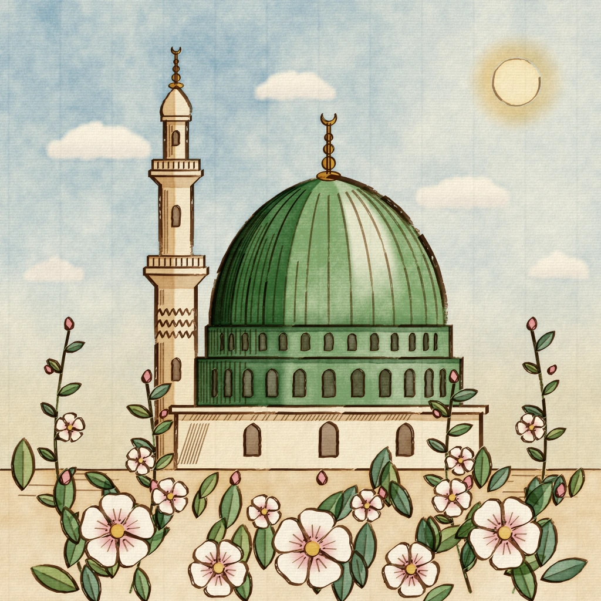

Hayalî bir ressamın eli. Alet: ucu eğik kesilip ortadan yarılmış kamış kalem ve ceviz kabuğu mürekkebi (koyu kahveden açık bal rengine); renk için yumuşak yuvarlak fırça. Kâğıt: krem, vergeli (laid) el yapımı kâğıt; ince yatay verge çizgileri ve seyrek dikey zincir izleri görünür. Çizgi alışkanlığı: çizgi resmin omurgasıdır; kalın, dolu ve kendinden emin bir ceviz kahvesi hat bütün biçimleri çevreler. Kalem 34° kadar sabit bir açıyla tutulur, bu yüzden sağ üste giden vuruşlar kıl inceliğinde, sağ alta inenler geniş çıkar; eğriler kısa düz parçalara bölünür, çizim köşeli, tutumlu ve kesindir. Her vuruş mürekkebe batırılarak başlar: başta koyu ve dolu, sona doğru bal rengine açılır, yük azaldığı yerde kâğıdın dişinde lif lif kesilir; kubbe konturu ve saplar gibi uzun hatlarda kalem sık sık yeniden doldurulur, böylece hat kopmaz; basılan geniş yerlerde yarık uç ortada ince açık bir çizgi bırakır. Gölge önce lavidir: kubbede kaburga sınırlarına oturan ikinci ve üçüncü sır, ışıklı dilimde kâğıt; mürekkeple yalnız tutumlu dokunuşlar (kubbenin gölge yanında meridyene koşut kısa vuruşlar, kasnakta ve minarede seyrek dikey çizgiler, korniş altında kısa eğik şerit). Palet: ceviz mürekkebi, adaçayı yeşili, sıcak okra, yumuşak gök mavisi, gül; beyaz taç yaprakları ve bulutlar kâğıdın kremi. Bitiriş: güneş kâğıt beyazı bir kurs, çevresinde okra ışıltı ve sulu mürekkeple tek halka; gök ufka doğru sıcaklaşır.

- **Köken:** Kamış kalem Orta Doğu ve Akdeniz'de yazı ve çizimin en eski aletlerindendir; Avrupa desen geleneğinde 17. yüzyıldan 19. yüzyıl sonuna dek manzara ve figür desenlerinde kalın-ince, açısal iziyle kullanılmıştır. Ceviz kabuğu ve bistr mürekkebiyle çizip suluboya lavisiyle renklendirme kalem-lavi deseninden, vergeli kâğıt el yapımı kâğıt geleneğinden gelir. Bu üslup gerçek bir sanatçıyı taklit etmez; bu teknikleri tek bir hayalî ressamın tutarlı eline (kalem açısı, mürekkep yükü, lavi sırası, palet) bağlayan atölye tarifidir.
- **Ayırt edici:** Kalın, kendinden emin ceviz kahvesi kamış kalem çizgisi bütün biçimleri çevreliyor ve küçük boyutta bile ilk okunan iz: kubbenin sağ konturu, minare gövdeleri ve sağ alta inen hatlar geniş, kubbenin sol konturu ve sağ üste giden hatlar ince; eğriler kısa düz parçalarla köşeli; Vuruşlar başta koyu ve dolu, sonda bal rengine açılıyor; geniş, basınçlı hatlarda yarık ucun bıraktığı ince açık lif çizgileri ve kuruyan uçlarda kâğıt dişinde kesilen lifler (kubbe konturu, minare gövdesi, saplar); Kubbede adaçayı yeşili lavi: sol dilimlerde kaburgaya oturan ikinci ve üçüncü sır, sağ üst dilimlerde kâğıda açılan ışık şeridi; kaburgalar sulu, açık mürekkeple; Tutumlu mürekkep gölgesi: kubbenin gölge yanında meridyene koşut kısa vuruşlar, kasnağın ve minarenin sol yanında seyrek dikey çizgiler, korniş altında kısa eğik vuruş şeridi; Krem vergeli kâğıt: gökte ve toprakta ince yatay verge çizgileri ve seyrek dikey zincir izleri; gök yukarıda yumuşak mavi, ufka doğru sıcak okraya geçiyor, bulutlar kâğıdın kremi, altları soluk leylak; Beyaz taç yaprakları kâğıt; diplerinde gül rengi lavi ve sulu mürekkeple kısa damarlar, göbekler okra-sarı; yapraklar üç ayrı adaçayı tonunda, gölge yarısı koyu
- **Palet:** `#4A2915` `#A57347` `#F6EEDB` `#92BADB` `#86B07E` `#4D7D58` `#DCB679` `#E79AA8`
- **Kodla çizim:** Kâğıt 2048 px yükseklik alanıdır: üç ölçekli değer gürültüsü, vergeli kâğıdın yatay verge sinüsü ve dikey zincir çizgileri. Laviler 1024 px'te çarpımsal birikir: maskeler bitkisiz sahne bölge haritasından ve bitki yollarından çizilir; her lavi katı maskeyi gürültüyle titreterek kenarı düzensizleştirir, maskenin kutu-bulanık kopyasından farkla kuruyan kenarda pigment birikmesini, kâğıt yüksekliğiyle granülasyonu, düşük frekanslı gürültüyle akış dalgalanmasını verir ve kâğıt rengini (1 − yoğunluk × soğurma) ile çarpar; kubbe sırları kaburga sınırlarına göre eşiklenir. Mürekkep 2048 px'te çizilir: her vuruş el titremesiyle bozulmuş, kısa düz parçalara bölünmüş yolun yedi 'lif' kopyasıdır (konturlarda uç genişliği 7–10 px, kaburga ve taramada 2,5–4 px); kopyalar kamış ucunun açısı doğrultusunda kaydırıldığı için çizgi yöne göre kendiliğinden kalınlaşıp incelir. Mürekkep yükü vuruş boyunca azalır; yükü eşiğin altına düşen lif çizilmez (kenar lifleri önce kurur, basınçlı geniş yerlerde orta lif açılır), renk yüke göre koyu kahveden bal rengine geçer ve birleştirmede açık (kuru) piksellerde mürekkep kâğıt dişine göre seyreltilir. Uzun hatlar mürekkebin bitişine göre vuruşlara bölünür. Örtüşme ressam sırasıyla çözülür: öndeki bitkinin silueti mürekkep katmanından silinip kendi çizgileri çizilir. Sonda kâğıt kabartma ışığı eklenir.
- **Kaynak:** [`S-161-kamis-kalem-ve-lavi/ornek.html`](stiller/S-161-kamis-kalem-ve-lavi/ornek.html)

### S-162

**Sepya Kalem ve Tinte** · *Sepia Pen and Tint* · ✦ atölye üslubu

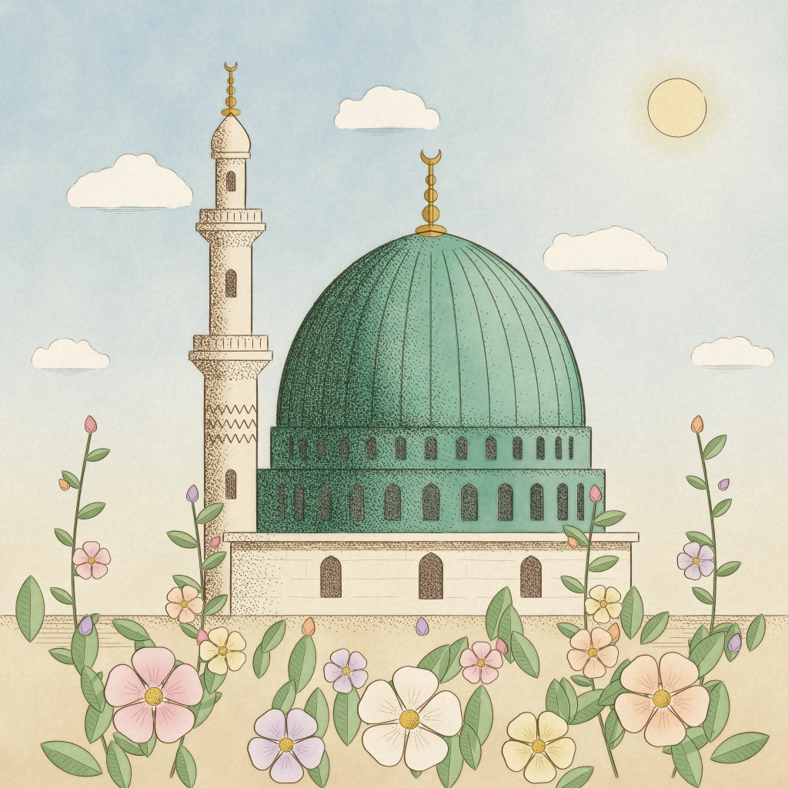

Hayalî bir 19. yüzyıl gezgin ressamının eli. Alet: ince, esnek çelik daldırma uç ve sepya mürekkebi; renk için yuvarlak samur fırça ve az sayıda soluk suluboya. Kâğıt: sıcak krem, düzgün dokulu (wove), lekesiz kâğıt. Çizgi: önce bütün biçimler ince, sakin ve kapalı bir konturla çizilir; uç aşağı inen vuruşlarda hafifçe açılıp şişer, vuruşların başı ve sonu incelir; bulutlar dış kenarında ince bir konturla, altında birkaç kısa yatay çizgiyle gösterilir. Gölge noktalamayla kurulur: noktalar düzenli aralıklı, hafif titrek bir ızgaraya konur; koyuluk nokta sıklığıyla, en koyuda biraz da nokta iriliğiyle artar (kubbenin gölge yarısı ve kaburga oluklarının dibi, kasnağın sol yanı ve kubbe altındaki şeridi, minarenin gölge yarısı, şerefe ve korniş altları, kaidenin sol ucu); ışıklı taş noktasız kalır; toprakta noktalar yalnız ufuk çizgisinin hemen altında sıklaşıp kısa bir mesafede sıfıra iner, açık kum noktasız kalır ve dokusunu alta doğru biraz koyulaşan ikinci bir kum tintesinden alır; en koyu yerlere kısa koşut taramalar eklenir (kubbenin sol kenarında meridyen boyunca, korniş altında yatay, pencere içlerinde dikey). Tinte: mürekkep kuruduktan sonra çizgilerin içine taşırmadan sürülen düz ve soluk katlar: bakır yeşili kubbe ve kasnak, uçuk gök mavisi gök, çiçekten çiçeğe değişen taç yaprak tinteleri (gül, kayısı, leylak, limon sarısı, ortadaki büyük çiçekte krem), tomurcuklarda gül, kayısı ve leylak, açık yaprak yeşili, devetüyü taş gölgeleri, altın okra alemler. Bitiriş: kaidede soluk taş sıraları ve kesik derzler; güneş soluk sarı bir kurs ve tek ince daire.

- **Köken:** 18. ve 19. yüzyıl topografik çizimlerine, gezi kitaplarının elle renklendirilmiş levhalarına ve bilimsel resimdeki noktalama (stippling) geleneğine dayanır: sepya kalem çizimi, noktalama ve kısa taramayla gölge, üstüne çizgiye sadık soluk suluboya tintesi (tinted drawing). Belirli bir sanatçıyı taklit etmez; bu teknikleri tek bir hayalî gezgin ressamın tutarlı eline bağlayan atölye tarifidir.
- **Ayırt edici:** İnce, sakin sepya kontur: aşağı inen vuruşlarda hafif şişen, uçlarda incelen çizgi; bütün biçimler kesin ve kapalı; Gölgeler sepya noktalarla kuruluyor: kubbenin sol yarısında ve kaburga oluklarının dibinde sıklaşıp irileşen noktalama kaburgaları kabartıyor; kasnağın sol yanı, minarenin gölge yarısı, şerefe ve korniş altları noktalı; ışıklı taş ve açık kum temiz; toprakta noktalama yalnız ufkun hemen altında, aşağı doğru sıfıra inen ince bir şerit; En koyu yerlerde kısa koşut taramalar: kubbenin sol kenarında meridyen boyunca, korniş altında yatay şerit, pencere ve nişlerin içinde dikey; Çizgilerin içinde soluk, temiz tinteler: bakır yeşili kubbe ve kasnak, açık yaprak yeşili; taç yapraklar çiçekten çiçeğe gül, kayısı, leylak, limon sarısı ve krem; tinte çizgiden taşmıyor; Uçuk gök mavisi gök ufka doğru krem ve sarıya açılıyor; bulutlar ince konturlu kâğıt beyazı, altlarında birkaç kısa yatay çizgi; Sıcak krem, lekesiz düzgün kâğıt; kaidede soluk taş sıraları ve kesik derzler, yapraklarda gölge yarısına koşut ince taramalar
- **Palet:** `#5A3F29` `#F8F1E2` `#7EB299` `#BBCED8` `#EFB3BF` `#F5C59A` `#D8C5D1` `#A6C38E`
- **Kodla çizim:** Kâğıt 2048 px düzgün tane alanıdır. Tinteler 1024 px'te bölge ve bitki maskelerinden çarpımsal lavi katları olarak birikir (çiçek ve tomurcuk tinteleri öğe sırasına göre beş ve üç renge dağıtılır); kenar titremesi çok düşük, kenar birikmesi ve granülasyon az tutulur, gölge tinteleri yumuşak kenarlı ikinci katlardır. Sepya mürekkep 2048 px'te değişken kalınlıklı şerit olarak doldurulur: kalınlık yolun aşağı inen bileşeniyle artar, uçlarda incelir, gürültüyle hafifçe dalgalanır; uzun hatlar vuruşlara bölünür. Noktalama ızgara hücrelerine titreşimle konan noktalardır: her hücrenin eşiği iç içe geçmiş gradyan gürültüsünden (mavi gürültüye yakın) gelir, nokta koyuluk işlevi bu eşiği aştığında konur ve yarıçapı koyulukla büyür; koyuluk işlevleri kubbe için dönel yüzey normalinden aydınlanma artı kaburga oluğu terimi, kasnak ve minare için silindir aydınlanması, korniş ve şerefe altları için bantlardır; zeminde noktalama yalnız ufkun altındaki 28 px'lik dereceli şeritte ve kaidenin sola düşen gölgesinde vardır, açık kuma ikinci, alta doğru artan bir kum tintesi sürülür. Kısa taramalar meridyen, yatay ve dikey doğrultularda bölgeye kırpılır. Bulut konturu, başka bir lobun içine düşmeyen yay parçalarından bulunur. Öndeki bitkiler arkadaki mürekkebi siler, sonra kendi çizgilerini taşır.
- **Kaynak:** [`S-162-sepya-kalem-ve-tinte/ornek.html`](stiller/S-162-sepya-kalem-ve-tinte/ornek.html)

### S-163

**Altın Mürekkep ve Suluboya** · *Gold Ink and Watercolor* · ✦ atölye üslubu

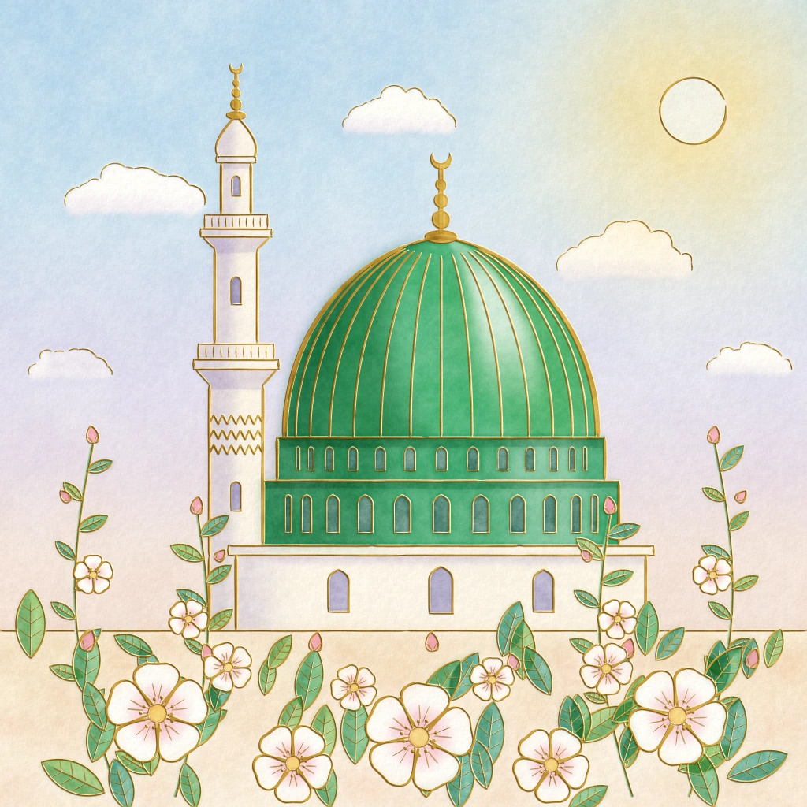

Hayalî bir ressamın eli. Alet: bol su taşıyan yumuşak samur fırça; ince uçlu daldırma kalem ve mika pullu altın mürekkep. Kâğıt: parlak beyaz, soğuk preslenmiş suluboya kâğıdı. Sıra: önce yıkamalar; pastel gök birbirine geçen katlarla (tepede gök mavisi, ortada leylak, ufukta şeftali, güneş çevresinde sıcak sarı), taze zümrüt kubbe ve kasnak (sağ üst dilimlerde kâğıda açılan parlak ışık, solda yumuşak kenarlı koyu yeşil ve camgöbeği sır), beyaz taşta leylak-mavi gölgeler, allık pembesi taç yaprak dipleri ve üç tonlu taze yapraklar. Yıkamalar kuruyunca bütün çizim yalnız altın mürekkeple çekilir: yapı konturu, kubbe kaburgaları, pencere kemerleri, alemler (altın dolgulu), taç yaprak kenarları ve damarları, yaprak konturu ve damarları, çiçek ercikleri, bulutların bütün üst kenarı (ışığa bakan yanda daha kalın), yer çizgisi ve güneşin kalın tek halkası. Çizgi belirgin, akıcı ve kendinden emindir; daldırma kalemin baskısıyla aşağı inen vuruşta şişer, yukarı çıkarken incelir, elle hafifçe dalgalanır; her çekişin başında küçük bir mürekkep birikintisi, sonunda incelen bir kuyruk kalır, uzun konturlarda kalem yeniden mürekkebe batırıldığı için kısa birleşim yerleri ve ara ara çok küçük boşluklar görülür. Altın mürekkep kâğıdın üstünde hafifçe kabarık kurur: her çizginin ışığa (sağ üste) bakan kenarı hafifçe açılır, sol alt kenarı biraz koyulaşır, mika pulları çizgi boyunca düzensiz, seyrek pırıltılar verir; ışıklı yüzeylerde bütün çizgi açılır, gölgede koyulaşır; çizginin altında mürekkebin kâğıda düşürdüğü belli belirsiz sıcak bir gölge vardır.

- **Köken:** Altın mürekkeple yazı ve süsleme el yazması, tezhip ve minyatür geleneklerinde yüzyıllardır kullanılır; metalik mürekkeple çizilmiş suluboya illüstrasyon çağdaş kitap ve davetiye resminde aynı ışıltıyı arar. Bu tarif suluboya yıkamasını ve daldırma kalemle metalik mürekkep çizgisini birleştirir; belirli bir sanatçıyı taklit etmez, hayalî bir ressamın tutarlı elidir (yıkama sırası, pastel palet, yalnız altın kontur).
- **Ayırt edici:** Bütün çizim belirgin altın mürekkep çizgileriyle: yapı konturu, on beş kaburga, pencere kemerleri, bulut kenarları, taç yaprak ve yaprak kenarları; hiç siyah ya da kahve çizgi yok, altın ağ küçük boyutta bile okunuyor; Altın çizgi daldırma kalemle çekilmiş: baskıyla şişip incelen kalınlık, hafif el dalgası, çekiş başlarında mürekkep birikintisi ve uzun konturlarda kısa birleşim yerleri; kabarık mürekkebin sağ üst kenarı hafifçe açık, sol alt kenarı koyu bal rengi, çizgi boyunca düzensiz seyrek mika pırıltıları; ışıklı yüzeylerde açılıyor, gölgede koyulaşıyor; altında ince sıcak gölge; Pastel gök birbirine geçen katlarla: tepede gök mavisi, ortada leylak, ufukta şeftali; güneş sıcak sarı bir ışıltının ortasında kâğıt beyazı kurs ve iki çekişte elle çizilmiş, hafif dalgalı kalın altın halka; Taze zümrüt kubbe: sağ üst dilimlerde kâğıda açılan parlak ışık şeridi, sol yanda yumuşak kenarlı koyu yeşil ve camgöbeği sır; kasnak pencereleri koyu çam yeşili; Beyaz taş kâğıt beyazı, gölgeleri leylak-mavi; kaide pencereleri leylak; alemler altın dolgulu; bulutların üst kenarı baştan sona altın, ışığa bakan yanda daha kalın; Beyaz taç yapraklarda allık pembesi dip, altın kenar ve ince altın damarlar, göbekte altın ercik halkası; yapraklar üç taze yeşil tonda, altın damarlı
- **Palet:** `#FFFDF8` `#B4842A` `#F6DC8A` `#3FB072` `#B0D3EA` `#DCCBEF` `#F9D2C0` `#F5B3C3`
- **Kodla çizim:** Kâğıt 2048 px soğuk preslenmiş doku alanıdır. Yıkamalar 1024 px'te çarpımsal lavi katlarıdır: gök dört katın (mavi, leylak, şeftali, güneş sarısı) konuma bağlı yoğunluk işlevleriyle üst üste binmesidir; bulutlar bulanık maskeyle yumuşak ayrılır; kubbe sırları dönel yüzey aydınlanmasından ve dilim sınırlarından eşiklenir, yumuşak kenarlı sırlar maskenin bulanık kopyasıyla karıştırılır. Altın mürekkep 2048 px'te beyaz bir maske katmanına değişken kalınlıklı şerit olarak çizilir: kalınlık iki ölçekli gürültüyle ±%30 oynar, aşağı inen çekişte şişer, yukarı çıkanda incelir, çekiş başında birikinti, sonunda kuyruk vardır; uzunluğa göre artan düşük frekanslı titreme (0,5–0,8 px) normal boyunca uygulanır; uzun konturlar rastgele boylu çekişlere bölünür ve her birleşimde ya 1–2,5 px boşluk kalır ya da yeni çekiş öncekinin ucuna biner; aynı şeritler yarım piksel kaydırılmış ikinci bir katmana koyu kahve olarak çizilip soluk, çarpımsal ince gölge olur. Birleştirmede altın katmanının her pikseline renk, bölge haritasından hesaplanıp bulanıklaştırılan bir aydınlanma haritasından (kubbede dönel yüzey normali, kasnak ve minarede silindir) artı gürültü ve kâğıt tanesiyle beş duraklı bir altın rampasından (koyu bal → limon altını → açık krem) seçilir; ayrıca altın katmanının alfa haritası çapraz komşularıyla karşılaştırılarak bir pah haritası çıkarılır: çizginin sağ üst kenarı rampada hafifçe açığa, sol alt kenarı koyuya kaydırılır (kabarık mürekkep, düşük pah karşıtlığı); seyrek mika pırıltıları çizginin dolu piksellerine karma işleviyle düzensiz serpilir. Öndeki bitkiler arkadaki altını siler, sonra kendi çizgilerini taşır.
- **Kaynak:** [`S-163-altin-murekkep-ve-suluboya/ornek.html`](stiller/S-163-altin-murekkep-ve-suluboya/ornek.html)

### S-164

**Gümüş Uç ve Tebeşir** · *Silverpoint and Chalk* · ✦ atölye üslubu

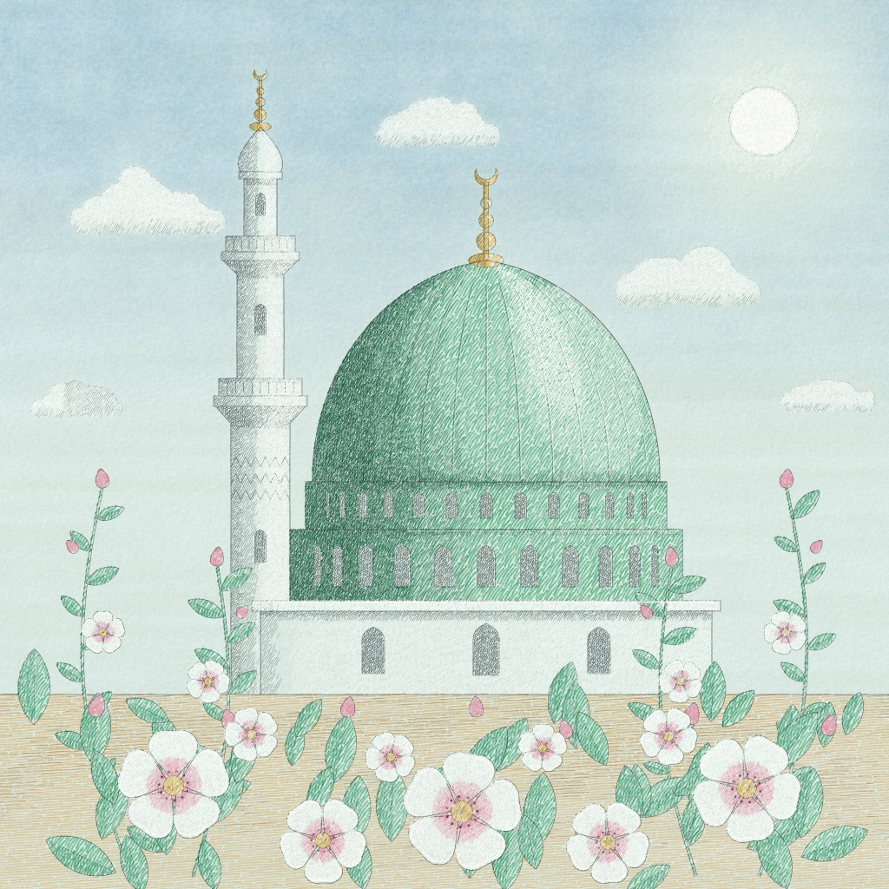

Hayalî bir ressamın eli; Rönesans çizim titizliğinde. Destek: kemik tozlu, fırçayla katlar hâlinde sürülmüş soluk mavi-yeşil astarlı kâğıt; astar ince dişlidir ve metal ucun izini tutar. Alet: gümüş uç (serin gri, basınçla kalınlaşmayan eşit kalınlıkta çizgi), ince samur fırça ve beyaz guaş; yeşil, altın-okra, gül, şeftali-okra ve soluk mavi tebeşirler, bunları yaymak için silgi (stump). Çizgi: biçimler tek, kesin ve ince bir gümüş konturla kurulur; ton yalnız çizgi sıklığıyla verilir: sağ üstten sola aşağı inen koşut, hafif yaylı taramalar küçük yamalar hâlinde; koyulaştıkça ikinci ve üçüncü yönde çapraz tarama eklenir (pencere içleri en sık); yapraklar ve tomurcuklar da aynı gümüş taramayla gölgelenir. Işık: beyaz guaşla aynı yönde ince fırça taraması; kubbenin sağ üst dilimlerinde, kaburgaların ışık yanında, minarenin ışıklı yüzünde, kaidede, korniş sırtında, bulutlarda ve beyaz taç yapraklarda; güneş dolu beyaz bir kurs. Renk: tebeşir çizgi bırakmaz; parmak ve silgiyle astara yayılır, yalnız dişin tepelerine tutunur: kubbe ve kasnakta yeşil (gölge yanında ikinci, koyu yeşil kat ve birkaç seyrek yumuşak vuruş), yapraklarda ve saplarda yeşil, göğün üstünde mavi, toprakta şeftali-okra, alemlerde ve çiçek göbeklerinde altın-okra, taç yaprak diplerinde ve tomurcuklarda gül. Böylece görünen el izi yalnız gümüş tarama ve beyaz ışıktır.

- **Köken:** Metal uç (gümüş uç) çizimi, renkli astarlı kâğıt ve beyazla ışıklandırma 14.–16. yüzyıl Avrupa atölye çiziminin temel tekniğidir; dönemin atölye el kitapları kemik tozlu astarın hazırlanışını anlatır. Renkli tebeşirle ve renkli astar üzerinde beyazla ışık verme sonraki yüzyılların desen geleneğinde sürer. Belirli bir sanatçıyı taklit etmez; bu teknikleri tek bir hayalî ressamın tutarlı eline (astar rengi, tarama yönü, beyaz ve tebeşir dağılımı) bağlayan atölye tarifidir.
- **Ayırt edici:** Soluk mavi-yeşil astar her yerde ara ton: gök büyük ölçüde astarın kendisi, üstte silgiyle yayılmış soluk mavi tebeşir; astarda fırça izinden belli belirsiz yatay dalgalanma ve ince diş; Gümüş ucun serin gri, eşit kalınlıklı çok ince çizgileri: sağ üstten sola aşağı inen koşut, hafif yaylı tarama yamaları; koyu yerlerde ikinci ve üçüncü yönde çapraz tarama, pencere içleri en sık; Beyaz guaş taraması ışıklarda: minarenin ışıklı yüzü, kaide, korniş sırtı, kubbenin sağ üst dilimleri ve kaburgaların ışık yanı; bulutlar beyaz tarama yamaları, güneş dolu beyaz kurs; Renk tebeşiri astara silgiyle yayılmış, çizgisiz ve yumuşak: kubbe ve kasnakta yeşil, gölge yanında koyu yeşil ikinci kat; gümüş tarama, gümüş kaburgalar ve beyaz ışık bunun üstünden geçiyor; Altın-okra tebeşirli alemler ve çiçek göbekleri; beyaz guaşla taranmış taç yapraklar, diplerinde gül rengi tebeşir; yapraklar yumuşak yeşil tebeşir üstüne gümüş konturlu ve gümüş taramalı; Toprak şeftali-okra tebeşirle yumuşak, üstünde seyrek, kesik yatay gümüş çizgiler
- **Palet:** `#D3E2DA` `#596062` `#FBFCF7` `#547F6A` `#A9CADD` `#C9BC98` `#B89A9E` `#B2A46B`
- **Kodla çizim:** Astar 2048 px ince diş alanıdır, üstünde hafif yatay fırça dalgalanması; rengi düşük frekanslı gürültüyle hafifçe kayar. Önce 1024 px ton haritaları hesaplanır: gümüş koyuluğu, beyaz ışık ve tebeşir renkleri; yapıda dönel yüzey ve silindir aydınlanmasından, bitkilerde maskelerden (yaprağın gölge yarısı, çiçek merkezine uzaklık) gelir. Tarama üreteci tuvali verilen açıda koşut çizgilerle tarar; birkaç komşu çizgi aynı kırılma noktalarını paylaşarak bir 'yama' oluşturur, vuruşlar hafif yaylıdır ve yalnız tonun eşiği aştığı parçalarda, tona göre artan saydamlıkla çizilir. Gümüş uç üç açıda üç eşikle (çapraz tarama), beyaz guaş iki açıda ayrı katmanlara çizilir; bitkilerin gümüş taraması, bitki konturları arkadaki çizgileri sildikten sonra ayrıca yapılır. Tebeşirler ton haritalarından üretilen, kâğıt yüksekliğinin tepelerinde yoğunlaşan (ters granülasyonlu), bulanık kenarlı çarpımsal katlardır; kontur ve kaburgalar gümüş, kaburgaların ışık yanı beyazdır. Birleştirmede gümüş çarpımsal, beyaz en üste konur. Öndeki bitkiler arkadaki gümüş konturu siler.
- **Kaynak:** [`S-164-gumus-uc-ve-tebesir/ornek.html`](stiller/S-164-gumus-uc-ve-tebesir/ornek.html)

### S-165

**Renkli Tarama** · *Colored Contour Hatching* · ✦ atölye üslubu

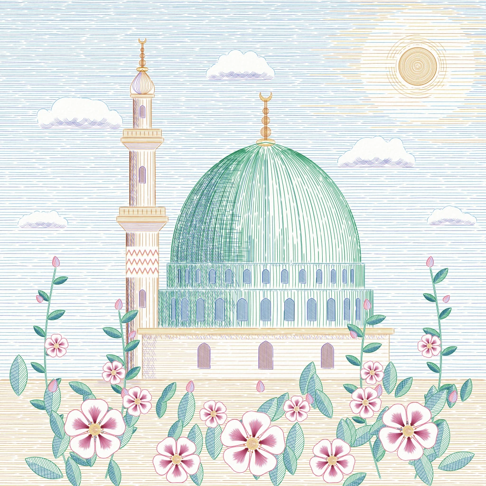

Hayalî bir ressamın eli. Alet: aynı ince uçlu sekiz kalem; mürekkepler zümrüt, çam yeşili, kobalt, gök mavisi, gül, altın, okra ve menekşe. Kâğıt: beyaz, düzgün bristol. Kural: hiçbir yer düz boyanmaz, hiçbir çizgi siyah değildir; her yüzey kendi biçimini izleyen çizgilerle kurulur, ton çizgi sıklığıyla verilir. El: her çizgi başta hafif bir basınçla başlar, sonda incelerek biter; uzun çizgiler bir solukta çekilmiş kısa vuruşlara bölünür, vuruşların uçları hafifçe biner ya da boşluk bırakır, aralıklar ve eğimler gözle ayarlandığı için küçük düzensizlikler taşır. Kubbe: meridyenler boyunca zümrüt çizgiler; ışıkta seyrek, gölgeye doğru aralara çizgiler birer birer eklenir, tepeye yaklaşan çizgiler kademeli bırakılır; gölge yanında enlem yayları boyunca kısa çam yeşili ve kobalt vuruşlar, en koyuda kobalt-menekşe eğik öbekler; kaburgalar koyu zümrüt, yanlarında ince çam yeşili. Kasnak ve minare: silindir boyunca kenarlara doğru sıklaşan dikey vuruşlar (kasnakta zümrüt ve çam yeşili, minarede okra ve menekşe), gölge yanında ve kubbenin altındaki şeritte kısa eğik vuruş öbekleri (kasnakta çam yeşili-kobalt, minarede menekşe-kobalt); pencereler kobalt-çam ya da menekşe-okra sık çapraz tarama. Kaide yatay okra ve altın kesik vuruşlarla; korniş altı ve kaidenin sol ucu kısa eğik menekşe öbekleriyle koyulaşır. Gök: elle çekilmiş, uçları azıcık binen yatay gök mavisi ve kobalt vuruş sıraları; güneşe yaklaştıkça altın ve okraya döner, güneş eş merkezli altın-okra halkalar. Taç yapraklar merkezden açılan gül ve menekşe ışınlarla (dipte sık, uçta kâğıt beyazı), yapraklar orta damardan uca kıvrılan zümrüt ve çam yeşili çizgilerle; her öğe kendi mürekkebiyle ince konturlanır.

- **Köken:** Kalem-mürekkep illüstrasyonundaki tarama ve çapraz tarama, gravürde biçimi izleyen çizgi (cross-contour) ve renkli ince uçlu kalemlerle yapılan çağdaş çizim pratiklerine dayanır; tonu çizgi ekleyerek kuran düzen gravürün ton kurma mantığından gelir. Belirli bir sanatçıyı taklit etmez; bu teknikleri sekiz mürekkepli tek bir hayalî ressamın tutarlı eline bağlayan atölye tarifidir.
- **Ayırt edici:** Siyah yok, düz dolgu yok: görüntünün tamamı uçları incelen, elle çekilmiş ince renkli mürekkep vuruşlarından; renkler çizgilerin yan yana ve üst üste gelişiyle optik olarak karışıyor; Kubbe meridyen vuruşlarıyla kurulmuş: ışıklı sağ yanda seyrek zümrüt çizgiler, gölgeye doğru çizgiler birer birer ekleniyor; her meridyen birkaç kesik, uçları incelen vuruştan; sol yanda enlem boyunca kısa çam yeşili ve kobalt vuruşlar, en koyuda menekşe-kobalt eğik öbekler; Kasnak ve minarede silindiri izleyen, aralıkları elle hafifçe değişen dikey vuruşlar; gölge yanında ve kubbe altındaki şeritte kısa eğik öbekler; pencereler kobalt-çam ve menekşe-okra sık çapraz tarama; Gök elle çekilmiş, aralıkları hafifçe değişen yatay mavi ve kobalt vuruş sıralarından, güneşe yaklaştıkça altın ve okraya dönüyor; güneş elle çekilmiş eş merkezli altın-okra halkalar, bulutlar beyaz kâğıt, altları menekşe-kobalt yaylarla; Taç yapraklarda merkezden açılan gül ve menekşe ışınlar dipte sık, uçta beyaz; göbekler eş merkezli altın-okra halkalar ve okra ercik noktaları; Yapraklar orta damardan uca kıvrılan zümrüt çizgilerle, gölge yarısında çam yeşili ve kobalt; toprak ve kaide yatay okra-altın çizgiler
- **Palet:** `#538A73` `#356B63` `#5A7796` `#9DB3C8` `#953752` `#B79869` `#B9936A` `#866D8F`
- **Kodla çizim:** Tek mürekkep katmanı 2048 px'te 'multiply' bileşimle çizilir; kesişen renkler üst üste koyulaşır. Her vuruş el titremesiyle bozulmuş bir yoldur ve değişken kalınlıklı şerit olarak doldurulur: başta hafif basınç, sonda incelme, kalınlıkta gürültülü dalgalanma; bölge haritasında bir koşulun sağlandığı parçalara kırpılır ve kırpılan uçlar da kısa bir incelmeyle biter. Uzun çizgiler 45–210 px'lik, uçları binen ya da aralık bırakan vuruşlara bölünür. Kubbe 256 meridyen yuvasıdır: her çizginin düzeyi indeksinin ikiye bölünebilirliğinden gelir, boylamı biraz kaydırılır; seyrek düzeyler her yerde, sık düzeyler kendi rastgele eşiklerini aydınlanma aştığında çizilir; yakınsayan çizgiler izdüşümdeki aralık kendi alt sınırının altına düşünce biter. Enlemler 18–56 px'lik kısa yaylardır, her biri kendi eşiğiyle; en koyu yerlerde eğik kısa öbekler eklenir. Kasnakta 192, minarede gövde başına 24–43 sütun vardır; sütunların açısı ve eğimi hafifçe sapar, gölge yanında eğik öbekler her vuruşun kendi eşiğiyle biter (sert sınır olmaz). Gök ve toprak, 60–170 px'lik, hafif yaylı vuruş sıralarıdır; sıra aralıkları rastgele değişir, renk güneşe uzaklıkla seçilir. Bitkilerde her öğe önce arkasındaki mürekkebi siler, sonra kendi yoluna kırpılmış taramasını taşır: taç yaprakta merkezden ışınlar, yaprakta damardan uca eğriler, tomurcukta eksene koşut çizgiler.
- **Kaynak:** [`S-165-renkli-tarama/ornek.html`](stiller/S-165-renkli-tarama/ornek.html)

### S-166

**Işıklı Sır Suluboya** · *Luminous Glazing Watercolor* · ✦ atölye üslubu

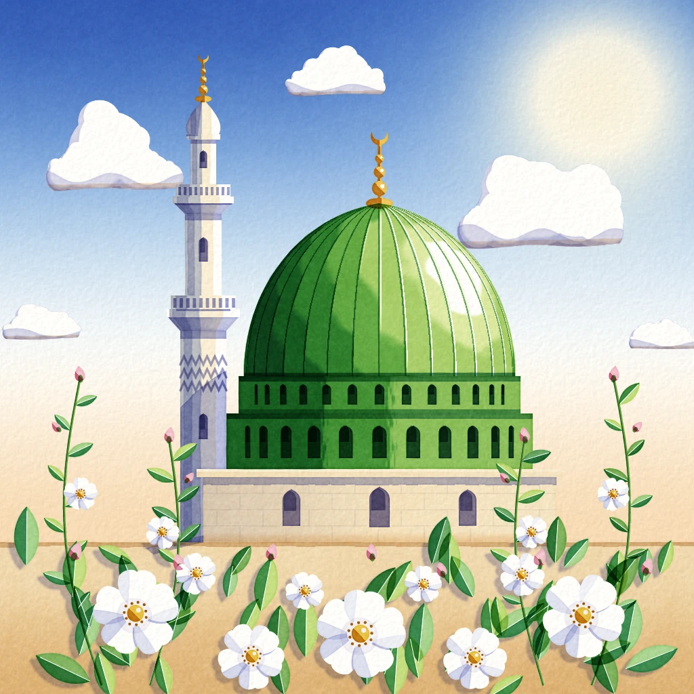

Hayalî, titiz bir gerçekçi suluboya ressamının eli. Gerili, parlak beyaz 300 g soğuk preslenmiş pamuk kâğıt; gök için yassı, ayrıntı için 4 ve 10 numara samur yuvarlak fırça. Palet: kobalt mavisi, ultramarin, aureolin, yeni gamboj, kinakridon gül, ftalo yeşili ve mavisi, ham siena. Ressam açıktan koyuya çalışır, her sırrı tam kurutup bir sonrakini üstüne sürer ve beyaz boya kullanmaz. Göğü bulutların çevresinden dolaşarak boyar: bulutlar boyanmamış kâğıttır, kobalt sırrı tümsekli tepelerde keskin bir kenarla durur, tabanda temiz nemli fırçayla yumuşatılır; sonra bulutun alt gövdesine tümsekleri izleyen tek bir serin gri-leylak gölge sırrı, kuruyunca en dibe ikinci küçük sır sürer. Kubbeyi altı kademeli sırla, her sırrı dilim dilim (kaburgadan kaburgaya) sürerek kurar: ışıkta sarı-yeşil, sonra yaprak yeşili, zümrüt, mavi-yeşil ve en gölgede serin mavi; sır sınırı her dilimde biraz başka yükseklikte biter, kaburgada küçük bir basamak yapar ve kuruyunca ince koyu bir kenar bırakır. Işıklı dilimlerde ilk iki sır kaburganın sağında kıl payı kâğıt bırakır. Gölgeyi kobalt-gül karışımı serin sırla keskin bir sınırla atar, düşen gölgeleri ayrı sırla ekler; en sonda pencerelere küçük koyu vurgular, alemlere sarı ve siena sırları ile korunmuş parıltı noktaları koyar; çiçek göbeklerini düz bir sarı sır, sol altta ikinci bir siena sırrı ve küçük, düzensiz bir kâğıt payıyla bitirir.

- **Köken:** Çağdaş gerçekçi saydam suluboyanın sır (glazing) tekniğine, beyazı boyamayıp kâğıtta koruma ilkesine ve kurumuş kâğıtta keskin kenarlı çalışmaya dayanır; kökü İngiliz suluboya okulunun katman katman sır uygulamasına ve fotogerçekçi suluboya ressamlarının sabırlı yöntemine uzanır. Tek bir gerçek ressamı örnek almaz; atölyenin tanımladığı hayalî bir ressamın elidir.
- **Ayırt edici:** Kubbede dilim dilim sürülmüş altı kademeli saydam sır: sınırlar her dilimde biraz başka yükseklikte bitiyor, kaburgalarda basamak yapıyor ve her sırrın kurumuş ince koyu kenarı görünüyor; Bulutlar boyanmamış kâğıt: kobalt gök sırrı tümsekli tepelerin çevresinden keskin dolaşıyor, tabanda yumuşuyor; alt gövdede tümsekleri izleyen serin gri-leylak gölge sırrı; Tepede derin kobalttan ufukta şeftali-altına inen dereceli gök; güneşin çevresinde boya inceltilerek açılmış parlak ışık; Sıcak güneş / serin gölge karşıtlığı: minarenin gölge yanında leylak-mavi sır, kubbenin minareye düşen eğri gölgesi, korniş altında keskin gölge şeridi; Kâğıt beyazı olarak korunmuş ışıklar: ışıklı kaburgaların sağında kıl payı beyaz çizgiler, kornişin üstü ve beyaz çiçekler; çiçeklerde serin, keskin kenarlı gölge sırları; Yapraklarda iki yarım sır (ışık yarısı sarı-yeşil, gölge yarısı mavi-yeşil), ortada korunmuş beyaz damar; üst üste binen yaprakların saydam koyulaşması
- **Palet:** `#3A63B9` `#A6CB67` `#428F32` `#14571D` `#C1BED6` `#B8B9BD` `#E0BB83` `#E8C44B`
- **Kodla çizim:** Canvas 2D, 1024 piksel. Her yıkama piksel başına bir kapsama alanıdır ve renk çarpımsal karışır: renk = kâğıt × Π exp(−soğurma × kapsama), soğurma hedef rengin −ln(renk/255) değeri. Maskeler SAHNE.yollar() yollarından ekran dışı tuvalde çizilir; el titremesi düşük frekanslı bir kaydırma alanıyla maskeyi 0,3–0,9 px oynatarak, kuruma kenarı maskenin bulanık kopyasından farkıyla, granülasyon kâğıt yüksekliğiyle, akış dalgası fbm gürültüsüyle eklenir. Bulutlar, yatay bir kuşak boyunca boyları gürültüyle değişen tümseklerin yassılaştırılmış metatop alanıdır (exp(−q²·0,7)); alan fbm ile hafifçe bükülür, tabanı gürültülü bir çizgiyle kesilir ve uçlarda incelir. Gök sırrı bu maskeyi korur; tabana yakın ve gürültüyle seçilmiş yerlerde koruma bulanık kopyaya karışarak kenar yumuşar. Gölge sınırı, yerel bulut boyundan ve fbm'den hesaplanan dalgalı bir çizgi ile büyük tümseklerin ışıktan uzak hilalleridir. Kubbe ışığı dönel yüzeyin normalinden (profil türevi) piksel başına hesaplanır, normal dilim ortasına doğru karıştırılır; altı eşik kademeli sırları verir, eşiğe her dilim için ayrı bir sapma ve yavaş bir gürültü eklenir. Kaburgalara işaretli piksel uzaklığından ince koyu çizgi ve ilk sırlarda sağında korunmuş kâğıt payı çıkar. Taç yaprakları Bézier yollarıdır; gölge yarısı yarım düzlem kesişimiyle, üst üste binme gölgesi kaydırılmış komşu yaprakla hesaplanır. Çiçek göbeği düz bir sarı sırdır; sol alt yarısına gürültüyle bükülmüş eğri sınırlı ikinci bir siena sırrı sürülür, sağ üstte küçük, düzensiz yedigen bir kâğıt payı kısmen korunur. Yapraklarda kuruma kenarı ve akış dalgası güçlüdür, kapsama fbm ile yaprak boyunca değişir. Bitkilerin zemine düşen gölgesi her yaprak ve çiçek için ayrı ayrı kısa kaydırılmış, hafifçe eğilip basıklaştırılmış maskelerden oluşan soluk (0,32) serin bir sırdır; yoğunluğu öğeye ve gürültüye göre değişir. En sonda kâğıt kabartması sol üstten ışıkla eklenir.
- **Kaynak:** [`S-166-isikli-sir-suluboya/ornek.html`](stiller/S-166-isikli-sir-suluboya/ornek.html)

### S-167

**Pastel Tonlu Suluboya** · *Soft Pastel Watercolor* · ✦ atölye üslubu

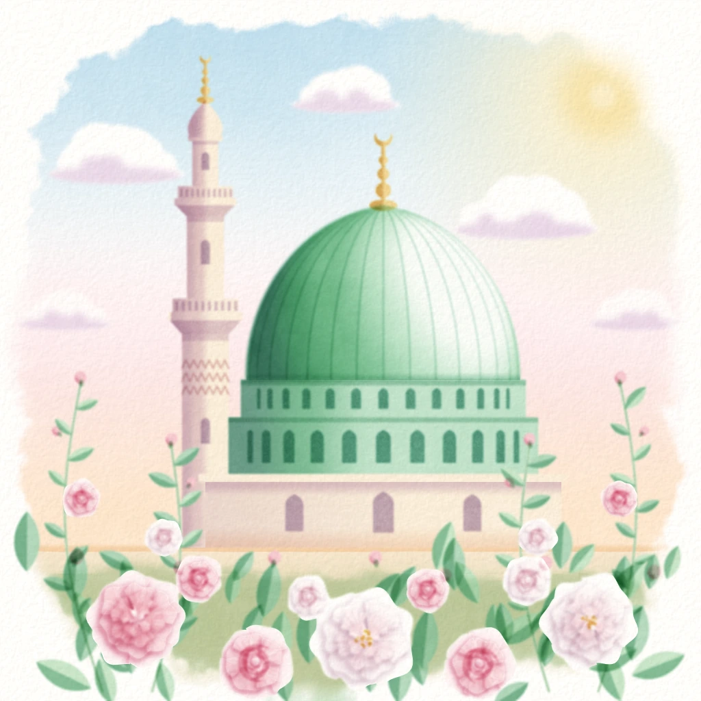

Hayalî, nazik elli bir suluboya ressamı. Sıcak beyaz, ince taneli 300 g pamuk kâğıt; yıkamalar için yumuşak sincap kılı fırça, yapraklar için 6 numara yuvarlak fırça ve kenarları yumuşatmak için temiz, nemli bir fırça. Palet: seyreltilmiş kinakridon gül, şeftali (gül ve Napoli sarısı), soluk serüle, nane yeşili (ftalo yeşili kâğıt beyazıyla açılmış), soluk altın (seyreltilmiş kinakridon altın) ve gölgeler için leylak (gül ve kobalt). Göğü nemli kâğıda sürer; tepede açık gök mavisi, ortada allık pembesi, ufukta şeftali-altın birbirine akar, bulutlar kâğıt beyazı bırakılır. Kenarları nemli fırçayla yumuşatır, neredeyse hiç koyu ton kullanmaz; taşı da sert kenarsız modeller: silindirde ışık yanına şeftali, gölge yanına iki kat leylak sürer, şerefe ve çıkma altlarına aşağı doğru eriyen gölge bantları, kaideye soluk taş sıraları ve pencerelere kemer tepesinde koyulaşan ikinci kat koyar. Çiçeklerde yaprağın kendisi kâğıt beyazıdır; biçimi, öndeki yaprağın arkadakine düşürdüğü yumuşak pembe-leylak gölge ve dipteki soluk allık verir, dış yaprak uçlarında ve birkaç iç yaprakta kuruyan boyanın bıraktığı keskin, yer yer kesilen ince kenarı korur; pembe güllerde yalnız ışık yanında kırık, ince bir kâğıt payı bırakır. Gök, zemin ve yaprak kütlesi kâğıdı kenardan kenara örter. Son dokunuş: soluk altın ercikler.

- **Köken:** Romantik çiçek suluboyasının ıslak üstüne ıslak gök, kaldırılmış bulut ve beyaz yaprakları arkadaki gölgeyle tanımlama (negatif boyama) tekniklerine ve kuruyan yıkamanın bıraktığı keskin kenarı biçim çizgisi olarak kullanma alışkanlığına dayanır. Gerçek bir ressamı örnek almaz; atölyenin tanımladığı hayalî bir ressamın elidir.
- **Ayırt edici:** Islakta birbirine geçen soluk gök: tepede açık gök mavisi, ortada allık pembesi, ufukta şeftali ve güneş çevresinde soluk altın; Önde iri şakayıklar ve güller: beyaz yapraklar kâğıt beyazı, biçimlerini öndeki yaprağın arkadakine düşürdüğü, yaprak kenarında keskin, dışa doğru eriyen pembe-leylak gölge ve kurumuş ince yaprak kenarı veriyor; güllerde ortada sarmal çanak yaprakları; Nane yeşili kubbe: sağ üstte yumuşak kâğıt beyazı ışık, sol yanda leylak-mavi gölge, ince ve yumuşak kaburgalar; Krem ve pembemsi minare ile kaide nemli kâğıtta yumuşak geçişlerle modellenmiş: ışık yanında sıcak şeftali, gölge yanında leylak, şerefe ve çıkma altlarında aşağı eriyen gölge bantları; kaidede şeftali korniş, soluk taş sıraları ve kemer tepesi koyulaşan pencereler; Kabarık, yumuşak kenarlı beyaz bulutlar ve altlarında soluk leylak-pembe gölge; altta çiçeklerin arkasında ıslakta yayılmış, alt kenara dek inen soluk nane yeşili yaprak kütlesi
- **Palet:** `#CBE4F0` `#F1DFD1` `#F2B6C0` `#D56A82` `#69A788` `#AAD2B1` `#FAEDC6` `#C9A5B2`
- **Kodla çizim:** Canvas 2D, 1024 piksel; S-166 ile aynı çarpımsal sır motoru, ama yumuşak elle: maskeler bulanıklaştırılıp gürültülü bir eşikle yeniden kesilir (ıslak kâğıtta tüylenen kenar), kuruma kenarı çok hafif, granülasyon düşük. Gök, zemin ve arka yaprak kütlesi yıkamaları tuvalin dört kenarına dek uzanır; bitki ve çiçeklerin çevresi bulanıklaştırılmamış maskeyle korunur, beyaz hale kalmaz. Şakayık ve güller kutupsal örneklenmiş, dış kenarı dalgalı yelpaze yapraklardır (2–4 kat); her yaprak dipten kenara dereceli soluk allıkla yıkanır, gölge maskesi = arkadaki yapraklar ∩ öndeki yaprağın 1–2 px kaydırılmış, az bulanıklaştırılmış kopyası − öndeki yapraklar (gürültüyle yoğunluğu değişir); dış kat ve birkaç iç yaprağın kenarına, maskeden 1 px bulanık kopyası çıkarılarak bulunan, gürültüyle kesilen ince kurumuş kenar çizgisi sürülür. Gül ortası daireden kaydırılmış daire çıkarılarak hilaller; pembe güllerde kenar payı yalnız ışık yanında, gürültüyle kesilen 1–3 px'lik bir şerit olarak korunur. Minare silindiri u = (x − 300)/yarıçap üzerinden geniş yumuşak eşiklerle ışık ve gölge katlarına, gölge bantları yüksekliğe göre azalan kapsamaya bölünür; kaidenin taş sıraları bulanıklaştırılmış ince çizgi maskesiyle yumuşak verilir. En sonda hafif kâğıt kabartması.
- **Kaynak:** [`S-167-pastel-tonlu-suluboya/ornek.html`](stiller/S-167-pastel-tonlu-suluboya/ornek.html)

### S-168

**Tonlu Kâğıtta Suluboya ve Beyaz** · *Watercolor and White on Toned Paper* · ✦ atölye üslubu

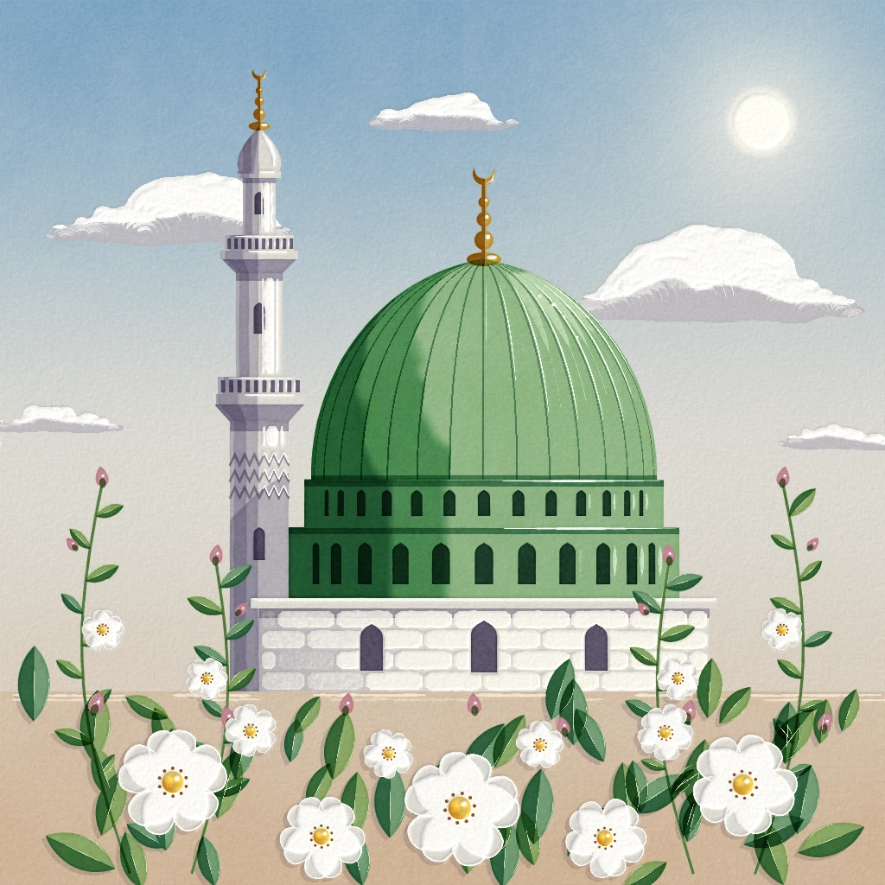

Hayalî bir ressamın eli. Orta dişli, açık nötr gri tonlu çizim kâğıdı; suluboya için 2 ve 8 numara yuvarlak, gök için yassı fırça, guaj için ince 1 numara yuvarlak ve 4 numara yassı fırça. Palet: serüle ve kobalt, yaprak yeşili ve ftalo yeşili, ham ve yanık siena, kinakridon gül, menekşeye çalan gri; titanyum beyazı guaj ve göbekler için biraz sarı guaj. Kâğıdın tonu orta değer olarak kalır; suluboya yalnız koyulaştırır (gök, gölgeler, yeşiller), bulutların gölgeli tabanı tonlu kâğıtta bırakılır. Işıklar en sonda tam örtücü beyazla, kenarı temiz ve bilinçli darbelerle sürülür: bulutların ışıklı tepeleri dolu beyazla ve tümsekleri izleyen, hafif kabarık kalan kavisli darbelerle; minarenin ışıklı yanında dikey şerit (kubbenin düşürdüğü gölgede durur); kaidede düz kenarlı, kare uçlu, uzunlukları değişen yassı fırça çekişleriyle sıra sıra; ince derzler tonlu kâğıtta kalır, bazıları guajın altında kaybolur, guaj kuruyunca korniş altına ve sola doğru gölgeye dönen cepheye saydam serin bir sır geçer; taç yapraklarda merkezden dışa, düz duran darbeler ve yalnız ışık yanında kenarı izleyen ince bir çizgi. Bitirirken güneşi dolu beyaz bir diskle, kubbe kaburgalarına ve alemlere ince beyaz parıltılar, düz sarı guaj göbeklere siena noktalar ve küçük bir beyaz dokunuş, yaprak kenarlarına açık sarı-yeşil çizgiler, ufka birkaç yatay krem darbe koyar.

- **Köken:** Renkli ya da tonlu kâğıtta beyazla ışık verme (Rönesans'tan beri mavi ve gri kâğıtta beyazla yükseltilmiş çizimler), 19. yüzyıl gezi defterlerinde tonlu kâğıda suluboya ve Çin beyazı ile çalışma ve bugünkü tonlu kâğıt eskiz defteri pratiğine dayanır. Gerçek bir ressamı örnek almaz; atölyenin tanımladığı hayalî bir ressamın elidir.
- **Ayırt edici:** Açık gri tonlu kâğıt orta ton olarak görünür: göğün alt yarısında, bulutların gölgeli tabanında, taş derzlerinde ve zeminde kâğıdın kendi rengi; Bulutların ışıklı tepeleri tam örtücü beyaz guajla, kenarı temiz; tümsekleri izleyen kavisli darbeler hafif kabarık, bir kısmı gölgeli tabana inceltilerek iniyor; Kaide uzun, düz kenarlı ve kare uçlu yassı fırça çekişleriyle sıra sıra beyaz; ince derzler tonlu kâğıtta kalıyor, bazıları kayboluyor; sol uç ve korniş altı guajın üstüne sürülmüş saydam serin sırla gölgede; korniş üstünde ince beyaz çizgi; Minarenin ışıklı yanında dikey örtücü beyaz şerit ve iki ince darbe, kubbenin düşürdüğü gölgede kesiliyor; korkuluk tırabzanı, şerefe kenarları ve zikzak bantta ince beyaz çizgiler; Saydam zümrüt yeşili kubbede ışıklı kaburgaların sağında ince beyaz parıltı çizgileri ve açık yeşil guaj ışık darbeleri; alemlerde beyaz parıltı noktaları; çiçek göbekleri düz sarı guaj, siena noktalar ve küçük bir beyaz dokunuş; Güneş dolu beyaz bir disk ve ince örtülü yumuşak hale; çiçek yaprakları merkezden dışa beyaz guaj darbeleriyle, ışıktan uzak yapraklarda guaj inceldiği için gri kâğıt gölge olur
- **Palet:** `#DCD9D2` `#82A7C4` `#A9C79D` `#2F6E3A` `#938E9D` `#FCFBF6` `#CDB194` `#5F864C`
- **Kodla çizim:** Canvas 2D, 1024 piksel. Kâğıt rengi #DCD9D2 olan çarpımsal sır motoru suluboyayı verir; örtücü guaj ayrı bir işlemle karışır: renk = renk × (1 − örtme) + beyaz × örtme ve guaj kalınlığı kabartma haritasına eklenip darbeler hafif ışık yakalar. Darbeler üç türdür: çoklu çizgi boyunca uçları incelen titrek çokgenler (bulut yayları, taç yaprak darbeleri, parıltılar), uçları hafif yuvarlatılmış yassı dörtgenler (minare ışığı, ufuk darbeleri) ve taş sıraları için kıl kıl biraz farklı boyda biten, düz kenarlı, kare uçlu yassı çekişler; kırık eşiği düşük tutulduğu için kenarlar temiz kalır. Bulutlar yatay kuşakta boyları farklı tümseklerin yassılaştırılmış metatop alanıdır; ışıklı bölge = bulut − gölge (dalgalı taban sınırı ve büyük tümseklerin hilalleri), dolu beyazla örtülür, tümsek yayları üstten kabarık beyazla, gölgeye uzanan kısmı azaltılmış örtmeyle boyanır. Kaide guajı her sırada 40–120 px boyunda, 1–1,5 px derzle ayrılan (yer yer üst üste binip derzi kapatan) yassı çekişlerdir; üstüne korniş altı gölgesi ve sola doğru koyulaşan serin sır çarpımsal olarak sürülür. Taç yapraklarda, göbeklerde ve kaidede guaj kalınlığı düşük tutulur, kabartma kabarık görünüm vermez; taç yaprak kenarındaki örtücü darbe ışık yönünde doğrusal bir geçişle yalnız ışık yanında belirir. Bitkilerin zemine düşen gölgesi her yaprak ve çiçek için ayrı kısa kaydırılmış, hafifçe eğilmiş soluk bir sırdır; minare şeridi kubbe gölgesinin eğrisinde kesilir.
- **Kaynak:** [`S-168-tonlu-kagitta-suluboya/ornek.html`](stiller/S-168-tonlu-kagitta-suluboya/ornek.html)

### S-169

**Kuru Fırça Natüralist** · *Drybrush Naturalist* · ✦ atölye üslubu

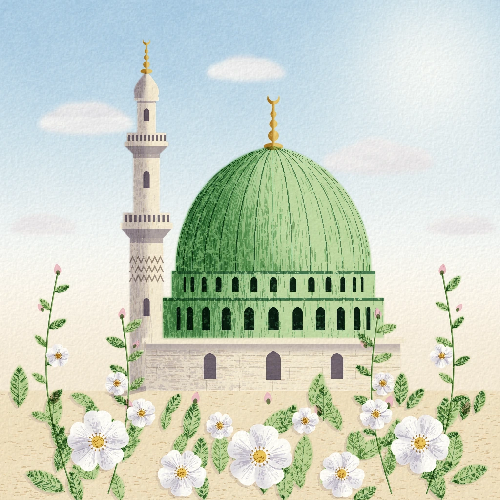

Hayalî, sabırlı bir gerçekçi suluboyacının eli. Belirgin dişli, kaba 640 g pamuk kâğıt; ilk yıkamalar için yumuşak bir fırça, ayrıntı için kılları açılmış ve her darbeden önce kâğıt mendile kurutulmuş 0–2 numara samur fırça. Palet sıcak ve doğaldır: biraz viridyenle camgöbeğine çekilmiş serüle, Napoli sarısı, sarı okr, ham siena, sap yeşili ve viridyen, yaprak yeşili, yanık umbra, tomurcuklar için kinakridon gül, menekşeyle yumuşatılmış Payne grisi. Önce gök (ufukta kremli Napoli sarısı, tepede camgöbeğine çalan serüle), taş, açık sap yeşili kubbe ve okr zemine soluk, yumuşak kenarlı yıkamalar sürer ve kurutur; sonra tonu, biçimi izleyen paralel ince kuru darbelerle kurar: gökte yassı fırçanın yatay kuşaklar hâlinde toplanan uzun, ince çekişleri (ufka yakın yerde sıcak Napoli çekişleri), kubbede kaburgalar boyunca kuşak kuşak koyu sap yeşili ve viridyen, minarede dikey, kaidede taş sıraları boyunca yatay taş damarı, toprakta ufka doğru kısalıp incelen uzun yatay ham siena ve okr çekişleri; bulutların gölgeli tabanında ince yatay darbeler. Darbeler uzun, ince ve süreklidir: fırça kâğıda dolu değer, boya azaldıkça darbe incelir, solar ve ucunda kâğıdın dişine takılıp kırılır; gölgeyi koyu boya yerine darbe sıklığıyla verir. Yapraklarda yan damarlara paralel darbeler atar, damarları açık bırakır; beyaz taç yapraklarda dipten uca ince sırt çizgileri çeker. Bitirirken pencerelere, kaburgalara ve ercik noktalarına keskin koyu ayrıntılar koyar.

- **Köken:** 20. yüzyıl gerçekçi suluboyasının kuru fırça (drybrush) geleneğine ve doğa ile bitki resmindeki ince fırça ayrıntılandırmasına dayanır: kaba kâğıtta az sulu boya, dokuyu kâğıdın dişinden alma ve tonu darbe yoğunluğuyla kurma. Gerçek bir ressamı örnek almaz; atölyenin tanımladığı hayalî bir ressamın elidir. S-049 Kuru Fırça'nın coşkulu, bütün yüzeyi kaplayan darbelerinin aksine darbeler ince, sakin ve yumuşak kenarlıdır; her yüzeyde biçimi izler (gökte ve toprakta yatay, kubbede meridyen yönünde).
- **Ayırt edici:** Sıcak natüralist anahtar: tepede camgöbeğine çalan serüle gök ufukta kremli Napoli sarısına ısınıyor; gökte ince, yatay, kuşaklar hâlinde toplanan kuru fırça çekişleri kâğıdın dişini atlayarak kırılıyor; Sap yeşili kubbe kaburgalar boyunca (meridyen yönünde) kuşak kuşak toplanan uzun, ince kuru fırça darbeleriyle modellenmiş: ışıkta açık yeşil, gölgede koyu yeşil ince çizgiler; kasnakta aynı elle dikey darbeler; Güneşli okr ve ham siena toprak, yassı fırçanın uzun yatay kuru çekişleriyle; çekişler ufka doğru kısalıp inceliyor; Darbe ortası dolu, kenarı ve solan ucu kâğıdın dişine takılıp hafifçe kırılıyor; kaba kâğıt dokusu yıkamaların altında da seçiliyor; Minarede dikey, kaidede taş sıraları boyunca yatay ince taş damarı; soluk taş sıraları ve şaşırtmalı derzler; Yapraklarda yan damarlara paralel ince darbeler, damarlar açık kâğıt; beyaz taç yapraklarda dipten uca yelpaze gibi açılan gri-leylak sırt çizgileri, göbeklerde siena benekler ve ince ercikler
- **Palet:** `#8DBFCF` `#F3E6C8` `#DCBD84` `#CCAE7E` `#8CC07A` `#1F5326` `#DACCB7` `#E1BE62`
- **Kodla çizim:** Canvas 2D, 1024 piksel, kaba kâğıt yüksekliği (fbm) ile çarpımsal sır motoru. İlk yıkamalar yumuşak kenarlı maskelerle sürülür. Kuru fırça katmanları yordamsal darbelerdir: kutu içinde rastgele noktalar ışık ya da yoğunluk işlevine göre kabul edilir, yön alanı boyunca (kubbede dönel yüzeyin meridyeni, atan2(1, u·dr/dy)) adım adım ilerletilir ve bölge yoluna kırpılmış parçalar olarak maske tuvaline çizilir; her parçada saydamlık ve kalınlık darbe sonuna doğru azalır (boya biter). Boya bırakma, kapsamanın kâğıt yüksekliğine karşı yumuşak bir eşikten geçirilmesidir: kapsama − derinlik × (1 − yükseklik); darbe ortası çukurlara da iner, kenarı ve solan ucu yalnız tepelerde kalır, böylece darbe sürekli kalıp yalnız kenarda kırılır. Bulutlar yassılaştırılmış metatop tümseklerinden; gölgeli tabandaki yatay darbeler bulut maskesiyle kesilir. Gök iki yıkamadır (ufukta Napoli kremi, tepede camgöbeği-serüle); üstündeki yatay kuru çekişlerin (40–120 px) kabul olasılığı yatayda 240 px, dikeyde 6 px ölçekli, anizotrop fbm gürültüsünden eşiklenir, böylece çekişler yatay kuşaklarda toplanır ve küçük boyutta da çizgili okunur. Zemin üç perspektif kuşağında (ufka yakın kısa ve ince, öne doğru uzun ve geniş) ham siena ve okr çekişleridir; zemindeki öbekler daha kısa ve dağınıktır, kabul olasılığının bir taban değeri vardır, böylece çekişler tam genişlikte ince koşut şeritler (ahşap damarı görünümü) oluşturmaz. Kubbe çekişlerinin olasılığı boylam (dilim) koordinatına göre kuşaklanır. Yaprak darbeleri yan damar çizgilerine yaklaşınca atlanır; taç yaprak sırtları dipten uca ikinci derece eğrilerdir.
- **Kaynak:** [`S-169-kuru-firca-naturalist/ornek.html`](stiller/S-169-kuru-firca-naturalist/ornek.html)

### S-170

**Mimari Lavi** · *Beaux-Arts Wash Rendering* · ✦ atölye üslubu

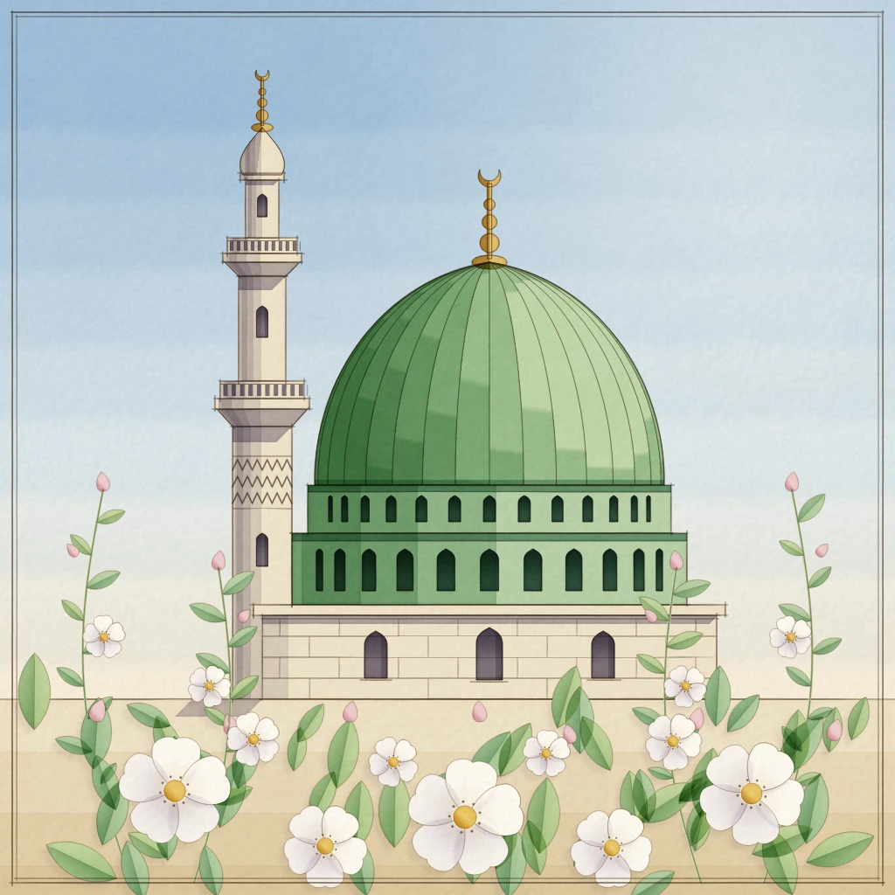

Hayalî, klasik eğitimli bir mimar-ressamın eli. Tahtaya gerilmiş, sıcak beyaz, düz (sıcak preslenmiş) kâğıt; seyreltilmiş sepya çini mürekkebiyle tiralin ve pergel, kubbe için eğri cetvel; gök için geniş yassı fırça, lavi için yuvarlak fırçalar. Palet: seyreltilmiş mürekkep, nötr gri, serüle-gri, sarı okr ve ham siena (taş, zemin), yeşil toprak ve yaprak yeşili (kubbe, peyzaj), tomurcuklar için kinakridon gül. Önce çizgiler çekilir: dış hatlar, kaburgalar, taş sıraları, korkuluk dikmeleri; cetvel çizgileri köşelerde hafifçe taşar, basınçla incelip kalınlaşır. Yıkamalar çok sayıda ince düz katla, her kat biraz daha kısa bırakılarak dereceli tona dönüştürülür: gök tepeye doğru yumuşak basamaklarla koyulaşır, kubbe dilim dilim düz tonlarla (en soldaki dilim yansıyan ışıkla bir ton açık bırakılır), silindirler kademeli bantlarla ve gölge kenarında yansıyan ışıkla modellenir. Gölgeler çıkıntılardan 45°'de kurulur (şerefeler, korniş, kaidenin zemine düşen gölgesi). Bitirirken pencereler üstte koyulaştırılır, peyzaj yapıdan daha serbest bir elle, seyreltilmiş açık sepya konturlarla ve dereceli lavilerle işlenir: kontur gölge yanında bastırılır, ışık yanında hafifler ve yer yer kalkar; her yaprağın ucu biraz bükük, iki yarısı biraz farklı genişliktedir, orta damar dipten uca incelen bir kalem çizgisidir; yaprak lavisi uçtan dibe ve kenardan damara koyulaşır, kuruyan kenarında pigment birikir, dolgusu dengesiz ve hafif tanelidir; beyaz taç yapraklar dipte sıcak tonla başlayıp kenarda kâğıt beyazına açılır, gölge yapraklarında leylak kat kenarda toplanır; bitki gölgeleri zemine 45°'de soluk düşer; resim ince çift çizgili bir çerçeveyle kuşatılır.

- **Köken:** École des Beaux-Arts'ın 19. ve 20. yüzyıl başı mürekkep ve lavi cephe çizimlerine (rendu), 45°'lik ışıkla gölge kurma bilgisine (sciagraphie) ve dereceli düz yıkama tekniğine dayanır; teknik çizimden ayrı olarak sıcak kâğıtta renkli ve resimsel bir sunuştur. Gerçek bir ressamı örnek almaz; atölyenin tanımladığı hayalî bir ressamın elidir.
- **Ayırt edici:** Bütün biçimler ince sepya mürekkeple: cetvelle çekilmiş düz çizgiler köşelerde hafifçe taşıyor, kalınlık basınçla değişiyor; kubbe, kemerler ve kaburgalar pergel ve eğri cetvelle; Kubbe dilim dilim düz tonlarla modellenmiş: her dilim tek ton, tonlar ışıktan gölgeye kademe kademe koyulaşıyor; en soldaki dilim yansıyan ışıkla bir ton açık; 45°'de kurulmuş keskin gölgeler: şerefe ve bilezik altlarında eğik uçlu gölge bantları, korniş altında gölge şeridi, kaidenin zemine sola düşen gölgesi; Tepeden ufka kat kat açılan dereceli gök yıkaması; ince basamaklar ve güneş yanında açılma; Kaidede taş sıraları ve şaşırtmalı derzler, korkuluklarda tek tek çizilmiş dikmeler, zikzak bant; minare silindiri kademeli gölge bantlarıyla; Zarif peyzaj: yapraklar uçtan dibe ve kenardan orta damara koyulaşan dereceli lavilerle, kurumuş kenarda pigment birikintisi ve dengesiz dolgu; ucu bükük, iki yarısı farklı genişlikte yapraklar, incelen kalem çizgisi orta damar; gölge yanında bastırılan, ışık yanında incelip kesilen açık sepya konturlar; beyaz çiçeklerde dipte sıcak ton, gölge yapraklarında dereceli leylak; resmi kuşatan ince çift çizgili çerçeve
- **Palet:** `#9FBDD6` `#99B67E` `#3E713E` `#E9DCC3` `#A69894` `#D8C399` `#6D6169` `#4B3E33`
- **Kodla çizim:** Canvas 2D, 1024 piksel; düşük akış dalgası ve hafif kuruma kenarlı çarpımsal lavi motoru, düz preslenmiş kâğıt dokusu. Mürekkep çizgileri bir maske tuvaline çizilir: cetvel çizgileri uçlarda kalınlığı rastgele değişen, 1,5–4 px taşan ve çok hafif bükülen ince dörtgenler; eğriler Path2D ile pergel gibi sabit kalınlıkta. Örtme: her bitki biçimi çizilmeden önce içindeki çizgiler destination-out ile silinir, sonra kendi konturu çekilir (arkadan öne). Gök, her biri bir öncekinden daha yukarıda biten, alt kenarı hafif gürültülü sekiz düz yıkamanın üst üste binmesidir. Kubbe normali dilim ortasına neredeyse tamamen yaslanır; beş eşik dilim başına düz, kademeli tonlar verir; en soldaki görünen dilimde (0 ve 1 numaralı dilimler) en koyu iki kat atlanır ya da zayıflatılır (yansıyan ışık). Minare ve kasnak silindirleri eşikli bantlarla, 45° gölgeler paralelkenar maskelerle boyanır; mürekkep en sonda yoğunluk olarak eklenir; peyzaj çizgileri iki ayrı maskede çizilip birleştirilir: ışık yönünde doğrusal geçişli kalın bir gölge yanı konturu ve ince bir temel kontur; ince kontur, kalın konturun zayıf kaldığı ışık yanında gürültüyle yer yer kesilir; orta damar, yaprağın bükük ekseni boyunca dipten uca daralan bir şerittir; hepsi daha açık sepya ve düşük yoğunlukla. Yaprak yolları SAHNE.bitki verisinden yeniden kurulur: her yaprağa tohumlu ucu bükme (eksene dik, u² ile artan kayma), iki yarıya ayrı genişlik ve boy çarpanı verilir. Yapraklar tek tek, yaprak eksenine göre u (uçtan dibe) ve v (kenardan damara) koordinatlarından hesaplanan dereceli kapsamayla, belirgin kuruma kenarı, granülasyon ve fbm gürültüsüyle bozulan dolguyla iki üç kat lavi alır; gölge yarısının kapsaması orta damara doğru azalır; taç yapraklarda merkeze uzaklıkla azalan sıcak kat, gölge yanında uzaklıkla açılan leylak ve kaydırılmış komşu yaprak konturundan ince binme gölgesi; bitki gölgesi 45° kaydırılmış, kenarında pigment biriken soluk tek kattır.
- **Kaynak:** [`S-170-mimari-lavi/ornek.html`](stiller/S-170-mimari-lavi/ornek.html)

### S-171

**Akademik Yağlıboya** · *Academic Oil Painting* · ✦ atölye üslubu

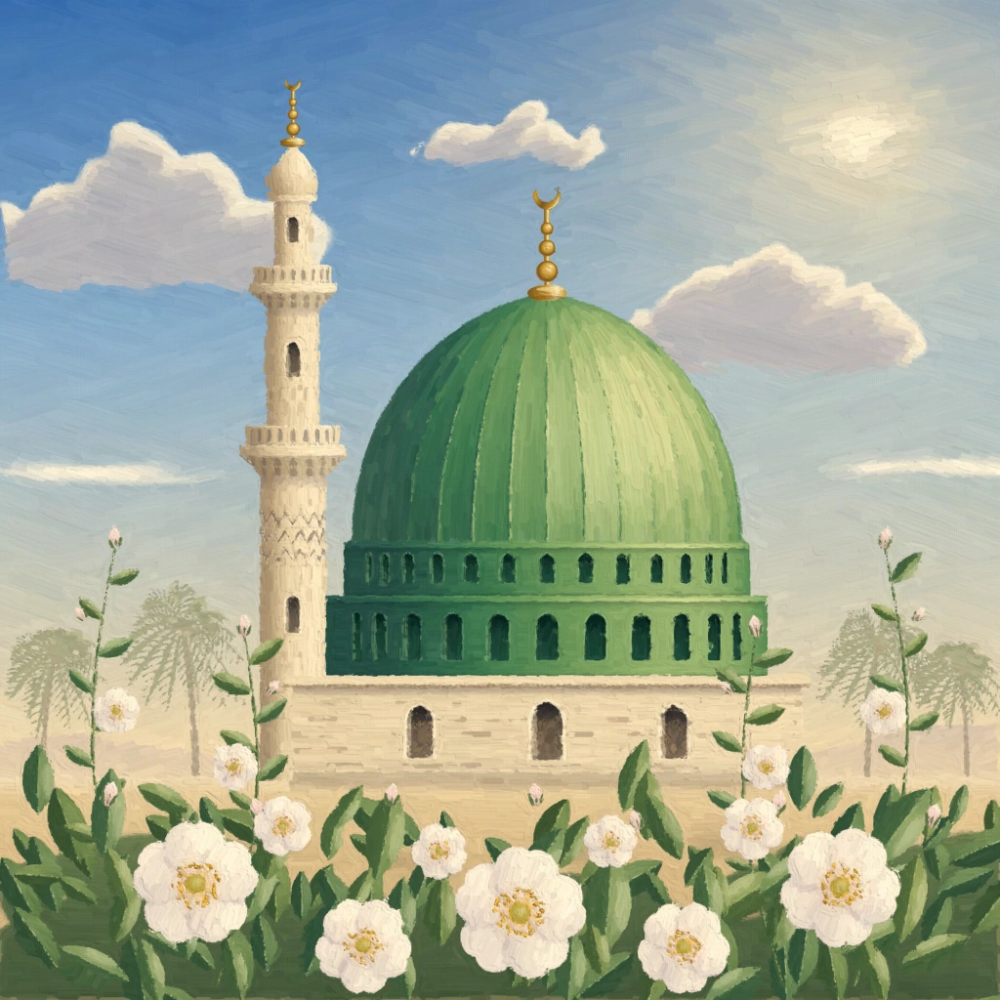

Hayalî bir 19. yüzyıl akademi ressamının eli. Aletleri samur ve yumuşak kıl yuvarlak fırçalar, ayrıntı için ince samur ve uzun kıllı bir kontur fırçası; zemini ince dokulu, açık krem astarlı keten bez. Paleti sıcak ve ölçülüdür: serülyen ve ultramarin gök, ufka doğru Napoli sarısı pus, krem-okr taş, zeytine çalan doğal zümrüt ve sap yeşili, altın okr. Önce kesin bir desen çizer, sonra bütün yüzeyi biçimi izleyen darbelerle boyar: gökte hafifçe çaprazlanan geniş darbeler, bulutlarda kıvrımı izleyen kısa darbeler, kubbede meridyen boyunca, minarede dikey, kaide ve kasnakta yatay; yaprakları ve taç yaprakları kendi biçimleri boyunca. Darbeleri komşusuyla kaynaştırır ama silmez; ışığı sıcak krem, gölgeyi serin gri-leylak tutar. Klasik kurala uyar: ışıklarda boyayı kalın sürer, gölgelerde ince bırakır, böylece koyu yerlerde keten bezin dokusu seçilir. Kenarları ince fırçayla temiz keser, uzak hurmaları ve tepeleri pusla soluklaştırır; altın alemleri en son samurla keskin işler ve resmi çok hafif sıcak bir vernikle birleştirir.

- **Köken:** 19. yüzyıl akademi resminin (École des Beaux-Arts geleneği) ve Oryantalist mimari resmin titiz, kaynaştırılmış yağlıboyasına dayanır: önce kesin desen, sonra ince katmanlarla modelaj, cilalı bitiş ve hava perspektifi; ufuktaki hurmalıklar ve sıcak pus bu geleneğin manzara alışkanlığıdır. Gerçek bir ressamı taklit etmez; atölyenin tanımladığı hayalî bir ressamın elidir.
- **Ayırt edici:** Bütün yüzeyde seçilen, biçimi izleyen kaynaştırılmış yuvarlak fırça darbeleri: gökte hafifçe çaprazlanan, kubbede meridyen boyunca, minarede dikey, kaide ve kasnakta yatay; Işıkta kalınlaşan boya: bulut tepeleri, beyaz güller ve kubbenin ışık yüzü kabartılı ve yağ parıltılı; gölgelerde ince boyanın altından keten bez dokusu; Göğe karışan kümülüs bulutlar: sıcak krem ışıklı tepeler, serin gri-leylak tabanlar; ufukta ince bulut şeritleri ve sıcak pus; Pus içinde soluklaşan uzak hurma ağaçları ve alçak tepeler (hava perspektifi); Zeytine çalan doğal zümrüt kubbe: meridyen darbeleriyle modellenmiş kaburgalar, sol kenarda serin yansıyan ışık; ince fırçayla keskin işlenmiş altın alemler; Taş sıraları seçilen krem kaide ve minare, kemer kaşlı koyu pencereler; kalın beyaz darbelerle boyanmış yabani güller ve altın erkek organlar
- **Palet:** `#5681B1` `#AFBABB` `#EAD3A8` `#D9D893` `#375E4E` `#C79A3F` `#A5B17E` `#FAECCF`
- **Kodla çizim:** Canvas, 2048 iç çözünürlük. Önce bir alt boya kurulur: gök piksel başına geçiş ve güneş ışıması; bulutlar küre kümelerinden kurulup gürültüyle bükülen, kendi gölgesiyle renklenen bir yoğunluk alanı (bükmede kopan küçük adacıklar eteğiyle birlikte silinir); kubbe her pikselde dönel yüzey normaliyle (16 kaburga, içbükey dilimler, yansıyan ışık), kasnak ve minare silindir aydınlatmalı degradelerle, kaide taş sıraları ve derzlerle; hurmalar ayrı katmanda boyanıp pusla soluklaştırılır, bitkiler yollarla modellenir. Sonra bütün resim 'ressam geçişi'yle yeniden boyanır: alt boyadan renk örneklenerek titreşimli ızgaralarda üç katman darbe atılır (düz alanlarda 7–14 piksel enli, 20–60 piksel boylu; ortada 3–7 piksel; kenarlarda ayrıntı haritasına göre 1–2 piksel). Darbe yönü yapı tensöründen çıkan akış alanıyla bölgenin varsayılan yönünün (meridyen, dikey, yatay, gökte çapraz) karışımıdır; darbe, renk farkı eşiği aşınca ya da mimari bölge sınırına gelince durur. Her darbeye kıl çizgileri ve ışıkta sıcak, gölgede serin bir ton kayması eklenir; aynı darbe, kalınlığı parlaklıkla artan bir yükseklik haritasına oluklarıyla çizilir. Altın alemler yeniden keskin çizilir; yükseklik ile düz dokuma bez dokusu sağ üstten, ışık yüzlerinde yağ parıltısıyla aydınlatılır; düşük frekanslı yer değiştirmeyle el titremesi ve hafif sıcak vernik çarpımı uygulanır.
- **Kaynak:** [`S-171-akademik-yagliboya/ornek.html`](stiller/S-171-akademik-yagliboya/ornek.html)

### S-172

**İnce Yağlıboya (Ahşap Pano)** · *Fine Oil on Panel* · ✦ atölye üslubu

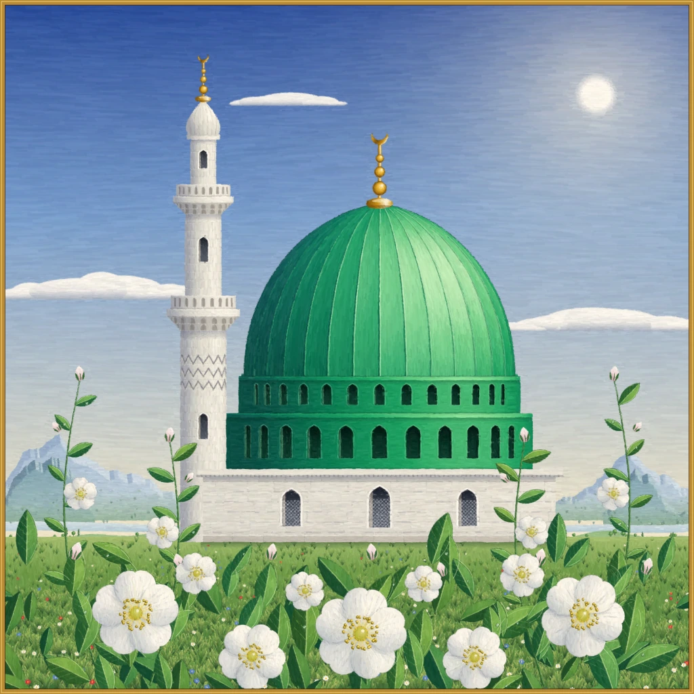

Hayalî bir ince resim ustasının eli. Zemini tutkallı alçıyla astarlanıp cam gibi zımparalanmış meşe pano; aletleri sincap ve samurdan çok ince yuvarlak fırçalar, birkaç kıllık 'tek kıl' fırça ve el dayanağı. Paleti serin ve mücevher gibidir: ultramarin, gümüşî gök mavisi, zümrüt sırları ve yeşil toprak, kurşun beyazı, kurşun-kalay sarısı, damla damla zinober ve kobalt. Bütün yüzeyi milimetrelik darbelerle kurar: göğü ultramarinden ufukta sıcak gümüşî beyaza ince yatay darbelerle geçirir, güneşi kurşun-kalay sarısına çalan krem bir disk ve geniş, sıcak, ışıltılı bir haleyle yakar, kubbeyi meridyen boyunca, minareyi dikey, ayrıntıları kıl inceliğindeki darbelerle işler; boyayı ince sürdüğü için yüzey kabartısız, mine gibi kalır. Uzak kayalıkları hava perspektifiyle maviye çevirir, ırmağı, minik ağaçları ve servileri nokta nokta kurar. Kubbeyi sır katmanlarıyla derin bir zümrüde götürür; kaburgaların ışıklı yanına kesik kesik kurşun beyazı çizgiler çeker. Çayırı tek kıllı fırçayla tutam tutam (dipte koyu, uçta sarı-yeşil) çimenler ve küçük beyaz, mavi, kırmızı kır çiçekleriyle doldurur; yaprakların kenarını ince koyu konturla keser, ışıklı kenarına ve orta damarına ince açık çizgiler, üstlerine çiy taneleri koyar; taç yapraklara ışık yönünde ince beyaz çizgiler atar. Resmi çok hafif sıcak bir vernikle birleştirir ve esere ait ince bir altın okr çerçeve şeridiyle bitirir.

- **Köken:** 15.–17. yüzyıl Flaman ve Hollanda pano resminin ince resim (fijnschilder) geleneğine dayanır: alçı astarlı ahşap pano, şeffaf sır katmanları, büyüteç inceliğinde ayrıntı, mavileşerek uzaklaşan 'dünya manzarası' arka planları, çiy taneleri ve kır çiçekleri. Gerçek bir ressamı taklit etmez; atölyenin tanımladığı hayalî bir ressamın elidir.
- **Ayırt edici:** Ultramarinden ufukta sıcak gümüşî beyaza geçen, yakından ince yatay fırça izleri seçilen gök; kurşun-kalay sarısına çalan krem güneş diski ve geniş, sıcak hale; ince, yatay bulut bantları; Yanlarda mavileşerek uzaklaşan sivri kayalıklar, gümüşî ırmak şeridi, minik ağaçlar ve serviler; Sır derinliğinde mücevher zümrüt kubbe; kaburgaların ışıklı yanında kıl inceliğinde, kesik kesik kurşun beyazı ışık çizgileri; Tek kıllı fırçayla tutam tutam çekilmiş çimenler (dipte koyu, uçta sarı-yeşil); aralarında minik beyaz, mavi ve kırmızı kır çiçekleri; İnce koyu konturlu yapraklarda ışıklı kenar ve orta damar boyunca açık çizgiler, çiy taneleri; taç yapraklarda ışık yönünde ince beyaz çizgiler; Kabartısız, mine gibi pürüzsüz pano yüzeyi: minicik darbeler ancak yakından seçilir; esere ait ince altın okr çerçeve şeridi
- **Palet:** `#3B5BA2` `#B6C1C8` `#135552` `#0E6D50` `#DDD8CD` `#78A94A` `#B98A34` `#F1EDDE`
- **Kodla çizim:** Canvas, 2048 iç çözünürlük. Alt boya: gök piksel başına geçiş (krem-sarı güneş çekirdeği, üstel düşen sıcak krem hale); bulut bantları ortak tabanlı, dikey degradeli elips kümeleri; kayalıklar orta noktadan kaydırmalı sırt çizgileriyle (sırt boyunca aydınlık ve gölgeli yüz şeritleri, alt yamaçta yeşillik, minik ağaçlar ve serviler); çayır 2600 tutam tek kıllık eğri çimen yaprağı ve 230 minik kır çiçeği; mimari silindir aydınlatmalı degradeler, derzler ve kafeslerle, kubbe dönel yüzey normaliyle piksel piksel (sert parlama yok) boyanır; yapraklar, çiy taneleri ve çiçekler yollarla çizilir. Sonra bütün resim alt boyadan örneklenen renklerle minicik darbelerle yeniden boyanır: düz alanlarda 2–4 piksel enli yatay darbeler, genelde 1–2 piksel, ayrıntıda 0,7–1,2 piksel; yön, yapı tensöründen çıkan akış alanıyla bölge yönünün (gökte yatay, kubbede meridyen, minarede dikey, çayırda yukarı) karışımıdır; darbe renk farkı eşiğinde ya da mimari bölge sınırında durur ve rengi sır gibi hafifçe doygunlaştırılır. Darbe yükseklik haritası çok zayıf aydınlatılır (mine yüzey). Ardından kaburgalara, yaprak kenarlarına ve damarlarına, taç yapraklara kesik kesik kıl inceliğinde açık çizgiler çekilir; hafif sıcak vernik çarpımı, düşük frekanslı el titremesi ve ince altın okr çerçeve şeridi eklenir.
- **Kaynak:** [`S-172-ince-yagliboya-ahsap-pano/ornek.html`](stiller/S-172-ince-yagliboya-ahsap-pano/ornek.html)

### S-173

**Açık Hava Yağlıboya** · *Plein-Air Oil* · ✦ atölye üslubu

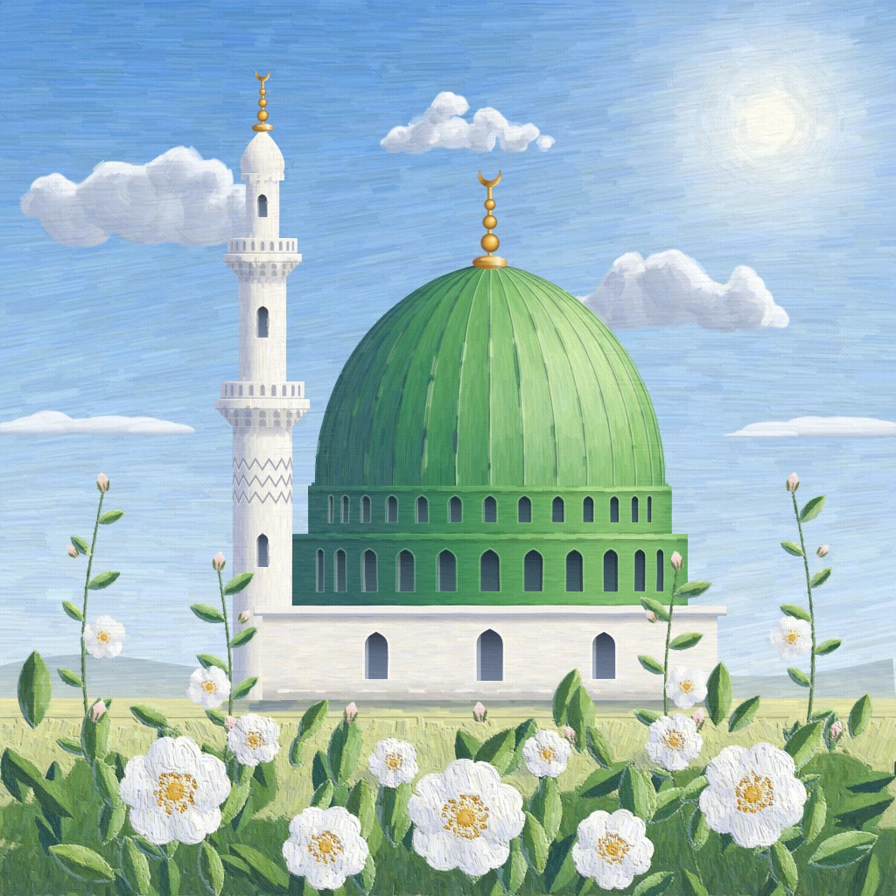

Hayalî bir açık hava (plein-air) ressamının eli; resmi yerinde, öğle güneşinde boyar. Zemini ince grenli, yarı mat astarlı keten tuval; aletleri orta boy yassı ve badem uçlu kıl fırçalar, ayrıntı için ince yuvarlak samur. Paleti gün ışığının sıcak-serin çiftlerinden kurulur: titan beyazı, Napoli sarısı ve açık okr ışıklar; seruleum, kobalt ve ultramarin gök ve gölgeler; krom oksit yeşili, yeşil toprak ve sarı-yeşil yeşiller. Göğü yukarıda dolgun kobalt maviden ufka doğru açılan yatay, hafif kavisli darbelerle boyar; yüksekteki güneşi soluk sarı-beyaz bir disk ve çevresinde dairesel kısa darbelerle ışıtır; bulutların beyaz ışıklı üst yüzlerini ve mavi-gri tabanlarını biçimlerini izleyerek işler, uzak tepeleri hava perspektifiyle mavimsi tutar. Mimaride önce kütleyi biçimi izleyen darbelerle (kubbede meridyen, minarede dikey, kaide ve kasnakta yatay) kurar; pencereleri, zikzak bandı, şerefe kenarlarını, korniş çizgisini ve kaburgaları sonra küçük fırçayla temiz keser, böylece kenarlar ressamca ama denetimli kalır. Her darbede açık sarıya ve gök mavisine kayan tonlar yan yana titreşir. Güneş yüksekte olduğundan gölgeler kısadır: kaidenin ve bitkilerin dibinde dar, mavi-gri gölgeler. Ön plandaki yaprakları ve gülleri yassı fırçanın kare uçlu darbeleriyle biçimleri boyunca yeniden boyar: yaprağın ışıklı yarısını açık sarı-yeşil, gölge yarısını serin mavi-yeşil tutar, gölge kenarına gökten yansıyan mavi bir ışık, ışıklı kenarına ince açık bir çizgi koyar; beyaz taç yapraklarda ve ışıkta boyayı kalın sürer.

- **Köken:** 19. yüzyıl açık hava (plein-air) manzara resminin yerinde, doğrudan boyama pratiğine, gün ışığında 'sıcak ışık–serin gölge' renk anlayışına, hava perspektifine ve katman katman, denetimli fırça kullanımına dayanır. Gerçek bir ressamı taklit etmez; atölyenin tanımladığı hayalî bir ressamın elidir.
- **Ayırt edici:** Yukarıda dolgun kobalt maviden ufka doğru açılan berrak öğle göğü, yatay ve hafif kavisli darbelerle; yüksekteki soluk sarı-beyaz güneş dairesel kısa darbelerle ışıyor; Beyaz ışıklı üst yüzlü, mavi-gri tabanlı, biçimi izleyen darbelerle boyanmış bulutlar; ufukta ince beyaz bulut şeritleri ve hava perspektifiyle mavimsi uzak tepeler; Minarede ve kaidede sıcak beyaz ışık, sol yüzlerde ve pencere içlerinde gökten gelen mavi-gri gölgeler; ışık tarafı açık yeşil, gölge tarafı serin mavi-yeşil, kaburgaları ince fırçayla belirtilmiş kubbe; Güneşli açık çayır; kaidenin ve bitkilerin dibinde yüksek güneşin kısa, mavi-gri gölgeleri; çayırda ve yaprak kütlesinde yassı fırçanın dikey darbeleri; Yassı fırçayla modellenmiş yapraklar: açık sarı-yeşil ışık yarısı, serin mavi-yeşil gölge yarısı, gölge kenarında mavi yansıma, ışık kenarında ince açık çizgi; kalın, kabartılı darbelerle boyanmış beyaz güller; Her yerde biçimi izleyen, açık sarı ve gök mavisi tonları yan yana titreşen ressamca darbeler; ışıkta boya kabartısı ve ince tuval greni
- **Palet:** `#6198D7` `#C3DCEC` `#ECF1F8` `#F0EFE7` `#B1B8CD` `#92C285` `#3A696A` `#DCDCA7`
- **Kodla çizim:** Canvas, 2048 iç çözünürlük; ışık sağ üstten, yüksek öğle güneşi. Gök piksel başına kobalttan ufka doğru açılan geçiş ve güneşin çevresinde küçük, beyaz bir ışıma; üstüne kıl demetli, açık sarı/gök mavisi titreşimli yatay darbeler, güneş çevresinde dairesel darbeler. Bulutlar bükülmüş yoğunluk alanı (beyaz ışık, mavi-gri gölge) ve ince bant bulutlar; üstlerinden kontur boyunca darbeler geçer. Uzak tepeler mavimsi degrade üstüne yatay darbeler. Mimari iki geçişte boyanır: önce gövde (silindir aydınlatmalı degradeler, dönel yüzey normalli kubbe), sonra öğenin kendi renkleri okunup yoluna kırpılan, biçimi izleyen yarı saydam darbeler; en sonda pencere, zikzak, korkuluk, korniş ve kaburgalar keskin olarak yeniden çizilir. Güneşli çayıra, kaidenin ve minarenin dibine kısa, bulanık mavi-gri gölge çokgenleri atılır. Yapraklar iki yarılı degrade, yumuşak açık parlaklık, ışık yönünün tersine kaydırılmış açık sarı-yeşil kenar çizgisi ve ışığa doğru kaydırılmış mavi yansıma çizgisiyle modellenir. Ardından ön plan (yer çizgisinin altı ve bitki bölgeleri) 'ressam geçişi'yle yeniden boyanır: alttaki renk örneklenip kare uçlu yassı fırça darbeleri üç katmanda (4–7, 2,4–4,2 ve kenarlarda 1,2–2 piksel enli) atılır; yön, yapı tensörü akış alanıyla dikey varsayılanın karışımıdır, darbe renk farkı eşiğinde durur ve açık sarı/gök mavisi titreşimi alır. Sonda gökte ve mimaride bölge haritasına göre yönlenmiş darbe kabartısı, ön planda yeniden boyamanın gerçek darbe kabartısı ve bez dokusu sağ üstten aydınlatılır; düşük frekanslı el titremesi uygulanır.
- **Kaynak:** [`S-173-acik-hava-yagliboya/ornek.html`](stiller/S-173-acik-hava-yagliboya/ornek.html)

### S-174

**Renk İplikleri** · *Divisionist Color Threads* · ✦ atölye üslubu

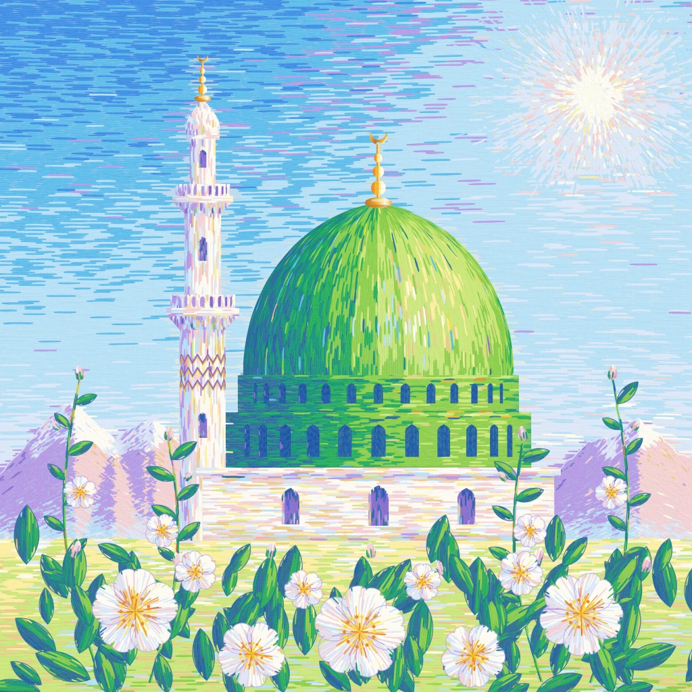

Hayalî bir bölümcü (divizyonist) ressamın eli. Zemini ince grenli, parlak beyaz astarlı tuval; aleti ince, uzun kıllı yuvarlak fırça ve tüpten neredeyse saf alınan boya. Paleti yirmiyi aşkın saf renk ve açık tondan oluşur: limon ve kadmiyum sarısı, turuncu, zinober, gül pembesi, menekşe, ultramarin, kobalt, serülyen, viridyan, zümrüt, sarı-yeşil ve bunların beyazla açılmış tonları. Renkleri paletinde karıştırmaz: her yüzeyi 2–3 piksel eninde, 10–45 piksel boyunda, fırçanın inip kalktığı uçlarda hafifçe incelen paralel iplik darbeleriyle örer, karışımı izleyicinin gözüne bırakır; ışıkta sarı ve beyaz, gölgede menekşe ve mavi iplikler sıklaşır. İpliklerin yönü biçimi izler: kubbede meridyen, kasnakta ve kaidede yatay, minarede silindir boyunca dikey, güneşin çevresinde ışınsal, gökte uzaklaştıkça sakin, hafif kavisli ve yataya yakın, dağlarda yamaç boyunca aşağı (ışıklı yüzde sağa, gölgeli yüzde sola), yapraklarda damar boyunca, taç yapraklarda yelpaze gibi. Karlı dorukların sırtını tek bir ışık ipliğiyle keser; çayırı sakin, açık sarı-yeşil ipliklerle örer ve koyu zümrüt yaprakları ince lâcivert bir kontur ipliğiyle çayırdan ayırır. Kasnak pencerelerini önce tek parça koyu ultramarin kemerler olarak doldurup üstüne kısa mavi iplikler çeker; kaide ve minare pencerelerini, zikzak bandı ve korkuluk nişlerini kısa iplik kümeleriyle keskin keser; düzenli, sabırlı ve kesin çalışır.

- **Köken:** 19. yüzyıl sonu İtalyan bölümcülüğünün (divisionismo) uzun ve ince saf renk darbelerine, Neo-empresyonizmin optik renk karışımına ve tamamlayıcı renk kuramına (Chevreul, Rood) dayanır; noktacılığın noktaları ya da empresyonizmin lekeleri yerine iplik biçimli darbeler kullanır. Gerçek bir ressamı taklit etmez; atölyenin tanımladığı hayalî bir ressamın elidir.
- **Ayırt edici:** Güneşin çevresinde ışınsal beyaz, limon ve pembe iplikler; gökte uzaklaştıkça yataya yakın, hafif kavisli kobalt, serülyen, açık mavi, leylak ve beyaz iplikler; Kubbede meridyen boyunca dizilen zümrüt, sarı-yeşil, viridyan ve kobalt iplikler; kasnakta ve kaidede yatay iplikler; kasnak pencereleri tek parça koyu ultramarin kemerler, kaide pencereleri kısa mor iplik kümeleri; Minarede silindir boyunca dikey iplikler, mor ve turuncu zikzak bant; Yanlarda kırıklı sırtlı, karlı doruklu dağlar: ışıklı yüzlerde şeftali-krem, gölgeli yüzlerde leylak-menekşe; yamaç boyunca aşağı inen iplikler; Sakin, açık sarı-yeşil çayırda yatay iplikler; koyu zümrüt yapraklar ince lâcivert kontur ipliğiyle çayırdan ayrılır; Taç yaprakları kendi ekseni boyunca yelpazelenen beyaz-limon-leylak iplikler ve ince leylak kenar; uçlarda incelen ipliklerin sırtında ince ışık ve hafif kabartı
- **Palet:** `#3C8EE6` `#5CBDEC` `#24AE5A` `#8ED04A` `#B79AE6` `#F7E040` `#2B6F9C` `#FFFDF4`
- **Kodla çizim:** Önce ekran dışında bir hedef tablo (ışık ve renk planı) kurulur: piksel başına gök; orta noktadan kaydırmayla kırıklı bir sırt çizgisi ve ondan piksel piksel boyanan dağlar (yamaç aşağı kayarak izlenen sırt eğimine göre ışıklı ya da gölgeli yüz, kar çizgisinin üstünde kar, aşağıda pus); silindir ve dönel yüzey aydınlatmalı yapı; açık çayır ve koyu yapraklar, çiçekler. Hedef katman katman örneklenir: gök, dağ ve çayır iplikleri yalnız arka plan katmanından (bitki ve yapı rengi taşımasın), kaide ve kasnak iplikleri pencereler çizilmeden önceki gövde katmanından, arka yapraklar, saplar ve ön yapraklar kendi katmanları çizildiği anda alınan ara kopyalardan (önlerindeki çiçeğin beyazını taşımasınlar), minare, kubbe, tomurcuk ve çiçekler son tablodan renk alır. Sonra her bölge için biçimi izleyen paralel izler üretilir (güneşin 95–225 piksel çevresinde halkalarda ışınlar, ötesinde hafif dalgalı yatay izler; geçiş halkasında ikisi olasılıkla seyrelerek karışır; gökte koyu lâcivert ve yeşil iplik seçilmez; kubbede dilim başına 12 meridyen, yatay ve silindir aralıklı dikey izler, dağlarda yüzün eğimine göre sağa ya da sola aşağı inen kısa izler, yaprak ekseni ve taç yaprak yelpazeleri); izler rastgele boylu ipliklere bölünür. Her ipliğin rengi, iplik ortasındaki hedef renge iz boyunca taşınan hata ve küçük titreşim eklenip 22 saf renkli paletten en yakını seçilerek bulunur (hata yayma ile optik karışım); çayırda titreşim düşük tutulur. Her iplik, basıncın en yüksek olduğu nokta rastgele kayan, uçlarda incelen yuvarlak uçlu bir şerit olarak doldurulur; iplikler bölgenin yoluna kırpılır, bölge önce hedefin açık bir kopyasıyla astarlanır, iplik merkezi bölge haritasıyla denetlenir; her ipliğin orta kısmına ince ışık çizgisi, ayrı bir tampona orta gri bir taban üstüne yükseklik çizilir; kasnak pencereleri önce tek parça kemer olarak (en az 3 piksel) doldurulur, üstüne yalnız mavi-menekşe paletinden iplik çekilir; dağ sırtlarına ışık ipliği, yapraklara lâcivert kontur ipliği çekilir. Sonda yükseklik ve bez dokusu sağ üstten yumuşakça aydınlatılır, hafif el titremesi uygulanır.
- **Kaynak:** [`S-174-renk-iplikleri/ornek.html`](stiller/S-174-renk-iplikleri/ornek.html)

### S-175

**İnce Fırça Akrilik** · *Fine-Brush Acrylic Realism* · ✦ atölye üslubu

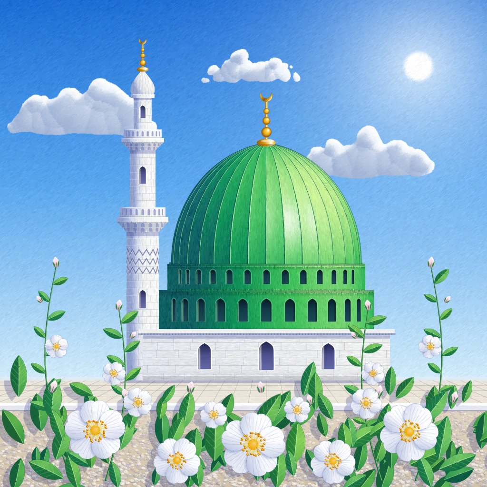

Hayalî bir çağdaş gerçekçi ressamın akrilik eli. Zemini birkaç kat akrilik astarla kaplanıp zımparalanmış sert levha; aletleri ince sentetik yassı ve yuvarlak fırçalar, kıl inceliğinde bir kontur fırçası. Paleti doygun ve temizdir: ftalo mavisi, kobalt, serülyen, ftalo yeşili, kadmiyum sarısı, titanyum beyazı, gölgeler için ultramarin-menekşe karışımı. Akrilik çabuk kuruduğu için geçişleri karıştırmaz, binlerce minik, opak, paralel darbeyle kurar ve her darbeyi kendi tonunda bırakır: gökte, bulutlarda ve döşemede hafifçe sağa yükselen yatay, kubbede meridyen boyunca, kasnak, kaide ve minarede dikey, yapraklarda ve taç yapraklarda biçim boyunca. Önce kütleyi boyar, sonra gölgeleri keskin kenarlı, saydam mavi-mor katmanlarla düşürür (korniş, şerefe ve kasnak pervazı altları, döşemeye düşen yaprak ve çiçek gölgeleri), pencereleri, derzleri, kaburgaları ve altın vurguları ince fırçayla netleştirir; en son bütün yüzeyi yeniden minik darbelerle örerek mat, darbe sırtları seçilen bir yüzey bırakır. Çiçekleri tek tek, damarları ve erkek organlarıyla işler; avluyu perspektifli taş döşeme ve mermer bordürlü çakıl yatağıyla kurar.

- **Köken:** Çağdaş gerçekçi ve foto-gerçekçi akrilik resim geleneğine, akriliğin hızlı kurumasından doğan tarama ile geçiş kurma tekniğine ve sert zemin üstünde ince fırça işçiliğine dayanır. Gerçek bir ressamı taklit etmez; atölyenin tanımladığı hayalî bir ressamın elidir.
- **Ayırt edici:** Küçük resimde bile seçilen, bütün yüzeyi örten minik paralel opak darbeler: gökte ve bulutlarda hafifçe sağa yükselen yatay tarama, kubbede meridyen boyunca, minare, kasnak ve kaidede dikey; Doygun kobalt-serülyen gök, keskin kenarlı beyaz kümülüs bulutlar ve parlak beyaz güneş; Keskin kenarlı mavi-mor gölgeler: korniş, şerefe ve kasnak pervazları altında, döşemeye düşen yaprak ve çiçek gölgeleri; Perspektifli açık renk taş döşemeli avlu, beyaz mermer bordürlü açık renk çakıl yatağı; Doygun zümrüt-sarı yeşil kubbe: ışık parlamayla değil darbelerle kurulmuş, kaburgalar ince fırçayla netleştirilmiş; Titiz çiçekler: mavi-mor gölgeli beyaz taç yapraklar, doygun sarı göbek ve erkek organlar; mat yüzeyde her darbenin bıraktığı ince sırt
- **Palet:** `#3A83DB` `#91C6F5` `#C2E896` `#15725B` `#ECEFF2` `#B1B6D5` `#D6A438` `#5CB458`
- **Kodla çizim:** Canvas, 2048 iç çözünürlük. Gök piksel başına doygun geçiş; bulutlar hafif bükülmüş, keskin eşikli yoğunluk alanı. Her bölge önce düz modelajla boyanır (silindir aydınlatmalı degradeler, dönel yüzey normalli kubbe, cephe degradesi) ve bölgeye özgü sabit açılı minik tek kıllı darbelerle taranır. Keskin gölgeler 'multiply' karışımlı, kenarı yumuşatılmamış saydam mavi-mor şekillerdir; bitki gölgeleri yaprak ve taç yaprak yollarının kaydırılmış kopyalarıdır; pencereler, derzler, korniş, korkuluk ve kaburgalar keskin çizilir; döşeme kaçış noktalı derzlerle, çakıl gölgeli ve ışıklı küçük elipslerle kurulur. Sonra bütün resim 'ressam geçişi'yle yeniden örülür: alttaki renk örneklenip titreşimli ızgaralarda iki katman kare uçlu opak darbe atılır (genelde 2,7–3,5 piksel enli, 8–14 piksel boylu; ayrıntıda 1,2–1,9 piksel); yön çoğunlukla bölgenin sabit açısıdır (gökte −20°, kubbede meridyen, mimaride dikey), yalnız kenarlarda yapı tensörü akışına uyar; her darbe kendi açık-koyu ve sıcak-serin sapmasını alır, renk farkı eşiğinde ya da mimari bölge sınırında durur. Darbe yükseklik haritası parıltısız (mat) aydınlatılır; sonda hafif el titremesi uygulanır.
- **Kaynak:** [`S-175-ince-firca-akrilik/ornek.html`](stiller/S-175-ince-firca-akrilik/ornek.html)

### S-176

**Elle Boyanmış Kâğıt Kolaj** · *Hand-Painted Paper Collage* · ✦ atölye üslubu

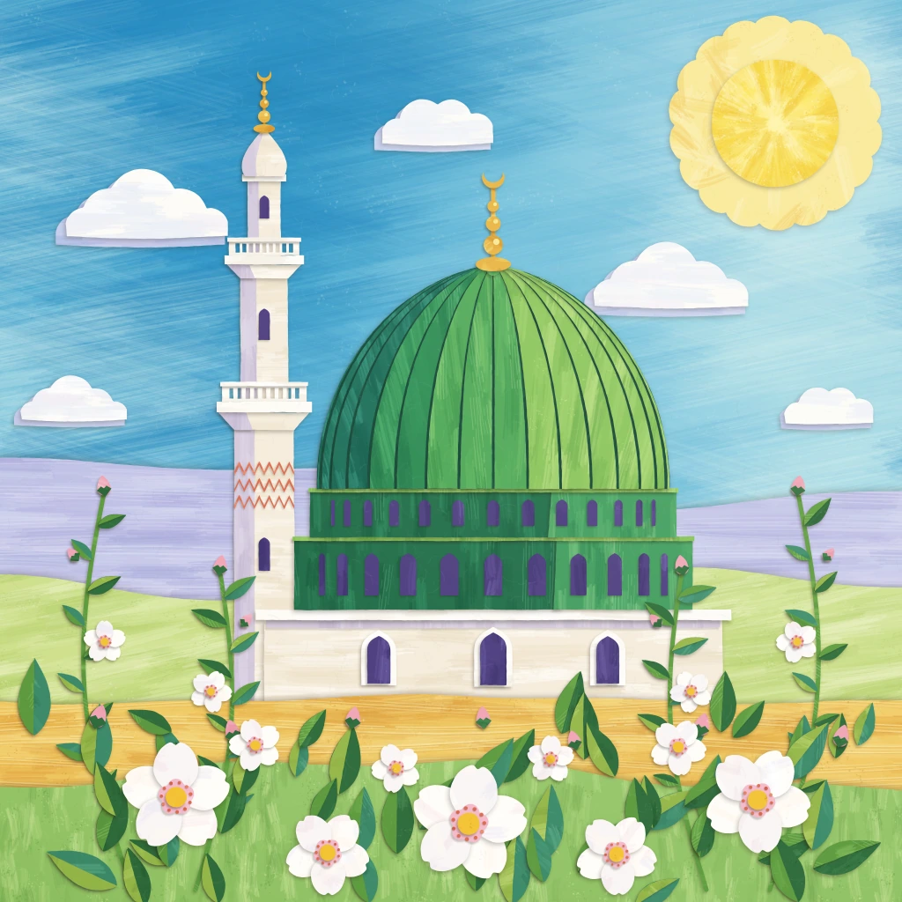

Hayalî bir kolaj ressamının eli. Ressam önce kendi kâğıtlarını boyar: ince beyaz kâğıtlara canlı ve aydınlık bir akril paletiyle (turkuaz-seruleum, limon sarısı, leylak, altın okr, taze yeşil) geniş fırça darbeleri sürer; her kâğıtta bir ana renk ile onun açık ve koyu iki üç tonu karışır. Her kâğıda kendi dokusunu verir: gök kâğıdına geniş yassı fırçayla iki yönde sakin çapraz darbeler, güneşe merkezin çevresinde dönen kısa, sakin darbeler, kubbe ve kasnağa dikey darbeler ve tarak izleri, kum kâğıdına ıslakken tarakla yatay dalgalı izler, çayıra dikine kısa çimen darbeleri ve sünger benekleri, yapraklara çapraz tarak izleri. Kuruyunca keskin bir makasla eskizine sadık, ölçülü ve temiz biçimler keser; makasın uzun kavisleri çok hafif dalgalanır, köşeler sivri kalır. Işığı kâğıt seçimiyle verir: aynı biçimi açık ve koyu iki kâğıttan ayrı keser (kasnakta sağdaki ışıklı parça, minarede soldaki leylak gölge şeridi, yaprakta orta damar boyunca açık yarım), kubbeyi koyu bir taban üstüne aralarında ince boşluk bırakarak gölgeden ışığa dört ayrı yeşil kâğıttan on altı dilim hâlinde dizer. Parçaları düz yapıştırır, altlarında yalnız ince ve yumuşak bir gölge kalır; güneşi ölçülü boyda, makasla düz kesilmiş açık sarı bir hale halkasının üstüne limon sarısı bir disk olarak koyar, pencereleri mor, alemleri sarı okr boyalı kâğıttan keser, beyaz çiçeklerin göbeklerine pembe loblu bir parça, sarı benekli bir daire ve küçük mercan makas noktaları ekler.

- **Köken:** Boyalı kâğıtla kolaj (painted paper collage) geleneğine dayanır: ressamın kendi boyadığı, tarak, fırça ve süngerle dokulandırdığı kâğıtları kesip yapıştırdığı resimli kitap tekniği; kâğıtların taraklı desenleri kitap ciltçiliğindeki tutkallı kâğıt (paste paper) boyamasından gelir. Belirli bir sanatçı taklit edilmez; bu, atölyenin tanımladığı hayalî bir ressamın elidir. S-106 Kesik Kâğıt'tan farkı tek renk guaş yerine çok tonlu, taraklı ve benekli boyalı kâğıtlar ve beyaz boşluklar yerine üst üste binen, ince gölgeli parçalardır; S-079 Yırtık Kâğıt Kolaj'dan farkı yırtık beyaz kenar yerine keskin makas kesimidir.
- **Ayırt edici:** Gök tek büyük boyalı kâğıt: turkuaz-seruleum akrilin üstünde geniş yassı fırçayla iki yönde sürülmüş sakin, çapraz darbeler; güneşe doğru açılan tonlar; Makasla düz kesilmiş açık sarı hale halkası üstünde, merkez çevresinde dönen sakin fırça darbeli limon sarısı güneş diski; arkasından leylak-mavi kâğıt payı görünen iki katlı beyaz bulutlar; Koyu yeşil taban üstüne ayrı ayrı kesilmiş on altı kubbe dilimi: gölgeden ışığa koyu deniz yeşilinden sarı-yeşile dört farklı boyalı kâğıt, dilimlerde dikey fırça ve tarak izleri; Leylak-mavi uzak tepe ve sarı-yeşil yamaç kâğıtları; önde yatay dalgalı tarak izli altın okr kum şeridi ve dikine çimen darbeli, benekli taze yeşil çayır; Kasnakta sağdaki açık yeşil kâğıdın makas dikişi, mor boyalı kâğıttan kemerli pencereler; minarede leylak gölge şeritleri ve mercan rengi zikzak şeritler; Orta damar boyunca iki ayrı kâğıttan kesilmiş yapraklar ve pembe loblu, sarı benekli göbekli beyaz çiçekler; her parçanın altında ince, yumuşak gölge
- **Palet:** `#1F86BE` `#FBE14E` `#2B8750` `#84C157` `#4B3D7E` `#F2CE6A` `#A9D17A` `#B7B9E2`
- **Kodla çizim:** 2× iç çözünürlükte canvas. Önce otuza yakın 'boyalı kâğıt' ekran dışı tuvallerde fırça, tarak ve benek ilkelleriyle boyanır: fırça darbesi bükümlü bir omurga boyunca kıl kıl ince eğrilerden, tarak izi bir yol boyunca normalde kaydırılmış, gürültüyle ara ara kopan açık çizgiler ve yanlarındaki koyu boya sırtından, benek küçük elips kümelerinden oluşur; döşenen küçük kâğıtlarda dikiş görünmesin diye kenardan taşan izler karşı kenarda tekrarlanır. Gök kâğıdı tek parça boyanır: turkuaz degrade ve güneş çevresinde açık bir ışıma üstüne iki yönde, geniş ve düşük alfalı yassı fırça darbeleri. Güneş diskinde kısa darbeler merkezin çevresinde teğet yönde döner (yaklaşık 160 piksel çaplı hale halkası, 110 piksel çaplı disk); kum kâğıdında yatay dalgalı tarak izleri, çayırda dikine kısa darbeler vardır. Parçalar SAHNE yollarının yoğun örneklenip periyodik gürültüyle normal boyunca hafifçe oynatılmasıyla elde edilen makas yollarıdır; her parça ilgili kâğıdın deseniyle (createPattern + setTransform ile kaydırılıp döndürülmüş) doldurulur. Gölge, desenli dolguda çok yavaş olduğu için biçim tuval dışına kaydırılıp yalnız gölgesi geri getirilerek düz renkle çizilir. Sonda sağ üstten yumuşak 'soft-light' gün ışığı.
- **Kaynak:** [`S-176-elle-boyanmis-kagit-kolaj/ornek.html`](stiller/S-176-elle-boyanmis-kagit-kolaj/ornek.html)

### S-177

**Washi Kolaj (Chigiri-e)** · *Washi Collage (Chigiri-e)* · ✦ atölye üslubu

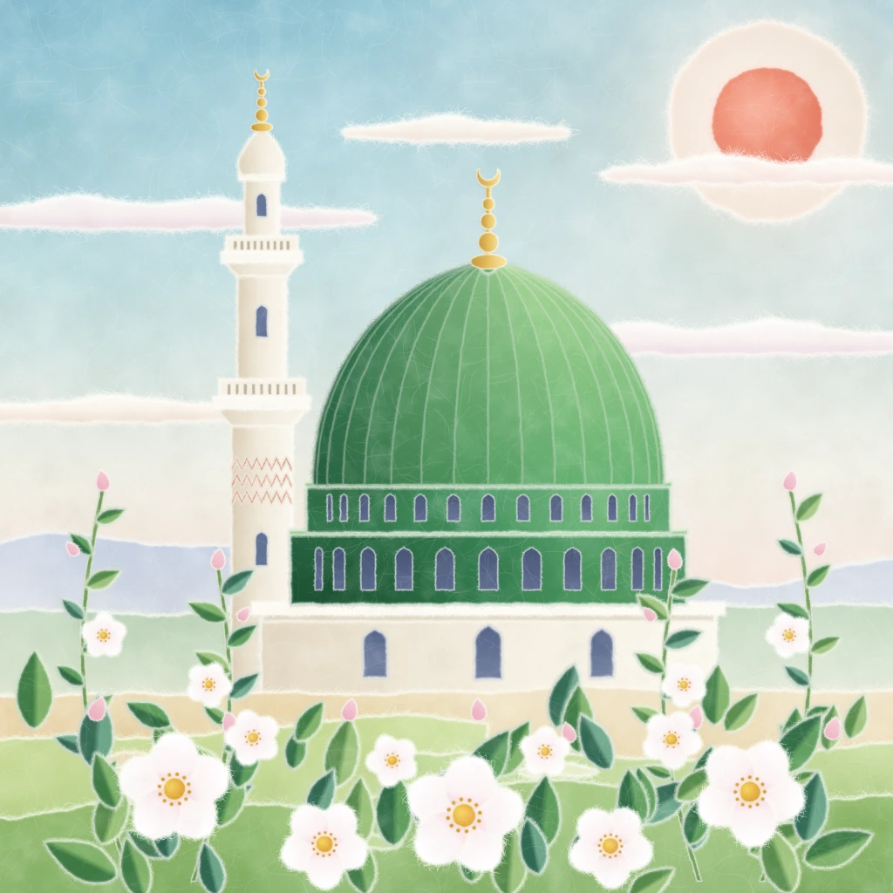

Hayalî bir chigiri-e ustasının eli. Usta makas kullanmaz: kozo liflerinden yapılmış ince washi kâğıtlarını, yırtacağı çizgiyi önce suyla yumuşatıp parmak uçlarıyla yavaşça yırtar; bu yüzden her parçanın çevresinde kâğıdın rengi kenara doğru incelip beyaza açılır ve dışa doğru uzun, kıvrık lifler saçaklanır; sert ya da keskin bir kenar yoktur. Kâğıtlarını bokashi denen yumuşak degrade boyamayla hazırlar ve yumuşak bir Japon paleti kullanır: gök yukarıda soluk asagi mavisinden ufukta sakura pembesine ve fildişine geçen bir sabah göğüdür; güneş soluk altın sarısının yumuşak bir tonudur; kubbe dilimleri gölgede koyu yeşilden ışıkta açık yeşile, taç yaprakları dipte soluk pembeden beyaza açılır; zeminde kincha ve taze çimen yeşilleri vardır. Boya düzensiz emildiği için iri, yumuşak bulutlanmalar kalır, kâğıdın içindeki uzun lifler ince açık çizgiler olarak görünür. Parçaları arkadan öne düz ve neredeyse gölgesiz yapıştırır: bokashi gök, soluk şeftali haleli güneş ve önünden geçen bir kasumi sis bandı, uzun ve yuvarlak uçlu öteki sis bantları, soluk leylak ve yeşil uzak tepeler, yapı (minare gövdesinin gölgeli sol yanına ayrı yırtılmış, yarı saydam serin leylak-gri bir şerit bindirir), koyu taban üstüne yan yana yırtılmış kubbe dilimleri (aralarındaki lifli dikişler açık yeşil kaburgalar olur), çivit mavisi pencereler, üst üste bindirilmiş yırtık çayır parçaları ve kenarları tüylü beyaz washi çiçekler. Bütün resim parlak, havadar ve yumuşak ışıklıdır.

- **Köken:** Japonya'nın chigiri-e (yırtık washi resmi) geleneğine ve washi kâğıdının bokashi (yumuşak degrade) boyamasına dayanır; gökteki sis bantları ve güneşin önünden geçen sis Japon resmindeki kasumi biçiminden gelir. Belirli bir sanatçı taklit edilmez; bu, atölyenin tanımladığı hayalî bir ustanın elidir. S-079 Yırtık Kâğıt Kolaj'dan farkı keskin, beyaz yırtık şerit yerine kâğıdın renginden beyaza yumuşakça açılan, tüylü lif saçağı, degrade boyalı kâğıtlar ve soluk sabah paletidir; S-107 Pelür Kâğıt Kolaj'dan farkı saydam ipek kâğıt binmeleri yerine lifli, yarı opak washidir.
- **Ayırt edici:** Her parçanın çevresinde rengi beyaza açılan tüy gibi yumuşak saçak ve dışa taşan uzun, kıvrık kozo lifleri; keskin kesik kenar yok; Bokashi sabah göğü: yukarıda soluk asagi mavisinden ufukta sakura pembesi ve fildişine geçiş; Fildişi-şeftali hale içinde ortası açık, soluk altın sarısı güneş; önünden geçen ve gökte uzanan uzun, yuvarlak uçlu beyaz-pembe kasumi sis bantları; Koyu taban üstüne yan yana yırtılmış on altı kubbe dilimi, gölgeden ışığa açılan yeşiller; aralarındaki lifli dikişler açık yeşil kaburgalar olur; Washi dokusu: kâğıdın içinde ince açık lifler ve boyanın düzensiz emilmesinden kalan iri, yumuşak bulutlanmalar; Soluk leylak ve yeşil uzak tepeler; kincha kum şeridi üstüne bindirilmiş yırtık taze yeşil çayır parçaları; çivit mavisi pencereler ve tüylü kenarlı beyaz çiçekler
- **Palet:** `#8EC3D3` `#F8E4DA` `#F6DA8A` `#1B5536` `#98CE88` `#5D6E92` `#F0E2C2` `#A9CB84`
- **Kodla çizim:** 2× iç çözünürlükte canvas. Dikişsiz döşenen bir washi dokusu (bulutlu kâğıt hamuru için çok oktavlı gürültü, uzun ve kısa açık lifler, seyrek koyu lifler) ile iri bir bulutlanma dokusu bir kez üretilir. Her parça SAHNE yolunun yoğun örneklenip orta ve yüksek frekanslı yırtık gürültüsüyle normal boyunca oynatılmasıyla elde edilir; dolgu parçaya göre konumlanmış doğrusal ya da dairesel degradedir (bokashi). Çizim sırası: çok hafif tuval dışı gölge; kenar boyunca önce dolgu renginde sonra beyazla üst üste çizilen üç genişlikte yarı saydam çizgiden oluşan, beyaza açılan saçak; dolgu; yola kırpılmış iç kenar açılması ve washi lif deseni (büyük parçalarda 'soft-light' bulutlanma); sonra dış çizgi boyunca örneklenen, dış normalden 35–80° yatık, kıvrık yüzlerce kısa lif (dolgu rengi ve beyazla). Minare gövdesi solda serin leylak-gri, sağda fildişi bir degradeyle dolar; üstüne sol üçte birlik, yarı saydam leylak-gri bir yırtık şerit ve aşağıya doğru koyulaşan krem bir bokashi eklenir. Kubbe koyu taban üstüne çok dar aralıklı on altı dilim olarak yırtılır; dilim liflerinde beyaz azaltılarak dikişler açık yeşil bırakılır. Sonda sağ üstten çok yumuşak 'soft-light' ışık.
- **Kaynak:** [`S-177-washi-kolaj/ornek.html`](stiller/S-177-washi-kolaj/ornek.html)

### S-178

**Boyalı Katmanlı Kâğıt** · *Painted Layered Paper* · ✦ atölye üslubu

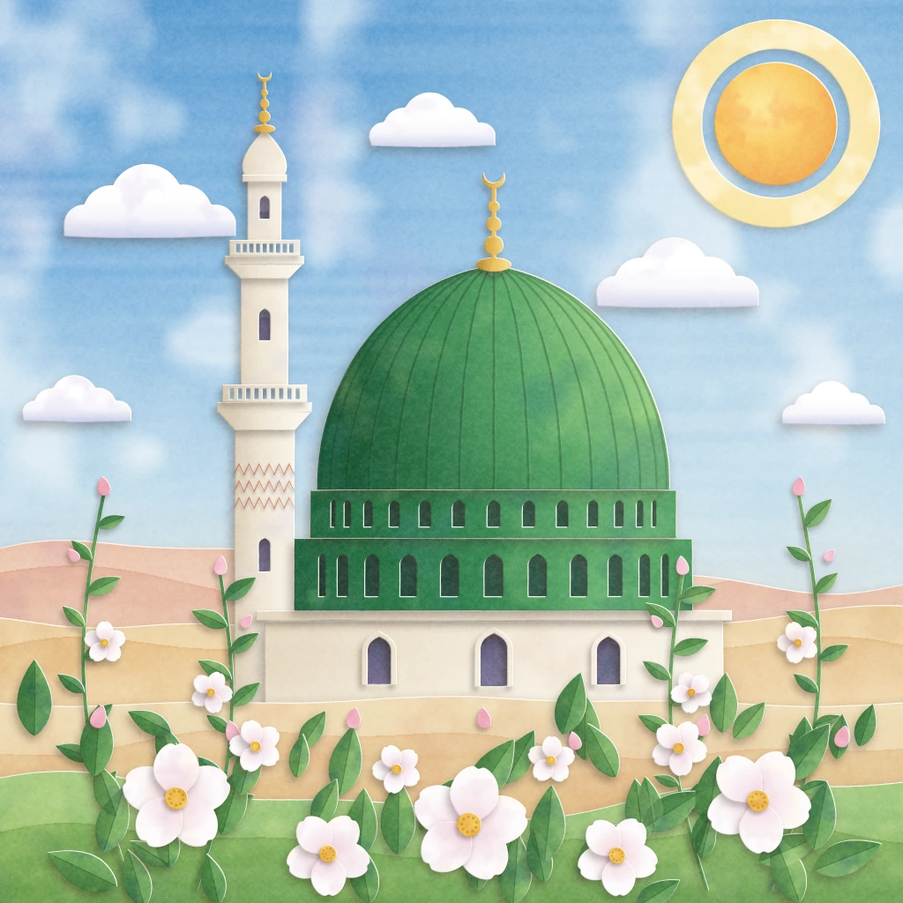

Hayalî bir kâğıt ressamının eli. Ressam kalın, soğuk preste suluboya kâğıdını kesmeden önce boyar: gök kartına yukarıda peygamber çiçeği mavisinden ufka doğru açılan sakin, dereceli bir yıkama yapar; bulut kümelerini üstte beyaz bırakıp alta doğru lila-mavi yıkamayla gölgeler, kuruyunca tümseklerin altına kenarında ince koyu çizgi bırakan ikinci bir lila sır katı sürer; kum tepelerini pembe ve okr yıkamalarla aynı yolla boyar; kubbeyi ıslak üstüne ıslak yeşillerle (solda mavi-yeşil, sağ üstte sarı-yeşil) gölgelendirip kaburgaları ince fırçayla çizer; pigment kâğıdın çukurlarına çökerek hafif granülasyon bırakır. Kuruyunca maket bıçağıyla temiz ve ölçülü biçimler keser; pencereleri katmandan oyar ve arkasına koyu boyalı bir kâğıt koyar, korkuluk aralıklarını tek tek açar. Katmanları köpük bantlarla arkadan öne dizer: gök kartı, üç kat üst üste daire güneş, ufuktan yükselen üç sıra yuvarlak tümsekli bulut kümesi, iki sıra kum tepesi, minare, kaide ve kabartma pencere çerçeveleri, kasnak, kubbe, zemin, yapraklar ve çiçekler. Her kesik kenarda kâğıdın beyaz özü ışığa bakan yanda ince bir çizgi olarak parlar, karşı yanda kalınlık gölgesi, altta yumuşak düşen gölge vardır; gökte havada asılı tek tek bulut yoktur, derinliği üst üste binen bulut sıraları verir. Çiçekler beyaz kâğıttan, dipleri soluk pembe yıkamalı; yaprakların bir yarısına koyu yıkama sürülmüştür.

- **Köken:** Katmanlı kâğıt kesimi (layered paper art, gölge kutusu) ile suluboya boyamanın birleşimine dayanır: kesilmeden önce suluboyayla boyanmış kâğıt katmanları. Belirli bir sanatçı taklit edilmez; bu, atölyenin tanımladığı hayalî bir ressamın elidir. S-029 Katmanlı Kâğıt'ın ressam kardeşidir; farkı düz renkli kâğıtlar ve havada asılı bulutlar yerine her katmandaki dereceli, ıslak üstüne ıslak ve granülasyonlu suluboya yüzeyi, ufuktan yükselen üst üste bulut kümesi katmanları, üç katlı güneş, sır kenarları ve kalın kâğıdın belirgin beyaz kesik kenarıdır.
- **Ayırt edici:** Gök kartında peygamber çiçeği mavisinden ufka açılan sakin, dereceli suluboya yıkaması ve hafif yatay yıkama bantları; Ufuktan yükselen üç sıra yuvarlak tümsekli bulut kümesi katmanı: üstte beyaz, alta doğru lila-mavi yıkama, tümseklerin altında ince koyu kenarlı ikinci sır katı; sıralar arasında yumuşak gölgeler; Üç kat üst üste kesilmiş daire güneş: krem, açık sarı ve altın sarısı diskler, her birinin altında gölge; Pembe ve okr kum tepesi katmanları: içlerinde ikinci sır katının dalgalı, ince koyu kenarlı sınırları ve pigment granülasyonu; Tek katman kubbe: ıslak üstüne ıslak yeşil gölgelendirme ve ince fırçayla boyanmış kaburgalar; oyulmuş pencereler ve korkuluk aralıklarının arkasında koyu boyalı kâğıt; Her kesik kenarda kalın kâğıdın beyaz özü ve kalınlık gölgesi; yarısına koyu yıkama sürülmüş yapraklar ve dipleri soluk pembe beyaz çiçekler
- **Palet:** `#6A97D2` `#C7CEEB` `#F6C445` `#2A7344` `#7EC071` `#E7BCA5` `#E9C996` `#A9CD85`
- **Kodla çizim:** 2× iç çözünürlükte canvas. Her katmanın boyası 1024 × 1024 sahne pikselinde piksel piksel üretilen bir suluboya yıkamasıdır: renk rampası üzerinde bir degrade fonksiyonu, gürültüyle dalgalanma, eşiklenmiş fbm gürültüsüyle ıslak üstüne ıslak ikinci pigmentler, yatay yıkama bantları, paylaşılan kâğıt tanesiyle koyu tonlarda artan granülasyon ve işaretli mesafe fonksiyonuyla tanımlanan sır katları (sınırda üstel kenar koyulaşması); kubbede kaburgalar yıkamanın üstüne çizgiyle boyanır. Bulut kümeleri, taban çizgisi dalgalı rastgele daire dizilerinin üst zarfından elde edilen siluetlerdir; yıkamaları siluetin tepesine olan uzaklığa göre beyazdan lila-maviye geçer, sır katı aynı zarfın aşağı kaydırılmışıdır. Katman yolu (SAHNE yollarından hafif el titremeli bıçak kesimi, pencereler için evenodd delikler) bu yıkamaya kırpılarak doldurulur. Düşen gölge tuval dışı gölge hilesiyle; beyaz kesik kenar ve kalınlık gölgesi, katmanın ayrı bir tuvale dolgusundan kaydırılmış kopyasının 'destination-out' ile silinmesiyle kalan bantlardır. Sonda kâğıt kabartması 'soft-light' ile ve sağ üstten yumuşak ışık.
- **Kaynak:** [`S-178-boyali-katmanli-kagit/ornek.html`](stiller/S-178-boyali-katmanli-kagit/ornek.html)

### S-179

**Şablon Suluboya** · *Stencil Watercolor* · ✦ atölye üslubu

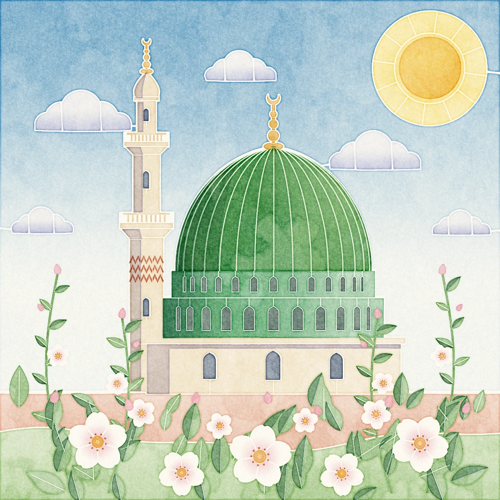

Hayalî bir şablon ressamının eli. Ressam her renk için ince, yağlı kartondan ayrı bir şablon keser ve şablonda kalan adacıkları tutmak için kısa, uçlarda hafifçe genişleyen köprüler bırakır: kubbe dilimlerinin arasındaki köprüler kaburgaları, pencere adacıklarını kasnağın ve kaidenin kenarına bağlayan kısa köprüler, güneş halkasının ışın aralıkları, bulut loblarını ayıran çentik köprüleri, bulutları en yakın minareye, kubbeye ya da çerçeveye tutturan birkaç kısa bağ, yaprakların orta damarı ve taç yaprakları arasındaki çizgiler kâğıdın beyazı olarak kalır. Şablonu soğuk preste beyaz suluboya kâğıdına koyar, açıklığı yumuşak bir fırçayla saydam yıkama olarak doldurur; boya içeride yumuşakça çiçeklenir, kurudukça pigment şablon kenarına toplanıp ince koyu bir sınır çizer, granülasyon kâğıdın dişinde belirir. Gökte seruleumu yukarıda dolgun sürer ve ufka doğru kâğıdın beyazına kadar açar; pigmentin bittiği yerde kenar birikimi de kaybolur. Renkleri açıktan koyuya üst üste basar (kubbede önce açık sarı-yeşil, sonra zümrüt, sonra solda mavi-yeşil gölge; güneşte limon sarısı sonra altın sarısı; taşta okr sonra leylak gölge); şablonlar bir iki milim kayar, kenarlarda ince renk payları görünür. Şablon bulutların, güneşin ve yapıların çevresinde ince bir kâğıt payı tutar. Zemin gül-toprak ve taze yeşil iki yıkamadır; beyaz çiçekler kâğıdın kendisidir, yalnız dipleri soluk pembe yıkamalı, göbekleri sarıdır. Bütün yüzey taze, aydınlık ve saydamdır.

- **Köken:** Şablonla renklendirme (stencil; Japon kappazuri ve Fransız pochoir geleneği) ile saydam suluboya yıkamasının birleşimine dayanır; köprülü şablon kesimi ve kenarda pigment birikmesi tarifin özüdür. Belirli bir sanatçı taklit edilmez; bu, atölyenin tanımladığı hayalî bir ressamın elidir. S-075 Pochoir'dan farkı ponponla tamponlanmış örtücü guaj ve benekler yerine fırçayla sürülmüş saydam yıkamalar, ana çizginin olmaması, köprülerin beyaz kâğıt çizgileri ve üst üste geçişlerin çarpımla karışan tonlarıdır.
- **Ayırt edici:** Keskin şablon kenarı ve hemen içinde kuruyan suyun topladığı ince koyu pigment sınırı; açıklıkların içinde yumuşak çiçeklenme ve granülasyon; Kısa, uçlarda genişleyen şablon köprüleri beyaz kâğıt olarak kalır: kubbe kaburgaları, pencereleri kenara bağlayan köprüler, yaprak orta damarları, taç yaprağı araları ve bulutları minareye, kubbeye ya da çerçeveye tutturan kısa bağlar; Loblarının arası çentik köprüleriyle ayrılmış, alt yarısı soluk lila-mavi yıkamalı bulut adacıkları; ışın aralıkları köprü olan halkalı limon sarısı güneş; Yukarıda dolgun seruleumdan ufka doğru beyaz kâğıda kadar açılan dereceli gök yıkaması; her biçimin çevresinde şablonun tuttuğu ince beyaz kâğıt payı; Üst üste saydam geçişler ve hafif kaymalar: kubbede sarı-yeşil, zümrüt ve mavi-yeşil gölge; taşta okr üstüne leylak gölge; yapraklarda iki yeşil; Gül-toprak ve taze yeşil zemin yıkamaları üstünde boyanmadan bırakılmış beyaz çiçekler: dipte soluk pembe yıkama, sarı göbek ve turuncu noktalar
- **Palet:** `#4D97C9` `#F7DD5A` `#F2B83A` `#2F8A4E` `#A8D46E` `#E2C58E` `#E2A68C` `#86B865`
- **Kodla çizim:** 1024 × 1024 doğrusal bir renk tamponunda (sıcak beyaz kâğıt) çalışılır. Her şablon geçişinde açıklıklar maske tuvaline beyaz doldurulur; köprüler (uçları genişleyen, gürültüyle hafifçe dalgalanan kısa şeritler ya da çizgiler), şablonun tuttuğu paylar ve saklanan alanlar (çiçekler, yapraklar) 'destination-out' ile oyulur; maskenin 3 px bulanık kopyası alınır. Her pikselde yoğunluk = degrade fonksiyonu × eşiklenmiş fbm ile yumuşak çiçeklenme (açık leke ve kenarında ince koyu halka) × ince gürültü × kâğıt tanesi granülasyonu + (maske − bulanık maske) ile bulunan kenar birikimi; kenar birikimi o noktadaki degrade yoğunluğuyla ölçeklenir, böylece gök yıkamasının beyaza açılan ucunda kenar da silinir. Renk kâğıda çarpımla eklenir (1 − d·(1 − renk)), böylece geçişler saydamca karışır. Her geçiş bir iki piksel kaydırılır. Sonda tampon tuvale basılır ve kâğıt tanesinin eğiminden üretilen kabartma 'soft-light' ile eklenir.
- **Kaynak:** [`S-179-sablon-suluboya/ornek.html`](stiller/S-179-sablon-suluboya/ornek.html)

### S-180

**Elle Boyanmış Düz Guaj** · *Hand-Painted Flat Gouache* · ✦ atölye üslubu

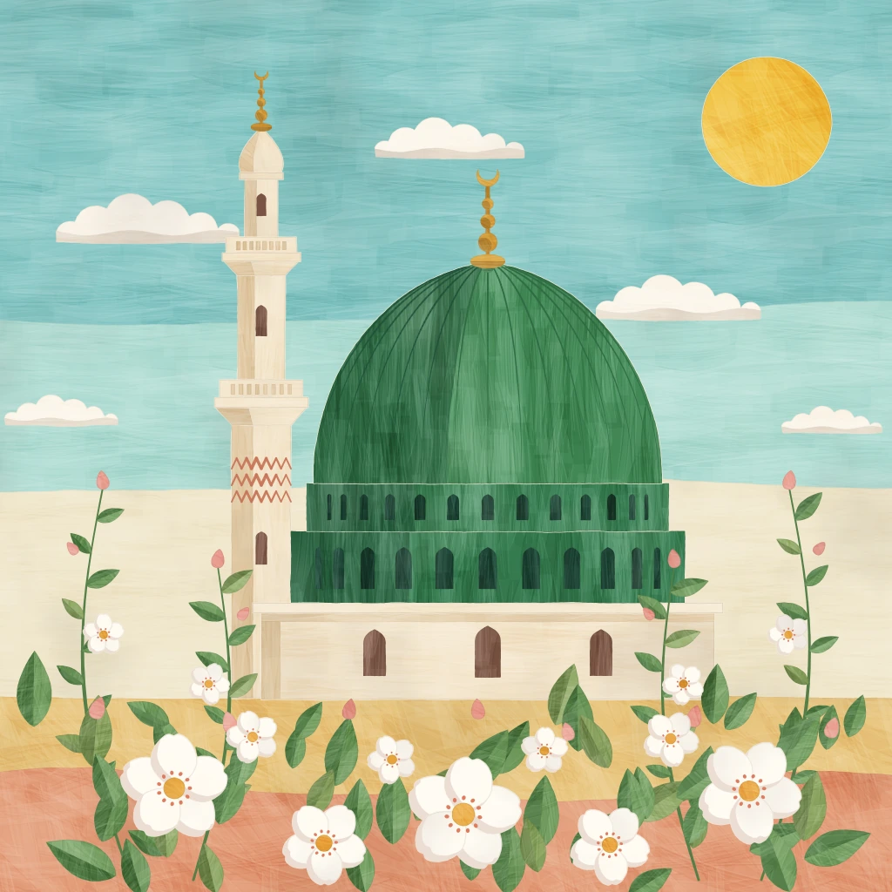

Hayalî, titiz bir illüstratörün eli. Kalın krem kâğıda sınırlı bir guaj paletiyle boyar: su yeşili ve açık su yeşili gök bantları, açık kum rengi ufuk, hardal sarısı güneş, sıcak zümrüt kubbe, fildişi taş, sıcak kahve pencereler, kiremit zikzaklar, hardal-okr kum ve mercan zemin. Her alanın önce kenarını yuvarlak fırçayla çevirir, sonra içini yassı fırçayla biçimi izleyerek doldurur (gökte, bulutlarda, kumda ve mercan zeminde yatay, minarede ve kubbede dikey, yapraklarda ve taç yapraklarında eksen boyunca, güneşte merkezin çevresinde dairesel); kenarlar temiz ama elle çekildiği için hafifçe dalgalıdır. Boyayı tek kat ve biraz kuru sürdüğü için her darbe ayrı seçilir: darbe boyunca boya bir yerde kalın ve koyu, bir yerde ince ve açık kalır, darbenin iki yanında ince boya sırtları, içinde seyrek fırça kılı izleri görünür; büyük alanlarda iri, yumuşak kalınlık farkları vardır. Degrade kullanmaz: gök ufka doğru elle boyanmış iki düz bant ve onun altında açık kum rengi bir ufuk bandıdır; fildişi kaide ve minare bu bandın önünde açıkça seçilir; güneş halesiz tek bir düz disktir, bulutlar uzun, düz tabanlı ve alçak tümseklidir. Her öğede yalnız bir gölge tonu vardır: kubbenin solunda bir dilim, kasnakta sol bölüm, minarede sol şerit, şerefe altları, bulutların alt kenarı, taç yapraklarının sol altında ince hilal. Kaburgaları ince fırçayla uçlara doğru incelerek, zikzakları kiremit rengi tek fırça çizgisiyle çeker. Büyük kütlelerin çevresinde yer yer kıl inceliğinde boyanmadan kalmış kâğıt payı görünür.

- **Köken:** Guajla elle yapılan düz illüstrasyon geleneğine (yayın ve afiş illüstrasyonu, 20. yüzyıl ortası resimli kitaplar) dayanır: opak, mat ve düz sürülen guaj alanları, görünür fırça darbeleri, sınırlı palet ve tek tonluk gölge. Belirli bir sanatçı taklit edilmez; bu, atölyenin tanımladığı hayalî bir illüstratörün elidir. S-022 Düz İllüstrasyon'un el yapımı kardeşidir; farkı vektör keskinliği ve pürüzsüz dolgu yerine elle çekilmiş kenarlar, her alanda açıkça seçilen yassı fırça darbeleri ve kalınlık farkları, halesiz düz güneş ve su yeşili, hardal, mercan paletidir.
- **Ayırt edici:** Düz alanların içinde açıkça seçilen yassı fırça darbeleri: darbe boyunca açılıp koyulaşan boya, iki yanda ince boya sırtı, seyrek kıl izleri; gökte, kumda ve mercan zeminde yatay, kubbe ve minarede dikey, yapraklarda eksen boyunca; Elle çekilmiş temiz kenarlar: hafif dalgalı çizgi, kenarda boyanın biriktiği ince sırt, yer yer kıl inceliğinde boyanmadan kalmış kâğıt payı; Degradesiz gök: su yeşilinden açık su yeşiline ve açık kum rengi ufka inen elle boyanmış düz bantlar; halesiz, merkezin çevresinde dönen dairesel fırçalı tek hardal sarısı güneş diski; Uzun, düz tabanlı, alçak tümsekli krem bulutlar; alt kenarlarında bulut biçimini izleyen tek gölge tonu; Tek gölge tonu: kubbenin solunda bir dilim, kasnakta sol bölüm, minarede sol şerit, şerefe altları, taç yapraklarının sol altında ince hilal; ince fırçayla uçlara doğru incelen kaburgalar; Sınırlı palet: sıcak zümrüt kubbe, fildişi taş ve sıcak kahve pencereler, hardal-okr kum ve mercan zemin, ada çayı yaprakları, mercan noktalı sarı göbekli beyaz çiçekler
- **Palet:** `#86C6C4` `#F2C445` `#438A57` `#306C45` `#F7EEDC` `#7C5646` `#E8C47C` `#E29A76`
- **Kodla çizim:** 2× iç çözünürlükte canvas. Üç yönlü (yatay, dikey, tek yönlü eğik) dikişsiz fırça darbesi deseni ve güneş için, dönme merkezleri hafifçe kayan yay biçimli darbelerden oluşan dairesel bir desen bir kez üretilir: her darbe uçlara doğru incelen yarı saydam açık ya da koyu bir şerit, iki yanında açık ve koyu birer ince boya sırtı ve içinde seyrek kıl çizgileridir; ayrıca iri ve yumuşak bir 'boya kalınlığı' benek dokusu hazırlanır. Her alan SAHNE yollarından el titremeli yolla (periyodik gürültüyle normal boyunca oynatılmış) düz renkle doldurulur, sonra yola kırpılarak fırça deseni (öğenin yönüne döndürülmüş) 'soft-light' ile basılır, böylece darbeler boyanın kendi tonunu açar ya da koyulaştırır ve griye kaçmaz; üstüne kalınlık dokusu gelir; kenarda yolun düşük alfalı koyu çizgisi boya sırtını verir; bazı kütlelerden önce kâğıt renginde bir çizgi çekilerek kıl inceliğinde pay bırakılır. Gölge tonları aynı yöntemle, ana biçime kırpılmış ikinci düz alanlardır; kaburgalar, saplar ve zikzaklar uçlarda incelen, gürültüyle basıncı değişen parçalı fırça çizgileridir; taç yaprağı hilali kaydırılmış biçimle evenodd kırpılarak bulunur.
- **Kaynak:** [`S-180-elle-boyanmis-duz-guaj/ornek.html`](stiller/S-180-elle-boyanmis-duz-guaj/ornek.html)

### S-181

**Altın Çağ Kitap Resmi** · *Golden Age Book Illustration* · ✦ atölye üslubu

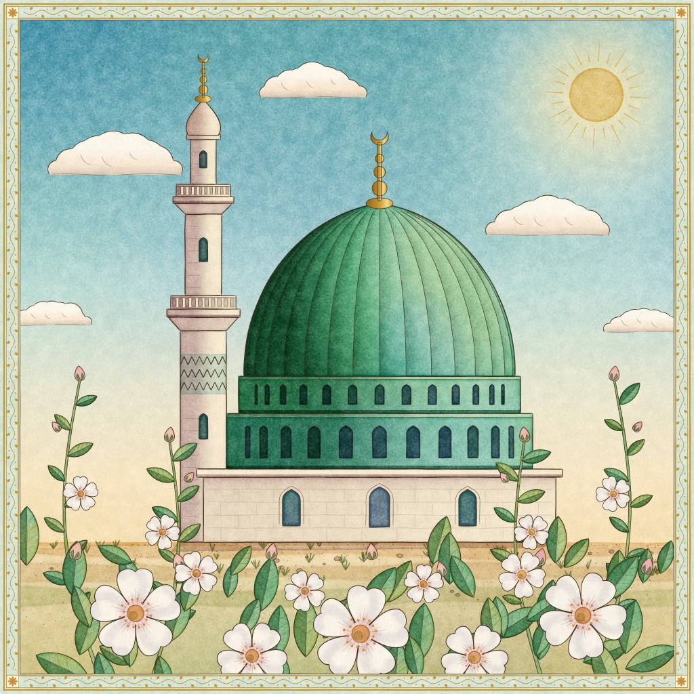

Hayalî bir kitap ressamının eli. Aletleri ince çelik uçlu bir dip kalem, sepya mürekkep, yuvarlak samur fırçalar ve altın guajdır; kâğıdı sıcak beyaz, ince dişli soğuk preslenmiş suluboya kâğıdıdır. Önce bütün sahneyi sakin, titiz bir kalem konturuyla çizer: çizgi hafifçe titrer, baskıyla kalınlaşıp incelir, köşelerde kalem kalkar; kubbe kaburgaları, taş derzleri, yaprak damarları ve ercikler tek tek işlenir. Sonra kat kat saydam sır atar: gökyüzü turkuazdan altın sarısı ufka akan derecelendirilmiş bir lavidir ve güneşin çevresi açık bırakılır; kubbe önce zümrüt, sonra gölge yanında koyu zümrüt sırlarla, her dilimin içinde ayrı bir gölgeyle modellenir, ışıklı yana sarımsı bir sır çekilir; taşın gölgeleri eflatun-gül tonundadır. Beyaz çiçekler kâğıt beyazı bırakılır, yalnız diplerine gül pembesi verilir. Boya kenarlarda hafifçe birikir, gökte ince bir granülasyon görülür. Son dokunuşlar altın boyalı alemler, güneşin ince altın ışınları, yerde üst üste atılmış dalgalı ılık toprak ve yeşil sır bantları, sepya mürekkeple ince noktalanmış toprak, tek tek çizilip boyanmış çakıllar ve ince ot öbekleri ve turkuaz bant üstünde altın asma motifli, köşe gülbezekli ince bordürdür.

- **Köken:** 20. yüzyılın başındaki 'altın çağ' kitap illüstrasyonu geleneğine (ince mürekkep çizgisi üstüne kat kat suluboya, mücevher tonlu parlak gökler, süslü sayfa bordürleri), suluboyada sırlama (glazing) tekniğine ve kitap süslemesindeki altın asma bordürlere dayanır. Hiçbir gerçek sanatçı taklit edilmez; bu, atölyenin tanımladığı hayalî bir ressamın elidir: sepya kalem konturu + turkuaz-zümrüt-gül-altın sırları + resme ait altın bordür.
- **Ayırt edici:** Sepya mürekkepli, baskıyla kalınlaşıp incelen ince kalem konturu; kaburgalar, taş derzleri, yaprak damarları ve ercikler tek tek çizili; Turkuazdan altın sarısı ufka akan, güneşin çevresi açık bırakılmış derecelendirilmiş gök lavisi; Kat kat zümrüt sırlarla modellenmiş kubbe: dilim içi gölgeler, sol yanda derin sır, ışıklı yanda sarımsı sır; Kâğıt beyazı bırakılmış, dipleri gül pembesi, altın göbekli yabani gül çiçekleri; Kabarık üstü mürekkep konturlu, altı gül-altın sırlı bulutlar ve ince altın ışınlı güneş; Turkuaz bant üstünde altın asma motifli, köşe gülbezekli ince bordür
- **Palet:** `#55B4C4` `#F2C877` `#2FA36A` `#0E6646` `#C99A34` `#E592A3` `#B497A6` `#3B2A1F`
- **Kodla çizim:** Tek canvas, 2× iç çözünürlük (2048 px), dış kaynak yok. Önce ince diş + iri doku birleşiminden bir kâğıt tanesi dizisi ve boyanmış kâğıt tuvali üretilir. Öğeler arkadan öne çizilir; her öğenin silüeti önce kâğıda geri döndürülür (arkadaki boya ve çizgiler örtülür), sonra saydam laviler 'multiply' ile bindirilir. Lavi işlevi maskeyi kutu boyutunda geçici bir tuvale çizer, bulanık kopyasıyla farkından kenar birikmesi, kâğıt tanesinden granülasyon ve düşük frekanslı gürültüden dalgalanma hesaplar; gölge sırlarının yoğunluğu SAHNE kubbe profilinden hesaplanan Lambert ışığından, dilim gölgeleri boylam fazından gelir. Mürekkep çizgileri SAHNE yollarından düzleştirilip köşelerden bölünür, normal boyunca gürültüyle titretilir ve uçları incelen değişken kalınlıklı çokgenler olarak doldurulur. Yer, dalgalı kenarlı yatay sır bantları, rastgele ince mürekkep noktaları ve elips çakıllarla katmanlanır. Taç yaprakları çentikli yabani gül biçiminde yeniden kurulur. Alemler yatay degradeli altın boyadır; bordür evenodd kırpmayla kâğıda döndürülen bant üstüne turkuaz lavi, altın cetveller, sinüs asma, yapraklar ve köşe gülbezekleriyle çizilir.
- **Kaynak:** [`S-181-altin-cag-kitap-resmi/ornek.html`](stiller/S-181-altin-cag-kitap-resmi/ornek.html)

### S-182

**Guaj Doğa Levhası** · *Gouache Natural-History Plate* · ✦ atölye üslubu

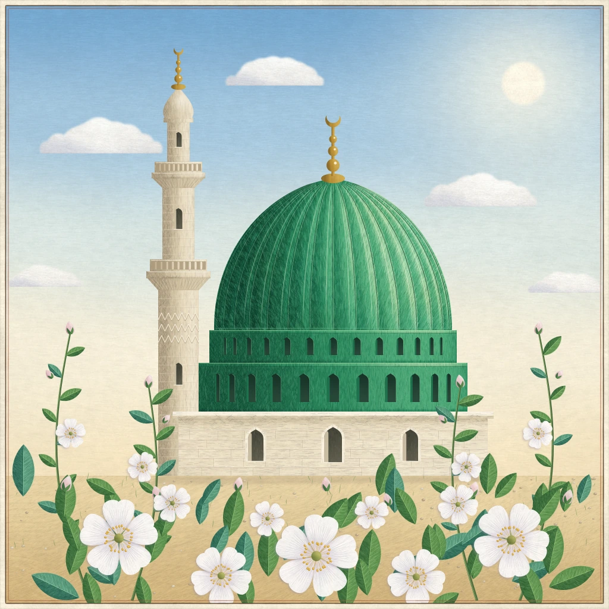

Hayalî bir doğa tarihi levha ressamının eli. Aletleri örtücü guaj ve en ince samur fırçalardır; kâğıdı hiç göstermez, her yüzeyi mat ve yoğun bir boya katıyla örter. Göğü tepede doygun bir gök mavisiyle başlar, ortada fildişine açılır ve ufukta soluk bir kayısı pembesine varır; bulutları yumuşak kenarlı örtücü beyazdır. Hiç kontur çizmez: biçimleri guajın kendi ton farklarıyla ayırır. Önce her biçimi modelajı yarı yarıya yassıltılmış düz bir zemin katıyla örter, sonra modelajı form yönünde (kubbede kaburga boyunca, minarede dikey, yaprakta damardan kenara, taç yaprakta ışınsal, gökte yatay, yerde hafif eğik) eşit aralıklı, ince fırça taramalarıyla kurar: ışıkta beyaz katılmış açık çizgiler, gölgede koyu ve çapraz çizgiler. Paleti doygundur ama aydınlıktır: derin zümrüt kubbe, ılık krem taş, okr kum, mavimsi ve sarımsı iki yeşilde yapraklar. Kubbe dilimlerinin ışık alan yanına beyaz katılmış ince ışık çizgileri koyar; kaburgalara bir ince koyu, bir ince açık çizgiyle sırt verir. Ayrıntıyı tek tek işler: taş blokları ve derzler, çıkma yivleri, korkuluk babaları, yaprakların orta ve yan damarları, taç yaprak damarları, taç yapraklar arası soğuk gölgeler, tek tek saplı ve başçıklı ercikler, tomurcukların çanak yaprakları. Son olarak levhayı krem bir pervaz, ince sepya cetveller ve aralarında soluk adaçayı yeşili bir guaj şeritle çerçeveler.

- **Köken:** 18.–19. yüzyıl doğa tarihi ve botanik levha ressamlığına, örtücü guaj (bodycolour) ile ince fırça taramasıyla (hatching) kurulan modelaj ve beyazla ışık verme geleneğine, levhaların cetvelli ve renk şeritli (wash-line) pervazlarına dayanır. Hiçbir gerçek sanatçı taklit edilmez; bu, atölyenin tanımladığı hayalî bir ressamın elidir: kontursuz mat guaj + form yönünde düzenli tarama + beyaz katılmış ışık çizgileri + tek tek işlenmiş ayrıntı + adaçayı şeritli levha pervazı.
- **Ayırt edici:** Kâğıdı göstermeyen mat, örtücü ve doygun guaj; hiç kontur yok, biçimler ton farklarıyla ayrılıyor; Form yönünde eşit aralıklı ince fırça taramaları: ışıkta beyaz katılmış açık, gölgede koyu ve çapraz çizgiler; Derin zümrüt, bombeli dilimli kubbe; kaburgalarda ince koyu-açık sırt çizgileri ve ışık yanında beyaz katılmış ışık çizgileri; Tepede doygun gök mavisinden fildişine ve ufukta soluk kayısı pembesine geçen göğe karşı keskin silüetler; Botanik titizlikte çiçek ve yapraklar: ışınsal taç yaprak damarları, soğuk gölgeler, tek tek saplı ercikler, yan damarlı yapraklar; Krem pervaz, ince sepya cetveller ve aralarında adaçayı yeşili guaj şeritle levha çerçevesi
- **Palet:** `#6A9FCE` `#F4D7C0` `#24875A` `#0E4530` `#EADDC2` `#3A6E3C` `#D2B47D` `#B9C9A6`
- **Kodla çizim:** Tek canvas, 2× iç çözünürlük (2048 px), dış kaynak yok. Kâğıt tanesi dizisi üretilir. Her biçim için renk, SAHNE geometrisinden hesaplanan ışık değerinin (kubbede profil + boylamdan Lambert ve dilim fazı, silindirlerde yatay ışık, yaprakta damara göre taraf, taç yaprakta dipten uca geçiş) renk rampasından okunmasıyla bulunur. Boyama iki adımlıdır: önce bu renk, biçimin ortalama tonuna doğru kısmen yassıltılarak örtücü guaj işleviyle (form yönünde anizotrop gürültü, kâğıt dişi) piksel piksel serilir; sonra biçime kırpılmış, baskın tarama yönünde döndürülmüş bir ızgarada eşit aralıklı kısa fırça çizgileri atılır: her çizginin rengi o noktanın renginden, nokta ortalamadan açıksa beyaza, koyuysa daha koyuya kaydırılarak seçilir; gölgede ikinci bir çapraz çizgi eklenir. Ayrıntılar değişken kalınlıklı ince çizgilerle çizilir: kaburga sırtları ve dilim ışık çizgileri, taş derzleri, çıkma yivleri, yaprak ve taç yaprak damarları, ercik sapları; ercik başçıkları üç katlı elipslerdir. Taç yapraklar arasındaki gölgeler kutu boyutunda geçici tuvalde bulanıklaştırılır; bulutlar bulanık maskeli örtücü beyaz üstüne yatay taramadır. Pervaz krem ve adaçayı guaj şeritleri ile üç ince cetveldir.
- **Kaynak:** [`S-182-guaj-doga-levhasi/ornek.html`](stiller/S-182-guaj-doga-levhasi/ornek.html)

### S-183

**Noktalama Gravür ve El Boyama** · *Hand-Colored Stipple Engraving* · ✦ atölye üslubu

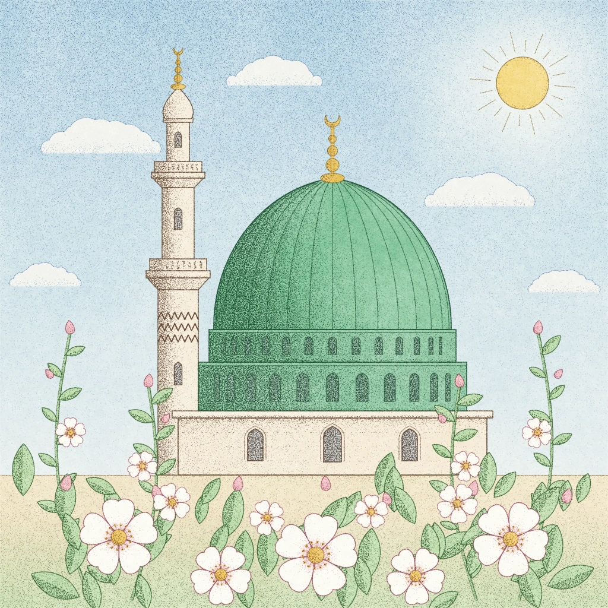

Hayalî bir botanik levha gravürcüsünün eli. Bakır levhaya ince iğne ve noktalama kalemiyle yalnız nokta vurur, hiç tarama çizgisi kullanmaz: noktalar biçimi izleyen ton geçişleri kurar; kubbenin, kasnağın ve minarenin gölge (sol) yanında sık ve iri, ışığa doğru seyrek ve küçüktür, parlaklarda hiç nokta yoktur. Konturlar bile düzenli dizilmiş sık nokta sıralarıdır, kubbe kaburgaları da noktalıdır. Gökte yalnız üst kenara doğru koyulaşan bir nokta kuşağı basar; göğün ortası, bulutlar ve ufuk çıplak kâğıt kalır. Levhayı bölge bölge kendi yumuşak rengiyle mürekkepler (gökte mavi, kubbe ve kasnakta koyu yeşil, taşta sepya, yaprakta yeşil, taç yapraklarda gül, göbekte okr) ve parlak, ılık beyaz bir kâğıda basar. Yapraklarda orta ve yan damarları noktasız bırakarak açık çizgiler elde eder; taç yapraklarda noktalar dibe doğru yoğunlaşır. Pencere açıklıklarını koyu boyanın üstünde kaynaşan sık noktalarla koyu basar. Baskı kuruyunca ince fırçayla, çizginin içinde kalarak saydam suluboyayı açık ve ince sürer, değeri noktalara bırakır: göğü tepede soluk gök mavisi, ufka doğru ılık açık okrayla iki renkte bitirir; kubbe ve kasnağa açık, taze zümrüt, taşa ılık krem, yaprak ve saplara taze yeşil (damarlara daha soluk), aleme ve göbeklere altın, tomurcuklara gül pembesi, kasnak pencerelerine yeşil-siyah, kaide ve minare pencerelerine mavi-siyah verir; beyaz taç yaprakları kâğıt beyazında bırakıp yalnız diplerine pembe sürer. Minare korkuluğunun babaları arasını kaynaşan sık noktalarla koyu düşey çizgiler olarak basar, tomurcukların dibine küçük yeşil çanak yapraklar ekler. Güneşi noktalı ışınlarla çevreler, bulutların altını noktayla gölgeler.

- **Köken:** 18. yüzyıl sonu ve 19. yüzyıl botanik levhalarında kullanılan noktalama gravür (stipple engraving) tekniğine, levhanın bölge bölge renkli mürekkeplenmesine (à la poupée) ve basılan levhanın elle suluboyayla bitirilmesine dayanır; çizgi gravürden (S-005) ve renkli nokta resminden (S-097) farkı, tonun tek renkli ince baskı noktalarıyla kurulması ve rengin saydam el boyasından gelmesidir. Hiçbir gerçek sanatçı taklit edilmez; bu, atölyenin tanımladığı hayalî bir ressamın elidir.
- **Ayırt edici:** Bütün tonlar tek tek basılmış, seçilir noktalardan: biçimin gölge yanında sık ve iri, ışığa doğru seyrek ve küçük; parlaklarda, göğün ortasında ve bulutlarda çıplak kâğıt; Konturlar çizgi değil, düzenli dizilmiş sık nokta sıraları; kubbe kaburgaları da noktalı; pencere açıklıkları koyu boya üstünde kaynaşan sık noktalarla koyu; Bölgeye göre renkli mürekkep: gökte mavi, kubbe ve kasnakta koyu yeşil, taşta sepya, yaprakta yeşil, taç yaprakta gül, göbekte okr; Açık, saydam el boyası: tepede soluk gök mavisinden ufukta ılık okraya geçen ve yalnız üst kenarında nokta kuşağı olan gök, açık zümrüt kubbe, ılık krem taş, taze yeşil yapraklar, altın alem ve göbekler, gül pembesi tomurcuklar; Yapraklarda noktasız bırakılmış, daha soluk boyanmış açık orta ve yan damarlar; beyaz taç yapraklarda dibe doğru yoğunlaşan pembe noktalar; Noktalı ışınlarla çevrili altın güneş ve altları noktayla gölgelenmiş bulutlar
- **Palet:** `#AECDE4` `#EBE7D6` `#496989` `#70C091` `#205C37` `#604833` `#F2E6CC` `#F2CD63`
- **Kodla çizim:** Tek canvas, 2× iç çözünürlük, dış kaynak yok. Öğeler arkadan öne 1024 px'lik dört tampona boyanır: ton (0–1), mürekkep rengi, el boyası rengi ve yoğunluğu; her öğenin maskesi kutu boyutunda geçici tuvalde çizilir ve tonu SAHNE geometrisinden hesaplanan ışıktan gelir (kubbede Lambert + dilim fazı, parlakta sıfır; silindirlerde yatay ışık, yaprakta taraf, taç yaprakta dibe doğru artış; gökte yalnız üst 300 px'te koyulaşan kuşak). Her pikseli en son örten öğenin sıra numarası ayrıca tutulur; yaprak damarları eksi tonla ayrı bir 'noktasız' tampona yazılır ve damarlarda el boyası da daha soluktur. Konturlar yol boyunca eşit aralıklı nokta listesi olarak kaydedilir; öndeki bir öğe örtüyorsa çizilmez. El boyasının rengi sabit ya da konuma bağlı olabilir (gökte soluk maviden okraya geçiş). El boyası tamponu 2048'e yumuşatılarak büyütülür, kâğıt dişi ve düşük frekanslı gürültüyle hafifçe düzensizleştirilip 'multiply' ile basılır. Sonra titrek bir ızgarada (2,6 px) aday noktalar tonla orantılı olasılık ve çapla seçilir (ton 0,06'nın altında nokta yok; çap yaklaşık 1–2,7 px), diski noktasız tampona değen noktalar atlanır, kalanlar kenar yumuşatılmış diskler olarak piksel düzeyinde birikim tamponuna basılır, kontur noktaları eklenir ve bütün nokta katmanı mürekkep renkleriyle 'multiply' ile bindirilir.
- **Kaynak:** [`S-183-noktalama-gravur-el-boyama/ornek.html`](stiller/S-183-noktalama-gravur-el-boyama/ornek.html)

### S-184

**El Boyamalı Ağaç Oyma Baskı** · *Hand-Colored Woodcut* · ✦ atölye üslubu

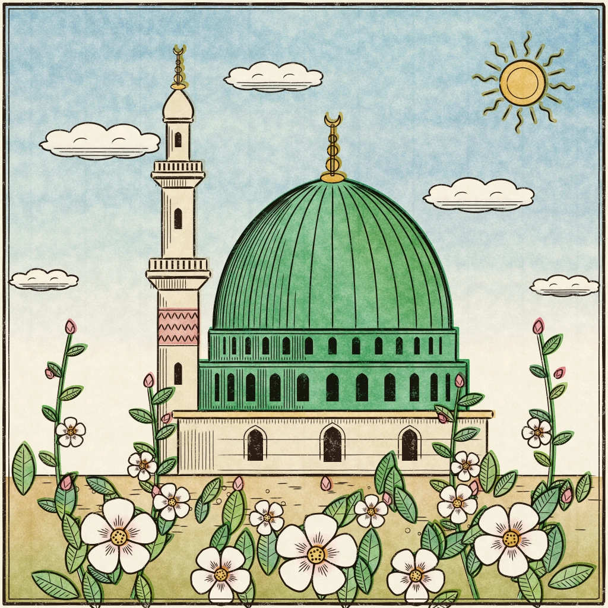

Hayalî bir eski bitki kitabı (herbaryum) ustasının eli. Armut ağacı kalıba bıçak ve oluklu oyacakla çalışır: çizgiler kalın, temiz ve hafif köşelidir, bıçağın girip çıktığı yerde iki ucu sivrilir; pencere açıklıkları dolgun siyah kalır. Gölgeyi yalnız sade, düzenli paralel taramalarla verir: kubbede kaburgalar arasına meridyen çizgileri, kasnak ve minarenin sol yanına dikey çizgiler, yaprağın ışıktan uzak yarısına kısa eğik çizgiler, taç yaprak diplerine ışınsal kesikler. Kalıbı siyah-kahve mürekkeple ılık beyaz dökme kâğıda basar; çizgiler ve pencere açıklıkları dolgun ve temiz basılır, kâğıdın ince yatay çizgileri seçilir. Sonra baskıyı elle renklendirir: berrak, saydam boyalarla (gök mavisi, mavimsi yeşim yeşili, taze yeşil, altın sarısı, sıcak gül pembesi) geniş ama özenli fırça sürüşleri yapar; boya kalıp çizgisine göre bir iki piksel kayar, bir yanda çizgiyi hafifçe aşar, öbür yanda çizginin içinde ince bir kâğıt payı bırakır, kenarda biraz birikir. Kaidenin beyaz taşını oyulmuş yatay derzler ve şaşırtmalı düşey derzlerle kesme taş sıralarına böler, korniş altına kısa dikey kesikler, gölgeli sol uca dikey taramalar atar. Bulutları birkaç geniş, alçak loblu ince bir üst kesikle sınırlanan yassı yatay kuşaklar olarak oyar: kuşağın alt yarısı, ışık yanında kısalan sıra sıra ince paralel kesiklerle doludur, üstü boş kâğıttır. Göğün üst kenarına aşağı doğru aralanan dört ince yatay kesik atar. Güneşi dolgun altın boyalı bir disk olarak bırakır, gölge yanına kısa kavisli kesikler, çevresine V oyacağıyla kesilmiş, uçları sivri kamalar biçiminde sırayla düz ve alev biçimli ışınlar oyar; resmi kalıba ait kalın-ince bir çift çerçeve çizgisiyle kapatır.

- **Köken:** 15.–16. yüzyıl Avrupa herbaryum (bitki kitabı) ağaç oyma baskılarına ve bu baskıların elle, fırça ya da şablonla renklendirilmesi geleneğine dayanır; linol baskıdan (S-006) farkı, büyük siyah kütleler yerine ince-kalın çizgi ve sade tarama ağırlığı, bol kâğıt beyazı ve çizgiden taşan saydam el boyasıdır. Hiçbir gerçek sanatçı taklit edilmez; bu, atölyenin tanımladığı hayalî bir ustanın elidir.
- **Ayırt edici:** Bıçakla oyulmuş gibi hafif köşeli, kalın, iki ucu sivrilen siyah-kahve çizgiler; dolgun siyah pencereler; Gölgeli yanlarda sade paralel taramalar: kubbede kaburgalar arası meridyen çizgileri, kasnakta ve kaidenin sol ucunda dikey, yapraklarda yarım yaprak boyunca; kaidede şaşırtmalı derzli oyma kesme taş sıraları; Kalıp çizgisine göre bir iki piksel kayan, bir yanda çizgiyi aşıp öbür yanda ince kâğıt payı bırakan saydam el boyaları: berrak gök mavisi, yeşim yeşili kubbe, taze yeşil yapraklar, altın sarısı, sıcak gül pembesi; Dolgun, temiz siyah-kahve baskı ve ılık beyaz dökme kâğıdın ince yatay çizgileri; Alçak loblu ince üst kesikli, alt yarısı sıra sıra ince paralel kesiklerle oyulmuş yassı bulut kuşakları; göğün üst kenarında aralanan yatay kesikler; dolgun altın disk çevresinde düz ve alev biçimli kama ışınlarıyla oyma güneş; Herbaryum üslubunda çiçekler (dipte ışınsal kesikler, noktalı göbek) ve kalıba ait kalın-ince çift çerçeve
- **Palet:** `#2A1D15` `#86BBD6` `#60AC86` `#9ABC86` `#E4BA5F` `#E1A7A0` `#DFC794` `#F9F2E4`
- **Kodla çizim:** Tek canvas, 2× iç çözünürlük, dış kaynak yok. Dökme kâğıt tanesi (ince yatay çizgiler ve seyrek zincir çizgileriyle) üretilir. İki ayrı katman tutulur: baskı (kalıp mürekkebi) ve renk. Öğeler arkadan öne işlenir: her öğenin silüeti baskı katmanından 'destination-out' ile silinir ve renk katmanında beyaza döndürülür, sonra o öğenin oyma çizgileri ve boyası eklenir. Oyma çizgi, SAHNE yollarının 3 px adımla yeniden örneklenmesiyle hafif köşeli hâle getirilir, köşelerden bölünür, hafif titretilir ve iki ucu sivrilen değişken kalınlıklı çokgen olarak doldurulur; taramalar kısa çift uçlu sivri çizgilerdir; kaidenin taş derzleri pencere açıklıklarında kesilen yatay oyma çizgiler ve sıra sıra kaydırılmış kısa düşey çizgilerdir; kubbede ışığa göre uzunluğu değişen ara meridyenler. Bulut kuşakları, yarım elips loblardan kurulan üst kenarlı ve düz tabanlı yollardır: üst kenar ince oyma çizgi, alt yarı yola göre kesilen, sağa doğru kısalan yatay paralel oyma çizgilerdir; güneş ışınları değişken genişlikli kama çokgenleri (alev ışınlarda sinüslü eksen) olarak doldurulur; göğün üst kenarındaki yatay kesikler kenardan kenara titrek çizgilerdir. Boya, maskeyi 1–2 piksel kaydırıp yaklaşık 1 piksel genişleten saydam lavi işleviyle (kenar birikmesi, tane, dalga) renk katmanına 'multiply' ile sürülür. Sonunda baskı katmanının alfası kâğıt tanesinin yalnız en yüksek tepelerinde çok az (en çok %8) azaltılır, böylece çizgiler dolgun kalır; iki katman kâğıda 'multiply' ile basılır.
- **Kaynak:** [`S-184-el-boyamali-agac-oyma/ornek.html`](stiller/S-184-el-boyamali-agac-oyma/ornek.html)

### S-185

**Fırça Kontur ve Guaj** · *Brush-Inked Contour and Gouache* · ✦ atölye üslubu

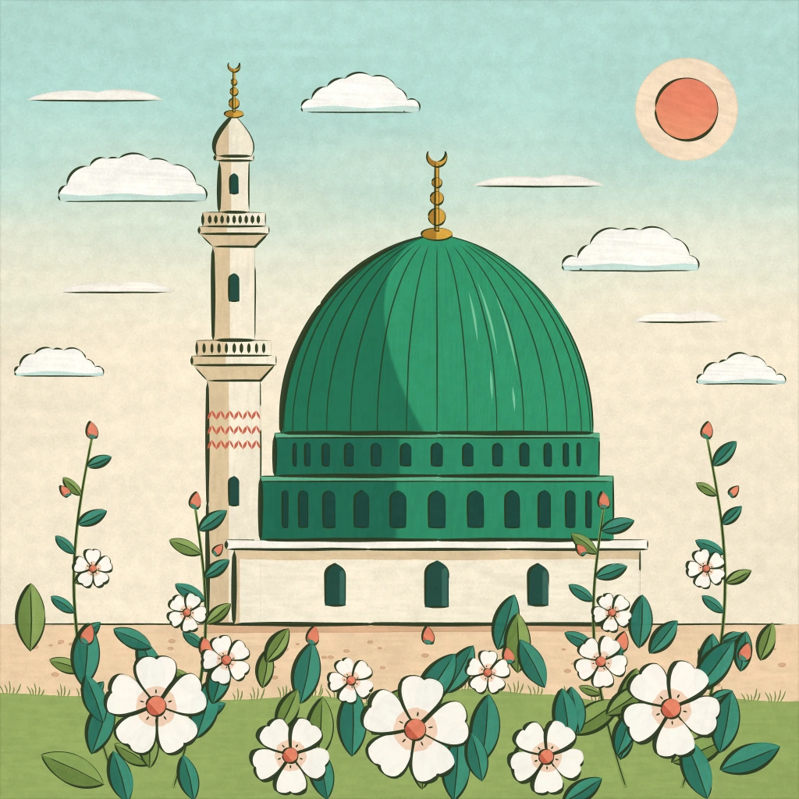

Hayalî bir orta yüzyıl ders kitabı ressamının eli. Krem bir resim kartonuna önce düz guaj dolguları sürer: her biçim tek renktir, içinde hafif fırça izleri seçilir ve kenarı konturla tam örtüşmez. Gölgeyi tek bir koyu tonla, keskin kenarlı düz bir biçim olarak verir: kubbede kıvrık bir ayrım çizgisiyle sol yarı koyu yeşil, minare ve kasnakta sol yan, krem taşta serin, açık gri bir ton; ışıklı yana kaburga boyunca birkaç açık yeşil vurgu fırça izi ekler. Paleti sınırlıdır ve aydınlık bir öğle ışığındadır: yukarıda berrak gök mavisi, ufka doğru soluk mavi-beyaza açılan gök; soluk krem haleli, soluk sarı güneş; petrol-zümrüt kubbe; mercan tomurcuklar ve çiçek göbekleri; şeftali dip lekeli krem-beyaz taç yapraklar; açık kum yer ve zeytin yeşili ön bant. Dolgular kuruyunca sivri samur fırçayla koyu yeşil-kahve mürekkeple konturu çeker; elinin imzası bu çizgidir: ince bir girişle başlar, sürüşün ortasında fırçaya bastırıp çizgiyi şişirir, sivri bir çıkışla kaldırır; fırçanın tutuluş açısından ötürü çizgi yönüne göre de kalınlaşıp incelir. Ana biçimleri (kubbe, kaide, kasnak) dolu fırçayla kalın, pencere ve göbek gibi ayrıntıları ince çeker. Işığın geldiği sağ üst kenarlarda çizgiyi inceltir ve yer yer tamamen kaldırarak kenarı açık bırakır, gölgede kalan sol alt kenarlarda dolgunlaştırır. Uzun çizgileri birkaç sürüşte tamamlar, kaburgaları ince fırçayla tepeye doğru inceltir. Göğe yuvarlak bulutların arasına ince, uzun, mercek biçimli krem bulut şeritleri ve altlarına tek bir şişip incelen fırça çizgisi koyar; çimenin kumla buluştuğu yere fırça ucuyla ot demetleri, kuma seyrek çakıllar ekler. Bütün sayfa düzenli, sakin ve okunaklıdır.

- **Köken:** 1940–1960'ların ders kitabı ve ansiklopedi illüstrasyonuna, fırça-mürekkep kontur ile guaj ya da poster boyasıyla yapılan düz dolgu tekniğine ve o dönemin sınırlı baskı paletlerine dayanır. Hiçbir gerçek sanatçı taklit edilmez; bu, atölyenin tanımladığı hayalî bir ressamın elidir: düz guaj + tek tonlu keskin gölge + yönüne göre kalın-ince fırça konturu.
- **Ayırt edici:** Sivri fırçayla çekilmiş, ortasında şişip uçlarında sivrilen koyu yeşil-kahve konturlar: gölge yanında dolgun, ışık yanında ince ve yer yer kesik; Hafif fırça izli düz guaj dolgular; dolgu kenarları konturla tam örtüşmüyor (elde boyamanın küçük kaymaları); Tek tonlu, keskin kenarlı gölge biçimleri: kubbede kıvrık ayrım çizgisiyle koyu sol yarı, minare ve kasnakta sol yan; Petrol yeşili, gök mavisi, krem ve mercan paleti: mercan tomurcuklar ve göbekler, şeftali dip lekeli krem-beyaz taç yapraklar; Kubbenin ışıklı yanında kaburga boyunca açık yeşil vurgu fırça izleri, tepeye doğru incelen fırça kaburgalar; Berrak gök mavisinden soluk mavi-beyaz ufka açılan öğle göğü; soluk krem haleli, konturlu soluk sarı güneş diski; kabarık krem-beyaz bulutlar arasında ince, uzun bulut şeritleri; fırça ucuyla çekilmiş ot demetli zeytin yeşili ön bant ve çakıllı açık kum
- **Palet:** `#2E412B` `#95CEE5` `#ECF4F0` `#FBEA8F` `#34936A` `#267556` `#E68466` `#F6EFDC`
- **Kodla çizim:** Tek canvas, 2× iç çözünürlük, dış kaynak yok. Krem karton tanesi üretilir. Gök, yukarıda gök mavisinden ufka doğru soluk mavi-beyaza geçen, ton dalgalı tek guaj katıdır; güneş soluk krem hale üstünde konturlu soluk sarı disk. Öğeler arkadan öne, örtücü guaj işleviyle boyanır: maske kutu boyutunda geçici tuvalde, hafif titretilmiş (konturla tam örtüşmeyen) SAHNE yolundan çizilir; renk piksel başına, keskin ama kenarı yumuşatılmış bir eşikle temel ton ve gölge tonu arasında seçilir (eşik kubbede profil + boylamdan Lambert ışığı, silindirlerde yatay ışık, yaprakta damar tarafı); fırça izi yön alanına göre anizotrop gürültüden, ton dalgası ve kâğıt dişi ise ayrı gürültülerden gelir. Kontur, SAHNE yolları düzleştirilip köşelerden ve 240 px'lik sürüşlere bölünerek, hafif titretilip değişken kalınlıklı çokgen olarak doldurulur: kalınlık, çizgi yönünün sabit fırça açısıyla yaptığı açının sinüsüne, sürüş ortasında şişen bir basınç eğrisine, ince girişe ve sivri çıkışa göre değişir; kalın çizgiler orantısız kalınlaştırılır. Kapalı yollarda yolun dönüş yönünden dış normal bulunur; normal ışığa (sağ üst) bakıyorsa çizgi incelir ve gürültü eşiğinde yer yer sıfıra inerek kesilir, gölge yanında kalınlaşır. Bulut şeritleri bezier mercek biçimleri, ot demetleri kısa açık fırça sürüşleridir. Kubbenin ışıklı yanındaki vurgu izleri profil meridyenleri boyunca açık yeşil fırça çizgileridir.
- **Kaynak:** [`S-185-firca-kontur-ve-guaj/ornek.html`](stiller/S-185-firca-kontur-ve-guaj/ornek.html)

### S-186

**Gongbi** · *Gongbi Meticulous Painting* · ✦ atölye üslubu

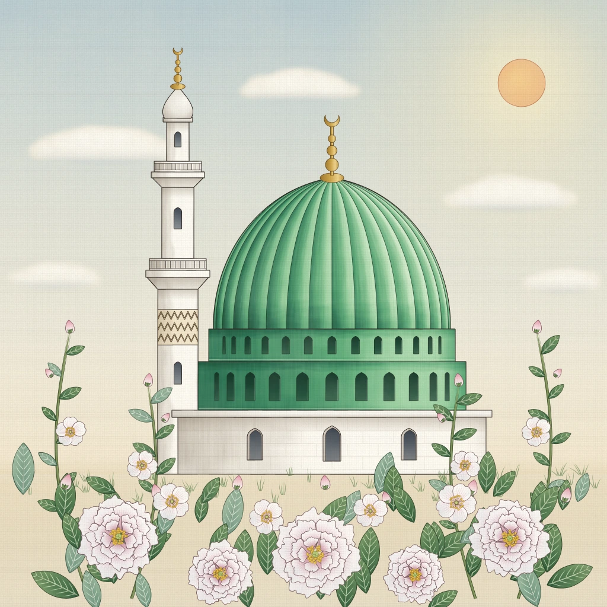

Hayalî bir ressamın titiz ipek resmi eli. Aletleri: şapla gerilmiş açık fildişi ipek, ince kurt kılı çizgi fırçası, sulandırılmış çam isi mürekkebi ve ikinci bir temiz su fırçası. Paleti: malakit yeşili, soluk azurit, istiridye kabuğu beyazı, allık pembesi, gütta sarısı, altın boya. Önce her biçim eşit basınçlı, başında hafif bir çivi düğümü olan 'demir tel' çizgiyle çekilir; mimaride çizgi cetvelle gider, bitkilerde fırça ucu hafifçe titrer, bulutlar soluk çivitle ince çizilir. Sonra renk, çizginin kenarından içe doğru birçok ince katta sürülür ve her katın sınırı su fırçasıyla açılır (fenran): kubbenin her dilimi kendi sol kaburgasından içe altı katla, kasnak soldan sağa, taşın gölge yanı üç-dört katla koyulaşır; kat sınırları ve fırça kılının izleri yakından seçilir. Şakayık taç yaprakları dipten uca allıktan beyaza, yapraklar orta damardan kenara koyulaşır, damarlar boyanmadan bırakılan açık 'su çizgileri' olarak kalır. Gök geniş fırçayla yatay katlar hâlinde sürülür, bulutların içi ipek rengi bırakılıp çevreleri boyanarak çıkarılır. Bitirirken ercikler tek tek noktalanır, çimen öbekleri ince fırça ucuyla eklenir.

- **Köken:** Çin'in gongbi ('titiz fırça') geleneğine, özellikle çiçek-kuş resmine ve mimariyi cetvelle çizen jiehua tekniğine dayanır; çizgiden içe dereceli boyama (fenran), damarları boş bırakma ve bulutu çevresini boyayarak çıkarma (hongyun tuoyue) alışkanlıkları bu gelenekten gelir. Hiçbir gerçek ressam taklit edilmez: üslup, atölyenin tanımladığı hayalî bir ressamın elidir.
- **Ayırt edici:** Eşit kalınlıkta, başı hafif çivili ince 'demir tel' mürekkep konturlar; mimaride cetvel çizgisi ve soluk taş sıraları; Her dilimi kendi sol kaburgasından içe doğru ince katlarla derecelenmiş (fenran), kat sınırları ve fırça kılı izleri seçilen malakit kubbe; kasnak ve taş da kat kat boyanmış; Önde dipten uca allıktan beyaza kat kat derecelenen şakayıklar, ince pembe damarlı yaban gülleri ve tek tek noktalanmış ercikler; Yapraklarda boyanmadan bırakılmış açık damar çizgileri (su çizgisi); bazı yaprakların soluk mavi-yeşil ters yüzü; Soluk çivit ince çizgiyle çekilmiş, içi ipek rengi bırakılıp çevresine gök lavisi kat kat sürülmüş bulutlar; Bütün yüzeyde ince atkı-çözgü ipek dokusu ve hafif dalgalı lavi yoğunluğu
- **Palet:** `#F2EADA` `#C1CFCF` `#7FBB90` `#448563` `#24684A` `#2C2420` `#E9AFBE` `#E9C04C`
- **Kodla çizim:** Canvas 2048 px iç çözünürlükte çizilip 1024'e indirilir. Bütün konturlar SAHNE yollarından gizli SVG yolu üzerinde getPointAtLength ile 1,1 birim aralıkla örneklenir ve dolu bir şerit (kalınlığı ve konumu tohumlu değer gürültüsüyle oynayan, kapalı yollarda dairesel gürültüyle dikişsiz) olarak çizilir; mimaride titreme çok düşük (cetvel), bitkilerde daha yüksektir. Geniş yüzeyler 'katmanlayıcı' ile piksel başına boyanır: düzgün bir hedef koyuluk N fırça katına bölünür, her katın sınırı fırça boyunca gürültüyle oynar ve smoothstep ile yumuşatılır, katın içine boyuna kıl izi gürültüsü, sınırına ince bir ıslak kenar eklenir. Kubbede her noktanın boylamından dilim no'su ve dilim içindeki yeri bulunur; dilimin kendi zemin tonu, sol kaburgadan içe altı katlı fenran, sağ kaburgada açık malakit katı ve dipte koyulaşan katlar beş duraklı malakit rampasına çevrilir. Kasnak, taş, gök ve yer aynı yöntemle (yatay ya da dikey fırça yönüyle) boyanır; bulutlar elips öbeklerinin maskesiyle gök lavisinden çıkarılır, kenarları elips birleşiminin sınır yaylarından ince çizgiyle çekilir. Şakayıklar dört halka kıvrık uçlu taç yaprağından, yapraklar eksen boyunca ve orta damardan dik degradelerle, damarlar açık şeritlerle çizilir. Sonda pigment yoğunluğu ipek rengine göre gürültüyle dalgalandırılır, 1024'te atkı-çözgü ipek dokusu basılır.
- **Kaynak:** [`S-186-gongbi/ornek.html`](stiller/S-186-gongbi/ornek.html)

### S-187

**Nihonga** · *Nihonga Mineral Painting* · ✦ atölye üslubu

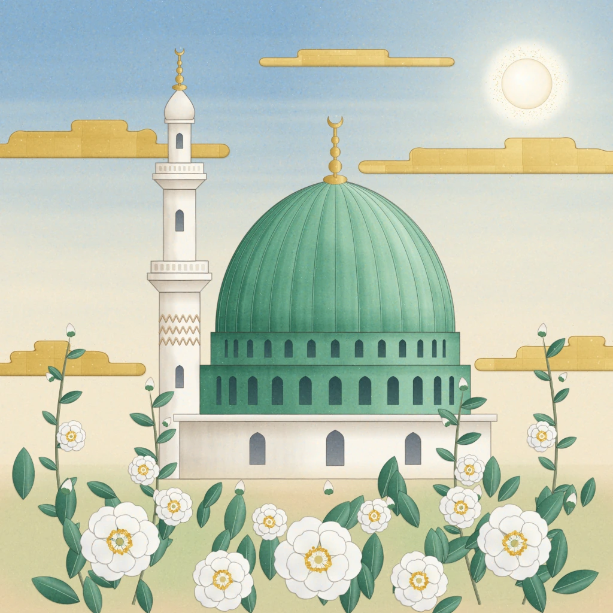

Hayalî bir ressamın taneli mineral boya eli. Aletleri: ahşap panele gerilmiş kalın washi, hayvan tutkalı (nikawa), tane boyuna göre ayrılmış ezme mineral boyalar (iwa-enogu), geniş yassı hake fırçası, yumuşak fırçalar, altın varak ve altın tozu. Paleti: soluk azurit gök, fildişi ufuk, rokushō malakit, byakuroku açık yeşil, aşı boyası toprak, istiridye kabuğu beyazı (gofun) ve altın. Gök hake fırçasıyla yatay, ince katlar hâlinde sürülür ve ufka doğru fildişine açılır (bokashi). Kubbede geniş yumuşak fırça kaburgalar boyunca iner, ton kat kat koyulaşır, kenarlarda kumadori ile derinleşir; koyu tonlara iri taneli boya sürüldüğü için tane orada irileşir, kristaller ışıkta tek tek parlar. Çizgi sönük ve yumuşaktır. Kamelyalar kalın, mat, hafif kabarık gofunla boyanır, ercik halkaları beyaz iplikli altın başlardır. Bitirirken gökte kademeli altın varak bulut şeritleri (suyari-gasumi) serilir: boyları farklı, uçları yuvarlak, iç köşeleri yumuşak kıvrımla birleşen şeritler; kenarları ince koyu altınla belirginleşir, çevrelerine seyrek altın tozu (sunago) elenir.

- **Köken:** 20. yüzyıl Japon nihonga resmine (mineral pigment, gofun, nikawa tutkalı, yumuşak geçişli bokashi ve kumadori boyama) ve Japon paravanlarındaki altın varak bulut şeritlerine (suyari-gasumi, kinpaku varak, sunago altın tozu) dayanır. Hiçbir gerçek ressam taklit edilmez: üslup, atölyenin tanımladığı hayalî bir ressamın elidir.
- **Ayırt edici:** Gökte, kubbede ve yapraklarda görünür mineral tanesi; koyu yeşillerde iri tane ve yer yer ışıkta parlayan kristaller; Soluk azurit gökte kademeli, uçları yuvarlak, boyları ve basamakları farklı altın varak bulut şeritleri; varak kareleri hafifçe seçilir, kenarda ince koyu altın kontur ve hafif kabarıklık; Bulut şeritlerinin çevresine seyrek elenmiş altın tozu (sunago); Kaburgalar boyunca inen geniş fırça katlarıyla derecelenmiş, kenarlarında koyulaşan taneli rokushō kubbe; kasnak ve taşta da görünür fırça katları; Kalın, mat gofun beyazıyla boyanmış kamelyalar; beyaz iplikli altın ercik halkaları ve sönük, yumuşak mürekkep çizgileri; Gofun beyazı disk güneş ve çevresinde altın tozu halesi
- **Palet:** `#9DBDD3` `#EDE8D9` `#8FBEA4` `#5B997F` `#396B57` `#DCBA65` `#FBFAF4` `#E2CCA2`
- **Kodla çizim:** Canvas 2048 px iç çözünürlükte. Gök, yer, kubbe, kasnak ve taş 'katmanlayıcı' ile piksel başına boyanır: düzgün bir hedef koyuluk N fırça katına bölünür, her katın sınırı fırça yönü boyunca gürültüyle oynar ve yumuşatılır, katın içine fırça kılı izi, sınırına ince ıslak kenar eklenir (gökte yatay hake katları; kubbede meridyen boyunca inen katlar, dilim gölgesi ve kenarlarda kumadori). Altın bulut şeritleri yuvarlak uçlu dikdörtgen (roundRect) basamaklarla ek dairelerden kurulur; birleşim 3,2 birim bulanıklaştırılıp eşiklenince iç köşeler yumuşak kıvrımla birleşir. varakDokusu ile üretilen hizalı kare varak (yaprak başına ton, ince dikiş, perdah gürültüsü) tek bir piksel geçişinde maskeyle kesilir; maskenin yukarı/aşağı komşusuna göre üst kenar açılır, alt kenar koyulaşır, maske değerinin eşik çevresinde Gauss biçimli koyu altın kontur çizilir; altına hafif kaymış bulanık gölge konur. Altın tozu geniş bulanık maskeye göre kabul edilen küçük dörtgenlerdir. Çizgiler geniş-soluk ve ince-orta iki şerit olarak 'yumuşak mürekkep' etkisiyle çizilir. 1024'e indirildikten sonra 320 bin rastgele boyutlu tane diski bir tane haritasına basılır; tane genliği koyu ve doygun piksellerde artar, açık gökte çok incedir, altın tonlarında renk sapması uygulanmaz; seyrek pikseller kristal parıltısı olarak açılır.
- **Kaynak:** [`S-187-nihonga/ornek.html`](stiller/S-187-nihonga/ornek.html)

### S-188

**Shin-hanga Ağaç Baskı** · *Shin-hanga Woodblock* · ✦ atölye üslubu

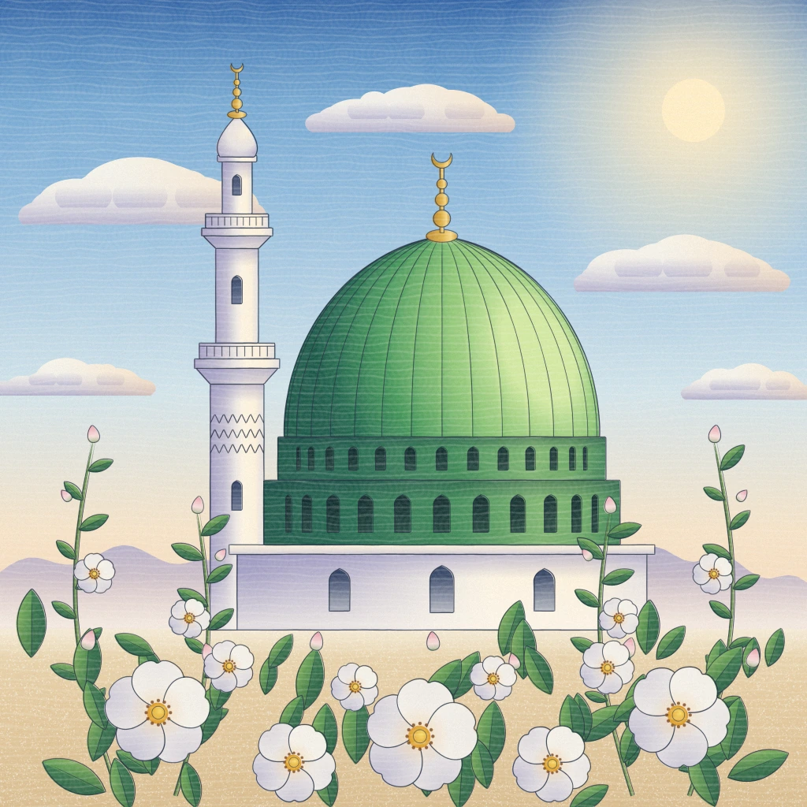

Hayalî bir ressam-baskıcının eli. Aletleri: yaban kirazı kalıplar, ince uçlu oyma bıçağı, bambu kılıflı baren, pirinç nişastasıyla karıştırılmış suluboya ve kalın kizuki-hōsho washi. Paleti: çivit-mürekkep ana kalıp, prusya mavisi gök, şeftali ufuk, lavanta gölge, sarı-yeşil ve mavi-yeşil, aşı boyası, altın sarısı. Ana kalıp (sumi-ita) ince ve keskin kenarlıdır; eğrilerde bıçağın küçük köşeleri hissedilir. Her renk ayrı kalıptan basılır: gök kalıbı üstte koyulaşan şeritle (ichimonji bokashi) başlar ve ufukta şeftaliye silinerek derecelenir; gök ve yer kalıplarında kiraz tahtasının düzensiz aralıklı, hafifçe dalgalanan yıllık halkaları baskıya geçer. Bulutlar kontursuz ve keskin kalıp kenarlıdır: kâğıt boş bırakılır, gölge yanları iki lavanta kalıbıyla, ışık alan kenarları soluk şeftaliyle basılır. Kubbe ve kasnak üç kalıpla kurulur: düz yeşil, solda silinerek derecelenmiş koyu yeşil, sağda sarı-yeşil ışık. Işık sağ üstten sıcak gelir; minare ve kaidede lavanta-mavi gölgeler, ufukta lavanta tepeler ve ince bir sis vardır. Bitirirken renk alanlarında baren izi ve susam baskı (goma-zuri) benekleri kalır; ana kalıp renklere göre bir iki piksel kayıktır.

- **Köken:** 20. yüzyıl Japon shin-hanga ('yeni baskı') hareketinin gerçekçi ışıklı, şiirsel manzara baskılarına ve ukiyo-e'den gelen ağaç kalıp baskı tekniklerine (bokashi, ichimonji bokashi, goma-zuri, mokume ağaç damarı, kentō kaydı) dayanır. S-014 Ukiyo-e'nin düz Edo renklerinden farkı ışık, hava perspektifi ve derecelemedir. Hiçbir gerçek sanatçı taklit edilmez: üslup, atölyenin tanımladığı hayalî bir ressamın elidir.
- **Ayırt edici:** Üstte koyulaşan şeritle başlayıp ufukta şeftaliye silinen bokashi gök; Yalnız gök ve yer kalıplarında düzensiz aralıklı, hafifçe dalgalanan kiraz ağacı damarı; Kontursuz, keskin kalıp kenarlı yığma bulutlar: kâğıt boş bırakılmış, gölge yanları iki lavanta kalıbıyla, ışık alan kenarları soluk şeftaliyle basılmış; Üç kalıpla basılmış kubbe ve kasnak (düz yeşil, solda silinerek derecelenen koyu yeşil, sağda sarı-yeşil ışık); yüzeyde baren izi ve susam baskı benekleri; İnce, keskin kenarlı, hafif köşeli çivit-mürekkep ana kalıp çizgisi; renk alanlarına göre hafif kayık; Ufukta lavanta tepeler ve sis; lavanta gölgeli beyaz yaban gülleri
- **Palet:** `#4C7AB2` `#A6C8E1` `#F5E2C9` `#B1ACC9` `#377158` `#D1E6A3` `#2B3547` `#E3CBA2`
- **Kodla çizim:** Üç ayrı 2048 px katman: renk kalıpları, ana kalıp (çizgi) ve kâğıt. Renk alanları SAHNE yolları örneklenip kenarı gürültüyle hafifçe oynatılarak (kalıp kenarı) basılır; kâğıt rengi gereken yerlerde 'destination-out' ile renk kalıbı silinir (güneş, bulutlar, beyaz taş, taç yaprakları). Bulutlar, kenarı yaklaşık 1 px oynatılmış rastgele dairelerden kurulan keskin kenarlı maskeden (düz, hafif dalgalı taban) üretilir; maskenin geniş bulanığı yükseklik haritası olur, gradyanından bulunan yüzey normaliyle sağ üst ışık arasındaki açı keskin sınırlı iki katlı lavanta gölge kalıbına ve ayrı, keskin kenarlı şeftali ışık kalıbına çevrilir; derecelenme yalnız blokların içinde kalır. Gök ve yer basıldıktan sonra renk katmanına piksel başına ağaç damarı işlenir: alan-çarpıtmalı (fbm) yıllık halka fazı, yer yer hafif dalgalanma, halka başına ince koyu geç odun çizgisi ve lif gürültüsü. Kubbe ve kasnak 'katmanlayıcı' ile piksel başına üç kalıp gibi boyanır: düz yeşil zemin, küre normali ile ışıktan hesaplanan gölgenin kenarı oynak, silinerek derecelenen üç katı, sağda iki katlı sarı-yeşil ışık ve gürültüden susam baskı benekleri. Baskı geçişinde renk yoğunluğu yönü yer yer dönen anizotropik gürültüyle (baren izi) ve ince benek gürültüsüyle değiştirilir; yerde seyrek, yumuşak, kum renginden biraz koyu ya da biraz açık küçük beneklerle goma-zuri yapılır. Ana kalıp (0,9; −0,7) kaydırılarak basılır, sonda ince kâğıt tanesi eklenir.
- **Kaynak:** [`S-188-shin-hanga/ornek.html`](stiller/S-188-shin-hanga/ornek.html)

### S-189

**Rinpa Altın Zemin** · *Rinpa Gold Ground* · ✦ atölye üslubu

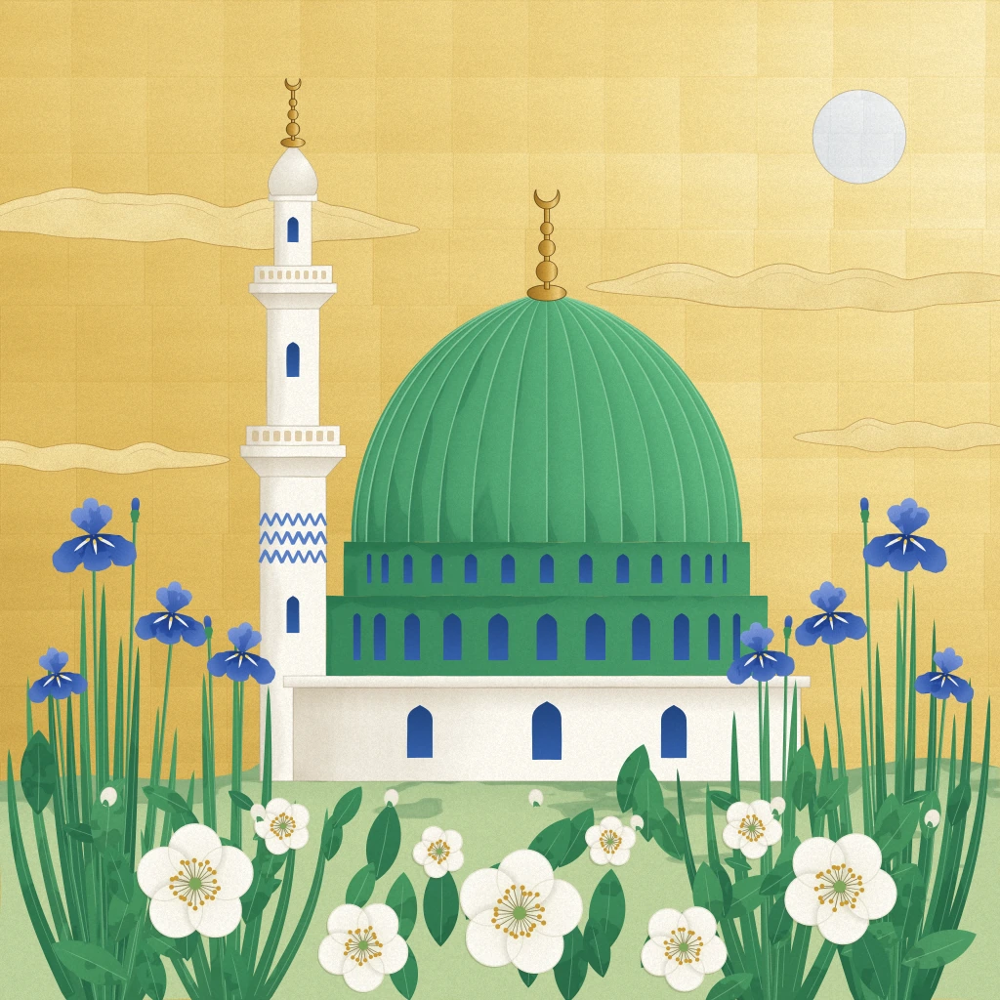

Hayalî bir Rinpa ressamının eli. Aletleri: kâğıda sıra sıra serilmiş kare altın varak, gümüş varak, altın tozu, hayvan tutkalıyla bağlanmış kalın gövdeli mineral boyalar ve geniş yumuşak fırçalar. Paleti: altın, gümüş, malakit yeşili, azurit mavisi, gofun beyazı, soluk yeşil toprak. Gök yerine altın varak bırakılır; perdah sağ üstte güneşe doğru açılır, sol altta derinleşir. Gökte varaktan açık, mat ve ince taneli altın tozu (sunago) bulut şeritleri vardır: dalgalı loblu kenarlar, yuvarlak uçlar, ince kindei (altın boya) konturu. Kubbe, kasnak ve bitkiler kontursuzdur (mokkotsu); minare ve kaidenin beyaz gofun yüzeyleri yalnız ince, soluk bej bir çizgiyle sınırlanır. Kubbe dilim dilim ıslak malakitle boyanır, gölge yanına koyu yeşil damlatılır (tarashikomi); boya göllenip kenarında ince koyu bir çizgi bırakır, dilimler arasında boyanın değmediği açık kaburga çizgisi kalır. Minare ve kaidenin kalın gofun beyazında, kasnağın malakitinde geniş fırça katlarının şeritleri ve bindirme sırtları seçilir; pencereler hafif alacalı, mat bir azurit katıyla boyanır. Süsenler üç sarkık ve üç dik taç yapraklıdır; sarkık taç yapraklarda beyaz-sarı işaret, diplerde koyu azurit gölü, yanlarda yelpaze gibi açılan tarashikomili kılıç yapraklar ve tomurcuklar vardır. Önde kenarına gofun toplanmış beş yuvarlak taç yapraklı erik çiçekleri ince altın erciklerle durur; güneş gümüş varak bir disktir.

- **Köken:** 17-18. yüzyıl Japon Rinpa okulunun altın zeminli paravan ve panel resimlerine, tarashikomi tekniğine, altın tozu bulutlarına ve süslemeci çiçek biçimlerine (süsen kümeleri, yuvarlak erik çiçeği) dayanır. Hiçbir ustanın eseri kopyalanmaz: üslup, atölyenin tanımladığı hayalî bir ressamın elidir.
- **Ayırt edici:** Bütün zemini kaplayan, ince dikişleri seçilen kare altın varak; sağ üstte güneşe doğru açılan, sol altta derinleşen perdah; Varaktan açık, mat ve ince taneli altın tozu bulut şeritleri: dalgalı loblu kenarlar, yuvarlak uçlar, ince altın boya konturu; Dilim dilim boyanmış, gölge yanında koyu yeşilin göllenip kenarında ince koyu çizgi bıraktığı (tarashikomi) kontursuz malakit kubbe ve kasnak; kaburgalar boyanın değmediği açık çizgiler; Üç sarkık ve üç dik taç yapraklı, beyaz-sarı işaretli, dibinde koyu azurit gölü olan süsenler; yelpaze gibi açılan kılıç yapraklar ve tomurcuklar; Kenarına gofun toplanmış beş yuvarlak taç yapraklı erik çiçekleri, ince altın ercikler ve tarashikomili yapraklar; Gümüş varak disk güneş
- **Palet:** `#E0C375` `#F1D990` `#EFDA9B` `#E4E7E8` `#59AE79` `#2F8058` `#395FAF` `#FAF7EE`
- **Kodla çizim:** Canvas 2048 px. Zemin varakDokusu ile piksel başına üretilir: 78 birimlik kare yapraklar, satır başına küçük kayma, yaprak başına hafif ton farkı, bindirme dikişleri, düşük frekanslı perdah gürültüsü ve sağ üstte Gauss biçimli parlama; güneş aynı işlevle gümüş renklerde üretilip daireyle kırpılır. Bulut şeritleri üst ve alt kenarı kosinüs loblarıyla dalgalanan, uçları üslü zarfla yuvarlanan kapalı yollardır; içleri piksel başına altın tozu (fbm alacası + seyrek parlak ve koyu taneler) ile boyanır, kenarları ve lob kıvrımları titrek altın çizgiyle çekilir. Tarashikomi tek bir piksel işleviyle yapılır: biçimin gölge alanı (T) ile fbm gürültüsü toplanıp eşiklenir; eşiğin üstü göl olur (kenara doğru koyulaşan), eşik çizgisinde ince koyu ıslak kenar kalır. Kubbede T, dilimin ışığa göre yeri, sol kaburgaya uzaklık ve taban gölgesinden hesaplanır, gürültü dilim no'suyla kaydırıldığı için göller kaburgada kesilir; kaburgalar açık yeşil şeritlerdir. Süsen taç yaprakları orta eksen boyunca genişlik profiliyle (sap, gövde, yuvarlak uç, kenar kıvrımı, sarkma) kurulur ve dipten uca açılan ton, dipte göl ve ince damarlarla piksel başına boyanır. Kılıç yapraklar, öndeki yapraklar ve toprak tümseği aynı tarashikomi işleviyle; erik çiçekleri beş daire, kenarda gofun halkası ve bindirme gölgesiyle çizilir. Minare ve kaide parçalarının kenarı ince, soluk bej titrek çizgiyle çekilir. Gofun ve kasnak yüzeylerine fircaKati işleviyle geniş fırça şeritleri (şerit ve sürüş başına ton farkı, kıl izi, bindirme sırtı, dolgun sürüş başı) işlenir; pencereler piksel başına taneli azurit (tepede koyu, dipte açılan kat, fbm alacası, seyrek koyu ve açık mineral taneleri) ile boyanır. Sonda ince mineral tanesi eklenir.
- **Kaynak:** [`S-189-rinpa-altin-zemin/ornek.html`](stiller/S-189-rinpa-altin-zemin/ornek.html)

### S-190

**Mavi-Yeşil Manzara** · *Blue-Green Landscape* · ✦ atölye üslubu

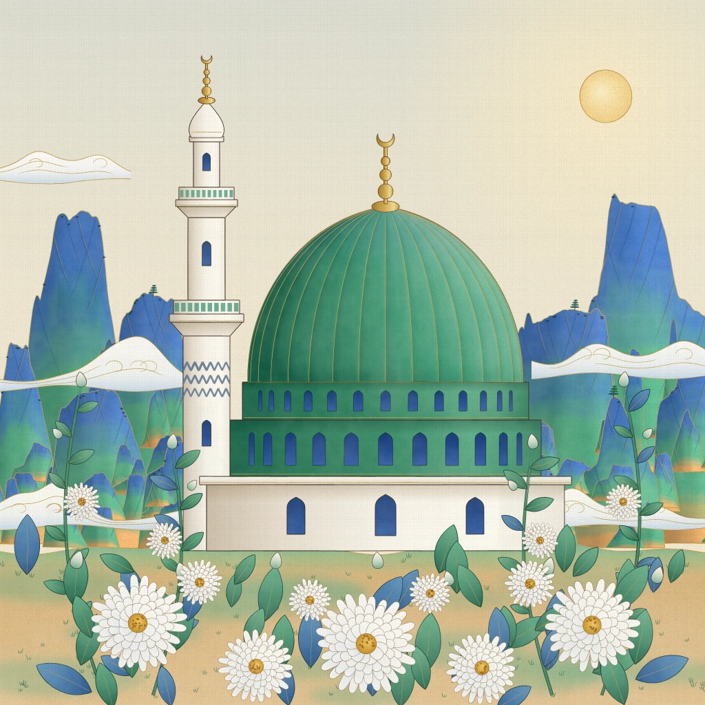

Hayalî bir ressamın altın çizgili mavi-yeşil manzara eli. Aletleri: şaplanmış açık tonlu ipek, ince kıl uçlu fırçalar, mürekkep, ezme mineral boyalar ve fırçayla sürülen altın boya. Paleti: azurit mavisi, malakit yeşili, aşı boyası, istiridye beyazı, altın ve ipeğin sıcak fildişi tonu. Dağlar kademeli omuzlu, sarp ve asimetrik doruklardır; büyük kütlelerin içinde daha alçak doruklar arkadan öne katman katman yığılır. Her doruk önce aşı boyasıyla boyanır, üstüne malakit, doruklara azurit katları sürülür; katların sınırı fırçayla düzensiz kalır, dağın ışık alan sağ yanı bir kat açıktır. Sırtlar ince altın konturla, yamaçlar kısa 'balta darbesi' çizgileriyle (kimi altın) işlenir; doruklarda seyrek yosun noktaları ve küçük çamlar vardır. Bulutlar istiridye beyazı akıcı şeritlerdir; kenarları ve içlerindeki kıvrık uçlu akış çizgileri altınla çekilir. Mimari ince mürekkep cetvel çizgisiyle çizilir; kubbenin her dilimi kaburgadan içe kat kat derecelenir, doruğa doğru azurit katı alır, kaburgalar ve kornişler altınla çekilir. Önde top biçimli kasımpatıları vardır: dışta uzun, kaşık uçlu ışın taç yaprakları, ortada uçları merkeze dönük çanak taç yapraklar.

- **Köken:** Çin'in qinglü shanshui (mavi-yeşil manzara) ve jinbi shanshui (altın çizgili mavi-yeşil manzara) geleneğine; azurit ve malakit boyaların aşı boyası üzerine katman katman sürülmesine, sırtların altınla çizilmesine dayanır. Belirli bir eser ya da ressam kopyalanmaz: üslup, atölyenin tanımladığı hayalî bir ressamın elidir.
- **Ayırt edici:** Kademeli omuzlu, sarp ve asimetrik doruklardan katman katman yığılmış dağlar; dipte aşı boyası, yamaçta malakit, doruklarda azurit, katların sınırı fırçayla düzensiz; Bütün sırtlarda ince altın kontur, yamaçlarda kısa balta darbesi çizgileri, doruklarda seyrek yosun noktaları ve küçük çamlar; Altın kenarlı, içinde kıvrık uçlu akış çizgileri olan istiridye beyazı bulut şeritleri; Her dilimi kaburgadan içe kat kat derecelenmiş, doruğu hafif azuritli, altın kaburgalı malakit kubbe; azurit pencereler ve ince mürekkep cetvel çizgileri; Dışta uzun kaşık uçlu ışın taç yaprakları, ortada uçları merkeze dönük çanak taç yapraklarla top biçimli beyaz kasımpatıları; Açık, sıcak tonlu ipek gök; altın konturlu soluk güneş ve altın damarlı mavi-yeşil yapraklar
- **Palet:** `#F2E8D2` `#3E6DB0` `#63B18F` `#438768` `#2C7458` `#C9A34E` `#FCFAF4` `#DDBB86`
- **Kodla çizim:** Canvas 2048 px iç çözünürlükte. Doruk profili rastgele genişlik ve yükseklikte basamaklardan (düz omuz ya da sarp yamaç) kurulan iki yanlı kırık çizgidir; yumuşatılır, dışa doğru şişirilir (1 − (1 − v)^1,45), omuzlarına küçük ikincil tepecikler ve iki ölçekli kaya kırığı gürültüsü eklenir. Her doruk 'katmanlayıcı' ile piksel başına boyanır: yüksekliğe ve sırta yakınlığa göre aşı boyası üstüne kat kat malakit ve azurit (sınırları gürültüyle oynayan, kıl izli katlar) ve tepe ekseninin sağında bir ışık katı. Büyük kütlelerin içinde üç katlı tabanlarla daha alçak doruklar arkadan öne kırpılarak yığılır; yamaçlara sivrilen balta darbesi çizgileri, konturlara koyu altın gövde + ince açık parıltı olan iki şeritli altın çizgi, doruklara seyrek yosun noktaları ve elips öbeklerinden küçük çamlar konur. Bulut şeritleri dalga + Gauss başlı üst kenar ve dalgalı alt kenardan kurulur, içlerine koşut akış çizgileri ve sarmal uçlar eklenir. Kubbe piksel başına dilim no'su ve dilim içi konumdan genel ışık katları, kaburgadan içe beş katlı fenran, dip katları ve doruğa doğru azurit katıyla; kasnak ve taş da katmanlayıcıyla boyanır. Kasımpatıları beş sıra dar taç yaprağından (dış ışınlar, kısalan orta sıralar, uçları merkeze dönük iki iç sıra) dipten uca sarı-yeşilden beyaza degrade ve ince mürekkep konturla çizilir. Sonda pigment yoğunluğu ipek rengine göre gürültüyle dalgalandırılır; 1024'te atkı-çözgü ipek dokusu ve doygun yerlerde mineral tanesi basılır.
- **Kaynak:** [`S-190-mavi-yesil-manzara/ornek.html`](stiller/S-190-mavi-yesil-manzara/ornek.html)

### S-191

**Renkli Kalem Gerçekçi** · *Colored-Pencil Realism* · ✦ atölye üslubu

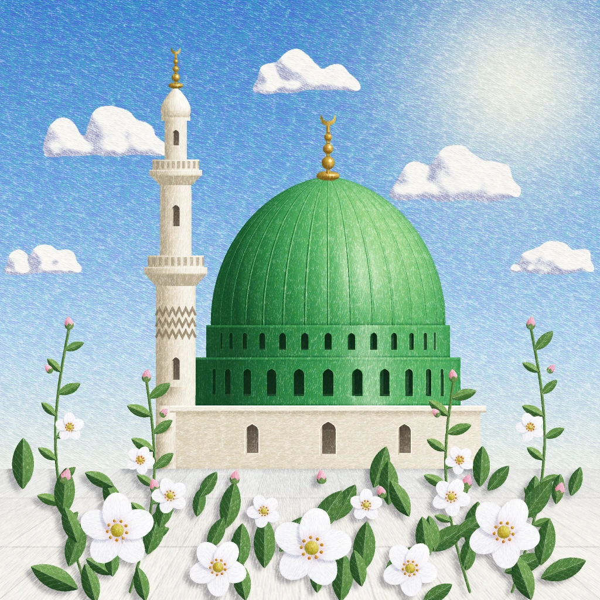

Hayalî bir fotogerçekçi renkli kalem ressamının eli. Aletleri: yumuşak mum bazlı ve sert yağ bazlı renkli kalemler, renksiz cila kalemi, sivri uç için zımpara; kâğıdı ince dişli, sıcak beyaz bristol. Paleti doygun ama aydınlıktır: kobalttan krem beyaza inen gök, zümrüt ve çimen yeşilleri, krem taş, sarı-kahve altın, soğuk gri gölgeli beyaz çiçekler. Her alanı formu izleyen yönde (gökte üç eğik yönde, kubbede kaburga boyunca, taşta yatay, taç yaprakta merkezden dışa) üç kat halinde ve her katta farklı tonda bir kalemle tarar; gökte kobalt mavisinin üstüne mor-mavi ve turkuaz katlar binince vuruşlar gözle seçilir. Bulutları hiç boyamaz: kâğıdın beyazını bırakır, yalnız gölge yanlarını mavi-gri ve leylak kalemle hafifçe tarar; bulutun ışıklı kenarını çevresindeki gök taraması çizer. Orta tonlarda vuruşu ve kâğıt dişini görünür bırakır, yalnız en koyu yerlerde basıncı artırıp cila kalemiyle dişi doldurarak mum parlaklığında pürüzsüz bir yüzey elde eder. Kenarları keskin ve temiz tutar; kubbe kaburgalarını ışıklı ve gölgeli iki ince çizgiyle, kasnağın parlaklığını dikey bir ışık şeridiyle modeller. Bitirirken mermer avlunun derzlerini, damarlarını, temas gölgesini ve çiçeklerin taşa düşen gölgelerini işler.

- **Köken:** Çağdaş fotogerçekçi renkli kalem çiziminin (katmanlama, cilalama/burnishing, renksiz cila kalemi, sert ve yumuşak uçların sırayla kullanılması, kâğıt beyazını ışık olarak bırakma) ve botanik ve mimari gerçekçi çizim geleneklerinin yöntemlerine dayanır. Gerçek bir sanatçı örnek alınmamıştır; tarif, bu teknikleri tutarlı alışkanlıklarla kullanan hayalî bir ressamın elidir: form yönünde üç renkli kat, ortada görünür vuruş ve diş, koyuda tam cilalama, kâğıt beyazı bulutlar, keskin kenar, parlak gün ışığı.
- **Ayırt edici:** Gökte üç kat eğik renkli kalem taraması gözle seçiliyor: kobalt mavisi, mor-mavi ve turkuaz kalemler üst üste, aralarında kâğıt dişinin beyaz noktaları; Bulutlar boyanmamış kâğıt beyazı; yalnız gölge yanları mavi-gri ve leylak kalemle hafifçe taranmış, ışıklı kenarlarını çevredeki gök taraması tanımlıyor; Kubbede kaburga boyunca sürülmüş yeşil katlar: orta tonlarda vuruş ve diş seçiliyor, en koyu yerler cilalanıp pürüzsüz; kaburgalar ışıklı ve gölgeli iki ince çizgi, sağ üstte parlak yansıma; Kasnakta dikey parlaklık şeridi, altın alemlerde metal yansıması; keskin, temiz kenarlı krem taş minare ve kaide; Perspektifte açık mermer avlu: derz çizgileri, ince damarlar, binanın dibinde temas gölgesi, çiçeklerin sola-aşağı düşen gölgeleri; Beyaz çiçeklerde soğuk gri gölgeler, üstteki taç yaprağın alttakine düşen gölgesi, sarı-yeşil göbeğin çevresinde turuncu erkek organlar; yapraklarda orta damardan katlanmış iki ton
- **Palet:** `#4C8ED3` `#FDFBF5` `#B2A8CC` `#206535` `#A0D894` `#E9E1D0` `#F2EFEB` `#3B6A2D`
- **Kodla çizim:** Ortak sahne modeli: her öğe (minare parçaları, pencereler, kubbe, alemler, her sap, yaprak, tomurcuk, taç yaprağı ve erkek organ) 2048 çözünürlükte sağlama bitli bir kimlik rengiyle ayrı ayrı çizilip çözümlenir; kenar yumuşatması karışımları komşuya göre onarılır. Piksel başına ertelenmiş gölgeleme: kubbede kubbeProfili türevinden dönel yüzey normali, 16 dilimde hafif şişkin dilim ve yarım silindir kaburga, Blinn parlaklığı; kasnak, minare ve alemlerde satır başına kimlik uçlarından silindir/küre normali; yaprakta orta damardan katlanmış iki düzlem ve yan damarlar; taç yaprakta üstteki taç yaprağının ışığa doğru kaydırılmış elipsinden düşen gölge. Bulutlar düz tabanlı kabarcıkların yumuşak birleşimi (1 − e^−Σ), ışık yönündeki yoğunluk farkıyla gölgelenir. Kimlik haritası düşük frekanslı gürültüyle hafifçe titretilerek okunur (el çizgisi gibi kenarlar). Gölgeleme her öğe için bir de form koordinatı (kubbede boylam × yay ve yükseklik, yaprakta boy ve en, taç yaprağında açı ve yarıçap) verir; vuruşlar bu koordinatlarda şeritlere bölünmüş, uçları incelen, basıncı ve eğimi karma ile değişen prosedürel çizgilerdir. Math.random yok, SAHNE.rng ve tamsayı karması. Bu üslupta hedef renk gerçekçi bir paletle hesaplanır; üç kat prosedürel tarama (form yönü, +0,42 ve −0,55 radyan döndürülmüş; gökte 6,4 px, kubbede 6 px, başka yerde 5,2 px şerit aralığı) yoğunluk alanı verir. Örtü oranı koyuluğa göre %74'ten %100'e çıkar; vuruş dokusu (gökte daha güçlü) ve ince dişli kâğıt yükseklik haritası örtüyü bu ortalamanın çevresinde oynatır, yalnız en koyu yerlerde cila payı dokuyu bastırır; iki çapraz katın farkıyla ton döndürülerek mor-mavi ve turkuaz kalemler taklit edilir, pigment rengi ortalama örtüye göre telafi edilir. Bulutlarda gök kalemi yerine mavi-gri/leylak kalem rengi kullanılır ve örtü bulut ışığına göre %3–58'e iner, böylece kâğıt beyazı korunur. Zemin perspektif dönüşümüyle (göz hizası y=600) mermer karo, derz, damar ve bitki gölgesi olarak gölgelenir; kasnağa yatay düzlemde Blinn parlaklığı eklenir.
- **Kaynak:** [`S-191-renkli-kalem-gercekci/ornek.html`](stiller/S-191-renkli-kalem-gercekci/ornek.html)

### S-192

**Kraft Kâğıtta Renkli Kalem** · *Colored Pencil on Kraft Paper* · ✦ atölye üslubu

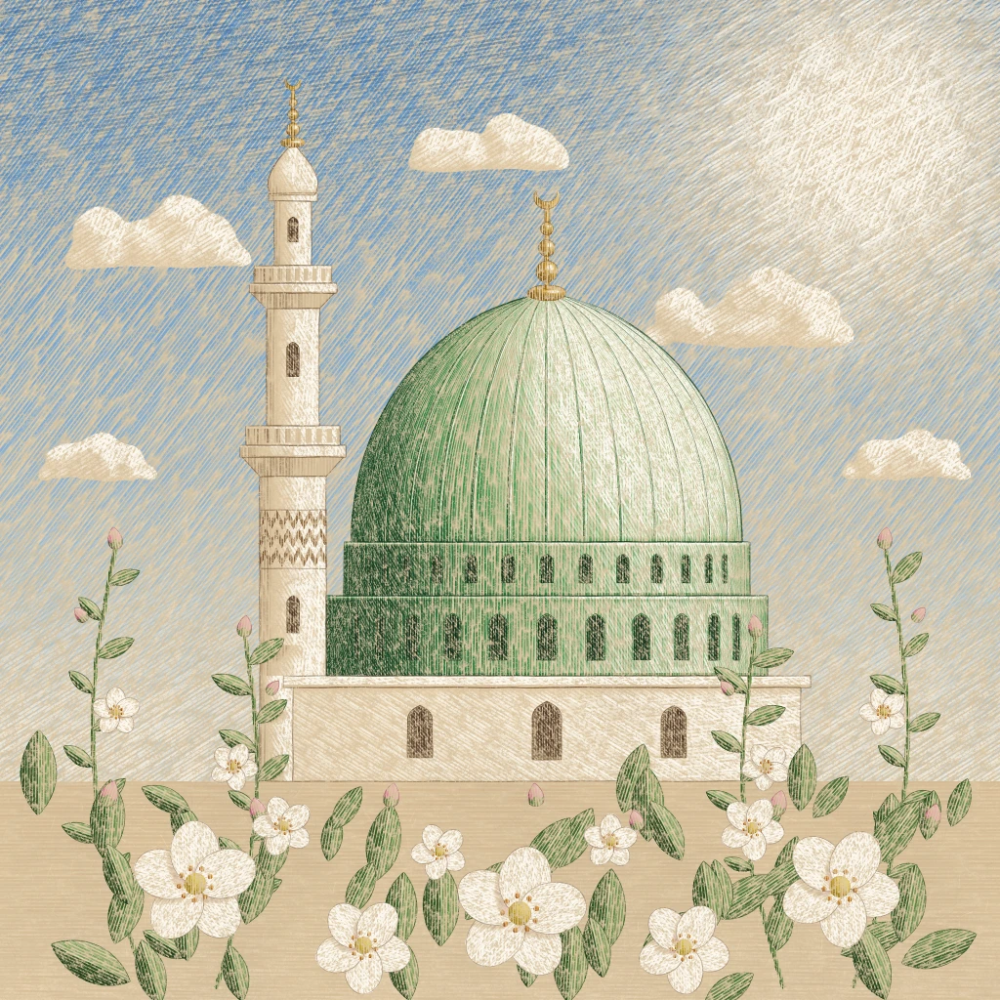

Hayalî bir ressamın kraft kâğıt üzerindeki renkli kalem eli. Kâğıdı lif kırıntılı, hafif dişli açık kraft; aletleri yumuşak, yarı saydam renkli kalemler (gök mavisi, yeşiller, sepya, gül) ve çok örtücü bir beyaz kalem. Ressam kâğıdın tonunu orta değer kabul eder ve hiçbir yeri tam kapatmaz: rengi form yönünde, aralarından kraft görünecek kadar seyrek, eşit aralıklı taramalarla sürer; gökte maviyi kısa vuruşlarla ve bölüm bölüm açısını biraz değiştirerek eğik tarar, yukarıda daha yatık ikinci bir mavi katla sıklaştırıp temiz bir kobalt elde eder, ufka doğru seyreltir. Gölgeleri büyük ölçüde kâğıda bırakır (taşın gölge yanı, bulut altları, kum); kubbede yeşil kalemin altından kraft seçildiği için yeşil sıcak bir zeytin tonuna kayar, koyu yanda aynı kalemle çapraz ikinci bir kat atar. Işıkları en son, renk taramasına çapraz giden ayrı bir beyaz kalem katıyla koyar: bulutların ışıklı tepeleri (üç yönde sık), güneş çevresi ve ufuk, aydınlık taş yüzleri, taç yaprakları, kubbenin sağ üstü. Her öğeyi kendi koyu renginde (koyu yeşil, sepya, koyu altın, gül) ince bir konturla tanımlar; kubbe kaburgalarının ışık yanına, minarenin sağ kenarına, korniş ve kasnak saçaklarına, yaprak damarlarına ince beyaz kalem çizgileri çeker. Sonuç sıcak ama genel değeri açık bir görüntüdür.

- **Köken:** Tonlu kâğıtta çizim geleneğine (orta ton kâğıt, koyu ve açık kalemle değer kurma; Rönesans'tan beri renkli zeminli desen) ve çağdaş kraft kâğıtta renkli kalem / beyaz kalem pratiğine dayanır. Gerçek bir sanatçı örnek alınmamıştır; tarif, kâğıdı ara değer olarak bırakan, renkleri seyrek düzenli taramayla süren, ışıkları ayrı bir beyaz kalem katında koyan hayalî bir ressamın tutarlı elidir.
- **Ayırt edici:** Açık kraft kâğıdın ten rengi her yerde ara değer olarak görünüyor: gökte, kubbede, taşta ve kumda taramaların arasından kraft ve lif kırıntıları seçiliyor; Gök kısa, bölüm bölüm açısı değişen eğik mavi kalem taramalarıyla kurulmuş: yukarıda yatık ikinci bir mavi katla sıklaşan temiz kobalt, ufka ve güneşe doğru maviyi çaprazlayan beyaz kalem taramasına dönüşüyor; Bulutlar kraft üstünde beyaz kalemle: ışıklı tepeleri üç yönde sık taranmış, alt yanları kâğıda bırakılmış; Kubbede kaburga yönünde yeşil tarama kraftla karışıp sıcak zeytin yeşiline kayıyor; koyu yanda çapraz ikinci kat, sağ üstte beyaz kalem ışığı ve her kaburganın ışık yanında ince beyaz çizgi; Taşın ışık yüzleri beyaz kalemle taranmış, gölge yanları çıplak kraft; her öğede kendi koyu renginde ince, özenli kontur; Önde çıplak kraft kum; beyaz kalemle işlenmiş, sarı göbekli ve kahve-altın erkek organlı çiçekler, pembe tomurcuklar ve yeşil taramalı, beyaz damarlı yapraklar
- **Palet:** `#DCC6A2` `#86A6C2` `#6D8860` `#DCDDBF` `#F4EBDB` `#EADCC4` `#846E56` `#ABAE7D`
- **Kodla çizim:** Ortak sahne modeli: her öğe (minare parçaları, pencereler, kubbe, alemler, her sap, yaprak, tomurcuk, taç yaprağı ve erkek organ) 2048 çözünürlükte sağlama bitli bir kimlik rengiyle ayrı ayrı çizilip çözümlenir; kenar yumuşatması karışımları komşuya göre onarılır. Piksel başına ertelenmiş gölgeleme: kubbede kubbeProfili türevinden dönel yüzey normali, 16 dilimde hafif şişkin dilim ve yarım silindir kaburga, Blinn parlaklığı; kasnak, minare ve alemlerde satır başına kimlik uçlarından silindir/küre normali; yaprakta orta damardan katlanmış iki düzlem ve yan damarlar; taç yaprakta üstteki taç yaprağının ışığa doğru kaydırılmış elipsinden düşen gölge. Bulutlar düz tabanlı kabarcıkların yumuşak birleşimi (1 − e^−Σ), ışık yönündeki yoğunluk farkıyla gölgelenir. Kimlik haritası düşük frekanslı gürültüyle hafifçe titretilerek okunur (el çizgisi gibi kenarlar). Gölgeleme her öğe için bir de form koordinatı (kubbede boylam × yay ve yükseklik, yaprakta boy ve en, taç yaprağında açı ve yarıçap) verir; vuruşlar bu koordinatlarda şeritlere bölünmüş, uçları incelen, basıncı ve eğimi karma ile değişen prosedürel çizgilerdir. Math.random yok, SAHNE.rng ve tamsayı karması. Kraft kâğıt: düz ten rengi (#DCC6A2) üzerine 9000 kısa eğri lif ve 2600 koyu kırıntı ayrı bir tuvale çizilip parlaklık çarpanı olarak işlenir, geniş bulutsu ton dalgalanması eklenir. Palet ressamın kalem renkleridir; her piksel için ışık değerinden ve öğe türünden üç katın basıncı belirlenir: renkli kalem (form yönünde, 5,4–7,5 px aralıklı tarama), koyu yerlerde aynı kalemin koyulaştırılmış hâliyle −0,75 radyan çapraz kat ve −0,55 radyan eğik beyaz kalem (güçlü ışıkta iki ek yönle). Kalem yarı saydamdır: örtü = basınç × vuruş yoğunluğu, kâğıt dişinin tepelerinde daha çok pigment; hiçbir katta telafi yapılmaz, böylece kraft her yerde araya karışır. Gökte mavi tarama, düşük frekanslı gürültü lekelerine göre üç açıdan (−1,09, −0,92, −0,77 radyan) birinden ya da geçişte ikisinden gelir, vuruş boyu yaklaşık 33 px; üstte −0,3 radyanlık ikinci bir mavi kat sıklaşır; gökte beyaz kalem −0,19 radyanla maviyi çaprazlar. Mavi basıncı yukarıdan ufka ve güneşe doğru azalır, beyaz kalem ufukta, güneş çevresinde ve bulutlarda (bulut ışığıyla) artar. Konturlar ve beyaz parıltı çizgileri SVG yollarından örneklenip kimlik haritasında görünen parçalara bölünür, basınçlı ve titrek çokgen çizgiler olarak ayrı bir katmana çizilir ve kâğıt dişine göre birleştirilir.
- **Kaynak:** [`S-192-kraft-kagitta-renkli-kalem/ornek.html`](stiller/S-192-kraft-kagitta-renkli-kalem/ornek.html)

### S-193

**Suluboya ve Renkli Kalem** · *Watercolor and Colored Pencil* · ✦ atölye üslubu

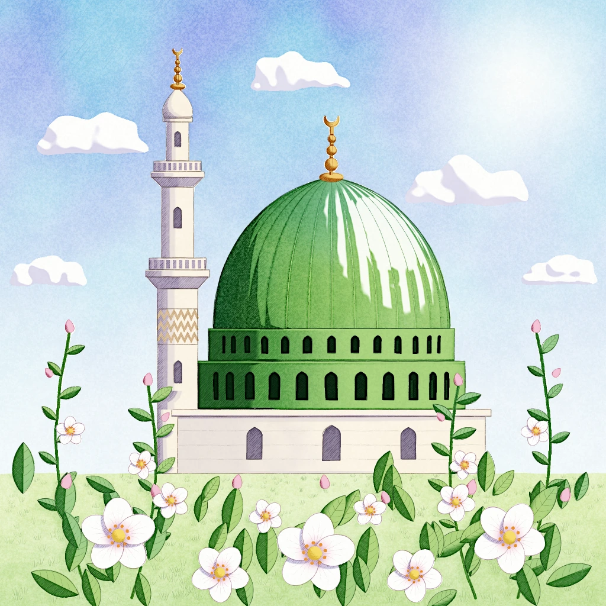

Hayalî bir çağdaş illüstratörün eli. Kâğıdı parlak beyaz, soğuk preslenmiş suluboya kâğıdı. Önce saydam sırlarla rengi kurar ve her öğeyi aynı sırayla boyar: açık zemin lavisi, kuruyunca sert kenarlı orta ton sırrı, en koyu gölgede üçüncü sır. Göğü yukarıda seruleum ve ultramarinin ıslakta karıştığı, ufka doğru açılan, pigmenti kâğıt dişinde tanelenen bir laviyle boyar; bulutları boyamaz, kâğıdı düzensiz ama net kenarla korur ve yalnız alt yanlarına ıslakta yumuşak bir gri-leylak lavi bırakır; yapıların çevresinde ince beyaz kâğıt payı kalır. Kubbeyi dilim dilim boyar: önce bütün kubbeye sarı-yeşil ile mavi-yeşilin ıslakta karıştığı bir lavi, sonra her dilime ayrı bir yeşil sır (gölge yanında koyu, ışıkta açık; her dilimin kuruyan kenarında pigment birikir), ışık alan dilimlerin ortasında dilim boyunca incelen kâğıt beyazı şeritler bırakır, gölge yanına koyu mavi-yeşil üçüncü sırrı atar. Taşa sıcak krem ve serin lila-gri, yapraklara iki tonlu (orta damarda sert kenarlı) yeşil, taç yapraklarına merkezde gül pembesi ve leylak gölge sürer. Kuruduktan sonra keskin uçlu renkli kalemlerle her öğeyi kendi koyu renginde ince bir konturla çizer, kaburgaları, yaprak ve taç damarlarını, kaidede derzleri işler, gölgeleri hep aynı yönde düzenli çapraz taramayla koyulaştırır; çayıra kısa, düzgün çimen tutamları serper.

- **Köken:** Suluboya ve renkli kalemin birlikte kullanıldığı karma teknik çizime (çocuk kitabı ve botanik illüstrasyonu, çağdaş el çizimi illüstrasyon) ve suluboyanın sır (glaze) katmanlama, ıslakta karıştırma, granülasyon, kenar birikmesi ve beyaz kâğıdı koruma yöntemlerine dayanır. Gerçek bir sanatçı örnek alınmamıştır; tarif, saydam sırları renkli kalem ayrıntısıyla tamamlayan hayalî bir illüstratörün tutarlı elidir.
- **Ayırt edici:** Kubbe dilim dilim boyanmış: her dilim ayrı bir yeşil sır, kuruyan kenarlarda pigment birikmesi; ışık alan dilimlerin ortasında incelen kâğıt beyazı şeritler, gölge yanında koyu mavi-yeşil üçüncü sır; Seruleum ve ultramarinin ıslakta karıştığı, kâğıt dişinde tanelenen gök lavisi; yapıların çevresinde ince, düzensiz beyaz kâğıt payı; Bulutlar boyanmamış kâğıt: düzensiz ama net kenarlı, alt yanlarında ıslakta yumuşak gri-leylak lavi; Renkli kalemle her öğenin kendi koyu renginde kontur (kubbede koyu yeşil, taşta sepya, alemde kahve-altın, çiçekte mor-pembe), kubbe kaburgaları, yaprak ve taç damarları, kaidede derzler; Gölgelerde tek yönlü düzenli kalem taraması: kubbenin sol yanı, minare, korniş altı, pencereler, yaprakların gölge yarısı; Orta damarda sert kenarlı iki tonlu yeşil yapraklar, gül pembesi merkezli ve leylak gölgeli beyaz çiçekler, açık yeşil çayır lavisi üstünde kalem çimen tutamları
- **Palet:** `#FEFEFC` `#9AC5EC` `#B7C4EA` `#B6DA95` `#398546` `#235C2E` `#E3F0C4` `#F3C9D6`
- **Kodla çizim:** Ortak sahne modeli: her öğe (minare parçaları, pencereler, kubbe, alemler, her sap, yaprak, tomurcuk, taç yaprağı ve erkek organ) 2048 çözünürlükte sağlama bitli bir kimlik rengiyle ayrı ayrı çizilip çözümlenir; kenar yumuşatması karışımları komşuya göre onarılır. Piksel başına ertelenmiş gölgeleme: kubbede kubbeProfili türevinden dönel yüzey normali, 16 dilimde hafif şişkin dilim ve yarım silindir kaburga, Blinn parlaklığı; kasnak, minare ve alemlerde satır başına kimlik uçlarından silindir/küre normali; yaprakta orta damardan katlanmış iki düzlem ve yan damarlar; taç yaprakta üstteki taç yaprağının ışığa doğru kaydırılmış elipsinden düşen gölge. Bulutlar düz tabanlı kabarcıkların yumuşak birleşimi (1 − e^−Σ), ışık yönündeki yoğunluk farkıyla gölgelenir. Kimlik haritası düşük frekanslı gürültüyle hafifçe titretilerek okunur (el çizgisi gibi kenarlar). Gölgeleme her öğe için bir de form koordinatı (kubbede boylam × yay ve yükseklik, yaprakta boy ve en, taç yaprağında açı ve yarıçap) verir; vuruşlar bu koordinatlarda şeritlere bölünmüş, uçları incelen, basıncı ve eğimi karma ile değişen prosedürel çizgilerdir. Math.random yok, SAHNE.rng ve tamsayı karması. Suluboya katmanı: her öğe türü için 2–3 saydam sır tanımlanır ve renkleri geçirgenlik olarak çarpılır (çıktı = kâğıt × Π(1 − yoğunluk × (1 − pigment))). Gök: yukarıdan ufka azalan yoğunluk, düşük frekanslı gürültüyle dalgalanma ve seruleum–ultramarin karışımı, kâğıt dişine göre granülasyon; bulut maskesi gürültüyle oynatılan dar bir eşikle kesilir (net, düzensiz kâğıt kenarı), bulut ışığı eşiğinden yumuşak gri-leylak gölge sırrı; yapı maskesinin bulanık kopyası ve gürültü eşiğiyle yapılardan önce durdurulur. Kubbe: kubbe boylamından (form koordinatı) 16 dilimin sırası ve dilim içi konumu bulunur; dilim merkez normalinin ışığa bakışından dilim başına sabit ton, dilim başına küçük rastgele sapma, dilim kenarında yoğunluk artışı ve ışık alan dilimlerde ışık değeriyle genişleyen, dilim ortasında kâğıt şeridi; gölge sırrı ışık değerinde gürültülü sert eşik. Yoğunluğun Gauss bulanık kopyasından farkı ayrıca kenar birikmesi olarak eklenir. Kalem katmanı: gölge taraması titreşimsiz geometrinin ışık değerine göre eşiklenen −0,82 radyan prosedürel tarama (koyuda +0,62 radyan ikinci kat), yerel rengin koyu doygun hâliyle çarpma; kontur, kaburga, damar, derz ve çimen çizgileri SVG yollarından ve bitki geometrisinden örneklenip kimlik haritasında görünen parçalara bölünür, basınçlı titrek çokgen çizgiler olarak çizilir ve kâğıt dişine göre çarpılarak birleştirilir.
- **Kaynak:** [`S-193-suluboya-ve-renkli-kalem/ornek.html`](stiller/S-193-suluboya-ve-renkli-kalem/ornek.html)

### S-194

**Mavi Kâğıtta Pastel** · *Pastel on Blue Paper* · ✦ atölye üslubu

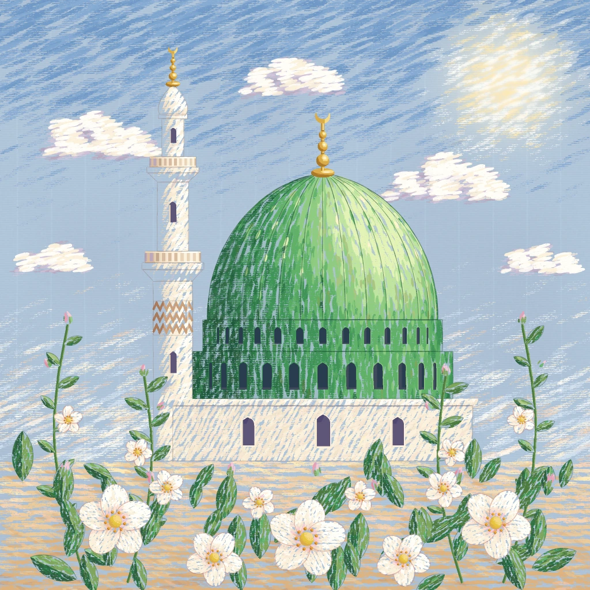

Hayalî bir pastel ressamının eli. Kâğıdı açık mavi, el yapımı Ingres kâğıdı: yatay vergeleri sık ama düzensiz aralıklı, zincir çizgileri çok soluk; aletleri sınırlı bir yumuşak pastel çubuk takımı (birkaç mavi, beyaz, krem, şeftali, kum, bir dizi yeşil, lila, mor-arduvaz, altın sarısı) ve ince pastel kalemler. Kâğıdı her yerde orta ton olarak bırakır, hiçbir alanı tam kapatmaz. Göğü büyük ölçüde kâğıda bırakır; yukarıda seyrek mavi, ufka doğru açık mavi, krem ve şeftali uzun eğik vuruşlar atar, güneşin çevresine kısa sarı-beyaz vuruşlar koyup özünü parmakla yedirir. Bulutları önce lila, sonra krem ve beyaz kısa yan vuruşlarla kurar. Kubbeyi kaburga yönünde geniş yan vuruşlarla, eldeki takımdan hedefe en yakın iki yeşilden biriyle örer, gölge yanına çapraz ikinci bir kat, ışık yanına açık sarı-yeşil vurgular atar; kâğıdın mavisi vuruş aralarından seçildiği için kubbe pudralı, serin bir yeşil olur. Taşı dik eğik paralel vuruşlarla krem ve beyazla tarar, gölge yanını kâğıda ve birkaç lila vuruşa bırakır; kumu eğik şeftali-kum vuruşlarla, yaprakları ve taç yapraklarını kısa form vuruşlarıyla kurar. Hafif bastırdığı yerde pastel yalnız verge sırtlarına tutunur ve kâğıdın çizgileri seçilir. Pencereleri, zikzakları, alemleri, korkulukları ve çiçek göbeklerini pastel kalemle sıkı doldurur; kaburgaları, kubbe ve kasnak kenarlarını, kornişin ışık çizgisini, taç ve yaprak kenarlarını ince pastel kalemle tanımlar.

- **Köken:** Tonlu (özellikle mavi) kâğıtta pastel geleneğine (18. yüzyıl portre pastelcileri, 19. yüzyıl Fransız pastel manzaraları), Ingres tipi vergeli pastel kâğıdına ve pastelde çubuğun yanıyla vuruş, optik karışım, kâğıdı ara değer bırakma ve parmakla yedirme yöntemlerine dayanır. Gerçek bir sanatçı örnek alınmamıştır; tarif, kâğıdın rengini göğe ve gölgelere bırakan, sınırlı çubuk takımıyla düzenli vuruşlar atan hayalî bir ressamın tutarlı elidir.
- **Ayırt edici:** Açık mavi Ingres kâğıdı her yerde görünüyor: gök büyük ölçüde çıplak kâğıt, kubbede, taşta ve kumda vuruşların arasından mavi seçiliyor; yakından düzensiz aralıklı, yer yer kesilen yatay verge sırtları seçiliyor; Çubuğun yanıyla atılmış geniş, uçları yuvarlak, tebeşirimsi ve düzenli vuruşlar; hafif bastırılan yerde pigment yalnız verge sırtlarında; Kubbe kaburga yönünde birkaç yeşil çubukla örülmüş, ışık yanında açık sarı-yeşil vurgular: parlak değil pudralı, kâğıt mavisiyle serinleşen bir yeşil; Taş dik eğik paralel krem-beyaz vuruşlarla taranmış, gölge yanları kâğıt mavisi ve lila; kum eğik şeftali-kum vuruşlar arasında mavi; Bulutlar lila taban üstüne krem ve beyaz kısa yan vuruşlar; güneşin özü parmakla yedirilmiş beyaz-sarı, çevresinde kısa sarı vuruşlar; Pastel kalemle ince tanımlama: koyu yeşil kaburgalar ve kenarlar, kornişte krem ışık çizgisi, gül rengi taç kenarları; pencereler mor-arduvaz sıkı dolgu
- **Palet:** `#B3C8DD` `#FFFDF7` `#FBF1DC` `#EAC99A` `#86AAD2` `#2B7444` `#8ECB80` `#5D5478`
- **Kodla çizim:** Ortak sahne modeli: her öğe (minare parçaları, pencereler, kubbe, alemler, her sap, yaprak, tomurcuk, taç yaprağı ve erkek organ) 2048 çözünürlükte sağlama bitli bir kimlik rengiyle ayrı ayrı çizilip çözümlenir; kenar yumuşatması karışımları komşuya göre onarılır. Piksel başına ertelenmiş gölgeleme: kubbede kubbeProfili türevinden dönel yüzey normali, 16 dilimde hafif şişkin dilim ve yarım silindir kaburga, Blinn parlaklığı; kasnak, minare ve alemlerde satır başına kimlik uçlarından silindir/küre normali; yaprakta orta damardan katlanmış iki düzlem ve yan damarlar; taç yaprakta üstteki taç yaprağının ışığa doğru kaydırılmış elipsinden düşen gölge. Bulutlar düz tabanlı kabarcıkların yumuşak birleşimi (1 − e^−Σ), ışık yönündeki yoğunluk farkıyla gölgelenir. Kimlik haritası düşük frekanslı gürültüyle hafifçe titretilerek okunur (el çizgisi gibi kenarlar). Gölgeleme her öğe için bir de form koordinatı (kubbede boylam × yay ve yükseklik, yaprakta boy ve en, taç yaprağında açı ve yarıçap) verir; vuruşlar bu koordinatlarda şeritlere bölünmüş, uçları incelen, basıncı ve eğimi karma ile değişen prosedürel çizgilerdir. Bu üslupta piksel tarama yerine pastel vuruşları kanvasa tek tek çizilir. Kâğıt: aralığı düşük frekanslı gürültüyle 5–8 px arasında değişen, derinliği yavaşça dalgalanan ve lif parçalarına kesilen kosinüs verge sırtları, neredeyse görünmeyen 118 px aralıklı dikey zincir çizgileri ve iki ölçekte lif gürültüsünden diş haritası; kâğıdın kendi tonu verge sırtlarında çok hafif açık. Vuruş: uçları yuvarlak incelen, hafif bükülen 12 parçalı şerit (yanVurus), renk ve basınç (alfa) vuruş başına. Altı grup (gök, kubbe-kasnak, taş, kum, yaprak, taç) ayrı tuvallere çizilir ve her piksel yalnız kendi grubunun tuvalinden okunur, böylece kenarlar temiz kalır. Vuruş merkezleri satır kaydırmalı titreşimli ızgaradan seçilir; yön form koordinatı FU'nun gradyanına diktir (kubbede kaburga, yaprakta damar, taç yaprakta radyal; taşta ve kumda sabit eğik açı), renk hedefin hafif açık/koyu hâline en yakın iki çubuktan biri (50 renklik sabit palet), basınç öğe ve ışık değerinden. Gökte vuruşlar yüksekliğe ve güneşe göre olasılıkla atılır; bulutlarda lila, krem ve beyaz üç kat. Birleştirme: birikmiş alfa × basınç dişe göre eşiklenir (toz yalnız sırtlara tutunur), aralarda kâğıt kalır; kubbede altta ince bir sürme ton, güneşin özünde dişe göre kırık yumuşak beyaz-sarı. Küçük ayrıntılar en yakın tek çubukla sıkı dolgu; kaburga, kenar, ışık çizgileri ve taç/yaprak konturları ayrı katmanda basınçlı çokgen çizgiler olarak çizilir. Math.random yok, SAHNE.rng ve tamsayı karması.
- **Kaynak:** [`S-194-mavi-kagitta-pastel/ornek.html`](stiller/S-194-mavi-kagitta-pastel/ornek.html)

### S-195

**Suluboya Üstüne Pastel** · *Pastel over Watercolor* · ✦ atölye üslubu

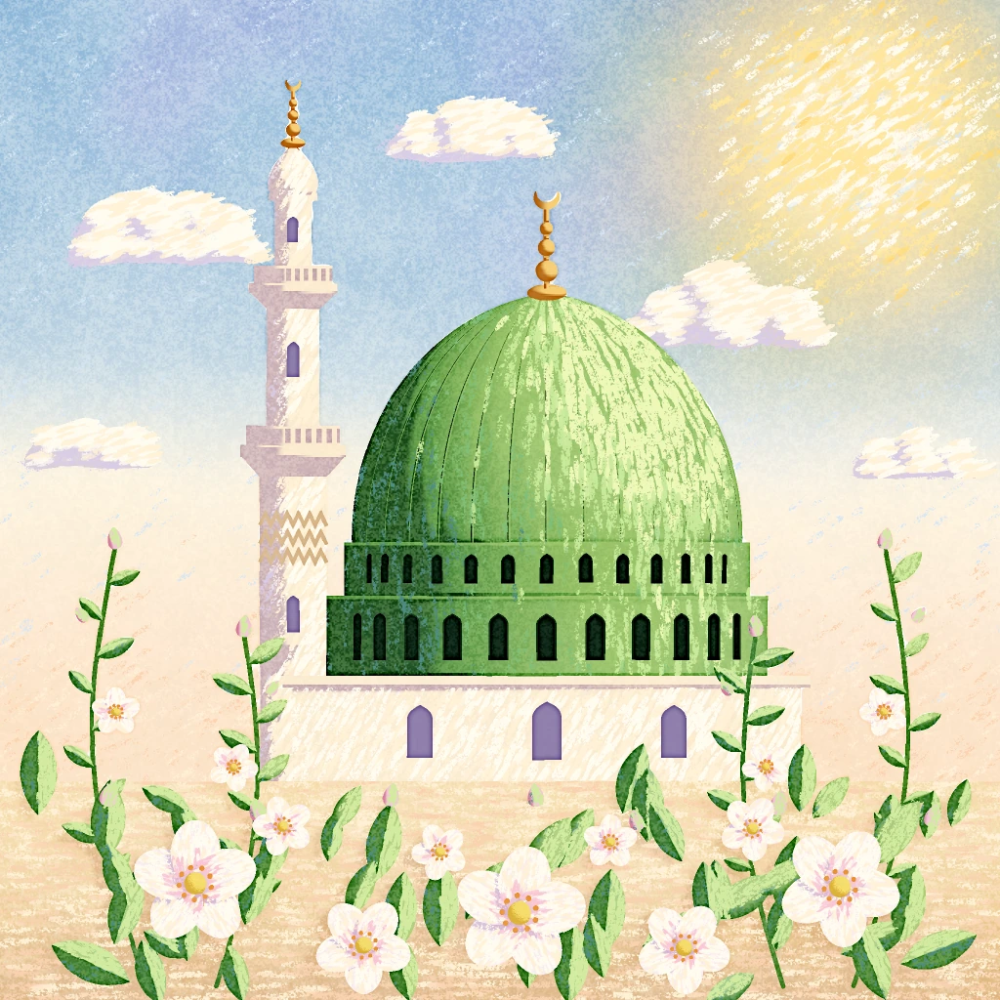

Hayalî bir karışık teknik ressamının eli. Kâğıdı pürüzlü (rough) beyaz suluboya kâğıdı. Önce bütün resmi saydam sırlarla kurar: yukarıda dolgun, ufka doğru açılan ve ıslakta yer yer camgöbeğine kayan berrak bir mavi gök (güneşin çevresinde kâğıdın beyazını bırakır, oraya yalnız çok soluk bir limon sarısı dokundurur; yapıların çevresinde yer yer düzensiz, ince bir kâğıt payı; bulutlar boyanmadan, alt yanları mavi-gri), sarı-yeşil üzerine yeşil ve gölgede camgöbeği-mor sırlarla kubbe ve kasnak, beyaz taş üzerine serin lavanta-gri gölgeler, açık okr bir kum, iki tonlu yeşil yapraklar, gül pembesi taç yapraklar. Lavi kuruyunca yumuşak pastele geçer ve çubuğun yanıyla kısa, form yönünde vuruşlar atar: yüksekteki güneşin çevresine beyaz ve soluk sarı vuruşlar koyup özünü parmakla beyaz bir ışığa yedirir; göğe açık ve orta mavi, ufka mavi-beyaz, bulutların ışıklı yanlarına beyaz, gölgelerine mavi-gri vuruşlar atar; kubbenin aydınlık yanını kaburga yönünde nane ve açık yeşil, ortasını seyrek yeşil, gölgesini seyrek camgöbeği vuruşlarla işler; taşın ışık yüzlerini dik eğik beyaz ve krem vuruşlarla, kumu açık kum ve krem, yaprakların ışık yarısını açık yeşil, taç yapraklarını beyaz, krem ve ortaya doğru pembe vuruşlarla kaplar. Korniş, şerefe ve korkuluk gibi ince bantları temiz lavide bırakır. Pastel kâğıdın diş tepelerine tutunur, çukurlarda alttaki saydam lavi görünür; iki teknik yan yana açıkça okunur. Kontur çizmez: biçimler lavi kenarları ve pastel ışıklarıyla kurulur.

- **Köken:** Suluboya alt boyama üzerine pastel uygulanan karışık teknik pratiğine (19. yüzyıldan beri pastelcilerin renkli lavi zemin kullanması, çağdaş karışık teknik manzara) ve pastelin pürüzlü kâğıtta diş tepelerine tutunması, parmakla yedirme, suluboyanın sır katmanlama ve ıslakta karıştırma yöntemlerine dayanır. Gerçek bir sanatçı örnek alınmamıştır; tarif, saydam laviyi opak, tebeşirimsi pastel vuruşlarıyla tamamlayan hayalî bir ressamın tutarlı elidir.
- **Ayırt edici:** İki teknik üst üste okunuyor: altta saydam, ıslakta karışmış ve kenarı biriken suluboya sırları, üstte çubuğun yanıyla atılmış opak, tebeşirimsi pastel vuruşları; Yüksekteki güneşin çevresinde beyaz ve soluk sarı pastel vuruşlar, özü parmakla beyaz bir ışığa yedirilmiş; gök yukarıda berrak maviden ufka doğru mavi-beyaza açılıyor; Kubbenin aydınlık yanında kaburga yönünde nane ve açık yeşil pastel vuruşlar, aralarından alttaki yeşil lavi görünüyor; gölge yanında seyrek camgöbeği vuruşlar; Taşın ışık yüzlerinde dik eğik beyaz ve krem pastel, gölge yanlarında serin lavanta-gri suluboya; korniş ve korkuluklar temiz lavide; Bulutların ışıklı yanlarında beyaz, gölgelerinde mavi-gri pastel; açık okr kumda açık kum ve krem yatay vuruşlar; Taç yapraklarında gül pembesi lavi üstüne beyaz, krem ve pembe pastel; kontur çizgisi yok, biçimler lavi kenarları ve pastel ışıklarıyla kurulmuş
- **Palet:** `#93C5E9` `#E1EFF8` `#FFF9D7` `#3D7449` `#DBEBA7` `#C1BEC2` `#F8EACD` `#F3C7D5`
- **Kodla çizim:** Ortak sahne modeli: her öğe (minare parçaları, pencereler, kubbe, alemler, her sap, yaprak, tomurcuk, taç yaprağı ve erkek organ) 2048 çözünürlükte sağlama bitli bir kimlik rengiyle ayrı ayrı çizilip çözümlenir; kenar yumuşatması karışımları komşuya göre onarılır. Piksel başına ertelenmiş gölgeleme: kubbede kubbeProfili türevinden dönel yüzey normali, 16 dilimde hafif şişkin dilim ve yarım silindir kaburga, Blinn parlaklığı; kasnak, minare ve alemlerde satır başına kimlik uçlarından silindir/küre normali; yaprakta orta damardan katlanmış iki düzlem ve yan damarlar; taç yaprakta üstteki taç yaprağının ışığa doğru kaydırılmış elipsinden düşen gölge. Bulutlar düz tabanlı kabarcıkların yumuşak birleşimi (1 − e^−Σ), ışık yönündeki yoğunluk farkıyla gölgelenir. Kimlik haritası düşük frekanslı gürültüyle hafifçe titretilerek okunur (el çizgisi gibi kenarlar). Gölgeleme her öğe için bir de form koordinatı (kubbede boylam × yay ve yükseklik, yaprakta boy ve en, taç yaprağında açı ve yarıçap) verir; vuruşlar bu koordinatlarda şeritlere bölünmüş, uçları incelen, basıncı ve eğimi karma ile değişen prosedürel çizgilerdir. Suluboya alt katı: her öğe türü için 2–3 saydam sır tanımlanır ve geçirgenlik olarak çarpılır (çıktı = kâğıt × Π(1 − yoğunluk × (1 − pigment))); gökte yukarıdan ufka doğru azalan ve güneşin çevresinde sönen mavi sır, gök mavisiyle camgöbeği arasında düşük frekanslı gürültüyle ıslakta karışır; güneşin hemen çevresine çok soluk bir limon sırrı düşer; bulut maskesiyle boyanmadan kalan bulutlar, bulut ışığı eşiğinden mavi-gri gölge sırrı alır; yapıların çevresinde gürültüyle yer yer ve değişen genişlikte kâğıt payı kalır, başka yerlerde lavi kenara kadar gelip hafifçe toplanır; yoğunluğun Gauss bulanık kopyasından farkı kenar birikmesini, kâğıt dişi granülasyonu verir. Pastel üst katı: vuruşlar kanvasa tek tek çizilir (uçları yuvarlak incelen, hafif bükülen şerit; renk ve basınç vuruş başına), altı grup (gök, kubbe-kasnak, taş, kum, yaprak, taç) ayrı tuvallerde, her piksel yalnız kendi grubundan okunur; ince bantlar (korniş, şerefe, korkuluk) gruba alınmaz. Vuruş merkezleri satır kaydırmalı titreşimli ızgaradan, yönü form koordinatı FU'nun gradyanına dik (taşta sabit eğik açı), renk ve basınç ışık değerine göre seçilen pastel çubuklarından. Birleştirme: birikmiş alfa iki ölçekli pürüzlü kâğıt diş haritasına göre eşiklenir, böylece pastel yalnız diş tepelerinde kalır ve çukurlarda lavi görünür; güneşin özü, pastel birleştirildikten sonra dişe göre kırık, parmakla yedirilmiş yumuşak beyaz-soluk sarı bir ışığa çekilir. Kontur katmanı yoktur. Math.random yok, SAHNE.rng ve tamsayı karması.
- **Kaynak:** [`S-195-suluboya-ustune-pastel/ornek.html`](stiller/S-195-suluboya-ustune-pastel/ornek.html)

### S-196

**Fildişi Minyatür Noktalama** · *Ivory Miniature Stippling* · ✦ atölye üslubu

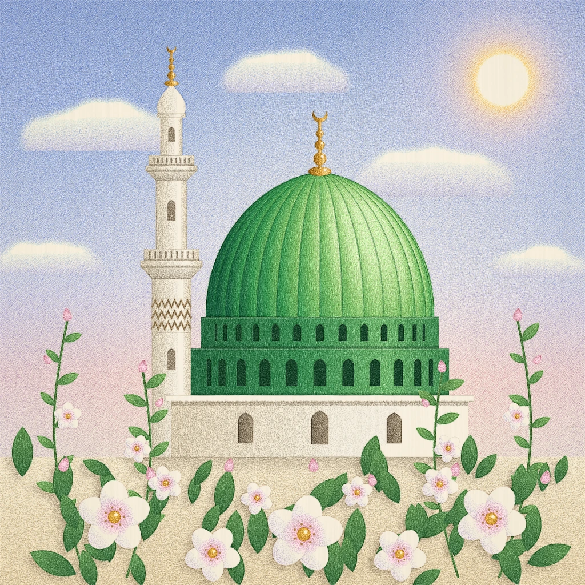

Hayalî bir minyatür ressamının eli. Alet: birkaç kıllı, ucu iğne gibi toplanan samur fırça; destek: ince kesilmiş, perdahlanmış fildişi yaprak; boya: saydam suluboya, ışıklarda yalnız fildişinin kendi sıcak parıltısı. Ressam hiçbir yeri yıkamayla doldurmaz: gökte tek yönde akan, başı dolgun ve kuyruğu incelen virgül biçimli kısa taramalar, kubbede meridyen boyunca, kasnakta dikey, yaprakta eksen boyunca taramalar (hachure), taşta ve çiçekte yalnız noktacıklar (pointillé) koyar; ton, aynı yere dönülerek, işaret sıklığıyla kat kat koyulaşır; açık yerlerde işaretler soluk ve sık, koyu yerlerde dolgun olur, araları hep fildişi kalır. Gök üstte inci mavisinden ufukta gül-şeftaliye iner; gölgeler leylak-gri ve serin yeşildir. Son olarak çok ince fırçayla açık, yumuşak konturlar çekilir ve alem kürelerine, çiçek göbeklerine birkaç çin beyazı ışık noktası konur.

- **Köken:** 18.–19. yüzyıl Avrupa'sındaki fildişi üstüne portre minyatürü geleneğine (pointillé ve hachure ile çalışan suluboya minyatür; fildişinin saydam boyanın içinden parlaması) ve hassas noktalama tekniğine dayanır. Belirli bir ressam taklit edilmez; burada tarif, bu tekniklerden kurulmuş hayalî bir ressamın elidir ve fildişi yerine onun görünüşü (sıcak, ışıklı, ince damarlı zemin) canlandırılır.
- **Ayırt edici:** Bütün resim, araları fildişi kalan binlerce küçük renk noktası ve kısa taramadan oluşuyor: uzaktan ince, titreşen bir tane dokusu; yakından bakınca gökte tek yönde akan çok küçük virgül taramaları, taşta ve çiçekte sık noktacıklar seçiliyor; Işıklar boş bırakılmış sıcak fildişi: güneş, bulutların tepeleri, taş kaide ve beyaz çiçekler fildişinin kendi parıltısıyla aydınlanıyor; Gök üstte inci mavisinden ufukta gül-şeftali rengine inen yumuşak bir geçiş; güneşin çevresinde altın, sonra gül renkli hale; Kubbede meridyen yönünde kısa taramalarla modellenmiş, ışıklı yanında sarı-yeşile açılan dilimler ve ince kaburga çizgileri; Ortası ışıklı, kenarlara doğru hafifçe sıcaklaşan fildişi zemin; bulutların çekirdeği boyasız fildişi olarak kalıyor; Çok ince, açık renkli kontur ve alem kürelerinde, çiçek göbeklerinde çin beyazı ışık noktaları
- **Palet:** `#F5ECDA` `#849CD0` `#E7D5CF` `#55A156` `#C8E3A9` `#1F5633` `#DDAA44` `#E1B8D9`
- **Kodla çizim:** Canvas, 2048 iç çözünürlük. Önce görünmeyen bir 'hedef ton' resmi çizilir (degrade gök, bulutlar, taş, kubbe; kubbe her dilimi dışbükey sayılarak piksel piksel Lambert ışığıyla), sonra fildişi rengine göre Beer–Lambert soğurmaya (−ln(hedef/fildişi)) çevrilir. Yaklaşık 13,6 milyon rastgele deneme beş geçişte işlenir: her denemede 4×4 hücrenin biriken boyası hedefin altındaysa, bölge haritasıyla kırpılmış bir nokta (yarıçap ~0,9 px, kenarı hafif koyu) ya da biçim yönünde (kubbe meridyeni, gökte tek akış yönü, kasnakta dikey, yaprak ekseni) 4,5–10 px boyunda, başı dolgun ve kuyruğu incelen virgül biçimli bir tarama boya tamponuna eklenir; işaretin gücü hedef tonla ölçeklenir (açık yerde soluk ve sık, koyu yerde dolgun), renklerde küçük sapmalar vardır. Sonuç fildişi × exp(−A) olarak bileşir; zemine çok hafif, geniş bir sıcaklık dalgalanması katılır. Konturlar örtmeli ayrı bir katmanda titrek ve basıncı değişen şeritlerle çekilip çarpımla bindirilir; ışık noktaları en son.
- **Kaynak:** [`S-196-fildisi-minyatur-noktalama/ornek.html`](stiller/S-196-fildisi-minyatur-noktalama/ornek.html)

### S-197

**Altın Serpmeli Kenar Süslemeli Resim** · *Painting with Gold-Flecked Floral Margins* · ✦ atölye üslubu

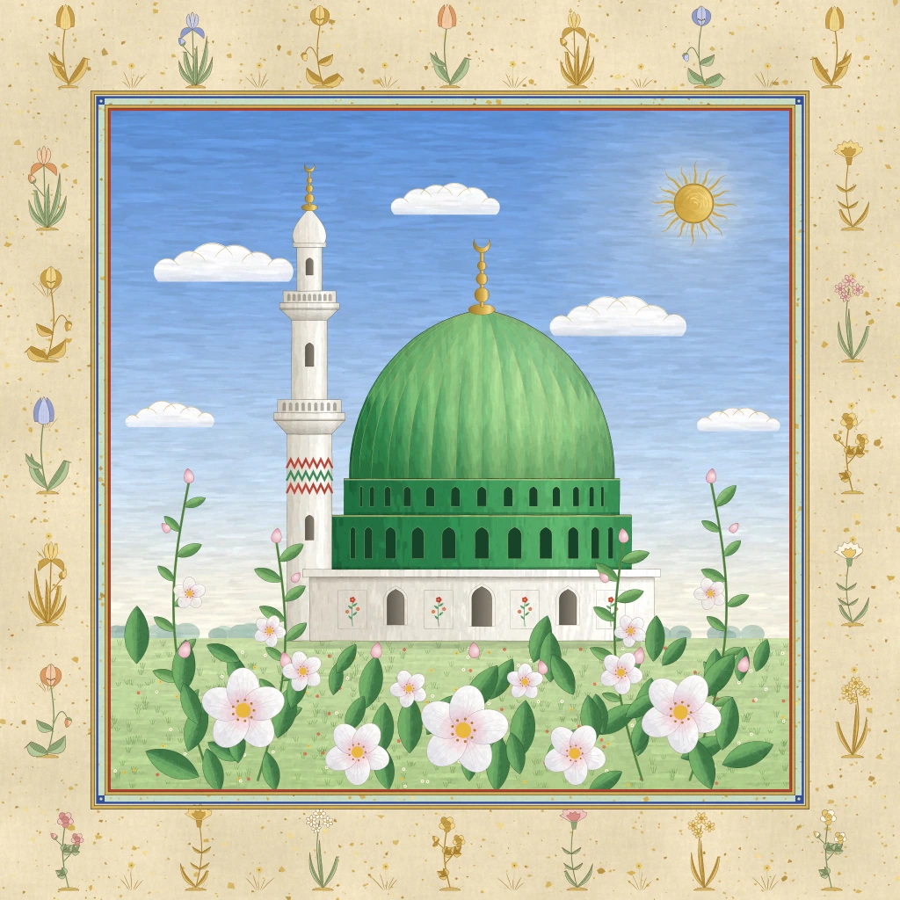

Hayalî bir albüm ressamının eli. Orta resim sincap kılı ince fırçayla, mühreyle perdahlanmış kâğıda örtücü suluboya (guaş) ile işlenir; ressam yumuşak geçiş yapmaz, her rengi birkaç ayrı tonda karıştırıp biçim yönünde kısa, örtücü ve kıl izli vuruşlarla yan yana sürer: gökte uzun yatay vuruşlarla lacivert-maviden ufukta sütlü beyaza inen gök, kubbede meridyen boyunca dilim dilim yeşiller, taşta ve kasnakta dikey vuruşlar, yapraklarda eksen boyunca, taç yapraklarda göbekten dışa; ton sınırları fırça izi olarak kalır. Tepeleri ince altın çizgili beyaz bulutlar, kabuk altını disk ve dalgalı alev ışınlı güneş, beyaz mermer minare ve kaide, çiçekli çayır; her biçim çok ince, hafif titrek koyu bir kontur alır. Kenar suyu açık devetüyü kâğıttır; üstüne köşeli altın pullar (zerefşan) serpilir. Kenarda aralıklı olarak lale, gül, süsen, karanfil, gelincik ve nergis dikilir: çoğu iki tonlu altınla (açık ve koyu altın, gölge yanında ince altın taraması), aralarındakiler soluk yeşil yaprak ve pembe, mavi, krem, şeftali çiçeklerle; her bitkinin altında küçük bir toprak öbeği, aralarda altın ot filizleri vardır. Resimle kenar arasında açık yeşil bir kâğıt şerit, altın, lacivert ve kırmızı ince cetveller, köşelerde küçük lacivert kareler bulunur.

- **Köken:** 17. yüzyıl Babür albüm sayfalarının (murakka) altın serpmeli, doğadan çiçekli bitkilerle bezeli kenar suyu geleneğine, İran ve Osmanlı kitap sanatlarındaki zerefşan ve cetvel işçiliğine dayanır. Belirli bir eser ya da usta kopyalanmaz; burada tarif bu geleneklerden kurulmuş hayalî bir albüm ressamının elidir ve orta resim sahnenin kendisidir; yazı, figür ya da hat yoktur.
- **Ayırt edici:** Geniş açık devetüyü kenar suyunda yüzlerce düzensiz, köşeli altın pul; bazıları ışığı yakalıyor; Kenarda aralıklı dizilmiş, doğadan çizilmiş çiçekli bitkiler: iki tonlu altın lale, gül, süsen, gelincik ile soluk yeşil yapraklı pembe, mavi, krem ve şeftali renkli çiçekler; dönük yaprak uçları ve toprak öbekleri; Resim ile kenar arasında açık yeşil kâğıt şerit; altın, lacivert ve kırmızı ince cetveller, köşelerde lacivert kareler; Orta resimde yatay guaş vuruşlarıyla boyanmış berrak mavi gök, tepeleri ince altın çizgili beyaz bulutlar ve dalgalı alev ışınlı, kabuk altını güneş; Dilim dilim modellenmiş, altın kaburga çizgili yeşil kubbe; kırmızı-yeşil zikzaklı beyaz mermer minare ve kaidede kakma çiçek panoları; Orta resmin her yerinde seçilen örtücü guaş vuruşları: yan yana sürülmüş ayrı ton lekeleri, kubbede meridyen boyunca, taşta dikey, çiçekli çayırda yatay; ince koyu konturlu, damarlı beyaz çiçekler
- **Palet:** `#ECDDBB` `#D2AE52` `#F1D88A` `#2F4FA0` `#C9DCC4` `#6192D5` `#3E9D58` `#B8402F`
- **Kodla çizim:** Canvas, 2048 iç çözünürlük. Kenar kâğıdı piksel döngüsüyle (iki ölçekli değer gürültüsü, dikey lif) üretilir; zerefşan, rastgele köşeli 4–6 kenarlı altın çokgenlerdir. Kenar bitkileri yordamsal: S eğrili sap, sinüs genişlikli ve kıvrık ortalı mızrak yapraklar (bir yarısı koyu ve ince taramalı, bazılarının ucu dönük), Bézier taç yapraklı lale, süsen, gelincik, karanfil, beş elipsli gül ve nergis; çizgiler titrek, basıncı değişen şeritlerdir (H.pen). Cetveller ve kâğıt şerit strokeRect/fillRect. Orta resim sahne koordinatında ölçeklenip kırpılarak önce düz renk ve degradelerle kurulur (güneş: alev biçimli şerit ışınlar, diskte yay biçimli altın vuruşlar). Sonra guaş geçişi: her bölgede parlaklık birkaç ayrı tona indirgenir ve ton sınırları fırça yönünde uzayan gürültüyle düzensizleşir; ardından yaklaşık 32 000 kıl izli, başı dolgun ve sonu kuru fırça gibi incelen vuruş, merkezindeki rengi küçük bir sapmayla alıp bölge yönünde (gök yatay, kubbe meridyeni, taş ve kasnak dikey, yaprak ekseni, taç yaprakta ışınsal) üç boyda sürülür; renk farkı eşiği vuruşun konturlara ve komşu renk alanına taşmasını engeller. En son kenara kâğıt dokusu katılır.
- **Kaynak:** [`S-197-altin-serpmeli-kenar/ornek.html`](stiller/S-197-altin-serpmeli-kenar/ornek.html)

### S-198

**Murakka Albüm Sayfası** · *Album Page (Murakka)* · ✦ atölye üslubu

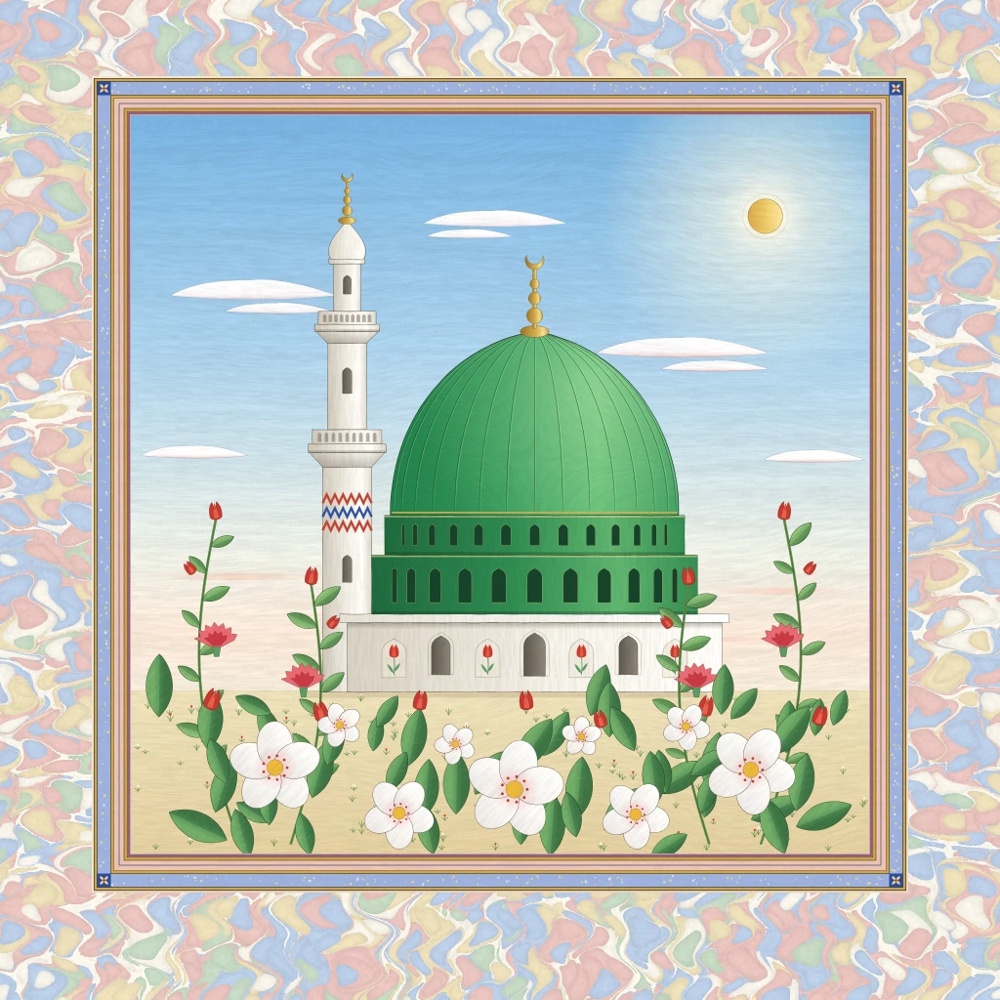

Hayalî bir murakka ustasının eli. Orta resim nakkaş usulü, gölgesiz, düz ve parlak boyanır; renkler düzdür ama ince fırçayla biçim yönünde kısa vuruşlarla sürüldüğünden guaşın yoğunluğu vuruş vuruş hafifçe oynar (gökte ve yerde yatay, kubbede dilim boyunca, yaprakta eksen boyunca, taç yapraklarında göbekten dışa): düz açık firuze gök, lacivert-gri konturlu düz beyaz uzun bulut şeritleri, çevresi iki sıra altın noktalı altın güneş; dilimleri sırayla iki düz yeşille boyanmış kubbe ince koyu ve açık kaburga çizgileri ve eteğinde altın bir şeritle; biçim yalnız gölgedeki yamaçta ve kasnakta çok ince, koyu yeşil koşut çizgilerle (pardaz) hissettirilir; beyaz minarede lacivert-kırmızı zikzak, kaidede lale motifli küçük panolar; kum renkli yerde beyaz çiçekler, dallarda kırmızı laleler ve karanfiller. Her biçim ince, koyu, hafif titrek ve basınçla kalınlığı değişen bir kalemle çevrilir; aharlı, mühreyle perdahlanmış kâğıdın ince tanesi ve hafif perdah parıltısı boyanın altından seçilir. Resim önce kırmızı bir cetvele, sonra altın cetvelli somon renkli bir pervaza, sonra altın halkâr noktalı açık lacivert bir pervaza oturtulur; köşelerde altın çiçekli lacivert kareler vardır. Dış kenar suyu, çok açık gül, açık mavi ve krem boyaların su yüzüne serpilip kâğıda alındığı iri taşlı, sakin bir battal ebrudur; renkler orta resim öne çıksın diye çok açık tutulur, taşlar kenarlarında belli belirsiz koyulaşır ve hafif bir dalgayla kayar.

- **Köken:** Osmanlı murakka (albüm) geleneğine dayanır: resim ya da kıtaların renkli kâğıt pervazlara ve altın, lacivert, kırmızı cetvellere oturtulması ve kenar suyunda ebru kâğıdı kullanılması. Ebru, damlaların birbirini ittiği gerçek battal ebru dönüşümüyle hesaplanır. Belirli bir eser ya da usta kopyalanmaz; tarif hayalî bir murakka ustasının elidir ve sayfada yazı kıtası, hat ya da figür yoktur.
- **Ayırt edici:** Dış kenar suyu çok açık gül, açık mavi ve krem iri taşlardan sakin battal ebru; taşların arasında ince beyaz damarlar ve hafif bir dalga; Katman katman pervazlar: altın halkâr noktalı açık lacivert kâğıt, altın cetveller, somon renkli kâğıt ve içinde ince lacivert çizgi, en içte kırmızı cetvel; Köşelerde dört altın yapraklı, kırmızı göbekli küçük lacivert kareler; Orta resimde gölgesiz, düz açık firuze gök, içinde yatay guaş vuruşlarının izi; lacivert-gri konturlu düz beyaz bulut şeritleri ve çevresi altın noktalı altın güneş; Dilimleri sırayla iki düz yeşille boyanmış kubbe, gölgedeki yamaçta ve kasnakta ince pardaz çizgileri, eteğinde altın şerit; lacivert-kırmızı zikzaklı minare, lale panolu kaide; Kum renkli yerde beyaz çiçekler, dallarda kırmızı laleler ve karanfiller; yapraklarda eksen boyunca, taç yapraklarında göbekten dışa ince fırça izi; kalınlığı basınçla değişen ince koyu el konturu
- **Palet:** `#F3DFD8` `#DFE5EC` `#A1D1E6` `#9DB2DE` `#EDC3B0` `#CFA64A` `#33A05C` `#C8392E`
- **Kodla çizim:** Canvas, 2048 iç çözünürlük. Ebru: kenar suyu bölgesine 520 damla (yarıçap 22–40) sırayla serpilir; her piksel için hafif dalga geri alınır, sonra damlalar sondan başa doğru tersine işlenir (dışarıdaki nokta p → c + (p − c)·√(1 − r²/|p − c|²)), içine düşülen ilk damlanın rengi alınır; taş kenarına doğru çok hafif koyulaşma ve lif gürültüsü eklenir. Pervazlar evenodd dolgulu dikdörtgen halkalar, cetveller strokeRect, halkâr rastgele altın noktalar; pano hafif gölgeyle ebru üstüne bindirilir. Orta resim sahne koordinatında ölçeklenip kırpılarak düz renklerle çizilir (degrade yok denecek kadar az): Bézier bulut şeritleri, kaburgalar arasındaki dilimler sırayla iki yeşil, pardaz için kırpılmış ince titrek çizgiler (H.pen), SAHNE.bitki konumlarında lale ve karanfiller, bağlayıcı saplar. Konturlar 0,6–1,4 kat arasında yavaşça değişen basınçla çekilir. Son geçişte orta resme guaş eli katılır: bölge yönünde (gök ve yer yatay, kubbede boylam boyunca, taş dikey, yaprakta en yakın yaprağın ekseni, taç yaprakta ışınsal) dizilen, boyu değişen, yumuşak profilli fırça vuruşları karmayla kendi yoğunluğunu alır ve parlaklığı yaklaşık ±%3 oynatır; üstüne vuruş boyunca kıl izi, geniş yoğunluk dalgalanması, ince kâğıt tanesi ve eğik, geniş bir perdah parıltısı eklenir.
- **Kaynak:** [`S-198-murakka-album-sayfasi/ornek.html`](stiller/S-198-murakka-album-sayfasi/ornek.html)

### S-199

**Kalemkâr** · *Kalamkari Hand-Painted Textile* · ✦ atölye üslubu

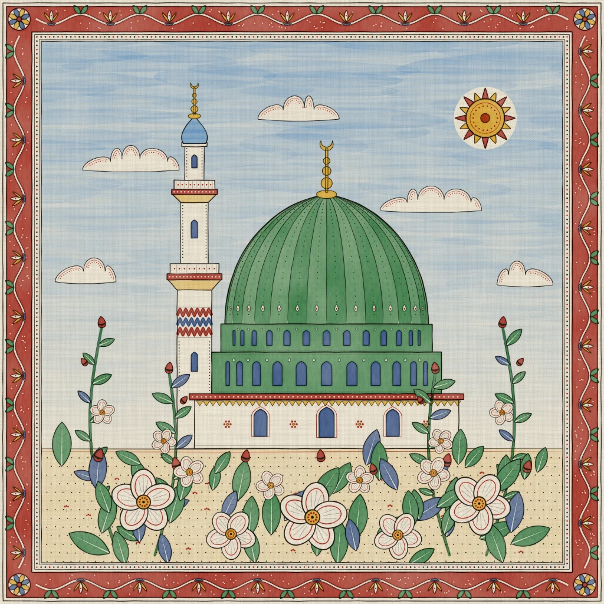

Hayalî bir kalemkâr ustasının eli. Destek: görünür dokumalı, ipliği yer yer kalınlaşan krem pamuklu bez. Alet: bambu kalem (kalam) ve fırça. Usta önce demir karasıyla bütün biçimleri elle, kalınlığı hafifçe değişen ve azıcık titreyen çizgilerle çizer; sonra boyaları elle doldurur: gök, geniş fırçayla yan yana ve üst üste sürülmüş açık çivit bantlarıyla (bantların bindiği yerde boya koyulaşır, aralarda açık kalır), kubbe ve kasnak çivit üstüne sarı bindirilmiş yeşil, pencereler koyu çivit, korniş ve şerefeler kök boya kırmızısı, alemler ve güneş zerdeçal sarısı. Boya çizgiye tam oturmaz, bezin ipliklerine işler, alanın içinde hafifçe dalgalanır ve kenarlarında koyulaşır. Krem bırakılmış yerler ikinci bir kırmızı iç çizgiyle, noktalarla ve damarlarla süslenir: beyaz çiçeklerde kırmızı iç kontur ve kara damarlar, yapraklarda krem orta damar, yerde sıra sıra kara noktalar. Kenarda kök boya zeminli bir bordürde krem sarmaşık, sarı nilüferler, yeşil yaprak çiftleri ve köşe rozetleri, içte noktalı çift çizgi.

- **Köken:** Hindistan'ın kalamkari (Farsça kalem-kâr, 'kalem işi') geleneğine, özellikle Srikalahasti üslubundaki elle çizilip boyanan pamuklu bezlere ve doğal boyalarla (çivit, kök boya, zerdeçal, demir karası) çalışma usulüne dayanır; Osmanlı'da da bu tür boyalı bezler kalemkâr adıyla bilinirdi. Belirli bir eser taklit edilmez; tarif bu tekniklerden kurulmuş hayalî bir ustanın elidir ve figür, yazı ya da hat içermez.
- **Ayırt edici:** Elle çekilmiş, kalınlığı değişen demir karası konturlar; çiçeklerde ve gökteki güneşte içte ikinci bir kök boya kırmızısı çizgi, bulutlarda dilimli tepeyi içeriden izleyen kırmızı çizgi ve nokta dizisi; Doğal boya renkleri: açık çivit gök, çivit üstüne sarıyla yeşil kubbe ve kasnak, koyu çivit pencereler, kök boya korniş, zerdeçal sarısı alem ve güneş; Boyanın bezin içine işlemesi: gökte üst üste binen el fırçası çivit bantları, alan içinde dalgalanan ton, kenarlarda koyulaşma ve çizgiden hafifçe taşan ya da geri kalan dolgu; Görünür pamuk dokuması; ipliklerin kalınlık farkı ve krem bezin sıcak tonu; Kök boya zeminli bordür: krem dalgalı sarmaşık, sarı nilüferler, yeşil yaprak çiftleri, krem serpme noktalar ve köşe rozetleri; içte noktalı çift çizgi; Kubbe dilimlerinde noktalı çizgiler ve krem damla dizisi; yerde sıra sıra kara noktalar ve kırmızı filizler; çiçeklerde kara damarlar
- **Palet:** `#F3EAD6` `#221915` `#A6B9C5` `#49618B` `#588C5F` `#AE5245` `#CEA038`
- **Kodla çizim:** Canvas, 2048 iç çözünürlük. Her boya (gök çividi, çivit, kök boya, zerdeçal, yeşil, demir karası) ayrı bir ekran dışı maske katmanına çizilir; sahne bordür içine 0,862 ölçekle yerleşir. Gök çividi ince bir ilk kat üstüne, uçları incelen, titrek, yaklaşık yüz geniş şerit vuruşla sürülür; vuruşlar üst üste bindikçe koyulaşır. Dolgular, yolun titretilmiş (H.wobble) çokgenidir; konturlar titrek, basıncı değişen şeritlerdir (H.pen); öndeki nesne alanını bütün katmanlardan silerek arkadakini örter. Bulut süsü, dilimli konturun normali boyunca içe kaydırılmış noktalardan (taban ve dar boğazlar atlanarak) çekilen ince kök boya çizgisi ve nokta dizisidir. Bordür mutlak koordinatta: kök boya halkası, destination-out ile oyulmuş krem sarmaşık, yordamsal nilüfer ve yaprak çiftleri, köşe rozetleri, nokta dizileri. Bileşimde krem bez rengi piksel piksel boyalarla çarpılır (Beer–Lambert benzeri): bulanık maskeyle kenar koyulaşması ve ipliğe sızma, değer gürültüsüyle lekelenme; en son çözgü-atkı kosinüs dokuması ve iplik kalınlığı (fitil) gürültüsü ile pamuk dokusu.
- **Kaynak:** [`S-199-kalemkar/ornek.html`](stiller/S-199-kalemkar/ornek.html)

### S-200

**Grisaille ve Renk Sırı** · *Grisaille with Color Glazes* · ✦ atölye üslubu

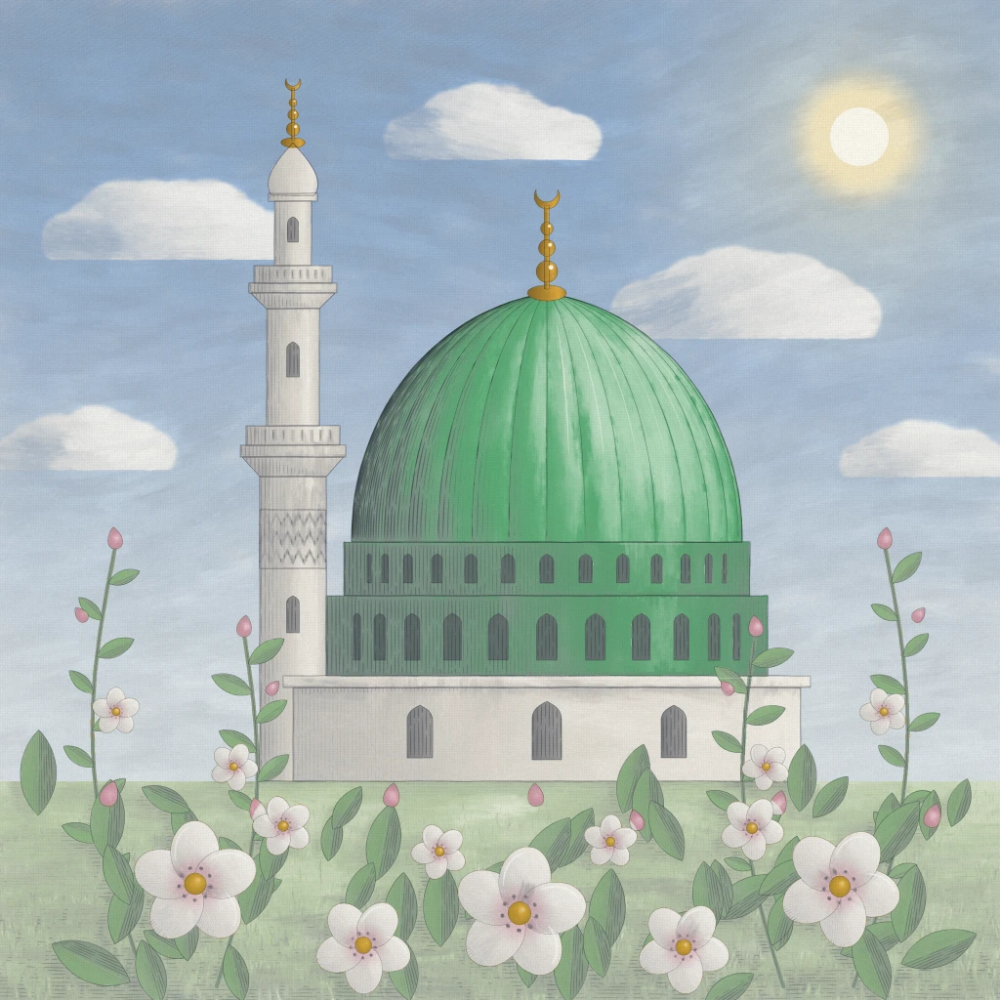

Hayalî bir klasik ressamın eli. Destek: açık beyaz astarlı ince keten tuval. Ressam önce bütün resmi serin, açık bir griyle modeller ve resmi bu gri taşır: önce iri, biçimi izleyen fırça vuruşları (gökte ufka koşut, yer yer kıvrılan geniş süpürmeler; kubbede meridyen boyunca, taşta dikey), sonra aynı yönde daha küçük vuruşlarla inceltme; çimende yumuşak tümsekler ve kısa ot vuruşları; yarı tonlarda ve gölgelerde biçimi izleyen, uçları incelen ince gri taramalar (gökte eğik, çimende yatay ve dalgalı); sonra bütün biçimleri ince koyu gri bir çizgiyle kesinleştirir. Kuruyunca saydam renk sırlarını geniş, yumuşak bir fırçayla sürer: gökte gri fırça izlerini örtmeyen ince, serin bir mavi (ufka doğru açılarak, güneş çevresinde altın sarısı), kubbe ve kasnakta daha dolgun bir yeşil, alemlerde altın sarısı, yapraklarda gri-yeşil, çimende çok ince bir yeşil, beyaz çiçeklerde yalnız göbeğe doğru ince bir gül sırrı, tomurcuklarda gül, taşta yalnızca çok hafif sıcak bir ton. Sır kalınlığı fırçaya göre değişir, ışıklardan silinir ve koyu grinin üstünde incelir; böylece gölgeler gümüşi gri kalır, renk ışıklı yarıda parlar, pencereler saf grisaille görünür. En son kubbe dilimlerine, minarenin ve çiçeklerin ışıklı kenarlarına ince kurşun beyazı vuruşlar konur.

- **Köken:** Avrupa resmindeki grisaille altboyama ve onun üstüne saydam renk sırları (velatura, glacis) sürme usulüne dayanır; Flaman ve İtalyan atölyelerinin 'ölü renk' ile başlayıp sırla bitirme pratiği ve gravür benzeri tarama modelajı ile birleşir. Belirli bir ressam taklit edilmez; tarif bu tekniklerden kurulmuş hayalî bir ressamın elidir.
- **Ayırt edici:** Resmi taşıyan gri modelaj: gökte ufka koşut, yer yer kıvrılan iri gri fırça süpürmeleri ince mavi sırrın içinden küçük boyda bile seçiliyor; kubbede meridyen yönünde, taşta ve kasnakta dikey, çimende yatay ince gri taramalar; Saydam yeşil sırlı kubbe ve kasnak: gölgedeki yanda sır incelip gri-yeşil kalıyor, ışıklı yanda parlak açık yeşil ve ince kurşun beyazı ışık çizgileri; pencereler saf gri; İnci grisi modelajın üstüne ince, serin mavi sırlı gök; tepeleri beyaz, alt yüzleri gri gölgeli kabarık bulutlar; güneş çevresinde altın sarısı sır; Beyaz çiçekler: gri modelajla biçimlenmiş taç yaprakları, göbeğe doğru ince gül sırrı, göbekten dışa gri taramalar ve ışıklı kenarda beyaz vuruş; gül sırlı tomurcuklar; Bütün biçimleri kesinleştiren ince, hafif titrek koyu gri kontur ve sırrın kenarının çizgiden azıcık kayması; Gri ot vuruşları ve tümseklerle modellenmiş, ince gri-yeşil sırrın içinden seçilen çimen; genel gümüşi tonda yeşil kubbe ve altın alemler renk vurgusu; keten tuvalin düz dokuması
- **Palet:** `#E0DCD4` `#4A4F5A` `#8DA4BE` `#C9D2D9` `#A3CEAE` `#678576` `#B3C2A4` `#CDA23E`
- **Kodla çizim:** Canvas, 2048 iç çözünürlük. Önce gri bir değer tasarımı çizilir (degrade gök ve bulutlar, silindir degradeli taş, kubbe her dilimi dışbükey sayılarak piksel piksel Lambert ışığıyla; çimende radyal tümsek lekeleri ve yaklaşık 5 200 kısa gri ot vuruşu); bulut ve güneş maskeleri ayrıca tutulur. Grisaille kıllı fırça vuruşlarıyla (11 kıl, uçları incelen, bölgeye kırpılmış, biçim yönünde; gökte ufka koşut ve gürültüyle kıvrılan) dört geçişte, yaklaşık 48 700 kez boyanır: önce 1 500 iri vuruş (1024 ölçeğinde 60–95 px boy, gökte ve çimende ±0,1 ton sapmayla, küçük boyda da seçilen fırça yapısı), sonra iki geçiş o anki boyayı biçim yönünde çekerek inceltir, en son ince ayrıntı vuruşları; tasarımdan sapma sınırlanır; serin gri ile astar beyazı arasında tona çevrilir. Örtmeli kontur katmanında değere göre koyulaşan, 22–52 px parçalara bölünmüş ve her parçası yalnız gölgenin bulunduğu kesimde (gölge derecesine göre ayrı tonla) çekilen taramalar (gökte eğik, çimende yatay dalgalı, kubbe meridyenleri, dikey taş ve kasnak, yaprak ekseni, taç yapraklarda ışınsal) ve titrek koyu gri konturlar çizilir. Sırlar piksel piksel çarpımla bindirilir: bölge rengi × fırça kalınlığı haritası (5 200 geniş, yumuşak vuruş) × ışıkta silme × gri değere bağlı incelme (koyu gride sır az seçilir); sır kenarı gürültüyle 1 px kaydırılır. En son kurşun beyazı şerit vuruşlar ve kosinüs dokumalı keten dokusu.
- **Kaynak:** [`S-200-grisaille-ve-renk-siri/ornek.html`](stiller/S-200-grisaille-ve-renk-siri/ornek.html)

### S-201

**Veduta Yağlıboya** · *Veduta Oil* · ✦ atölye üslubu

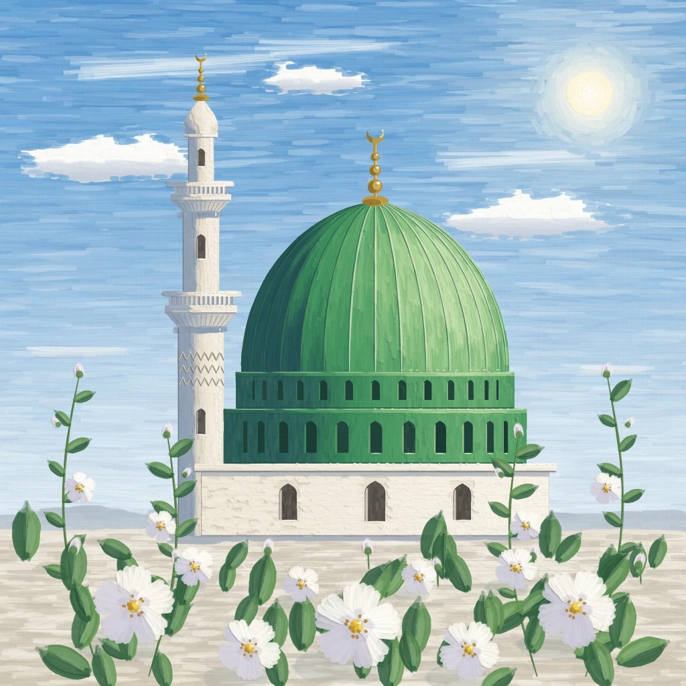

Hayalî bir veduta (şehir ve yapı manzarası) ressamının eli. Zemini açık sıcak gri astarlı ince tuval; aletleri uzun kıllı bir kontur fırçası, küçük düz kıl fırçalar ve yalnız ana dikeyler ile kornişler için bir cetvel. Paleti berrak öğle ışığıdır: tepede serülyen, ufka doğru sütlü açık mavi; krem kurşun beyazı taş, serin mavi-gri gölge, verdigris yeşili kubbe ve altın okr. Göğü uzun yatay darbelerle, ufka doğru açarak sürer; kabarık bulut koymaz, yalnız birkaç uzun, ince, yüksek sirrus izini yüklü kurşun beyazıyla, uçlarını tüylendirerek çeker; ufka yakın iki ince beyaz şerit bırakır; sağ üstte kalın kurşun beyazı tuşlarla dolu soluk sarı-beyaz bir güneş diski ve çevresinde gök rengine karışan teğet darbeler boyar. Mimariyi önce kesin çizer; ışıkta kalan taş yüzlerini (minarenin sağ yarısı, kaidenin ön yüzü) tuvalden kabaran iri, sıcak krem kurşun beyazı tuşlarla, gölge yanlarını astarın sıcak grisini seçtiren ince ama açıkça serin mavi-gri boyayla kurar. Kubbeyi meridyen boyunca darbelerle modeller, kaburgaları yüklü kontur fırçasıyla, eni hafifçe değişen çizgilerle çeker; şerefelerin ve kornişin altına kısa öğle gölgeleri düşürür. Avluyu açık sıcak gri taş döşeme olarak boyar; derzleri yakına doğru açılan sıralar ve kaçış noktasına koşan, açıkça seçilen çizgiler olarak kontur fırçasıyla çeker. İmzası, korkuluk kenarları, pencere eşikleri, kornişler, kasnak pervazları ve alem küreleri gibi her ışık kenarına sık sık bıraktığı 3–6 piksellik parlak, kabarık ışık tuşlarıdır. Çiçekleri yuvarlak uçlu küçük yüklü tuşlarla, gölgedeki taç yaprakları serin gri-morla, göbekleri sarı tuş kümeleriyle bitirir.

- **Köken:** 18. yüzyıl İtalyan veduta resminin ve topografik mimari manzara geleneğinin tekniklerine dayanır: açık ya da gri astar, cetvelle kurulan mimari çizim, ışıkta kalın kurşun beyazı, gölgede ince boya ve ışık kenarlarında küçük parlak tuşlar. Gerçek bir ressamı taklit etmez; atölyenin tanımladığı hayalî bir ressamın elidir.
- **Ayırt edici:** Uzun yatay darbelerle sürülmüş, tepede serülyen, ufka doğru sütlü açık maviye dönen gök; birkaç uzun, ince, uçları tüylenen sirrus izi, kabarık bulut yok; Sağ üstte kalın kurşun beyazı tuşlarla dolu, çevresinde teğet darbeler dönen soluk sarı-beyaz güneş diski; Işık yüzlerinde (minarenin sağ yarısı, kaidenin ön yüzü) tuvalden kabaran iri, sıcak krem kurşun beyazı tuşlar; gölge yanlarında açıkça serin mavi-gri; Korniş, korkuluk, kasnak pervazı, pencere eşiği ve alem kürelerinde sık dizilmiş, parlak, kabarık ışık tuşları; Cetvelle çekilmiş minare dikeyleri ve kornişler; yüklü kontur fırçasıyla çekilmiş, eni değişen kubbe kaburgaları; Derzleri kaçış noktasına koşan açık taş avlu; yuvarlak uçlu tuşlarla boyanmış beyaz çiçekler: gri-mor gölgeli taç yapraklar ve sarı göbekler
- **Palet:** `#7DAFD8` `#CBDBE8` `#F0EBE0` `#8F9EB0` `#5F9565` `#35644F` `#C5972C` `#D6CFBA`
- **Kodla çizim:** Canvas, 2048 iç çözünürlük. Ortak sahne geometrisi (kubbe profili, kasnak pencereleri, minare parçaları, kaide, bitki yerleri) hafifçe dalgalandırılmış, elle çizilmiş yollara çevrilir ve kırpma için kullanılır. Her alan kendi yön alanına göre (gökte yatay, kubbede meridyen akışı, taşta dikey ve yatay) titreşimli ızgaraya konan fırça darbeleriyle doldurulur; her darbe gövde poligonu, kıl çizgileri, tüylenen kuru uç ve boya birikintisinden oluşur. Renk bölgenin ışık modelinden (kubbede dönel yüzey normali, kasnak ve minarede silindir) ve ressamın paletinden gelir; gölge darbeleri düşük örtücülükle astarı seçtirir. Sirrus izleri, düşük örtücülüklü geniş bir sır darbesi üstüne sivri uçlu, düşük boya yüklü (tüylenen) uzun beyaz darbelerdir. Minarenin ışık yüzüne ve kaidenin ön yüzüne yuvarlak uçlu, kabartmalı kurşun beyazı tuşlar ayrıca konur. Güneş diski teğet yönlü kalın tuşlardan, ışıltısı gök rengine karışan teğet darbelerden oluşur. Darbeler aynı anda bir kalınlık haritasına çizilir; sonunda sağ üstten aydınlatılarak boya kabartısı verilir, ince ve düzensiz tuval dokusu yalnız ince boyalı yerlerde seçilir. Işık tuşları küçük düzensiz poligonlar, cetvel çizgileri titremesi az kontur fırçasıyla çizilir.
- **Kaynak:** [`S-201-veduta-yagliboya/ornek.html`](stiller/S-201-veduta-yagliboya/ornek.html)

### S-202

**Beyaz Astarda Mücevher Renkler** · *Jewel Colours on a White Ground* · ✦ atölye üslubu

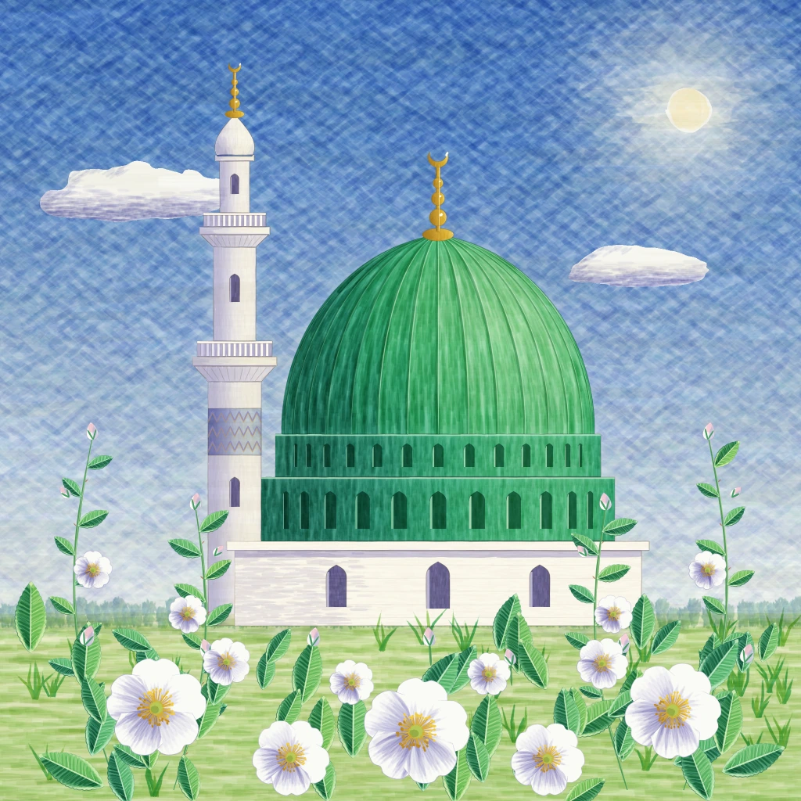

Hayalî, titiz bir ressamın eli; küçük çalışır, taze sürülmüş parlak beyaz astarın üstüne saf mücevher renkleriyle. Taşıyıcısı düz bir pano, aletleri küçük samur fırçalardır; boyayı ince, saydam sırlar hâlinde sürer, böylece beyaz astar her rengin altından parlar. Önce mimariyi ince sepya samur çizgileriyle çizer; taşı sıcak, çok açık bir sırla, gölgeyi leylak-mavi sırla, kubbeyi dilimler boyunca, üst üste bindikçe koyulaşan saydam darbelerle, katman katman parlak zümrüt-viridyen sırlarla boyar; kaburgaların yanına ince koyu sır, üstlerine astarın parladığı ince ışık çizgisi koyar. Göğü az sayıda geniş, saydam, çoğu yatay sır darbesiyle iki kat sürer, üstüne tek bir açıda seyrek, hafif bir geçiş ekler; darbelerin arasından beyaz astar parlar, bindikleri yerler bir ton koyulaşır: tepede açık, berrak kobalt, ufka doğru beyaza yakın. Güneş diskini ve iki küçük bulutu beyaz astarda keskin kenarla boş bırakır; diske soluk sarı ince bir sır sürer, çevresinde sır darbelerini teğet döndürür; bulutların altına leylak-mavi sır çeker. Ön planda her yaprağı doğadan inceler: tırtıklı kenar, açık orta damar, yan damarlar, ışık ve gölge yarısı; çayırı tek tek çekilmiş ot tutamları, ufku küçük yuvarlak ağaç tepeleri tamamlar. Çiçekleri beyaz yabani güller olarak boyar: çentikli, geniş taç yaprakları beyaz astarda bırakır, dibe ve gölge yanına damar yönünde leylak-mavi sır çeker, altın sarısı erkek organları teker teker çizer.

- **Köken:** 19. yüzyıl ortasında doğaya sadakati ilke edinen İngiliz ressamların (Pre-Raphaelite kardeşliği) tekniklerine dayanır: taze beyaz astar üstüne saf, parlak renkler, ince samur fırça, saydam sırlar ve ön planda botanik kesinlik. Gerçek bir ressamı taklit etmez; atölyenin tanımladığı hayalî bir ressamın elidir.
- **Ayırt edici:** Aralarından beyaz astarın parladığı geniş, saydam, çoğu yatay sır darbeleriyle boyanmış açık kobalt gök; güneşin çevresinde teğet dönen darbeler; Dilimler boyunca üst üste binen saydam darbelerle, beyaz astarın içinden parlayan zümrüt-viridyen kubbe sırları; İnce sepya samur çizgileriyle çizilmiş mimari; leylak-mavi gölge sırları ve mor-mavi pencereler; Tırtıklı kenarlı, orta ve yan damarlı, ışık-gölge yarılı, tek tek incelenmiş zümrüt yapraklar ve ot tutamları; Çentikli geniş taç yapraklı beyaz yabani güller; leylak-mavi gölge ve teker teker çizilmiş altın sarısı erkek organlar; Beyaz astarda keskin kenarla boş bırakılmış soluk sarı güneş diski ve iki küçük bulut; bulutların altında leylak-mavi sır, ufukta küçük yuvarlak ağaç tepeleri
- **Palet:** `#658CC0` `#9BB2CB` `#E8E1D4` `#44A16E` `#207254` `#B8B3CD` `#D7B456` `#D1DBAF`
- **Kodla çizim:** Canvas, 2048 iç çözünürlük. Sırlar ayrı bir katmana normal karışımla (her darbe gövde ve kıl çizgileriyle) boyanır, sonra katman tek seferde çarpma (multiply) ile beyaz astarın üstüne bindirilir; böylece üst üste binen sırlar saydam kalır ve beyaz astar alttan parlar. Bazı katlarda (kubbe ve kasnak darbeleri, yaprak, taç yaprak ve çayır darbeleri) darbeler katmanın içinde de çarpma ile birikir: üst üste binen yerler koyulaşır ve darbe kenarları seçilir. Hedef renge iki üç sırla varılsın diye her katın rengi hedef rengin kökü alınarak hesaplanır. Gök üç sır katıdır: iki kat geniş (9–14 piksel), 50–150 piksel boylu, çoğu yatay darbe (güneşin 80 pikselinde teğet dönen ve kısalan) ve tek açıda (yaklaşık 29°) seyrek bir hafif kat; her kat kendi içinde yığılmaz, katlar birbirine çarpılır; mimari siluet çift-tek kuralıyla kırpılarak gökten ayrılır. Mimari ince samur çizgileri değişken enli, titrek bir kontur işleviyle çizilir; kubbe darbeleri meridyen akış alanını izler, renk dönel yüzey normalinden gelir. Yapraklar tırtıklı kenar yoluyla kırpılıp yan damar yönünde sır darbeleriyle, güller çentikli taç yaprak yollarıyla kurulur; erkek organlar tek tek çizgi ve tuşlarla çizilir. Bulutlar ve güneş, gürültüyle biçimlenen bir piksel maskesiyle gök katmanlarından silinerek beyaz astarda boş bırakılır; bulut gölgesi ve güneşin soluk sarısı yalnız maskenin içine sürülür.
- **Kaynak:** [`S-202-beyaz-astarda-mucevher-renkler/ornek.html`](stiller/S-202-beyaz-astarda-mucevher-renkler/ornek.html)

### S-203

**Ham Keten Üzerine İnce Yağlıboya** · *Thin Oil on Raw Linen* · ✦ atölye üslubu

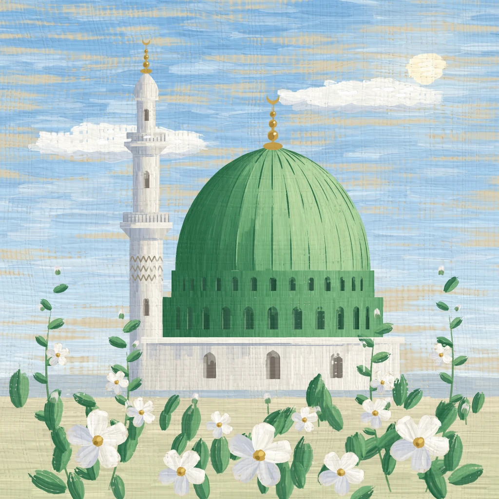

Hayalî bir ressamın eli; boyayı ince ve kuru sürer. Taşıyıcısı iri, ince ve açık astarlı keten bezdir: iplik aralığı yaklaşık 5 piksel, her iplik kendi eninde, kalınlığında ve tonunda, iplikler boyunca uzun ve kısa düğümler var; doku düzgün bir ızgara değildir, boyanın bastırıldığı yerlerde biraz dolar, astar onu hiçbir yerde kapatmaz. Aletleri sert kıl düz fırçalardır; boyayı fırçada az tutup bezin üstünde ovalar, renk ipliklerin tepelerine takılır, aralarda açık keten seçilir. Her yüzeyi katlarla boyar: önce geniş, kuru darbelerle ince bir alt kat, sonra üstüne komşusundan açık ya da koyu, hafif yeşile ya da mora kayan, tek tek seçilen darbeler. Darbeler biçimi izler: gökte yatay (önce çok ince, soluk bir serülyen yalnız iplik tepelerine; sonra yukarıda serülyen, ufka doğru açılan mavi ve beyaz darbeler; ufka yakın kuru beyaz ovalama; darbe aralarında keten dokusu ve yer yer küçük sıcak keten kıymıkları kalır, gök yine açıkça mavidir), kubbede dilim dilim (her dilime tabandan tepeye iki üç darbe; ışık yanında kuru açık sarı-yeşil, gölge yanında ince koyu yeşil ovalama), kasnak, kaide ve minarede düz uçlu dikey darbeler (sıcak ve serin beyazlar; kaidenin gölgedeki sol ucunda serin gri, ışıktaki sağında sıcak beyaz), yerde yatay (uzakta ince ve kısa, önde geniş ve uzun; krem, kum okru ve adaçayı yeşili, seyrek koyu adaçayı ve okr vurgular). Güneşi sağ üstte kısa dairesel darbelerle, kenarı soluk sarı, ortası beyaz, tam daire olmayan bir disk olarak boyar; çevresine kuru, beyazımsı kısa ovalamalar koyar (bulanıklık yok). İki bulutu birbirine benzetmez: solda kısa ve kabarık, sağda uzun ve yassı; her birini üst üste binen kütlelerden kuru fırçayla ovalar, tepelerine eğriyi izleyen kalın beyaz sürüşler, alt yüzlerine serin gri-mavi sürüşler koyar. Kaburgaları aynı sert fırçayla, eni değişen, uçları incelen, aralarında küçük kuru boşluklar kalan parça parça koyu yeşil darbelerle çeker. Çiçeklerin yerini ham ketene ayırır; her taç yaprağını merkezden dışa iki üç kuru beyaz darbeyle kurar, dibine kısa serin gri bir gölge darbesi koyar, gölgedeki taç yapraklarını serin gri-beyaz tutar, ışık kenarına keskin, kalın bir beyaz tuş koyar; göbeği koyu okr bir tuşun üstüne küçük sarı okr tuş kümesiyle bitirir. Yaprakları dipte dar, üçte birde en geniş, ucu sivri ve hafif kıvrık çizer: ışık yanındaki yarısını açık, gölge yanındakini koyu yeşil iki kuru darbeyle doldurur, ortaya ince açık bir damar çeker. Kalın, dokuyu örten vurgular yalnız en parlak ışıklardadır (kubbenin ışık yüzü, minarenin ve kaidenin güneşli kenarı, taç yapraklarının ışık kenarı, bulut tepeleri, güneşin ortası, alem küreleri).

- **Köken:** Ham ya da ince astarlı keten bezde kuru fırçayla ovalama (scumbling) ve ince yağlıboya geleneğine dayanır: dokuyu resmin parçası olarak kullanan kuru fırça tekniği ve ışıkta kalın, gölgede ince boya ilkesi. Gerçek bir ressamı taklit etmez; atölyenin tanımladığı hayalî bir ressamın elidir.
- **Ayırt edici:** Her yerde boyanın içinden seçilen iri, düzensiz, düğümlü keten dokusu; iplikler kalınlı incelili, kendi tonlarında, görünürlüğü yer yer değişen; Gökte yatay, kuru uçlu, komşusundan açık ya da koyu serülyen ve beyaz darbeler; aralarda keten dokusu ve yer yer küçük sıcak keten kıymıkları; Dilim dilim boyanmış kubbe: her dilimde tabandan tepeye uzanan, tonları ayrışan darbeler ve ışık yanında kuru açık yeşil ovalama; sert fırçayla çekilmiş, parça parça kesilen koyu yeşil kaburgalar; Kaidede ve kasnakta seçik, düz uçlu dikey darbeler; yerde krem, kum okru ve adaçayı yeşili geniş yatay darbeler; Biri kısa ve kabarık, öteki uzun ve yassı iki ovalanmış bulut (tepeleri kalın beyaz, altları serin gri-mavi) ve dairesel darbelerle boyanmış soluk sarı-beyaz güneş; Taç yaprakları kuru beyaz darbeler ve dipte serin gri gölgeyle kurulmuş çiçekler; dipte dar, ucu sivri, bir yarısı açık bir yarısı koyu yeşil yapraklar
- **Palet:** `#84B4D9` `#AECAD8` `#F4F2E9` `#E2DDCF` `#6EA876` `#33694A` `#BA9C50` `#D7D0AB`
- **Kodla çizim:** Canvas, 2048 iç çözünürlük. Önce keten yükseklik haritası üretilir: atkı ve çözgü iplikleri tek tek rastgele en, kalınlık, yükseklik ve tonla dizilir (yer yer kalın ya da ince iplikler), iplik boyunca iki ölçekte gürültüyle kalınlaşan düğümler, düz dokuma (bir üstten bir alttan) ve iki ölçekte kıvrım; zemin bu haritadan ve iplik tonlarından açık keten rengiyle boyanır. Her boya geçişi ayrı bir katmana kuru fırça darbeleriyle (gövde, kıl çizgileri, kuru uç) çizilir, sonra her pikselde katmanın örtücülüğü dokunun yüksekliğiyle karşılaştırılarak bindirilir: ince boya yalnız iplik tepelerine tutar, çukurlarda keten kalır; eşik düşük frekanslı gürültüyle yer yer değişir. Gök dört katta boyanır: düşük basınçlı soluk bir ilk ovalama, geniş kuru alt kat, değeri ve tonu kaydırılmış seçik darbeler ve ufka doğru seyrek kuru beyaz; yer, kaide, kasnak ve minare alt kat, seçik darbeler ve seyrek ışık ya da gölge ovalamasıyla boyanır. Bulutlar birkaç elips kütlenin en büyüğünü alan, altı basık, gürültüyle bozulmuş bir alan fonksiyonundan çıkar; gövde, tepe ve alt yüz darbeleri bu alana ve kenarına göre yerleştirilir. Güneş, kenarı birkaç sinüsle dalgalanan bir yola kırpılmış dairesel darbelerdir. Kubbede ince bir meridyen alt katından sonra on altı dilimin her birine, kubbe profilinden alınan meridyen eğrileri boyunca iki üç parçalı darbeler çekilir; renkler dönel yüzey ışık modelinden gelir. Kaburgalar iki üç parçalı, eni değişen damla profilli darbelerdir. Her yaprak iki yarı yola (dipte dar, sivri uçlu, hafif kıvrık) bölünür; her yarı kendi rengindeki iki kuru darbeyle kırpılarak doldurulur, ortaya eni değişen ince bir damar çizilir. Çiçeklerin yeri boyamadan önce saklanan çıplak keten görüntüsüyle geri doldurulur, taç yaprakları buna kırpılmış kuru darbelerle ve dipte gölge darbesiyle ovalanır. Kalın vurgular doğrudan ve kalınlık haritasına çizilir (bulut vurguları mimarinin dışına kırpılır); sonunda doku ile boya kalınlığı birleştirilip, gücü düşük frekanslı gürültüyle değişen bir sağ üst ışıkla kabartılır.
- **Kaynak:** [`S-203-ham-keten-ince-yagliboya/ornek.html`](stiller/S-203-ham-keten-ince-yagliboya/ornek.html)

### S-204

**Yapıcı Fırça Vuruşu** · *Constructive Brushstroke* · ✦ atölye üslubu

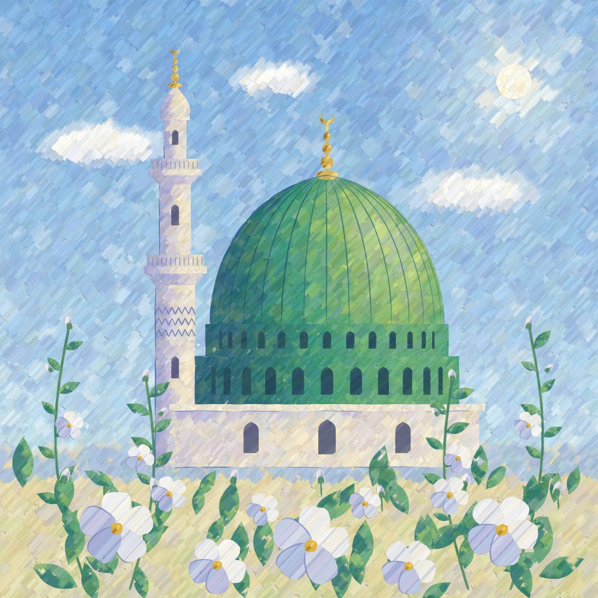

Hayalî bir ressamın eli; biçimi çizgiyle değil, renk düzlemleriyle kurar. Zemini beyaz astarlı tuval, tek aleti yaklaşık bir santim enli düz bir fırçadır. Her şeyi aynı köşegende (sol alttan sağ üste, yaklaşık 45°) yan yana konmuş 2–6 paralel vuruştan oluşan yamalarla örer; vuruşlar büyük düzlemlerde 30–46 piksel boyunda, uçları kare ve hafif kuru, her biri komşusundan biraz farklı tonda. Yamalar birbirine hafifçe biner ve tonu yamadan yamaya belirgin biçimde kayar: gökte yalnız açık ultramarin, serülyen, yeşilimsi mavi ve beyaz; kubbede viridyen, mavi-yeşil ve sarı-yeşil, gölgede maviye dönen; taşta krem, soluk mor, mavi ve okr; zeminde sıcak okr ve krem arasında soluk mor gölge yamaları. Önce ince ve geniş bir ilk katla zemini örter; yamaların arasında yer yer küçük beyaz tuval parçaları kalır. İki küçük bulutu gökten beyaza geçen, kenarda incelen yamalarla, güneşi köşegende yan yana konmuş birkaç kısa soluk sarı-beyaz vuruşla kurar; güneşin kenarı vuruş uçlarından oluşur, kusursuz bir daire değildir. Çiçeklerin her taç yaprağını aynı köşegende, boyları ve tonları farklı (beyaz, krem, soluk leylak, açık mavi) üç dört geniş vuruşla boyar; vuruş uçları yaprağın kenarına düzensizce varır ya da gerisinde kalır, sürekli bir kontur yoktur; ışıktan uzaklaştıkça yaprak mavi-mora döner ve gölge yanı yalnız bir iki kırık mavi parçayla belirtilir. Son olarak kubbe dış hattını, minare dikeylerini, korniş ve kasnak kenarlarını yer yer kırık, ince mavi bir çizgiyle yeniden belirtir.

- **Köken:** 19. yüzyıl sonunda geliştirilen yapıcı vuruş (constructive stroke) anlayışına dayanır: biçimi aynı yönde paralel vuruş gruplarıyla kurmak, rengi düzlemlerle modellemek, sıcak-soğuk ton kaydırmaları ve yer yer mavi kontur. Gerçek bir ressamı taklit etmez; atölyenin tanımladığı hayalî bir ressamın elidir.
- **Ayırt edici:** Bütün yüzeyde aynı köşegende yan yana konmuş paralel düz vuruşlardan oluşan dokuma yamalar; Yamadan yamaya belirgin kayan tonlar: gökte ultramarin, serülyen, yeşilimsi mavi ve beyaz; kubbede viridyen, mavi-yeşil ve sarı-yeşil; zeminde okr ve soluk mor; Çizgi yerine renk düzlemleriyle modellenmiş kubbe, kasnak ve taş; gölgede mavi-mora dönen krem taş; Yer yer kırık, ince mavi çizgiyle yeniden belirtilmiş kubbe ve minare kenarları; Kenarda incelen yamalarla kurulmuş iki küçük bulut, kısa soluk sarı-beyaz vuruşlardan düzensiz kenarlı güneş ve yamaların arasında kalan küçük açık tuval parçaları; Taç yaprak başına boyu ve tonu farklı üç dört geniş köşegen vuruşla boyanmış, kenarı vuruş uçlarından oluşan, mavi-mor gölgeli beyaz çiçekler
- **Palet:** `#88AED7` `#AAC9E2` `#66A17B` `#3D7873` `#9BB984` `#9AA2C9` `#D9D3AE` `#E9E6DD`
- **Kodla çizim:** Canvas, 2048 iç çözünürlük. Bölgeler (gök, zemin, minare parçaları, kaide, kasnak, kubbe, yapraklar) elle çizilmiş titrek yollarla kırpılır; önce ince ve geniş bir ilk kat sürülür. Sonra titreşimli ızgaradaki her noktaya bir yama konur: sabit köşegende (yaklaşık −47°) yan yana 2–6 paralel düz vuruş; her vuruş kendi boyu, eni, uç kayması ve tonuyla, gövde, kıl çizgileri ve kuru uçla çizilir. Yamanın taban rengi bölgenin ışık modelinden (kubbede dönel yüzey normali, kasnak ve minarede silindir), ton kayması bölgenin komşu renk listesinden rastgele seçilir. Vuruşlar kalınlık haritasına da çizilir; sonunda sağ üstten aydınlatılarak her vuruşun kenarı seçilir. Çiçeklerde her taç yaprağı, yapraktan %7 geniş ve kenarı titreyen bir yolla kırpılır; yaprağın köşegene dik genişliği üç dört şeride bölünür, her şeritte vuruş yaprağın o şeritteki uzanımı kadar, uçları rastgele kısa ya da uzun çekilir (alt ton yok); gölgeli yapraklarda bir iki kırık mavi kenar parçası. Güneş kırpılmamış sekiz kısa köşegen vuruştur. Mavi kenar çizgileri titrek yolların kırık parçaları olarak, değişken enle çizilir.
- **Kaynak:** [`S-204-yapici-firca-vurusu/ornek.html`](stiller/S-204-yapici-firca-vurusu/ornek.html)

### S-205

**Akdeniz Öğle Işığı** · *Mediterranean Noon Light* · ✦ atölye üslubu

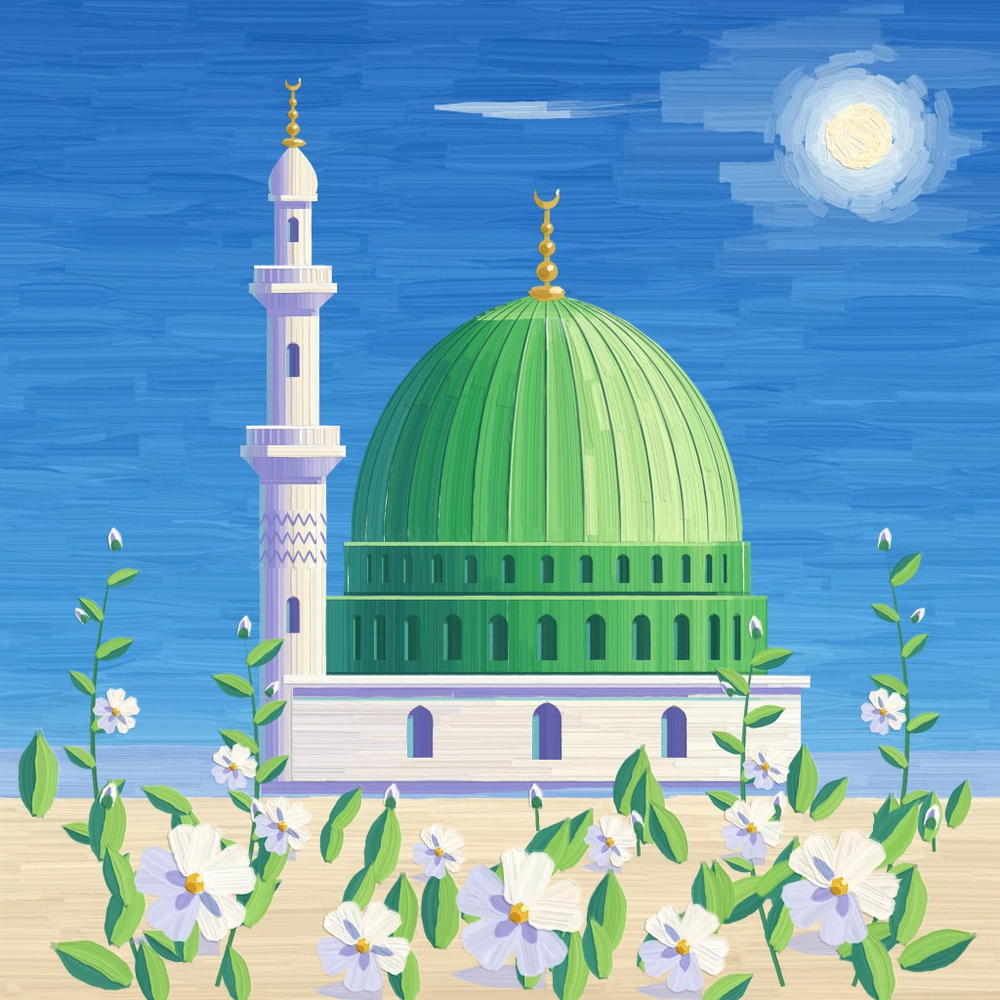

Hayalî, yüksek tonda çalışan bir öğle güneşi ressamının eli. Zemini beyaz tuval; aletleri sulu ve kalın boyayla yüklü büyük ve orta boy düz fırçalar, birkaç keskin vurgu için ince bir fırça. Her darbe tek başına bir düzlemi anlatır ve uzun, tek bir hareketle çekilir: gökte geniş yatay darbeler, tepede derin Akdeniz mavisi, ufka doğru açık serülyen, sağ üstte kalın, sıcak beyaz kısa darbelerle dönen soluk sarı-beyaz bir güneş diski, çevresinde gök rengine karışan teğet darbeler ve gökte yüksekte tek bir ince beyaz tül; minarede ve kasnakta tabandan tepeye dikey darbeler, kaidede uzun yatay darbeler, kubbede her dilim boyunca bir iki uzun yüklü darbe. Beyaz yapıyı güneşte kalın sıcak beyazla, gölgede kobalt-morla boyar; gölgenin uzak kenarına ve pencere sövelerine turkuaz yansıma koyar. Kubbe taze, parlak yeşildir; ışık yüzünde açık sarı-yeşil kalın darbeler taşır. Öğle gölgeleri kısa ve keskindir: şerefelerin ve kornişin altında, kaidenin dibinde kobalt-mor şeritler. Yaprakların her yarısını eksen boyunca bir iki yüklü düz fırça darbesiyle çeker: dolu, boya birikintili başlangıç, kuruyup incelen uç, dış kenar fırçanın kendi kenarı; güneşli yarı sarı-yeşil, gölge yarısı mavi-yeşil. Çiçekleri güneşli beyaz birkaç kalın darbeyle, gölge yanını açık mavi-mor ve kobalt-mor darbeyle, göbeği sarı kalın tuşla bitirir; hiçbir şeyi ovmaz ya da kaynaştırmaz, her darbe görünür kalır.

- **Köken:** 20. yüzyıl başındaki Akdeniz luminizmine ve açık hava (plein air) yağlıboyasına dayanır: beyaz tuvalde yüksek ton, büyük düz fırçayla yüklü tek darbeler, beyazın güneşte sıcak, gölgede mavi-mor, yansımada turkuaz görülmesi. Gerçek bir ressamı taklit etmez; atölyenin tanımladığı hayalî bir ressamın elidir.
- **Ayırt edici:** Geniş yatay yüklü darbelerle sürülmüş derin Akdeniz mavisi gök; kalın sıcak beyazla dönen güneş diski ve tek bir ince beyaz tül; Güneşte kalın sıcak beyaz, gölgede kobalt-mor beyaz yapı; gölge kenarlarında ve pencere sövelerinde turkuaz yansıma; Her dilim boyunca uzun, yüklü darbelerle boyanmış parlak taze yeşil kubbe; ışık yüzünde açık sarı-yeşil kalın darbeler; Tabandan tepeye tek darbelerle boyanmış minare ve kasnak; kaidede uzun yatay darbeler; Şerefe ve korniş altında, kaide dibinde kısa, keskin kobalt-mor öğle gölgeleri; Birkaç kalın darbeyle boyanmış güneşli beyaz çiçekler, açık mavi-mor gölge yanı ve sarı göbek; yarısı sarı-yeşil, yarısı mavi-yeşil, uçları kuru biten yüklü darbelerden yapraklar
- **Palet:** `#2A6EBE` `#418FD2` `#61A3D7` `#F4ECDB` `#8D8ACC` `#69B36F` `#318564` `#E7D9B7`
- **Kodla çizim:** Canvas, 2048 iç çözünürlük. Her darbe, merkez çizgisi boyunca gövde poligonu, kıl çizgileri, kare ya da tüylenen uç ve boya birikintisiyle çizilen yüklü bir düz fırçadır; aynı darbe kalınlık haritasına da çizilir ve sonunda sağ üstten aydınlatılarak kalın boyanın kabartısı ve yağ parıltısı verilir. Gök geniş yatay darbe katlarıdır; güneş diski teğet yönlü kalın darbelerden, ışıltısı gök rengine karışan teğet darbelerden oluşur; minare parçaları ve kasnak, silindir ışık modelinden renk alan, tabandan tepeye tek dikey darbelerle; kubbe her dilimin iki boylamı boyunca iki parçalı uzun darbelerle (renk dönel yüzey normalinden) boyanır. Beyazın gölge rampası kobalt-mora, uzak kontura yakın gölgeler turkuaza kaydırılır. Her yaprak yarısı eksen boyunca iki darbedir (geniş ana darbe ve dışta daha ince, bir ton farklı ikinci darbe; düşük boya yüküyle kuru, kıl kıl biten uç; kontur yok). Gölgeler, pencereler ve alemler ayrı darbe ve tuşlarla çizilir; ince ve düzensiz tuval dokusu yalnız ince boyalı yerlerde seçilir.
- **Kaynak:** [`S-205-akdeniz-ogle-isigi/ornek.html`](stiller/S-205-akdeniz-ogle-isigi/ornek.html)

### S-206

**Hollanda Şehir Manzarası** · *Dutch Townscape Oil* · ✦ atölye üslubu

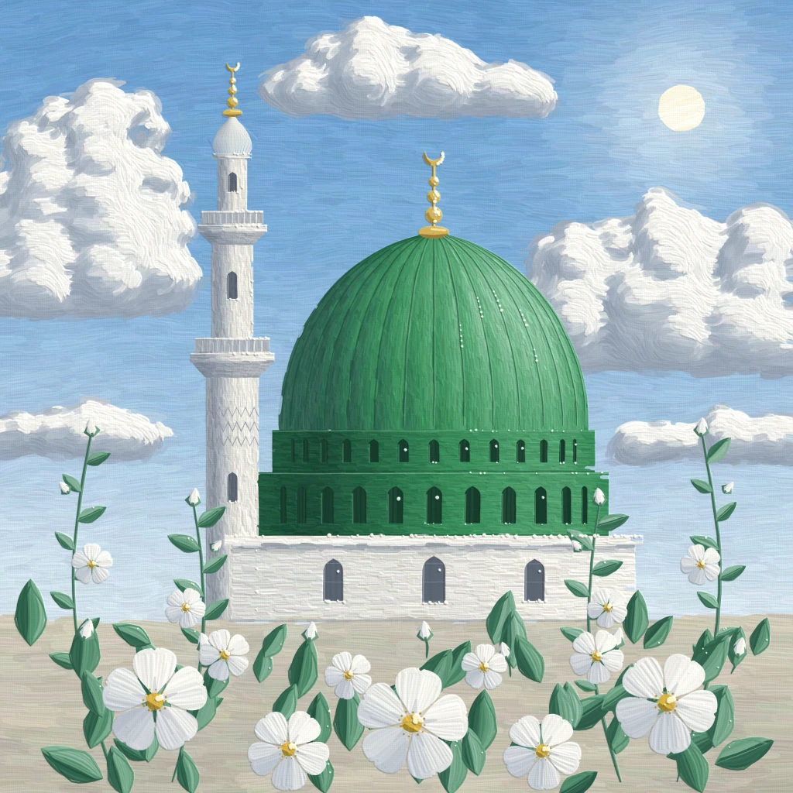

Sakin bir şehir manzarası ressamının eli. Zemini açık gri astarlı ince keten tuvaldir; aletleri orta boy yuvarlak ve yassı kıl fırçalar, ışık noktaları için ince bir samurdur. Paleti serin ve berraktır: azur ve serülyen gök, ufka doğru soluk mavi-beyaz, bulut beyazı, mavi-gri bulut gölgesi, serin taş beyazı ve mavi-gri gölgesi, berrak kubbe yeşili, mavimsi yaprak yeşili, açık altın okr. Göğü resmin yarısını taşıyan bir sahne gibi kurar: açık havayı kısa, hafif eğik darbelerle kaynaştırır; kümülüsleri yuvarlak kıvrımlarını izleyen, birbirine kaynaşan darbelerle değerle modeller: ışık alan tepeler beyaz (kalın boya yalnız en parlak tepelerde), karınlar yumuşak serin mavi-gri; gölge yanında kenarı göğe eritir, ışık yanında keskin keser. Güneşi birkaç kısa, kalın, soluk sarı-beyaz darbeyle koyar; kenarı darbe uçlarıyla düzensiz kalır ve çevredeki açık gök darbelerine kaynaşır. Mimariyi biçimi izleyen küçük darbelerle sakin ve sağlam boyar: minarede dikey, kaide ve kasnakta yatay, kubbede kaburga boyunca; kaburgaları, pencereleri ve korkulukları ince samurla keser, gölgeleri yumuşak ama keskin tutar. En son imzası olan ışık noktalarını (pointillé) koyar, ama yalnız ışığın gerçekten yakaladığı yerlere: altın alemlerin ve hilallerin ışıklı sağ yanına, minare topuzunun ışıklı omzuna, ışıklı yandaki pencere eşiklerine, korniş ve şerefe kenarında birkaç yere, yaprak uçlarına ve çiçek göbeklerine; her yerde iki beş lekecikten oluşan, farklı boyda, sıcak beyaz, opak ve kabarık düzensiz kümeler.

- **Köken:** 17. yüzyıl Hollanda şehir manzarası resminin (Delft ve Haarlem çevresi) serin gün ışığına, büyük gök kompozisyonuna ve ışığı kabarık küçük boya noktalarıyla gösteren pointillé alışkanlığına dayanır; gri astarlı tuval, kaynaştırılmış küçük darbeler ve bulutların ince boya üstüne kalın beyazla modellenmesi bu geleneğin atölye uygulamasıdır. Gerçek bir ressamı taklit etmez; atölyenin tanımladığı hayalî bir ressamın elidir.
- **Ayırt edici:** Resmin yarısını taşıyan yüksek gök: kıvrımları izleyen kaynaşık darbelerle değerle modellenmiş büyük beyaz kümülüsler, en parlak tepelerde kalın beyaz, karınlarda yumuşak serin mavi-gri; Yalnız ışığın yakaladığı yerlerde düzensiz ışık kümeleri: alemlerin ve hilallerin ışıklı yanında, ışıklı pencere eşiklerinde, korniş ve şerefe kenarında, yaprak uçlarında ve çiçek göbeklerinde iki beş kabarık sıcak beyaz lekecik; Kaynaştırılmış küçük darbeler: minarede dikey, kaide ve kasnakta yatay, kubbede kaburga boyunca; Serin kuzey ışığı: mavi-gri taş gölgeleri, berrak yeşil kubbe, mavimsi yeşil yapraklar; Gölge yanında göğe eriyen, ışık yanında keskin kesilmiş bulut kenarları; kısa, kalın darbelerden, kenarı düzensiz soluk güneş; İnce boyanın altından seçilen gri astarlı keten dokusu; pencere içlerinde serin koyu darbeler
- **Palet:** `#70A3D2` `#C0D6E8` `#F6F6F1` `#9EAABA` `#4A9968` `#306351` `#D3B45E` `#70A085`
- **Kodla çizim:** Canvas, 2048 iç çözünürlük. Önce bir alt boya (model) kurulur: gök piksel başına dikey geçiş ve güneşin çevresinde serin açılma; bulutlar küre yığını bir yükseklik alanından (düz tabanlı, gürültüyle bükülen kenarlı) çıkarılıp yüzey normaliyle sağ üstten aydınlatılır, gölge yanında kenar yumuşatılır; minare ve kasnak silindir ışığıyla, kubbe 16 dilimli dönel yüzey normaliyle renklenir. Sonra resim titreşimli ızgaralardan başlayan darbelerle yeniden boyanır: gökte iki katman (14–21 ve 9–14 piksel enli, uzun ve kaynaşık, kabartısı düşük), darbe yönü bulut yükseklik alanının izohips teğetiyle yatay yönün karışımı; bulut tepelerinde kalın beyaz, gölgelerde mavi-gri ek darbeler. Mimari parça parça kırpılarak dikey, yatay ve meridyen yönlü 3,5–8 piksel enli darbelerle boyanır; kaburgalar, pencereler, korkuluklar, zikzak bant ve alemler ince fırça darbeleriyle elle işlenir. Yapraklar eksenleri boyunca boyanır ve kenarları iki ince, sivrilen darbeyle kapatılır; taç yaprakları merkezden dışa darbelerle, kapalı tomurcuklar ışıklı ve gölgeli darbelerle ve iki yeşil çanak yaprakla boyanır. Pointillé, yalnız seçilmiş ışık yerlerine konan 2–5 lekecikli kümelerdir; her lekecik 2–5 piksellik düzensiz bir yedigen, yükseklik tuvalinde kabarık. Güneş el titremeli bir disk, üstünde dört yuvarlak uçlu yatay darbe ve kenarına binen yedi kısa açık gök darbesi. Bulut bölgelerinde yükseklik tuvali griyle örtülerek kabartı yaklaşık üçte bire indirilir (en parlak tepelerde daha az). Her darbe kıl izleriyle birlikte ayrı bir yükseklik tuvaline de çizilir; yükseklik sağ üstten aydınlatılır, düzensiz keten bezi dokusu eklenir ve düşük frekanslı yer değiştirmeyle el titremesi verilir.
- **Kaynak:** [`S-206-hollanda-sehir-manzarasi/ornek.html`](stiller/S-206-hollanda-sehir-manzarasi/ornek.html)

### S-207

**Leke Ressamı (Macchia)** · *Macchia Painter* · ✦ atölye üslubu

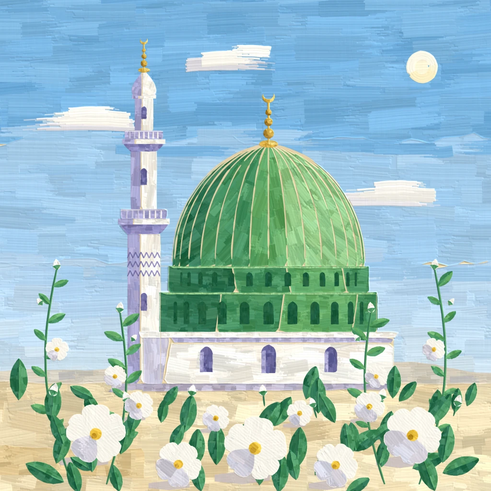

Güneşi düz lekelerle gören bir ressamın eli. Zemini açık okr astarlı küçük ahşap panodur; aletleri dolu yassı kıl fırçalardır, boyası kalın ve yağlıdır. Paleti sade ve aydınlıktır: serülyen, açık ve soluk mavi gök, güneşli beyaz, serin leylak gölge, gölge, orta ve güneşli yeşil, kum okru, altın sarısı. Her biçimi iki üç düz renk lekesine indirger: minareyi ve kaideyi güneşli beyaz ve leylak gölge lekeleri olarak, kubbeyi dilimleri izleyen gölge, orta ve güneşli yeşil lekeleri ve sağ üstte eğik kesilmiş tek bir ışık lekesiyle, kasnağı dört dikey yeşil lekeyle kurar; gölge lekesindeki pencereler gölgeye karışır, ışıktakiler koyu ve keskindir, her biri elle biraz farklı boydadır. Her lekeyi lekenin yönünde (gökte ve duvarda yatay, kubbede dilim boyunca, minarede dikey) sürülmüş, alanı iki üç kat örten kalın darbelerle doldurur: darbe eğik tutulmuş fırçanın kare kenarıyla, başta küçük bir boya yığınıyla dolu başlar, kıl demetleri bir iki ton farklı boya taşır, bazı kıllar komşu ıslak rengi sürükler; uçta komşu kıllar demet demet aynı yerde kopar, darbe kesik kesik kuruyarak biter. Darbeden darbeye ton ve sıcak-soğuk kayması belirgindir. Boya kalındır: darbenin başı kalın, ucu incedir, iki kenarında kırık boya sırtları, gövdesinde kıl olukları vardır; sağ üstten gelen ışık bu kabartıyı tutar. Gökte üç düz bant boyar: yukarıda serülyen, ortada açık mavi, ufka doğru soluk mavi; darbeler ufka doğru incelir, ufukta soluk gri-okr alçak tepelerden ince bir şerit vardır. Bulutları düz tabanlı, yuvarlak uçlu düz lekeler olarak atar: güneşli beyaz gövdenin alt üçte birini tek, hafif eğik bir sınırla kesilmiş leylak-gri gölge lekesi örter; güneşi kenarı fırçayla kesilmiş tek, soluk sarı-beyaz bir leke olarak koyar. Kubbe kaburgalarını yassı fırçanın kenarıyla aşağıdan yukarı incelen, yer yer kesilen çizgilerle, minaredeki zikzakları her kolu ayrı, köşede bir öncekinin üstüne taşan kısa darbelerle çeker. Her yaprağı biri gölgede biri ışıkta, dipte bastırılıp uçta sivrilen iki dolu darbeyle, büyük yapraklarda ışık yarısına üçüncü, daha açık kısa bir darbe ekleyerek; her taç yaprağını uçtan göbeğe çekilmiş iki üç darbeyle boyar. Çiçeğin ışıktan uzak yarısını düz bir sınırla kesilmiş tek leylak gölge lekesi örter, ortadaki sarı noktanın sol altı da aynı biçimde okr gölgeyle kesilir; kumda her çiçeğin altına yassı bir leylak gölge lekesi düşer.

- **Köken:** 19. yüzyıl ortasında Floransa'da açık havada çalışan leke (macchia) ressamlarının güçlü güneşi düz, keskin kenarlı ışık ve gölge lekeleriyle görme tavrına ve küçük ahşap pano üstüne açık astarla yaptıkları etütlere dayanır; renkli (leylak-mavi) gölge, biçimi birkaç lekeye indirgeme ve dolu fırçanın kalın, kabartılı darbesi bu geleneğin alışkanlıklarıdır. Gerçek bir ressamı taklit etmez; atölyenin tanımladığı hayalî bir ressamın elidir.
- **Ayırt edici:** Her biçim iki üç düz lekeye indirgenmiş: minare ve kaide güneşli beyaz ve leylak gölge; kubbe dilimleri izleyen gölge, orta ve güneşli yeşil lekeler ve sağ üstte eğik kesilmiş tek bir açık yeşil ışık lekesi; kasnakta gölge lekesine karışan, ışıkta keskinleşen pencereler; Lekelerin içinde lekenin yönünde sürülmüş kalın, dolu yassı fırça darbeleri: kare ve eğik, boya yığınlı başlangıç, demet demet aynı yerde kopup kuruyan uç, darbeden darbeye belirgin ton ve sıcak-soğuk kayması; Küçük görselde bile seçilen kalın boya kabartısı: kıl olukları, kırık kenar sırtları ve sağ üstten ışık alan, başta kabarıp uca doğru incelen darbe gövdeleri; Serülyenden soluk maviye üç düz gök bandı, darbeler ufka doğru incelir; ufukta soluk gri-okr alçak tepelerden ince bir şerit; Düz tabanlı, yuvarlak uçlu bulut lekeleri: güneşli beyaz gövde ve tek bir eğik sınırla kesilmiş leylak-gri taban gölgesi; kenarı fırçayla kesilmiş, soluk sarı-beyaz düz güneş lekesi; Uçta sivrilen iki dolu darbeden yapraklar (biri gölgede biri ışıkta, büyüklerinde üçüncü açık bir darbe); uçtan göbeğe darbelerle boyanmış beyaz çiçekler: düz bir sınırla kesilmiş tek leylak gölge lekesi, yarısı okr gölgeli sarı nokta, kumda yassı leylak gölgeler
- **Palet:** `#6EAEDF` `#CDE4F1` `#F7F4EA` `#AAAAD3` `#64B56C` `#307259` `#E8DAB5` `#DCB343`
- **Kodla çizim:** Canvas, 2048 iç çözünürlük; ayrıca bir yükseklik (boya kalınlığı) tuvali. Pano açık okr ile kapanır; gök bantlarının altına düz, mavi-gri bir alt kat sürülür. Temel öğe 'darbe' işlevidir: orta çizgi boyunca eğik başlangıç kenarlı bir gövde düz renkle doldurulur, üstüne yaklaşık 3,4 piksel aralıklı kıl şeritleri çizilir; komşu şeritler benzer ton taşır (kıl demetleri), bir kısmı karışım rengine çekilir; kuru uçta 3–5 kıllık demetler aynı noktalarda kopar, yuvarlak uçlu dolgun parçalara bölünür. İsteğe bağlı bir en profili yaprak darbelerini dipte ve uçta sivriltir. Yükseklik tuvaline başta kalın, uçta ince bir gövde geçişi, derin kıl olukları, kırık kenar sırtları ve başta sönerek inen bir boya yığını yazılır. 'leke' işlevi biçimin çevresini düz parçalara bölüp köşeleri oynatır (fırçayla kesilmiş kenar), alanı kırpar, düz renkle doldurur ve alanı iki üç kat örtecek sayıda darbeyi rastgele yerlere, lekenin yönünde atar (kubbede meridyen teğetini izleyen bir yön alanı); her darbe beş kademeli bir ton basamağından (gökte ±19'a, kumda ±16'ya kadar, darbelerin yaklaşık sekizde biri 1,7 kat) ve sıcak-soğuk kaymasından renk alır, kalınlığı darbeden darbeye değişir. Gök dalgalı sınırlı üç bant (darbe eni yukarıdan aşağı 50, 44, 36 piksel) ve bant sınırlarını aşan seyrek darbeler; bulutlar iki alçak kamburlu yarım elips biçiminde bir beyaz leke, eğik bir çizginin altında kırpılan leylak-gri leke ve iki kambur arasındaki çukura geri sürülen kısa bir gök darbesi; kubbe 16 dilimin dört gruba ayrılmasıyla dilim sınırlarını izleyen dört leke ve eğik kesilmiş bir ışık lekesi; kaburgalar üç parçalı, yukarı doğru incelen darbeler; kasnak pencereleri boyu ve eni hafifçe oynatılmış kemer lekeleri; minare parçaları dikey bir sınırla leylak gölge ve beyaz ışık lekelerine bölünür, zikzakların her kolu ayrı bir kısa darbedir. Yapraklar iki sivri darbe (büyüklerinde ışık yarısında üçüncü, açık bir darbe); çiçekler taç yaprağı başına iki üç darbe, ışığa dik bir yarım düzlemle kırpılmış leylak gölge lekesi ve düz sarı göbek. Sonda yükseklik iki ölçekte (1,3 ve 3,5 piksel bulanıklık) sağ üstten aydınlatılır, sırtlarda hafif yağlı parıltı verilir ve düşük frekanslı yer değiştirmeyle el titremesi eklenir.
- **Kaynak:** [`S-207-leke-ressami-macchia/ornek.html`](stiller/S-207-leke-ressami-macchia/ornek.html)

### S-208

**Bantla Maskelenmiş Akrilik** · *Tape-Masked Acrylic* · ✦ atölye üslubu

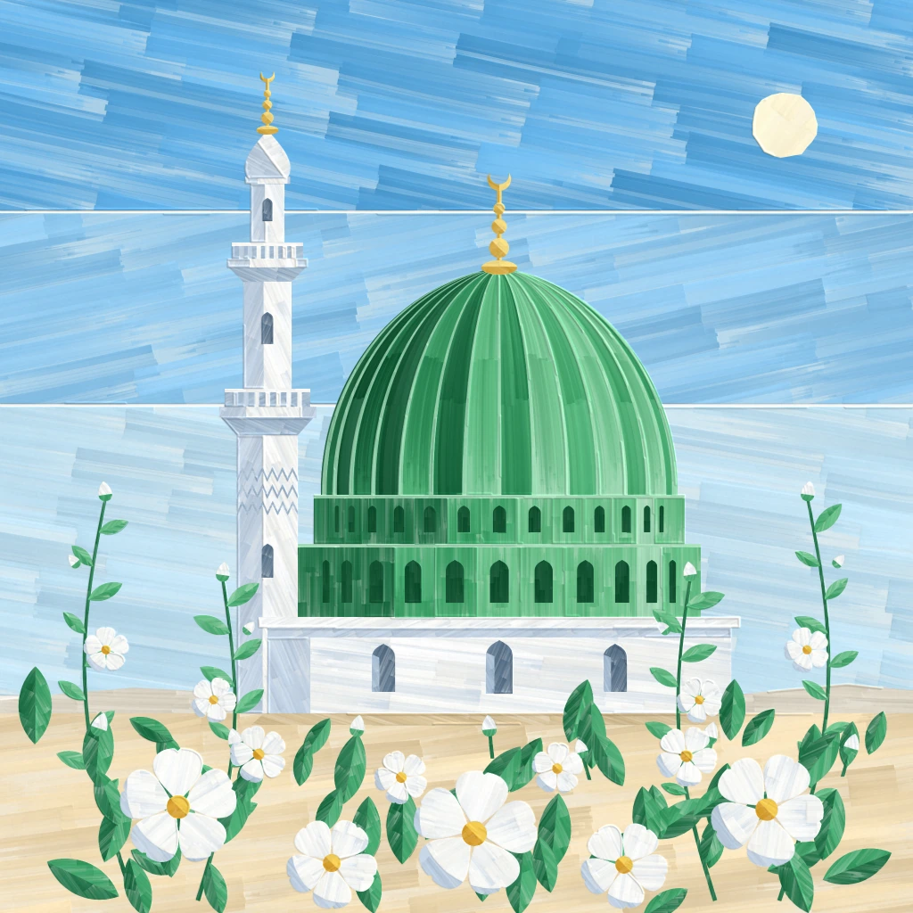

Biçimleri bantla maskeleyen çağdaş bir ressamın eli. Zemini alçı astarlı ahşap panodur; aletleri düşük yapışkanlı kâğıt bant, elle kesilmiş şablon filmi ve geniş, yassı sentetik fırçalardır. Paleti güneşli ve temizdir: gök mavisi, orta ve soluk mavi, alçı beyazı, soluk mavi-gri alt boya, serin mavi-gri gölge, nane, yeşil, koyu yeşil, kum, soluk sarı-beyaz ve altın sarısı. Her biçimi önce maskeler, sonra iki katta boyar: önce rengin alçıyla açılmış ince bir ilk katı (beyazların altına soluk mavi-gri), sonra yüklü ikinci katı geniş yassı fırçayla sıra sıra, birbirine binen geçişlerle çeker. Her geçiş kare ve boya yüklü başlar, sona doğru incelir; kuru uçta kıl demetleri şerit şerit kopar ve alttaki açık kat çizgi çizgi görünür, geçişlerin bindiği yerde ton koyulaşır. Bir alandaki geçişlerin hepsini aynı yöne çeker, komşu alanda yönü ters çevirir: gökteki üç bant sırayla sağa ve sola, ters eğimle çekilir; bantların arasında bandın bıraktığı ince alçı çizgileri kalır. Kubbenin her dilimi ayrı bir şablondur; dilimler ışığa göre koyu yeşilden naneye kayar ve komşudan komşuya belirgin biçimde açık-koyu gider gelir. Dilimi bir basamak açık yeşil ilk katın üstüne, dilim boyunca uzun geçişlerle boyar; bir dilimde fırçayı yukarı, yanındakinde aşağı çeker; dilimlerin arasına tepeye doğru incelen açık nane yeşili kaburga şeritleri maskeler. Kasnakta pencere araları dikey şeritler, minarede ve kaidede beyaz ile serin mavi-gri gölge şeritleri, kumda hafif çapraz geçişler, ufukta şablonla kesilmiş soluk kum-gri tepeler, yapraklarda damar boyunca iki ton. Güneşi makasla kesilmiş köşeli bir şablonla, birkaç geniş geçişle soluk sarı-beyaz boyar; her taç yaprağını ayrı maskeleyip yaprak boyunca fırçalar, tek serin gölge biçimi ve iki tonlu sarı göbek ekler. Bant kenarlarının bir kısmında boya, boyalı tarafta ince bir sırt yapar; yer yer bandın altına kıl inceliğinde sızar.

- **Köken:** 20. yüzyılın ikinci yarısındaki keskin kenarlı (hard-edge) resmin ve çağdaş akrilik ressamlarının maskeleme bandı ile şablon filmi kullanma pratiğine dayanır: maskelenmiş düz alan, iki katlı akrilik, yassı fırçanın kare başlangıcı ve kuru ucu, kenarda boya sırtı ve bant altına sızma bu tekniğin doğal izleridir. Gerçek bir ressamı taklit etmez; atölyenin tanımladığı hayalî bir ressamın elidir.
- **Ayırt edici:** Bant izleriyle (ince alçı çizgileri) ayrılmış üç düz mavi gök bandı; her bant geniş yassı fırça geçişleriyle boyanmış, bantlar sırayla ters yöne ve ters eğimle çekilmiş; Kare ve boya yüklü başlayıp sona doğru incelen fırça geçişleri: kuru uçta kıl demetleri şerit şerit kopar, alttaki açık ilk kat çizgi çizgi görünür, geçişlerin bindiği yerde ton koyulaşır; Kubbenin 16 dilimi ayrı maskelenmiş şeritler: komşudan komşuya açık-koyu gidip gelen yeşiller, dilim boyunca çekilmiş uzun fırça izleri ve aralarında açık nane yeşili kaburga şeritleri; Bant ve şablonla kesilmiş keskin kenarlar; kenarların bir kısmında boyalı tarafta ince boya sırtı, yer yer kıl inceliğinde sızıntı; Minare ve kaidede soluk mavi-gri alt katı çizgi çizgi gösteren beyaz ve serin mavi-gri gölge şeritleri; çapraz fırça izli kum zemin ve soluk kum-gri tepe şeridi; Makasla kesilmiş köşeli, soluk sarı-beyaz güneş; ayrı şablonlu, yaprak boyunca fırçalanmış beyaz taç yaprakları, tek serin gölge biçimi, iki tonlu sarı göbek ve damar boyunca iki tona bölünmüş yapraklar
- **Palet:** `#5FA8DA` `#C1DDEB` `#F1F3F2` `#BBCBDB` `#6EBA8C` `#4A9C6E` `#266E48` `#EADAB7`
- **Kodla çizim:** Canvas, 2048 iç çözünürlük. Her biçim keskin kenarlı bir maske alanıdır: alan kırpılır, önce ilk kat düz renkle (renk alçı beyazıyla %20–55 açılmış; beyazlarda soluk mavi-gri; kasnak pencerelerinde yalnızca %7, kemerler koyu ve net kalsın diye) doldurulur ve yükseklik tuvali o alanda sıfırlanır; sonra verilen yönde, %24 bindirmeli sıralar hâlinde yassı fırça geçişleri çekilir (en 4–36 piksel). Her geçiş, parametre uzayında (boyuna s, enine v) bir haritayla tanımlanır ve enine dizilmiş 1–9 piksellik kıl demetlerinden kurulur: her demetin kendi kapsaması vardır (%10–35'i ince, 0,3–0,6), boyuna doğrusal degradeyle başta yüklü ve biraz koyu, sonda solar; demetler geçiş boyunun %0–40'ı kadar erken biter ve uçlarından gittikçe incelip solan bir iki kıl kuyruğu uzar; her demette ince bir kıl çizgisi vardır. Geçişler arası ton beş basamakta ±17'ye kadar değişir. Bir alandaki geçişlerin %88'i aynı yöne çekilir; komşu alanlarda yön ters çevrilir. Kubbe dilimleri kaburga meridyenlerinden kurulur; renk, dilim normalinin ışıkla çarpımından beş duraklı yeşil rampadan alınır ve tek ve çift dilimlerde ±0,18 kaydırılır; ilk kat rampada 0,24 daha açıktır; geçişler dilim haritasında (s = y, v = dilim içi oran) dilim boyunca, çift dilimlerde yukarı, tek dilimlerde aşağı çekilir; kaburgalar tepeye doğru incelen 1,8–5 piksellik ayrı açık şeritlerdir. Kenar boyunca rastgele parçalara alanın içine kırpılmış 2,2 piksellik boya sırtı (yükseklik ve hafif doygun renk), seyrek parçalara 0,8 piksellik koyu sızıntı çizgisi eklenir. Gök üç bant (fırça yönü +0,2, −0,2, +0,16 radyan), aralarında 3 piksellik alçı boşluğu; güneş düzensiz açılarla kesilmiş bir çokgen. Yükseklik sağ üstten aydınlatılır, ince alçı dokusu eklenir, çok hafif (0,5 iç piksel) bir el titremesi verilir.
- **Kaynak:** [`S-208-bantla-maskelenmis-akrilik/ornek.html`](stiller/S-208-bantla-maskelenmis-akrilik/ornek.html)

### S-209

**Elle Boyanmış Animasyon Fonu** · *Hand-Painted Animation Background* · ✦ atölye üslubu

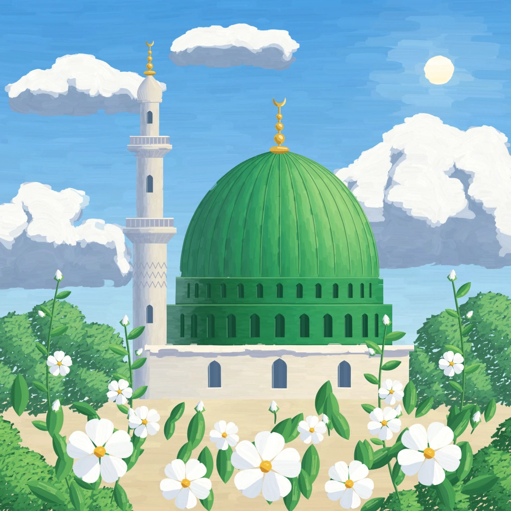

Elle çizilmiş animasyon filmlerinde çalışan bir fon ressamının eli. Zemini düz illüstrasyon kartonudur; aletleri yassı ve yuvarlak kıl fırçalar ve opak afiş boyasıdır (guaj). Paleti parlak ve davetkârdır: doygun gök mavisi, ufukta soluk turkuaz-beyaz, bulut beyazı, mavi-gri bulut gölgesi, güneşli krem taş, serin mavi-gri taş gölgesi, berrak kubbe yeşili, yaprak yeşilleri ve sarı-yeşil ışıklar. Göğü geniş, hafif dalgalı yatay darbelerle tepede doygun maviden ufukta açık turkuaza indirir; darbe kenarları seçilir ama yüzey düzgündür. Büyük kümülüsleri önce mavi-gri gövdeleriyle, sonra ışıkla gölgenin buluştuğu yerde kıvrımı izleyen açık gri-mavi bir ara tonla, en son sakin, kavisli, dolu beyaz darbelerle ışıklı tepeleriyle kurar; göğe ve güneşe bakan üst kenarı doğrudan beyazla keser (çevreyi saran bir gölge şeridi bırakmaz), mavi-gri gölgeyi yalnız düz tabana ve alt yüzlere koyar, tabanın içine kopuk beyaz adacık bırakmaz. Mimariyi açık düzlemlerle ve yumuşak renk kaymalarıyla boyar: ışık yanı krem, gölge yanı serin mavi-gri, kubbede kaburga boyunca darbeler ve ışıklı yüzde kuru fırça. Yeşilliği katman katman lekeyle kurar: önce koyu, sonra orta, sonra ışık yanında sarı-yeşil, en son kuru fırça ışıkları; arkadaki ağaç kütlelerini hava perspektifiyle soluklaştırır, ön köşeleri alçak çalılarla çerçeveler. Güneşi kenarı hafifçe düzensiz bir leke ve üstünde birkaç kısa yatay darbe olarak koyar. Beyaz çiçekleri her taç yaprağında iki üç darbeyle, kapalı tomurcukları beyaz ve serin mavi iki üç darbe ve dibini saran iki yeşil çanak yaprakla boyar.

- **Köken:** 20. yüzyılın klasik elle çizilmiş animasyon filmlerinde fon ressamlarının illüstrasyon kartonu üstüne guaj ve afiş boyasıyla yaptığı fon resmine dayanır: ressamca ama kesin biçimler, iki değerli kümülüs modellemesi, katmanlı leke yeşillik ve kuru fırça dokusu bu mesleğin alışkanlıklarıdır. Gerçek bir ressamı ya da stüdyoyu taklit etmez; atölyenin tanımladığı hayalî bir ressamın elidir.
- **Ayırt edici:** Fırçayla kurulmuş büyük kümülüsler: sakin, kavisli beyaz darbelerle ışıklı tepeler, kıvrımı izleyen açık gri-mavi ara ton, mavi-gri gölge yalnız düz tabanlarda ve alt yüzlerde; Tepede doygun maviden ufukta soluk turkuaz-beyaza inen geniş, hafif dalgalı yatay guaj darbeleri; Katman katman leke yeşillik: arkada hava perspektifiyle soluklaşan ağaç kütleleri, önde köşeleri çerçeveleyen alçak çalılar; Yapraklarda, ağaçlarda ve kubbenin ışıklı yüzünde kuru fırça ışıkları; Açık düzlemli mimari: krem ışık yüzleri, serin mavi-gri gölgeler, kaburga boyunca darbelerle boyanmış berrak yeşil kubbe; Her taç yaprağı iki üç darbeyle boyanmış beyaz çiçekler ve mat sarı göbekler
- **Palet:** `#4D9DDD` `#A6D4EE` `#FAFAF5` `#89A3C2` `#EFE6CF` `#3FA762` `#3C775A` `#E9DAB5`
- **Kodla çizim:** Canvas, 2048 iç çözünürlük. Alt boya (model): gök dikey geçiş; bulutlar küre yığını yükseklik alanından, tabana doğru güçlenen gölgeyle; siluetin üst kenarında (yukarısı ve sağ üstü gök olan noktalarda) ışık beyaza zorlanır, kütle tabanına yakın bantta iç ışık bastırılır (gölgede kopuk beyaz adacık kalmaz), ışık alanı 13 piksellik kutu bulanıklığıyla yumuşatılır (küçük ısırıklar kaybolur); minare ve kasnak silindir ışığıyla, kubbe dönel yüzey normaliyle. Açık gök, bulutsuz bir gök işlevinden renk alan 16–36 piksel enli, 60–180 piksel boylu, gürültüyle hafifçe dalgalanan iki katman darbeyle; bulutlar örtüleri içinde önce gövde, sonra ışık sınırında açık gri-mavi (#C4D2E2) ara ton darbeleri, sonra ışıklı yerlerde beyaza çekilmiş 12–17 piksel enli, kıvrım yönünü (yükseklik alanının izohips teğeti) izleyen darbelerle, üst kenarlarda kısa kıvrımlı beyaz darbelerle boyanır. Mimari kırpılarak 5–10 piksel enli yön alanlı darbelerle, ayrıntılar ince fırça darbeleriyle işlenir. Ağaç ve çalı kütleleri lob kürelerinden ışık hesaplanarak dört katmanda (koyu, orta, ışık lekeleri ve dolgusuz kuru fırça kıl izleri) atılır; arkadakiler gök rengine doğru soluklaştırılır. Bitkiler ve çiçekler birkaç geniş darbeyle boyanır, göbekler mat lekelerdir; tomurcuklar üç gövde darbesi ve iki çanak yaprak darbesidir. Güneş el titremeli bir disk üstüne dört yuvarlak uçlu yatay darbe ve kıl izleriyle boyanır. Guaj mat olduğu için kabartı ışığı çok zayıf tutulur; ince karton dokusu ve hafif el titremesi eklenir.
- **Kaynak:** [`S-209-elle-boyanmis-animasyon-fonu/ornek.html`](stiller/S-209-elle-boyanmis-animasyon-fonu/ornek.html)

### S-210

**Kuzey Gün Işığı Yağlıboya** · *Northern Daylight Oil* · ✦ atölye üslubu

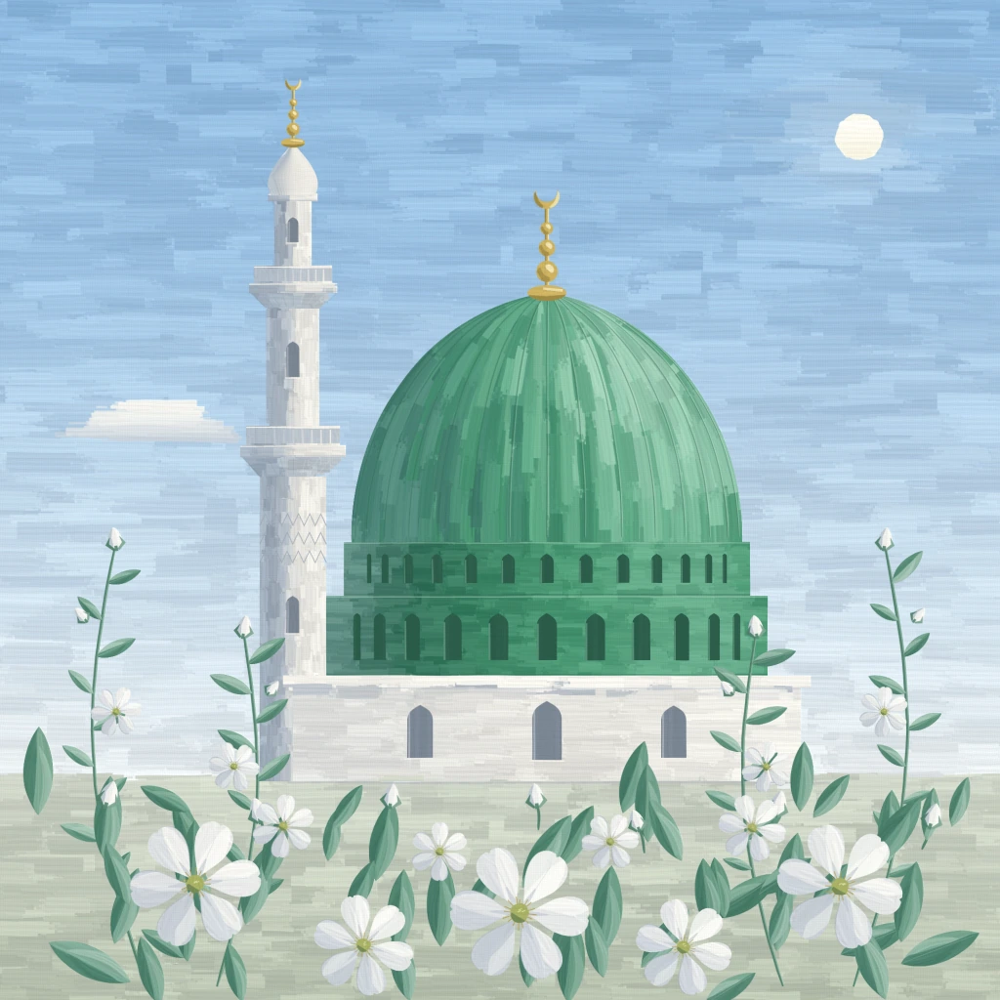

Serin ve temiz kuzey gün ışığını seven sessiz bir açık hava ressamının eli. Zemini inci grisi astarlı ince tuvaldir; aletleri küçük yuvarlak ve yassı fırçalardır. Paleti serin, aydınlık ve az kontrastlıdır: serin gök mavisi, ufukta neredeyse beyaz inci, taş beyazı, serin gri-mavi gölge, serin deniz yeşili ve açık yeşil ışığı, adaçayı yeşili yapraklar, adaçayı-gri çayır, soluk altın. Göğe önce açık bir tonla ince bir sürme, sonra geniş ve uzun, birbirine kaynayan yatay sürmeler yapar. Asıl gök darbelerini küme küme atar: her küçük alanda fırçayı aynı yöne, çoğunlukla soldan sağa çekerek yan yana üç-altı kısa darbe koyar; bir alanın darbeleri aynı ton ailesindendir; alandan alana ton bir iki basamak, yön biraz değişir ve serin bir renk kayması (mavimsi, inci, yeşilimsi, leylakımsı) olur. Tepede darbeler iri ve belirgindir, ufka doğru küçülür, tonları yaklaşır ve gök inciye açılır; güneşin çevresinde açılır ve sakinleşir. Her darbenin başı dolu ve yuvarlakçadır, sonu incelir, dış kılları daha az boya bırakır ve ucu ıslak boyanın içinde alttaki renge kaynar; arada bir daha açık, uzun bir darbe atar. Havaya küçük, düz tabanlı tek bir kümülüs koyar: kabarık kütleleri sağ üstten ışık alır, kısa yatay darbe sıraları ve kütlelerin yuvarlaklığını izleyen kısa eğri darbelerle boyanır, tabanı uzun serin gri bir darbedir, üst kenarını göğün renginden birkaç darbeyle yer yer geri keser. Güneşi kenarı elle çevrilmiş küçük, soluk sarı-beyaz bir disk olarak, çevresini izleyen eğri darbelerle bırakır. Mimariyi küçük, kaynaşmış, seçilen darbelerle boyar: minareyi dikey, kaideyi ve kasnağı yatay darbelerle; kenarları kesin keser, gölge yanlarını serin mavi-griye çeker, pencere girintilerini birkaç tonlu dikey darbelerle, kemer altını koyu, dibini gökten gelen serin bir yansımayla işler. Kubbeyi önce kendi tonlarıyla ince bir sürmeyle örter, sonra her dilimi iki üç şeritte, tabandan tepeye çekilmiş, üst üste binen darbelerle modeller: her şeridin kendi tonu, darbeden darbeye küçük bir basamağı vardır; darbe altta dolu başlar, ucu alttaki boyaya kaynar. Işık yanına kısa açık vurgular koyar, kaburgaları ince çizer. Kalın boya, parıltı noktası ya da sert gölge kullanmaz. Çayırı uzun kaynaşmış sürmeler ve üstüne küme küme kısa yatay darbelerle boyar. Yaprakları kırpmadan, yalnızca darbelerle kurar: orta tonda bir darbe, gölge yarısına koyu, ışık yarısına açık birer darbe; yaprağın karışımı yapraktan yaprağa biraz mavimsi ya da sarımsı olur. Çiçekleri narin, altı taç yapraklı beyaz çiçekler olarak boyar: her taç yaprağını uçtan merkeze çektiği darbelerle kurar; önce yaprağı kaplayan inci bir darbe, sonra ışıktan uzak yana serin gri, ortaya inci, ışık yanına neredeyse beyaz birer darbe ve uca yakın küçük beyaz bir vurgu.

- **Köken:** 19. yüzyıl İskandinav ve Kuzey Avrupa açık hava resminin serin, berrak ve sessiz gün ışığı anlayışına ve küçük boyutlu, ıslak içinde ıslak kaynaştırılmış ama seçilen darbelerle yapılmış etütlerine dayanır; açık gri astar, az kontrast, gökte küme küme kısa yatay darbeler ve gölgede gökten gelen serin ton bu geleneğin alışkanlıklarıdır. Gerçek bir ressamı taklit etmez; atölyenin tanımladığı hayalî bir ressamın elidir.
- **Ayırt edici:** Küme küme boyanmış serin mavi gök: her küçük alanda aynı yöne çekilmiş yan yana üç-altı kısa yatay darbe, alandan alana bir iki ton ve hafif yön farkı; tepede iri ve belirgin, ufka doğru küçülür ve inciye açılır; Solda darbelerle kurulmuş küçük, düz tabanlı tek bir kümülüs ve kenarı elle çevrilmiş küçük, soluk sarı-beyaz güneş; Her dilimi tabandan tepeye üst üste binen darbelerle boyanmış serin deniz yeşili kubbe; şeritler arasında ve darbeden darbeye ince ton farkı, ince kaburgalar; Keskin kenarlı mimari: minarede dikey, kaide ve kasnakta yatay, kaynaşmış küçük darbeler; gölge yanları serin mavi-gri, pencere girintileri birkaç tonlu dikey darbelerle; Önde küme küme kısa yatay darbelerle boyanmış adaçayı-gri çayır; kırpılmadan, gölge yarısı koyu ışık yarısı açık darbelerle boyanmış, tonu yapraktan yaprağa değişen yapraklar; Her taç yaprağı uçtan merkeze çekilmiş darbelerle (serin gri, inci, neredeyse beyaz) kurulmuş altı yapraklı narin beyaz çiçekler
- **Palet:** `#8CB8DD` `#DDE7EC` `#EAEAE5` `#A5B2BE` `#60A686` `#99CAB1` `#BFC9BA` `#C8B268`
- **Kodla çizim:** Canvas, 2048 iç çözünürlük; zemin inci grisi (#DCDDD8). Renk başvurusu olarak bir model çizilir: gök dikey geçiş ve güneş çevresinde dar bir açılma, yer inci-adaçayı geçişi; minare, kaide ve kasnak silindir ışığıyla ve gölge kenarında serin yansımayla (her parça önce 14 px enli bir çizgiyle kenarından taşırılarak boyanır ki kenara taşan darbeler de doğru rengi alsın), kubbe dilim başına oluk eğimli dönel yüzey normaliyle. Bütün darbeler tek bir yağlıboya fırçası işleviyle çizilir: 1,2–1,7 px aralıklı kıl şeritleri (geniş gök sürmelerinde 2,2, çayır sürmelerinde 2 px); kenar şeritleri biraz geç başlar (yuvarlakça dolu baş), sonda darbe incelir ve şeritler rastgele uzunlukta kurur; ıslak kenar seçeneğinde dış şeritlerin örtücülüğü azalır; yükseklik tuvaline şerit sırtları ve baştaki boya birikimi yazılır. Renk modelden alınır, altı kademeli ton basamağı ve küçük bir renk kaymasıyla değiştirilir; kaynaşan darbelerde darbenin sonu alttaki model rengine karışır. Gök: degrade ince sürme; 24–32 px enli, 150–300 px boylu yarı saydam, kaynaşan yatay sürmeler (ölçek tepede 1,35, ufukta 0,8); sonra küme döşeme: titreşimli ızgarada yaklaşık 84 px aralıklı (× ölçek) kümeler, her kümede aynı yöne çekilmiş yan yana 3–6 darbe, 11–15 px enli, 56–136 px boylu (× ölçek), uçları kaydırılmış; küme basamağı tepede ±16,5, ufukta ±7 RGB (güneş çevresinde yarıya iner), küme içi basamak bunun yaklaşık yarısı; renk kaymaları yalnızca serin (mavimsi, inci, yeşilimsi, leylakımsı); küme yönü gürültü ve küme başına küçük rastgele sapmayla tepede en çok yaklaşık ±9°, ufukta bunun üçte biri; darbe sonu %45 oranında alttaki renge kaynar; seyrek, 110–190 px boylu açık uzun darbeler. Bulut: sağ üstten ışık alan dört elips kütlenin birleşimi, düz taban; 5,6 px aralıklı sıralarda 7–9 px enli kısa yatay darbeler (renk kütle ışığından), kütleleri üç yarıçapta izleyen kısa eğri darbeler, kısa beyaz vurgular, tabanda uzun serin gri darbe, üst kenarda gök renginden geri kesen dört kısa darbe; kırpma yok. Güneş: 72 noktalı, kenarı hafifçe düzensiz disk (#FDFCF4) ve çevresini izleyen dört eğri darbe; kabartı yok. Çayır: kendi tonunda degrade ince sürme, 16–22 px enli, 110–230 px boylu kaynaşan yatay sürmeler, üstüne yaklaşık 74 px aralıklı kümelerde 2–4 darbe, 10–14 px enli, 46–116 px boylu, ±18 RGB basamak. Mimari parça yoluyla kırpılır: minare gövdeleri 7–9 px enli dikey darbeler, çıkma, şerefe, bilezik ve korkuluk 6,5–8,5 px enli yatay; kaide 10–13 px enli, 48–128 px boylu kaynaşan yatay darbeler; kasnak 8–10,5 px enli yatay darbeler. Kasnak pencereleri üç dikey koyu yeşil darbe, koyu kemer altı, dipte serin yansıma ve açık sol yanakla; kaide pencereleri dört dikey gri-mavi darbe, koyu kemer altı, sağ altta serin gök yansıması ve açık sol yanakla. Kubbe: modelin tonlarıyla ince bir ilk kat; her dilimde dilim genişliğine göre bir ile üç şerit; her şerit tabandan tepeye, %14–28 üst üste binen 50–134 px boylu darbelerle çekilir; darbe eni dilimin izdüşümüyle daralır (1,3 kat), renk boyunca modelden alınır, şerit tonu yaklaşık ±11, darbe basamağı yaklaşık ±9 RGB, basamak darbe sonuna doğru söner; uçlar yassı fırça gibi küt biter; ışık yanında 34 kısa açık vurgu darbesi. Kaburgalar, korkuluklar ve alemler ince fırça darbeleriyle işlenir. Yapraklar kırpılmadan üç darbeyle: orta tonda geniş bir darbe, gölge yarısına koyu, ışık yarısına açık darbe; ton darbe boyunca biraz açılır, yaprak başına küçük bir renk kayması; ince orta damar. Çiçeklerin her taç yaprağı kırpılmadan, uçtan merkeze çekilen beş darbeyle (inci gövde, serin gri, inci, neredeyse beyaz, küçük beyaz vurgu; kabartısı zayıf), dipte serin gri gölge darbesi. Son olarak yükseklik haritası sağ üstten zayıf ışıkla gölgelenir (empasto yok), gürültüyle düzensizleşen yaklaşık 3 px'lik ince keten dokusu ve hafif el titremesi eklenir.
- **Kaynak:** [`S-210-kuzey-gun-isigi-yagliboya/ornek.html`](stiller/S-210-kuzey-gun-isigi-yagliboya/ornek.html)

### S-211

**Napoli Guajı** · *Neapolitan Gouache* · ✦ atölye üslubu

Hayalî bir Grand Tour hatıra ressamının eli. Düzgün yüzeyli vergeli kâğıda küçük samur fırçalarla örtücü, mat ve hafif tebeşirimsi guaj sürer; hiçbir biçimi konturla çizmez, biçimler renk kenarlarıyla ayrılır. Gök boyasını dokuz ayrı karışım olarak hazırlar: tepede koyu kobalt-masmavi, her kat bir öncekinden biraz açık, ufukta neredeyse beyaz mavi. Her katı kendi karışımıyla 8–12 px'lik yatay darbelerle sürer, katların sınırında darbeleri birbirine geçirir ve üstüne komşu katın boyasıyla 3–6 px'lik daha kısa darbeler çeker; böylece geçiş yumuşak bir degrade değil, basamak basamak inen darbe kuşaklarıdır. Güneşin hemen çevresini soluk sarı-beyaz kısa yatay darbelerle açar, güneşi kısa dairesel darbelerle soluk bir disk olarak koyar. Bulutları yassı tabanlı küçük kümeler hâlinde baştan sona darbeyle kurar: gölgeli alt gövdeyi üç mavi-gri karışımın kısa yatay darbeleriyle sürer, bulutun kenarını ve hafif düzensiz tabanını darbe uçları çizer; ışık alan üst kısmı konturu izleyen kalın, tebeşir beyazı örtücü darbelerle bindirir. Kubbe yeşilini de altı karışım olarak hazırlar ve dilim yönünde darbelerle, ışığa göre koyu yeşilden açık yeşile kurar; komşu darbeler ayrı karışımdan geldiği için her darbe seçilir. Kaburgalara ince koyu yeşil vurgu, ışık yanlarına açık yeşil çizgi ve sağdaki dilimlerde fırça ucuyla kırık, örtücü açık dokunuşlar koyar. Taşı yatay ve dikey krem darbelerle, gölgeyi serin gri ile boyar; korniş, şerefe ve pencere kenarlarına (pencerelerin sağ söveleri dahil) kesik kesik örtücü tebeşir beyazı dokunuşlar, pencerelerin ışık alan iç yanına açık bir şerit koyar. Yaprakları orta damardan kenara doğru öne eğik çekilmiş küçük samur darbeleriyle kurar: ışık yanı açık, gölge yanı koyu yeşil; ön plandaki alçak yeşillik öbeklerini iki üç yeşilin üstü ışık alan küçük örtücü lekeleriyle yapar. Çiçeklerde taç yaprağına önce mavimsi gri bir altlık koyar, üstüne uçtan göbeğe doğru örtücü beyaz darbeler çeker; gölgedeki taç yapraklarında darbeler kısa kalır, altlığın mavisi göbeğe ve sol alta doğru görünür. Göbeği üst üste konmuş küçük sarı, okra ve açık sarı lekelerle yapar; parlak nokta koymaz. Resmi kenardan kenara doldurur ve çevresine cetvelle, elin hafif titremesi görünen tek koyu çizgi (yaklaşık 2,5 px) çeker.

- **Köken:** 18. ve 19. yüzyılda Napoli'de Grand Tour gezginlerine satılan örtücü guaj manzaralara (gouache napoletana) dayanır: doygun gök, keskin ve aydınlık mimari, küçük örtücü beyaz ışıklar ve resmin çevresindeki ince siyah çerçeve çizgisi bu geleneğin özellikleridir. Gerçek bir ressam taklit edilmemiştir; tarif atölyenin tanımladığı hayalî bir ressamın elidir.
- **Ayırt edici:** Tepede kobalt-masmavi, ufka doğru açık maviye basamak basamak inen doygun gök; küçük boyutta da seçilen yatay guaj darbe kuşakları; Kontursuz mimari: kubbe, kasnak ve taş yalnız renk kenarlarıyla ayrılıyor; kubbede ayrı yeşil karışımlardan seçilen dilim darbeleri, kaburgalarda ince koyu yeşil vurgu ve ışık yanında kırık açık dokunuşlar; Alt gövdesi mavi-gri kısa yatay darbelerle, üstü tebeşir beyazı kalın darbelerle boyanmış yassı tabanlı bulutlar; kenarı darbe uçları çiziyor, güneşin hemen çevresinde soluk yatay darbelerden ışıltı; Korniş, şerefe ve pencere kenarlarında kesik kesik örtücü tebeşir beyazı dokunuşlar; pencerelerin ışık alan iç yanında açık şerit; Orta damardan kenara çekilmiş küçük samur darbelerinden yapraklar ve iki üç yeşilin lekelerinden alçak yeşillik öbekleri; uçtan göbeğe beyaz darbelerle boyanmış, altlığın mavisi göbeğe doğru görünen çiçekler ve küçük sarı lekelerden göbek; Resmin çevresinde cetvelle çekilmiş tek koyu çizgi; resim çizginin ötesinde de kenara kadar sürüyor
- **Palet:** `#2F7AD0` `#94C0E7` `#C3DEF0` `#F4F1E8` `#DBCFB0` `#63A863` `#276F42` `#D4A239`
- **Kodla çizim:** Canvas, 2048 iç çözünürlük; SAHNE geometrisi (kubbe profili, kaburgalar, kasnak pencereleri, minare parçaları, bitki yerleri) kullanılır, SAHNE.ciz çağrılmaz. Bütün dolgular tek tek çizilen fırça darbeleridir: darbe, ana çizgi boyunca genişliği başta inişle şişen, sonda incelen, kenarı gürültüyle oynayan dolu bir şerit ve üstünde ton farklı 2–3 kıl izidir. Alanlar sarsılmış ızgaraya karışık sırayla dağıtılan darbelerle doldurulur; renk her darbenin merkezinde ışık modelinden (sağ üstten ışık; kubbede dilim düz yüzü ile yuvarlak yüzey karışımı, kasnak ve minarede silindir) okunur ve küçük oynamayla çekilir. Gök renkleri dokuz basamaklı bir karışım listesinden seçilir (her darbe kendi y'sine ±11 px sarsıntıyla en yakın kat); iki kat yatay darbe (geniş taban + kat sınırlarında komşu boyayla ince üst kat), güneş ışıltısı soluk yatay darbeler. Bulutlar maske kullanmadan çizilir: gölgeli gövde dört mavi-gri/beyaz karışımdan kısa yatay darbeler, darbenin iki ucu merkezden bulut yoğunluğu eşiğe düşene kadar yürütülerek bulunur (kenarı darbe uçları çizer); ışık alan üst kısım kontur yönü ile yatay arasında (±0,45 rad) kalın beyaz darbeler; kubbede meridyen yönünü izleyen eğri darbeler (ton altı basamağa kuantlanır, kasnakta da), kaburgalar elle titreyen basınçlı çizgiler ve ışık yanında kırık açık parçalar. Yapraklar biçim içine kırpılmış, orta damardan kenara giden üç noktalı eğri darbeler (yarısı ışık, yarısı gölge tonu); çiçeklerde mavimsi gri taç yaprak altlığı üstüne uçtan göbeğe 4–12 örtücü beyaz darbe, göbek 14 küçük sarı-okra leke. Çerçeve dört cetvel çizgisi; son geçişte ince mat kâğıt tanesi. Math.random yok, SAHNE.rng ve tamsayı karması.
- **Kaynak:** [`S-211-napoli-guaji/ornek.html`](stiller/S-211-napoli-guaji/ornek.html)

### S-212

**Yumurta Temperası Tarama** · *Egg Tempera Hatching* · ✦ atölye üslubu

Hayalî bir yumurta temperası ressamının eli. Zemin, tutkallı alçıyla astarlanıp zımparalanmış parlak beyaz bir pano; aletleri minicik yuvarlak fırçalar. Tempera çabuk kuruduğu için renkleri karıştırmaz, 11–24 px'lik kısa, iki ucu sivri darbeleri demetler hâlinde, tuğla dizisi gibi kaydırılmış düzenli bir örgüye yerleştirir; tonu demetteki darbe sayısıyla (koyuda 4–5, açıkta 1–2) ve çapraz katların üst üste binmesiyle kurar, demetleri rastgele kümelemez; açık yerlerde darbeler arasından alçı beyazı görünür. Göğü iki yönlü bir örgüyle dokur: −8°'lik serulyum ve +12°'lik ultramarin demetler, eşit boylu ve keskin. Tepede demetler sık ve koyudur; aşağı indikçe ultramarin serulyuma döner, darbe sayısı azalır ve renk açılır, ufukta aradan neredeyse yalnız alçı beyazı görünür. Güneşin hemen çevresinde taramalar soluk maviye açılır; güneşi küçük, alçı beyazı bir disk olarak bırakır ve içine yalnız birkaç çok soluk limon sarısı demet koyar, çevresine hale yapmaz. Bulutların ışık alan üstünü alçı beyazı bırakır, alt yanlarına biçimi izleyen, aşağı doğru sıklaşan ve ikinci bir açıyla çaprazlanan gri-mavi tarama koyar. Kubbede önce her dilimin meridyeni boyunca, dilimle birlikte kıvrılan kesintisiz bir malakit taban taraması çeker; gölgeyi ±25°'lik iki çapraz katla, darbe sıklığını soldaki dilimlerden sağdakilere düzenli azaltarak kurar; ışık alan sağ dilimlerde darbeler seyrekleşir, aralarına açık yeşil-krem taramalar girer ve alçı beyazı görünür. Kasnağı yatay, minareyi dikey tarar. Beyaz taşı aradan alçı görünen ince, keskin okr-krem taramalarla (minarede dikey, kaidede yatay), gölge yanlarını gri-mavi ikinci bir katla verir; gülü yalnız korniş ve şerefe altlarının gölgesinde kullanır. Yeri açık okr taramaların üstüne aşağı doğru sıklaşan ikinci bir okr çapraz taramayla, en önde dik malakit ve açık yeşil tarama öbekleriyle kurar. Taç yapraklarını alçı beyazı bırakıp göbeğe ve gölge yanına doğru soluk mavi-mor kavisli taramayla, göbekleri okr taramayla boyar. Biçimleri ince yuvarlak fırçayla çekilmiş koyu konturla keser; altın kullanmaz, alemleri okr sarısıyla tarar.

- **Köken:** Orta Çağ ve erken Rönesans İtalyan pano resmindeki yumurta temperası tekniğine dayanır: alçı (gesso) astar, çabuk kuruyan boyanın karıştırılmadan ince paralel ve çapraz tarama (tratteggio) darbeleriyle katmanlanması ve tonun optik karışımla kurulması. Geleneğin altın varak zemini bilerek dışarıda bırakılmış, gök gündüz mavisiyle taranmıştır. Gerçek bir ressam taklit edilmemiştir; tarif atölyenin tanımladığı hayalî bir ressamın elidir.
- **Ayırt edici:** Gök, −8° serulyum ve +12° ultramarin kısa tarama demetlerinden dokunmuş sakin, düzenli bir örgü; tepede sık ve koyu, ufka doğru aradan giderek daha çok alçı beyazı görünen aydınlık mavi; güneş halesiz, küçük bir alçı beyazı disk; Bulutların üstü alçı beyazı, alt yanları biçimi izleyen, aşağı doğru sıklaşan çapraz gri-mavi taramayla gölgeli; Kubbe dilimlerin meridyeni boyunca kıvrılan malakit taramalarla; gölge soldan sağa düzenli seyrelen ±25° çapraz koyu yeşil katlarla, sağdaki ışık alan dilimlerde aradan alçı beyazı ve açık yeşil-krem taramalar; ince koyu kaburga ve kontur çizgileri; Beyaz taş aradan alçı görünen ince okr-krem taramalarla: minarede dikey, kaidede yatay; gölge yanlarında gri-mavi ikinci kat, gül yalnız korniş ve şerefe altlarında; Taç yaprakları alçı beyazı, göbeğe ve gölge yanına doğru soluk mavi-mor kavisli tarama; okr göbek ve ince mor kontur; Altın yok: alemler okr sarısı boya taramasıyla
- **Palet:** `#F3EEE0` `#5B7FCC` `#8DBBE0` `#7EA7D7` `#63A47C` `#2F6D57` `#E3B7B7` `#E6DBBE`
- **Kodla çizim:** Canvas, 2048 iç çözünürlük; SAHNE geometrisi kullanılır, SAHNE.ciz çağrılmaz. Temel öğe 'tarama demeti': aynı yöne çekilmiş 3–6 kısa, iki ucu sivri, hafif basınçlı darbe (tek darbe dolu bir şerit). Gök, kubbe, kasnak ve taşta demet merkezleri tuğla dizili (her sıra yarım hücre kaydırılmış) sarsılmış bir hücre ızgarasından gelir ve her hücreye bir demet konur; ton, demetteki darbe sayısıyla (ondalık sayı, rastgele yuvarlanır) verilir, böylece leke kümesi oluşmaz; bulut, yer ve bitkilerde merkezler ton işlevine göre olasılıkla seçilir; yön her öğede biçimi izler (gökte −0,14 ve +0,21 rad iki kat, kubbede meridyen yönünü izleyen eğri darbeler ve ±0,44 rad çapraz katlar, kasnakta yatay, minarede dikey, taç yapraklarda göbekten dışa kavisli, yapraklarda orta damardan kenara). Gök ayrı bir katta taranır; bulutlar yoğunluk alanından maske, güneş ve mimari biçimler destination-out ile silinip alçı beyazı bırakılır. Her öğede 2–4 kat: taban rengi, gölge rengi (gül, gri-mavi ya da koyu yeşil) ve ışık rengi; renkler karıştırılmaz, üst üste binen katlar gözde karışır. Konturlar ve kaburgalar elle titreyen basınçlı ince çizgiler. Son geçişte çok ince mat alçı tanesi. Math.random yok, SAHNE.rng ve tamsayı karması.
- **Kaynak:** [`S-212-yumurta-temperasi-tarama/ornek.html`](stiller/S-212-yumurta-temperasi-tarama/ornek.html)

### S-213

**Sünger ve Şablon Guaj** · *Sponge-and-Stencil Gouache* · ✦ atölye üslubu

Hayalî bir şablon ressamının eli. Parlak beyaz soğuk preslenmiş kâğıt kullanır; her biçim için ince kartondan elle şablon keser (kenarlar temiz ama 8–20 px'lik kısa düz bıçak kesiklerinden oluşur, eğriler hafif köşeli, köşelerde bıçak bazen biraz ileri kaçar ve boya bu ince yarıktan kıl gibi sızar), guajı iki gözenek iriliğindeki deniz süngerlerine alıp şablonun içinden bastırır. Süngeri şablon kenarına daha sık bastırdığı için her kesik kenar boyunca 6–10 px'lik yoğun gözenekli bir şerit oluşur, içeride ağ gibi gözenekler ve aralarından kâğıt beyazı kalır. Şablonları her katta elle yeniden oturttuğu için katlar 1–2 px kayar; komşu biçimler arasında ince kâğıt beyazı ek yerleri ya da hafif bindirmeler görünür. Her biçimi 2–3 şablon katıyla kurar: kubbede önce yeşil taban, sonra sol bölüm ve her kaburganın solundaki dar şeritler için koyu yeşil gölge şablonları, sonra sağ üst dilimlerin ortasına mercek biçimli sarı-yeşil ışık şablonları; kasnakta yeşil taban, solda ve çıkıntı altlarında koyu yeşil, sağ-ortada sarı-yeşil, pencerelerde koyu yeşil. Göğü üç üst üste şablon kuşağıyla basar: önce bütün göğe açık mavi, sonra alt kenarı ufka yakın, dalgalı ama düz bıçak kesikli ikinci şablondan orta mavi, en son tepede yine dalgalı kesikli üçüncü şablondan iri gözenekli serulyum; her kuşağın kesik kenarına süngeri sık bastırır; bulut ve güneş şablonlarını örtü olarak koyup kâğıt beyazı bırakır; bulutların içine önce bulut şablonundan alta doğru sıklaşan soluk lila-mavi, sonra üst kenarı lobları izleyerek dalgalı kesilmiş ikinci bir şablondan lila basar; güneşi köşeli, çokgenimsi kesilmiş bir şablondan soluk sarı, sol alt yanına biraz daha koyu sarı basar. Minareyi ve kaideyi iki gözenek iriliğiyle krem (aralardan kâğıt görünür), sol yanlarını, çıkıntı altlarını ve korniş altını lila gölge şablonuyla; zikzakları ve korkuluk babalarını dar kesilmiş yuvalardan basar. Çiçekleri kâğıt beyazı bırakır; lila gölgeyi taç yapraklarının dibini izleyen, göbekten çıkan sivri uçlu dillerden oluşan yıldız biçimli bir şablondan basar, gölge yanındaki taç yapraklarında dil uzayıp yaprağın bir yarısına yayılır; sarı göbek basar; yapraklarda gölge yarısı ve ışık şeridi ayrı şablonlardır.

- **Köken:** Şablonla elle renklendirme (pochoir), dekoratif şablon boyama ve sünger boyama tekniklerinin birleşimine dayanır: kesik şablonun keskin kenarı ile süngerin gözenekli baskısı aynı biçimde bir arada kullanılır, biçimler üst üste binen şablon katlarıyla kurulur. Gerçek bir ressam taklit edilmemiştir; tarif atölyenin tanımladığı hayalî bir ressamın elidir.
- **Ayırt edici:** Her biçimin kenarı kısa düz kesiklerden oluşan keskin, elle kesilmiş şablon kenarı; kesik boyunca yoğun gözenekli şerit, içi ağ gibi sünger gözeneği; katlar arasında ince kâğıt beyazı ek yerleri; Gök dalgalı, düz bıçak kesikli üç üst üste şablon kuşağı: altta açık mavi, ortada orta mavi, tepede iri gözenekli serulyum; bulutlar kâğıt beyazı, içlerinde dalgalı kesilmiş ikinci şablondan lila gölge; güneş köşeli kesilmiş soluk sarı; Kubbede koyu yeşil gölge şablonları (sol bölüm ve her kaburganın solunda dar şerit) ve sağ üst dilimlerde sarı-yeşil mercek biçimli ışık şablonları; Krem minare ve kaide iki gözenek iriliğinde, aralardan kâğıt görünür; sol yanlar, çıkıntı altları ve korniş altı lila gölge şablonu; pencereler gri-mor; Çiçekler kâğıt beyazı; taç yapraklarının dibini izleyen yıldız biçimli lila gölge şablonu ve sarı göbek; yapraklarda gölge yarısı ve ışık şeridi ayrı şablon; Sünger şablon kenarına sık bastırıldığı için doku kenarlarda yoğun, içeride daha açık ve gözenekli; küçük görselde de seçilen keskin kuşak kenarları
- **Palet:** `#FCFCF8` `#9AC7E8` `#C3DEF1` `#418B5E` `#6FAF7A` `#C9C3E2` `#EEE4CC` `#D4AA3D`
- **Kodla çizim:** Canvas, 2048 iç çözünürlük; SAHNE geometrisi kullanılır, SAHNE.ciz çağrılmaz. Sünger damgaları: iki gözenek iriliğinde altışar adet 120 px alfa damgası; gürültüyle dalgalanan yuvarlak dış kenar, rastgele dairesel gözenekler ve alan bükmeli fbm eşiğinden bağlantılı ağ boşlukları, kırık dış kenar. Şablonlar: SAHNE yolları 0,8 px adımla örneklenip mimaride 8–20, güneşte ~21 px'lik rastgele aralıklarla, keskin dönüşler korunarak kısa düz kesiklere indirgenir, köşeler 0,4–1,3 px oynatılır, mimari köşelerde 2–5 px'lik ince bir taşma yarığı eklenir, tüm parçalar aynı dönüş yönüne çevrilir. Gök kuşakları: sinüs ve sarsıntıyla dalgalanan, 15–27 px'lik düz parçalardan oluşan bir kesik çizginin üstündeki alan; kesik çizgi boyunca 4 px arayla ek damga. Her şablon katı ayrı bir ekran dışı tuvalde: sarsılmış ızgaraya döndürülmüş, ölçeklenmiş, saydamlığı değişen damgalar basılır, şablon kenarı boyunca ek damgalar, ardından source-in ile tek renk, destination-in ile açık yerler (şablon her kat için 1–2 px kaydırılabilir: kayıt kayması) (ve ikinci şablonla kesişim), destination-out ile örtülen yerler, son olarak kâğıt dişi alfa maskesi uygulanıp ana tuvale bindirilir. Bulutlar yassı tabanlı lob birleşiminden hafif yumuşatılmış üst kenarlı kesik çokgen; içlerinde yoğunluğu yükseklikle artan bir sünger katı ve üst lobları aşağı kaydıran dalgalı ikinci şablon; çiçek taç yaprakları sonradan kâğıt rengiyle geri açılır (şablonla korunmuş gibi). Math.random yok, SAHNE.rng ve tamsayı karması.
- **Kaynak:** [`S-213-sunger-ve-sablon-guaj/ornek.html`](stiller/S-213-sunger-ve-sablon-guaj/ornek.html)

### S-214

**Seladon Astarda Guaj** · *Gouache on a Celadon Ground* · ✦ atölye üslubu

Hayalî bir ressamın eli. Orta dişli kâğıdı önce geniş yassı fırçayla soluk seladon (gri-yeşil-mavi) bir lavla yatay katlar hâlinde boyar; göğün geleceği üst kısımda astarı biraz daha mavi ve açık sürer. Bu astar resmin her yerinde ara ton olarak kalır. Üstüne yassı ve yuvarlak fırçalarla, birbirinden ayrı duran darbeler koyar; darbelerin arasında çoğu zaman ince bir astar şeridi görünür. Yassı fırçası kâğıda hafif yuvarlanmış, eğik bir ağızla değer; darbe boyunca boya dolu gider, sonunda kıllar farklı yerlerde biter ve kuru, kırık bir kuyruk bırakır. Göğü açık mavi ve tepede biraz daha doygun mavi yatay darbelerle, sıra sıra kurar: darbelerin uçları birbirine biner, sıralar arasında astar yalnız 1–3 px'lik ince, uzun, yatay şeritler hâlinde görünür; güneşin çevresinde darbeler beyaza yakın soluk maviye açılır, güneşi kalın beyaz ve soluk sarı kısa darbelerle koyar, bulutları örtücü beyaz darbelerle, alt yanlarını soluk mavi-gri darbelerle yapar; seladon astar göğe serin bir yeşil-mavi alt ton verir ama gök açıkça gündüz mavisi kalır. Yeşil kubbe ve kasnakta önce gölge yanına geniş saydam koyu yeşil sürer, üstüne kubbede dilim yönünde örtücü yeşil ve açık yeşil darbeler koyar; kasnağı yatay sıralar hâlinde, soldan sağa düzenli açılan beş yeşil karışımla örer, astar yalnız gölgedeki sol üçte birde sıraların arasından görünür; kaburgaları ince yuvarlak fırçayla saydam koyu yeşil çizer. Minareyi dikey sütunlar hâlinde yassı darbelerle boyar: ışık alan sağ yanda geniş, örtücü, birbirine binen krem-beyaz; gölgedeki sol yanda darbeler daralır ve serinleşir, seladon aralarında ince dikey şeritler hâlinde kalır. Kaidenin beyaz taşını krem ve beyaz yatay darbelerle örer, gölgeyi astara ve tek bir saydam gri-yeşil darbeye bırakır. Çiçekleri kalın beyaz darbelerle boyar, gölge yanını ve göbek çevresini astara bırakır; yaprakları iki darbeyle (ışık yanı açık, gölge yanı koyu) kurar, orta damar boyunca astar kalır.

- **Köken:** Renkli astar (imprimatura) üzerinde çalışma ve 19. yüzyıl sonunda tonlu kâğıt ya da karton üstüne astarı ara değer olarak bırakan guaj ve inceltilmiş boya pratiğine dayanır: ışıklar örtücü, gölgeler saydam, astar darbelerin arasından görünür. Gerçek bir ressam taklit edilmemiştir; tarif atölyenin tanımladığı hayalî bir ressamın elidir.
- **Ayırt edici:** Soluk gri-yeşil-mavi seladon astar gökte, taşta, kumda ve çiçeklerde darbelerin arasından ince şeritler hâlinde görünüyor: gökte yatay, minarenin gölge yanında dikey; Gök sıra sıra yatay açık mavi yassı fırça darbeleri: yuvarlakça eğik başlangıç, dolu gövde, kılların ayrı ayrı bittiği kuru uç; sıraların arasında ince seladon şeritleri serin bir alt ton veriyor, güneş kalın beyaz-sarı kısa darbeler; Kubbede önce saydam koyu yeşil sürme, üstünde dilim yönünde örtücü yeşil ve açık yeşil darbeler; kasnak soldan sağa düzenli açılan yatay yeşil darbe sıraları; saydam koyu yeşil kaburga çizgileri; Minare dikey krem-beyaz darbe sütunları, ışık yanı örtücü ve geniş; kaide krem-beyaz yatay darbeler, korniş altında astar ve tek saydam gölge darbesi; Çiçekler kalın beyaz darbeler; gölge yanı ve göbek çevresi seladon astar; Yapraklar iki darbe: ışık yanı açık, gölge yanı koyu, orta damar boyunca astar
- **Palet:** `#C2D6CC` `#93C3E5` `#BFDDF0` `#F1F3EF` `#6AAE80` `#39835E` `#DFD3AF` `#E7CA5C`
- **Kodla çizim:** Canvas, 2048 iç çözünürlük; SAHNE geometrisi kullanılır, SAHNE.ciz çağrılmaz. Astar: düz seladon zemin üstüne 46–64 px enli, 220–380 px boylu, yarı saydam üç tonlu yatay lav darbeleri; gök katında bunun üstüne yukarıdan aşağı #B9D5DD'den #CFE3E6'ya açılan, daha mavi bir astar lavı. Darbe iki türlüdür: yassı fırça ve yuvarlak fırça (sivri uçlar, basınç oynaması); saydam darbeler düşük alfayla. Yassı fırça izi ayrı bir işlevdir: darbe eni boyunca 6–26 kıl şeridi; her kıl, eğik ve hafif yuvarlak bir başlangıç çizgisinden başlar, gövdenin %50–82'sine kadar dolu, sonra 2–4 kırık, incelen ve saydamlaşan kuru parçayla farklı uzunlukta biter; ana çizgi gürültüyle hafifçe kıvrılır, eni basınçla şişer, kıllar arasında küçük ton farkı vardır. Gök, minare ve kasnak sıra/sütun düzeninde boyanır: gökte 14,2 px arayla yatay sıralar, her sırada 60–145 px'lik darbeler boylarının %40–50'si kadar ilerleyerek birbirine biner, darbe eni (12,4–15,4 px) sıra aralığına yakın olduğu için sıralar arasında yalnız ince uzun astar şeritleri kalır; minarede 5,4 px arayla dikey sütunlar, ışıkta geniş, gölgede dar darbeler; kasnakta 7,6 px arayla yatay sıralar, gölgedeki sol üçte birde daha dar darbeler. Kubbe, kaide, bulut ve yerde darbeler sarsılmış ızgaraya karışık sırayla dağıtılır; gölgelerde darbelerin bir kısmı olasılıkla atlanır. Gök ve yer ayrı bir katta boyanıp mimarinin yeri destination-out ile boşaltılır (orada da astar görünür). Renk, ışık modelinden (kubbede dilim düz yüzü + yuvarlak yüzey, kasnak ve minarede silindir) eşiklerle seçilen birkaç karışımdan biridir; kubbe ve kasnakta önce geniş saydam koyu yeşil darbeler, sonra örtücü katlar. Çiçek taç yaprağı yeri önce astar rengiyle kapatılır, üstüne göbekten dışa 2–3 kalın beyaz darbe; gölgedeki yarı boş bırakılır. Son geçişte orta diş: düşük frekanslı fbm ve tane ile parlaklık oynaması. Math.random yok, SAHNE.rng ve tamsayı karması.
- **Kaynak:** [`S-214-seladon-astarda-guaj/ornek.html`](stiller/S-214-seladon-astarda-guaj/ornek.html)

### S-215

**Kurşun Kalem Altlıklı Guaj** · *Gouache over a Visible Pencil Drawing* · ✦ atölye üslubu

Hayalî bir ressamın eli. Düzgün beyaz kâğıda önce bütün sahneyi HB kalemle çizer: temiz, kendinden emin, uçlarında incelen gri grafit konturlar; basınç çizgi boyunca değişir, uzun çizgilerde kalem ara ara kalkar, köşelerde çizgi bir iki piksel taşar. Kubbenin kaburgalarını, pencereleri, korkuluk babalarını, yaprakları ve taç yapraklarını ayrı ayrı çizer; cetvelle birkaç soluk yapı çizgisi çeker (kubbe ve minare eksenleri alemlerin üstüne ve kaidenin altına taşar; kasnak ve korniş yatayları biçimin iki yanından dışarı uzanır; ufuk). Gölge yanlarına serbest elle, aralığı ve açısı hafifçe oynayan eğik kalem taraması yapar: minarenin sol yanı, kubbenin sol yanı, kasnağın sol ucu, korniş altı, kaide pencereleri, bulutların alt-sol yanı ve çiçeklerde gölge yanındaki taç yapraklarının göbeğe yakın kısmı. Sonra guajı küçük yassı fırçalarla sürer: her alana önce aynı karışımdan geniş, sulu bir ilk kat, üstüne yarı örtücü darbeler. Her darbenin başı fırçanın hafif yuvarlak, hafif eğik ağzıdır; gövdesinde kıl izleri ve kenarında hafifçe toplanmış boya görülür; boya bitince uç pürüzlü, parmak parmak kırılır ve alttaki kat ya da kâğıt seçilir. Kalem çizgisi açık renklerin ve kâğıdın üstünde tam, koyu yeşilin altında yalnızca gümüşi bir iz olarak görünür. Göğü satır satır, hafifçe dalgalanan yatay serulyum darbelerle boyar; her darbe kendi karışımıdır (biraz kobalta ya da turkuaza kayar, kimine beyaz katar), bu yüzden gökte geniş, biraz açık ve biraz koyu lekeler oluşur; yukarıda daha koyu ve geniş, ufka doğru açık. Darbelerin arasında, özellikle ufka yakın ve açık lekelerde, ince beyaz kâğıt aralıkları kalır. Bulutların çevresinde fırça konturu izler, güneşin yanında hafifçe kıvrılır. Bulutların yassı ama hafif dalgalı tabanlı biçimini kâğıt beyazı bırakır; topakların üstüne topağın kavsini izleyen beyaz darbeler, alt-sol yanlarına ve tabana soluk mavi-gri darbeler sürer; gök boyası tabanın altına yer yer biraz biner. Güneşi soluk sarı-beyaz birkaç dairesel darbeyle boyar: kenarını darbeler verir, gök mavisi kalem halkasının üstüne yer yer biner. Kubbeyi dilim dilim, her dilimde bir ile üç şerit hâlinde aşağıdan yukarı, dilim boyunca uzanan darbelerle boyar; ışık yanında sarımsı açık yeşil, gölgede serin koyu yeşil. Kasnağı ve kaideyi tonu bir açılıp bir koyulaşan yatay, minareyi dikey darbelerle; pencereleri koyu yeşil ve sıcak griyle doldurur. Yaprakları damarın iki yanında ikişer yarı örtücü darbeyle (biri uzun, biri kısa ve biraz kayık) boyar: ışık yanı açık, gölge yanı koyu yeşil. Taç yapraklarını göbekten dışa doğru beyaz guajla, gölge yanındakilere göbeğin çevresinde enine yatırılmış tek bir mavi-gri darbe sürer; göbeği önce düz sarı, sonra küçük sarı ve gölge yanında okr dokunuşlarla boyar. Renk alanı kalem çizgisinin bir kıl içinde durur ya da biraz üstüne biner; yer yer çizgiyle alan arasında ince bir kâğıt aralığı kalır.

- **Köken:** Botanik ve mimari etüt geleneğinde, önce kalemle altlık çizim (underdrawing) yapılıp sonra yarı örtücü guajla boyanan ve çizimin bilerek görünür bırakıldığı çalışma biçimine; yassı fırçayla katman katman guaj sürme ve kalemle gölge tarama alışkanlıklarına dayanır. Gerçek bir ressam taklit edilmemiştir; tarif, sürecini görünür bırakan hayalî bir ressamın tutarlı elidir.
- **Ayırt edici:** Her biçimin çevresinde basıncı değişen, yer yer kesilen gri grafit kontur: kubbe kaburgaları, pencereler, korkuluk babaları, yapraklar, taç yaprakları; çizgi açık renklerin altından belirgin, koyu yeşilin altından soluk seçiliyor; Gökte satır satır, hafifçe dalgalanan yatay yassı fırça darbeleri: her biri ayrı ton, pürüzlü kuru uçlu; aralarında ince beyaz kâğıt aralıkları, gökte geniş açık-koyu lekeler; Kubbe dilim dilim, dilim boyunca aşağıdan yukarı uzanan guaj darbeleriyle boyanmış; kaburga çizgileri boyunca kâğıt ve kalem seçiliyor; Gölge yanlarında boyanın altından görünen serbest elle eğik kalem taraması: minarenin ve kubbenin sol yanı, korniş altı, bulutların alt-sol yanı, çiçeklerde gölge yanındaki taç yaprakları; Cetvelle çekilmiş, biçimin kenarından taşan soluk yapı çizgileri: minare ve kubbe eksenleri alemlerin üstünde ve kaidede, kasnak ve korniş yatayları iki yanda, ufuk; Yassı tabanlı bulutlar beyaz ve soluk mavi-gri darbelerle topak topak boyanmış; soluk sarı-beyaz güneş dairesel darbelerle boyanmış, gök mavisi kalem halkasına yer yer biniyor
- **Palet:** `#F9FAFB` `#5F615D` `#72AEDF` `#AED0E9` `#84C58B` `#317052` `#EEE7D5` `#E4C45C`
- **Kodla çizim:** Canvas, 2048 iç çözünürlük; SAHNE geometrisi kullanılır, SAHNE.ciz çağrılmaz. Kalem katı: SAHNE yolları örneklenip uçları incelen, basınçlı, hafif titrek dolu şeritler olarak çizilir; köşeli yollarda her kenar ayrı ve köşeden biraz taşar, uzun çizgiler rastgele bir yerden 2–5 px boşlukla bölünür. Önde duran biçimin arkasındaki çizgiler destination-out ile silinir; cetvel çizgileri ve maskeyle sınırlı serbest kalem taramaları (aralık 0,7–1,7 × temel aralık, açı sapmalı, kavisli, iki ucu incelen kısa parçalar; çiçeklerde her çiçeğin taç yaprağı maskesi ve ışık yönüne göre gölge yanı) eklenir; grafit piksel başına kâğıt dişine göre kırılır. Guaj darbesi (guaj fonksiyonu) küçük bir karalama tuvalinde tam örtücü kurulur: yuvarlak ve eğik başlı gövde çokgeni, enine her konumda ayrı biten pürüzlü kuru uç, kıl izleri, kenarda koyulaşma, destination-out ile açılan parmak aralıkları; sonra alfa 0,5–0,96 ile yerine konur. Alanlar satır satır (satirBoya: değişken boşluk ve bindirme, gürültüyle dalgalanan satırlar, önce geniş sulu ilk kat) ya da sarsılmış ızgarayla boyanır. Gökte renk, düşük frekanslı bir gürültüyle (gokLeke) kaydırılır; ufka yakın ve açık lekelerde darbelerin bir kısmı tamsayı karmasıyla atlanır, böylece kâğıt görünür; fırça yönü bulut çevresinde konturun teğetine döner, güneşin yanında hafifçe kıvrılır. Bulutlarda bulutGolge her topağın alt-sol yanına ve tabana gölge payı ile darbe yönünü (topağın teğeti, tabanda yatay) verir; taban gürültüyle dalgalanır, uçları kalkar. Kubbe 16 dilimde, dilim başına 1–3 şerit hâlinde meridyen boyunca darbelerle boyanır. Gök, bina ve bitki kenarları gürültüyle kaydırılmış yollarla boşaltılır ya da kırpılır (kalem çizgisine yaklaşan, yer yer üstüne binen, yer yer kâğıt bırakan kenar). Sonunda kalem katı piksel geçişinde çarpma ile bindirilir: grafitin örtücülüğü altındaki boyanın açıklığına göre değişir (kâğıtta ve açık renklerde yaklaşık 0,8, koyu yeşilde yaklaşık üçte biri); aynı geçişte açık yerlerde seçilen ince kâğıt dişi eklenir. Math.random yok, SAHNE.rng ve tamsayı karması.
- **Kaynak:** [`S-215-kursun-kalem-altlikli-guaj/ornek.html`](stiller/S-215-kursun-kalem-altlikli-guaj/ornek.html)

### S-216

**Sınırlı Palet Suluboya** · *Limited-Palette Watercolour* · ✦ atölye üslubu

Hayalî bir ressamın üç pigmentli suluboya eli. Aletleri: parlak beyaz soğuk preslenmiş kâğıt, iki yuvarlak samur fırça ve paletinde yalnız serin bir ultramarin, saydam bir limon-aureolin sarısı ve kalıcı gül. Bütün renkleri kâğıdın üstünde, kuruyan katların üstüne yeni sırlar geçerek karıştırır: yeşiller önce sürülen açık sarı katın üstüne mavi sır geçilerek doğar ve taze, açık kalır (kimi yerde daha mavi, kimi yerde daha sarı); gölgeler mavi ile gülün açık menekşe-gri karışımıdır; taş ve toprak açık gül-sarı sırlardır; beyazlar boş kâğıttır. Her sır kâğıtta kuruyup sert, hafifçe koyulaşmış bir kenar bırakır; iki sırrın bindiği yer daha koyu ve doygun kalır. Göğü tahtayı hafif eğik tutarak yukarıdan aşağı yatay ıslak geçişlerle sürer: her geçiş bir öncekinin dalgalı alt kenarına biner, fırçaya her seferinde biraz daha su alındığı için gök ufka doğru açılır, ultramarin kâğıdın çukurlarına çöker (granülasyon). Bulutların çevresinden kuru fırçayla dolaşır: kenarları sert ama kâğıt dişinde pürüzlü kırılır; içlerine üst kenarı sert iki menekşe-gri sır sürer, alttaki sır bulutun tabanından biraz taşar ve gökle bindiği yerde ince koyu bir çizgi bırakır. Güneş düzensiz bir kâğıt diskidir, içine çok açık aureolin konur. Kubbede önce bütün yeşil alana aureolin, üstüne çok açık bir ultramarin sürer; sonra her dilimi yukarıdan aşağı tek darbeyle mavi sırlar (boya alt uçta birikir, komşu dilimler biraz biner, kaburgalar bindirme çizgisi olarak doğar), ışık tarafındaki birkaç dilimin ortasında dar bir şeridi açık bırakır, dilimlerin içine dilim boyunca daha dar ikinci vuruşlar koyar (kimi daha sarı, kimi daha mavi, gölgede menekşe). Gölge yanına kenarı sol üstten sağ alta eğik inen, kaburgaları kesen iki geniş menekşe-mavi sır geçer; kaburgaları ince yuvarlak fırçayla, basınçla kalınlaşıp incelen, yer yer kesilen çizgilerle çizer. Kasnağın her katını soldan sağa iki üç fırça yüküyle sürer (solda çok, sağda az mavi), yüklerin bindiği yerde eğik koyu şeritler kalır; katların alt kısmına birkaç bölmeyi aşan, dalgalı üst kenarlı ikinci sırlar, pencere aralarına yer yer ince bir fırça çizgisi koyar; pencereleri tek darbede, sol yarılarını ikinci bir sırla boyar, sağda ince bir ışık şeridi kalır. Kaide ve minare gövdesi soldan sağa çekilmiş açık gül-sarı yatay geçişlerdir (taş sıraları); saçak altı ve sol yanlar menekşe-gri gölgedir. Toprak, ön yaprakların çevresinden dolaşan uzun yatay geçişlerden oluşur: arkada gül-sarı, önde sarı ve mavi + sarı açık yeşiller, aralarda birkaç menekşe-gri geçiş; her geçişin başı dolgun, sonu kuru fırçayla kâğıt dişinde kırılarak biter. Yapraklar hafifçe kıvrıktır, iki yarısı ayrı sürülür, orta damar kalınlığı oynayan bir kâğıt çizgisi olarak kalır; ışık yarısında sarıya çalan yeşilin ucuna mavi bir sır, gölge yarısında dibe güllü mavi bir sır geçer, sırların ucu yaprağın içinde sert bir kenar bırakır. Çiçekler boş kâğıttır; taç yapraklarının gölge yarısına açık menekşe sır, göbeğe sarı ve gül-sarı noktalar konur. Gül yalnız karışımlarda ve tomurcuklardaki küçük vurgularda kullanılır.

- **Köken:** Üç ana pigmentle (çoğu kez ultramarin, aureolin, kalıcı gül ya da kinakridon) çalışan sınırlı palet alıştırmasına, kuru üstüne kuru sırlama (glazing) tekniğine ve suluboyanın pigment çökmesi (granülasyon) ile kuruyan kenar koyulaşmasına dayanır. Hiçbir gerçek ressam taklit edilmez: üslup, atölyenin tanımladığı hayalî bir ressamın elidir.
- **Ayırt edici:** Yukarıdan aşağı yatay ıslak geçişlerle sürülmüş, ufka doğru açılan ultramarin gök: geçişlerin dalgalı kenarlarından kalan yatay kuşaklar ve kâğıdın çukurlarına çöken granüle pigment; Bütün renklerin yalnız üç pigmentten çıktığı serin uyum: kimi sarıya kimi maviye çalan taze, açık yeşiller, menekşe-gri gölgeler, açık gül-sarı taş ve toprak, kâğıt beyazı çiçekler; Dilim dilim tek darbeyle sırlanmış kubbe: komşu dilimler arasında açık-koyu farkı, dilim boyunca dar ikinci vuruşlar ve açık bırakılmış şeritler, kaburgaları kesen eğik kenarlı menekşe-mavi gölge sırrı, kalınlığı oynayan kesik kaburga çizgileri; Kasnak, kaide, minare gövdesi ve toprakta soldan sağa çekilmiş yatay sırlar: kuruyup sert kalan, koyulaşmış kenarlar ve bindikleri yerde koyu şeritler (taş sıraları, gül-sarı ve açık yeşil toprak geçişleri); Hafifçe kıvrık, iki yarısı ayrı sürülmüş yapraklar: kâğıtta karışmış yeşil (dibi sarı ucu mavi ya da dibi güllü mavi), ikinci sırların yaprak içinde bıraktığı sert kenarlar, kalınlığı oynayan beyaz orta damar; Kuru fırçayla etrafından dolaşılmış, kenarı kâğıt dişinde pürüzlü, kâğıt beyazı kümülüs bulutları: içlerinde iki menekşe-gri sır, gökle bindiği tabanda ince koyu çizgi; halkasız, düzensiz, soluk sarı güneş diski
- **Palet:** `#86A6DA` `#CDDBF1` `#B6D98D` `#87B161` `#63836C` `#E4E3ED` `#EAD7AD` `#EBB9C3`
- **Kodla çizim:** Canvas 2048 px iç çözünürlükte boyanıp 1024'e indirilir. Kâğıt dişi tohumlu değer gürültüsüyle bir yükseklik alanı olarak kurulur. Her lavi (sır) SAHNE yollarından elle titretilmiş bir çokgen maskeyle ekran dışı tuvale çizilir; iki bulanık kopyasından kenar koyulaşması, ince boya birikintisi çizgisi ve alt kenarda havuzlanma hesaplanır, kenar kâğıt dişine göre pürüzlenir, içine geniş ölçekli düzgünsüzlük ve kâğıt çukurlarına çöken pigment eklenir. Lavi renk değil, üç pigment yoğunluk tamponuna (ultramarin, aureolin, gül) miktar ekler; rezerv yerler maskeden silinir. Kuru fırça rezervi için rezerv şeklinin 1,6 px bulanık kopyası kâğıt yüksekliğiyle eşiklenir: kenar sert kalır ama dişte pürüzlü kırılır (bulanık geçiş yok). Sonda yoğunluklar 400–700 nm'de 31 bantlık spektral bir modelle (her pigmentin dalga boyuna göre yutma eğrisi, Beer–Lambert) yansımaya, CIE renk eşleme eğrileriyle sRGB'ye çevrilir (33³'lük 3B tablo, üç doğrusal ara değer); böylece mavi ile sarı kâğıt üstünde gerçekten yeşile karışır. Basit Beer–Lambert modeli bu yeşili fazla bulanık (zeytinî) bulduğu için tabloya fiziksel olmayan bir 'taze yeşil' adımı eklenir: mavi ve sarı birlikte bulunup gül az olduğunda renk OKLab'da 138° tonuna doğru biraz döndürülür, doygunluğu 0,14 tavanına doğru artırılır ve biraz açılır; kâğıda çok yakın, çok sulu karışımlarda (OKLab açıklığı 0,85'in üstünde) bu adım giderek söner, böylece güneşin aureolini ile göğün mavisinin bindiği kenarda yeşil halka doğmaz; yalnız mavi (gök), yalnız sarı ya da gül (taş, altın) ve gül katılmış menekşe-gri karışımlar değişmez. Gök, yukarıdan aşağı 86–156 px yüksekliğinde, alt kenarı iki ölçekli gürültüyle dalgalanan, 12–22 px bindirmeli 7–8 yatay ıslak (bulanık maskeli) geçiştir; ultramarin aşağı doğru azalır, fırça yükü x boyunca gürültüyle ve sağa doğru azalır, güneş çevresinde düşer. Bulutlar 3–5 yuvarlak, yassı, rüzgâr tarafı biraz dik tümseğin birleşiminden çıkan düzensiz bir tepe çizgisi, küt yuvarlak uçlar ve düze yakın bir tabandır; gök onları kuru fırça rezerviyle dışarıda bırakır, iki gölge sırrının alt kenarı tabanın 2,6 px altına taşar. Kubbe: aureolin alt kat (0,55, solda biraz fazla) ve 0,15 ultramarin; 16 dilim sırı (komşu dilimlerde mavi ±%13–21 dönüşümlü, bindirme dilimin görünen genişliğiyle ölçekli ±1,5 px, alt uçta havuzlanma), ışık tarafındaki dilimlerde dar açık şerit rezervi, her dilimde boylam bandı biçiminde, dilimin dibine kadar inen 1–2 dar ikinci vuruş (yarıda sivri biten uç yok), dilimlerin yarısında tabandan sert üst kenarlı sır, kenar boylamı yükseklikle doğrusal değişen (eğik) iki menekşe-mavi gölge sırrı ve alt şerit; kaburgalar 1–2 parçalı, kenara doğru incelen ve açılan, basınçla oynayan şeritler. Kasnak: her katta üç yük, eğik bindirmeli, x boyunca azalan ağırlıklı yatay sırlar; alt kısımda birkaç bölmelik ikinci sırlar, yer yer pencere arası çizgisi, kasnağa kırpılmış iki eğik kenarlı gölge sırrı, saçak ve kat aralarında kesik yatay vuruşlar; pencereler rastgele karışımlı iki sır. Kaide: açık alt kat üstüne tam genişlikte üç yatay şerit sır (27–31 px), saçak altı ve sol yan gölgeleri, kesik derz çizgileri; minare gövdesinde yer yer açık gül-sarı yatay sırlar. Toprak: açık alt kat ve 11 uzun yatay geçiş (30–50 px, kuru biten uçlar); ön yapraklar toprak sırlarından rezervle korunur. Yapraklar kıvrık orta damarlı, yarıları farklı genişlikte, damar boşluğu değişken; ışık yarısına sarımsı yeşil + uç kısmına mavi sır, gölge yarısına yeşil + dip kısmına güllü mavi sır; mavi sarının 0,8 katını geçmez. Kâğıt dişi sağ üstten gelen ışıkla çok hafifçe gölgelenir. Çizim yaklaşık 5,5 sn sürer.
- **Kaynak:** [`S-216-sinirli-palet-suluboya/ornek.html`](stiller/S-216-sinirli-palet-suluboya/ornek.html)

### S-217

**Beyaz Mürekkep Konturlu Suluboya** · *Watercolour with White Ink Line* · ✦ atölye üslubu

Hayalî bir ressamın beyaz mürekkep konturlu suluboya eli. Aletleri: sıcak preslenmiş pürüzsüz suluboya kâğıdı, yassı ve yuvarlak lavi fırçaları, opak beyaz mürekkep ve ince uçlu bir dip kalem. Önce orta açıklıkta, temiz ve iyi modellenmiş lavileri sürer: göğü tepeden ufka elle derecelendirilmiş bir seruleum lavisiyle ve üstüne tepeden inen, ıslakken dalgalı bir alt kenarla bırakılmış üç ince sırla boyar; boya yükü yatay uzanan yumuşak lekeler hâlinde oynar, seruleum kâğıdın çukurlarına hafifçe çöker. Bulutların yerini boş bırakmaz: lavi ıslakken nemli fırçayla açılır (üstleri daha temiz, altları yumuşak), altlarına tabana doğru eriyen açık leylak-gri gölge sürülür. Kubbeyi dilim dilim boyar: her dilim ayrı, elde karıştırıldığı için biraz farklı bir yeşil sır (ışıkta açık, gölgede koyu); dilim ıslakken içine biraz sarımsı ya da koyu yeşil düşürür; solda bir gölge sırrı daha geçer. Kasnağı pencere aralarında bölme bölme, taşı sıcak açık bej, gri-bej gölgeler ve ikinci sıcak bir sırla, toprağı üst üste üç açık sırla, çiçekleri soluk leylak-mavi katlarla boyar; beyaz çizgi görünsün diye hiçbir yeri kâğıt beyazına yakın bırakmaz. Boya kuruyunca yalnız tanımlayıcı çizgileri beyaz mürekkeple çizer, hiçbir biçimin çevresini kapatmaz: kubbe kaburgaları ve dış çizginin ışık alan sağ parçası, kasnak ve kaide pencerelerinin açık kemerleri (yalnız kemer, alt kısım çizilmez), kat ve korniş çizgileri, şerefe korkuluğunun tırabzanı ve tek tek dikmeleri, zikzak bant, yaprakların kırık orta damarı, taç yapraklarında iki üç damar, göbek çevresinde birkaç etamin. Kalem basıncıyla çizgi yaklaşık 0,8–3 piksel arasında yavaşça kalınlaşıp incelir, uçları sivrilir, kalemin konduğu yerde ara sıra küçük bir mürekkep düğümü kalır; uzun çizgilerde kalem kalkar ve 10–34 piksellik boşluklar bırakır. Bulutlarda yalnız ışık alan üst kenarın birkaç kısa parçasını çizer; güneşin çevresine kapanmayan iki kısa yay çeker. Beyaz çizim lavilere tam oturmaz, bir iki piksel kaymıştır.

- **Köken:** Renkli zemin üstüne beyaz mürekkep ya da beyaz guaşla çizme (beyaz kalem vurgusu) alışkanlığına, suluboya illüstrasyonda dip kalemle sonradan kontur çekme tekniğine ve sıcak preslenmiş kâğıtta düz, derecelendirilmiş lavi sürmeye dayanır. Hiçbir gerçek ressam taklit edilmez: üslup, atölyenin tanımladığı hayalî bir ressamın elidir.
- **Ayırt edici:** Dilim dilim, her biri biraz farklı yeşil sırla boyanmış kubbenin üstünde parlayan, uca doğru incelen, yer yer kalemin kalktığı beyaz kaburga çizgileri; Kasnak ve kaide pencerelerinde yalnız kemeri çizen açık beyaz mürekkep yaylar; kırık beyaz kat ve korniş çizgileri; Şerefe korkuluklarında beyaz tırabzan ve tek tek dikmeler, minarede beyaz zikzak bant; Soluk leylak taç yaprakları kontursuz; her yaprakta iki üç beyaz damar, göbek çevresinde kısa etaminler; Tepeden ufka açılan, ince sırların dalgalı kenarları ve granülasyonu seçilen seruleum gök; lavisi açılmış bulutların yalnız ışık alan üst kenarında birkaç kısa beyaz çizgi, güneşin çevresinde kapanmayan iki beyaz yay; Yapraklarda yalnız kalemin bir iki kez kalktığı kırık beyaz orta damar
- **Palet:** `#72AED9` `#9AC7E4` `#77B777` `#236135` `#E2D4B4` `#CDC8E2` `#E0B438` `#FFFFFF`
- **Kodla çizim:** Canvas 2048 px iç çözünürlükte boyanıp 1024'e indirilir. Pürüzsüz (sıcak pres) kâğıt dokusu düşük genlikli değer gürültüsüdür. Laviler, SAHNE yollarından elle titretilmiş çokgen maskelerle RGB optik yoğunluk tamponuna eklenir (her lavinin kuruyan kenarı, ince birikinti çizgisi, alt kenarda havuzlanma, geniş ölçekli düzgünsüzlük); gök bir taban lavisi (yoğunluk yukarıdan aşağı azalır, gürültüyle yatay lekeler hâlinde oynar, granülasyon yüksek) ve tepeden inen, alt kenarı iki ölçekli gürültüyle dalgalanan üç ince yumuşak sırdır; hepsi bulanık bir bulut maskesinin içinde (üst yarıda daha çok) %62–86 azaltılır (ıslakken açma). Kubbe 16 ayrı dilim lavisi (tohumlu yoğunluk) ve her dilime yumuşak kenarlı ikinci bir sarımsı ya da koyu yeşil lavi; kasnak pencere aralarına göre bölme lavileri. Bulutlar birkaç büyük, elle titretilmiş elipsin birleşimidir, tabanları gürültüyle dalgalı; gölgeleri dalgalı bir sınırla sürülür, ağırlığı tabana doğru azalır ve alt kenarı yumuşak rezervle açılır. Sonda yoğunluk kâğıt rengiyle çarpılarak görüntüye çevrilir. Beyaz mürekkep ayrı bir 2048 px katmana çizilir: her çizgi eşit aralıklı noktalara örneklenen yolun iki yanına, düşük frekanslı basınç gürültüsüyle (%55) değişen kalınlıkta ve uçları sivrilen bir şerit olarak doldurulur (dışta %84, içte daha yoğun ikinci şerit); 70 px'ten uzun çizgiler 40–150 px'lik parçalara bölünür, aralarında 10–34 px boşluk kalır; başlangıçların %35'inde küçük bir elips düğüm. Pencerelerde kemer çokgeninin yalnız üst kısmı, bulutlarda titretilmiş biçimin üst kenarından 2–3 kısa parça çizilir. Örtme için ressamın sırası izlenir: önce yapı çizilir, sonra arkadan öne her yaprak, sap, tomurcuk ve çiçek kendi alanındaki eski çizgileri destination-out ile silip kendi çizgisini çizer. Katman sonda lavilerin üstüne (1,4 px sağa, 0,9 px yukarı kaydırılarak) konur.
- **Kaynak:** [`S-217-beyaz-murekkep-konturlu-suluboya/ornek.html`](stiller/S-217-beyaz-murekkep-konturlu-suluboya/ornek.html)

### S-218

**Beyaz Aralıklı Leke Suluboya** · *Watercolour Patches with White Gaps* · ✦ atölye üslubu

Hayalî bir ressamın serbest elle 'lavi vitrayı' yapan eli. Aletleri: parlak beyaz, dişli suluboya kâğıdı ve tek bir küçük yuvarlak fırça. Her leke kuru kâğıda ayrı ayrı sürülür (kuru üstüne kuru) ve kenarı keskin kalır; ressam leke henüz ıslakken bir ucuna ikinci bir renk değdirir, renk lekenin içinde yumuşakça yayılır ama kenara taşmaz (gökte bir mavi öbürüne, kubbede yeşil sarımsı ya da mavimsi yeşile, taşta krem leylak griye geçer). Pigment bir yana doğru hafifçe birikir, mavi ve yeşil pigment kâğıdın dişine oturup granüle olur, kururken kenar ince bir koyuluk bırakır. Yan yana iki lekeyi aynı değerde sürmez: her lekeyi komşusundan biraz açık ya da koyu seçer. Her biçimi biçimi izleyen lekelere böler ve komşu lekenin kenarına değmeden elle titreyen ince bir beyaz kâğıt aralığı bırakır; köşeler yuvarlak kalır, üç lekenin buluştuğu yerde kenarları içe kavisli küçük beyaz üçgenler oluşur. Bu ağ en güçlü mimaride, kubbede ve bitkilerde görünür (1–3 px): kubbede lekeler dilimler boyunca uzanır, her dilim kendi eğimiyle hafif yatık çizgilerle iki ile beş arasında bölünür, alttaki uzun lekelerin bazıları dilim boyunca da ikiye ayrılır ve ışığa göre açık, orta ya da koyu yeşil seçilir; kasnak pencere aralarına ve her aralıkta farklı yükseklikte ikiye, taş kaide sıra sıra bloklara, minare yatay kuşaklara ve gölge-ışık sütunlarına, korkuluk dikmelere, zikzak bant zikzak çizgileri boyunca şeritlere ayrılır. Gökte el yumuşar: ressam göğü boyları çok farklı, yatay uzamış, uçları yuvarlak, üst kenarı biraz, alt kenarı az dalgalı geniş lavi lekeleriyle doldurur; büyük bir lekenin yanına küçük bir leke sığdırır, büyük leke küçüğü kavisle sarar; birleşme çizgileri uzun, akan eğrilerdir; düz kesik oluşmaz, yalnız birkaç leke ince bir uçla biter. Gökteki aralık daha incedir (0–2 px) ve yer yer kapanır. Lekeler orta seruleum, kobalt, turkuvaza çalan seruleum ve soluk mavi arasında değişir, ufka doğru açılır ama komşular arasındaki değer farkı ufukta da sürer; güneşin çevresi daha açıktır, güneş elle kesilmiş tek bir soluk sarı lekedir. Bulutlar kâğıt beyazı bırakılır; tabanları yan yana alçak tümseklerle hafifçe dalgalanır, her tümseğin sol altına (ışık sağ üstten) hilal biçimli soluk mavi-leylak bir gölge lekesi, büyük bulutlarda en kenara ikinci, biraz koyu bir hilal konur. Toprağı yatay, alçak ve uzun lekelerle boyar: kaide dibinde kum ve soluk sarı-yeşil, öne doğru açık, taze çayır yeşilleri; yapraklar bunlardan belirgin koyudur. Yapraklar orta damar boyunca iki, büyükleri üç lekeye bölünür ve dipten uca sarımsı ya da mavimsi yeşile döner; saplar uzun parçalar hâlinde sürülür. Çiçekler kâğıt beyazı bırakılır, taç yaprağı yarılarına soluk mavi-menekşe lekeler, göbeğe iki sarı leke (ışıkta açık, gölgede koyu) konur. Alemlerin ince çubuğu ve minare alemi tek altın lekedir; kubbe aleminin yakası, büyük küreleri ve hilali ışık ve gölge yarısına ayrılır.

- **Köken:** Suluboyada kuru üstüne kuru ayrı leke (dry-on-dry) tekniğine, lekeler arasında kâğıt beyazı bırakma alışkanlığına ve vitray ile kloazone mineciliğinin renk alanlarını ince bir ağla ayırma fikrine dayanır; ağ burada kurşun ya da tel değil, boyanmadan bırakılan kâğıttır. Hiçbir gerçek ressam taklit edilmez: üslup, atölyenin tanımladığı hayalî bir ressamın elidir.
- **Ayırt edici:** Mimariyi, kubbeyi ve bitkileri saran, küçük boyutta bile seçilen, genişliği 1–3 px arasında değişen elle titreyen beyaz kâğıt ağı ve köşelerdeki küçük beyaz üçgenler; Boyları çok farklı, yatay akan, kavisli sınırlarla birbirini saran geniş lavi lekelerinden kurulmuş, komşu lekeleri biraz açık ya da koyu seçilmiş, aralıkları ince ve yer yer kapanan, ufka doğru açılan seruleum-kobalt gök; Her lekenin içinde ıslakken damlatılmış ikinci rengin yumuşak geçişi (gökte bir maviden öbürüne, kubbede sarımsı ya da mavimsi yeşile); lekenin kenarı keskin kalır; Dilimler boyunca uzanıp hafif yatık çizgilerle bölünen, bazıları boyuna da ayrılan, açık-orta-koyu yeşil kubbe lekeleri; blok blok krem taş kaide, kuşak kuşak minare ve zikzak bantta beyaz zikzak aralıklar; Kâğıt beyazı bulutların tümseklerinin sol altında hilal biçimli soluk mavi-leylak gölge lekeleri; Açık sarı-yeşil çayırın önünde orta damar boyunca bölünmüş koyu yeşil yapraklar ve kâğıt beyazı, mavi-menekşe gölge lekeli çiçekler; kenarlarda ince kurumuş koyuluk ve kâğıt dişine oturan granülasyon
- **Palet:** `#7DB8DF` `#89AFDE` `#ADDAEC` `#71B971` `#348255` `#EADEC4` `#C3DFA1` `#FDFDFB`
- **Kodla çizim:** Canvas 2048 px iç çözünürlükte hesaplanıp 1024'e indirilir. Önce sahnenin elle titretilmiş biçimleri bir bölge tuvaline (renk = bölge kodu + nesne numarası) boyanır. Her piksel için bölgeye özgü bir bölmeyle leke numarası bulunur. Gökte lekeler sıralar hâlinde serpilir (sıra aralığı 50–88 px, ufka doğru %30 incelir; boy 190–680 px arasında log-düzgün, ufka doğru %20 uzar; yarı yükseklik sıra aralığının 0,45–0,9'u). Her lekenin içerilik payı, uçları üstel profille (m = 1,5–4) yuvarlanan, üst kenarı daha çok, alt kenarı az gürültüyle dalgalanan, hafif eğik ve bükük yatay bir elipse boyuna göre ölçeklenmiş uzaklıktır; piksel, payı ile lekeye özgü 0–0,25 ek payın toplamı en büyük olan lekeye verilir (boya göre ağırlıklı, kavisli sınırlar). Koordinatlar düşük frekanslı bir akış alanıyla (dikeyde ±18–25 px) bükülür. Toprakta 'fırça lekesi' bölmesi kullanılır: 24–40 px'lik sıralarda yatay mercek biçimli lekeler, önce sürülen kazanır. Bulut tabanı yan yana alçak tümseklerden kurulur; her tümseğin sağ üste kaydırılıp küçültülmüş eşi ışıklı çekirdektir, hiçbir çekirdeğe girmeyen yer gölge lekesi, daha az kaydırılmış çekirdeğin de dışında kalan dar kenar (yalnız büyük bulutlarda) koyu gölge lekesidir; küçük bulutlarda kaydırma büyütülür. Kubbede boylamdan dilim no'su, dilime özgü 2–5 bölme yüksekliği ve her bölme çizgisinin kendi eğimi, alttaki lekelerde %45 olasılıkla dilim boyunca ikinci bölme; kasnakta pencere aralıkları ve aralığa özgü bölme yüksekliği; kaidede tohumlu taş sıraları; minarede kuşak-sütun ve zikzak çizgisi testleri; yapraklarda yerel eksende orta damar tarafı kullanılır. Gökte, toprakta ve bulutlarda 900 (bulut gölgesinde 1500) çalışma pikselinden küçük leke parçaları, en uzun sınırı paylaştıkları aynı yüzeydeki komşuya katılır (toprak toprağa, gök göğe, bulut gölgesi bulut beyazına; iki geçiş). Leke komşuluk grafiğinden her lekeye komşularınınkinden farklı bir değer basamağı seçilir (dört basamak; gökte yoğunluk ×0,80–1,21, toprakta ×0,86–1,15, kubbede ışık eşiğine ±0,1). Sonra leke sınırlarından iki geçişli pah uzaklık dönüşümü hesaplanır: mimaride ve bitkilerde uzaklığı gürültüyle 0,9–2,9 çalışma pikseli arasında değişen eşiğin altındaki pikseller boyanmaz (saplarda ve altın çubukta eşik ×0,55); gökte ve toprakta eşik 0–1,9 arasında yumuşakça değişir, düşük frekanslı gürültünün en düşük yerlerinde sıfırdır (lekeler birbirine değer) ve sınır yarım piksel hassasiyetle yumuşatılır. Bölgeye göre değişen bir yarıçapla morfolojik açma yapılarak leke köşeleri yuvarlanır. Her lekenin ana rengi ve ikinci rengi bölge paletinden karma ile seçilir; ikinci renk, lekenin ağırlık merkezine ve yarı boyuna göre ölçülmüş bir eksen boyunca, gürültüyle titreyen yumuşak bir geçişle %30–90 oranında karışır. Renkler RGB optik yoğunluk olarak, kenara uzaklıkla azalan kurumuş kenar (gökte 0,30–0,46, toprakta 0,28–0,42, başka yerlerde 0,42–0,67), lekenin içinde %6–14'lük havuzlanma eğimi, iki ölçekli granülasyon (gökte %10, kubbede %7) ve kâğıt çukurlarına oturan pigmentle yazılır. Dar boğazından ayrılıp küçük kalan boyalı adacıklar (gökte ve toprakta 260, bulut gölgesinde 900, kubbede 160 çalışma pikseli) silinir; yoğunluklar kâğıt rengiyle çarpılır ve kâğıt dişi sağ üstten gelen ışıkla hafifçe gölgelenir.
- **Kaynak:** [`S-218-beyaz-aralikli-leke-suluboya/ornek.html`](stiller/S-218-beyaz-aralikli-leke-suluboya/ornek.html)

### S-219

**Topoğrafik Renkli Çizim** · *Tinted Topographical Drawing* · ✦ atölye üslubu

Hayalî bir topoğrafya ressamının eski usul renkli çizim eli. Aletleri: düzgün, krem-beyaz wove kâğıt, ince çelik uç, gri-kahve mürekkep, yuvarlak lavi fırçaları ve geniş bir gök fırçası; paleti soğuk gri-mavi alt lavi, temiz gök mavisi ve birkaç açık, taze yerel renktir (özsu yeşili, açık çimen yeşili, krem taş, soluk kum, soluk altın, açık pembe). Önce bütün sahneyi kalemle çizer: basınç çizgi boyunca yavaşça değişir (yaklaşık 1–3 piksel), dış hatlar kalın, ayrıntılar ince; uçlar incelir, uzun çizgilerde kalem ara ara kalkar; korniş ve kasnak gibi dikdörtgenlerin kenarlarını ayrı ayrı çeker, köşelerde kalem birkaç piksel taşar. Çizdikleri: minarenin kuşakları ve korkuluk dikmeleri, minare gövdesinde ve kaidede kesik kesik seyrek taş sıraları, pencereler, kubbenin dış çizgisi ve ince kaburgaları, yaprak kenarları ve orta damarları, yan tomurcukların kısa dalları; çiçeklerin beş taç yaprağını fırıldak gibi birbirinin üstüne bindirir, her yaprağın yalnız görünen kenarını bir iki parça hâlinde çeker. Öndeki biçim arkadakinin çizgisini örter. Sonra bütün gölge yapısını tek bir soğuk gri-mavi laviyle, biçimin yönünde sürülmüş, kurumuş kenarı koyulaşan düz fırça darbeleriyle kurar; iki darbenin bindiği yer bir ton koyu kalır: minare gövdesinin sol yanında boydan boya dikey darbeler; kasnakta soldan sağa seyrekleşip açılan dikey darbeler (keskin bir gölge sınırı yoktur); kubbede dilim dilim darbeler (sol dilimler tam boy, her dilimin sol yanında tepede ince başlayıp aşağı genişleyen bir darbe); şerefe altları, korniş gölgesi, pencere içleri; yapının dibinde yatay gölge darbeleri; yaprakların gölge yarısında sapından ucuna incelen darbeler; taç yapraklarının dibinde enine sürülmüş çanak gölgesi, gölgedeki yapraklarda kenar boyunca bir darbe ve üstteki yaprağın kenarı boyunca ince bir düşen gölge; bulutların alt kısmında yatay geçişler. En son saydam yerel renkleri sürer. Gök, sağa doğru hafifçe yükselen kısa geçişlerle yukarıdan aşağı sıra sıra sürülür; her geçişin boya yükü ve mavisi farklıdır, kimisinin kenarı kuruyup ince bir iz bırakır; gök tepede daha koyu, ufka doğru ve güneşin çevresinde açıktır. Bulutların ışık alan üst kısmı kâğıt bırakılır, gök lavisi orada keskin, pigment birikintili, girintili çıkıntılı bir kenarla biter; gölgeli alt kısım gri-mavi yatay darbelerle modellenir ve gök mavisiyle birleşir. Güneş keskin kenarlı, çok soluk sarı bir disktir. Kubbeye önce bütün yüzeye soluk özsu yeşili, sonra dilim dilim ikinci bir yeşil kat sürer: dilimler kaburgada hafifçe birbirine biner, ışık alan orta-sağ dilimler açık kalır. Kasnağa açık yeşil, taşa krem, zemine soluk kum ve yatay kum geçişleri, ön plana üst kenarı geçişlerin kuru uçlarıyla kırık kırık biten açık çimen yeşili sıralar sürer. Zemini boyarken bitkilerin çevresinden dolanır; yapraklar önce açık taze yeşil, sonra gölge yarılarına ikinci bir yeşil darbe alır; öndeki yaprağın rengi arkadakinin üstüne binmez. Renk lavileri kalem çizgisine tam oturmaz: yer yer bir iki piksel kayar, bir yanda kâğıt bırakır, öbür yanda çizgiyi aşar (kubbenin ışıklı sağ kenarında ince bir kâğıt şeridi kalır). Kalem çizgisi en son, lavilerin üstüne mürekkebin kendi renginde oturur.

- **Köken:** 18. yüzyıl İngiliz topoğrafik renkli çizim (tinted drawing) geleneğine dayanır: kalemle çizim, gri ya da gri-mavi tek renk alt laviyle gölge modelleme ve üstüne açık yerel renk sürme sırası bu gelenekten gelir. Hiçbir gerçek ressam taklit edilmez: üslup, atölyenin tanımladığı hayalî bir ressamın elidir.
- **Ayırt edici:** Basıncı değişen, yer yer kalemin kalktığı, dikdörtgen köşelerinde taşan gri-kahve kalem çizgisi; minare gövdesinde ve kaidede kesik kesik seyrek taş sıraları; Bütün gölgeler biçimin yönünde sürülmüş soğuk gri-mavi alt lavi darbeleri: minarenin sol yanında ve kasnakta dikey, kubbede dilim dilim, yapının dibinde yatay; iki darbenin bindiği yer bir ton koyu; Dilim dilim boyanmış soluk özsu yeşili kubbe: sol dilimler gri-mavi gölgeli, ışık alan orta-sağ dilimler açık, ışıklı sağ kenarında ince bir kâğıt şeridi; Kısa, hafifçe yükselen fırça geçişlerinin boya yükü farkıyla seçildiği, tepede koyu, ufka doğru açılan temiz gök mavisi; üstü keskin ve girintili çıkıntılı kâğıt beyazı, altı yatay gri-mavi darbelerle gölgelenip gökle birleşen bulutlar; Kalem çizgisine tam oturmayan, kurumuş kenarı koyulaşan saydam açık renkler: ışık ve gölge yarısı ayrı yeşillerle boyanmış yapraklar, yatay geçişli soluk kum, üst kenarı kırık kırık biten açık çimen yeşili; Fırıldak gibi birbirine binen, kesik kalem konturlu kâğıt beyazı taç yaprakları; dipte gri-mavi çanak gölgesi, açık sarı göbek
- **Palet:** `#55504C` `#9CA7AD` `#7FB1DF` `#B5D4E5` `#B3D3A2` `#618E7D` `#E9D8AD` `#F8F4EA`
- **Kodla çizim:** Canvas 2048 px iç çözünürlükte boyanıp 1024'e indirilir. Krem kâğıt dokusu yaklaşık 2,8 px tane boyunda değer gürültüsü ve hafif lif çizgileridir. Kalem çizgileri SAHNE yollarından örneklenip basınç (%55, düşük frekans) ve titreme gürültülü şeritler olarak nesne nesne (minare, kaide-kasnak-kubbe, arka yapraklar, saplar, yapraklar, tomurcuklar, çiçekler) toplanır; 90 px'ten uzun çizgiler 45–155 px'lik parçalara bölünür, aralarında 2–6 px boşluk kalır; kalın çizgiler 1,6, incecikler 1,35 katsayısıyla genişletilir; korniş ve kasnak dikdörtgenleri köşelerde 2–5,5 px taşan dört ayrı çizgidir. Çiçeklerde her taç yaprağının bir sonrakinin içinde kalmayan kenarı nokta-çokgen testiyle bulunup çizilir. Gri-mavi alt lavi (#7E9ED6 tabanlı) ve yerel renkler RGB optik yoğunluk tamponuna lavi motoruyla eklenir: elle titretilmiş çokgen maske, hariç biçimler ve isteğe bağlı kırpma (destination-in), iki bulanık kopyadan kuruyan kenar ve ince birikinti çizgisi, alt kenarda havuzlanma, geniş ölçekli düzgünsüzlük, kâğıt çukuru granülasyonu. Fırça darbeleri orta çizgi boyunca başı yuvarlak, sonu incelen, iki kenarı ayrı ayrı dalgalı, genişliği basınçla değişen çokgenlerdir; minarede ve kasnakta dikey (kasnakta soldan sağa seyrekleşen ve açılan), kubbede boylam–yükseklik uzayında dilim biçiminde, bulut altında ve zeminde yatay, yaprak ve taç yapraklarında biçime göre eğri sürülür ve ilgili biçime kırpılır. Gök iki maskeli lavidir (#7FBFF0 ve #93BCF2): 512 px'lik yardımcı tuvale sıra sıra, sağa doğru yaklaşık %6 yükselen kısa geçiş biçimleri rastgele boya yükü (±%45) ve ton oranıyla opak çizilir, %65'inin alt kenarına kuruyan kenar izi eklenir, 1 px bulanıklaştırılır; bu alan iki lavinin ağırlık çarpanıdır, yoğunluk aşağı doğru azalır ve güneş çevresinde düşer. Bulutlar elle iki kez titretilmiş yassı elips tümseklerinin birleşimidir; gök lavisi bulutların ışıklı üst kısmında keskin (kenar koyulaşması ve birikinti çizgisiyle), orta kısmında 3,5 px yumuşak bir rezervle bırakılır, tabana yakın kısımda bulutun üstüne biner; gölge çok açık bir alt kat, 4–6 yatay fırça darbesi ve tabanda bir darbedir. Yaprak lavileri sırada sonra gelen ve değen yaprakların birleşimini, zemin lavileri bütün bitkileri hariç tutar. Yerel renk biçimleri daha yüksek genlikle yeniden titretilir ve kaydırılır (yapraklarda ±2 px, kubbe yeşili 2,6 px sola). Yoğunluk krem kâğıt rengiyle (Beer–Lambert) çarpıldıktan sonra kalem katı ayrı bir 2048 px tuvalde rgb(80,70,62) renginde çizilir (arkadan öne, her nesne önce kendi alanındaki eski çizgileri destination-out ile siler; yapı %95, arka yapraklar %78, ön bitkiler %100 opaklıkta), kâğıt dişine göre opaklığı kırılır ve görüntünün üstüne konur.
- **Kaynak:** [`S-219-topografik-renkli-cizim/ornek.html`](stiller/S-219-topografik-renkli-cizim/ornek.html)

### S-220

**Yassı Fırça Suluboya** · *Flat-Brush Watercolour* · ✦ atölye üslubu

Hayalî bir ressamın yassı fırça suluboya eli. Aletleri: kaba (rough) beyaz suluboya kâğıdı ve tek bir 2,5 cm'lik yassı fırça; yuvarlak fırça ya da kalem kullanmaz, ince çizgileri fırçanın keskin ağzıyla çeker. Her vuruş düz bir kenarla başlar (başlangıçta boya hafifçe birikir), kenarları paralel ilerler, sonuna doğru boyası azalır ve kâğıdın dişine takılarak kıl izleriyle kırık, kuru bir uçla biter; vuruşlar saydamdır, bindikleri yerde koyulaşır. Gök iki kattır: önce bütün göğe sulu, açık bir seruleum katı (ıslakken birleşir, ufka ve güneşe doğru açılır); kuruyunca üstüne dağınık yerleşmiş, her biri fırçanın tam genişliğinde, hafif eğik ve farklı uzunlukta koyu seruleum ve kobalt vuruşlar. Bulutlar yatay vuruşların arasında boş bırakılan kâğıttır: tabandan yukarı iki dört sıra, her sıra yukarıdakinden geniş, uçları fırça ağzının eğik, düz kesimi; böylece bulutun üstü basamaklı, tabanı düzdür ve kenarına yaklaşan vuruşlar boyası azalmış fırçayla kâğıt dişine takılarak kırık biter. Alt sıraya ağızla bir iki düz, yatay açık menekşe-gri vuruş konur. Güneş, çevresindeki yatay vuruşların ağzı kavise döndürülerek kesilmiş, hafif köşeli bir kâğıt diskidir; içine çok açık sarı tek geniş vuruş sürülür, çevresinde halka kalmaz. Kubbe her dilimde tabandan tepeye kıvrılan tek bir dikey vuruşla kurulur; fırça dilimin genişliğinde başlar, kubbe daraldıkça ağzına döndürülür; kaburgalar fırça ağzıyla çekilir, sol yan geniş ikinci bir kıvrık katla koyulaşır. Kasnak yatay vuruşlarla boyanır; pencereler tek birer dikey vuruştur: eşikten düz ağızla başlar, kemerde fırça ağzına döndürülerek sivri biter; minare ve kaide üst üste yığılmış yatay vuruşlardır, toprak geniş, açık kum rengi yatay vuruşlardır (sıraların kalınlığı ve bindirmesi değişir, her vuruşun kuru ucu bir sonrakinin ıslak başlangıcının altında kalır), korkuluk dikmeleri ve zikzak bant ağızla çekilir. Yapraklar yan yana iki kısa vuruştur, uca doğru fırça ağzına döndürülerek sivrilir; bitkilerin dibinde fırçanın ağzıyla yukarı açılan iki üç kısa, soluk yeşil ot vuruşu durur; çiçekler kâğıt beyazıdır, taç yapraklarının gölge yanına ağızla menekşe-gri birer vuruş, göbeğe çapraz iki sarı dokunuş konur.

- **Köken:** Suluboyada yassı fırça (flat / one-stroke) tekniğine, mimari suluboya etütlerindeki düz kenarlı lavilere ve kaba kâğıtta kuru fırça (dry brush) etkisine dayanır. Hiçbir gerçek ressam taklit edilmez: üslup, atölyenin tanımladığı hayalî bir ressamın elidir.
- **Ayırt edici:** Açık bir ilk katın üstüne dağınık yerleşmiş, düz başlayıp kuru, kıl izli uçla biten geniş dikdörtgen gök vuruşları; binen yerlerde koyulaşma; Dilim başına tabandan tepeye kıvrılan tek bir yassı fırça vuruşundan kurulmuş, fırça ağzına dönerek daralan dilimlerle kubbe; Eşikten düz ağızla başlayıp kemerde sivri biten tek vuruşluk pencereler ve yatay vuruşlarla kurulmuş kasnak; Üst üste yığılmış yatay vuruşlarla boyanmış minare ve kaide; korkuluk dikmeleri ve zikzak bant fırça ağzıyla; Yan yana iki kısa vuruştan oluşan, uca doğru sivrilen yapraklar ve ağız vuruşlarıyla gölgelenmiş kâğıt beyazı çiçekler; Yatay vuruşların arasında kâğıt bırakılmış, üstü basamaklı, tabanı düz bulutlar; kenarlarında kuru fırça takılması, alt sırada düz ağızlı menekşe-gri vuruş; çevresi ağızla kesilmiş, hafif köşeli güneş diski
- **Palet:** `#9EC5E4` `#6DA0D4` `#50965D` `#2A6D35` `#E9DDC3` `#D5D3E2` `#E1B039` `#F9F8F4`
- **Kodla çizim:** Canvas 2048 px iç çözünürlükte boyanıp 1024'e indirilir. Kaba kâğıt dokusu iri dişli değer gürültüsüyle bir yükseklik alanıdır. Her yassı fırça vuruşu bir orta çizgi (kırık çizgi), genişlik ve renkle tanımlanır; kutusundaki her piksel için en yakın parça bulunur, vuruş boyunca uzaklık s ve yanal konum hesaplanır. Piksel, başlangıç kenarı düz, yan kenarları paralel (hafif titrek) şeridin içindeyse boyanır; yan kenarlarda ve başlangıçta boya birikimi, kıl izi gürültüsü eklenir. Vuruşun son üçte birinde boya yükü azalır ve yalnız kâğıt dişinin tepeleri ile kıl izlerinin tuttuğu yerler boyanır (kuru fırça), uç düzensiz kesilir. Fırça ağzına döndürme, s'ye bağlı genişlik çarpanıyla yapılır (kubbe diliminde kubbe profilinden, pencerede sivri kemer eğrisinden). Rezervler (yapı, çiçekler, güneş) ve kırpma (kubbe, kasnak) piksel maskeleridir; göğün ilk katı lavi motoruyla (bulutlar sert rezerv) sürülür. Bulutlar, tabandan yukarı daralan iki dört yatay sıradan (uçları eğik kesilmiş dörtgenler, elle titretilmiş) oluşan basamaklı biçimlerdir ve sert rezervdir; ikinci kat vuruşlar 6 px bulanık, 3 px genişletilmiş bir maskeyle bulut kenarında yalnız kâğıt dişinin tepelerine boya bırakır. Güneş 10 kenarlı, kenarları hafif kavisli bir çokgen rezerv; çevresine diskte kesilen dört yatay vuruş. Toprak vuruşlarının sıra kalınlığı 38–80 px, bindirmesi %6–28, kuruması 0,18–0,38; bitki diplerinde 2–3'lü ot vuruşları. Renkler RGB optik yoğunluk olarak toplanır, saydam vuruşlar bindiği yerde koyulaşır; sonda kâğıt rengiyle çarpılır ve kâğıt dişi sağ üstten gelen ışıkla gölgelenir.
- **Kaynak:** [`S-220-yassi-firca-suluboya/ornek.html`](stiller/S-220-yassi-firca-suluboya/ornek.html)

### S-221

**Nim Kalem** · *Nīm-qalam (Half-Pen Tinted Drawing)* · ✦ atölye üslubu

Hayalî bir nim kalem ustasının eli. Destek: perdahlı, fildişi beyazı kâğıt; büyük kısmı açık bırakılır. Alet: kalem gibi tutulan çok ince samur fırça ve kahve-siyah mürekkep. Usta önce bütün biçimleri kalın-ince ritimli, bastırınca şişen ve ucunda incelen çizgilerle çizer; gölgede kalan sol kenarları daha dolgun çeker. Modellemeyi renkle değil taramayla yapar: kubbede her dilimin içinde iki kaburga arasına sığan, hafif kavisli kısa paralel vuruşlar gölgeye doğru sıklaşır, en koyu yerde ikinci bir çapraz tarama gelir; minare gövdelerinde, kasnakta ve pencerelerde dikey ve eğik ince taramalar vardır; tarama çizgileri cetvelle değil elle çekilir, yer yer kesilip sivrilerek biter. Yaprakların gölgeli yarısı da eğik taramayla, kaidenin dibindeki kısa gölge kısa çapraz vuruşlarla verilir. Sonra az ve saydam renk sürer: gökte birbirine karışan geniş yatay açık mavi lavi geçişleri (ıslak kenarlarında pigment birikir, ufka doğru hafifçe açılır, açık ve koyu bantlar sırayla iner, gök yer çizgisine kadar mavi kalır), kubbe ve kasnakta kaburga yönünde açık yeşil lavi ve yalnız gölgeli yanda bir kat yeşil, yapraklarda açık yeşil, çiçeklerde göbekten dışa çekilmiş gül pembesi ve sarı vuruşlar. Gökte uçları sarmal kıvrımlı, ortasından kendi üstüne kıvrılan bir filiz (düğüm) çıkan Fars usulü bulut kuşakları ince mürekkep çizgisiyle, içleri beyaz-mavi; güneş iki yay vuruşuyla çizilmiş soluk sarı bir teker. Çiçekler lale, karanfil ve yaban gülüdür; son dokunuş alemlerde küçük altın lekeleri.

- **Köken:** Safevi ve Osmanlı sanatındaki nim kalem (Farsça nīm-qalam, 'yarım kalem') geleneğine dayanır: mürekkeple çizilmiş, gölgesi tarama ve ince fırça işiyle verilmiş, yalnız yer yer hafif renk ve altınla tamamlanmış çizimler; Timurlu-Safevi süslemesindeki çi (Çin kökenli) bulut kuşağı ile Osmanlı lale, karanfil ve gül motifleri buna eklenmiştir. Belirli bir eser ya da sanatçı taklit edilmez; tarif bu tekniklerden kurulmuş hayalî bir ressamın elidir; figür, yazı ya da hat içermez.
- **Ayırt edici:** Kalın-ince ritimli, şişip incelen kahve-siyah fırça-kalem konturları; gölge yanlarında daha dolgun çizgi; Kubbede dilim dilim, kaburgalar arasına sığan kısa kavisli tarama ve en koyu sol yanda çapraz tarama; minare, kasnak ve pencerelerde ince taramalar; Açık mavi gök lavisi: üst üste binen ıslak yatay geçişler, kenarlarında pigment birikmesi, ufka doğru hafifçe açılan mavi; İnce mürekkep çizgili, uçları sarmal, ortasında düğüm kıvrımı olan, içi beyaz-mavi Fars bulut kuşakları ve iki yay vuruşuyla çizilmiş soluk sarı güneş; İnce çizgiyle çizilip soluk gül pembesi ve sarıyla boyanmış laleler, karanfiller ve yaban gülleri; damarlı, gölgeli yarısı taralı yapraklar; Geniş açık kâğıt alanları (beyaz kaide ve minare), soluk toprak lavili yer ve alemlerde küçük altın dokunuşları
- **Palet:** `#F9F4E8` `#4C4839` `#C5D7E1` `#C9DAB6` `#587B54` `#EBCDBF` `#F2DFAC` `#AE9040`
- **Kodla çizim:** Canvas, 2048 iç çözünürlük. Her pigment (gök mavisi, açık yeşil, yeşil, gül, sarı, toprak, sulandırılmış mürekkep) ayrı bir alfa katmanına fırça vuruşlarıyla boyanır: gökte bulanıklaştırılmış geniş ıslak bantlar ve uçları incelen kuru geçişler, kubbede meridyen yönünü izleyen vuruşlar (yoğunluk kubbe aydınlatmasına göre), kasnakta yatay ve gölgede dikey vuruşlar. Önde kalan biçimler arkadakinin lavisini ve mürekkebini siler (örtme). Mürekkep katmanı titrek, basıncı gürültüyle değişen şerit çizgilerdir; kubbe taraması her kaburga aralığında ayrı ayrı, kademeli eşiklerle (gölge arttıkça daha çok vuruş) çizilir, diğer taramalar paralel çizgilerin yoğunluk fonksiyonuyla kesilmesinden gelir; yoğunluğa eklenen düşük genlikli gürültü çizgileri yer yer böler, böylece cetvel izi kalmaz. Bulut kuşakları dalgalı orta çizgi, düğümlü genişlik, iki uçta sarmal kıvrım ve gövdenin ortasından yukarı ayrılıp kendi üstüne kıvrılan incelen bir filizle kurulur (filizin gövde içinde kalan mürekkebi silinir). Bileşimde fildişi kâğıt piksel piksel pigmentlerle çarpılır (Beer–Lambert benzeri), bulanık maskeyle ıslak kenar birikmesi ve kâğıt dişine oturan granülasyon eklenir; mürekkep hafifçe yayılır, altın örtücü ve tanelidir.
- **Kaynak:** [`S-221-nim-kalem/ornek.html`](stiller/S-221-nim-kalem/ornek.html)

### S-222

**Delâil Ravza Tasviri** · *Dalāʾil Prayer-Book Medina Painting* · ✦ atölye üslubu

Hayalî bir Osmanlı kitap ressamının eli. Destek: perdahlı kâğıt; bütün sayfa boyanır, kenarda ince altın cetvel ve iki kıl çizgi. Alet: maden boyalar (örtücü), çok ince fırça ve fırçayla sürülen altın. Usta sahneyi cepheden, bakışımlı ve düzleştirilmiş bir görünüş olarak kurar. Düz alanları örtücü bir taban katla kapatır, sonra aynı rengin biraz açık ve koyu tonlarıyla kısa vuruşlar atar; gökte vuruşlar geniş, uzun ve hafif eğiktir, tonları fırçadan fırçaya belirgin biçimde değişir; üstüne seyrek koyu lapis ve birkaç açık vuruş gelir, bindikleri yerde koyulaşır; yüzeyde elin izi küçük görselde bile görünür kalır. Kubbe taze koyu yeşil, dilim dilim kaburga yönünde vuruşlarla boyanır; sol üçte bir belirgin koyu, sağ yan açık vuruşlarla aydınlanır; kaburgalar ve dış kontur ince altın çizgidir. Kasnak yeşil, pencereler koyu yeşil-siyah ve altın kenarlıdır; kaide ile minare temiz beyaz, sıcak ve soğuk beyazların vuruşlarıyla (minarede dikey, kaidede yatay), kornişte ve şerefelerde altın baklavalı kırmızı bantlar, kırmızı-yeşil zikzak, kırmızı kemer bordürlü pencereler. Altın her yerde fırçayla çekilir, kalınlığı hafifçe değişir ve taneli bir parıltı taşır. Gökte uçları kıvrık, ortasından küçük bir düğüm kıvrımı çıkan beyaz bulut kurdeleleri ince altın konturla; sağ üstte düz ve alev biçimli altın ışınlar arasında beyaz bir güneş teker; iki uçta alev biçimli vuruşlarla boyanmış ince selviler; açık yeşil düz yer bandında, yarım adım kaydırılmış sıralar hâlinde kırmızı laleler, pembe karanfiller ve beyaz güller (iki halka yuvarlak taç, diplerine pembe çekilmiş, ortada kırmızı sarmal çizgili pembe kadeh); her bitki elle yeniden çizilir, boyu, eğimi, yaprakları ve türlerin sırası biraz değişir; aralarında küçük çimen öbekleri.

- **Köken:** 18.–19. yüzyıl Osmanlı Delâilü'l-Hayrât yazmalarındaki Mekke ve Medine tasvirlerine, Osmanlı kitap resminin örtücü boya, altın tahrir (kontur) ve düzleştirilmiş cephe anlatımına, selvi ve tertipli çiçek sırası motiflerine dayanır. Belirli bir yazma ya da sanatçı taklit edilmez; tarif bu geleneklerden kurulmuş hayalî bir ressamın elidir; yazı, kartuş, hat ya da figür içermez.
- **Ayırt edici:** Kubbe kaburgalarında, kasnakta, kaidede ve minarede fırçayla çekilmiş, kalınlığı hafifçe değişen taneli altın konturlar; Aydınlık mavi gök; tonu fırçadan fırçaya belirgin değişen geniş, uzun ve hafif eğik örtücü vuruşlar; Kornişte ve şerefelerde altın baklavalı kırmızı bantlar, kırmızı-yeşil zikzak ve kırmızı kemer bordürlü koyu pencereler; Altın konturlu, düğüm kıvrımlı beyaz bulut kurdeleleri; düz ve alev ışınlı altın-beyaz güneş; iki uçta alev vuruşlu ince selviler; Açık yeşil yer bandında yarım adım kaydırılmış sıralar hâlinde, her biri elle biraz farklı çizilmiş lale, karanfil ve pembe kadehli beyaz güller; yan saplarda lale, karanfil ve gonca; Kenarda iki kıl çizgi arasında ince altın cetvel
- **Palet:** `#71A7DB` `#279655` `#CEAE4E` `#F7F5EE` `#C8463B` `#E7A0A5` `#2F6B45` `#E3E7C7`
- **Kodla çizim:** Canvas, 2048 iç çözünürlük; boya doğrudan ana tuvale sahne sırasıyla sürülür, böylece önde kalan boya arkadaki altını da örter. Her düz alan titretilmiş bir yolla örtücü taban kat olarak doldurulur, sonra aynı alan rengi rastgele açılıp koyulaştırılmış, uçları incelen şerit vuruşlarla kaplanır (gökte ±%11, 20–32 px genişlikte, düşük frekanslı gürültüyle yönü oynayan uzun eğik vuruşlar, üstünde seyrek koyu lapis ve açık mavi katlar; kubbede ±%12, dilim dilim ve ışığa göre koyudan açığa meridyen vuruşları; kasnakta dikey; beyazlarda dört ayrı sıcak-soğuk beyaz). Altın, aynı tohumla hem ana tuvale altın renginde hem ayrı bir maske katmanına çizilir; bileşimde yalnız rengi gerçekten altına yakın kalan piksellere tane, kenarda koyulaşma ve gürültüyle yer yer ışık eklenir. Bulutlar uçları kıvrık, ortasından sarmal bir filiz çıkan şeritlerdir, konturları altınla çekilir; güneşin ışınları sırayla sivri üçgen ve dalgalı altın şerittir; selviler alev biçimli küçük vuruşlarla dokulanır; çiçek sıraları yordamsal lale, karanfil ve gül işlevleriyle çizilir; her bitkinin ölçüsü, yeri, sap dibinden döndürülen eğimi, yaprak sayısı ve tür sırası (komşu iki bitki aynı olmaz) tohumlu rastgelelikle değişir. En sonda perdahlı kâğıt için hafif lif dokusu ve geniş ölçekli, çok yumuşak perdah dalgalanması uygulanır.
- **Kaynak:** [`S-222-delail-ravza-tasviri/ornek.html`](stiller/S-222-delail-ravza-tasviri/ornek.html)

### S-223

**Konak Duvarı Manzarası** · *Ottoman Mansion Wall Landscape* · ✦ atölye üslubu

Hayalî bir 19. yüzyıl Osmanlı duvar ressamının eli. Destek: düz, ince, mat ve hafif gözenekli kireç sıva (sağlam, çatlaksız). Alet: geniş, yumuşak duvar fırçaları ve ince kontur fırçası; boya tutkallı, mat ve tebeşirimsi. Usta gökü ufka doğru beyazımsı açılan pudra mavisinde, iki yönde çaprazlanan geniş yumuşak vuruşlarla sürer; vuruşların bir kısmı tebeşirimsi açık, bir kısmı bir ton koyu kalır. Bulutları iki üç yuvarlak kütle hâlinde, kütlenin kavsini izleyen kısa, yumuşak beyaz vuruşlarla doldurur; alt kenar yassı ve soluk gri-mavidir. Ufukta soluk mavi-yeşil iki kat tepe, üstlerinde küçük selviler ve yuvarlak ağaçlar; çayır açık nane yeşili, yatay vuruşlarla ve öne doğru biraz koyulaşarak; tertipli yuvarlak çalılar lekelerle; kaidenin önünde alçak çimen ve küçük çiçek tutamları. Mimariyi pastel düzlemler hâlinde, görünür, tebeşirimsi vuruşlarla boyar: silindirlerde açık-orta-gölge tonlarda, uçları seçilen dikey vuruşlar; kubbenin her diliminde gölge yanı koyu, ortası orta, ışık yanı açık üç ton ve kaburga yönünde geniş vuruşlar; kaidede sol yanı bir ton koyu, geniş yatay vuruşlar; hepsi ince koyu bir çizgiyle çevrilir; kubbe dilimlerinde ince koyu kaburga ve ışık yanında açık bir çizgi vardır. Çiçekler demetler hâlindedir: birkaç vuruşluk güller (düzensiz bir gövde lekesi, çevresinde gölge yanında koyu, ışık yanında açık beş-altı geniş hilal taç yaprağı, ortada iki-üç kısa koyu kavisle çukur bir kâse, önünde açık bir dudak ve birkaç açık kenar dokunuşu) ve laleler, düzgün yapraklar. Kenarda en çok 34 piksellik aşı boyası bantta dalgalı ince sarmaşık, küçük güller ve yaprak çiftleri, köşe gülleri; bandın iç kenarında ince kırmızı çizgi.

- **Köken:** 18.–19. yüzyıl Osmanlı konak, köşk ve evlerindeki duvar ve tavan manzaralarına (kireç sıva üstüne tutkallı boya ya da kalem işi; Batı etkili manzara, selvi, köşk ve çiçek çelengi süslemeleri) dayanır. Belirli bir yapı ya da usta taklit edilmez; tarif bu tekniklerden kurulmuş hayalî bir ressamın elidir; figür ya da yazı içermez.
- **Ayırt edici:** Pudra mavisinden ufukta beyazımsıya inen gökte iki yönde çaprazlanan geniş, yumuşak fırça vuruşları; İki üç yuvarlak kütleden, kütlenin kavsini izleyen kısa beyaz vuruşlarla kurulmuş, altı yassı ve soluk gri-mavi bulutlar; Uzak soluk tepeler üstünde küçük selviler ve yuvarlak ağaçlar; nane yeşili çayırda düzgün yuvarlak çalılar; Görünür tebeşirimsi vuruşlarla pastel mimari ve ince koyu konturlar; kubbenin her diliminde koyu, orta ve açık yeşil üç ton; Hilal taç yaprağı vuruşları ve ortada koyu kavisli bir kâseyle birkaç vuruşta boyanmış pembe, kırmızı ve beyaz güller ile laleler; düzgün yaprak yelpazeleri; Aşı boyası bant üstünde sarmaşık, küçük güller ve yapraklardan çelenk; iç kenarda ince kırmızı çizgi; mat, tebeşirimsi sıva yüzeyi
- **Palet:** `#A6C8E4` `#D5E4EC` `#F1ECDF` `#C1DCB4` `#548D63` `#E3A3AB` `#BD564E` `#E3CF9E`
- **Kodla çizim:** Canvas, 2048 iç çözünürlük; boya doğrudan ana tuvale sahne sırasıyla, çok sayıda yarı saydam, uçları incelen şerit vuruşla sürülür. Gök önce ince yatay bantlarla kurulur, sonra yönü gürültüyle oynayan ±0,55 radyan iki yönde çapraz vuruşlarla kaplanır (vuruşların bir kısmı açık, bir kısmı koyu tonda); bulutlar, üç elips kütlesinin içine serpilen ve en yakın kütlenin kavsine teğet yönelen kısa kavisli vuruşlardır, alt kenarda yatay ve gri-mavi. Uzak tepeler titretilmiş eğri dolgular, selvi ve ağaçlar küçük dolgu ve leke vuruşlarıdır. Mimaride silindir aydınlatmasıyla seçilen, tonu ±%8–10 oynayan dikey vuruşlar, kubbede dilim içindeki konuma göre üç tona ayrılan meridyen yönlü geniş vuruşlar, kaidede solu koyu yatay vuruşlar ve titrek ince konturlar vardır. Güller düzensiz gövde dolgusu, ışığa göre koyu-orta-açık seçilen 5–6 hilal yay vuruşu, ortada üç kısa koyu kavis, açık dudak ve kenar dokunuşlarından; laleler yol dolgusu ve iki vuruştan kurulur. Kenar bandı evenodd kırpmasıyla boyanır; çelenk dalgalı sarmaşık, yaprak çiftleri ve mini güllerdir. Bileşimde ince lif/benek gürültüsü, sığ, iki yönlü ince gözenek dokusu (tek tek koyu nokta yok), çok geniş hafif mala dalgası ve renkleri az beyaza çeken tebeşir matlığı piksel piksel uygulanır.
- **Kaynak:** [`S-223-konak-duvari-manzarasi/ornek.html`](stiller/S-223-konak-duvari-manzarasi/ornek.html)

### S-224

**Osmanlı Natüralist Çiçek Resmi** · *Ottoman Naturalistic Flower Painting* · ✦ atölye üslubu

Hayalî bir 18. yüzyıl Osmanlı çiçek ressamının eli. Destek: perdahlı, sıcak beyaz kâğıt. Alet: çok ince fırçalar ve guaş. Usta her taç yaprağını ve yaprağı ayrı ayrı, arkadan öne boyar: önce düze yakın tek bir orta tonla örter, sonra modellemeyi 'pardaz' yapar: dipten uca uzanan (önden kısalmış bantlarda enine giden) sayısız ince vuruş. Vuruşların tonu sürekli bir geçiş değildir; ressam paletinde karıştırdığı birkaç basamaktan (koyu, orta, açık, ışık) seçer, böylece komşu vuruşlar birbirinden ayrılır ve taç yüzeyi ince çizgili bir doku kazanır. Güller önden ve yukarıdan görülen dolgun, kâseli güllerdir: dışta beş ya da altı geniş taç yaprağı açılır ve uçları geriye kıvrılır (kat yeri ince koyu bir çizgiyle), arada yarı açık ikinci bir sıra, ortada boyları ve yükseklikleri biraz farklı şişkin kâse taçları ve en içte sarmal bir tomurcuk; öndeki taç arkadakine yumuşak bir gölge düşürür; ışık alan uç kenarlara sürekli bir parlak çizgi yerine kenardan içeri çekilmiş kısa, açık vuruşlar konur. İki iri gül kardeş gibi durmaz: biri koyu allı ve daha yandan, öbürü soluk pembe, daha önden ve daha açılmış görülür; beyaz gül sıcak beyaz kalır, gölgeleri serin gri-yeşil, kalbi krem-sarıdır. Laleler şişkin bademi taçlıdır: kenarları ve dipleri koyu, ışığa bakan yanın ortası açık; damarları izleyen, tüylenen krem alevlerle alacalıdır. Sümbül çiçeklerinin her biri ayrı boyanır: önden görülenler altı küt uçlu ayrı taç yaprağı (dipte koyu, uçta açık) ve koyu bir boğaz, yandan görülenler ağzı geriye kıvrık tüplerdir; başağın sol yanı gölgede kalır. Karanfiller üç kat, loplu ve ince dişli yelpazelerdir. Yapraklar birbirinin aynısı değildir: eni, ucu, iki yarısı ve yeşilin tonu yapraktan yaprağa değişir; uzun mızrak biçimli yaprakların arasında kenarı testere dişli, yumurta biçimli gül yaprakları vardır. Orta damarın ışığa bakan yarısı sarımsı açık, öbür yarısı mavimsi koyudur; damar yönünde eğik vuruşlar, ince açık yan damarlar ve bazılarında kıvrılmış, mavimsi açık ters yüz; kontur gölgeli kenarda daha kalın ve koyu, ışıklı kenarda ince ve yer yer kesiktir. Gök açık gün mavisi; 9–13 px enli, hafif eğik, uzun vuruşlarla döşenir, vuruşlar fırçadan fırçaya bir ton açık ya da koyudur ve ufka doğru açılır. Bulutlar birkaç yuvarlak öbekten kurulan, örtücü vuruş kümeleridir; vuruşlar dört tondan (beyaz, iki açık gri-mavi, serin gölge) seçilir: öbeklerin sağ üste bakan kenarı beyaz, altları serin gri-mavidir. Güneş, kenarı elle çizilmiş soluk sarı-beyaz bir tekerdir; içi yönleri farklı kısa, örtücü vuruşlarla doldurulur. Çayır açık sarımsı yeşildir: geniş, yumuşak alt boya lekelerinin üstüne dipten yukarı çekilmiş, ucu incelen, tonu açık krem ile serin yeşil arasında değişen çimen vuruşları sürülür. Mimari daha sade ama vuruşları görünür: kubbede kaburga yönünde dilim dilim 4–8 px pardaz (her dilimin sol kaburgaya yakın yanı koyu, sağa doğru açık; soldaki dilimler genelde koyu, sağdakiler açık); kasnakta pencere araları açık, üst kenarda açık bir silme; beyaz kaide ve minarede üç dört tondan yatay ve dikey vuruşlar, sol yanda serin gölge ve kaidede elle çekilmiş çok açık kesme taş çizgileri; ince kontur.

- **Köken:** 18. yüzyıl Osmanlı (Lale Devri ve sonrası) natüralist çiçek resmine, çiçek albümleri ve murakka sayfalarındaki guaş çiçek tasvirlerine ve minyatürdeki 'pardaz' (ince fırça vuruşlarıyla modelleme) tekniğine dayanır. Belirli bir eser ya da sanatçı taklit edilmez; tarif bu geleneklerden kurulmuş hayalî bir ressamın elidir; figür ya da yazı içermez.
- **Ayırt edici:** Önde iri, natüralist güller: koyu allı, soluk pembe ve sıcak beyaz; uçları geriye kıvrılan dış taçlar, kâseyi saran şişkin taçlar ve ortada sarmal tomurcuk; her taç dipten uca, birkaç ton basamağına oturan görünür ince pardaz vuruşlarıyla modellenmiş; Kenarları koyu, ortası açık şişkin taçlı, damarları izleyen krem alevlerle alacalı kırmızı, pembe ve turuncu laleler; Her çiçeği altı küt uçlu ayrı taç yaprağıyla boyanmış mavi sümbül başakları ve loplu, ince dişli kenarlı, uzun yeşil kadehli pembe karanfiller; Biçimi ve tonu yapraktan yaprağa değişen, orta damarın bir yanı sarımsı açık, öbür yanı mavimsi koyu iki tonlu yapraklar; aralarında testere dişli gül yaprakları; gölgeli kenarda kalın, ışıklı kenarda ince ve kesik kontur; Hafif eğik, uzun, tonu fırçadan fırçaya değişen vuruşlarla döşenmiş gün mavisi gök; örtücü vuruş kümelerinden kurulan, altı serin gri-mavi beyaz bulutlar; içi kısa vuruşlu soluk sarı-beyaz güneş; dipten yukarı çekilmiş çimen vuruşlu açık çayır; Dilim dilim vuruşlarla boyanmış, her dilimi solda koyu sağda açık yeşil kubbe; pencere araları açık kasnak; vuruşları görünen beyaz minare ve çok açık kesme taş çizgili kaide
- **Palet:** `#8CBCE5` `#E499A5` `#C1556C` `#C2463E` `#859AD7` `#649E67` `#2E8D59` `#FBFAF1`
- **Kodla çizim:** Canvas, 2048 iç çözünürlük; guaş doğrudan ana tuvale sürülür. Güller küçük bir 3B modelle kurulur: her taç yaprağı (en s, dipten uca t) parametreli bir yüzeydir (yarıçap, yükseklik ve açı işlevleri; uç yuvarlaması, kenarda kâse ya da geriye kıvrılma, kâse taçlarında dudak); yukarıdan-önden izdüşürülür (açık güllerde 50–64°, goncalarda 22°); dış taç sayısı (5–6), açılma ve iç taçların boy-yükseklik sapmaları güle göre değişir. Çizim sırası dış taçlar, ikinci sıra, koyu kalp, kâse ve iç taçlardır (arkadan öne). Her taç için ızgara dörtgenleri derinliğe göre sıralanıp düze yakın bir alt boyayla doldurulur; küçük bir derinlik tamponu taçın kendi kıvrımıyla örttüğü yerleri ayırır; ekranda eşit sıklıkta dağıtılan ince vuruşlar dipten uca (kısalmış bantlarda enine) çekilir; tonları yüzey normali, sarılmış ışık, kâse derinliği ve çiçeğin bütün hacminden hesaplanır, titreşimle 0,13'lük basamaklara yuvarlanır ve gölge–orta–açık–ışık rampasından seçilir. Öndeki taç, öncekilerin birleşik yolu içinde kaydırılmış yarı saydam bir gölge bırakır; uç ve görünen yan kenarlara titrek kontur, kıvrım kat yerine koyu–açık çift çizgi, ışıklı uç kenara içeri çekilmiş kısa açık vuruşlar konur. Lale taçları ve yapraklar bükümlü omurga ile genişlik işlevinden kurulan 'loft' biçimlerdir; lale alacası iki ölçekli gürültüyle seçilen, omurgaya paralel krem vuruşlardır, taç kenarları koyulaşır. Yapraklar en, uç, iki yarı genişliği ve ton bakımından tohumla değişir; gül yapraklarının kenarına testere dişleri eklenir; iki yarım tonla alt boyanıp orta damar boyunca birer uzun vuruş, orta damardan kenara eğik vuruşlar ve ince yan damarlarla işlenir; kontur iki kenarda ayrı çekilir. Sümbül çiçekleri önden altı ayrı, dibe doğru daralan elips taç yaprağı (her biri üç vuruşlu), yandan yedi boyuna vuruşlu tüplerdir. Gök (9–13 px, 60–115 px boy, −0,2 ± 0,12 rad), kubbe (4–8 px, dilim içi koyu-açık), kasnak, beyaz yapı alanları ve çayır (geniş alt boya + dipten yukarı çimen vuruşları) uçları incelen yönlü vuruşlarla doldurulur; kaidede kesme taş çizgileri elle çekilir. Bulutlar elips öbeklerinden bir yoğunluk alanıdır: vuruşlar yoğunluğa göre seçilir, tonları yükseklik, yan ve öbek kenarının ışığa bakışından hesaplanıp dört basamaktan birine oturur; kenarda kısalır; önce gölgeli, sonra beyaz vuruşlar sürülür. Güneşin kenarı periyodik sapmalı kapalı bir eğridir. Bileşimde perdahlı kâğıt için çok hafif lif ve benek gürültüsü uygulanır.
- **Kaynak:** [`S-224-osmanli-naturalist-cicek-resmi/ornek.html`](stiller/S-224-osmanli-naturalist-cicek-resmi/ornek.html)

### S-225

**Safevi Minyatürü** · *Safavid Miniature* · ✦ atölye üslubu

Hayalî bir Safevi saray musavvirinin eli. Destek: mühreyle perdahlanmış kâğıt. Alet: maden boyalar, ince fırçalar, koyu ve altın kontur. Usta gökü açık lacivertten ufukta soluk maviye indirir ve küçük yamalar hâlinde boyar: her yamada kısa, geniş örtücü vuruşlar aynı yöne gider, komşu yamalar hafifçe çaprazlaşır (yataydan çoğunlukla 6–26°); fırçanın her yükü yamaya azıcık başka bir ton verir; vuruşun başı dolgun, sonu kuru ve incedir, tonu ve rengi (lacivert ya da gök mavisi) fırçadan fırçaya seçilir biçimde değişir, kimi vuruş kuruyunca kenarında ince, koyuca bir hat bırakır. Göğe düğümlü, uçları kıvrılan beyaz Çin bulut kurdeleleri koyar: kurdele fırçanın basıncıyla yer yer şişip incelir, iki yanından ince, kıvrık birer sürgün filizlenir; gövde mat beyazdır, kurdele boyunca sürülmüş kısa, üst üste binen sıcak, saf ve serin beyaz vuruşlar seçilir; bir kenarına koşut kesik, soluk lacivert bir iç çizgi çekilir, çevresi kalın-ince lacivert konturludur. Ufku yüksek ve hafif dalgalı tutar; açık nane yeşili çayırı sarımsı ve mavimsi yeşil arasında oynayan geniş yatay vuruşlarla boyar, her yanına üç-beş ince yapraklı küçük ot öbekleri ve aşağı yukarı eşit aralıklarla minik çiçek demetleri serper (üç ince sap, iki yaprak, sap uçlarında beş benekli beyaz, pembe, mavi ya da sarı çiçekçik). Uçlarda iki sıra dar, sivri lobdan kurulmuş lavanta ve soluk mercan kayalar: lob dipte şişkin, kenarları yumrulu, tepeye doğru incelip sivrilir ve ucu yana kıvrılır; uzun lobların yanından küçük yan loblar çıkar; lob boyunca solda ve dipte koyu, sağ üstte açık vuruşlar, sol kenara koşut katman katman yankı çizgileri ve kalın-ince koyu kontur; kimi lob öteki kayanın rengine çalar. İki yanda badem ağaçları: hafif kavisli ince gövde alçakta üç kola ayrılır, kollar yukarı ve dışa kıvrılarak incelir, sıra sıra ince dallar ve uç sürgünleri verir; dallar boyunca tek tek küçük beş yapraklı çiçekler (çoğu beyaz, kimi allık pembesi, koyu pembe göbekli), uçlarda pembe goncalar, arada seyrek taze yeşil yaprakçıklar; dal koyu kahve, ışık yanında ince açık çizgi; ağaçlar yapının önüne taşmaz. Mimaride düz renk alanları süslemeyle zenginleşir: firuze üst kasnakta beyaz kafes, firuze minare topuzu ve şerefe bantları, lacivert zeminde firuze baklavalar, kaidede lacivert-firuze gülçeli friz, firuze çerçeveli pencereler ve pencere aralarında firuze çerçeveli, içte altın kıl çizgili, tepesinde küçük firuze gülçeli sığ kör kemerler (iç sağ kenarda ve kemer altında serin gölge); yeşil kubbe dilim dilim, vuruşlar dilim boyunca, solda koyu, sağda açık boyanır, üstünde altın kaburgalar ve altın nokta dizileri. Beyazı kısa, geniş vuruşlarla sürer; sıcak krem, serin ve saf beyaz vuruşlar yan yana seçilir: minare gövdesinde dikey (sol yanda kademeli serin mavi-gri gölge), kaidede yatay. Önde ışık yanı açık, öteki yanı koyu iki tonlu yapraklar arasında, başı hafifçe eğik ve yana dönük beyaz güller: dış halkada beş-altı geniş, ucu hafif çentikli, kenarı dalgalı taç, ortada kâse gibi dört-beş taç, içte pembe allıklı üç küçük taç ve kıvrık çizgili gonca göbek; her taçta dipte serin gri-mavi gölge vuruşları, yelpaze gibi açılan ince soluk damarlar ve dış kenarda kavisli saf beyaz ışık vuruşu; arkadaki taçlar azıcık serin kalır. Kenarlar keskin ve elle çekilmiş kalın-ince konturludur; renkler lirik, bakışım özenli.

- **Köken:** 16. yüzyıl Safevi saray resmine (Tebriz, Kazvin ve İsfahan nakkaşhaneleri) dayanır: yüksek ufuk, çiçekli ağaçlar, çayıra serpilmiş çiçek demetleri, Çin kökenli bulut kıvrımları (çi), süngerimsi kayalar, firuze çinili mimari ve perdahlı kâğıtta maden boyalar. Belirli bir eser ya da sanatçı taklit edilmez; tarif bu geleneklerden kurulmuş hayalî bir ressamın elidir; figür, yazı ya da hat içermez.
- **Ayırt edici:** Küçük yamalar hâlinde, yönü yamadan yamaya hafifçe çaprazlaşan kısa ve geniş örtücü vuruşlarla boyanmış, ufka doğru açılan lacivert gündüz göğü; Fırça basıncıyla şişip incelen, kıvrık sürgünler veren, kalın-ince lacivert konturlu beyaz Çin bulut kurdeleleri; Yüksek ufuklu nane yeşili çayırda geniş yatay vuruşlar, küçük ot öbekleri ve düzenli serpilmiş minik çiçek demetleri; Dallar boyunca tek tek küçük beyaz-pembe çiçekli ince badem ağaçları; uçlarda yumrulu, sivri loblu lavanta ve mercan kayalar; Firuze vurgular (kafesli üst kasnak, minare topuzu ve şerefeler, kaidede firuze çerçeveli kör kemerler) ve dilim dilim boyanmış yeşil kubbede altın kaburgalar ile nokta dizileri; Önde başı eğik, taçları çentikli ve dipte serin gölgeli, taç taç boyanmış beyaz güller
- **Palet:** `#6994D6` `#BED5EC` `#A5CFA9` `#42ACAB` `#2C8955` `#2F4F9A` `#EDC2C7` `#CDBBDB`
- **Kodla çizim:** Canvas, 2048 iç çözünürlük; boya doğrudan ana tuvale sahne sırasıyla sürülür. Gök önce yüksekliğe göre yatay bantlar, sonra yaklaşık 4300 kısa, geniş vuruşla (40–74 px boy, 13–19 px en) kaplanır: her vuruşun yönü, 74 px aralıklı oynatılmış bir ızgaradaki en yakın yamanın açısından gelir (komşu yamalar zıt yönde, yataydan 6–26°, vuruş başına ±7° oynama); rengi yüksekliğe göre seçilir, yamanın tonu (±%2,5) ve vuruşun kendi kayması (±%6) eklenir, lacivert ya da gök mavisine kayar; vuruşların %40'ı önce biraz koyu tam genişlikte, sonra 2,4 px daha dar asıl renkte iki kez çizilerek kuruyan kenar hattı alır. Güneş hafif yassı, dalgalı bir el çizgisinden (tam daire değil) dolgu, kırpma ve altın halka olarak çizilir. Bulut kurdeleleri dalgalı orta çizgi, ortada ilmik ve iki uçta sarmal kıvrımla kurulur; genişlik gürültüyle oynar (fırça basıncı); iki ince sürgün, kökü gövdenin altında kalacak biçimde artan eğrilikle kıvrılır; gövde serin beyaz taban üstüne kurdele boyunca üst üste binen kısa beyaz vuruşlarla doldurulur; dolgu ve kontur ayrı titreme alır; alt kenara koşut kesik iç çizgi ve kalın-ince lacivert kenar çizgileri. Kayalar çayırdan önce çizilir (dipleri çayırın altında kalır): her biri altı-yedi uzun arka lob, iki yan lob ve dört-beş kısa ön lobdan oluşur; lob ekseni eğik ve uçta kıvrık, yarı genişliği dipte şişip tepeye doğru sıfıra iner, iki kenar farklı evrede sinüsle yumrulanır; kırpma içinde eksene koşut iki koyu ve iki açık vuruş, üç yankı çizgisi ve kalın-ince kontur. Çayır, sıra sıra 40–86 px boyunda, 10–16 px eninde yatay vuruşlarla (ton ±%7, sarımsı ve mavimsi yeşil arasında renk, %45'inde kenar hattı) boyanır; ot öbekleri ve çiçek demetleri kaydırmalı, oynatılmış ızgaralara serpilir, yapının arkasına düşenler atlanır. Beyaz alanlar kısa, geniş koşut vuruşlardır (sıcak krem, serin ve saf beyaz rastgele, ton ±%2,5): minare gövdesinde yaklaşık 10 px'lik sütunlarda 34–80 px boyunda dikey vuruşlar (silindir ışığına göre solda serin gölge), kaidede 50–110 px boyunda yatay vuruşlar; kör kemerler kemer yoluyla kırpılıp dikey vuruşlar ve iki gölge vuruşuyla boyanır; renkli alanlar kısa vuruşlarla doldurulur; kubbe vuruşları meridyenleri izler, rengi ışığa göre seçilir ve dilimden dilime ±%5 değişir. Mimari süsler (kafes, baklava, gülçe, nokta dizileri) yordamsal çizilir. Badem ağaçları gövde + üç kol + özyinelemeli dallar ve uç sürgünleridir (incelen şeritler); çiçekler dallar boyunca 6–13 px aralıkla beş elipsli taç ve göbekle, goncalar uçların yaklaşık %60'ında; sağdaki iki ağaç kaidenin sağında tutulur. Güllerde yaprak sayısı ve açıları oynatılır; baş 0,80–0,92 oranında basık ve ±14° döndürülmüş çizilir; her taç, dibi daralan, ucu çentikli, kenarı sinüsle dalgalanan bir elips yoludur; dış (5–6), orta (4–5, yukarı kaydırılmış) ve iç (3) halka; taç içinde üç gölge vuruşu, en çok üç damar çizgisi ve kenar ışık vuruşu; yukarı bakan taçlar serin renk alır; göbekte üç kıvrık yay. Altın aynı tohumla ana tuvale ve bir maske katmanına çizilir; bileşimde yalnız altın renkli piksellere tane ve ışık, bütün yüzeye perdahlı kâğıt için hafif lif dokusu ve geniş ölçekli, çok yumuşak perdah dalgalanması uygulanır.
- **Kaynak:** [`S-225-safevi-minyaturu/ornek.html`](stiller/S-225-safevi-minyaturu/ornek.html)

### S-226

**Kemiksiz Fırça (Mogu)** · *Boneless Brush (Mogu)* · ✦ atölye üslubu

Hayalî bir ressamın 'kemiksiz' (konturu olmayan) fırça eli. Aletleri: perdahlı, düz yüzeyli beyaz kâğıt, yumuşak keçi kılı fırçalar; fırçanın bir yanı koyu, öbür yanı sulu ve açık yüklenir, böylece her darbe kendi içinde bir kenardan öbürüne koyulaşır. Paleti: taze ve koyu yeşil, soluk taş rengi, soluk gri-mor, gök mavisi, altın sarısı. Gök, geniş yumuşak bir fırçayla kâğıdın bir ucundan öbürüne süpürülen yatay sıralarla sürülür: her sıra iki tonlu yüklüdür, genişliği ve yoğunluğu fırça yeniden yüklendikçe değişir, bazı sıralar ortada kuruyup yeniden başlar, sıralar arasında yer yer ince kâğıt aralıkları kalır, kıl izleri görünür. Bulutlar ve güneşin çevresi kâğıt olarak bırakılır; bulut kenarları fırçanın kalktığı yerde lif lif biter, altlarına soluk gri-mor tek bir darbe gelir. Kubbe yelpaze gibi açılan geniş eğri darbelerle boyanır: her dilim tabandan tepeye tek darbedir, sol kenarı koyu, sağ kenarı açık; dilimler arasında kalan ince kâğıt aralıkları kaburga olur. Minare ve kaide neredeyse çizgisiz, soluk dikey ve yatay darbelerle; pencereler alttan yukarı çekilen, ucu sivrilen tek koyu darbelerdir; alemlerin küreleri yuvarlak altın lekeler, hilalleri ise boynuzdan boynuza çekilen, bir kenarı açık, öbür kenarı koyu altın tek bir darbedir. Büyük yapraklar iki yarım darbeyle (ortada kâğıttan bir damar kalır), küçükleri tek sivri darbeyle; beyaz çiçeklerin taç yaprakları ortadan dışa tek darbedir: fırçanın bir yanı soluk gri-mor, öbür yanı yalnız su yüklüdür, böylece taç yaprağının bir yarısı kıl izli gri-mor, öbür yarısı kâğıt beyazı kalır; dipte soluk sarı-yeşil, uçta hafif ıslak kenar birikmesi.

- **Köken:** Çin resmindeki 'kemiksiz' (mogu) çiçek resmine ve fırçayı iki tonla yükleyip tek darbede derecelendirme alışkanlığına dayanır; Japon resmindeki benzer tek darbe yaprak ve taç yaprağı geleneğinden de beslenir. Hiçbir gerçek ressam taklit edilmez: üslup, atölyenin tanımladığı hayalî bir ressamın elidir.
- **Ayırt edici:** Hiç kontur yok: bütün biçimler fırça darbesinin kendi kenarıyla bitiyor; Her dilimi tabandan tepeye tek, iki tonlu darbe olan yelpaze kubbe; dilimler arasındaki ince kâğıt aralıkları kaburga gibi okunuyor; Gökte kâğıdı boydan boya geçen geniş yatay darbeler: kıl izli, bir kenarı daha mavi, aralarında yer yer ince kâğıt aralıkları, bazılarının ucu kuruyup yeniden başlıyor; bulutlar ve güneş halkası boyanmadan kâğıt bırakılmış; Ortasında kâğıttan damar kalan iki yarım darbeli yapraklar; bindirme yerlerinde saydam koyulaşma; Taç yaprakları ortadan dışa tek darbe: bir yarısı kıl izli soluk gri-mor, öbür yarısı kâğıt beyazı, dibinde soluk sarı-yeşil; Minare ve kaide soluk taş ve gri-mor dikey/yatay darbelerle, pencereler ucu sivrilen tek darbeler
- **Palet:** `#96BEDE` `#C2DAEA` `#2E764A` `#3E8652` `#9AC29A` `#6EA27E` `#EACA6A` `#FEFAF6`
- **Kodla çizim:** Canvas 2048 px iç çözünürlükte, kayan noktalı bir boya tamponuna çizilir. Her darbe piksel başına taranır: orta çizgi 1 px aralıkla örneklenir, her nokta için iki kenarın yarı genişliği gürültüyle oynatılır, her piksel en yakın parçaya göre darbe boyu (u) ve enine konum (v) alır. Renk v'ye göre iki ton arasında karışır (iki tonlu yükleme), yoğunluk boyuna kıl izi gürültüsüyle, kenarda ıslak kenar birikmesiyle, uçta kuru fırça kırılmasıyla ve kâğıt dişiyle oynar; boya saydam olarak kâğıt rengini çarpar, bindirmeler koyulaşır. Gök sıraları tuvali boydan boya geçen tek darbelerdir; genişlikleri ve yoğunlukları düşük frekanslı gürültüyle değişir, bazı sıralar kuru uçla bitip ikinci bir darbeyle sürer. Bulut maskesi elips öbeklerinin bulanık maskesinin, yatayda uzun ve dikeyde sık değişen gürültüyle eşiklenmesinden gelir. Kubbe dilimleri SAHNE.kubbeProfili ve dilim boylamlarından hesaplanan, tepede sıfıra inen genişlikli tek darbelerdir; kasnak, kaide ve korniş darbeleri yuvarlak uçları görünmesin diye kenarı hafif titrek dikdörtgen maskelerle kesilir. Taç yaprağı geometrisi önceden hesaplanır ve aynı geometriden çiçek alanı ayrılır, böylece taç yaprakları kâğıt beyazı kalır ve arkalarında hayalet iz oluşmaz.
- **Kaynak:** [`S-226-kemiksiz-firca-mogu/ornek.html`](stiller/S-226-kemiksiz-firca-mogu/ornek.html)

### S-227

**Cetvelli Çizgi Resmi** · *Ruled-Line Painting (Jiehua)* · ✦ atölye üslubu

Hayalî bir saray mimari ressamının titiz eli. Aletleri: gerilmiş soluk krem ipek, cetvel kılavuzu ve ince kurt kılı çizgi fırçası, sulandırılmış mürekkep; renkler ezilmiş azurit, malakit, istiridye beyazı ve soluk aşı boyası. Önce bütün mimari çizilir: düz çizgiler cetvelle, başında küçük bir fırça düğümü, ucunda hafif incelmeyle; uzun çizgiler fırça yeniden yüklendikçe birleşen parçalardan oluşur, köşelerde hafifçe taşar. Kubbenin her kaburgası çift ince çizgi, kasnakta diş sırası ve pilastr çiftleri, pencerelerde çift kemer ve kafes, kaidede korniş silmeleri, diş sırası ve soluk taş derzleri, minarede mukarnas kemercikleri ve tek tek çizilmiş korkuluk babaları bulunur. Sonra renk, örtücü mineral boyayla ve görünür fırça izleriyle düz sürülür; gölge yanlarına ikinci, düz bir kat gelir; renk çizgiyi her yerde tam tutturmaz. Gök azuritle yatay katlar hâlinde, her geçiş ufka doğru biraz daha açık, bindirme yerlerinde dalgalı ince koyu kenarlarla boyanır; gök tepede doygun azurit, ufka doğru açık mavidir. Bulutlar kabarık ve dilimli değil, saray resmindeki gibi yatay katlıdır: üst kenarı geniş bir yay, alt kenarı neredeyse düz, iki ucu incelen mercek biçimli iki-üç kat; dış çizgileri soluk çivit ince fırçayla çekilir, içleri kabuk beyazıyla dolar, her katın içinde üst yayı izleyip ucunda kıvrılan tek ince çizgi bulunur. Güneş konturla çevrilmez: soluk sarı-beyaz örtücü bir disk, kenarında hafif boya birikmesi. Bitkiler ince yeşil konturla, açık malakit dolgu ve damarlarla; çiçekler kabuk beyazı, dipte soluk okr fırça izleri ve tek tek çizilmiş ercikler.

- **Köken:** Çin resmindeki jiehua ('cetvelle çizilen resim') geleneğine, yani saray ressamlarının mimariyi cetvel kılavuzu ve ince fırçayla çizip açık mineral renklerle boyama yöntemine dayanır; ipek üzerinde azurit-malakit paleti de bu gelenekten gelir. Hiçbir gerçek ressam taklit edilmez: üslup, atölyenin tanımladığı hayalî bir ressamın elidir.
- **Ayırt edici:** Mimarinin çok yoğun ince mürekkep çizgileri: çift çizgili kaburgalar, diş sıraları, pilastr çiftleri, kafesli pencereler, tek tek korkuluk babaları; Uçlarında fırça düğümü olan, parça parça birleşen ve köşelerde hafifçe taşan cetvel çizgileri; Tepede doygun, ufka doğru açılan azurit gök; yatay fırça katları ve kat sınırlarında dalgalı ince koyu kenarlar; Örtücü malakit kubbe ve kasnakta görünür fırça izleri, solda ikinci düz gölge katı; renk çizgiyi tam tutturmuyor; Soluk çivit ince çizgiyle çekilmiş, mercek biçimli, yatay katlı kabuk beyazı bulutlar; her katın içinde ucu kıvrılan tek ince çizgi; İnce konturlu, damarlı açık malakit yapraklar ve okr dipli kabuk beyazı çiçekler; ipeğin atkı yönünde hafif lif dokusu
- **Palet:** `#679CD8` `#8EBAE6` `#DEE6EA` `#B6D6B6` `#66B28A` `#E6D6B2` `#CAAA56` `#5A5240`
- **Kodla çizim:** Renkler 2048 px kayan noktalı tamponda boyanır: yerel (kutu boyutunda) maskeler biraz kaydırılıp bulanıklaştırılır ve ya düz lavi (kat sınırlı, dalgalı yoğunluk, kenar birikmesi) ya da maskeyle kesilen yan yana örtücü fırça darbeleriyle (kıl izi, ton oynaması) doldurulur; kubbe meridyen boyunca darbelerle boyanır. Gök, bulut ve yapı maskeleriyle kesilen iki azurit katıdır (yoğunluk tepeden ufka satır satır azalır); bulutlar üst kenarı yay, alt kenarı düz, uçları sivri mercek çokgenleridir, iç çizgileri üst yayı izleyip spiralle biter; kat sınırları gürültüyle titreyen satırlardan, bindirme koyulaşmasından gelir. Bütün mürekkep çizgileri ayrı bir çizgi katmanında elle çekilmiş şerit olarak çizilir (SAHNE yolları getPointAtLength ile örneklenir; genişlik ve konum tohumlu gürültüyle oynar; cetvel çizgileri parçalı, uçları düğümlü); öndeki biçim çizilmeden önce kendi alanındaki eski çizgiler silinir. Çizgi katmanının mürekkep yükü düşük frekanslı gürültüyle değiştirilip çarpma kipinde basılır; sonda ipeğin atkı yönündeki kalın-ince iplik dokusu çok hafifçe uygulanır.
- **Kaynak:** [`S-227-cetvelli-cizgi-resmi/ornek.html`](stiller/S-227-cetvelli-cizgi-resmi/ornek.html)

### S-228

**Pahari Minyatürü** · *Pahari Miniature* · ✦ atölye üslubu

Hayalî bir tepe sarayı minyatürcüsünün lirik ve narin eli. Aletleri: perdahlanmış fildişi kâğıt, çok ince sincap kılı fırçalar, örtücü sulu boya. Paleti: soluk gök mavisi, tepede daha derin bir mavi, soluk ve çayır yeşili, kubbe yeşili, sıcak ve serin beyazlar, gri-mavi ve gri-menekşe gölge, çiçek pembesi, kızıl-kahve kontur, gül kurusu bordür. Ressam düz renk alanlarını bile tek bir lavi olarak değil, fırçayı her seferinde yeniden yükleyerek çektiği, girişi yuvarlak, çıkışı incelip kuruyan kısa örtücü darbelerle örer; yan yana darbelerin tonu biraz açılıp koyulaşır, böylece küçük görselde de fırça izi okunur. Gök, ufka doğru beyazlaşan uzun ve geniş yatay darbelerle, tepede daha derin mavi bir bantla boyanır. Bandın alt kenarında ve içinde, üst üste binmiş yarı örtücü beyaz darbelerden yumuşak bulut kurdeleleri durur; altlarında gri-mavi bir gölge darbesi, bazılarının ucunda gövdeden çıkıp kıvrılan ince beyaz bir fırça çizgisi vardır. Orta gökteki bulutlar üst üste binen yatay beyaz darbe sıralarıdır: üst sıralar kısa, alt sıra uzun ve düz; altında gri-mavi gölge ve ince, kesik bir kalem çizgisi. Güneş kısa yatay darbelerle boyanmış, ince okr konturlu soluk sarı-beyaz bir disktir. Arka plan kenarlara doğru yükselen üç dalgalı tepe katıdır; her kat sırtın eğrisini izleyen, aşağı indikçe düzleşen geniş darbelerle boyanır, eteği bir sonraki sırta doğru sırtı izleyen kısa, sivri fırça dokunuşlarıyla (pardaht) koyulaşır. Sırtlardaki küçük çalılar ve iki yandaki ince boylu ağaçlar yaprak yaprak kurulur: önce koyu yeşil yapraklarla tırtıklı bir kütle, sonra öbeklerin ışıklı sağ üst yanlarında orta ve açık yeşil yapraklar; ağaçlarda pembe ve beyaz minik çiçekler salkım salkım, aralarda tek tük pembe tomurcuk. Çayır düzensiz sıralı ince ot tutamları ve küçük çiçekli bitkilerle işlenir. Minare ve kaide sıcak ve serin beyaz darbelerle boyanır (minarede dikey, kaidede kırık sıralı yatay); gölgeler sol yanda kısa gri-mavi dikey darbeler, korniş ve şerefe altlarında yatay darbelerdir. Kubbe dilim dilim boyanır: her dilim üç meridyen darbesinden oluşur, dilimin solu koyu, sağı açıktır ve darbeler boy boyunca parça parça ton değiştirir; gölgeli solda dilim boyunca uzanan kısa koyu yeşil tarama, ışıklı sağda kuru uçlu açık yeşil darbeler. Kasnak dikey darbelerle, solda koyu taramayla, sağda açık boyanır. Bütün biçimler ince kızıl-kahve (yeşillerde koyu yeşil) bir kalemle çevrilir: kontur iki-dört çekişte tamamlanır, çekişler uçlarda incelir, birbirine biraz biner ya da kıl payı boşluk bırakır; gölge yanında kalın, ışık yanında incedir. Öndeki yapraklar orta damarla ikiye bölünür, ışıklı yarı açık, gölgeli yarı koyu yeşil darbelerle boyanır. Büyük beyaz çiçeklerin dibe doğru daralan, kenarı hafif dalgalı taç yaprakları içten dışa ışınsal beyaz, krem ve gri-menekşe darbelerle boyanır; dipte merkezden dışa sönen pembe darbeler, ortada okr noktalı sarı göbek. Resim, kısa örtücü darbelerle boyanmış gül kurusu bir bordürle ve iç kenarında cetvelle çekilmiş beyaz ve kızıl-kahve iki ince çizgiyle çerçevelenir.

- **Köken:** Kuzey Hindistan'ın tepe saraylarında gelişen Pahari minyatür resmine, özellikle yumuşak yeşil peyzajı, çiçekli ağaçları, ince kontur ve noktalamayla (pardaht) modelaj alışkanlığıyla tanınan lirik koluna dayanır. Hiçbir gerçek ressam taklit edilmez: üslup, atölyenin tanımladığı hayalî bir ressamın elidir.
- **Ayırt edici:** Kenarlara doğru yükselen üç kat soluk yeşil tepe: sırtı izleyen geniş fırça darbeleri, eteklerde kısa sivri pardaht dokunuşlarıyla yumuşak koyulaşma, sırtlarda sıra sıra yaprak yaprak boyanmış küçük çalılar; İki yanda, koyu yeşil yaprak kütlesi üstüne açık yeşil yaprak öbekleriyle kurulmuş, pembe-beyaz minik çiçek salkımlı ince boylu ağaçlar; Dilim dilim boyanmış kubbe: her dilimin solu koyu, sağı açık; gölgeli solda dilim boyunca kısa koyu yeşil tarama, ışıklı sağda kuru uçlu açık darbeler; Kalınlığı ışığa göre değişen, çekiş çekiş tamamlanan ince kızıl-kahve kontur; beyaz duvarlarda kırık sıralı sıcak ve serin beyaz fırça izleri, sol yanda gri-mavi gölge darbeleri; Uzun yatay darbelerle boyanmış soluk mavi gök; tepede daha derin mavi bant, içinde yarı örtücü beyaz bulut kurdeleleri ve ucu kıvrılan ince beyaz çizgiler; orta gökte yatay darbe sıralarından bulutlar; Işınsal beyaz, krem ve gri-menekşe darbeli, dibi pembe büyük beyaz çiçekler; iki tonlu yapraklar ve fırça izli gül kurusu bordür
- **Palet:** `#B7D5EA` `#C6DBB1` `#97C185` `#3A9163` `#F1EFEA` `#E6BBC0` `#C9766D` `#784F41`
- **Kodla çizim:** Boyama 2048 px kayan noktalı tamponda yapılır; kâğıt dişi alanı darbelerin yoğunluğunu hafifçe oynatır. Her darbe, orta çizgisi ve yarı genişlik profili verilen, piksel başına boyanan bir şerittir (kıl izi gürültüsü, ıslak kenar, kuru uç). Geniş alanlar yerel maskelerle kesilen yan yana örtücü darbelerle boyanır; duvarlarda ve kasnakta her sıra 20–130 px'lik, uçları incelen, birbirine biraz binen parçalara bölünür. Gök, rengi darbeden darbeye ve düşük frekanslı gürültüyle değişen 170–400 px'lik yatay darbelerle örtülür; üst bant dalgalı kenarlı bir maskeyle sınırlanır. Bulut kurdeleleri geniş yarı örtücü, dar parlak ve gri-mavi alt darbelerin üst üste binmesidir; kıvrımlar sarmal orta çizgili ince darbelerdir. Orta gökteki bulutlar 3–4 sıra yatay darbedir. Tepeler sinüs toplamı sırt eğrilerinden kurulur; her kat, sırt eğrisinden derinlikle yatay doğruya karışan eğriler boyunca 70–240 px'lik darbelerle boyanır. Eteklerdeki pardaht titrek bir ızgarada, olasılığı gölge fonksiyonu ve öbek gürültüsüyle belirlenen, sırt yönüne çevrilmiş uzun eliptik dokunuşlardır. Ağaç taçları, kenarı gürültüyle oynayan iğ biçimli bir silüet içinde yüzlerce koyu yaprak dokunuşu, üstüne sağlı sollu dizilip birbirine binen elips öbeklerin ışıklı yanlarında ışığa göre sıralanmış orta ve açık yaprak dokunuşları ile 3–6 çiçekli salkımlardan oluşur; çalılar aynı yaprak dokunuşlarıyla boyanır. Kubbe her dilimde üç meridyen darbesiyle boyanır, parçalar arasında ton yaklaşık ±%17 oynar; gölge taraması, meridyen üzerinde hesaplanan 7–23 px'lik kısa çizgilerdir. Taç yaprak yolları elips yerine dibe doğru daralan, iki sinüsle dalgalanan kapalı eğrilerdir. Konturlar ayrı bir çizgi katmanında çekilir: kapalı biçim 2–4 çekişe bölünür, her çekişin kalınlığı dış normalin sağ üstteki ışığa bakışına ve gürültüye göre değişir, uçlar incelir; öndeki biçimden önce kendi alanındaki eski çizgiler silinir ve katman çarpma kipinde basılır. Bordür kenarlar boyunca beş sıra kısa örtücü darbeyle boyanır, iç kenar çizgileri cetvel şeritleridir.
- **Kaynak:** [`S-228-pahari-minyaturu/ornek.html`](stiller/S-228-pahari-minyaturu/ornek.html)

### S-229

**Kumpanya Resmi** · *Company Painting* · ✦ atölye üslubu

Minyatür geleneğinde yetişip yabancı alıcılar için Avrupa kâğıdına mimari görünüm yapan hayalî bir ressamın eli. Aletleri: beyaz, düzgün Avrupa kâğıdı (wove), ince uçlu kalem, geniş yassı lavi fırçası ve ince fırça, kahverengi mürekkep, sulu boya. Paleti: seruleyen ile kobalt arasında oynayan gün ışığı mavisi, soluk ve gölgeli kubbe yeşili, kasnakta daha koyu yeşil, sıcak beyaz taş ve soluk kum rengi lavi, gri-mavi gölge, soluk gri-yeşil zemin, açık pembe ve sarı. Önce her pencere, korkuluk babası, kaburga ve silme, basınçla kalınlaşıp incelen kahverengi mürekkeple çizilir; uzun düz çizgiler cetvelle, parça parça çekilir, kalem mürekkebe her batırılışında çizgi koyu başlar, mürekkep azaldıkça açılır. Sonra her alan soluk bir lavi alır, ama lavi fırça geçişleriyle serilir ve geçişler görünür kalır. Gök iki katta boyanır. İlk katta büyük fırça soldan sağa sıra sıra yatay geçişler yapar; her sıra fırçanın iki-dört kez yeniden yüklenmesiyle tamamlanır, her yükleme bir öncekinin ıslak ucuna binerek yumuşakça karışır, topuğunda biraz koyu başlar ve boya azaldıkça uca doğru solar; sıraların alt kenarında boya boncuğu kalır, gök aşağı indikçe sulandırılıp ufka doğru açılır, pigment kâğıdın dişinde tanelenir, iki ince bulut lavi ıslakken bezle kaldırılır. Lavi kuruyunca gökün üst ve orta kısmı, eğik konmuş yassı fırçayla birkaç ayrı yatay darbeyle bir kat daha koyulaştırılır: her darbenin kavisli, bir köşesi önde başı, kuruyan kenarı ve kuru, kırık ucu seçilir. Bitkilerin yeri gökte ve zeminde boş bırakılır. Güneş de kâğıtta boş bırakılmış yerine soluk sarı bir lavi ve tek dairesel fırça turuyla boyanır, mürekkep halkası çekilmez. Kubbe dilim dilim boyanır: fırça her dilim boyunca iner, dilimin bir kenarı biraz koyu kalır; gölge yanı kaburgalarda biten düz katlarla basamak basamak koyulaşır; ardından her dilime tabandan yukarı çekilen soluk bir ikinci kat verilir, bu darbeler kubbenin ortası dolaylarında kuru, kırık uçla biter. Kasnak, genişliği değişen ve ıslakken birleşen dikey geçişlerle, her geçişin sol kenarı biraz koyu kalarak boyanır. Kaide duvarı soluk kum rengi, parça parça yatay geçişlerle; ışık alan sağ uçta fırça arada bir kâğıdı boş bırakır. Minare gövdeleri dikey geçişlerle, sol yanları gri-mavi; gölge yanları ve silme altları solda koyu, sağa açılan gri-mavi geçişle verilir, dökülen gölge yoktur. Renk mürekkep çizgisini tam tutturmaz, 1–2 px kayar. Yapının önünde dar, düz gri-yeşil bir zemin bandı; zemin yatay geçişlerle ve üstüne ikinci katın ayrı darbeleriyle boyanır. Bitkiler botanik çizim gibi resmîdir: yapraklarda orta ve yan damarlar, açık bir lavi ve gölge yarısında orta damar boyunca dipten uca tek, iki tonlu, ucu kuruyan fırça darbesi; beyaz çiçeklerin taç yaprakları kâğıt beyazıdır, bir yanlarında kenarı belirgin gri-mor gölge, diplerinde damar boyunca iki ince soluk pembe darbe, ince damarlar; sarı göbek ince fırça ucuyla noktalanır, ercikler tek tek çizilir.

- **Köken:** Hindistan'da on sekizinci ve on dokuzuncu yüzyıllarda yerli minyatür ressamlarının Avrupalı alıcılar için Avrupa kâğıdına yaptığı 'Company' resimlerine, özellikle mimari görünümlerle botanik ve doğa tarihi levhalarındaki kahverengi mürekkep, düz soluk lavi ve belgesel titizlik birleşimine dayanır. Hiçbir gerçek ressam taklit edilmez: üslup, atölyenin tanımladığı hayalî bir ressamın elidir.
- **Ayırt edici:** Her pencerede, kaburgada, korkulukta basınçla kalınlaşıp incelen, tonu kalemdeki mürekkebe göre koyulaşıp açılan kahverengi mürekkep kontur; İki katlı gök: ıslakken birleşen, yeniden yüklenen fırçayla parça parça serilmiş ve uca doğru solan yatay geçişler; üstünde kavisli başlı, kuru uçlu, ayrı ayrı seçilen koyu mavi ikinci kat darbeleri; bezle kaldırılmış iki ince bulut ve mürekkep halkası olmayan, boyanmış soluk sarı güneş; Dilim dilim boyanmış yeşil kubbe: gölge yanı kaburgalarda biten katlarla basamak basamak koyulaşıyor, tabandan yukarı çekilen ikinci kat darbeler kubbenin ortalarında kuru uçla bitiyor; Kasnakta genişliği değişen dikey geçişler, kaide duvarında soluk kum rengi yatay geçişler, minare gövdesinde dikey geçişler; gölge yanları gri-mavi, dökülen gölge yok; Yatay geçişler ve ikinci kat darbeleriyle boyanmış soluk zemin, önde dar gri-yeşil bant; bitkilerin yeri boş bırakılmış, yapraklarda gölge yarısı tek iki tonlu darbe, beyaz çiçeklerde ince pembe darbeler ve noktalanmış sarı göbek
- **Palet:** `#9ABDDF` `#BDD7BC` `#5D9168` `#679F7B` `#F0E7D6` `#B4BCC3` `#705A46` `#DBE4C3`
- **Kodla çizim:** Lavi katları 2048 px kayan noktalı tamponda saydam boya olarak (kâğıt rengini çarparak) boyanır; yaklaşık 4 px taneli kâğıt dişi boyanın tutunmasını oynatır. Islakken birleşen geçişler için ayrı bir ıslak katman kullanılır: darbeler bu katmana örtücü yazılır, böylece bindirme koyulaşmaz; katman sonra maske ve kâğıt dişiyle çarpılarak kâğıda geçirilir. Gökte ve zeminde her sıra 2–4 parçadan oluşur (yarı genişlik 24–40 px); her parçanın kendi tonu ve renk sapması var, başı eğik ve bir öncekinin üstüne gürültülü bir saydamlık rampasıyla karışır, topuk koyuluğundan uca doğru yaklaşık üçte bir oranında solar, alt kenara düzensiz boncuk ve kıl izi gürültüsü eklenir. Gökün ikinci katı ve zeminin ikinci katı doğrudan kâğıda saydam yazılan ayrı yatay darbelerdir (yarı genişlik 9–26 px, boy 200–540 px): iki yarısı farklı uzunlukta kavisli baş profili, topuk havuzu, kuruyan kenar ve gürültüyle kırılan kuru uç. Gök ve zemin maskesi yapıdan, güneşten ve bütün bitkilerden (yaprak, tomurcuk, sap, çiçek) boşaltılır; yapının ve güneşin çevresinde maskenin bulanık hâliyle farkından kuruyan kenar hesaplanır. Güneş: elle çevrilmiş biçimde düz lavi ve dairesel tek darbe. Kubbenin on altı dilimi profil boyunca inen iki tonlu darbelerle, gölge yanı üst üste katlarla, ikinci kat tabandan yukarı çıkan ve kuru uçla biten darbelerle boyanır. Kasnak, kaide duvarı ve minare gövdeleri, maskeyi sıra sıra parçalara bölen ortak bir dolgu yordamıyla (dikey ya da yatay, ıslak katmanda birleşen, iki tonlu yük, boncuk, kuru uç, ışık yanında rastgele boşluk) boyanır; gölge yanları ve silme altları aynı darbe motoruyla, diğer alanlar 1–2 px kaydırılıp yumuşatılmış maskede düz lavi ve kenar birikmesiyle. Bitkiler önden arkaya boyanır, her biçimin lavisi öndekilerin dolu maskesiyle kesilir; yaprağın gölge yarısı yarım yaprak maskesinde tek iki tonlu darbe, taç yapraklarında iki ince pembe darbe, göbekte yumuşak noktalar. Kahverengi mürekkep ayrı bir katmanda elle çekilmiş şeritlerle (basınç ve titreme gürültüsü, parçalı cetvel çizgileri) çizilir; katmanın saydamlığı uzun dalga boylu gürültüyle oynatılır (kalemdeki mürekkep) ve katman çarpma kipinde basılır.
- **Kaynak:** [`S-229-kumpanya-resmi/ornek.html`](stiller/S-229-kumpanya-resmi/ornek.html)

### S-230

**Pith Kâğıdına Kanton Guajı** · *Canton Gouache on Pith Paper* · ✦ atölye üslubu

Hayalî bir Kanton ihraç ressamının parlak, süslü ama titiz eli. Aletleri: yumuşak beyaz, çok ince ve düzgün hücreli, hafif yarı saydam pith kâğıdı; ince ve orta boy fırçalar; parlak, örtücü guaj. Paleti: parlak ve soluk mavi, zümrüt ve derin yeşil, parlak beyaz, şakayık pembesi, altın sarısı, kenar mavisi. Her alan önce örtücü bir gövde rengiyle düz kapatılır, sonra boya küçük, hafif kabarık, küt başlı darbelerle üstüne işlenir. Gök: ressam fırçayı bir kez boyaya batırıp iki-beş darbeyi art arda atar; bir yüklemenin darbeleri aynı tondadır, her biri bir öncekinden biraz daha kısa, açık ve kurudur; yüklemeden yüklemeye ton belirgin oynar (açıklar soluk maviye ve camgöbeğine, koyular doygun kobalta kayar), darbelerin boyu (çoğu 25–70 px, arada daha uzun bir sürüş), eni (10–15 px) ve açısı (yaklaşık ±10°) değişir; gök tepeden ufka soluk maviye açılır. Güneş elle çizilmiş, tam daire olmayan soluk sarı-beyaz bir disktir; çevresinde göğün darbeleri diske dolanan açık yay darbelerine dönüşür ve dışa doğru göğe karışır. Üç uzun, sakin beyaz bulut kısa yatay darbe sıralarından örülür; uçları yuvarlak, altları hafifçe dolgun ve soluk mavi-gri, tepe kenarı kıvrımı izleyen beyaz yay darbeleriyle çizilir. Kubbe dilim dilim boyanır: her dilime meridyen boyunca üç sütun kısa zümrüt darbe; dilimin solu belirgin koyu, sağı açık, genel ışık soldaki derin yeşilden sağ üstteki açık zümrüde basamak basamak açılır; sağ üstte açık zümrüt vurgu darbeleri, aralarda elle çekilmiş koyu kaburga çizgisi ve yanında açık sırt, dışta kalınlığı oynayan derin yeşil siluet çizgisi. Altın alemlerde küreler sol altta koyu, sağ üstte açık yay darbesi ve küçük bir ışık lekesiyle yuvarlanır, her parçanın çevresine ince koyu altın kontur çekilir. Kasnak açık zümrütte dikey, küt başlı darbelerle sütun sütun, kornişin altında yatay koyu yeşil gölge şeridiyle boyanır; kemerli pencereler hafif titrek, elle çekilmiş konturla, içleri kısa dikey darbelerle ve sol iç yüzde açık bir şeritle boyanır. Minare dikey, kaide sıra sıra yatay beyaz darbelerle (taş dizileri gibi) boyanır; serin gri-mavi gölge kornişin altında ve minarenin yanında toplanır, parçaların çevresinde ince gri-mavi kontur vardır; minaredeki zikzak bandı parlak mavidir. Çayır yatay darbelerle, yüklemeden yüklemeye açılıp koyulaşarak boyanır. Yapraklarda ışığa (sağ üste) bakan yarı açık, öteki koyudur; her yarı orta damardan kenara ve uca doğru eğik, yan yana küt darbelerle balıksırtı gibi örülür, her darbe kendi tonundadır; damar açık sarı-yeşil, gölge yanındaki kenar kalınlığı oynayan ince koyu yeşil çizgidir. Saplar iki tonlu, sağ yanlarında parça parça açık darbe. Öndeki şakayıklar dıştan içe beş halka taç yaprağından kurulur; her taç yaprağı dipte koyu, uçta açık tek bir darbe ve içinde iki-üç ince fırça çizgisidir; çiçeğin sol altı beyazlarda gri-mor, pembelerde koyu pembe gölgededir; ışık yanındaki yaprak uçlarında ince açık kenar darbesi, gölge yanındakilerde ince koyu kontur vardır; ortada sarı ercikler. Bitirirken kâğıdın kenarına ihraç albümlerindeki gibi ince mavi bir bant, bant boyunca iki sıra uzun örtücü darbeyle boyanır ve içine cetvelle ince koyu ve beyaz çizgi çekilir; pith kâğıdının kadifemsi hücre beneği boyanın altından hafifçe seçilir ve koyu renkleri bile yumuşakça aydınlatır.

- **Köken:** On dokuzuncu yüzyılda Kanton'da ihraç için pith (özlü bitki) kâğıdına yapılan parlak guaj resimlere ve bu albümlerin ince boyalı kenar bantlarına dayanır; kâğıdın kadifemsi, ışığı içine alan yüzeyi ve örtücü, parlak renk alışkanlığı bu gelenekten gelir. Hiçbir gerçek ressam taklit edilmez: üslup, atölyenin tanımladığı hayalî bir ressamın elidir.
- **Ayırt edici:** Parlak, doygun, örtücü renkler ve keskin kenarlar; her alan önce gövde rengiyle kapatılıp küt başlı, hafif kabarık guaj darbeleriyle işlenmiş; Fırçanın her yüklemesiyle art arda atılmış, boyu, tonu ve açısı değişen kısa darbelerden örülmüş, ufka doğru soluk maviye açılan parlak mavi gök; güneşin çevresinde diske dolanan açık yay darbeleri; Dilim dilim modellenmiş ışıl ışıl zümrüt kubbe: her dilimin solu koyu sağı açık, elle çekilmiş kaburgalar ve derin yeşil siluet çizgisi; altın alemin kürelerinde koyu ve açık yay darbeleri; Balıksırtı gibi eğik, yan yana darbelerle boyanmış doygun yeşil yapraklar ve yatay darbeli taze yeşil çayır; Dipte koyu, uçta açık taç yapraklarından halka halka beyaz ve pembe şakayıklar: sol altta gri-mor ya da koyu pembe gölge, taç yapraklarında ince fırça çizgileri; Kâğıdın kenarında bant boyunca uzun darbelerle boyanmış ince mavi bant, içinde ince koyu ve beyaz çizgi
- **Palet:** `#6AA9E4` `#C0DAEC` `#4CC78E` `#2B845A` `#FDFDFD` `#F0ADC0` `#467FCB` `#E0B74D`
- **Kodla çizim:** 2048 px kayan noktalı tamponda her alan önce yerel maskeyle düz, örtücü bir gövde rengiyle kapatılır; ardından maske içine kısa guaj darbeleri basılır (piksel başına darbe: yuvarlak topuklu, ucu incelen genişlik profili, kıl izi, hafif kuru uç). Gökte darbeler 'yüklemeler' hâlinde atılır: her yüklemede 2–5 darbe ortak bir renkle, her biri bir öncekinden biraz kısa, açık ve kuru; yükleme rengi konumdan (tepeden ufka mavi geçişi) hesaplanıp açık maviye/camgöbeğine ya da kobalta doğru %15'e kadar kaydırılır, bölgesel bir gürültü açık ve koyu yüklemeleri kümeler. Darbe eni yaklaşık 10–15 px, boyu çoğunlukla 24–70 px (yüklemelerin yaklaşık %14'ünde 70–120 px), satır aralığı 7,5–13 px; yön düşük frekanslı gürültü ve yükleme başına küçük bir sapmayla yaklaşık ±10° döner. Güneşin çevresinde 38–84 px yarıçaplarda diske dolanan yay darbeleri dışa doğru seyrelerek gök darbelerine karışır; disk hafif dalgalı bir konturla maskelenir ve dairesel darbelerle doldurulur. Bulutlar maskesiz, satır satır yatay darbelerle (zarf: süperelips, uçlar yuvarlak; alt kenar üç hafif şişkinlikle) ve tepe kıvrımını izleyen yay darbeleriyle kurulur. Kubbede her dilime meridyen boyunca üç sütun kısa darbe düşer; ton genel ışık artı dilim içi dışbükeylik terimiyle altı basamağa yuvarlanır ve darbe başına yaklaşık ±%15 oynatılır; kaburgalar koyu çizgi + açık sırt, siluet kalınlığı gürültüyle oynayan kontur olarak çekilir. Alemlerde küreler yay darbeleriyle modellenir, parça konturları değişken kalınlıkta çekilir. Pencerelerin kemer yolu gürültüyle ±0,6 px kadar titretilip maskelenir, içi dikey darbelerle doldurulur ve konturu elle çekilir. Kaide yatay satırlarda, minare ve kasnak dikey sütunlarda darbelerle boyanır; minare ve kaide parçalarının çevresine ince gri-mavi kontur çekilir. Çayır yatay darbe yüklemeleriyle (yükleme başına ±%15 ton) boyanır. Yaprakların her yarısı önce tek bir gövde darbesiyle kapatılır, sonra orta damardan kenara ve uca doğru eğik, yan yana küt darbelerle (balıksırtı; darbe başına ±%15 ton, ışık yarısında uca doğru açılma) doldurulur; gölge kenarına değişken kalınlıkta kontur çekilir. Şakayıklar ortadan dışa genişleyen, rengi dipten uca değişen taç yaprağı darbelerinden beş halka hâlinde kurulur; her yaprağa 2–3 ince iç çizgi, ışık yanında açık, gölge yanında koyu kenar darbesi eklenir; çiçeğin sol altı gölge rengine kaydırılır. Darbeler aynı zamanda bir yükseklik alanına kalınlık yazar; bu alan yumuşatılıp sağ üstten gelen ışıkla hafifçe aydınlatılır (darbe kabartısı). Kenar bandı (14 px) bant boyunca iki sıra uzun örtücü darbeyle (80–230 px, ton ±%15) maskeli olarak boyanır, içine değişken kalınlıkta ince koyu ve beyaz çizgi çekilir. Sonda pith kâğıdı dokusu uygulanır: uzunca hücreli (1024'te yaklaşık 10×6 px) bir Voronoi ızgarasında her hücreye bir ton verilir, en yakın iki hücrenin tonu sınırda yumuşakça karıştırılır (çizgi ya da kabarcık oluşmaz); bu benek açık alanlarda daha belirgindir ve koyu boyayı hücre hücre hafifçe aydınlatır (kadifemsi, ışığı içine alan yüzey); üstüne çok hafif saten parlaklığı eklenir.
- **Kaynak:** [`S-230-pith-kagidina-kanton-guaji/ornek.html`](stiller/S-230-pith-kagidina-kanton-guaji/ornek.html)

### S-231

**Velur Kâğıtta Pastel** · *Pastel on Velour Paper* · ✦ atölye üslubu

Hayalî bir pastel ressamının eli. Kâğıdı açık gri-mavi velur (kadife yüzeyli, havlı) pastel kâğıdı; aletleri sınırlı bir yumuşak pastel çubuk takımı: birkaç gök mavisi, bir mor-mavi, bir yeşil-mavi, beş yeşil, kadife beyaz, krem, açık lila, mavi-mor, sarı ve altın. Velur pigmenti bütünüyle tuttuğu için parmakla yedirmez; harmanlamayı 10–40 px'lik kısa, kenarları yumuşak ama belirli vuruşları komşu tonlarla üst üste bindirerek yapar, her vuruş tek bir çubuğun tek tonudur ve komşusundan tonca biraz ayrılır, böylece geçişler vuruş vuruş okunur ama yumuşak kalır. Göğe önce çubuğun yan yüzüyle geniş, yatay bir örtü katı atar; üstüne yatay, kısa vuruşlarla yukarıda gök mavisinden ufka doğru açık maviye iner, aralara mor-mavi ve yeşil-mavi vuruşlar serpiştirir. Güneşin çevresini soluk mavi-beyaz kısa vuruşlardan bir ışıltıyla açar, güneşin özünü teğet kısa vuruşlarla soluk sarı-beyaz bir disk olarak kurar; basık bulut kümelerini kenarda gökle karışan yarı saydam lila-mavi, altta mavi-lila gölge, üstte biçime kıvrılan kadife beyaz vuruşlarla yapar. Kubbeyi kaburga yönünde uzunca vuruşlarla, gölge yanında derin yeşil ve yer yer yeşil-mavi, ışık yanında açık sarı-yeşille modeller; kaburgaları koyu kadife bir çizgi ve ışık yanında açık yeşil bir eş çizgiyle tanımlar. Taşı kadife beyaz, krem ve açık lila eğik ya da dikey vuruşlarla, gölgeyi mavi-mor ile atar; yaprakları iki yarıda koyu ve açık yeşil vuruşlarla, taç yapraklarını göbekten dışa beyaz vuruşlarla ve göbeğe yakın mavi-mor gölgeyle kurar. Yeri yatay, iri, yeşil ve sarı-yeşil vuruşlarla sürer. Geniş alanlarda velurun havından gelen çok hafif, yönlü bir kadife parıltısı kalır; açık gri-mavi kâğıt neredeyse hiç görünmez.

- **Köken:** Velur (flok) pastel kâğıdı üzerinde yumuşak pastel tekniğine, pastelde parmakla yedirmek yerine kısa vuruşları üst üste bindirerek optik harmanlamaya ve sınırlı bir çubuk takımıyla basamaklı ton kurma alışkanlığına dayanır. Gerçek bir sanatçı örnek alınmamıştır; tarif, velurun pigmenti tümüyle tutan havından yararlanan hayalî bir ressamın tutarlı elidir.
- **Ayırt edici:** Kâğıt dişi hiç görünmüyor: renkler derin, doygun ve mat; vuruşlar kenarları yumuşak ama belirli kadifemsi lekeler; Gök yatay, kısa, kenarı yumuşak mavi vuruşlardan; komşu vuruşlar tonca ayrıldığı için küçük görselde de vuruş vuruş okunuyor; Kubbe kaburga yönünde üst üste binen yeşil vuruşlarla modellenmiş; gölgede derin yeşil ve yeşil-mavi, ışıkta açık sarı-yeşil; Kaburgalar koyu kadife bir çizgi ve ışık yanında açık yeşil bir eş çizgiyle tanımlanmış; Basık bulut kümeleri biçime kıvrılan beyaz vuruşlardan, altları lila-mavi gölgeli; güneş soluk mavi-beyaz vuruşlarla çevrili soluk sarı-beyaz disk; Taç yaprakları göbekten dışa beyaz vuruşlu, göbeğe yakın mavi-mor gölgeli; yumuşak sarı göbek
- **Palet:** `#589DD5` `#C4DFF2` `#1C6444` `#4DA96A` `#A8D894` `#AFAED4` `#F9F8F1` `#E6BE50`
- **Kodla çizim:** Ortak sahne yolları el titremesiyle (normal yönünde periyodik harmonik kaydırma) Path2D'ye çevrilir; öğe maskeleri ve satır koşularından silindir koordinatı çıkarılır. Kubbede kubbeProfili'nden dönel yüzey normali, kasnak ve minarede silindir normali ile sağ üstten yayınık ışık hesaplanır. Her öğe kendi katmanında, titreşimli ızgaradan seçilip karıştırılan merkezlere atılan şerit vuruşlarla (uçları incelen, hafif bükük 10 parçalı çokgen) boyanır; ton ışıktan alınır ve her vuruşa kendi küçük sapması eklenir (komşu vuruşlar ayrışır, posterleşme olmaz). Gökte geniş bir örtü katının üstüne iki vuruş katı biner; güneşin çevresindeki ışıltı da vuruşlardan oluşur. Bulutlar birkaç basık elipsin gürültüyle kırılan birleşiminden; vuruşlar elipsin üst kavsine teğet, altta yataydır. Katmanlar öğe yoluyla kırpılır ve 0,6–1,4 px bulanıklıkla birleştirilir (yumuşak ama belirli kenar). Kaburgalar, korniş, korkuluk, zikzak ve saplar basınçlı çokgen çizgilerdir. Bitirişte döndürülmüş koordinatlarda düşük genlikli, yönlü değer gürültüsüyle hafif hav parıltısı verilir. Math.random yok, SAHNE.rng.
- **Kaynak:** [`S-231-velur-kagitta-pastel/ornek.html`](stiller/S-231-velur-kagitta-pastel/ornek.html)

### S-232

**Filmde Renkli Kalem** · *Coloured Pencil on Drafting Film* · ✦ atölye üslubu

Hayalî bir renkli kalem ressamının eli. Desteği beyaz üstüne konmuş mat polyester çizim filmi; aletleri sivri renkli kalemler (iki gök mavisi, açık lacivert, üç yeşil, yeşil-mavi, krem, sıcak gri, lila, koyu lila, sarı, turuncu-oker) ve her yerel renk için bir koyu kontur kalemi. Önce filmin arkasından geniş, yumuşak lekelerle açık renkleri sürer (gök için serin, leylağa çalan açık mavi, kubbe için açık yeşil, taş için krem, taç yaprakları için lila); bu katman önden filmin matlığından buğulanmış, ışıklı bir taban gibi görünür. Önde tonu uçları incelen, tek yönlü çizgilerle kurar; film diş tutmadığı için çizgiler tanesiz, saten ve hafif saydamdır, üst üste geldikçe renk koyulaşır, çizgi tonun bittiği yerde kalkar. Göğü uzun, düzgün, az eğimli (yaklaşık 9°) saten süpürüşlerle, üst bantta sık ve hafif bastırılmış perdahlı çizgilerle pürüzsüz, düşük karşıtlıklı bir tona getirir, ufka doğru seyreltir; arkada ufka doğru ve güneşin çevresinde leylağa çalan, serin, soluk mavi bir parıltı bandı kalır. Güneşi ve bulutları çıplak film bırakır: bulutun kenarını kalemin kalktığı çizgi uçları kurar, arka yüzün buğusu da bulutta keskin biter; güneşin içine soluk sarı kısa tarama, bulut altlarına lila çizgiler koyar. Kubbeyi kaburga yönünde eğri çizgilerle, gölge yanında koyu yeşil ve yeşil-mavi katlarla tarar; kasnak ve minarede çizgiler dikey, kaidede eğik, zeminde yatay yamalar hâlindedir. Yaprakları orta damardan kenara yan damar yönünde çizgilerle, taç yapraklarını göbekten dışa birkaç kısa lila çizgiyle tarar, gerisini çıplak film bırakır; kaidenin ışık yanında da film çıplak kalır. En sonda kubbe, kasnak, kaburgalar, pencereler, taş, yaprak ve taç yaprak konturlarını yerel rengin koyu kalemiyle temiz, basıncı hafifçe değişen çizgilerle çizer.

- **Köken:** Mimarlık ve mühendislik çiziminde kullanılan mat polyester çizim filmi (drafting film) üzerinde renkli kalem çalışmasına, filmin iki yüzüne de çizilebilmesinden yararlanan arka yüzden renklendirme yöntemine ve renkli kalemde katman katman tek yönlü tarama ile perdahlama tekniklerine dayanır. Gerçek bir sanatçı örnek alınmamıştır; tarif hayalî bir ressamın tutarlı elidir.
- **Ayırt edici:** Kâğıt dişi yok: bütün tonlar tanesiz, saten, hafif saydam kalem çizgilerinden; çizgilerin yönü ve basıncı her yerde seçiliyor; Arkadan sürülmüş buğulu açık renkler (serin gök mavisi, kubbe yeşili, krem, lila) ön çizgilerin altında yumuşak bir ışıltı veriyor; ufka doğru ve güneşin çevresinde pürüzsüz, leylağa çalan serin, soluk mavi bir parıltı; Gök uzun, düzgün, az eğimli, düşük karşıtlıklı saten süpürüşlerden; üst bantta perdahlı pürüzsüz ton; güneş ve bulutlar çıplak film, bulut kenarı kalem uçlarıyla keskin; Kubbe kaburga yönünde eğri çizgilerle taranmış; gölgede koyu yeşil ve yeşil-mavi katlar; Taç yaprakları ve taşın ışık yanı çıplak beyaz film: yapraklarda göbekten dışa birkaç kısa lila çizgi ve keskin lila kontur; Yerel rengin koyu kalemiyle temiz konturlar: koyu yeşil kubbe ve kaburgalar, sıcak gri taş, koyu yeşil yapraklar
- **Palet:** `#98BCE0` `#C3DBED` `#3E7C4F` `#93C690` `#ECE5D4` `#D6CEE7` `#5A995E` `#F7F9F9`
- **Kodla çizim:** 2048 iç çözünürlük. Ortak sahne yolları el titremesiyle Path2D'ye çevrilir, öğe maskeleri ve silindir koordinatları çıkarılır. Arka yüz katmanı: öğe sırasıyla silinip yeniden boyanan geniş şerit lekeler (gökte az eğimli; ufukta ve güneş çevresinde leylağa çalan soluk mavi parıltı lekeleri); birleştirmede 6 px bulanıklaştırılır, bulut biçimi bulanıklıktan sonra dar eşikli bir maskeyle keskin silinir ve çarpımla (multiply) basılır. Ön yüz: her alan için bir ton haritası (ışık hesabı, yükseklik, güneş ve bulut uzaklığı); çizgiler ton eşiğini aştıkları koşulara bölünür ve her koşu uçları incelen, genişliği sinüs karışımıyla değişen çokgen bir kalem darbesi olur. Gökte üç geçişte, her biri kendi paralel çizgi takımıyla (2,3–3 px aralık, 160–420 px boy, −9° civarı eğim) ton eşiğine göre bölünen uzun süpürüşler atılır; koşu uçlarındaki incelme mutlak boyla (8–12 px) sınırlıdır, böylece bulut kenarına kadar ulaşır; üst bantta 1,25 px aralıklı perdah; kubbede kubbeProfili'nden meridyen çizgileri; yapraklarda orta damardan kenara eğik çizgiler. Çizgiler katman içinde çarpımla üst üste biner; her öğe çizilmeden önce kendi alanı katmandan silinir, böylece öndeki arkadakini örter. Konturlar örneklenmiş yollar boyunca basınçlı çokgen çizgilerdir. Math.random yok, SAHNE.rng.
- **Kaynak:** [`S-232-filmde-renkli-kalem/ornek.html`](stiller/S-232-filmde-renkli-kalem/ornek.html)

### S-233

**Pastel Tarama** · *Hatched Pastel* · ✦ atölye üslubu

Hayalî bir pastel ressamının eli. Kâğıdı krem-beyaz, ince dişli pastel kâğıdı; aletleri keskin kenarlı sert pastel çubuklar: gök mavisi, koyu gök mavisi, açık gök mavisi, açık lacivert, çok açık lacivert, beyaz, soluk sarı, lila; dört yeşil, sarı-yeşil, yeşil-mavi, sarı; krem, kum, mavi-mor, altın sarısı ve oker. Her çizgi 2–4 px eninde, 15–40 px boyunda; çizgileri 4–6'lık takımlar hâlinde, 4 px kadar arayla ve bir alan içinde tek bir açıyla atar, koyu yerlerde ikinci bir takımı yaklaşık 30° kesecek biçimde üstüne bindirir. Hiç yedirmez, ezmez; ara tonları farklı renkteki takımları yan yana ve üst üste getirerek gözde karıştırır. Göğün altına önce pastelin yanıyla çok açık, ince bir mavi sürtme atar (çizgi aralarında beyaz kıymık değil açık mavi kalsın diye); göğü sığ eğik açıyla gök mavisi ve açık lacivert takımlarla kurar, ufka doğru açık mavi ve beyaz takımlara geçer, kesen ikinci takımı yukarıda sık, aşağıda seyrek atar; güneşi sık beyaz ve soluk sarı takımlarla, çevresini dar bir halkada açık mavi ve beyaz takımlarla, bulutları beyaz takımlar ve altlarında lila takımlarla yapar. Kubbeyi kaburga yönünde yeşil takımlarla örer; renklerin oranını ışığa göre kademesiz değiştirir: gölge yanında koyu yeşil, yeşil-mavi ve yeşil takımları aralarında açıklık bırakarak sırayla yan yana koyar (ton hiçbir yerde düz bir koyuya dolmaz), ortada yeşil, ışık yanında sarı-yeşil ve seyrek sarı çizgiler; kaburgaları uç uca eklenen kısa koyu yeşil çizgiler ve ışık yanında sarı-yeşil eş çizgilerle belirtir. Kasnak ve minarede takımlar dikey, kaidede eğiktir; kontur çizmez, biçimler tarama yönünün değiştiği yerde belirir. Taç yapraklarını göbekten dışa beyaz takımlarla, göbeğe yakın ve gölge yanında kesen lila takımlarla kurar; taç yaprak sınırlarını kesik mavi-mor çizgilerle, göbekleri sarı ve turuncu kısa taramayla bitirir.

- **Köken:** Pastelde ve renkli kalemde paralel ve çapraz tarama geleneğine, sert pastel çubuğun keskin kenarıyla çizgi çizme yöntemine ve yan yana konan saf renklerin gözde karışması (optik karışım) ilkesine dayanır. Gerçek bir sanatçı örnek alınmamıştır; tarif, yalnız tarama takımlarıyla çalışan hayalî bir ressamın tutarlı elidir.
- **Ayırt edici:** Bütün yüzey 2–4 px enli, kısa, keskin pastel çizgilerinden; çizgiler 4–6'lık paralel takımlar hâlinde; Her alanda tek tarama açısı; koyu yerlerde yaklaşık 30° kesen ikinci takım; hiçbir yerde yedirme yok; Gök sığ eğik gök mavisi, açık lacivert ve beyaz takımlardan titreşen bir doku; çizgiler kâğıt dişinde boylarınca kırılıyor; güneş sık beyaz ve soluk sarı takımlar; Kubbe kaburga yönündeki yeşil takımlarla ışıktan gölgeye kademesiz modellenmiş: ışıkta sarı-yeşil; gölgede koyu yeşil, yeşil-mavi ve yeşil takımlar arada açıklık bırakarak sırayla; uç uca kısa çizgilerden koyu kaburgalar; Kontur yok: biçimler tarama yönünün değiştiği yerde beliriyor; Taç yaprakları beyaz takımlardan, göbeğe yakın kesen lila takımlar ve kesik mavi-mor sınır çizgileri
- **Palet:** `#80B5E2` `#C0D6EF` `#B1D06E` `#68AB6D` `#3C8C7A` `#F4EDDC` `#F0CC54` `#6C77B6`
- **Kodla çizim:** 2048 iç çözünürlük. Ortak sahne yolları el titremesiyle Path2D'ye çevrilir; öğe maskeleri, silindir koordinatları ve kubbeProfili'nden dönel yüzey ışığı hesaplanır. Tek bir boya katmanında öğeler sırayla çizilir: her öğe önce kendi alanını katmandan siler, sonra kendi yolu içinde kırpılarak taranır. Tarama takımı 4–6 paralel şerit çizgidir (2,3–3,1 px en, 16–28 px boy); takım içinde aralık ve boy hafifçe titreşir, uçlar eğik bir sınırda kayar. Gökte taramanın altına bulut ve güneş dışında kalan, yukarıdan aşağı açılan çok açık mavi bir sürtme katı konur. Alanlar titreşimli ızgaradan (gökte 10,5 px, kubbede 8,6 px) seçilen takım merkezleriyle kaplanır; takım rengi bölgenin ışık ya da yükseklik değerine göre ağırlıklı bir renk listesinden seçilir (kubbede ağırlıklar ışığın sürekli işlevleridir: yumuşak basamak ve çan eğrileri); koyu bölgelerde olasılıkla (kubbede en çok %55) +0,52 rad kesen ikinci takım eklenir; kubbenin koyu yanında koyu yeşil, yeşil-mavi ve yeşil ağırlıkları birlikte kalır, açık bir taban üstünde takımlar arasında boşluk kalır. Kaburgalar yol boyunca uç uca, korniş, şerefe gölgesi ve taç sınırları kesik kısa çizgilerdir. Bitirişte katmanın alfası kâğıt dişine göre %88–100 arasında kırılır; diş gürültüsü tarama yönünde uzatılmıştır, boşluklar çizginin boyunca kırık pastel izi gibi uzanır; kâğıdın kendi tonu hafif gürültülüdür. Math.random yok, SAHNE.rng.
- **Kaynak:** [`S-233-pastel-tarama/ornek.html`](stiller/S-233-pastel-tarama/ornek.html)

### S-234

**Süngerle Pastel** · *Sponge-Applied Pastel* · ✦ atölye üslubu

Hayalî bir pastel ressamının eli. Kâğıdı beyaz, çok ince ve eşit dişli zımparalı pastel kâğıdı; aletleri kap pastelleri (pan pastel), çeşitli boylarda yumuşak sünger aplikatörler, sünger uçlu kalemler, silgi ve kesik ya da yırtık kâğıt maskeler. Göğü süngeri bastırıp kısa bir süpürüşle çekerek kurar: her iz dolu, yuvarlak bir baskıyla başlar, süngerin çekildiği yönde incelip pudralaşan, kırık bir kuyrukla biter; izin kenarında ve kuyruğunda süngerin 3–8 px'lik gözenekleri açılır, kâğıt ya da alttaki kat görünür. Üç değer adımıyla çalışır: önce bütün göğe en açık mavi, sonra üst üçte ikiye orta gök mavisi, en son tepeye koyu gök mavisi lekeler; güneşin çevresini açık bırakır, ufka yakın lekeler arasında beyaz kâğıt kalır. Yeri önde yeşil, ufukta açık krem-yeşil yay biçimli süpürüşlerle kurar. Bulutların üstüne yırtık kâğıt maske koyar: üst kenar maskenin keskin, kırık çizgisi, gövde beyaz kâğıt; alt yanı gözenekli leylak-gri sünger izleriyle, altından da buluta gözenekli biçimde giren açık maviyle yumuşar. Güneşi silgiyle kâğıdın beyazına kadar açar (kenarı biraz düzensiz) ve içine tek, soluk sarı, gözenekli bir sünger dokunuşu koyar; hale yapmaz. Mimaride kubbe silueti, kaide, korniş, minare ve kasnak kesik maskelerle sürülür; renk maskenin kenarında keskin biter, içte yumuşak geçer; taşın ışık yanında sıcak krem görünür. Kubbenin her dilimini ayrı maskeyle çalışır: kaburga çizgisinde koyu yeşil keskin bir kenar, dilimin içine doğru yumuşak açılım. Taç yapraklarının her birini dört beş yuvarlak sünger ucu dokunuşuyla kurar: dışta beyaz, göbeğe yakın soluk leylak, dokunuş kenarlarında gözenekler; yapraklarda açık ve koyu yeşil dokunuş sıraları; göbekleri sarı dokunuşlar ve koyu sarı noktalarla bitirir.

- **Köken:** Kap pastellerin (pan pastel) sünger aplikatörlerle sürülmesine, zımparalı pastel kâğıdına, pastel ve püskürtme resimde kullanılan kesik ve yırtık kâğıt maskelere (şablonlama) ve silgiyle ışık açma yöntemine dayanır. Gerçek bir sanatçı örnek alınmamıştır; tarif hayalî bir ressamın tutarlı elidir.
- **Ayırt edici:** Gök süngerle basılıp süpürülmüş yuvarlak, üst üste binen izlerden: her izin dolu bir baskısı ve pudralaşan, kırık bir kuyruğu var; kenarlarda 3–8 px'lik sünger gözenekleri açılıyor; üç değer adımında gök mavisi, ufka yakın izler arasında beyaz kâğıt; Kubbe dilim dilim maskeyle çalışılmış: kaburgada keskin koyu kenar, dilim içine doğru yumuşak açılım; Bulutların üst kenarı yırtık kâğıt maskenin keskin, kırık çizgisi; altı gözenekli leylak-gri sünger izleri ve buluta gözenekli biçimde giren açık mavi; Siluetlerde, kornişte ve şerefelerde maskenin keskin kenarı; altlarında keskin başlayıp yumuşayan gölge şeritleri; taşın ışık yanında sıcak krem; Güneş silgiyle kâğıt beyazına açılmış, kenarı biraz düzensiz bir disk; içinde tek, soluk sarı, gözenekli sünger dokunuşu; Taç yaprakları dört beş yuvarlak sünger ucu dokunuşundan: dışta beyaz, göbeğe yakın soluk leylak, kenarlarda gözenekler; yapraklarda açık ve koyu yeşil dokunuş sıraları
- **Palet:** `#6CAFE2` `#8CC2E9` `#D4E8F5` `#7DB883` `#39815D` `#D6D3E5` `#F3D36F` `#F4EBD8`
- **Kodla çizim:** 1024 çözünürlük. Maske kenarları için sahne yolları çok az (0,25 px) titreşimle Path2D'ye çevrilir. Gök üç katmanda çizilir: her katmana yalnız yoğunluk olarak (siyah alfa) ışınsal geçişli eliptik 'baskı' lekeleri ve bunların bir yöne, hafif yay boyunca küçülüp seyrelen leke dizisinden 'süpürme kuyrukları' basılır; katman sonra gözenek eşiğinden geçer: iki ölçekli değer gürültüsü (3–8 px'lik öbekler) yoğunlukla karşılaştırılır, yoğun yerde gözenek kapanır, seyrek kenarda açılır; ardından 'source-in' ile katmanın rengine (dikey renk geçişi) boyanır. Katmanlar en açıktan koyuya üst üste basılır, üst katlarda güneş çevresi ve ufka yakın yerler seyrek bırakılır. Bulutlar: düşük frekanslı gürültüyle dalgalanan yırtık kenar çizgisinin altı silinir, alt yana gözenek eşikli leylak-gri ve açık mavi leke dizileri basılır. Güneş: titrek disk destination-out ile silinir, tek gözenekli sarı leke diske kırpılır. Yer, minare, kaide, kasnak ve kubbe grupları taban dolgusu, sünger süpürüşleri (uçları yumuşak, kavisli şerit) ve seyrek lif izlerinden kurulur, ctx.filter bulanıklığıyla yumuşatılıp grup maskesiyle keskin kırpılır. Kubbe dilimleri ardışık kaburga meridyenleri arasındaki çokgenlerle maskelenir. Taç yaprakları her yaprakta beş beyaz ve bir iki leylak sert kenarlı leke olarak iki ayrı katmana basılır, gözenek eşiğinden geçip boyanır. Bitirişte zımpara dişi alfaya çok hafif tanecik verir. Math.random yok, SAHNE.rng.
- **Kaynak:** [`S-234-sungerle-pastel/ornek.html`](stiller/S-234-sungerle-pastel/ornek.html)

### S-235

**Eritilmiş Yağlı Pastel** · *Solvent-Blended Oil Pastel* · ✦ atölye üslubu

Hayalî bir yağlı pastel ressamının eli. Kâğıdı ağır, dişli beyaz resim kâğıdı; aletleri yağlı pasteller (gök mavisi, açık mavi, beyaz, krem, soluk sarı, üç yeşil, sarı-yeşil, yeşil-mavi, lila, mor-arduvaz, sıcak gri, sarı, turuncu, altın), yassı bir fırça ve çözücü. Önce geniş alanlara pastel sürüp yassı fırça ve çözücüyle eritir: gök uzun, yatay, küt ve kare ağızlı başlayan, ucunda kılları farklı boylarda ayrışan saydam fırça sürmeleri olur; sürmeler farklı boyda, birbirine kaydırılarak ve birkaç derece farklı eğimle atılır, içlerinde yassı fırçanın kıl izleri seçilir; yukarıda doygun gök mavisi, ufka ve güneşe doğru açık mavi; güneş diskini boş bırakır, bulut gövdelerini temiz ve nemli yassı fırçayla düz kenarlı şeritler hâlinde sürmeyi kaldırarak açar. Kubbe ve kasnağı kaburga yönünde, gölge yanını iki kat yeşil ve yeşil-mavi ile; taşı krem ve gölgede soluk lila ile; yeri sarı-yeşil ve kum, yaprakların tabanını yeşil ile eritir; çiçekleri sürmede kâğıda bırakır. Sonra üstte eritmeden, dişe takılan mumlu vuruşlarla formu tanımlar: kubbede kalın (5–6 px), dişe takılıp kırılan koyu yeşil kaburgalar ve ışık yanında sarı-yeşil eş vuruşlar, ışık bölgesinde kısa açık vuruşlar ve koyu yeşil siluet; kasnak katlarında açık ve koyu yatay vuruşlar, pencerelerde sıkı koyu yeşil dolgu; minare ve kaidede kırık lila-gri konturlar, beyaz ışık vuruşları, mor-arduvaz pencereler ve zikzak; kaide duvarında sağda beyaz, ortada krem, solda soluk lila kısa yatay mum taraması. Bulutlara alttan üste kısalan kalın, dişe takılan beyaz mum vuruşlarıyla yuvarlak bir sırt ve altlarına kısa, soluk lila bir mum çizgisi; güneşe dişe takılan beyaz ve soluk sarı vuruşlarla konturu olmayan dolgun bir disk; yere uzakta ince, önde iri yatay sarı-yeşil ve yeşil mum taraması; yapraklara iki yarıda açık ve koyu yeşil, taç yapraklarına kalın beyaz mum vuruşları, sarı göbek ve turuncu noktalar koyar.

- **Köken:** Yağlı pastelin terebentin ya da kokusuz çözücüyle fırçada eritilerek boya gibi sürülmesi tekniğine, eritilmiş katmanla eritilmemiş mumlu vuruşun birlikte kullanılmasına ve dişli kâğıtta mumun yalnız diş tepelerine tutunmasına dayanır. Gerçek bir sanatçı örnek alınmamıştır; tarif hayalî bir ressamın tutarlı elidir.
- **Ayırt edici:** Gök, kubbe, yer ve yaprak tabanı saydam eritilmiş sürmeler: yassı fırçanın küt, kare ağızlı başlangıçları, farklı boylarda ayrışan kıl uçları ve sürme içinde kıl izleri seçiliyor; sürmeler farklı boy ve hafif farklı eğimlerle birbirine kaydırılmış; Üstte keskin, kalın, kâğıt dişine takılıp kırılan mumlu vuruşlar: kaburgalar, kasnak kenarları, çimen, yapraklar, taç yaprakları; Kubbede kalın koyu yeşil mumlu kaburgaların ışık yanında sarı-yeşil eş vuruşlar; Bulut gövdeleri sürmenin düz kenarlı yassı fırça şeritleriyle kaldırılmasıyla açılmış; üstlerinde alttan üste kısalan kalın, dişli beyaz mum vuruşları, altlarında kısa soluk lila mum çizgisi; Kalın, dişli beyaz mumlu taç yaprakları eritilmiş yeşil tabanın üstünde; Zeminde eritilmiş yeşil sürmenin üstüne kalın, kısa, yatay sarı-yeşil ve yeşil mum taraması; kaide duvarında kısa yatay mum taraması
- **Palet:** `#84B7D9` `#CEE0E8` `#338267` `#42975A` `#78B967` `#F1E7D3` `#FCFCFA` `#F5D35C`
- **Kodla çizim:** 2048 iç çözünürlük. Sahne yolları el titremesiyle Path2D'ye çevrilir; öğe maskeleri ve ışık hesabı ortak çekirdekten gelir. İki ana katman vardır: eritilmiş sürmeler ve mumlu vuruşlar. Sürme, iki ucu küt (kare) saydam bir şerit gövde, başta köşeleri yuvarlayan basık bir elips ve uçta farklı boylarda ayrışan ince kıl şeritlerinden oluşur; gövde kenarı hafifçe dalgalanır; kıl izleri 30–150 px boyunda, düşük karşıtlıklı şeritler olarak ayrı katmandadır. Her öğe sürmede kendi alanını silip kendi yoluna kırpılarak boyanır; gövde katmanı birleştirmede 1,6 px bulanıklıkla (fırça izi seçilsin diye), kıl izi katmanı 1,1 px ile çarpımla (multiply) basılır. Her alanın altına düşük alfalı geniş bir taban sürmesi konur. Bulut gövdeleri yassı fırça biçimli şeritlerle sürmeden kaldırılır (destination-out), güneş diski boş bırakılır. Mumlu vuruşlar opak şeritler ve basınçlı çokgen çizgilerdir; uzun hatlar (kaburga, siluet, korniş) kesik kesik vuruşlara bölünür. Kâğıt dişi üç ölçekli değer gürültüsüdür: mum katmanının alfası dişe göre eşiklenir (mum yalnız tepelere tutunur), sürmeler dişe göre hafifçe tanelenir, kâğıdın kendi tonu dişle değişir. Math.random yok, SAHNE.rng.
- **Kaynak:** [`S-235-eritilmis-yagli-pastel/ornek.html`](stiller/S-235-eritilmis-yagli-pastel/ornek.html)

### S-236

**İskandinav Çizgi ve Suluboya** · *Nordic Line and Watercolour* · ✦ atölye üslubu

Hayalî bir İskandinav ev ressamının eli. Alet: koyu gri mürekkepli ince uçlu kalem, yassı ve yuvarlak sulu fırçalar; kâğıt: düz, beyaz, çok ince dişli suluboya kâğıdı. Çizgi alışkanlığı: her biçim önce kalemle çizilir; kalem bastırıldığı yerde, özellikle gölge yanında (sol ve alt kenarlar) kalınlaşır, ışık yanında incecik kalır, el hafifçe titrer; dikdörtgenlerin kenarları ayrı vuruşlarla çekilir, köşelerde kimi zaman taşar, kimi zaman birleşmeden kalır. Boya alışkanlığı: lavi açık ve havadardır, çizginin içinde kalır, çoğu yerde çizgiyle boya arasında kılcal bir kâğıt beyazı bırakır; kuruyan boya kenarında ince, biraz koyu bir ıslak kenar kalır. Gök büyük yassı fırçanın hafif eğik, yatay gidip gelişleriyle şerit şerit sürülür: her geçişin üstü bir öncekine karışır, dibinde boya toplanıp ince bir kenarla kurur, fırça bir yandan öbür yana boşalır; ufka doğru şeritler açılır ve aralarında yer yer kâğıt beyazı kalır. Kubbe dilim dilim, yukarıdan aşağı boyanır; boya her dilimin altında toplanır, ışık yanındaki dilimler arasında kâğıt payı kalır. Taşın ışık yanı neredeyse çıplak kâğıttır, gölge yanı ıslak kenarlı açık mavi-gri bir kat. Bulutlar kâğıt beyazı bırakılır, açık gri-mavi kalemle iki üç yerde kopan bir çizgiyle çevrelenir, alt yanlarına ıslak kenarlı soluk mavi-gri bir gölge konur; güneş soluk limon sarısı, elle çekilmiş, biraz basık ve açık bırakılmış bir kalem halkasıyla çizilir. Açık kırmızı bilerek, küçük süs notaları hâlinde kullanılır: minarenin zikzak bandı, korkuluk parmakları, kaide şeridindeki çentikler, pencere eşikleri ve tomurcuklar. Palet: berrak mavi, taze yeşil, zümrüt, krem, açık kırmızı ve bol kâğıt beyazı.

- **Köken:** İskandinav ev resmi ve kitap resimlemesindeki ince kalem çizgisi ile düz, açık suluboya (çizgi ve lavi, line and wash) geleneğine; ayrıca kalemle çizilip suluboyayla renklendirilen botanik ve mimari levha alışkanlığına dayanır. Gerçek bir sanatçıyı taklit etmez; bu teknikleri tek bir hayalî ressamın tutarlı eline (çizgi kalınlığı kuralı, düz lavi, ıslak kenar, aydınlık palet) bağlayan atölye tarifidir.
- **Ayırt edici:** İnce koyu gri kalem çizgisi basınçla değişiyor: gölge yanında kalınlaşıyor, ışık yanında incecik; el titremesi seçiliyor, dikdörtgen köşeleri kimi yerde taşıyor, kimi yerde birleşmeden kalıyor; Gök büyük yassı fırçanın hafif eğik yatay geçişleriyle şerit şerit sürülmüş: geçiş diplerinde ince ıslak kenar, fırçanın bir yandan öbür yana boşalması; ufka doğru şeritler açılıyor, aralarında kâğıt beyazı kalıyor; Bulutlar kâğıt beyazı: açık gri-mavi kalemle iki üç yerde kopan bir çizgiyle çevrili, altta ıslak kenarlı soluk mavi-gri gölge; güneş soluk limon sarısı, elle çekilmiş, biraz basık ve açık bırakılmış kalem halkalı; Dilim dilim boyanmış taze zümrüt kubbe: boya her dilimin altında toplanıyor, dilim kenarlarında ince ıslak kenar, ışık yanında dilimler arasında kâğıt payı; kasnak yatay fırça geçişli; Taşın ışık yanı neredeyse çıplak kâğıt, gölge yanı ıslak kenarlı açık mavi-gri; çizgiyle boya arasında yer yer kılcal kâğıt beyazı; Açık kırmızı küçük süs notaları: minarenin zikzak bandı, korkuluk parmakları, kaide şeridindeki çentikler ve pencere eşikleri; kalemle çizilmiş beyaz çiçekler, soluk mavi gölge, sarı göbek; çayır kırık, soluk yatay geçişlerle
- **Palet:** `#32393E` `#A8CDEA` `#468F62` `#649B7B` `#F5F0E3` `#DB8072` `#E0EBD1` `#FBF9F2`
- **Kodla çizim:** Kâğıt 2048 px'lik üç ölçekli gürültü yükseklik alanıdır (düşük genlik: düz kâğıt). Laviler 1024 px'te çarpımsal birikir (S-161 kitinden uyarlanan lavi motoru): maskeler bitkisiz bölge haritasından ve bitki yollarından çizilir, maskenin dar bulanık kopyasından farkla kuruyan kenarda pigment birikir. Gök, kasnak ve çayır 'şerit lavi' ile boyanır: alan hafif eğik yatay şeritlere bölünür, her şerit ayrı bir kattır; üst sınırı yumuşak rampalı (ıslak birleşme), alt sınırı keskin ve dalgalıdır (kuruma kenarı), yoğunluk fırçanın gidiş yönünde azalır ve alt kenarda artar; şeritler hafifçe biner ya da ufka yakın yerlerde aralarında kâğıt boşluğu kalır; kasnakta her kat tek bir şerittir. Kubbe 16 dilimin her biri için kaburga boylamına göre maskelenen ayrı bir kattır (yoğunluk dilimin altına doğru artar; ışık yanında bazı dilimler arasında boşluk bırakılır). 'Pay' işlevi maskeyi kenarından gürültüyle değişen bir payla içeri çeker (çizgiyle boya arasındaki kılcal kâğıt beyazı). Kalem çizgisi 2048 px'te değişken kalınlıklı şerittir: dış normalin ışık yönüyle iç çarpımına göre gölge yanında kalınlaşır, ışık yanında incelir, basınç gürültüsüyle belirgin biçimde oynar ve el titremesiyle bozulur; dikdörtgen kenarları köşede taşan ya da eksik kalan ayrı vuruşlardır. Bulutlar bir yoğunluk alanının eşiğidir; kalem çizgisi eşik konturundan çıkarılır, üç yerden geniş aralıklarla kesilir. Güneş halkası basık, açık uçlu bir yoldur. Öndeki bitki, arkasındaki çizgiyi kalem katmanından silip kendi çizgisini çizer. Sonda kâğıt kabartma ışığı eklenir.
- **Kaynak:** [`S-236-iskandinav-cizgi-ve-suluboya/ornek.html`](stiller/S-236-iskandinav-cizgi-ve-suluboya/ornek.html)

### S-237

**Geç Osmanlı Suluboya Manzarası** · *Late Ottoman Watercolour Landscape* · ✦ atölye üslubu

Hayalî bir geç Osmanlı asker ressamının eli. Alet: ince kurşun kalem, yumuşak yuvarlak suluboya fırçaları ve ince uçlu bir ayrıntı fırçası; kâğıt: dişi belirgin, krem-beyaz soğuk preslenmiş suluboya kâğıdı. Çalışma sırası: önce kurşun kalemle ölçülü bir ön çizim (yapı, alemler, yer çizgisi, güneş halkası, çiçek ve yaprak dış çizgileri); kalem yer yer kalkar, kimi kenarda ikinci bir arama çizgisi kalır, iz kâğıdın dişine takılıp lavilerin altından görünür. Gök tepeden ufka yatay fırça bantlarıyla derecelenir: her bant bir öncekinin ıslak dibine biner, fırçanın durduğu yerde ince, biraz koyu bir kuruma kenarı bırakır; pigment fırçanın yönünde çöker, yatay tane izleri seçilir; tepede daha parlak gök mavisi, ufukta krem kâğıda açılır. Bulutlar kâğıt bırakılır: üst ve sağ kenarları kuru kâğıda değen sert, biraz koyulaşmış bir çizgidir, yalnız gölgeli sol alt yanda ıslakta denetimli biçimde dağılır; altlarına soğuk gri-mavi bir gölge bırakılır. Güneş soluk limon sarısı bir kurstur; kalem halkası elle dolaşılmış, biraz oynak ve açık kalır. Kubbeye önce açık, sıcak bir sap-zeytin yeşili sürülür, sonra her dilim yukarıdan aşağı ayrı bir fırçayla boyanır: boya dilimin alt ucunda toplanıp koyu bir kenarla kurur, gölge yanında mavi-yeşile döner. Taş sıcak beyazdır, gölge yanı kuruma kenarlı mavi-gri bir kat; koyu, ince vurgular yalnız pencerelerdedir. Manzara: ufukta soluk mavi-yeşil bir koru, yatay fırça bantlarıyla sürülmüş sap ve zeytin yeşili çayır, ince ot vuruşları ve kümeler hâlinde küçük beyaz kır çiçekleri. Palet: gök mavisi, açık ufuk mavisi, sap yeşili, zeytin, mavi-yeşil, kubbe yeşili, sıcak beyaz, kurşun grisi.

- **Köken:** 19. yüzyıl sonu ve 20. yüzyıl başında Osmanlı askerî okullarında resim dersleriyle yetişen asker ressamların belgesel ve şiirsel manzara suluboyalarına ve Avrupa topografik suluboya geleneğine (kurşun kalem ön çizimi üstüne saydam lavi) dayanır. Gerçek bir sanatçıyı taklit etmez; bu gelenekleri tek bir hayalî ressamın tutarlı eline bağlayan atölye tarifidir.
- **Ayırt edici:** Lavilerin altından görünen, yer yer kalkıp kırılan ince kurşun kalem ön çizimi: minare ve kaide kenarları, alemler, taç yaprakları ve yaprak dış çizgileri, kimi yerde ikinci bir arama çizgisi; güneşin çevresinde elle dolaşılmış, açık kalan kalem halkası; Gök yatay fırça bantlarıyla derecelenmiş: bantların durduğu yerde ince, biraz koyu kuruma kenarları, fırça yönünde yatay tane izleri; tepede parlak gök mavisi, ufukta krem kâğıda açılıyor; Bulutlar krem kâğıt: üst ve sağ kenarları sert ve biraz koyulaşmış, yalnız gölgeli sol alt yanda ıslakta dağılıyor; altlarında soğuk gri-mavi gölge; güneş soluk limon sarısı bir kurs; Kubbe dilim dilim boyanmış: açık sap-zeytin yeşili üstüne her dilimde yukarıdan aşağı çekilmiş yeşil, boya dilimin alt ucunda toplanıp koyu kenarla kurumuş; gölge yanı mavi-yeşil, kaburgalar ince fırça; Sıcak beyaz taş, gölge yanında kuruma kenarlı mavi-gri; koyu ince vurgular yalnız pencerelerde; ufukta iki yanda soluk mavi-yeşil koru; Sap ve zeytin yeşili çayır yatay fırça bantlarıyla, öne doğru ince ot vuruşları ve kümeler hâlinde küçük beyaz kır çiçekleri; kâğıt bırakılmış taç yaprakları, okra-sarı göbek
- **Palet:** `#97B8CA` `#D8DCD1` `#A5B778` `#336C44` `#4C744E` `#F0ECDF` `#9BB083` `#C0A959`
- **Kodla çizim:** Kâğıt 2048 px'lik belirgin dişli yükseklik alanıdır. Laviler 1024 px'te çarpımsal birikir (S-161 kitinden uyarlanan lavi motoru). Gök 'şerit lavi' ile boyanır: alan hafif eğik yatay bantlara bölünür, her bant ayrı bir kattır; üst sınırı yumuşak rampalı (ıslak birleşme), alt sınırı keskin ve dalgalıdır (kuruma kenarı), yoğunluk bant dibinde artar ve fırçanın gidiş yönünde azalır; yatayda çok uzamış gürültü fırça yönündeki tane izlerini verir; bütün gök yukarıdan ufka derecelenir, tepeye ıslakta yumuşak biten ikinci bir kat biner. Bulutlar Gauss kümeleri toplamından kurulan bir yoğunluk alanının eşiğidir; kenar yumuşaklığı bulutun sol alt yanında artar, başka her yerde dar kalır; sert kenar boyunca bulanık maskeden türetilen ince bir şeride ek gök katı konur (koyulaşmış kuru kenar). Kubbe önce tek açık katla, sonra 16 dilimin her biri için kaburga boylamına göre maskelenen ayrı bir katla boyanır (yoğunluk dilimin altına doğru artar, alt ucu tırtıklı keskin sınırla biter), gölge yanına yumuşak maskeli mavi-yeşil kat biner. Çayır bir taban katı ve şerit lavi bantlarıdır. Kurşun kalem katmanı yapı çizgileri ve bitki dış çizgilerinden titretilmiş, 40–130 px'lik parçalara bölünüp aralarında kısa boşluklar bırakılmış ince şeritlerdir (çoğu çizgide kaydırılmış ikinci arama çizgisi); birleştirmede kâğıt yüksekliğine göre tanecikli seyreltilir, öndeki bitki arkasındaki kalem izini siler. İnce fırça katmanı kaburgaları, pencere kemerlerini, korkulukları, zikzak bandını, sapları, damarları ve ot vuruşlarını değişken kalınlıklı şeritlerle çizer.
- **Kaynak:** [`S-237-gec-osmanli-suluboya-manzarasi/ornek.html`](stiller/S-237-gec-osmanli-suluboya-manzarasi/ornek.html)

### S-238

**Mürekkep ve Ekolin** · *Ink and Liquid Watercolour* · ✦ atölye üslubu

Hayalî bir kitap resimcisinin eli. Alet: sepya-siyah mürekkepli fırça kalem ve yoğun sıvı suluboya (ekolin) için dolgun, yuvarlak bir fırça; kâğıt: pürüzsüz, parlak beyaz bristol karton. Çizgi alışkanlığı: kontur kısa, birbirine binen vuruşlarla çekilir; her vuruş incecik başlar, basınçla kabarır, kalkarken sivrilir; gölge yanında (sol ve alt kenarlar) belirgin biçimde kalınlaşır, ışık yanında incelir ve fırça yer yer kalkıp çizgiyi keser; çiçek ve yapraklarda çizgi daha incedir ve ışık yanında sık sık kesilir; bulutlar konturlanmaz. Boya alışkanlığı: ekolin bristole emilmediği için her fırça vuruşu görünür kalır: vuruş sivri başlar, basınçla genişler, ilerledikçe boyası azalır, gövdesinde kılların boyuna izlerini taşır, kuyrukta fırça kuruyup birkaç ince parmağa ayrılır; boya vuruşun alt kenarında boncuk gibi toplanıp kurur ve ince, koyulaşmış, keskin bir çerçeve bırakır; binişler koyulaşır. Gök önce açık bir turkuaz katla, sonra soldan sağa, güneşe doğru yükselen eğik ve geniş süpürmelerle boyanır: tepede sık ve yoğun turkuaz-mavi, aşağı indikçe süpürmeler seyrekleşir, kısalır ve açılır; güneşin yanında incelir. Bulutlar boyanmadan bırakılmış kâğıttır; alt yanlarına üst sınırı dalgalı ve keskin açık leylak, en alta daha dar ikinci bir leylak vuruşu sürülür. Güneş limon sarısı bir kurstur: boya kenarda toplanır, ortası açık kalır; göğün ilk katı kursun kenarına kadar gelir, kimi yerde ona değer, kimi yerde kıl kadar ince bir kâğıt aralığı bırakır. Kubbe önce tek bir zümrüt geçişle, sonra her dilim tepeden aşağı ayrı bir vuruşla boyanır: dilimler değerce açık-koyu sırayla oynar, biri biraz sarıya biri biraz maviye kayar; ışığın vurduğu sağ üst yanda vuruşlar hafifler ve düzensiz, keskin sınırlı açık bir alan kalır; ardından sol ve alt yana, sınırı kubbenin biçimini izleyip dilimleri kesen tek bir mavi-yeşil gölge sırı çekilir; her dilimin dibinde boya farklı yükseklikte bir boncuk olarak kurur. Kasnak soldan sağa yatay vuruşlarla boyanır. Minarenin her gövde parçası şerefenin altından başlayan dört dikey vuruşla kurulur: solda leylak gölge ve en dışta daha koyu dar bir leylak, ortada açık limon, sağda kâğıt beyazı bırakılmış bir ışık şeridi ve en sağ kenarda ince bir leylak. Kaidenin ön yüzü iki açık limon vuruşuyla boyanır; korniş altına ve sol uca sürülen leylak gölge sağa doğru kuruyup kıllara ayrılır. Çimen sağa doğru hafifçe inen, üç tonlu eğik yeşil süpürmelerle boyanır. Yapraklar dipten uca tek vuruş, gölge yarısına koyu yeşil ikinci vuruş; taç yaprakları her çiçekte boyca ve açıca biraz farklıdır: dipte keskin, dalgalı sınırlı leylak, gölgeye dönen yaprakların kenarında farklı genişlikte leylak hilaller, göbekte limon sarısı. Palet: turkuaz-mavi, soluk gök mavisi, zümrüt, açık zümrüt, koyu mavi-yeşil, limon sarısı, leylak, sepya-siyah mürekkep ve parlak beyaz kâğıt.

- **Köken:** 20. yüzyıl kitap ve dergi resimlemesindeki fırça kalem konturu ile konsantre sıvı suluboya (anilin esaslı 'liquid watercolour'; Türkiye'de yaygın bir marka adından gelen 'ekolin' adıyla bilinir) tekniğine dayanır; bristolde boyanın emilmeden kuruyup keskin, koyulaşmış kenar bırakması, fırça vuruşlarının ve binişlerin görünür kalması tekniğin kendi davranışıdır. Gerçek bir sanatçıyı taklit etmez; hayalî bir ressamın tutarlı eline bağlanmış atölye tarifidir.
- **Ayırt edici:** Sepya-siyah fırça kalem konturu: kısa, birbirine binen vuruşlar incecik başlayıp kabarıyor ve sivriliyor; gölge yanında (minarenin solu, kubbenin sol kenarı) kalın, ışık yanında ince ve yer yer kesik; çiçek ve yapraklarda daha ince; bulutlar konturlanmamış; Gök, soldan sağa güneşe doğru yükselen eğik, geniş ekolin süpürmeleriyle boyanmış: tepede sık ve yoğun turkuaz-mavi, aşağıda seyrek ve açık; her süpürmenin kenarında keskin, koyulaşmış kuruma çizgisi, gövdesinde kıl izleri, kuyruğunda kuruyup ince parmaklara ayrılan uç; Dilim dilim tepeden aşağı boyanmış parlak zümrüt kubbe: dilimler açık-koyu sırayla oynuyor, sağ üstte keskin ama düzensiz sınırlı açık bir alan kalıyor; sol ve alt yanda dilimleri kesen tek bir mavi-yeşil gölge sırı, sınırı keskin ve koyu; Minare gövdesi her parçada dört dikey vuruşla: solda iki tonlu leylak gölge, ortada açık limon, sağda bırakılmış kâğıt beyazı ışık şeridi; kaidenin ön yüzünde sağa doğru kuruyup kıllara ayrılan limon ve leylak vuruşlar; Bulutlar boyanmamış beyaz kâğıt, altlarında dalgalı ve keskin sınırlı iki tonlu açık leylak; güneş kenarında koyulaşan boya çerçevesi ve açık ortasıyla limon sarısı bir kurs, gök kenarına kimi yerde değiyor kimi yerde kıl kadar aralık bırakıyor; Beyaz taç yaprakları her çiçekte biraz farklı boy ve açıda; dipte keskin, dalgalı sınırlı leylak, gölgeye dönen yapraklarda farklı genişlikte leylak hilaller, limon sarısı göbek; yapraklar kıl izli iki vuruşlu zümrüt, çimen keskin binişli eğik yeşil süpürmeler
- **Palet:** `#43A9E3` `#B7E3F4` `#4CB678` `#7ED1A4` `#0B6935` `#F6DF6D` `#C4BAE1` `#26252C`
- **Kodla çizim:** Kâğıt 2048 px'lik çok düşük genlikli yükseklik alanıdır (pürüzsüz bristol). Renkler 1024 px'te çarpımsal laviler olarak birikir (S-161 kitinden uyarlanan motor): kenar birikmesi yüksek ve bulanıklık dar, böylece her kat kuruma kenarında ince ve koyu bir çerçeve bırakır. Geniş yüzeyler analitik fırça vuruşlarından kurulur (bantVurus): eğik ve hafif kavisli bir orta çizgi boyunca, başta incelip sonda sivrilen, kenarları düşük frekanslı gürültüyle dalgalanan bir şerit maskesi; yoğunluk vuruş boyunca azalır, alt kenara doğru artar (boncuk), vuruş yönünde uzamış gürültü kıl izlerini, kuyrukta enlemesine gürültünün yükselen bir eşikle kesilmesi ayrılan kıl parmaklarını verir. Her vuruş ayrı bir lavi katı olduğundan binişler koyulaşır. Gök bir taban katı ile eğimi yaklaşık -0,15 olan sıralar hâlinde dizilmiş eğik vuruşlardır; aşağı indikçe vuruşlar kısalır, açılır ve bir kısmı atlanır, güneşe yaklaştıkça yoğunluk düşer. Güneş kursu çevresindeki boşluğun yarıçapı açısal gürültüyle -0,6 ile 2,6 px arasında oynar. Bulutlar Gauss kümeleri toplamından kurulan, gürültüyle bozulmuş bir yoğunluk alanının eşiğidir; iki leylak gölge, sınırı yalnız x'e bağlı dalgalı bir çizgi olan ayrı katlardır (adacık kalmaz). Kubbe bir taban katı, 16 dilimin her biri için kaburga boylamına göre maskelenen ayrı vuruşlar (değer çarpanı 0,62–1,34 arasında sırayla oynar, renk sarı ya da mavi-yeşile kayar, yüzey aydınlanması eşiği aşan yerde vuruş %55 hafifler), aydınlanma eşiğinin altında kalan bölgeye düşük frekanslı gürültüyle bozulmuş tek bir gölge katı, sol dilimlerde mavi-yeşil ikinci geçişler ve dilim diplerinde keskin sınırlı boncuk katlarıdır. Kasnak, minare (her gövde parçasında dört dikey vuruş, şerefe altında kırpılmış), kaide ve çimen aynı vuruş işleviyle boyanır; yapraklar eksen boyunca uzamış gürültülü tekil laviler, taç yaprağı gölgesi kaydırılmış yaprak maskesinin farkından çıkan, ışığa dönüklüğe göre genişliği değişen hilaldir; taç yapraklarının boyu, eni ve açısı karma işleviyle her yaprakta biraz oynar. Fırça kalem 2048 px'te çizilir: yol görünür parçalara, sonra birbirine binen vuruşlara bölünür; kalınlık dış normalin ışıkla iç çarpımına göre, uçlarda sinüs incelmesiyle ve basınç gürültüsüyle değişir; ışığa bakan yerlerde gürültü eşiğinin altında kalan noktalar atlanır, çizgi kırılır. Öndeki bitki arkasındaki konturu siler.
- **Kaynak:** [`S-238-murekkep-ve-ekolin/ornek.html`](stiller/S-238-murekkep-ve-ekolin/ornek.html)

### S-239

**Majolika Boyama** · *Maiolica Painting* · ✦ atölye üslubu

Hayalî bir majolika ressamının eli. Yüzey: pürüzsüz, süt beyazı kalay sırı (fırınlanmış, çok hafif camsı; çatlak ya da iğne deliği yok); resim tuvalin tamamını dolduran düz bir panodur, tabak ya da çini ızgarası yoktur. Alet: bol boya alan yumuşak yuvarlak fırçalar; boyalar dört metal oksit: kobalt mavisi, bakır yeşili, antimon sarısı (azıcık okra) ve mangan moru-kahvesi. Çiğ sır boyayı anında emdiği için vuruş düzeltilemez: her vuruş incecik başlar, ortada dolgunlaşır, sonunda boya göllenir; kıllar ince koyu izler bırakır; fırında pigment sırda hafifçe dağılır ve kenarlar yumuşar. Sıra: önce mangan konturu (kalınlığı basınçla değişen, gölge yanında dolgun), sonra renkler. Gök soldan sağa yatay kobalt vuruşlarıdır: tepede geniş vuruşlar birbirine biner ve binen yerler koyulaşır, aşağı doğru vuruşlar incelir, açılır ve açık kobalta döner, ufka yakın sır neredeyse çıplak kalır; vuruşların içinde kıl izleri ve sırın boyayı düzensiz emmesinden doğan ince tane seçilir. Bulutlar düz tabanlı yığınlar olarak sır beyazı bırakılır, gölge yanında dolgun, iki üç yerde kopan açık kobalt bir konturla çevrelenir, tabanlarına tek bir kıvrık açık kobalt vuruş konur. Kubbede her dilime meridyen boyunca üç bakır yeşili vuruş, gölge dilimlerine ikinci kat; kasnakta silindiri izleyen dikey bakır yeşili vuruşlar (kenarlara doğru sıklaşır), üst ve alt kenarda saran birer yatay vuruş; pencereler sır beyazı bırakılıp saf kobaltla boyanır. Taş sır beyazı, gölge yanı açık kobalt; alemler antimon sarısı, gölge yanı okra; güneş tek, geniş, soluk antimon sarısı bir vuruşla boyanmış bir kurstur, kenarında yalnız kısa bir yayda kırık, ince okra çizgi vardır, çevresinde sır beyazı bir halka bırakılır. Yer ufukta açık antimon sarısı, önde seyrek bakır yeşili yatay vuruşlar; çiçekler sır beyazı, manganla çevrili, antimon sarısı göbekli; yapraklar tek basışta bakır yeşili.

- **Köken:** İtalyan Rönesans majolikası, İspanyol-Mağrip ve Delft kalay sırlı seramik boyamasındaki çiğ sır üstüne boyama (in-glaze) tekniğine ve klasik dört renkli majolika paletine (kobalt, bakır, antimon, mangan) dayanır. Gerçek bir sanatçıyı ya da atölyeyi taklit etmez; tekniği nesne görüntüsü olmadan düz bir pano resmine taşıyan hayalî bir ressamın elidir.
- **Ayırt edici:** Gök yatay kobalt fırça vuruşlarından: tepede geniş vuruşlar birbirine biniyor ve binen yerler koyulaşıyor, aşağıda incelip seyrekleşen açık vuruşlar, ufka yakın neredeyse çıplak sır; her vuruş ince başlayıp dolgunlaşıyor, sonunda göllenmiş, içinde kıl izleri ve ince emilim tanesi; Bütün biçimleri çevreleyen mangan moru-kahvesi kontur; kalınlığı basınçla değişiyor ve sırda hafifçe dağılmış; Kubbe dilim dilim meridyen boyunca bakır yeşili taramalı vuruşlar; gölge dilimlerinde ikinci kat, kaburgalar ince mangan; Kasnakta silindiri izleyen dikey bakır yeşili vuruşlar: kenarlara doğru sıklaşıyor, gölge yanında ikinci kat; üst ve alt kenarda saran birer koyu yatay vuruş; pencereler sır beyazı bırakılıp saf kobaltla boyanmış; Süt beyazı sır taşta, bulutlarda ve taç yapraklarında boş bırakılmış; düz tabanlı bulutlar gölge yanında dolgun, iki üç yerde kopan açık kobalt konturla çevrili, tabanlarında tek kıvrık açık kobalt vuruş; minare ve kaidenin gölge yanında açık kobalt vuruşlar; Tek, geniş, soluk antimon sarısı vuruşla boyanmış güneş kursu, kısa bir yayda kırık ince okra kenar ve çevresinde sır beyazı halka; sarı-okra alemler; yerde ufukta açık sarı, önde kaydırmalı, öne doğru sıklaşan bakır yeşili yatay vuruşlar; tek basışta boyanmış bakır yeşili yapraklar
- **Palet:** `#F7F6F0` `#5F75AC` `#8095C4` `#B9C5DB` `#4D8C61` `#9CB7A2` `#E3BD66` `#7C6572`
- **Kodla çizim:** Sır, 2048 px'lik düşük frekanslı yükseklik alanıyla çok hafif dalgalanan süt beyazı bir zemindir (çatlak, iğne deliği yok). Dört pigment (kobalt, bakır yeşili, antimon sarısı, mangan) ayrı 2048 px beyaz katmanlara 'multiply' ile boyanır; her vuruş tek parça bir şerittir: kalınlık profili baştaki incecik dokunuştan ortada dolgunluğa ve sonda hafif daralmaya giden bir basınç eğrisi, dolgu baştan sona yükü azalan ve sonda göllenen doğrusal bir renk geçişi, üstüne birkaç ince kıl izi. Gök vuruşları kaydırmalı yatay sıralar hâlinde yerleştirilir: sıra aralığı tepede vuruş genişliğinin yarısından azdır (vuruşlar biner), aşağı doğru iki katına çıkar; genişlik, yük, boy ve vuruşlar arası boşluk yükseklikle değişir; vuruşlar bulut, güneş halkası, yapı ve bitki sınırlarında kırpılıp her parça kendi uçlarıyla biter. Bulutlar Gauss kümeleri toplamından kurulan bir yoğunluk alanının eşiğidir; konturları bu eşiğin kare yürütmeyle çıkarılan çizgisinden fırça kalemle çekilir. Kubbede vuruşlar meridyenler boyunca, dilim genişliğine göre noktadan noktaya değişen kalınlıkla; kasnakta silindir açısına eşit aralıklı dikey vuruşlar (izdüşümde kenarlara doğru sıklaşır), sonra pencereler yeşil katmanda sır beyazıyla geri alınıp kemer içinde kırpılmış kobalt vuruşlarla boyanır. Mangan konturu basınçla kabaran, gölge yanında kalınlaşan fırça kalem vuruşlarıdır. Öndeki bitkiler arkadaki boyayı sır beyazıyla örter. Fırın etkisi: her pigment katmanı birleştirmeden önce çok hafifçe bulanıklaştırılır (kobalt en çok), birleştirmede ince bir gürültüyle (kobaltta yatay uzamış) boya yoğunluğu ±%15 oynatılır, sonra sır rengiyle çarpılır.
- **Kaynak:** [`S-239-majolika-boyama/ornek.html`](stiller/S-239-majolika-boyama/ornek.html)

### S-240

**Yeşil Altboya (Verdaccio)** · *Green Underpainting (Verdaccio)* · ✦ atölye üslubu

Hayalî bir tempera ressamının eli. Yüzey: beyaz alçı (gesso) astarlı ahşap pano, çok hafif yatay mala izleri. Alet: samur fırçalar. Çalışma sırası: 1) Verdaccio: yeşilimsi gri altboya; ışıkta neredeyse hiç, gölgede dolgun yumuşak bir kat, sonra biçimi izleyen koşut, kesik kesik ve belirgin fırça taramaları (2–3 px kalınlık, 15–40 px boy): kubbede meridyenler boyunca, kasnakta ve minarenin gölge yanında dikey, şerefe ve korniş altlarının gölgedeki alt yüzlerinde yatay, çayırda seyrek yatay, bulutların yalnız sol alt gölge üçte birinde tek yönde eğik; koyu yerde bütün çizgiler, açık yerde yalnız birkaçı çizilir, ışıklı üst yüzler temiz kalır. Altboyanın ince yeşil-gri çizimi biçim sınırlarında görünür. 2) Sırlar: yerel renkler ince ve saydam sürülür; ışıkta dolgun, gölgede ince olduğu için altboya gölgelerde gümüşî yeşil olarak okunur: gök berrak mavi, geniş fırçayla gidip gelen yarı saydam vuruşlarla (kıl izleri seçilir), ufka doğru açılır; kubbe ve kasnak zümrüt, taş ışıkta sıcak beyaz, çayır taze sarı-yeşil, önde serin yeşile döner; güneş alçı beyazı bırakılıp soluk sarımsı bir sırla boyanır. 3) Bitiriş: bulutların ışıklı yanına keskin kenarlı, fırçayla sürülmüş opak kurşun beyazı ve tepelerinde birkaç uzun yatık beyaz vuruş; minarenin ışık yanına, korniş üstüne, kubbenin en ışıklı dilimlerine ve taç yapraklarının ışık yanlarına birkaç opak beyaz tarama. Palet: verdaccio, gümüşî yeşil, gök mavisi, soluk gök, taş beyazı, zümrüt, taze yeşil, altın.

- **Köken:** İtalyan Gotik ve erken Rönesans yumurta temperasında biçimin önce terra verde / verdaccio ile modellenip üstünden yerel renklerle sırlanması yöntemine (Cennino Cennini'nin anlattığı biçimiyle) ve yağlıboyadaki yeşil altboya aşamasına dayanır. Gerçek bir sanatçıyı taklit etmez; bu yöntemi tek bir hayalî ressamın tutarlı eline bağlayan atölye tarifidir.
- **Ayırt edici:** Kubbede meridyenler boyunca belirgin, kesik kesik yeşil-gri fırça taramaları: sol dilimlerde sık, ışıklı sağ dilimlerde seyrek; en ışıklı dilimlerde birkaç açık yeşil-beyaz ışık çizgisi; Gölgeler serin, gümüşî yeşil ve taramalı: minarenin ve kaidenin sol yanı ile kasnağın gölge yanı dikey, şerefe ve korniş altlarının gölgedeki alt yüzleri yatay taramalı; ışıklı üst yüzler ve taşın ışık yanı temiz, sıcak beyaz; Berrak mavi gök sırrı ufka doğru açılıyor: geniş fırçanın gidip gelen yarı saydam vuruşları, kıl izleri ve vuruşların bindiği yerler seçiliyor; Bulutların ışıklı yanı keskin kenarlı, fırçayla sürülmüş opak kurşun beyazı; yalnız sol alt gölge üçte biri yeşil-gri altboya ve eğik taramalı; güneş alçı beyazı bırakılmış soluk sarımsı bir kurs; Renkler ışıkta temiz (zümrüt kubbe ve kasnak, sıcak beyaz taş, taze sarı-yeşil çayır), gölgede altboyanın yeşil-grisine çekiliyor; çayırın altından seyrek yatay yeşil-gri taramalar seçiliyor; Beyaz taç yapraklarında göbeğe doğru ışınsal yeşil-gri taramalı gölge, ışık yanında opak beyaz kısa vuruşlar ve sarı göbek
- **Palet:** `#9AADA4` `#759371` `#87B2CB` `#B5CCD5` `#E3E1D0` `#A3BD87` `#6BAC81` `#AF9A55`
- **Kodla çizim:** Alçı astar 2048 px'lik düşük genlikli yükseklik alanıdır (yatay mala izi gürültüsüyle). Üç katman çarpımsal birleşir, en üstte opak ışık katmanı: 1) Altboya: 1024 px lavi motoruyla (S-161 kitinden uyarlanmış) her biçimin koyuluk alanına göre yumuşak verdaccio katı (kubbede yüzey normali ve ışıkla hesaplanan aydınlanma, kasnak ve minarede silindir ışığı, kaidede korniş altı ve sol uç, bulutlarda alt ve sol yan; bulutlar Gauss kümeleri toplamından kurulan bir yoğunluk alanıdır); üstüne 2048 px'te düzenli tarama: biçimi izleyen koşut çizgiler (kubbe meridyenleri, dikey ve yatay çizgi takımları; bulut gölgelerinin sol alt üçte birinde ve çayırda düzensiz ızgaradan tek yönlü kısa çizgiler; aralık 5–7 px, kalınlık 2,3–2,8 px) kesik parçalara bölünür; minarede şerefe korkuluğu, döşemesi ve bilezik dikey taramadan, ışıklı yüzler yatay taramadan dışlanır, her çizginin kendi eşiği vardır ve parça yalnız orta noktasındaki koyuluk eşiği aşınca, koyulukla artan saydamlıkta, uçları incelen şerit olarak çizilir. 2) Sırlar: yerel renkler çarpımsal laviler olarak, ışıkla artan güçte (gölgede ince) sürülür; gökte ince bir kat ve üstüne geniş (45–65 px), uzun, yarı saydam fırça vuruşları: yükü baştan sona azalan şeritler, içlerinde çok sayıda ince kıl izi; güneş kursu bu katmandan temizlenir. Yaprak ve sap sırları biçimden biraz taşar (kenarda kâğıt çizgisi kalmaz); çayıra taze sarı-yeşil, önüne yumuşak sınırlı serin yeşil bir sır biner. 3) Bulutların ışıklı yanına yoğunluk alanının dar eşiğinden (küçük ölçekli gürültüyle tırtıklı) keskin kenarlı, fırça yönünde çizgili opak beyaz bir sürme ve tepelerde birkaç uzun yatık vuruş konur; gök sırrı aynı dar eşikte biter (bulut çevresinde hale kalmaz); opak kurşun beyazı ışık taramaları aynı çizgi takımlarıyla kubbenin en ışıklı dilimlerine, minare ve korniş ışık yanlarına ve taç yapraklarına konur. Biçim sınırlarında altboyanın ince yeşil-gri çizimi değişken kalınlıklı şeritlerle; öndeki bitkiler arkadaki tarama ve çizgileri örter.
- **Kaynak:** [`S-240-yesil-altboya-verdaccio/ornek.html`](stiller/S-240-yesil-altboya-verdaccio/ornek.html)
